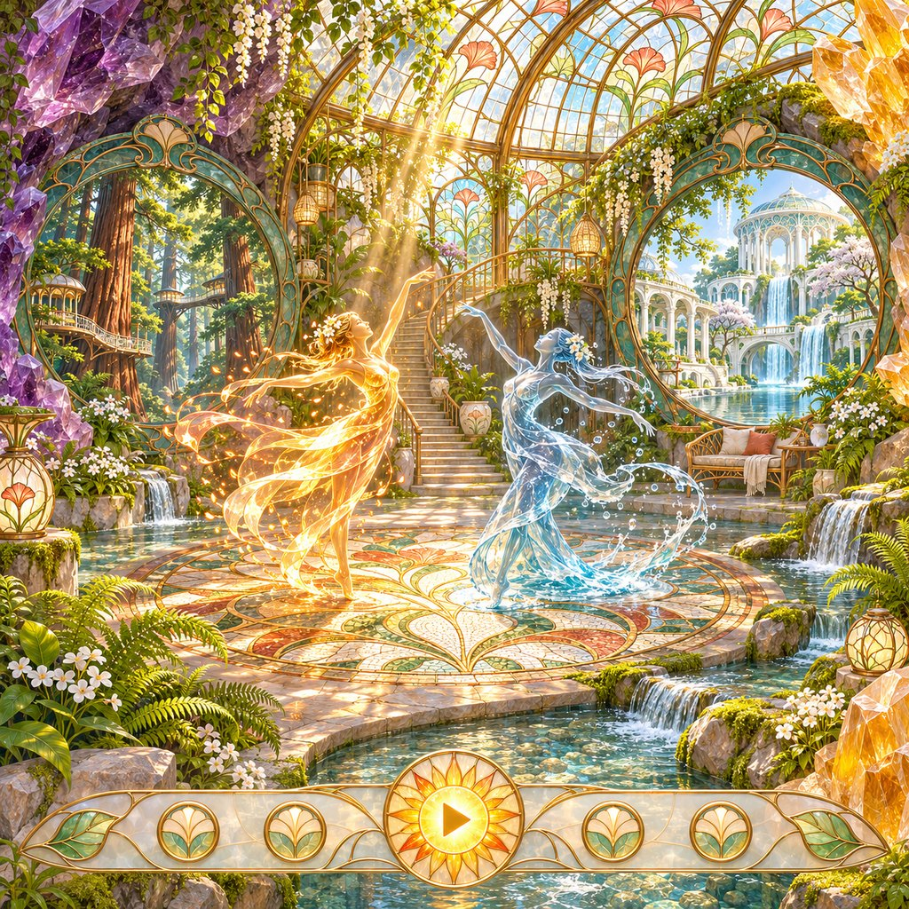
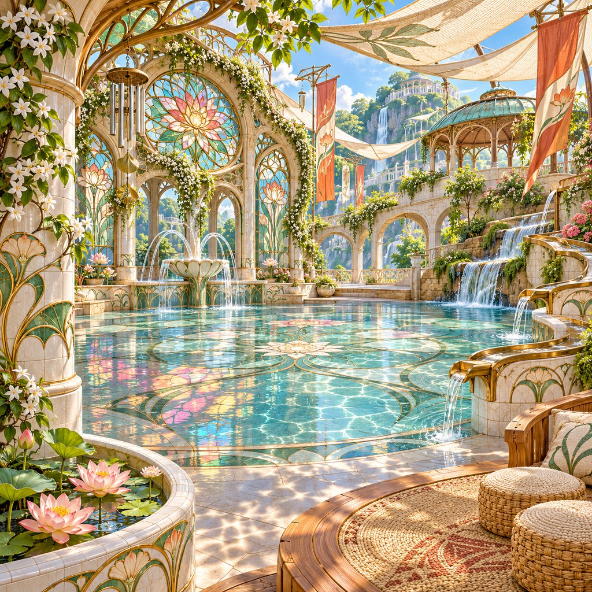
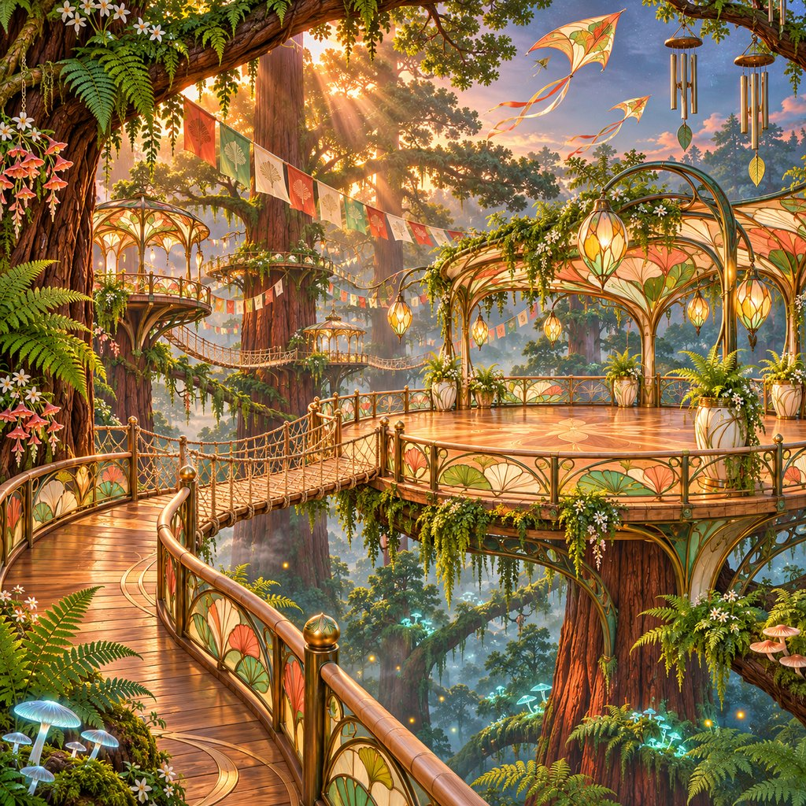
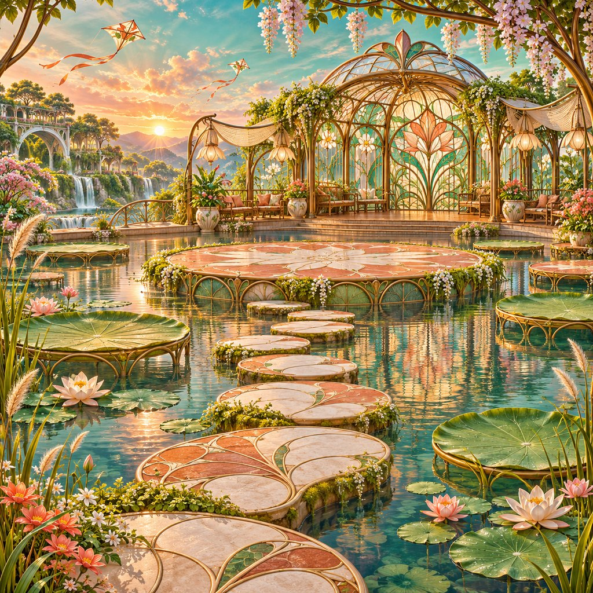
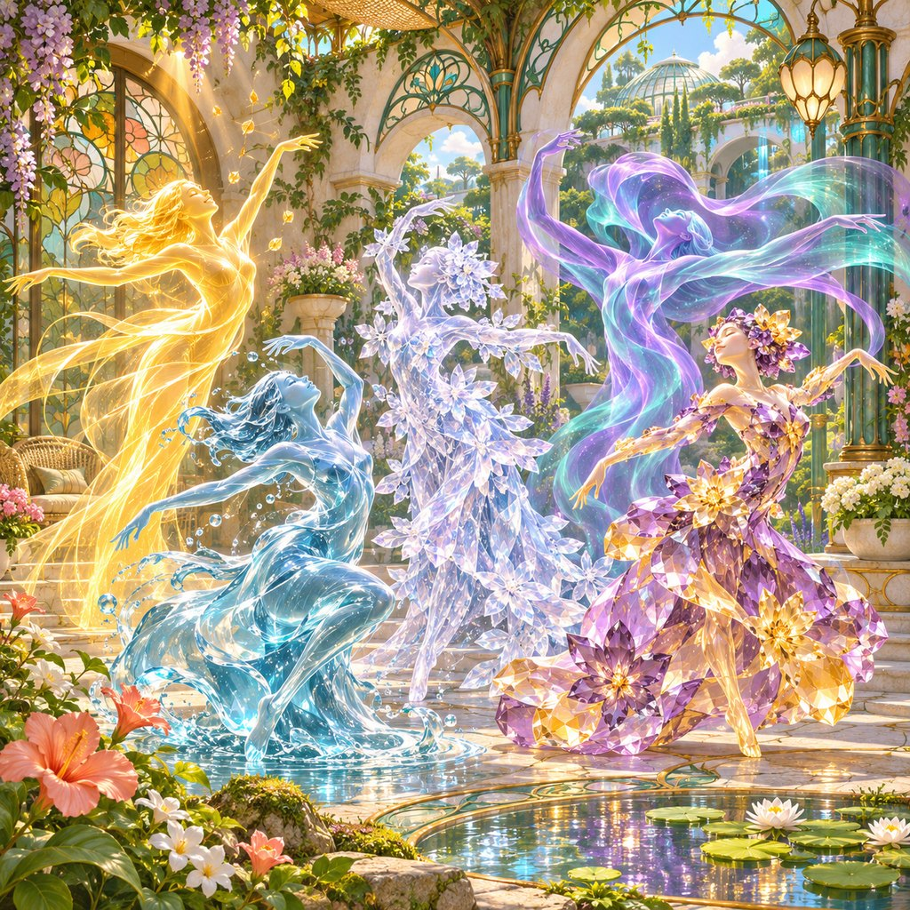

# Solarpunk: the art bible

Energy Bending's look, from phase 4 on (owner, 14 Nov 2026: "full on solarpunk, built up pass by pass toward
something epic"). This is the reference every later pass follows, so the game grows one way. It says what solarpunk
means here, gives the palette and type as tokens, the shapes, a direction for each world and each matter, what to
avoid, and the passes still to come. The first pass (report 16-skin) put it into the skin: the front, the lobby, the
HUD, the banner, the controls card and the lesson.

The tone is binding and comes first: a chill, good-vibes game of nature, healing and awe. The duel is contact improv
(catch, swing, fling, launch). Nothing hurts, burns down or explodes.

## What solarpunk means here

A hopeful, sunlit future where nature and craft live together. Every built thing is made with care and has something
growing on it. The light is warm and generous. Nothing is new and shiny, and nothing is ruined: things are lived in
and tended.

| | here |
|---|---|
| **feel** | calm, warm, open, a little wondrous; the quiet of a garden in the morning and the hush of a greenhouse at noon |
| **light** | golden sun as the key, its soft bounce off cream stone and leaves; light through leaded and stained glass; water caustics; after dusk, bioluminescence (moss, fungi, fireflies), never a neon tube |
| **materials** | white ceramic, honey sandstone, brass, copper gone green (verdigris), honey wood, woven fibre, leaded and stained glass, clear water, moss, petals |
| **ornament** | art nouveau: whiplash curves, leaf and petal forms, the sun disc, flowers drawn as stained glass, thin gold leading between panes |
| **motion** | things grow, open, unfurl and sway; they ease out like a leaf settling; slow breathing (about 3.4 s); a moment blooms rather than bursts |
| **sound** | bowls, chimes, kalimba, wind, water and birds; struck glass and wood, never an impact or a boom (src/audio already leans here) |

## The palette

Named tokens, in one place: `src/hud/theme.ts` (what the HUD's canvases draw with) and the same names as CSS custom
properties on `:root` in `index.html` (`--eb-<name>`, for the menus and cards). `src/hud/theme.test.ts` keeps the two
equal. Use the token, never a new hex, and add a token here first if the game needs a colour it lacks.

| token | CSS | hex | use |
|---|---|---|---|
| sun | `--eb-sun` | `#ffc861` | the one accent: play, a full flow bar, a perfect beat, the finale, what matters now |
| sunHi | `--eb-sun-hi` | `#fff0c8` | the sun's light: highlights, a number as it flares, chosen labels |
| honey | `--eb-honey` | `#e09a3a` | the sun's shadow side; the foot of the gold leading; a keycap's rim |
| brass | `--eb-brass` | `#c9a463` | thin frames, rings and tracks at rest |
| cream | `--eb-cream` | `#fbf4e4` | ink on glass: body text and numbers; a keycap's face |
| parchment | `--eb-parchment` | `#e6d7b8` | quieter ink: labels, hints, the controls card's left column |
| leaf | `--eb-leaf` | `#8fd17f` | leaves on frames, a reached cost on the flow bar, a lesson step done |
| moss | `--eb-moss` | `#4e7a45` | leaves' shadow side, the dark of a sprig |
| verdigris | `--eb-verdigris` | `#6cc3a8` | copper gone green: the gates' rings, a second accent |
| teal | `--eb-teal` | `#4fc0c8` | sky teal |
| sky | `--eb-sky` | `#a8e3ee` | pale sky: the countdown's digits |
| terracotta | `--eb-terracotta` | `#d4744e` | fired clay: platforms, pots, warm stone |
| coral | `--eb-coral` | `#ff8e7a` | a touch, never a field |
| glass | `--eb-glass` | `#1d170e` | the glass's body: smoked honey, always with alpha |
| night | `--eb-night` | `#0b0906` | the deepest warm dark: the page under the canvas, the veil |
| seat 1 | `--eb-seat-1` | `#ff6fa3` | rose: who seat 1 is (src/duel/seat.ts). Never tinted, never reused for anything else |
| seat 2 | `--eb-seat-2` | `#5ff0a4` | fern: who seat 2 is |

**The glass.** Every panel is the same pane: smoked honey glass (a dark warm tint, `GLASS` in theme.ts and
`--eb-glass-bg`), warm light pooled along its top, a cream hairline inside its edge, and round it a thin gold came over
a darker lead line (`--eb-lead`, `leaded()` in src/hud/style.ts). It is dark on purpose: the worlds run from a white
sky to a black pool, and cream type on a dark pane holds on all of them (cream on the glass is over 7:1, the test
checks it). The concept images' light cream glass is lovely in a still and unreadable over the temple at noon: keep
the gold leading and the shapes, not the light fill.

**Matter's colours** (`MATTER` in src/hud/style.ts, the menu's swatches) stay the matters' own. The seat colours are
rose and fern, the two hues no matter has, so who is who always reads.

## Type

| face | where | why |
|---|---|---|
| **Fraunces** (Google Fonts, variable; SOFT pinned at 100, WONK at 0 in the font's address, so the canvas, which cannot set axes, gets the soft cut) | the display: the style numbers, the panels' names, the banner's winner, the countdown, the controls card's title, the lesson's prompt, the game's names on the strip (italic) | an old-style serif with soft, rounded terminals: warm, hand-made, a little art nouveau, and very legible as numbers |
| **Nunito Sans** (Google Fonts, variable 400 to 900) | the body: labels, keys, small caps, prose, the pops | humanist and open at small sizes; its caps track well |

`TYPE` in theme.ts and `--eb-display` / `--eb-body`. Big words are caps, tracked (0.1 to 0.2 em); prompts and the
card are sentence case or lowercase, never shouted. Small text is never under 9 px at 720p; keys sit on keycaps
(cream face, dark ink, a honey rim) so a single letter reads. The HUD asks for its faces as it mounts and draws every
word again once they arrive (`loadFaces`, `fontEpoch`), so no sprite keeps the fallback face.

## Shapes

- **Art-nouveau curves.** A line that swells and tapers (a whiplash), a curve that ends in a curl or a leaf, never a
  hard bevel. Corners are round; a point is a leaf's tip.
- **Leaf and petal forms.** A leaf: two quadratic curves from a stem to a tip (`leaf()` in style.ts). A petal: a narrow
  base swelling to a round tip, a daisy's and not a gear's tooth (`petals()`). A crown of petals round a disc is the
  sun and the game's emblem.
- **Leaded-glass lines.** Thin gold over dark lead, dividing panes; a second, fainter came echoing a shape inside it.
- **The HUD's grammar** (first pass): a panel is a **cartouche**, round at the outer end behind its **medallion** (the
  matter's glyph in a deep honey well, a came in the seat's colour, a crown of gold petals) and drawn to a leaf's tip
  at the inner end, a sprig of two leaves where the tip begins; a power is a **cabochon** in a gold setting, its key
  on a **keycap** under it; the flow bar is a **stem** of dark glass in gold leading with a leaf where each cost falls;
  the set's orb is a **sun disc** whose petals light as the merge grows; the play button is the **sun** itself.
- **Corners.** A sprig of leaves on a whiplash stem (`--eb-sprig`) at a strip's ends and a card's corner; once per
  pane, never a frame of ornament all round.

## The worlds

Each world keeps its game shape (its stage, ledges and gates); the pass changes what it is made of and how it is lit.

### The geode and the hub: a crystal greenhouse grotto

A geode cavern opened to the sun: amethyst and citrine crystal walls meet a curved greenhouse roof of leaded glass on
brass ribs, and shafts of gold fall through it onto ferns, moss and hanging wisteria on the crystal ledges. Clear water
runs in a stone channel. The stage is a round mosaic floor (a petal mandala). The gates are framed in verdigris copper
rings with an art-nouveau crest. Light: warm shafts from above as the key, amethyst bounce, cyan caustics off the
water. Keep the crystals; give them plants for company. The front is a low strip of honey glass in gold leading with a
sun to press.

### The tide temple: a sunlit water temple

Terraces of white ceramic and honey sandstone round a shallow court of clear turquoise water with a lotus mosaic seen
through it; brass channels and small falls; sailcloth canopies and long banners in the breeze; jasmine over the arches;
stained-glass rose windows throwing coloured light on the water. Morning sun. The tide is clean, bright water, and the
drowned court shines through it rather than drawing lines on it (report 15, issue 5).

### The redwoods: canopy walkways

Platforms of honey wood and woven-fibre rope bridges high among the giant trunks; solar-glass lanterns like seed pods;
kites and strings of leaf-printed flags; wind chimes; ferns and moss on every branch. Golden hour going to dusk: warm
shafts through the mist above, and below the first bioluminescence, moss, fungi and fireflies.

### The Pool: a water garden

A wide still pool reflecting a peach-and-teal sky; stepping stones and round floating platforms like lily pads and
lotus leaves, in terracotta and white ceramic with moss at their rims; a delicate glass-and-brass pavilion at the far
side; reeds, water lilies, ripples catching the light, kites. This is the answer to report 15's first issue (white
blocks in a black void): the floes become warm, edged, planted platforms, and the water shows the sky.

## The bodies and their matter

The dancers are faceless bodies of matter, not people in costumes: take the matters' character from this image, not
its figures.

| matter | in a solarpunk world | its powers |
|---|---|---|
| **fire** | the sun's warmth and the embers of growth: gold to amber, embers that drift up like seeds and pollen; its light warms the leaves near it. Never smoke, char, lava or a blast | flare: a bloom opening upward (a sunrise); ribbon: a warm updraft like heat over a summer field |
| **water** | clear living water with light inside it, caustics wherever it falls; clean, never murky | whip: a fountain's arc that catches; wave: a crest that carries, like a garden's falls |
| **ice** | frost flowers and clear crystal petals; morning dew; it melts into drops of light | step: a block of clear ice like a glass tile; slide: a frost path |
| **plasma** | solar wind and aurora: soft violet-to-teal ribbons and filaments, not electric neon lightning | blink: a shimmer through the air; arc: a filament of aurora between two |
| **gems** | crystal blossoms: amethyst and citrine facets that grow like flowers | pillar: a crystal stem rising; prism: a facet of stained light turning a flight |
| **steam** | morning mist in the sun's shafts: warm white, carrying light | where fire meets water: a soft rising veil, never a hiss of danger |

A fusion is a bloom (a flower or a tree of light opening over the pair), a finale is the sun at its height, the banner
is a garland. A catch is a meeting; a fling is a launch into the air like a seed on the wind.

## Motion and sound in the skin

Things open, grow and settle: a pop opens like a flower and fades; a panel's number flares gold and cools; the play
sun breathes slowly; a card rises a few pixels as it fades in. No shakes, no flashes over the bodies, no strobe. Sounds
are struck glass and wood, bowls, chimes, water and wind.

## What to avoid

- grim, grimy, ruined, post-apocalyptic, dystopian, military
- industrial: bare steel, rivets, pipes, gears and cogs (a crown of petals must never read as a gear's teeth), hazard
  stripes, smoke
- neon cyberpunk: magenta and cyan tubes, chrome, scanlines, glitch, holograms, a violet-black night as the default
- danger language: red alerts, skulls, damage numbers, health bars, "KO", lava, explosions, anything burning down
- cold UI: pure white type on near-black, hairline greys, a violet-black glass (the skin before phase 4)
- ornament everywhere: one sprig per pane, not a border of filigree; plants on built things, not built things buried
- light cream panes over the 3D worlds (unreadable on a bright sky)
- costumed, faced figures for the dancers: they are bodies of matter

## The roadmap

Each pass shows in stills from the same steps (`scripts/steps/skin-16.mjs` for the skin; each world's own steps) and
keeps the frame budget.

1. **The first pass (phase 4, this one).** The bible and its concept images; the tokens and the faces in one place;
   the skin on everything that is not a world (honey glass in gold leading, cartouche panels, the sun orb and the sun
   to press, keycaps, the banner's warm band and serif, the card, the lesson, the veil). The worlds' agents move their
   own areas a first step the same way.
2. **Materials and light.** Each world's key light warm and its sky lit (the temple by day, the Pool's sky in the
   water); plants on built things (vines up the temple's columns, moss on the Pool's platforms, ferns on the geode's
   shelves); the near fade's outline in brass and only near the pair; the gates' rings in verdigris copper; plasma
   toward aurora and fire's embers as seeds.
3. **Ornament and life.** Kites, banners and chimes that answer the music and the field's wind; fountains and falls;
   pollen in the sun's shafts; fireflies and glowing moss after dusk; the banner as a garland of petals opening across
   the screen; a lettered logotype for the title.
4. **Toward epic.** A set's light moving through a day (dawn at the count-in, gold at the finale, dusk and
   bioluminescence after); the hub as a greenhouse cathedral with sun through leaded glass; a fusion that blooms a tree
   of light over the pair; the film's grade warm and filmic; the front's strip a living garland.

## The concept images

Made with GPT Image through the Codex CLI (14 Nov 2026), each with its prompt and provenance beside it as JSON. They
are references to aim at, not textures: the game builds its look from shaders, geometry, light and matter.

| image | keep | leave |
|---|---|---|
| [hub-front](solarpunk/hub-front.jpg) | the greenhouse roof and its sun shafts, the copper-ringed gates, the mosaic stage, the strip and its sun button | the strip's light cream fill |
| [hud-mock](solarpunk/hud-mock.jpg) | the cartouche panels with a medallion at the outer end, the gold leading, the petalled sun orb, the vine-like bar | the light fill, the costumed dancers, the sundial (the beat stays a ring) |
| [temple](solarpunk/temple.jpg) | all of it: the water court, the rose windows, brass channels, sails and banners | |
| [redwoods](solarpunk/redwoods.jpg) | all of it: the walkways, lanterns, kites, chimes, the dusk glow below | |
| [pool](solarpunk/pool.jpg) | the lily-pad platforms, the pavilion, the sky in the water | |
| [matter](solarpunk/matter.jpg) | each matter's character | the figures, faces and dresses |
