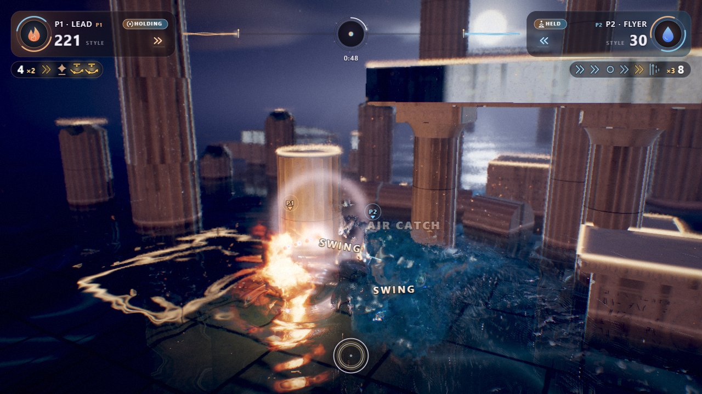
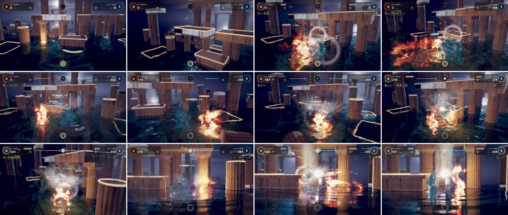
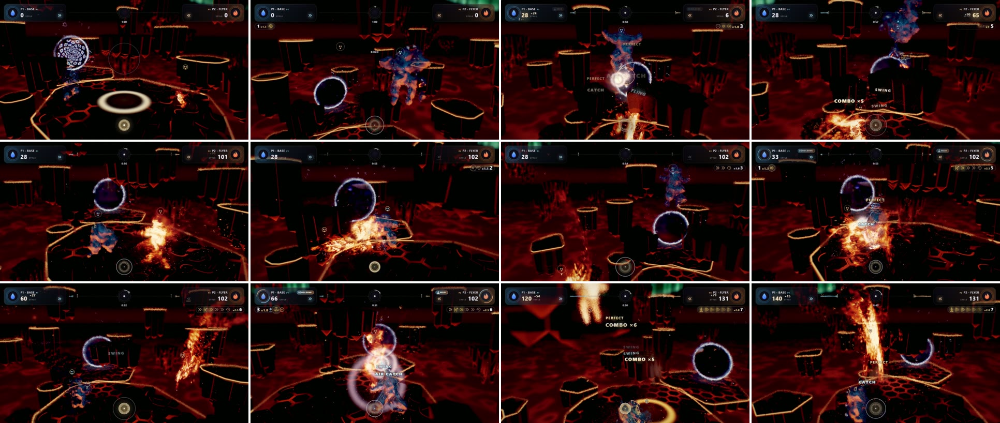

# Phase 1 (Move): the duel itself and its virtual players

Branch `worktree-agent-a76fd4610dcbd98bf`, from master `df03f4a`. Master merged in as each piece landed: the owner's
first correction (`b91e987`, 3D native), the HUD, the render lock (`647eb31`), the movement kit, the arenas, the HUD
on v2 and its optional fields (`4015716`). It was built three times: first as a 2D arena fight (the first brief), then
as a 3D fight (the first correction), and now as the **dance battle** (the owner's second correction: no hits, no KOs,
no damage). Everything below is the dance battle unless it says otherwise. The last section says what was thrown away.

## How to start one

- Page: `?duel&world=temple&dress=fire,water&p1=human&p2=bot&style=lead,flyer&skill=0.7&seed=3`, plus `&lock` (or
  press `l`) for the 2D lock, `&set=45` for the set's length in seconds (60 by default), and `&go` to start without
  waiting for the human seats' devices. `p1` and `p2` each take `human` or `bot`. `skill` (0 to 1) and `style`
  (`lead`, `flyer`, `base`; the old names `aggressive`, `showy`, `evasive` still map onto them) each take one value
  or a pair `a,b`.
- Keys (the duel's scheme, solo keyboard): free, **WASD** to move (relative to the camera), **Space** to jump, **C**
  to go down. Locked: **A/D** to move, **W** to jump, **S** to go down. **J is the grab**: hold it to keep hold,
  release it to fling, and the stick aims the fling. **K** or **Shift** dashes, **L** kicks, **I** spins, **O**
  dodges. Held by the other, jump to launch off their hands (the lift) or dodge to spin out (the counter). Gamepad:
  the punch button (X) grabs. Touch: the punch button grabs. Split keyboard: the right half grabs with `,`.
- Film: `node scripts/film.mjs films/duel-1.json --preview --sheet` shoots a timeline whose shots are
  `mode: "duel"`. The cast takes `dress`, `style`, `skill` and `brain`, plus a `seed`, and a cue `{at, rig: 'lock'}`
  switches to the lock. `films/duel-1.json` has 16 s in the temple (fire flyer and water lead, the last 5 s locked)
  and 13 s in the forge (water base and fire flyer).
- Node: `node scripts/duel-sim.mjs [--world temple,forge] [--view free,locked] [--sets 6] [--styles mix|lead,flyer]
  [--skills 0.7,0.7] [--set-s 60] [--seed 1] [--json out.json] [-v]`.
- Real page: `node scripts/playtest.mjs --world temple [--lock] [--seconds 60] [--human brain|script] [--json out]`.

## What was built

| file | what |
|---|---|
| `shared/duel.ts` | The rules, kept pure so a server can run them later. A **set** on the music: a count-in (3, 2, 1, BEND), 60 s of play, a 5 s finale, then the result. **Combos**: each link (catch 6, aerial catch 8, lift 7, fling 6, vault 6, counter 5, flown 4, swing 3, wall jump 3, wall run 2, flip 2, kick 2, aú 2, dash 1, jump 0.5) adds to the combo. The multiplier is 1 + 0.25 per link, up to ×4. A link on an 8th-note line within ±60 ms counts double. The third same link in a row is worth 0.35. A combo is banked into **style** when the dancer has been on the ground for 0.7 s or idle for 1.8 s. **Leading** adds style outright: starting a catch 5, an aerial catch 6, a fling the other lands well 4. **Shared energy** rises with links made while joined or while both combos are live, rises faster in contact, and ebbs otherwise. At 0.6 the **merge** charges, and if the set's peak reached 0.7 the finale is a **fusion**. A **fall** below the space costs 8 style, drops the live combo and reforms the body in 0.9 s near the other. Emits events: count, go, link, lead, combo, merge, fall, ready, finale, done, set. |
| `src/duel/contact.ts` | The contact physics, a coupling outside `Character`. **Catch**: the grab button with a hand within 0.55 m of the other's hand, waist or ankle (0.75 m in the air). The body standing or on a wall becomes the holder, and a body caught in the air makes it an aerial. **Swing**: the held body is carried round the contact like a weight on a rope of the link's length, with its gravity eased, damped and capped at 13 m/s. The holder's stick pumps it round, twice as hard on the beat, and each 0.8π of arc is a swing. Free, its feet are kept above the holder's chest and the world's solids bounce it. Locked, it arcs in the plane and stays above the floor. **Fling**: the holder lets go and the held body leaves on the tangent at ×1.35, aimed up to 4.5 m/s by the stick and 2.6 m/s up, capped at 17 m/s. **Lift**: the held body jumps from the contact's height or above and launches at 16 m/s. **Counter**: the held body dodges (or jumps from below) and spins out. **Vault**: a body landing on the other's shoulders bounces off at 12.5 m/s. A hold lets go by itself after 3.2 s, or if stretched past 2.8 m. A **pose pass** puts the holder's nearer hand and the held body's hand on the contact and stretches the held body's other arm along the swing. `splitIntent` sends the grab, and while joined the stick and jump, to the contact, so the holder braces. |
| `src/duel/match.ts` | Joins the rules to two `Character`s, and is pure. It wraps each body's `update` with the pose pass, steps the contact during play, and turns the bodies' own events into links (walljump, wallrun, dash, aú, a flip, a kick in the air). It keeps a soft wall at the space's edge and re-forms a fallen body near the other, or at the spawns for a new set. |
| `src/duel/index.ts` | `?duel`. Two seats, free 3D by default with a third-person camera framing both side-on from the clearest side, or the lock anywhere. Humans join by device. The seat gates split each Intent between the body and the contact. It shows the world's arena (`showArena`) and uses the arena's `camera.maxDist` as the room. Each frame after the camera, it hands HudState v2 to `bend.hud.set`. `bend.duel` exposes match, arena, plane, state, events, history, hud, start, restart, stop, setBrain, brains, ghost, wish and stats. |
| `src/duel/fx.ts` | What is seen and heard. Light beads stream along the link, the contact glows, the two matters deposit into the field (fire and water meeting make steam), and `field.fuse` coils the two into a helix as the merge charges (the whole finale when it fuses). Catches, swings, flings, lifts, vaults and counters each get rings, sparks, sounds and rumble, and a fall gets a burst, a reform ring and count pulses. |
| `src/duel/hud-state.ts` | Builds HudState v2 from the rules, the contact and the bodies, **with every optional field**: `combo.beats` (aligned with `links`), `combo.ended` / `combo.cashed` on the frame a combo ends, `players[].lead` (each dancer's share of the set's leading), `players[].best`, `pops[].id`, `pops[].dir` (a fling's direction on screen), and `link.from` / `link.to`. The pops are CATCH, AIR CATCH, SWING, FLING ×n, LIFT, VAULT, COUNTER, PERFECT, COMBO ×n, MERGE, FELL, FUSION/FINALE and Pn WINS. Its v2 types are typechecked against `src/hud/state.ts`. |
| `src/ai/duel-brain.ts` | The virtual player (next section). |
| `src/duel/sim.ts`, `probe.ts`, `scripts/duel-sim.mjs` | The Node harness. It runs the real bodies (duel profile, the world's solids), the real contact and rules, and two brains, over many seeded sets, free or locked. It reports catches (and the share caught in the air), swings, flings, lifts, vaults and counters per minute, how holds end, combos per player-minute, links per combo, the longest combo, air time, wall jumps, falls, style, the energy's peak, fusions and merges. |
| `src/duel/stages.ts`, `fallback.ts`, `arena.ts` | The temple, forge and pool in Node, from the same pure layouts and arenas the page uses. `fallback.ts` builds an arena for a world that has none. `arena.ts` is the arenas agent's. |
| `scripts/playtest.mjs` | The real page in real time with real key presses (below). |
| `films/duel-1.json`, `film.mjs`, `film-shot.ts` | The film tool's `mode: "duel"`. |
| `src/duel/test/duel.test.ts` | 18 tests in `npm test`. They cover the rules (count-in, combos, perfect, repeats, banking, leading, energy and merge, falls, sets and finale) and the contact (catch, aerial, swing speed off and on the beat, fling and landing, a lift higher than a jump, counter, vault, the lock staying on the plane, the intent split). They also check the brain's jump model, the HUD state's optional fields, two brains dancing a set deterministically in the temple and the forge free and locked (catches, flings, swings, combos, few falls), and that the stick doesn't flicker. |

Changes outside `src/duel`: `src/play/index.ts` (the `?duel` dispatch and `PlayApp.hand`), `src/main.ts` (passes
`hand`), `src/dancer/play.ts` (`PlayCtx.stage`, so the duel's arena plane is the one the lock uses),
`src/engine/film-shot.ts` (the mode's name) and `scripts/film.mjs` (the duel's page query).

### The virtual player (`src/ai/duel-brain.ts`)

A `Brain` that plays only through Intents, free or locked, whichever its body is in. Three styles:

| style | wants to be | seeks contact | leaps to be caught | holds before a fling |
|---|---|---|---|---|
| `lead` (a generous lead) | close (0.7 m) | 0.9 | 0.25 | 1.6 s |
| `flyer` (a showy flyer) | at a leap (2.2 m) | 0.35 | 0.9 | 1.0 s |
| `base` (a grounded base) | 1.4 m | 0.75 | 0.1 | 2.0 s |

- **Seeing**: the other body as it was a reaction time ago, carried forward by its velocity, with an aim error. Skill
  sets the reaction time, aim error, beat accuracy, how often it waits for the beat, decision rate, prediction and
  catch timing.
- **Contact**: it grabs when a hand comes within reach (more readily when the other is in the air). The flyer runs at
  the other and jumps at its hands. Holding, it pumps the stick round the contact, a skilled player only on the 8th
  lines, and lets go once the hold has lasted and the swing carries the other toward a good place: somewhere high to
  land, a wall to kick off, or the middle of the space (locked: in toward the middle), with the stick aimed there.
  Held, it lifts off the other's hands (above the contact, after 0.8 s, mostly on the beat) or spins out.
- **Moving**: the legs from before the pivot are kept. Free, it goes round solids, jumps onto tops, avoids pits, kicks
  off walls only toward somewhere to land, and dashes to close a gap, get away or recover over the void. Locked, it
  uses the plane's floor, ledges and walls. Between contacts it dances flourishes on the beat.

## Measured

### Node: two virtual players, 6 sets of 60 s per row, skill 0.7 for both

Per minute of play. Holds end mostly in flings. A *release* means the hold was stretched past 2.8 m.

| world | view | pair | catches (air) | swings | flings | lifts | vaults | counters | hold | combos/player-min | links/combo | longest | air | falls/min |
|---|---|---|---|---|---|---|---|---|---|---|---|---|---|---|
| temple | free | lead & flyer | 23.0 (30%) | 70.3 | 15.3 | 4.5 | 1.8 | 2.3 | 1.4 s | 23.2 | 3.6 | 10 | 41% | 0.2 |
| temple | free | base & flyer | 20.0 (23%) | 59.8 | 8.8 | 5.8 | 0.8 | 4.5 | 1.5 s | 20.8 | 3.6 | 52 | 41% | 0.5 |
| temple | free | lead & lead | 27.0 (25%) | 82.7 | 18.8 | 3.7 | 2.0 | 3.8 | 1.7 s | 22.5 | 4.0 | 12 | 45% | 0.0 |
| temple | locked | lead & flyer | 26.3 (61%) | 24.8 | 14.7 | 6.3 | 7.3 | 3.7 | 1.4 s | 19.7 | 3.2 | 17 | 56% | 1.2 |
| temple | locked | base & flyer | 24.5 (64%) | 26.8 | 11.8 | 6.7 | 6.8 | 3.3 | 1.4 s | 18.3 | 3.1 | 12 | 57% | 2.2 |
| forge | free | lead & flyer | 20.2 (10%) | 66.0 | 13.7 | 5.0 | 1.8 | 0.8 | 1.3 s | 19.9 | 4.1 | 18 | 44% | 2.3 |
| forge | free | base & flyer | 18.3 (21%) | 60.5 | 8.2 | 5.7 | 0.7 | 2.8 | 1.4 s | 18.3 | 3.6 | 15 | 40% | 2.7 |
| forge | free | lead & lead | 22.3 (13%) | 80.8 | 17.0 | 1.7 | 1.3 | 2.7 | 1.6 s | 18.8 | 4.5 | 25 | 44% | 3.2 |
| forge | locked | lead & flyer | 24.8 (26%) | 6.2 | 14.2 | 6.2 | 4.2 | 2.3 | 1.4 s | 20.1 | 2.4 | 17 | 50% | 1.5 |
| forge | locked | base & flyer | 23.3 (31%) | 8.7 | 10.3 | 7.0 | 3.7 | 3.5 | 1.4 s | 19.3 | 2.3 | 25 | 48% | 1.8 |

How holds ended, temple free lead & flyer: 92 flings, 27 lifts, 14 counters, 0 releases. Forge locked flyer & base:
44 flings, 33 lifts, 31 counters, 17 releases. The full table, with the flyer & base and lead & lead pairs and the
links per minute, is in `node scripts/duel-sim.mjs --sets 6`.

**Skill** (temple free, lead & flyer, 6 sets): 0.2 vs 0.2 averages 908 style per dancer per set and 16 merges. 1 vs 1
averages 1246 style and 93 merges. A lead at 0.9 beats a flyer at 0.3 6–0, but a lead at 0.3 against a flyer at 0.9
is 3–3: style is mostly for leading, so the flyer's skill shows less in the score.

### The real page (`scripts/playtest.mjs`, preview build, headless Chrome on the 5090, 1280×720)

Seat 1 is played with real key presses by a ghost lead (a virtual player thinking in the page, its wish turned into
keydowns and keyups). Seat 2 is a flyer bot. Both have skill 0.7.

| run | fps | frame mean / p95 / p99 | frames > 25 ms | GPU mean (p95) | key → run | key → jump | the dance |
|---|---|---|---|---|---|---|---|
| temple free, 60 s | 56.4 | 17.72 / 18.20 / 18.60 ms | 11 of 3356 | 2.41 ms (3.62) | 8.7 ms, 1.0 frame | 8.9 ms, 1.0 frame | 21 catches (10 aerial), 57 swings, 8 flings, 7 lifts, 1 vault, 2 counters, 34 combos (longest 10), 110 of 168 links on the beat, 9 falls |
| forge free, 60 s | 56.5 | 17.71 / 18.30 / 18.70 ms | 9 of 3357 | 2.16 ms (3.42) | 10.8 ms, 1.0 frame | 12.0 ms, 1.0 frame | 20 catches (8 aerial), 56 swings, 8 flings, 9 lifts, 1 vault, 1 counter, 31 combos (longest 15), 114 of 169 on the beat, 7 falls |
| temple locked, 40 s | 56.6 | 17.65 / 18.30 / 18.60 ms | 4 of 2236 | 2.30 ms (3.49) | 13.1 ms, 1.2 frames | 10.7 ms, 1.0 frame | 7 catches, 3 swings, 4 flings, 2 lifts, 14 combos (longest 9), 33 of 79 on the beat, 2 falls |

Headless requestAnimationFrame runs at about 56 fps, so the frame times are that pacing, not the scene's cost. The
GPU's own time is about 2.2 to 2.4 ms. Key to motion is measured from the keydown event's own time to the first frame
the body moves (a run along the ground faster than 0.5 m/s, or a jump risen 2 cm). Moments while the two are joined
are left out, because the holder is braced and doesn't run. An earlier run with a scripted human (run at the other,
hold J when close) gave 8 catches by the human in 40 s, 28 swings, 17 flings and a longest combo of 16. The page falls
more than Node (7 to 9 a minute). See the weak points.

### Films and stills

`films/duel-1.json` was shot with `--preview`: 16 s in the temple (the last 5 s locked) and 13 s in the forge, with
the v2 HUD. Sheets: `media/11-film-duel-1-temple-sheet.jpg` and `media/11-film-duel-1-forge-sheet.jpg`. The preview
is `media/film/duel-1-preview.mp4`, which git ignores. Stills: `media/11-duel-hud-v2-temple.jpg` (a swing with the
HOLDING/HELD tags, the combo icons gold on the beat, and the set's orb), `11-duel-swing-temple.jpg`,
`11-duel-steam-temple.jpg` (fire and water joined), `11-duel-catch-temple.jpg`, `11-duel-catch-forge.jpg` and
`11-duel-lift-temple.jpg`. The temple reads well: catches, swings with the link's beads, steam where they meet, and the
pops over the contact. The forge is dark and dense with floating stones, and the bodies are sometimes small or behind
a stone.

## Weak points

- **The swing is a pendulum or merry-go-round driven by a sense heuristic.** The stick across starts the sense, and
  hard against the velocity flips it. It reads as a swing, but the body is placed on the rope kinematically rather
  than simulated as two masses. The held body's own inputs do nothing until it lifts or counters.
- **Swings in the lock are rare in the forge** (6 to 9 a minute, against 25 in the temple). A body can't swing under
  the floor, and going over the top takes more pump than the brains give it.
- **The shared energy saturates.** Its peak reaches 1.0 in nearly every set, so nearly every finale fuses. The ebb
  (0.07/s) or the per-link gain needs tuning against real players.
- **Skill shows in style and merges but barely in who wins** when the weaker player is the lead, because style is mostly
  for leading. That is the design, but the flyer's role scores little.
- **Combos can run very long** (52 links once, base & flyer in the temple) when the two stay joined in the air and no
  one lands, because a combo is banked only on the ground or when idle.
- **The page falls more than Node** (7 to 9 a minute in the page, against 0 to 3 in Node). Flings in the page go
  into the temple's drops and off the forge's stones. Node's forge doesn't bob, and the page's timing differs. Fling
  aim doesn't yet check the landing.
- **The forge's crown, an integrator issue.** `forge.ts`'s `groundAt` counts the crown hanging over the middle (top
  3.1 m) as the floor under it. A free body walking under the crown is put on top (3.38 m) in one frame. That breaks
  holds, and it would surprise any player in `?duel&world=forge`. In Node (`stages.ts`), I left the crown to the
  solids, which is what the fix in the forge should do: the crown is already a solid you can stand on and that stops
  a body from the side. The page still has the bug.
- **The camera in the forge**: the stones close in, and the near fade helps but bodies still get small.
- **Two humans on one keyboard haven't been tried by a person**, only by the scripts.

## Not done

- No server: the rules are pure and ready for one, but the duel is local only.
- The fusion finale is the helix and the HUD's banner. There is no choreographed fused body yet.
- No pool or geode Node worlds in the tests (the pool is in `stages.ts`, the geode and redwoods need their page
  layouts).
- Fling aim doesn't predict where the body will land, and the brains don't aim the counter.
- No sound design beyond the existing sfx names.
- No person has played it yet. All the feel numbers come from the scripts.

## What was thrown away (the fight)

- **The fight rules**: hits (hit capsules against hurt capsules), knockback per move doubled on the beat, three hits
  to a KO, falls as KOs credited to the last hitter, the scatter and untouchable time, blocks, i-frame dodges, clashes,
  rounds to five KOs, and flow as the super meter. `shared/duel.ts` was rewritten from scratch for the dance.
- **The fight brain**: reach tables measured from the move library's capsules, strikes waiting for the 8th line,
  answers (esquiva, negativa, aú, roll, block, strike back) to attacks seen starting, and circling. Its legs (moving
  free and locked, walls, dashes, pits) were kept.
- **The fight's effects**: the jogo's `Feel` for hits and clashes, the KO's scatter blast, the untouchable shimmer and
  the KO pops. Count pulses, reform rings and winner rings were kept.
- **The fight's HUD state** (hits of 3, KOs, superMeter, the round) and later the v1 shim. The HUD on master is v2,
  and the duel fills v2 with nothing else.
- **The fight's Node table and stills** (`11-duel-free-*.jpg`, `11-duel-locked-temple.jpg`), replaced above.

## For the integrator

- `src/dancer/play.ts`: `PlayCtx.stage?: () => StagePlane | null`. When it is set, that plane is the one the lock
  uses, ahead of the world's own stage. The duel sets it to the arena's plane. It is merged with master's arena-test
  lines.
- `src/play/index.ts` dispatches `?duel` to `src/duel` (a dynamic import). `PlayApp.hand` (the hand's burst buffer)
  is passed from `src/main.ts`.
- **The chunk rule**: `src/duel` must not import *values* from `src/hud` or anything else that lives only in
  main.ts's chunk. Main awaits `registerPlay` → duel at the top level, so such an import deadlocks the production
  build (the page never becomes ready). Type imports are fine. `hud-state.ts` keeps a copy of `screenOf` for this
  reason and reaches the HUD through `window.bend.hud.set`.
- **The grab is the punch binding** under the duel's scheme (keyboard J, `,` on the split right, gamepad X, touch's
  punch button). If the bindings ever name a grab, `splitIntent` in `contact.ts` is the one place to change.
- The contact is **outside `Character`**. It moves `root` and `v`, sets `grounded` and `support`, and wraps each
  body's `update` to apply its pose pass. A change to how `Character.update` writes the pose, or to `root` semantics
  in plane mode, needs a look at `contact.ts`.
- While the duel is free, its camera overrides `rig.solids` (null), `rig.clearance` and the world's `room` (from the
  arena's `camera.maxDist`). `stop()` restores them.
- `HudState` optional fields: the duel fills `combo.beats`, `combo.ended`, `combo.cashed`, `lead`, `best`, `pops[].id`
  and `pops[].dir`. `src/hud/state.ts` doesn't type them yet, so the duel types them locally and checks the result
  against `src/hud`'s `HudState`. `link.from` is the contact point (the holder's grip) and `link.to` is the held
  body's chest. Both hands meet at the contact, so the grip-to-grip line would have no length.
- **The forge crown floor bug** (above) is in `src/worlds/forge/forge.ts`'s `groundAt`, which isn't mine to change.

### Proposed lines for AGENTS.md

- `?duel` is the dance battle: rules in `shared/duel.ts` (pure), contact in `src/duel/contact.ts`, the virtual player
  in `src/ai/duel-brain.ts`. Measure with `node scripts/duel-sim.mjs` (Node) and `node scripts/playtest.mjs` (the real
  page, real keys).
- `src/duel` must not import values from main.ts's chunk (`src/hud` included), because main awaits the duel at the top
  level. Type imports are fine.
- A world's `groundAt` must not report a slab overhead as the floor. Leave overhead slabs to `World.solids`.
