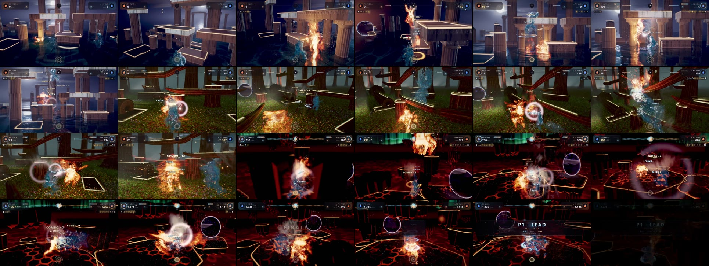
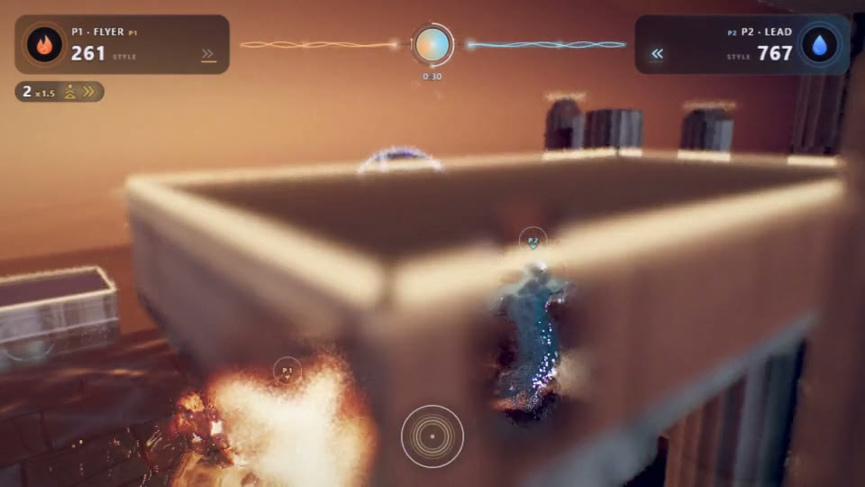
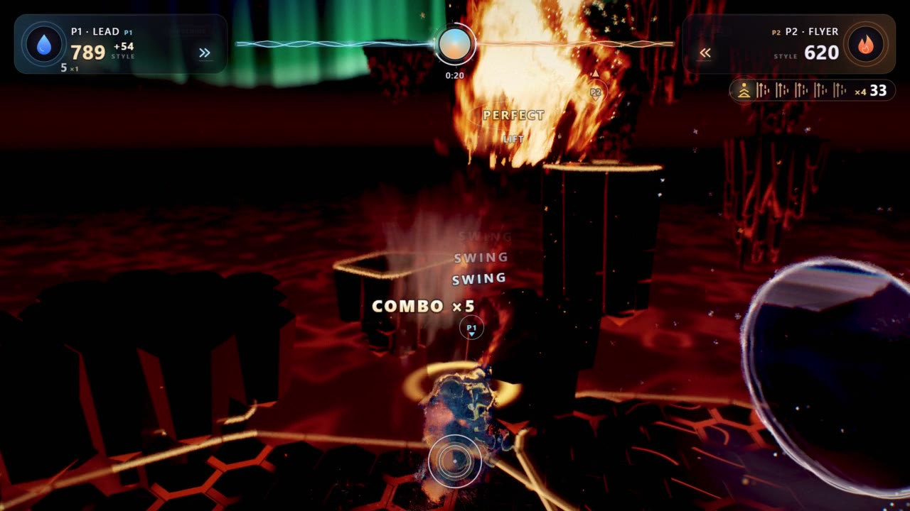
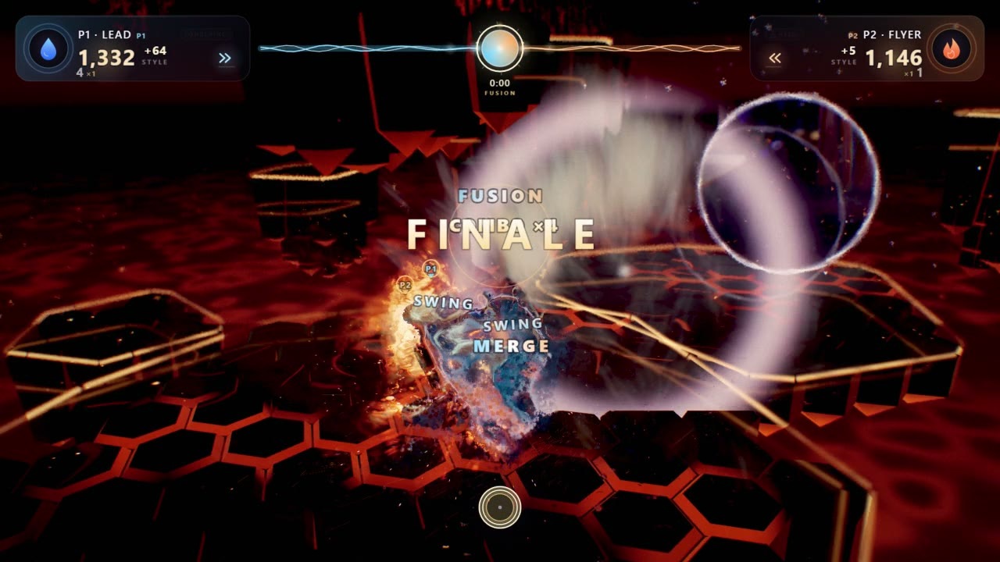
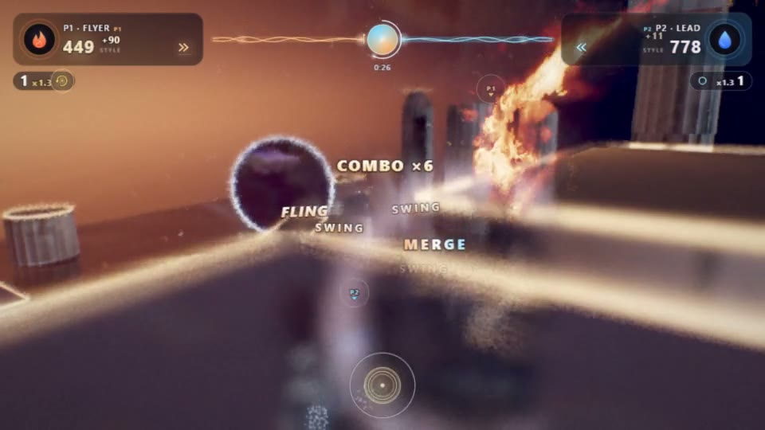
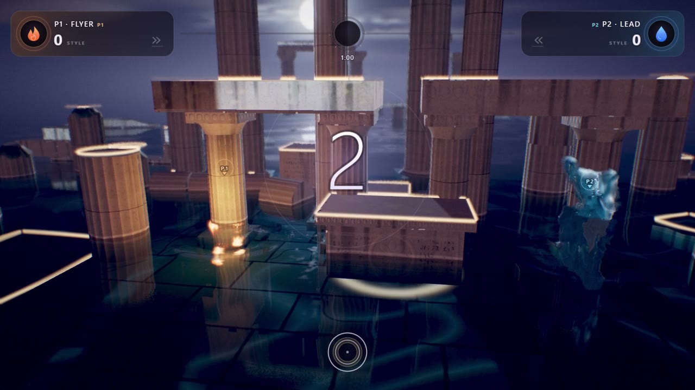
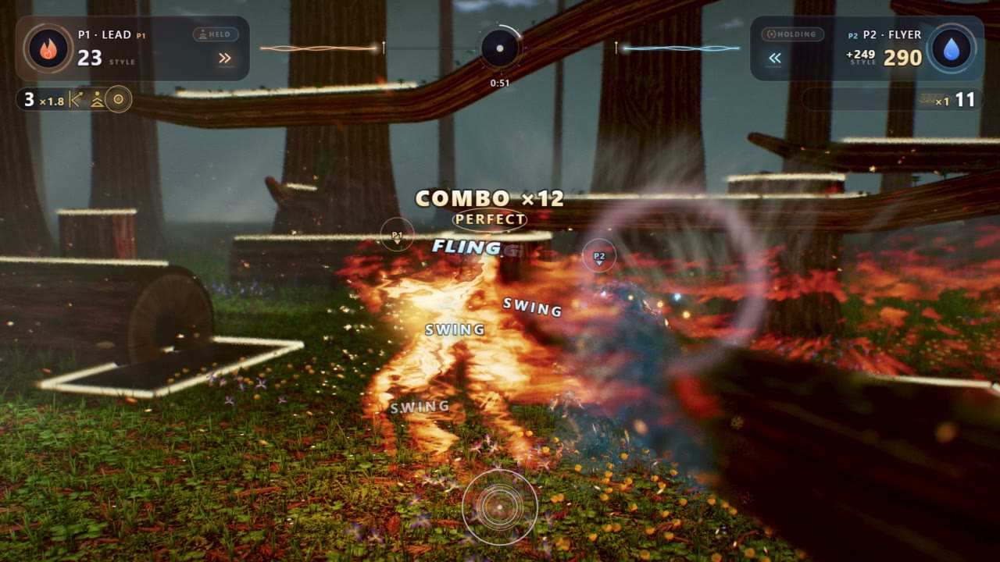
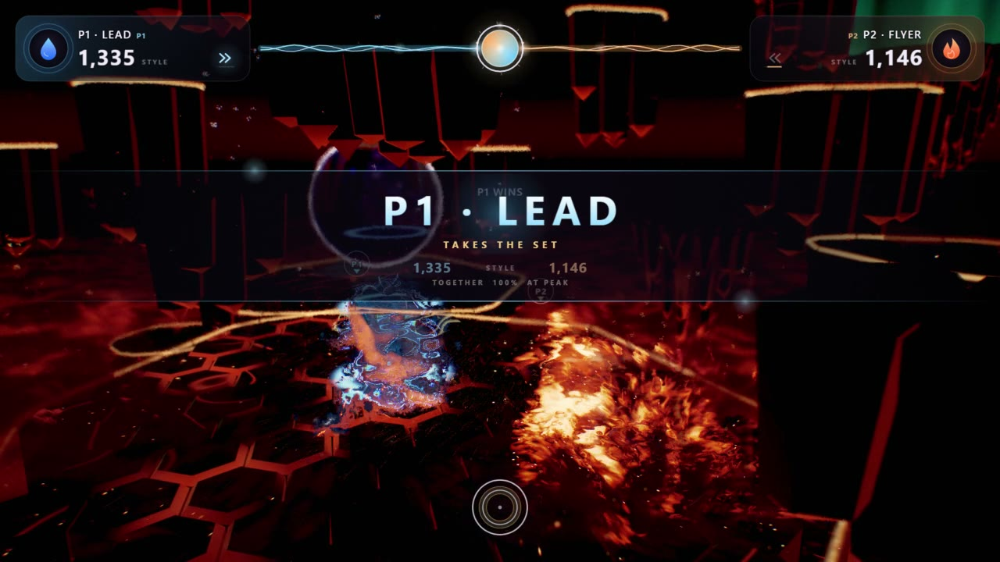

# 12: the duel's phase 1 film, and how it feels to play

Branch `worktree-agent-a4580c727aba55bab`, from master `f6aeedf` (phase 1 merged). The brief: fix the forge's floor
first, then make the phase 1 film of the contact dance (about 30 s, the duel's own camera with the HUD on screen, cut
like a highlight reel of a real match), and say, as a virtual player who has played a lot of it, the five things that
most hold it back from feeling great.

**Measured:** `npm run typecheck`; the full `npm test` (exit 0: 14 TS test files, audio, the gates, the net tests,
including the two new forge tests); the forge's floor in Node (a duel body walking under the crown and dropped onto
it); three real-key playtests (`scripts/playtest.mjs`, the temple and the forge free for 60 s, the temple locked for
40 s); eleven scouted sets and pieces of sets rendered as previews and read event by event (the temple, the forge
twice, the redwoods and the Pool free for a whole set each; the temple, the redwoods and the forge locked for 35 s;
the lock switched mid-set; slow motion); two previews of the film and the master, every one looked at as contact
sheets. **Not measured:** a person playing; a phone; the film's sound listened to by ear (the mix was checked by its
levels, not heard).

## The film

`docs/reports/media/film/duel-p1.mp4` (git-ignored): 29.0 s, 1280×720, 60 fps, H.264 High at 3.54 Mbit/s (two
passes), AAC 192 kbit/s stereo at 48 kHz, 13.6 MB; loudness −14.9 LUFS integrated, peaks −2.8 dBFS. Encoded from the film tool's master (`duel-p1-master.mp4`, rendered at 1.5× and
brought down on the GPU, under the render lock). The timeline is `films/duel-p1.json`; the track is the forge's
(130.3 bpm), from bar 49's second beat, so the count-in falls on the track's pickup and **DANCE lands on the downbeat
where the song comes back in** (bar 50). Every cut is on a beat of the track.

| time | shot | what happens |
|---|---|---|
| 0:00.0 | **temple, free** (fire a flyer, water a lead, seed 3) | the court in the moonlight; **3** (0:00.0), **2** (0:00.5), **1** (0:00.9) on the track's pickup, **DANCE** at 0:01.4 on its downbeat |
| 0:02.6 | | fire runs at water and vaults off its shoulders (VAULT) |
| 0:03.6 | | water catches it out of the air (AIR CATCH) |
| 0:04.6 | | fire launches off water's hands (LIFT, PERFECT, COMBO ×5) |
| 0:05.1 | **temple, the 2D lock** (the same pair and court) | fling and a vault (0:05.7), AIR CATCH (0:06.4), a launch off the hands with COMBO ×5 (0:07.4), a catch thrown straight into a fling (0:08.0), CATCH (0:08.9) |
| 0:09.2 | **redwoods, free** (fire a lead, water a flyer, seed 5) | CATCH (0:09.4), FLING with COMBO ×6 (0:10.4), fire's wall jump off a trunk (0:12.5), AIR CATCH (0:13.0), LIFT (0:14.0), AIR CATCH again (0:14.4); the shared energy strands filling |
| 0:15.4 | | **the creative beat:** mid-swing the game slows to a third (the track plays on) and the camera leaves the duel's own to push in on the flown body |
| 0:16.0 | | water lets go: FLING, **COMBO ×12 at ×4**, the flame body streaking out of the swing |
| 0:17.1 | | water dashes after it and catches it again (CATCH) |
| 0:17.5 | **forge, free**, 40 s into the set (water a lead, fire a flyer, seed 11) | AIR CATCH (0:17.6), fire launched off water's hands up out of the frame (0:18.9), AIR CATCH (0:19.5), MERGE (0:20.7), FLING with COMBO ×6 (0:21.4), and fire's **COMBO ×35** cashing into its style (0:22.2) |
| 0:22.6 | **forge, the set's last seconds** | FLING with COMBO ×7 (0:22.8), CATCH (0:23.2), the merge full (0:23.7), **FUSION FINALE** (0:24.1): the two coil in steam |
| 0:25.3 | **forge, the result** | the finale's steam, then the banner **P1 · LEAD TAKES THE SET**, 1,335 to 1,146 (0:26.4); out on the track's bar 64 |

Shot sheets (the master): `media/12-film-duel-p1-<shot>-master-sheet.jpg`.

### How it was made

1. **Played first.** The real-key playtest (a ghost lead pressing real keys against a flyer bot): the temple free,
   the forge free and the temple locked (below). Then whole sets watched: two virtual players, scouted as 72 s
   previews from the count-in to the next set, with every rule event logged against the film's clock.
2. **The film tool, so a highlight reel can be cut from a real set.** A duel's dance depended on where the music's
   beats fell from its first frame, and the film tool anchored the clock to the shot's in-point: moving an in-point,
   or the track's place under it, gave a different match. Now (src/engine/film-shot.ts) a duel shot's clock is
   anchored to the duel's first frame and its pre-roll snapped to a whole beat, so the in-point is on a beat of the
   track (its chords follow by `trackBeat0`) and **the dance is the same whatever the in-point**: scout a whole set
   once, read `info.json`'s `duel.log`, cut into it. Measured: the redwoods' set gave the same events to the frame
   with the in-point at 0 s, 4.6 s and 7.9 s, under three different track beats, with and without film camera keys.
   Also new: a `rate` cue (slow motion: the page steps `rate`/60 s a frame; the track plays on; the shot's recorded
   score is left out), and `audio.from` (the track's bar under the first frame). docs/extending/film.md says how.
3. **Two bugs found by looking**, fixed: the forge's floor (the brief's, below) and the **count-in**, which never
   showed: the duel handed the HUD the whole count (3, 2, 1) where it reads a fractional count-down, so each digit sat
   at the start of its fade-in, invisible; only DANCE was ever seen (`src/duel/hud-state.ts`).
4. **The timeline**: three worlds (the temple and the forge read best, as the brief said; the redwoods read better
   still: bright, the bodies stand out against the grass and bark; the Pool is graphic but its pair spends long apart,
   0 merges in its set, and its water reads as black). Five cuts into three sets, plus a jump cut inside the forge's set
   past the finale's steam.
5. **Previews, then the master.** What the sheets showed and what changed: the slow motion's push-in ended with the
   catching body filling the lens and five pops stacked on it (the camera kept further back, the shot ended on the
   catch); the forge's build began with the launched body out of the top of the frame for a second (the in-point moved
   to the air catch after it); the finale's five seconds of steam were dead (the jump cut to the banner).

## The forge's floor

`groundAt` (src/worlds/forge/forge.ts) took the **highest** stage slab over a point, so the crown hanging over the
middle (top 3.1 m, bobbing ±0.28) was "the floor" under it, and a free body walking under it was put on its top
(3.38 m) in one frame. It now reads `groundOf` (src/worlds/forge/layout.ts): the **lowest** stage slab under the
point, so a slab hung over a lower one is overhead, not floor, and is left to `World.solids` (its faces stop a body
from the side, its top is landed on from above). That also covers the floats' inner edges, which hang over the anvil's
edge and lobe: 433 sample points (0.05 m grid) where the left float was the floor over the anvil. The duel's Node
world (src/duel/stages.ts) reads the same function, so Node and the page agree.

Tests (src/worlds/forge/floor.test.ts, beside Report 9's two, which pass unchanged):
- under the crown, 1,063 points read the anvil (0 m) at six beats of the bob; the floats out past the anvil still are
  the floor, risen and sunk;
- a duel body (`DUEL_PHYS`, the forge's columns and the arena's stones as solids) walks from x −3 to 3 under the crown
  and stays at 0.000 m, and dropped from 5 m over it lands on its top (3.38 m). With the old floor the same test fails
  (3.380 m under the crown).

In the playtest, the forge free gave **0 falls in 60 s** (Report 11: 7). Different seeds and times, so not proof, but
the holds no longer break under the crown.

Left as it was: a body on the crown stands on its solid's top, which is the crown's highest reach (3.38 m), so while
the crown bobs down it stands up to 0.56 m above it. Fixing that needs the movement's solids to bob (a solid's bounds
are cached per object), or a height-aware floor in `Terrain`; both reach outside the forge.

## The real-key playtest (scripts/playtest.mjs, the film server, headless Chrome on the 5090, 1280×720)

| run | fps | GPU mean (p95) | key → run | key → jump | the dance |
|---|---|---|---|---|---|
| temple free, 60 s | 56.5 | 2.49 ms (3.90) | 10.7 ms, 1.1 frames | 9.7 ms, 1.0 frame | 20 catches (8 aerial), 60 swings, 15 flings, 3 lifts, 3 vaults, 1 counter, 38 combos (longest 10), 116 of 165 links on the beat, 6 falls |
| forge free, 60 s | 56.4 | 2.75 ms (4.03) | 7.8 ms, 1.0 frame | 7.8 ms, 1.0 frame | 23 catches (5 aerial), 72 swings, 9 flings, 11 lifts, 2 counters, 45 combos (longest 10), 117 of 176 on the beat, 0 falls |
| temple locked, 40 s | 56.7 | 2.17 ms (3.79) | 9.4 ms, 1.0 frame | 10.0 ms, 1.0 frame | 17 catches (11 aerial), 17 swings, 8 flings, 5 lifts, 4 vaults, 3 counters, 27 combos (longest 10), 43 of 77 on the beat, 0 falls |

The body answers a key in one frame. The feel problems are not latency.

## Five things that hold it back (for phase 2)

From eleven scouted sets (about eight minutes of two virtual players), the playtests and the film's own frames. Numbers
are per set of 60 s unless said.

### 1. The free camera loses the dance: in the pieces, and above the frame

The duel's camera stands side-on to the pair with its boom kept long and the near fade dissolving what is in front.
In the temple that puts the eye among the stones: a lintel or a drum a metre from the lens, blurred by the depth of
field across a third of the frame, with the bodies seen through a dithered hole (temple, 31.5 s into the set, below).
It happens in every temple set I watched, worst between 28 and 38 s, when the pair works round the lintels. The
other half: **a launch leaves the frame**. A lift sends the flyer up at 16 m/s, and the camera, framing the pair's
middle, lets it go out of the top for most of a second (the forge at 0:18.9 in the film, below; I moved that shot's
in-point past the launch before it, which had the flyer out of frame for its first second). The air catch that follows is often the best moment in the
game, and the player doesn't see the flyer coming down to it.

For phase 2: frame the higher body with head room (track the flyer's apex, not the pair's middle, while one is
launched or flown), and keep the eye out of the pieces rather than dissolving them: choose the side-on yaw whose eye
stands clear by more than the near fade, or rise above the pieces' tops. The forge's live gate disc also sits in
frame in most of its shots (a purple ring at the edge).

### 2. The shared energy fills in 20 to 40 s, then has nothing left to say; every finale fuses

The first MERGE came at 22.4 s of play (redwoods), 25.6 (temple), 18.8 (temple locked), 40.8 and 41.9 (the forge's
two sets). After it the merge fires again every 1.5 to 4 s (13 MERGE pops in the temple's set, 15 in the redwoods').
Peak 1.00 in four of the five whole sets; **all five finales fused**, the Pool's too (its peak 0.84, with no merge all
set, still past the 0.7 that decides a fusion). So the strands are full for the second half of every set, the orb
blooms gold and stays, and the finale is not earned. The "build" of a set lasts its first 20 to 40 seconds. Report 11
saw this in Node; the page and the films show it the same way. For phase 2: the energy should ebb faster when the two
are apart or repeating themselves, the merge should need the peak held while joined, and a fusion should be rare
enough to be the set's event (a peak of 0.9 held a few seconds, say).

### 3. Combos don't end, and one link fires every frame

The forge's flyer cashed a **COMBO ×35** (0:22.2 in the film). It lasted 6.3 s, and **29 of its 35 links were wall
runs**, counted two or three frames apart (19 inside half a second, 40.6 to 41.4 s into the set) while the flyer,
held and swung, was dragged along a stone's face: a wall run starting and ending each frame, each one a link. Nothing
else in eight minutes of play did that (1 to 6 wall runs a set elsewhere, never two inside half a second), so it is a
bug: the contact moving a held body along a face should not start the body's own wall runs. The other long ones are
real but tell the same story: the Pool's flyer made a ×21 of 13 dashes and 7 wall jumps between stones without
standing still for 0.7 s. Longest combos per set: 9, 11, 14, 21, 35. The multiplier reaches its cap of ×4 at the 12th
link, so past that the number climbs and nothing changes, and the HUD's row shows the last six icons, so a ×35 looks
like a ×6 until it cashes. As a player held by the other, my inputs do nothing until I lift or counter, while my combo
counts what is done to me (`flown`, the wall runs). For phase 2: no wall run while held; bank a combo when its dancer
has been held more than a beat or two; give the flown body a link only for what it does with the flight (a wall jump,
a landing, an aerial of its own); a long combo needs something new past ×4 (a tier, a sound, a word).

### 4. The finale is five seconds of steam

At FINALE the words FUSION FINALE come up, then for five seconds the two stand or drift apart inside a cloud of steam
(the field's helix coiling round them), with the camera standing back; then the banner. Nothing the bodies do changes
at the finale, no choreographed fused body, and no score moves (style is final). In the film I jump cut from 1.9 s
into it to the banner. It is also where the pops pile highest: the last links' COMBO ×4, SWING and MERGE are drawn
over and under the FINALE word (below), with the forge's gate disc beside it. For phase 2: the finale should be the two doing one thing (a fused body, or a scripted lift and
throw the pair perform together on the music's last bar), a second or two long, then the banner; and the centre's
words should clear the pops.

### 5. Contact reads as a ball of light with words on it

While the two are joined they are a metre apart, the swing turns them round each other at up to 13 m/s, and the
contact's rings, the link's beads, the steam and every link's pop are drawn on the same spot. SWING pops fire every
0.8π of arc: 58 to 82 swings a minute free, so more than one a second while joined, each a word on the pair. I
counted up to **eight named pops inside one second** in the logs (the redwoods' and the temple's sets); the still
below has six words on screen at once (COMBO ×6, FLING, SWING three times, MERGE) over a block that hides one of the
two. Who holds whom is in the panels'
HOLDING / HELD chips, not on the bodies. For phase 2: one SWING pop per hold (counting up, ×3) instead of one per
arc; pops that keep off the bodies and each other (a lane per dancer); and the holder's grip and the flown body's
streak drawn so that "who threw whom" reads from the bodies, before any word.

### Smaller things seen

- The count-in is three beats: 1.4 s at the forge's 130 bpm. Over the court it reads, but it is fast.
- The temple's first frames are dark for a moment (the scene's exposure coming up) under the "3".
- In the lock the pair is framed well when it starts locked; switched to mid-set (the `l` key, scouted with a cue at
  5 s) the camera stood back to the whole plane and the bodies were small for the next seven seconds.
- Slow motion slows the HUD too (pops age on the game's clock), so in a slow-motion beat the pops hang and stack.
- Falls are rare now (0 to 5 a set); in the forge's second set both fell together, joined, and reformed together.

## Stills

`docs/reports/media/12-p1-*.jpg`: the film's sheet (`12-p1-film-sheet.jpg`), the countdown (`12-p1-countdown.jpg`),
the first air catch (`12-p1-air-catch-temple.jpg`), the lock (`12-p1-lock-temple.jpg`), the slow-motion fling
(`12-p1-slow-fling-redwoods.jpg`), the forge's combo (`12-p1-combo-forge.jpg`), the banner (`12-p1-banner.jpg`), and the
feel stills above. The master's per-shot sheets: `12-film-duel-p1-<shot>-master-sheet.jpg`.

## The render lock

The master waited 16 minutes on the shared render lock (`C:/Users/ericr/render-lock`). The directory had been made at
18:58 and was still there at 21:43 while the GPU sat at 0% (sampled for half a minute) and no capture was running on
the PC (no Chrome, no film.mjs or shot.mjs but mine, no Python). I took it for stale and removed it (it was empty); my
film.mjs took it at once and released it after each take (holds of 10 to 39 s). If another agent's process did own
it, it had been idle for nearly three hours.

## Weak points of the film

- It is two virtual players, seeded and chosen: the moments are real play, but picked from about eight minutes.
- The slow motion and its push-in are the film's, not the game's: the game has no slow motion (phase 3's juice).
- Three of the six shots are one forge set; the banner shot is a jump cut past the finale's steam.
- The forge's gate disc is in most of its frames, and the forge is dark: water's body is dark blue on dark red.
- The film's sound is the forge's track with the shots' own recorded matter voices and sounds under it (the slow
  shot's left out). I checked the levels, not by ear.

## Not done

- The camera, energy, combo, finale and pop changes above: phase 2's.
- The crown's hover (a body on it stands at its highest reach while it bobs).
- `films/duel-1.json` was not re-rendered; its pre-roll of 1.2 s is now snapped to 3 beats.
