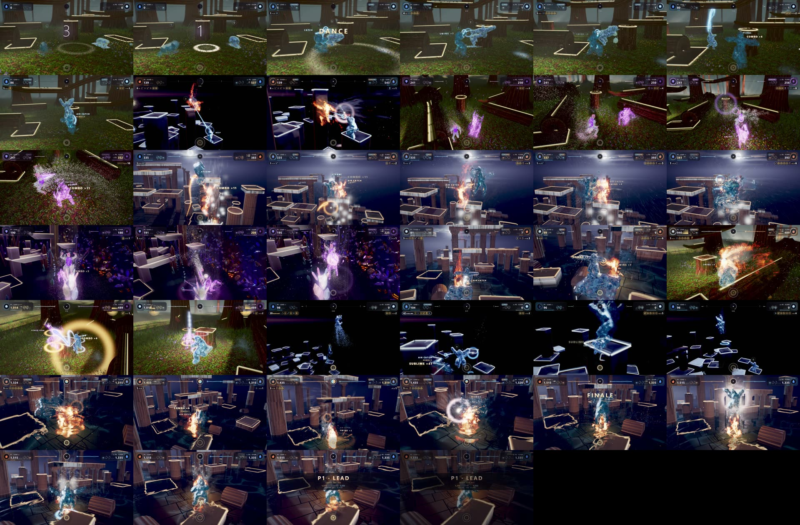
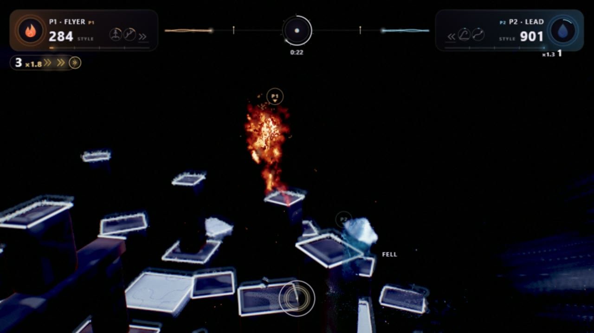
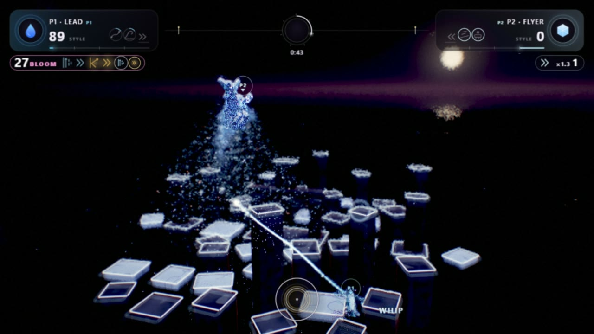
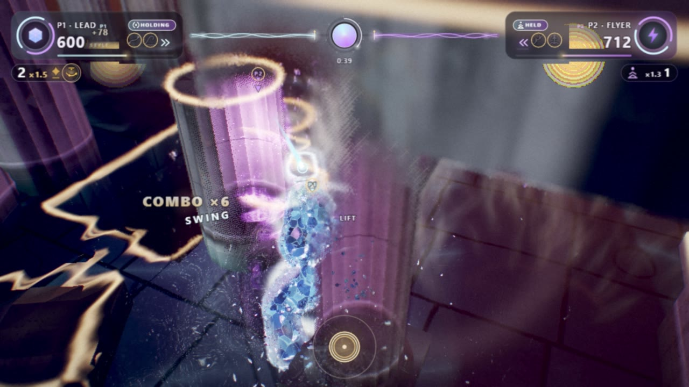
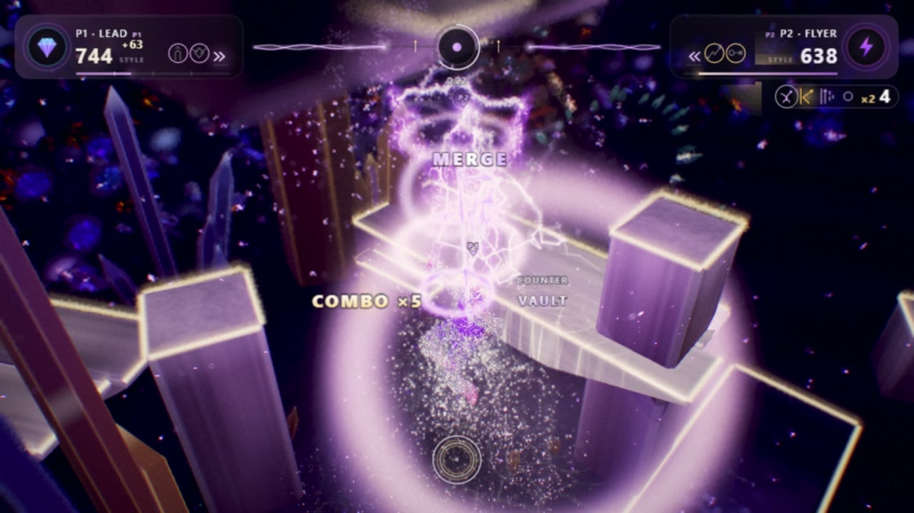
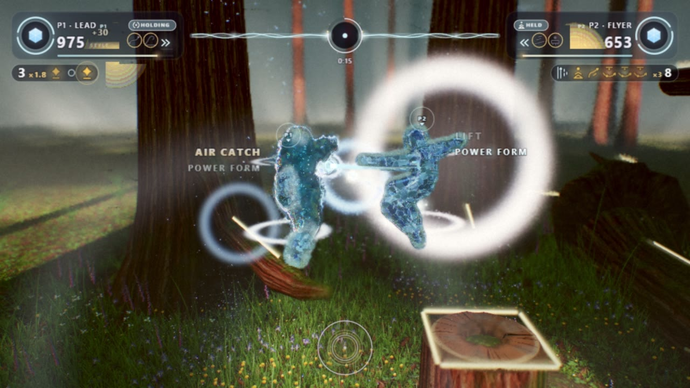
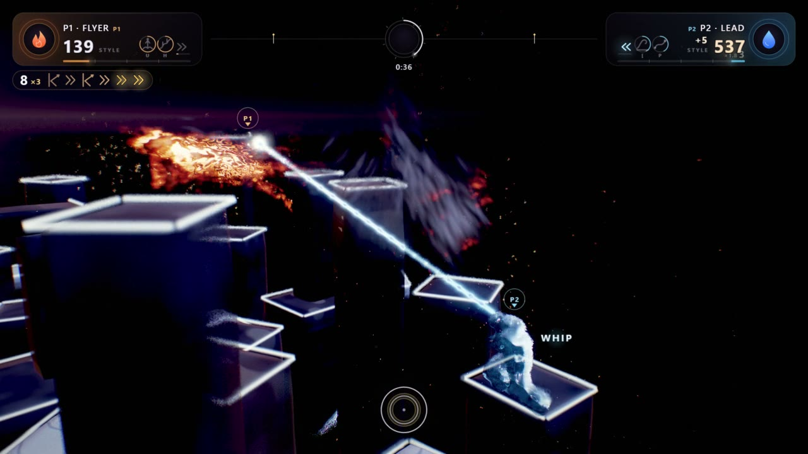
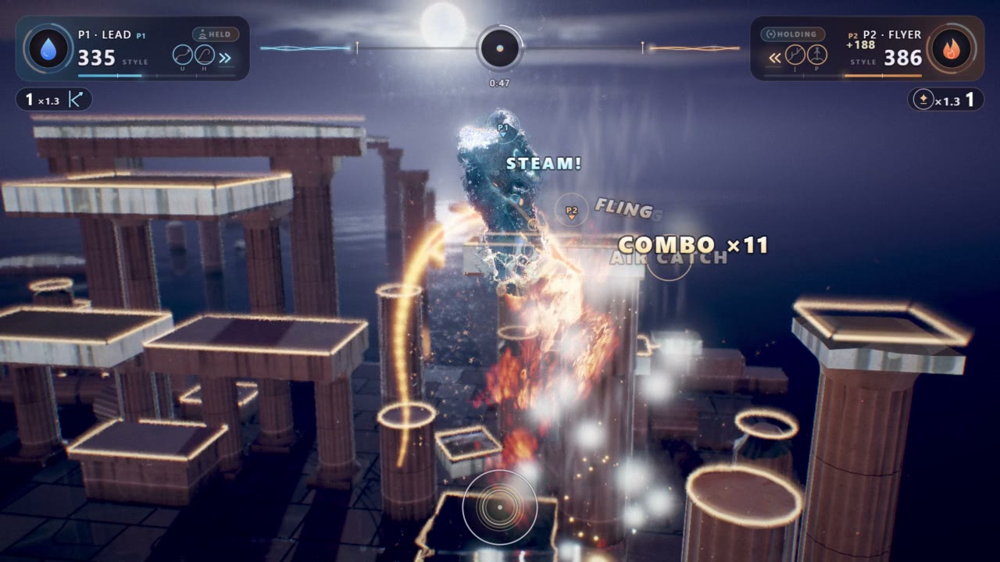
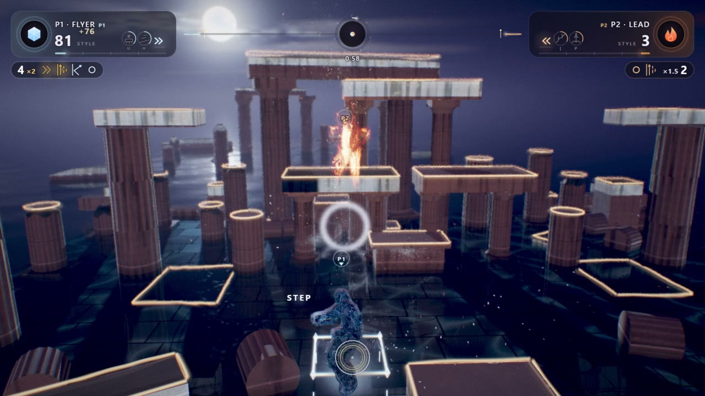
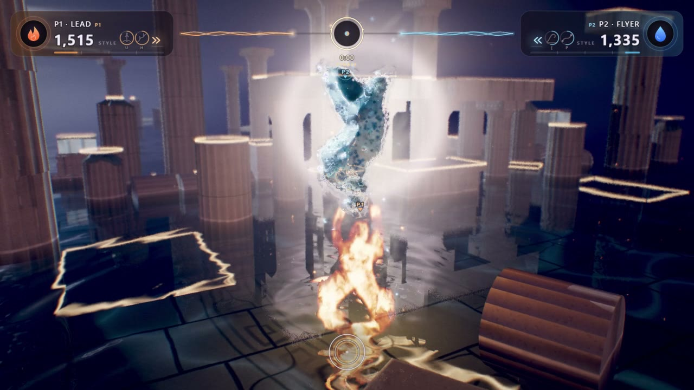

# 13: the duel's phase 2 film (Bend), and what holds it back now

Branch `worktree-agent-a4f503ea41a0468c2`, from master `d6ae365` (phase 2 merged: the powers, the reactions, the
camera's head room, the readability fixes, the pacing, the new finale). The brief: make the phase 2 film of the contact
dance with powers (about 30 s, 720p60, the HUD on, two virtual players across the four worlds, cut like a highlight
reel on one Suno track's beats), showing the powers that make contact, the power form, a combo reaching a tier, and
the finale; then name, as a player who has watched a lot of it, the five things that most hold it back, for phase 3
(Juice).

**Measured:** 41 whole sets scouted as previews in the page (two virtual players, 60 s each, from the count-in through
the finale and the banner), every rule and power event read from `info.json`'s duel log against the film's clock; the
contact sheets of the moments I cut, looked at frame by frame; two previews of the film and the master, looked at as
contact sheets; the film's loudness (ffmpeg's ebur128); the Node harness's fusion rate for comparison;
`npm run typecheck`; the full `npm test` (exit 0, 12 net tests passed). **Not measured:** a person playing; a
phone; the sound by ear (levels only); the lock (`?lock`) in phase 2 (every shot is the free camera).

## The film

`docs/reports/media/film/duel-p2.mp4` (git-ignored): **32.4 s, 1280×720, 60 fps, H.264 High at 4.76 Mbit/s (two passes), AAC
192 kbit/s stereo at 48 kHz, 19.3 MB**; loudness −14.4 LUFS integrated, peaks −1.4 dBFS. Encoded from the film tool's
master (`duel-2-master.mp4`, 121.8 MB, rendered at 1.5× and brought down on the GPU, under the render lock; and its
`duel-2-web.mp4`, 36.9 MB).

The timeline is `films/duel-2.json`. The track is **the redwoods' ("Embers in the Redwoods", 113.05 bpm, A minor)**,
from bar 92's second beat to bar 107: its last swell (bars 93 to 96, the loudest of the song, −13 to −15 dB a beat),
the hush after it (bars 97 to 100, −19 to −24), the return (101 to 104) and the start of its ending (105 on). I chose it
for its mood (warm, golden, a forest at dusk, written with "a swell where two bodies fuse into an aurora"), and because
that shape is a highlight reel's: the build on the swell, an awe beat in the hush, the powers back on the return, the
finale on the ending. Every cut is on a beat of it, and the three section changes are cuts: DANCE lands on bar 93's
downbeat, the geyser on bar 97's, the power form on bar 101's, and the fused finale fires 0.03 s after bar 105's.

| time | shot | what happens |
|---|---|---|
| 0:00.0 | **redwoods, morning** (water a lead, ice a flyer; seed 9) | **3** (0:00.0), **2** (0:00.5), **1** (0:01.1) over bar 92, **DANCE** at 0:01.6 on bar 93's downbeat; water catches ice at once (CATCH, 0:01.8), swings it, flings it up with its streak (FLING, COMBO ×6, 0:03.6), and catches it out of the air (AIR CATCH, 0:05.1) |
| 0:05.3 | **the Pool** (fire a flyer, water a lead; seed 1) | fire high over the black water; water on a stepping stone throws **WHIP** (0:05.7), the lash crosses the gap to the flyer, **AIR CATCH** at range (0:06.6), and reels it in |
| 0:07.4 | **redwoods** (gems a lead, plasma a flyer; seed 1) | plasma in the air throws **ARC** (0:08.4): the lightning tether pulls the two together and they meet in the air (AIR CATCH, 0:08.7), swing, fling (0:09.9) |
| 0:10.1 | **temple, slowed** (water a lead, fire a flyer; seed 6) | bar 97, the hush: **STEAM!** (0:10.1), the geyser carries water up past the lintels; from 0:10.5 the game slows to a third (the track plays on); fire leaps up and catches water at the top (**AIR CATCH**, 0:10.9); they swing over the court in the steam; water flings fire (0:13.8) and catches it again (AIR CATCH, 0:14.0) |
| 0:14.3 | **the geode** (gems a lead, plasma a flyer; seed 2) | plasma launched off gems' hands (LIFT); gems raises a **PILLAR** under its own feet (0:14.6) that carries it up to the flyer: CATCH (0:15.6); plasma's ARC (0:16.0) and an air catch (0:16.3) |
| 0:16.5 | **temple** (ice a flyer, fire a lead; seed 1) | ice in the air sets a **STEP** under its feet (0:16.6) and stands on it over the court, a ledge; fire flares up beside it and catches it (AIR CATCH, 0:17.1), and swings it |
| 0:18.6 | **redwoods** (water a lead, fire a flyer; seed 3) | bar 101, the track back: water, already in its power form (ice), flings fire, which takes its own **POWER FORM** in flight (0:18.9): plasma in a gold ring, lightning off it; it lands and catches water (CATCH, 0:20.5) |
| 0:20.7 | **the Pool** (water a lead, ice a flyer; seed 12) | water's combo at RADIANT ×40 closes on an air catch: **SUBLIME ×41** (0:21.8) |
| 0:23.9 | **temple, moonlit** (fire a lead, water a flyer; seed 32, skill 0.95) | the set's last seconds: fire flings water (0:24.6), **FLARE** into an air catch (0:25.1), the second **MERGE** (0:26.6), a last fling (0:26.9); **FINALE** at 0:27.1 on bar 105: the fused lift, fire below and water raised overhead in a column of light (0:28.5), floating down beside it; the banner **P1 · LEAD TAKES THE SET**, 1,515 to 1,335 (0:30.0); out at 0:32.4 on bar 107's third beat |

The **creative beats**: the two virtual players are shown as two people at one split keyboard (a new `&keys=left,right`:
each panel's power icons carry the keys that seat would press, U and H on the left, P and [ on the right, which is
what a player needs to know to try it); the temple's geyser is slowed to a third from the top of its ride, at the
track's hush, so the high catch can be seen at all (at full speed it is a few frames before the swing turns it); and the reel is bookended by structure rather than a pair: the redwoods' count-in opens it, the
temple's fused lift closes it.

Shot sheets (the master): `media/13-film-duel-2-<shot>-master-sheet.jpg`.

### How it was made

1. **Scouted, 41 sets.** Each set a 66 s preview (count-in, 60 s of play, the finale, the banner) on the redwoods'
   track (so the brains danced on its tempo), at 1280×720 (25 sets) or 640×360 (16). Pairs of matter chosen for the
   powers I wanted: fire and water (whip, wave, flare, ribbon: the geyser), plasma and gems (arc, blink, pillar, prism),
   ice with water or fire (step, slide; freeze, melt); styles lead and flyer both ways, a base twice; skill 0.85 (25
   sets) and 0.95 (16 sets); the four worlds.
2. **A film-tool fix first** (below): the powers' events never reached `info.json`'s log, so a scouted set showed a
   whip catch as a plain catch and no STEAM! at all. With them logged, an analyser listed every cast with the links
   that followed it, every reaction, form, tier, merge and finale; I looked at sheets (a frame every 0.1 to 0.4 s)
   around each candidate and chose by eye.
3. **Cut into the sets on the beat.** A duel shot's dance is the same whatever its in-point (report 12), so each shot
   is a `preroll` of whole beats into its set; the dance in the film matched the scouts' logs to the frame (the whip at
   25.38 s of its set in both, the geyser at 14.93, the finale at 61.6), except after the slow motion's cue, as it
   should: a `rate` cue changes what follows it. In the first preview (the cue 0.95 s after an in-point a beat earlier)
   water caught fire; in the master fire catches water as in the scout, and the fling and second catch after it are the
   slowed dance's own.
4. **Previews, then the master.** What the sheets showed and what changed: the temple's ending had five temple shots,
   so the power forms moved to a redwoods set (seed 3) and the opening to the redwoods (seed 9); the geyser shot opened
   on half a second of a drum in front of the lens, so its in-point moved one beat later, onto the STEAM! (the slow
   motion's cue moved with it, to fire at the same moment of the set); the panels' new keys didn't show in the first
   preview because the film server (no file watching, by design) still served the old `src/duel/index.ts`: restarted.
5. **The finale.** A fused finale is rare now, as phase 2 meant: 2 of the 25 sets at skill 0.85 fused, 7 of the 16 at
   0.95 (below). Of the six fused lifts I looked at (of nine), the temple's moonlit one (seed 32, fire a lead, water a flyer,
   skill 0.95) reads best: fire below, water raised overhead in the column of light with its arms open, the court
   behind, then the banner. The redwoods' two (seeds 9 and 34) were close and dark under the trunks; the geode's had a
   slab's corner in the frame and purple on purple.

## The numbers (41 scouted sets, 41 minutes of play)

| | all | skill 0.85 | skill 0.95 | temple | redwoods | Pool | geode |
|---|---|---|---|---|---|---|---|
| sets | 41 | 25 | 16 | 16 | 11 | 4 | 10 |
| casts a minute (both players) | 9.8 | 9.8 | 9.9 | 10.1 | 9.5 | 11.0 | 9.4 |
| catches made by a power (a minute) | 3.2 | 3.2 | 3.3 | 3.2 | 3.8 | 4.0 | 2.3 |
| catches a minute (all) | 23.7 | 22.8 | 25.2 | 26.1 | 24.6 | 11.7 | 23.7 |
| power forms | 65 | 37 | 28 | 31 | 18 | 0 | 16 |
| reactions | 10 | 6 | 4 | 6 | 4 | 0 | 0 |
| combo tiers (sets with one) | 18 (8) | 16 (6) | 2 (2) | 2 (2) | 0 | 13 (3) | 3 (3) |
| merged sets | 30 | 15 | 15 | 15 | 7 | 0 | 8 |
| **fused finales** | **9 (22%)** | **2 (8%)** | **7 (44%)** | 3 | 2 | 0 | 4 |
| falls | 51 | 51 | 0 | 2 | 0 | **49** | 0 |

- **Casts:** 9.8 a minute for the pair, so about one every 12 s per player, 7 to 12 a set. By power: whip 133, flare
  88, wave 32, arc 27, blink 25, pillar 24, ribbon 23, step 22, prism 16, slide 13. The first power of each matter is
  cast 2.5 to 4 times as often as the second (whip 133 to wave 32, flare 88 to ribbon 23).
- **Power catches** (`powers.felt.catches`: a whip or an arc that joined the two) 132, 3.2 a minute: about one catch
  in seven comes through a power. Launches (a flare or a pillar under a body) 175; seconds ridden on an updraft or a
  geyser 21; seconds stood on an ice step 5.6 in all 41 sets; prism redirects 7; blink swaps 19.
- **Reactions:** 9 geysers and 1 melt; **no freeze in 41 sets** (`felt.bars` 0): the whip-on-a-step bar has never been
  seen.
- **Tiers:** 18 tiers in 8 sets, 13 of them in the Pool (FLOW to SUBLIME). Through contact, in the other three worlds,
  5 tiers in 37 sets, all FLOW (12 links); never BLOOM or higher. The longest combos outside the Pool were 8 to 19.
- **Finales:** the shared energy's peak averaged 0.85 at skill 0.85 and 0.95 at 0.95; the fusion needs a merge and the energy
  held at 0.9 for 3 s. The Node harness (`scripts/duel-sim.mjs`, the same brains, its own seeds) fused 5 of 8 temple sets at
  0.85 where the page fused 0 of 8 temple sets: the page's sets differ from Node's (its world, its music clock), so its
  rates are the ones to trust.
- The film's own power moments are real play, chosen from those 41 minutes; nothing was cast by the timeline.

## Five things that hold it back (for phase 3, Juice)

From the 41 scouted sets, the film's frames, and report 12's list (whose five were phase 2's fixes: the camera's head
room now works, the energy is paced, the finale is a duet, the pops have lanes, SWING counts up once a hold).

### 1. A catch has no weight

The game's best move, the catch out of the air, lands in one frame: the two bodies join, a ring blooms on the
contact, a word pops, and the swing has already turned them on. At full speed the geyser's high catch (the temple, seed
6, 15.5 s into its set) is on screen for about 0.3 s before the swing carries it out of its shape; the Pool's whip
catch (seed 1) goes from the cast (25.38 s) to the catch (26.23 s) and on into the reel with nothing marking the moment
it holds. To make the film read I slowed one catch by hand (0:10.5 to 0:14.3), which is the film doing what the game
should. Phase 3's hit-stop, adapted to contact: on a catch (more on an air catch, most on a catch at range or at the
top of a geyser) hold both bodies' pose for 3 to 6 frames with the contact's ring and the link's beads still moving,
then let the swing go; a short ease of the camera toward the contact; the catch's sound on that frame. The same
"hold" for the moment of a fling's release and the lift's top in the finale.

### 2. The Pool is not a duel arena yet

Four Pool sets: **49 falls** (8 to 16 a set; 2 in the other 37 sets together), 59 to 95 dashes a set against 7 to 15
catches, no merge, no fusion, the energy's peak 0.35 to 0.62. The pair spends the set apart on separate stones (the Pool,
seed 1, 39.6 s below: water fallen in, fire 6 m up), the flyer's style ends as low as 110. The whip suits it (4 catches a
minute at range, the best rate of the four worlds: the film's 0:05 shot), but a missed jump over black water is a fall
every time. Node agrees (report 12's numbers and today's: 1.1 catches a minute, 84 dashes). Phase 3's gentle hazard
for the Pool (a swell rocking the stones) would make it worse unless the water first stops being a pit: let a body
land in the water and wade or float back (a soft fall with no reform), or bring the stones closer, and teach the brains
to stay near each other there.

### 3. The tiers reward running alone, not the dance

FLOW, BLOOM, RADIANT, SUBLIME (12, 18, 26, 36 links) are reached through contact almost never: 5 FLOWs in the 37 sets
outside the Pool, and nothing higher. In the Pool they come every set, from chains of dashes and wall jumps between
stones: the film's SUBLIME (0:21.8, the Pool, seed 12) is 41 links of which 18 are dashes, 9 wall jumps, 3 wall runs
and only 1 catch, 5 swings, 1 fling and the closing air catch, while the partner scored 0 style that set. A combo that
holds a partner banks after a beat or two held (phase 2's fix 3), which is right, but it leaves contact chains at 8 to
14. So the tier, the game's loudest word, marks the least social play. For phase 3: count a hold's catch, swing, fling
and the partner's landing as one chain shared by the two (a pair combo, with its own tiers and its own colour), and let a
solo chain of the same move kinds (dash, wall jump) stop adding after a few; then the tier can carry the juice (a sound,
a flash of the pair's colours, a beat of slow motion).

### 4. The camera still stands in the pieces

Phase 2's camera frames the flyer's apex well (the geyser shot, the arc, the finale all keep the higher body in frame
with room), but its eye still lands against the arena's pieces and the world's solids. The temple (seed 7, 22.1 to
24.2 s: a drum blurred across a third of the frame, below), the temple again (seed 6, 14.1 to 14.4 s, before the
geyser: why the film's geyser cuts in a beat late), the redwoods (seed 1 with ice and water, 16.35 to 16.6 s: a fallen
log's lit edge across the lens; seed 3, 44.0 to 45.0 s, a log across the frame through a power form), the geode (seed 5,
39.2 to 41.0 s: looking down through slabs and rings at a merge, below). Report 12's issue 1 half remains: the eye is
"clear by more than the near fade" of what it measures, but the logs, drums and slabs it misses are the duel's own
pieces and the world's, seen from where it stands. For phase 3, with shake and slow motion coming, the eye needs to be
clean first: test the eye's sphere and its sight line against every solid (the arena's pieces and `World.solids`), and
prefer rising over the pieces to sliding among them.

### 5. Who is who: matter that looks alike, and two powers of ten doing most of it

Water and ice are both blue bodies; in the redwoods (seed 9, the film's opening) the lead and the flyer are told apart
only by the texture of their particles, and in the power form water turns to ice, so the pair becomes two identical
ice bodies (seed 9, 47.4 s, below). Plasma and gems in the geode are purple on purple with the gem body reading as white
dust. Fire and water, the clearest pair, were in 23 of the 41 sets. And the powers lean on two of ten: whip and flare are
55% of all casts; the freeze never happened, the melt once, the ice step held a body for 5.6 s in 41 minutes. For phase
3: give each seat a colour that survives its matter and its form (the HUD's colour on the body: a rim, its trail, the
contact's half of the ring), keep a form from taking the other seat's matter, and have the brains (and the tutorial
the front's menus will need) reach for the second power and the reactions, so a player sees the bar, the melt and the
step used as a ledge in their first sets.

### Smaller things seen

- **Skill decides the fusion.** 8% of sets fuse at skill 0.85, 44% at 0.95. A good human pair will see it often; a new
  one, perhaps never. The HUD shows no "nearly": the orb is full, the peak is 0.93, the set bows. A note at the finale
  ("held 2.1 s of 3") would teach it.
- **The slow motion slows the HUD,** as in report 12: in the slowed geyser the pops hang (STEAM!, AIR CATCH, COMBO ×11
  stack above the pair for two seconds).
- **The panels' keys are small:** the letter under each power icon is the smallest text on screen at 720p.
- **A cast at the finale:** in the redwoods' seed 34 water cast a wave 0.02 s before FINALE and its wash ran under the
  lift; the finale could clear the powers' effects.
- **The flyer's style in the Pool** ends near zero (the film's 0:21 shot shows P2 at 0 style beside a SUBLIME).

## Fixes committed

- **Film tool: the powers in the duel log** (`src/engine/film-shot.ts`). `info.json`'s `duel.log` now carries
  `powers.events` (a cast with its power and seat, the power form, a reaction) beside the rules' events. Without it a
  scouted set showed no cast and no STEAM!, and a whip catch looked like any catch.
- **Duel: `&keys`** (`src/duel/index.ts`): the power keys under a virtual player's panel icons (`solo`, `left`,
  `right` or `pad`, one or per seat), as if people played the seats; the film uses `&keys=left,right`. A human seat
  still shows its own device's keys.

## Stills

`docs/reports/media/13-p2-*.jpg`: the film's sheet (`13-p2-film-sheet.jpg`), one still per power moment
(`13-p2-countdown.jpg`, `13-p2-whip-pool.jpg`, `13-p2-arc-redwoods.jpg`, `13-p2-geyser-temple.jpg`,
`13-p2-pillar-geode.jpg`, `13-p2-step-temple.jpg`, `13-p2-forms-redwoods.jpg`, `13-p2-sublime-pool.jpg`,
`13-p2-finale-lift.jpg`, `13-p2-banner.jpg`), and the feel stills above (`13-p2-feel-*.jpg`). The master's per-shot
sheets: `13-film-duel-2-<shot>-master-sheet.jpg`.

## Weak points of the film

- Two virtual players, seeded and chosen: every moment is real play, picked from 41 minutes.
- The finale's set was played at skill 0.95 (the others at 0.85), because fusions at 0.85 were 2 in 25 and both were
  dark; at 0.95 the temple fused 3 of 8 times.
- The slow motion is the film's, not the game's.
- Nine shots from eight sets; the opening and the finale are different sets (no one set had both a clean count-in and
  a clean fused lift in a world not already over-used).
- The SUBLIME is the Pool's solo chain (issue 3), shown because it is the only tier above FLOW in 41 sets.
- The sound is the track with the shots' recorded matter voices under it (the slowed shot's left out); checked by its
  levels, not heard.

## Not done

- The five issues above: phase 3's.
- The lock in phase 2 was not filmed or scouted.
- `films/duel-p1.json`'s forge shots no longer render (the forge is retired); it stays a record.
