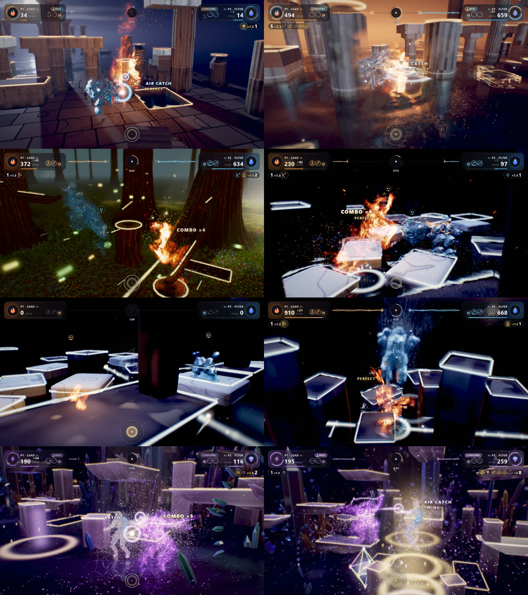

# 14: the duel's arenas in phase 3 (Juice): the Pool, gentle hazards, and the virtual players

Branch `worktree-agent-a3419e45883b95921`, from master `ac4e6fe` (phase 2 and its film merged). One of six agents on
phase 3; mine is the arenas, their hazards and the virtual players. The brief: make the Pool a duel arena (report 13's
issue 2: 49 falls in 4 sets, almost no catches), give each arena a gentle hazard of nature's own (the temple's tide, the
redwoods' wind, the Pool's swell, the geode's hum), on the music's phrase and readable before it acts, each with a
switch; and teach the brains to reach for the second power, set up the reactions, use the ice step as a ledge, ride
the hazards and stay close in the Pool. The tone is binding: no damage, nothing that punishes; the hazards make
movement interesting.

**Measured:** the Node harness, before and after, 40 seeded sets of 60 s per world (temple, redwoods, geode, Pool; 160
sets a run), two virtual players at skill 0.85, free 3D, the dress rotated so each matter plays in two of five pairs
(fire+water, water+ice, ice+fire, plasma+gems, gems+plasma) and the styles through four pairs (`scripts/duel-measure.mjs`,
new); the same after with the hazards off; 10 sets each of the Pool and the temple locked; `npm run typecheck`;
`node scripts/test-ts.mjs` (16 files, all pass, the new `src/duel/test/hazards.test.ts` among them); stills of each hazard
from the page on my dev server (port 5433, headless Chrome on the RTX 5090, 1280×720, `scripts/shot.mjs`), looked at.
**Not measured:** a person playing; the sound (the hazards make none); a phone; the GPU cost of the hazards' drawing
(a CPU list of glows and a few ripple pushes a frame; not timed); the page's own catch and fall rates (the stills' sets
only; report 13 found the page's sets differ from Node's); `npm run test:net` (not run, by the brief).

## The numbers

Node, 40 sets a world, skill 0.85, free 3D, dress rotated. *Before* is master `ac4e6fe` measured with the new script
(the Node harness gained the redwoods for it); *after* is this branch with the hazards on, and in brackets with them off.

| | temple | redwoods | geode | Pool |
|---|---|---|---|---|
| falls a set, before | 0.05 | 0.03 | 0.10 | **9.85** |
| falls a set, after | 0.00 (0.05) | 0.10 (0.03) | 0.10 (0.13) | **0.00** (0.00) |
| catches a minute, before | 24.1 | 23.4 | 23.0 | **12.5** |
| catches a minute, after | 23.9 (23.9) | 23.1 (23.1) | 21.7 (22.5) | **26.7** (23.3) |
| two apart, mean (m), before → after | 1.6 → 1.6 | 1.6 → 1.6 | 1.6 → 1.7 | 3.2 → 1.4 |
| reactions a set, before | 0.45 | 0.35 | 0.28 | 0.15 |
| reactions a set, after | 1.00 | 0.93 | 0.75 | 1.00 |
| the ice step stood on (a set), before | 0.75 | 0.90 | 1.07 | 1.48 |
| the ice step stood on (a set), after | 0.78 | 1.05 | 0.93 | 0.88 |
| hazard ridden (a set), after | tide 10.9 (20.5 s) | gust 10.2 (4.6 s) | hum 3.2 (2.7 s) | swell 4.0 (3.4 s), crest jumps 3.3 |
| fused finales, before → after | 6 → 5 | 8 → 6 | 6 → 7 | 0 → 31 |

**The Pool** is now a duel arena: no falls in 40 sets (9.85 a set before), 26.7 catches a minute (12.5 before; the
other worlds 21.7 to 23.9), the two 1.4 m apart on average (3.2 before), a merge in nearly every set and 31 of 40 finales
fused (0 before). The water alone did most of it: with the hazards off (no swell) the Pool is at 23.3 catches and
0 falls a set (the swell adds the other 3.4 catches a minute: its crest throws them together). It is now the easiest world to fuse in (peak energy 0.98 against 0.87 to 0.90 elsewhere), which may be
too easy; see the weak points.

**The powers** (all four worlds, about 1,500 casts each way):

| | flare | ribbon | whip | wave | step | slide | blink | arc | pillar | prism | whip + flare |
|---|---|---|---|---|---|---|---|---|---|---|---|
| share before (%) | 16.3 | 4.4 | 18.3 | 4.2 | 13.8 | 4.5 | 7.5 | 14.0 | 10.7 | 7.0 | 35 |
| share after (%) | 12.0 | 9.7 | 15.3 | 10.5 | 12.0 | 5.5 | 7.7 | 9.0 | 9.0 | 10.0 | 27 |

The second power to the first, before → after: fire (ribbon to flare) 0.27 → 0.81, water (wave to whip) 0.23 → 0.69,
ice (slide to step) 0.32 → 0.46, plasma (arc to blink) 1.85 → 1.16, gems (prism to pillar) 0.65 → 1.11. With each matter
dressed equally a fair share is 10% a power and 20% for whip and flare together; report 13's 55% was in sets where fire
and water were dressed in 23 of 41, so it is not the same measure. Ice's slide stays low: in the Pool there is rarely
4 m of floor for a slide to lie on (it fizzles and is refunded; 0.28 there), and ice's step is now cast more as a
ledge and as a setup (below).

**The reactions** went from 0.15 to 0.45 a set to 0.75 to 1.00 (all four worlds: 49 → 147 in 160 sets): steam 16 → 42,
melt 25 → 47, **freeze 8 → 58**. Pairs that can react are three of the five dressings, so an able pair reacts about 1.5
times a set. (The page in report 13 saw no freeze in 41 sets; Node saw 8 in 160 before. The brains' change is what
matters: whips at steps, waves to fire.)

**The ice step as a ledge** did not rise: 168 stands in 160 sets before, 145 after (31 to 42 a world against 30 to 59),
and the seconds stood 48 → 50. Ice now casts its slide more (the balance), and the step is often used up by a reaction
(a freeze swaps it for a bar, a melt for a puddle). Against the steps the brains cast (about 200 in the 160 sets), the stands come to about three in four.

## What changed

### The Pool's water is a floor (`src/worlds/pool/arena.ts`, `pool.ts`; `src/duel/hazards.ts`)

The duel's Pool was deep black water with nothing under it: a missed jump between stones was a fall, every time. Now
the water is a floor a body floats on, 1.15 m under its surface (`HAZARD.FLOAT`: the water at its chest, its head and
shoulders out). `poolGround` is the stones' tops a body could wade onto, or the water (`waterFloor`), whichever is
higher; the kill floor went from −1.4 to −2.0, under it. A body that lands in the water does so with a ring of foam and a
few drops thrown up and a push on the ripples, swims at most 3.4 m/s (a run is 6.5), and jumps out onto a stone (a
stone's top is 1.3 to 1.5 m over a floating body's feet; a jump is 2.2 m). Locked to the stage plane the water is a solid
ledge across the plane at the floating height under the body (`Character.extraLedges`), so the lock has no falls either
(0 in 10 Pool sets locked). The stones were not moved: with the water to swim in, the gaps are a swim, not a fall, and
the arena as drawn (report 11) stays.

### The hazards (`src/duel/hazards.ts`, drawn by `src/duel/hazards-fx.ts`)

Pure: the page (`index.ts`, a few lines) and the Node harness (`sim.ts`) step it after the powers each frame, through the
bodies' velocity, `Character.env.updraft` and the worlds' floors, as the powers do. The music's phrase is four bars (16
beats); each hazard keeps to it.

- **The temple's tide** (`tideHazard`): the duel's spring tide, a cosine over 16 bars from 0.5 m under the court to 1.45 m
  over it, highest on a phrase's line (every 64 beats; about 34 s at 112 bpm, so one or two high waters a set). The
  temple draws it (`temple.ts` takes its tide from the hazard while the arena is shown: the surface, the wet stone and
  its drying as before, from the hazard's low and high) and floats on it (its `groundAt` is the water where that is
  higher). At its height the court and its low stones are under water and the bodies float with their feet 0.3 m off the
  floor; the drops are pools to swim at any tide (a body in one floats with its head at the court's floor and jumps
  out). A floating body drifts with the current: in from the sea toward the great gate while the tide rises, out while
  it falls, fastest at mid tide (0.9 m/s). Seen before it acts: the water climbs over two bars, and glints of moonlight
  drift on it with the current round the pair, with the current's ripples. With the hazard off the temple is as it was
  (the jogo's tide, the drops pits).
- **The redwoods' wind** (`windHazard`): a gust on seven phrases of ten (by the phrase's own dice), mostly along the stage
  one way or the other, now and then slanting across it. Leaves and needles fly three beats before it (a few, then many),
  it rises over a beat and a half, holds six beats, falls over three. It carries a body with it: 2.4 m/s in the air, 0.6
  on its feet (moved as a wave moves one: the air's drag and the body's own steering would take a push on its speed
  back), so a jump leans 1.2 m off its line. Drawn: leaves (warm greens and golds, tumbling) and needles (thin streaks)
  carried across the clearing round the pair, and the field's wind with them (the grass bends, a flame leans).
- **The Pool's swell** (`swellHazard`): on each phrase a crest crosses the pool in 12 beats, from a different side in turn
  (six directions), 0.32 m high and 2 m wide, gathering as it comes in and dying as it leaves. The ice floes ride it (up
  0.32 m) and the low stepping stones rock on it (0.13 m): their solids move in place (`Mover`), and the stones' draw
  follows (`poolStonesNow` writes their buffer). A swimmer is lifted and carried along the crest (up to 1.6 m/s), and a
  jump off it (from the water, a floe or a stone riding it) goes 3.2 m/s higher and on with it, once a swell. Drawn: a
  line of foam on the crest across the open water (broken where a stone stands), glints along it, a soft sheet of light
  behind, the crest pushed into the ripples as it rolls.
- **The geode's hum** (`humHazard`): on each phrase a crystal hums. For two bars before, glints rise round its foot and
  a ring pulses on the floor with the beat; then for a bar and a half a column of soft honey light (1.25 m round, 4.2 m
  high) lifts whoever stands in it, easing up at 6.5 m/s to a float at its top, drawing its riders in to its middle, and
  lets them go when it ends (they fall from its top and land as from any jump). Four places in turn, where the hollow stands open overhead (no shelf for 6.8 m) and the
  drops are a way off (a body flung from the top lands on the agate): behind the drops by the great trunk, and in front.
  Drawn: rings rising up the column, points of light spiralling up it, the field drawn up with it (a vortex).

Each has a switch: `arena.hazard.on` (`setHazards(arena, on)`), `&hazards=0` on the page, `hazards: false` in the harness.
`bend.duel.hazards` is the live one (its `hazard`, `sight()`, `ride`, `rides`).

What a hazard draws fades out within a few metres of the camera's eye (a crest or a leaf against the lens was a white
smear in the first stills).

### The virtual players (`src/ai/duel-brain.ts`)

- **Both powers.** Each matter's two powers about as often as each other: the one this player has cast more lately
  waits (×0.25 two ahead, ×0.5 one ahead), the other is reached for (×1.5, ×2.2). More moments for the second powers: a
  ribbon dash to the other or under it when it is above (only over floor all the way: a dash out over a drop was a fall),
  a wave to the other on the ground, a prism on its path when it flies fast on its own (a leap, a launch, a wall kick).
  (A prism on the caster's own flight, tried first, threw it into the geode's drops.)
- **The reactions set up and answered.** Water rolls its wave to a fire partner whose flare or ribbon is ready; ice sets
  a step between the two for a water partner's ready whip, or a fire partner's flare. The answer does not wait its turn
  (the few seconds between casts): fire flares in a wave within 2.2 m or dashes its ribbon into one within 5 m; water
  lashes at a step 1.2 to 6.5 m off whose top is from 0.3 to 4.5 m over its feet (the old condition, over 1.8 m, almost
  never held: a step set ahead stands 1.05 m up), which is the freeze; fire flares on a step it stands under, the melt.
- **The ice step as a ledge.** A step set on the ground ahead is run up onto at once; any step standing within 3.6 m and
  a jump up (over floor, not out over a drop) is a place to go now and then; falling with the other more than 1.8 m off,
  a step under its own feet is a ledge in the air to leap from (any style now, not only the flyer). Landing on one, the
  thumbs settle over the small top instead of holding the stick through it (they ran past a 1.1 m step).
- **The hazards ridden.** A leap at the other with a gust behind it (the wind within 60° of the way to the other, 2.2 to
  8 m off); into the hum's column with the other when both are near it, to float up together; a jump off the swell's crest toward the other; the water a floor in their
  sight (`groundAt`), so a swim across is a way, not a pit; locked, the water a surface of the plane.
- **The Pool.** Nearer the other (its `want` × 0.65) and, when its place would be in the water, onto a stone near it.

`DuelSight.hazard` (`HazardSight`: the water at a point, the wind and the one coming, the hum's columns, the swell's
height) is what they see of it.

### The harness

- `src/duel/stages.ts`: the redwoods in Node (the wood's layout, its stage, the fallen giant's round top, the arena), so
  all four worlds are measured; the temple's floor with its tide.
- `src/duel/sim.ts`: the hazards stepped after the powers, in the brains' sight; `hazards: false`; the result's
  `hazards` (each one's rides and seconds, seconds in water); the arena left at rest after a set (its clock at 0, its
  stones still, its switch on), so what runs after it is not at high tide.
- `src/duel/measure.ts` and `scripts/duel-measure.mjs` (new): the numbers above. `node scripts/duel-measure.mjs
  [--world temple,redwoods,geode,pool] [--sets 20] [--skills 0.85,0.85] [--hazards 1] [--view free] [--json out] [-v]`.
- `src/duel/test/hazards.test.ts` (new, 7 tests): the Pool's water (afloat, slower, out onto a floe), its swell (floes
  ride up; at rest when off), two players in the Pool (no falls, 27.5 catches a minute), the temple's tide (pools at low,
  the court under water at high, off as before), the gusts (led in by leaves; a jump leans 1.24 m), the hum (lifted to
  4.05 m, 1.1 s near the top), and players riding each hazard in whole sets.

## Stills

`docs/reports/media/14-arenas-*.jpg`, from the page (port 5433, two virtual players, 1280×720):

- `14-arenas-temple-low.jpg`: low water, the court dry, a drop a pool of dark water with its rim of light.
- `14-arenas-temple-high.jpg`: high water at dusk, the court drowned among the columns, the pair caught and swinging
  while afloat.
- `14-arenas-redwoods-gust.jpg`: a gust through the clearing, leaves and needles streaming past the pair.
- `14-arenas-pool-swim.jpg`: fire and water in the Pool's water by a floe, a ring of foam round the landing.
- `14-arenas-pool-swell.jpg`: the swell's crest crossing the open water at the count-in, a line of foam between the
  stones.
- `14-arenas-pool-crest.jpg`: a jump off the crest into a lift.
- `14-arenas-geode-warn.jpg`: a crystal's warning, a ring of violet light on the agate, a catch beside it.
- `14-arenas-geode-hum.jpg`: the hum's column, rings rising, the pair in it swinging into an air catch.

(The temple's and the redwoods' stills were taken before the near-eye fade went in; nothing else in their drawing has
changed since.)

## Weak points

- **The Pool may now be too kind.** 31 of 40 sets fused (the other worlds 5 to 7) and its energy's peak averages 0.98.
  Water costs nothing but speed, the two stay 1.4 m apart, and every set merges. The duel's own pacing (shared/duel.ts,
  another agent's) decides how rare a fusion is; if the Pool should be harder, the water could be slower, or the swell
  could part the two now and then.
- **Half the Pool is spent swimming.** 39 s a set in water between the two bodies (out of 120 body-seconds). The brains
  prefer a stone near the other, but the dance carries them into the water often. It reads as a swim in the stills; a
  person may want more stone and less water.
- **The swell is hard to see in a still.** Its foam line and ripples read when the camera looks across the water; from the
  duel's camera, low over the pair, it is often out of frame or edge on. The floes' bob (0.32 m) is small next to the
  camera's own motion.
- **The temple's drops are pools at every tide** (the low water, −0.5 m, floats a body 1.65 m under the court, over the kill
  floor). So the temple no longer has a place to fall at all while its hazard is on. The tide's low end is the knob
  (`tideHazard({ low })`): under −1.05 m the drops are pits again at low water.
- **The wind moves the body, not its speed** (as the wave does). A body's momentum does not carry the gust on after it
  dies, and the wind does not push against a wall. Simple and readable; not physical.
- **The hum's places are fixed**, four in turn; a pair far from this phrase's place doesn't ride it (3.2 rides a set).
  The geode's catches are 21.7 a minute against 23.0 before and 22.5 with the hazard off: riding the column costs a
  little contact.
- **The ice step as a ledge did not rise** (above). The brains reach for the slide more and use steps up in reactions.
- **The rim light** (report 11) is drawn at the stones' rest: on a floe riding the swell its line sits up to 0.32 m under
  the floe's top for a moment. Under the temple's high water the drops' rims glow through the water.
- **Glows, not matter.** The leaves, foam and glints are the play's glow list (additive light), not particles of their
  own: leaves read as small soft lights, more fireflies than leaves at a distance.
- **No sound.** The hazards make none (audio is not mine): a gust, the swell's crest and the hum would want one each.

## Not done

- Sound for the hazards (`src/audio`, not mine).
- HUD words for a hazard ("HIGH TIDE", "GUST"): the stills read without them; the HUD's budget is another agent's.
- The hazards in the page measured over many sets (only the stills' sets ran there); the locked view measured beyond 10
  Pool and 10 temple sets.
- A film of the hazards (no render was asked; none run).
- Phones: the hazards' glows are a few hundred a frame at most (the leaves up to 84); not measured on one.

## For the integrator

- **`src/duel/index.ts`** (mine, 10 lines): the hazard made after the powers (`new DuelHazards(chars, match, arena, { on:
  q.get('hazards') !== '0' })`), stepped after `powers.step`, drawn after the powers' fx (`HazardFxDraw`, with `eye` and
  `ground`), in the brains' sight (`hazard: hazards.sight()`), cleared at `stop()`, and `bend.duel.hazards`.
- **The `Arena` contract** gains `hazard?: Hazard` (src/duel/arena.ts), beyond duel.md's; each world's arena.ts sets its
  own. The Pool's arena's `yKill` went from −1.4 to −2.0.
- **World floors.** The temple's and the Pool's `groundAt` include their water while the arena is shown (`waterFloor`);
  the temple's tide drawn from the hazard while it is on. Anything reading `World.groundAt` in the duel (the camera, the
  powers, the brains) sees the water as floor.
- **Moving solids.** The Pool's movers change their solids' `c[1]` in place; the solids' cached bounds
  (`solidBound`) are a little stale while they ride (at most 0.32 m, upward only).
- **`Character.extraLedges`** is chained by the hazards as the powers chain it (the water ledge in the lock).
- Nothing in shared/duel.ts, shared/powers.ts, camera.ts, src/audio or the net code was touched.
