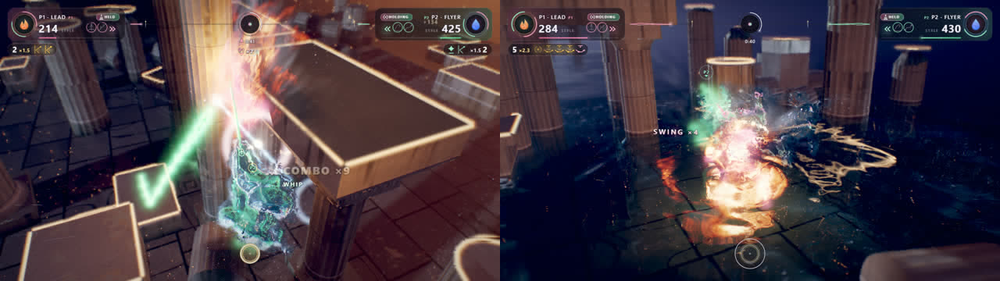
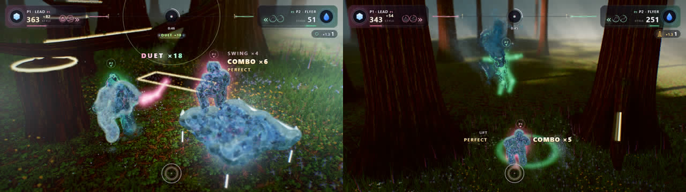
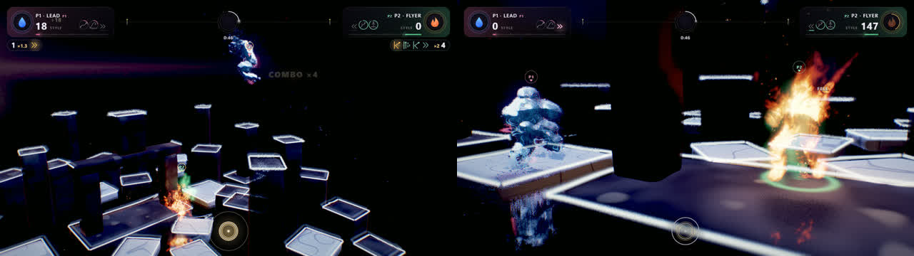

# 14: the duel's camera and seat colours (phase 3, Juice): a clean eye, the impulse, who is who

Branch `worktree-agent-a9701961fe5f23c88`, from master `ac4e6fe` (phase 2, report 13), with master `48d72de` (the feel
track, report 14-feel) and `4a6d80b` (the arenas track) merged in. One of six phase 3 tracks: report 13's issue 4 (the camera in the pieces), the first
half of issue 5 (who is who), and the camera half of the juice (`DuelCamera.impulse`, the time base under a hit-stop).

The tone holds: the impulse is an ease and a settle toward two bodies meeting, never a shake; the seat colours are
rose and fern.

**Measured:** `scripts/cam-sim.mjs` (new), 24 seeded Node sets of 40 s before and after (temple, redwoods, geode, Pool;
six each; skill 0.85; four style pairs; six dress pairs, so the ice steps and gem pillars are in the solids while they
stand), every frame judged; the same with an impulse at every catch, fling, lift and merge; `src/duel/camera.test.ts`
(5 new tests) and `src/duel/seat.test.ts` (new, 4 tests); `npm run typecheck`; `node scripts/test-ts.mjs` (18 of 18
files); headless 720p stills of the page on my dev server (port 5434), before and after, and of the seat colours.
**Not measured:** a person playing; a phone; the lock (unchanged); the near fade's dissolve in the numbers (the Node
judge sees every solid as solid, the page dissolves some); `npm run test:net` (port clash). The before and after stills
are the same seeds and frames, but the sets diverge in the page once the camera differs (the stick is read in the
camera's turn), so each pair shows the same moment of a set, not the same pose.

## The numbers (24 sets, 55,272 frames each side)

"Near frame" is the share of frames where a solid stands in the near part of the frame: a 9 × 5 grid of rays through
the lens, each looking for a solid nearer than halfway to the nearer body (at most 4 m): a drum, a log, a slab across
the lens. "Over a tenth" is a piece across a tenth of the frame or more. "Hidden" is a body with two of its hips, chest
and head behind a solid. "Past the room" is the eye further than the arena's camera room + 1.2 m from its middle (in the
geode that is out through the hollow's shell, which is no solid). The flyer is the flown body (or the higher by a metre)
in the air, its head inside the frame below the top 8 %. A reforming body is not judged (and, after, not framed).

| | before | after |
|---|---|---|
| a piece in the near frame | 12.7 % | **5.5 %** |
| … over a tenth of the frame | 6.2 % | **2.8 %** |
| eye past the room (the geode's shell) | 6.4 % | **0.5 %** |
| eye within the near fade's 0.6 m of a solid | 0.6 % | 0.6 % |
| eye inside a solid | 0.0 % (a few frames) | 0.1 % |
| a body hidden (2 of 3 sight points) | 8.8 % | **6.4 %** |
| flyer in frame | 19,082 / 19,106 | **19,106 / 19,106** |
| both bodies whole in frame | 99.97 % | 100 % |
| CPU a frame (Node, a loaded machine) | 0.1 to 0.3 ms | 0.14 to 0.8 ms |

| world | near frame | over a tenth | past the room | eye < 0.6 m | hidden | turn reversals a minute | mean pitch |
|---|---|---|---|---|---|---|---|
| temple | 12.9 → 3.4 % | 6.4 → 1.6 % | 0 → 0 % | 0.7 → 0.3 % | 6.5 → 3.4 % | 17.7 → 26.3 | 16° → 25° |
| redwoods | 15.9 → 6.1 % | 6.8 → 2.4 % | 8.9 → 0.8 % | 0.8 → 0.6 % | 5.1 → 4.0 % | 21.9 → 23.7 | 19° → 25° |
| geode | 14.0 → 9.8 % | 7.4 → 6.3 % | 16.5 → 1.2 % | 0.9 → 1.6 % | 9.0 → 7.7 % | 20.6 → 24.2 | 19° → 25° |
| Pool | 8.1 → 2.7 % | 4.0 → 1.0 % | 0.3 → 0 % | 0.1 → 0 % | 14.5 → 10.7 % | 28.1 → 35.4 | 14° → 32° |

**Again on master with the arenas track merged** (`4a6d80b`: the Pool's water a floor, the hazards, the brains that
balance their powers; the play changes, so the same 24 sets were run again, the old camera against the new):

| | before | after |
|---|---|---|
| a piece in the near frame | 14.3 % | **6.9 %** |
| … over a tenth of the frame | 6.4 % | **3.5 %** |
| eye past the room | 5.9 % | **0.4 %** |
| eye within 0.6 m of a solid | 0.5 % | 0.4 % |
| a body hidden | 7.6 % | **5.6 %** |
| flyer in frame | 17,251 / 17,262 | **17,262 / 17,262** |

By world (near frame over a tenth, before → after): temple 2.2 → 1.1 %, redwoods 2.9 → 0.6 %, geode 10.5 → 8.3 %, Pool
10.0 → 4.2 %. The geode is now the one that is left (below); its one bad set in the test (the pair behind the great
crystal trunk under the high shelves: 24 % of its frames, the flyer's head in the top 8 % for 2 frames of 741) is why
the test allows 7.5 % and 0.2 %.

With an impulse at every catch, fling, lift and merge (`--impulses`): near frame 5.3 %, over a tenth 2.8 %, eye within
0.6 m 0.5 %, flyer 19,106 / 19,106: the impulses cost the clean eye nothing measurable. The largest turn a frame stays
1.72° (the rate cap) everywhere.

The eye now prefers to rise: the mean pitch is 6 to 18° higher, the boom a little shorter. The turn reverses a little
more often (the near frame is a new reason to choose); the temple test's limit (30 a minute) holds at 16 to 26.

## What changed

### 1. A clean eye (`src/duel/camera.ts`, `src/duel/camspace.ts` new)

- **Every solid, one space.** `camspace.ts` `spaceOf(list, ground)` is the CamSpace the page and Node both use: the
  eye's clearance, sight-line sweeps, and `fg(eye, rays, reach)`, the share of a ray grid that meets a solid within
  reach (only the solids within reach of the eye are swept: most frames none are). `spaceFor` rebuilds it whenever
  World.solids is a new list, so the powers' ice steps, pillars and the frozen bar are in it the frame they appear
  (the page rebuilt only on a change of length before). `local(p, r)` keeps only the solids round the pair.
- **The choice** (every 0.25 s, 84 poses) also pays for a piece in the near frame (a 7 × 4 grid), from the fit's eye
  and from back along the boom where the eased boom still stands; and pays heavily for an eye out through the world's
  shell (past the room + 1.2 m in any direction).
- **The fallback, each frame**, judges the eye clean: clear of solids by the near fade's distance + 0.35 m, inside the
  room, no ray of the near grid meeting a solid, and each body seen (two of its hips, chest and head). It judges where
  the eye is and where the pair's motion carries the look point 0.3 s on, so the tilt starts before a drum fills the
  lens. Where it is not clean: **rise first** (tilts of 0.12 to 0.7 rad), held 0.6 s before easing back down (no
  bobbing over a row of drums), dropped at once if the held tilt itself turns unclean; eased up fast, down slowly, and
  fast both ways while the eye it gave is unclean. Only where no rise is clean, a **dip** under an overhang (the
  geode's high shelves). Only then the boom **comes in** along itself to the first clean eye, never past what the lens
  a little short of its widest still holds; and the boom eases in faster while the eye stands in the pieces.
- **The shell.** The eye never stands further than the room + 1.2 m from the arena's middle: the boom is shortened and
  the lens widened there, except where the widest lens would lose a body (the flyer in frame wins).
- **A fallen body** (`CamBody.away`, the page sets it from `Character.reforming`) is not followed down into the water:
  the other is framed alone until it is back.
- Kept: the fit and its margins, the apex framing, the hard pass, the bounded turn. No gate disc can be in shot: the
  duel shuts the world's gates (phase 2).







### 2. The juice API

```ts
// src/duel/camera.ts
export type CamImpulseKind = 'catch' | 'fling' | 'tier' | 'lift' | 'merge';
export interface CamImpulse { at: [number, number, number]; kind: CamImpulseKind; k: number }
class DuelCamera { impulse(e: CamImpulse): void }   // k 0 … 1
```

For a moment the look point leans toward `at` and the boom eases in (a fling: out), with a soft settle (the weight
arriving) or a sway, sized by `k` and the kind (`IMPULSE`):

| kind | lean (share of the way, ≤ 0.8 m) | boom | length | settle / sway |
|---|---|---|---|---|
| catch | 0.22 | in 7 % | 1.2 s | settles 5 cm |
| fling | 0.12 | out 4 % | 1.2 s | sways 6 cm |
| tier | 0.10 | in 5 % | 1.5 s | settles 3 cm (a breath) |
| lift | 0.15 | in 3 % | 1.3 s | rises 6 cm |
| merge | 0.30 | in 10 % | 1.9 s | settles 3 cm, sways 3 cm |

The shape is u³(1 − u)⁴: it starts and ends at rest with no step in speed or acceleration (the test: the first frame
moves the eye under 2 mm; the most acceleration of any kind's eye or look point is 10.2 m/s², the catch's). Several
at once are summed and bounded softly (lean ≤ 0.8 m, boom in ≤ 14 %, out ≤ 8 %). It runs before the hard pass, so
every body stays inside the hard margins; and its gain fades out within a fifth of a second wherever the eye with it
would be less clean than without, and back in gently. `camera.last.lean` / `.push` say what it did this frame.

**Time base: real time.** `update(dt)` is the page's `f.dt`, not the game's `danceDt`, and impulses age on it. Under the
feel track's hit-stop and slow motion (which scale `danceDt` only) the camera keeps easing at its own pace toward the
slowed bodies, and an impulse plays out in real seconds (the test: a catch impulse at a hit-stop leans 0.16 m and is
over in 1.2 s with the bodies frozen; a slow motion at a fifth keeps the turn within its rate). The feel track's call
(`src/duel/index.ts`, `camKind` in `weight.ts`) is already on master and reaches this method.

### 3. Seat colours that survive matter and form (`src/duel/seat.ts` new, `fx.ts`, `shared/powers.ts`)

- **Seat 1 rose (#ff6fa3), seat 2 fern (#5ff0a4)**: the two hues no matter has, 171° apart, at least 48° from every
  matter's HUD colour (the nearest: fern and ice). The HUD's players' `color` is the seat's now (one line in index.ts
  after `duelHud.build`; hud-state.ts untouched), so the panels, tags, pops and the link line agree with the bodies.
- **On the body:** a halo along its bones in the glow pass (`seatHalo`): an opaque body (gems, ice) hides its core,
  so it reads as a rim round the outline; through water, fire and plasma it is a tint with a soft edge (`HALO_LOOK`
  per matter). 1.9× in the power form. Gone while the body reforms.
- **Its trail:** the halo is glow, so the glow's trails (post.ts) leave it behind a moving body; the fling's streak is
  in the thrower's seat colour (as phase 2 meant: who threw whom).
- **The contact's ring in halves** (`splitRing`): the catch's ring and the grip's cuff, facing the eye, split along the
  line between the two chests, each dancer's half on its own side in its own colour. The grip's arm and rope, the
  lift, reform, finale and win rings are in the seat's colour too.
- **A form never takes the partner's matter** (`shared/powers.ts` `FORM_TOWARD`, `FORM_INSTEAD`, `formLook`): water's
  form turns it toward ice and fire's toward plasma; beside an ice partner water's form is **tide** and beside plasma
  fire's is **sunfire**, the body turning only 0.15 of the way (power-fx.ts multiplies `Dancer.form` by `formLook`'s
  depth; one line). Every other pair is as before. The form's powers are unchanged.


## Files

`src/duel/camera.ts` (the clean eye, the shell, `impulse`, `CamBody.away`), `src/duel/camspace.ts` (new: the shared
CamSpace and the judge), `src/duel/camworlds.ts` (new: the four worlds in Node, the redwoods from its pure layout),
`src/duel/camprobe.ts` + `scripts/cam-sim.mjs` (new: the measure), `src/duel/camera.test.ts`, `src/duel/seat.ts` +
`seat.test.ts` (new), `src/duel/fx.ts`, `shared/powers.ts` (the form table), `src/duel/power-fx.ts` (one line),
`src/duel/index.ts` (the space from camspace.ts, the HUD's seat colours, the fx's eye and form, `away`: a few lines).

```bash
node scripts/cam-sim.mjs [--world temple,redwoods,geode,pool] [--sets 6] [--set-s 40] [--impulses] [--why] [--json f]
```
`--why` breaks the unclean frames down (which solids stand in the near frame, whether the fallback found a clean eye).

## Not done

- **The geode is still the hardest**: a piece in the near frame 9.8 % of frames (6.3 % over a tenth; 14.7 and 8.3 % on master with the arenas track; the pair often dances behind the great crystal trunk), the eye within
  0.6 m of a solid 1.6 % (worse than before's 0.9 %: kept inside the hollow, the eye has less room). Its shelves reach
  across the plane at 2.7, 5.5 and 7.1 m and a high flyer is framed among them; `--why` names the top shelf and the
  standing beams. A closer, wider camera for the geode, or the near fade dissolving what crosses the near frame (not
  only the sight lines), would be next.
- **Hidden bodies in the Pool** (10.7 %): the standing stones are taller than a jump and the camera does not swing
  round them (turning is costly by design); the page's near fade dissolves a solid across a framed dancer's sight line,
  which the Node judge does not count.
- **Turn reversals** rose (Pool 35 a minute, from 28): framing one body while the other reforms, and the near frame as
  a new reason to choose. Not felt in the stills; worth watching in a film.
- **Cost**: 0.14 to 0.8 ms of CPU a frame in Node (the redwoods the most: 305 solids), against 0.1 to 0.3 before,
  measured on a machine shared with five other agents.
- The halo is faint on water in the redwoods' shade; the rose is near plasma's own pink (seat 1 plasma reads rose, but
  its matter's violet shows less). A per-matter rim in the bodies' own shaders would be crisper than a glow.
- The judge's bodies in Node are rough (root-relative points), not the page's skeletons.
