# 14: the duel's camera and seat colours (phase 3, Juice): a clean eye, the impulse, who is who

Branch `worktree-agent-a9701961fe5f23c88`, from master `ac4e6fe` (phase 2, report 13), with master `48d72de` (the feel
track, report 14-feel) and `4a6d80b` (the arenas track) merged in. One of six phase 3 tracks: report 13's issue 4 (the camera in the pieces), the first
half of issue 5 (who is who), and the camera half of the juice (`DuelCamera.impulse`, the time base under a hit-stop).

The tone holds: the impulse is an ease and a settle toward two bodies meeting, never a shake; the seat colours are
rose and fern.

**Measured:** `scripts/cam-sim.mjs` (new), 24 seeded Node sets of 40 s before and after (temple, redwoods, geode, Pool;
six each; skill 0.85; four style pairs; six dress pairs, so the ice steps and gem pillars are in the solids while they
stand), every frame judged; the same with an impulse at every catch, fling, lift and merge; `src/duel/camera.test.ts`
(5 new tests) and `src/duel/seat.test.ts` (new, 4 tests); `npm run typecheck`; `node scripts/test-ts.mjs` (18 of 18
files); headless 720p stills of the page on my dev server (port 5434), before and after, and of the seat colours.
**Not measured:** a person playing; a phone; the lock (unchanged); the near fade's dissolve in the numbers (the Node
judge sees every solid as solid, the page dissolves some); `npm run test:net` (port clash). The before and after stills
are the same seeds and frames, but the sets diverge in the page once the camera differs (the stick is read in the
camera's turn), so each pair shows the same moment of a set, not the same pose.

## The numbers (24 sets, 55,272 frames each side)

"Near frame" is the share of frames where a solid stands in the near part of the frame: a 9 × 5 grid of rays through
the lens, each looking for a solid nearer than halfway to the nearer body (at most 4 m): a drum, a log, a slab across
the lens. "Over a tenth" is a piece across a tenth of the frame or more. "Hidden" is a body with two of its hips, chest
and head behind a solid. "Past the room" is the eye further than the arena's camera room + 1.2 m from its middle (in the
geode that is out through the hollow's shell, which is no solid). The flyer is the flown body (or the higher by a metre)
in the air, its head inside the frame below the top 8 %. A reforming body is not judged (and, after, not framed).

| | before | after |
|---|---|---|
| a piece in the near frame | 12.7 % | **5.5 %** |
| … over a tenth of the frame | 6.2 % | **2.8 %** |
| eye past the room (the geode's shell) | 6.4 % | **0.5 %** |
| eye within the near fade's 0.6 m of a solid | 0.6 % | 0.6 % |
| eye inside a solid | 0.0 % (a few frames) | 0.1 % |
| a body hidden (2 of 3 sight points) | 8.8 % | **6.4 %** |
| flyer in frame | 19,082 / 19,106 | **19,106 / 19,106** |
| both bodies whole in frame | 99.97 % | 100 % |
| CPU a frame (Node, a loaded machine) | 0.1 to 0.3 ms | 0.14 to 0.8 ms |

| world | near frame | over a tenth | past the room | eye < 0.6 m | hidden | turn reversals a minute | mean pitch |
|---|---|---|---|---|---|---|---|
| temple | 12.9 → 3.4 % | 6.4 → 1.6 % | 0 → 0 % | 0.7 → 0.3 % | 6.5 → 3.4 % | 17.7 → 26.3 | 16° → 25° |
| redwoods | 15.9 → 6.1 % | 6.8 → 2.4 % | 8.9 → 0.8 % | 0.8 → 0.6 % | 5.1 → 4.0 % | 21.9 → 23.7 | 19° → 25° |
| geode | 14.0 → 9.8 % | 7.4 → 6.3 % | 16.5 → 1.2 % | 0.9 → 1.6 % | 9.0 → 7.7 % | 20.6 → 24.2 | 19° → 25° |
| Pool | 8.1 → 2.7 % | 4.0 → 1.0 % | 0.3 → 0 % | 0.1 → 0 % | 14.5 → 10.7 % | 28.1 → 35.4 | 14° → 32° |

**Again on master with the arenas track merged** (`4a6d80b`: the Pool's water a floor, the hazards, the brains that
balance their powers; the play changes, so the same 24 sets were run again, the old camera against the new):

| | before | after |
|---|---|---|
| a piece in the near frame | 14.3 % | **6.9 %** |
| … over a tenth of the frame | 6.4 % | **3.5 %** |
| eye past the room | 5.9 % | **0.4 %** |
| eye within 0.6 m of a solid | 0.5 % | 0.4 % |
| a body hidden | 7.6 % | **5.6 %** |
| flyer in frame | 17,251 / 17,262 | **17,262 / 17,262** |

By world (near frame over a tenth, before → after): temple 2.2 → 1.1 %, redwoods 2.9 → 0.6 %, geode 10.5 → 8.3 %, Pool
10.0 → 4.2 %. The geode is now the one that is left (below); its one bad set in the test (the pair behind the great
crystal trunk under the high shelves: 24 % of its frames, the flyer's head in the top 8 % for 2 frames of 741) is why
the test allows 7.5 % and 0.2 %.

With an impulse at every catch, fling, lift and merge (`--impulses`): near frame 5.3 %, over a tenth 2.8 %, eye within
0.6 m 0.5 %, flyer 19,106 / 19,106: the impulses cost the clean eye nothing measurable. The largest turn a frame stays
1.72° (the rate cap) everywhere.

The eye now prefers to rise: the mean pitch is 6 to 18° higher, the boom a little shorter. The turn reverses a little
more often (the near frame is a new reason to choose); the temple test's limit (30 a minute) holds at 16 to 26.

## What changed

### 1. A clean eye (`src/duel/camera.ts`, `src/duel/camspace.ts` new)

- **Every solid, one space.** `camspace.ts` `spaceOf(list, ground)` is the CamSpace the page and Node both use: the
  eye's clearance, sight-line sweeps, and `fg(eye, rays, reach)`, the share of a ray grid that meets a solid within
  reach (only the solids within reach of the eye are swept: most frames none are). `spaceFor` rebuilds it whenever
  World.solids is a new list, so the powers' ice steps, pillars and the frozen bar are in it the frame they appear
  (the page rebuilt only on a change of length before). `local(p, r)` keeps only the solids round the pair.
- **The choice** (every 0.25 s, 84 poses) also pays for a piece in the near frame (a 7 × 4 grid), from the fit's eye
  and from back along the boom where the eased boom still stands; and pays heavily for an eye out through the world's
  shell (past the room + 1.2 m in any direction).
- **The fallback, each frame**, judges the eye clean: clear of solids by the near fade's distance + 0.35 m, inside the
  room, no ray of the near grid meeting a solid, and each body seen (two of its hips, chest and head). It judges where
  the eye is and where the pair's motion carries the look point 0.3 s on, so the tilt starts before a drum fills the
  lens. Where it is not clean: **rise first** (tilts of 0.12 to 0.7 rad), held 0.6 s before easing back down (no
  bobbing over a row of drums), dropped at once if the held tilt itself turns unclean; eased up fast, down slowly, and
  fast both ways while the eye it gave is unclean. Only where no rise is clean, a **dip** under an overhang (the
  geode's high shelves). Only then the boom **comes in** along itself to the first clean eye, never past what the lens
  a little short of its widest still holds; and the boom eases in faster while the eye stands in the pieces.
- **The shell.** The eye never stands further than the room + 1.2 m from the arena's middle: the boom is shortened and
  the lens widened there, except where the widest lens would lose a body (the flyer in frame wins).
- **A fallen body** (`CamBody.away`, the page sets it from `Character.reforming`) is not followed down into the water:
  the other is framed alone until it is back.
- Kept: the fit and its margins, the apex framing, the hard pass, the bounded turn. No gate disc can be in shot: the
  duel shuts the world's gates (phase 2).


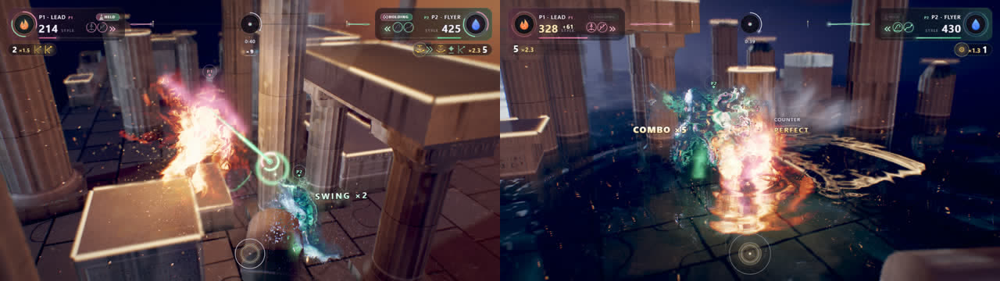
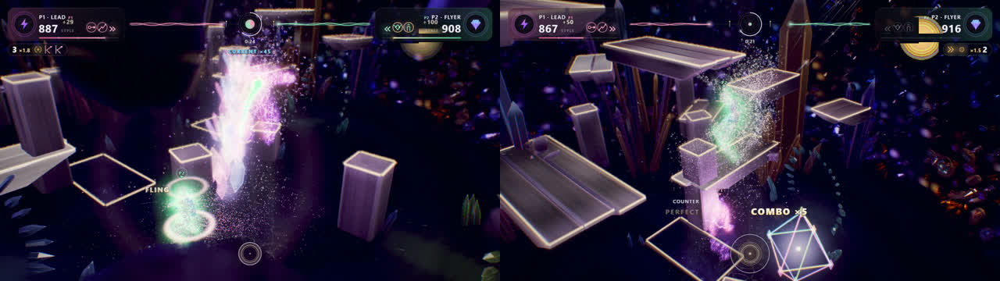


### 2. The juice API

```ts
// src/duel/camera.ts
export type CamImpulseKind = 'catch' | 'fling' | 'tier' | 'lift' | 'merge';
export interface CamImpulse { at: [number, number, number]; kind: CamImpulseKind; k: number }
class DuelCamera { impulse(e: CamImpulse): void }   // k 0 … 1
```

For a moment the look point leans toward `at` and the boom eases in (a fling: out), with a soft settle (the weight
arriving) or a sway, sized by `k` and the kind (`IMPULSE`):

| kind | lean (share of the way, ≤ 0.8 m) | boom | length | settle / sway |
|---|---|---|---|---|
| catch | 0.22 | in 7 % | 1.2 s | settles 5 cm |
| fling | 0.12 | out 4 % | 1.2 s | sways 6 cm |
| tier | 0.10 | in 5 % | 1.5 s | settles 3 cm (a breath) |
| lift | 0.15 | in 3 % | 1.3 s | rises 6 cm |
| merge | 0.30 | in 10 % | 1.9 s | settles 3 cm, sways 3 cm |

The shape is u³(1 − u)⁴: it starts and ends at rest with no step in speed or acceleration (the test: the first frame
moves the eye under 2 mm; the most acceleration of any kind's eye or look point is 10.2 m/s², the catch's). Several
at once are summed and bounded softly (lean ≤ 0.8 m, boom in ≤ 14 %, out ≤ 8 %). It runs before the hard pass, so
every body stays inside the hard margins; and its gain fades out within a fifth of a second wherever the eye with it
would be less clean than without, and back in gently. `camera.last.lean` / `.push` say what it did this frame.

**Time base: real time.** `update(dt)` is the page's `f.dt`, not the game's `danceDt`, and impulses age on it. Under the
feel track's hit-stop and slow motion (which scale `danceDt` only) the camera keeps easing at its own pace toward the
slowed bodies, and an impulse plays out in real seconds (the test: a catch impulse at a hit-stop leans 0.16 m and is
over in 1.2 s with the bodies frozen; a slow motion at a fifth keeps the turn within its rate). The feel track's call
(`src/duel/index.ts`, `camKind` in `weight.ts`) is already on master and reaches this method.

### 3. Seat colours that survive matter and form (`src/duel/seat.ts` new, `fx.ts`, `shared/powers.ts`)

- **Seat 1 rose (#ff6fa3), seat 2 fern (#5ff0a4)**: the two hues no matter has, 171° apart, at least 48° from every
  matter's HUD colour (the nearest: fern and ice). The HUD's players' `color` is the seat's now (one line in index.ts
  after `duelHud.build`; hud-state.ts untouched), so the panels, tags, pops and the link line agree with the bodies.
- **On the body:** a halo along its bones in the glow pass (`seatHalo`): an opaque body (gems, ice) hides its core,
  so it reads as a rim round the outline; through water, fire and plasma it is a tint with a soft edge (`HALO_LOOK`
  per matter). 1.9× in the power form. Gone while the body reforms.
- **Its trail:** the halo is glow, so the glow's trails (post.ts) leave it behind a moving body; the fling's streak is
  in the thrower's seat colour (as phase 2 meant: who threw whom).
- **The contact's ring in halves** (`splitRing`): the catch's ring and the grip's cuff, facing the eye, split along the
  line between the two chests, each dancer's half on its own side in its own colour. The grip's arm and rope, the
  lift, reform, finale and win rings are in the seat's colour too.
- **A form never takes the partner's matter** (`shared/powers.ts` `FORM_TOWARD`, `FORM_INSTEAD`, `formLook`): water's
  form turns it toward ice and fire's toward plasma; beside an ice partner water's form is **tide** and beside plasma
  fire's is **sunfire**, the body turning only 0.15 of the way (power-fx.ts multiplies `Dancer.form` by `formLook`'s
  depth; one line). Every other pair is as before. The form's powers are unchanged.

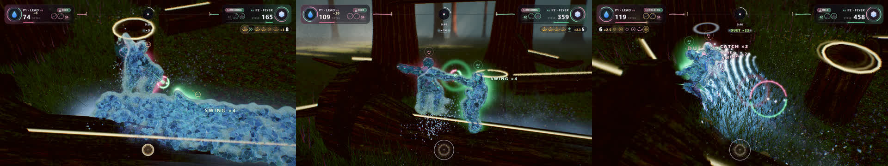
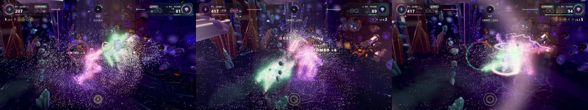
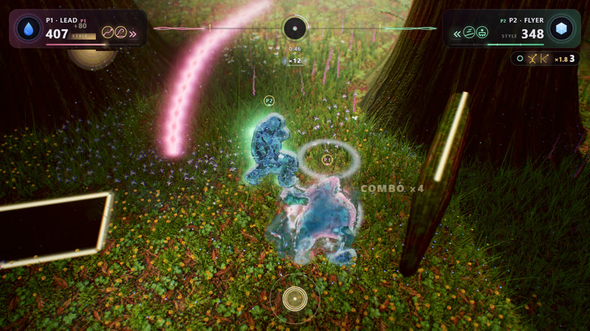

## Files

`src/duel/camera.ts` (the clean eye, the shell, `impulse`, `CamBody.away`), `src/duel/camspace.ts` (new: the shared
CamSpace and the judge), `src/duel/camworlds.ts` (new: the four worlds in Node, the redwoods from its pure layout),
`src/duel/camprobe.ts` + `scripts/cam-sim.mjs` (new: the measure), `src/duel/camera.test.ts`, `src/duel/seat.ts` +
`seat.test.ts` (new), `src/duel/fx.ts`, `shared/powers.ts` (the form table), `src/duel/power-fx.ts` (one line),
`src/duel/index.ts` (the space from camspace.ts, the HUD's seat colours, the fx's eye and form, `away`: a few lines).

```bash
node scripts/cam-sim.mjs [--world temple,redwoods,geode,pool] [--sets 6] [--set-s 40] [--impulses] [--why] [--json f]
```
`--why` breaks the unclean frames down (which solids stand in the near frame, whether the fallback found a clean eye).

## Not done

- **The geode is still the hardest**: a piece in the near frame 9.8 % of frames (6.3 % over a tenth; 14.7 and 8.3 % on master with the arenas track; the pair often dances behind the great crystal trunk), the eye within
  0.6 m of a solid 1.6 % (worse than before's 0.9 %: kept inside the hollow, the eye has less room). Its shelves reach
  across the plane at 2.7, 5.5 and 7.1 m and a high flyer is framed among them; `--why` names the top shelf and the
  standing beams. A closer, wider camera for the geode, or the near fade dissolving what crosses the near frame (not
  only the sight lines), would be next.
- **Hidden bodies in the Pool** (10.7 %): the standing stones are taller than a jump and the camera does not swing
  round them (turning is costly by design); the page's near fade dissolves a solid across a framed dancer's sight line,
  which the Node judge does not count.
- **Turn reversals** rose (Pool 35 a minute, from 28): framing one body while the other reforms, and the near frame as
  a new reason to choose. Not felt in the stills; worth watching in a film.
- **Cost**: 0.14 to 0.8 ms of CPU a frame in Node (the redwoods the most: 305 solids), against 0.1 to 0.3 before,
  measured on a machine shared with five other agents.
- The halo is faint on water in the redwoods' shade; the rose is near plasma's own pink (seat 1 plasma reads rose, but
  its matter's violet shows less). A per-matter rim in the bodies' own shaders would be crisper than a glow.
- The judge's bodies in Node are rough (root-relative points), not the page's skeletons.

## Second pass (branch `p3-camera-2`): a players' view, not a security camera's

The coordinator's stills of merged master showed the camera rising too far: in the temple it looked steeply down onto
the pair with drums in the near corners, and in the geode a lit block stood in the near bottom-left over the pair.

**What changed** (`src/duel/camera.ts`):
- **The look down is capped**: under 35° (`softPitch`), and to 43° (`maxPitch`) only when the frame before found
  neither a modest tilt, a turn nor the boom coming in made the eye clean. The choice's pitches are 0.2, 0.38 and
  0.55 rad, it pays 2.0 a radian for looking down (1.4 before), and the fallback's rises stop at the cap.
- **A turn comes before a rise**: an unclean eye asks the choice again at once (at most every 0.15 s), so a yaw to a
  clear side is taken while a modest tilt covers the moment.
- **The near corners weigh more**: a ray through a corner of the near grid counts 2.5 times, so a drum filling a near
  corner costs nearly what one over a body does; one hidden sight point already makes the eye unclean (it was two).
- The near part of the frame the camera looks at now matches the judge's (0.6 of the way to the nearer body, at most
  5 m).

**The judge** (`camspace.ts`) now has its own fixed yardstick (0.6 of the way, at most 5 m), its pitch, and the near
corners' coverage (the 2 × 2 cells at each corner of the 9 × 5 grid). `cam-sim.mjs` prints the look down (mean, 90th
percentile, the share past 35° and 45°) and the corners (any, an eighth or more), and takes `--dress a,b`.

**The numbers**, 24 sets on master `040beef`, the master camera against this one, the new yardstick for both:

| | master | p3-camera-2 |
|---|---|---|
| look down, mean | 27.7° | **22.0°** |
| look down, 90th percentile | 43 to 59° | **35°** |
| frames past 35° | 30.0 % | **2.4 %** |
| frames past 45° | 18.3 % | **0 %** |
| a near corner filled | 11.2 % | **8.7 %** |
| … an eighth of the corners or more | 8.1 % | **6.2 %** |
| a piece in the near frame | 14.4 % | **11.5 %** |
| … over a tenth of it | 6.1 % | **4.8 %** |
| eye within 0.6 m of a solid | 0.4 % | 0.8 % |
| eye inside a solid | 0.0 % | 0.1 % |
| a body hidden | 5.6 % | 5.6 % |
| flyer in frame | 17,262 / 17,262 | 17,262 / 17,262 |

| world | past 35° | a near corner (≥ 1/8) | near frame over a tenth |
|---|---|---|---|
| temple | 15.1 → 0.3 % | 3.6 → 2.3 % | 2.2 → 1.5 % |
| redwoods | 20.6 → 1.0 % | 2.1 → 3.4 % | 1.0 → 1.6 % |
| geode | 30.5 → 4.2 % | 15.9 → 13.3 % | 13.4 → 11.1 % |
| Pool | 53.7 → 4.4 % | 10.8 → 5.8 % | 7.8 → 4.9 % |

The cost: the eye stands within 0.6 m of a solid a little more often (0.4 → 0.8 %; the Pool's stones, the geode), the
redwoods' corners a little worse (2.1 → 3.4 %), the geode's turn reverses more (28 → 33 a minute).

**Stills** (the same seeds and moments, 12, 15, 18 and 21 s in the temple, 14 to 23 s in the geode; master's camera
above, this one below; the sets diverge once the camera does):

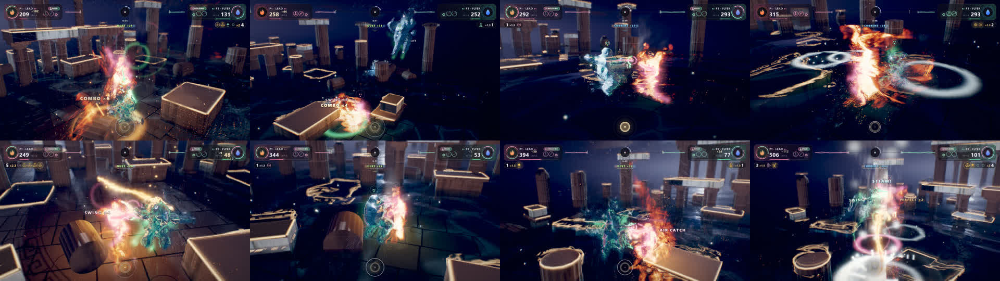
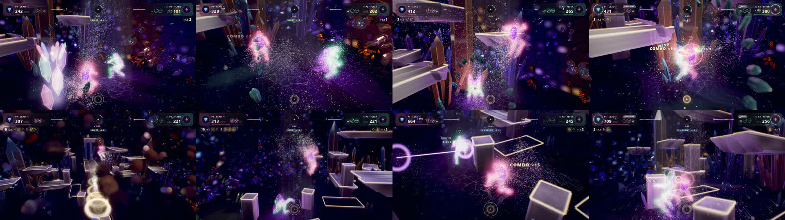

What I see in them: the temple is the players' view now, low and side on, the court behind the pair; a drum or a
block still sits in a bottom corner in two of the four. The geode is not fixed: lower, the eye now looks across the
arena's standing selenite beams (`--why` names solids 190 to 193, at x ±3.8 and the drops' outer edges) and the gems'
pillars, and the blocks sit in its near bottom-right (below). The geode's corners improved by the numbers (15.9 →
13.3 %) but not enough to see.

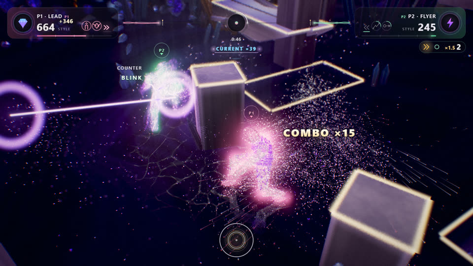

**Not done, the geode**: tried and reverted, none of which moved it: a fifth yaw offset (1.25 rad), a closer boom
for the wide lens, a cap on the turn's cost so the camera swings round the great crystal trunk, finer pitches and a
heavier near cost. The test's geode set (seed 45, the pair under the high blade and behind the trunk for the whole set)
is 39 to 44 % near frame with either camera. What would: the near fade dissolving what stands in the near part of the
frame in the duel (`worlds/fade.ts` fades only within 0.6 m of the eye and across a dancer's sight line), or the
geode's beams and the low blades made shorter or moved off the camera's side of the plane (the arena's, not mine).

## The near fade in the duel's frame (branch `p3-near-fade`)

The second pass left the geode with lit pieces in the near part of the frame that no yaw, boom, turn cost or pitch
cleared. Now the near fade dissolves them: in the duel, a piece standing between the eye and the pair, across a share of
the frame or a near corner, dissolves gracefully, and its edges stay as a faint line of the arena's rim light, so the
arena's shape still reads and can be used. In every world: the arena's pieces, the world's solids and the gems'
pillars. The camera is unchanged (it never reads the fade, so every number it makes is the same as before, frame for
frame).

**Measured:** `scripts/cam-sim.mjs` (the same 24 seeded sets of 40 s as above, every frame judged twice: as before, and
with the pieces the fade has dissolved at least halfway counted as clear); `src/worlds/fade-frame.test.ts` (new, 7
tests); `npm run typecheck`; `node scripts/test-ts.mjs` (19 of 19 files); `check-limits`, `check-bindings`; GPU timings
in the geode's duel against master served beside it (`shot.mjs --timings`, 1280×720, 24 windows of 150 frames each
side) and on the plain geode page; headless 960×540 stills of the page on my dev server, each moment grabbed with the
frame test on and, one stepped frame later, off (`scripts/fade-cap.mjs`, new); the Node harness (`duel-measure.mjs`)
before and after the one layout change I tried (reverted). **Not measured:** a person playing; a phone or a laptop (the
16 slots' loop on a weak GPU); 1080p; the gems' pillar dimming seen in a still (no pillar stood in a near corner at a
moment I grabbed); the redwoods' dissolve in a still (no moment of its run covered a quarter of the frame); `npm run
test:net`. The duel in the page is not deterministic from run to run (the same seed gives other moments), so the stills
are pairs grabbed at the same moment of one run, not the second pass's moments.

### How

- **The test, on the CPU** (`src/worlds/fade-frame.ts`, pure: the page's `worlds/fade.ts` and the Node probe both run
  it). Each frame a 16 × 9 grid of rays from the eye, over a frame 1.2 times the lens, looks for solids within the near
  part of the frame (0.6 of the way to the nearer body, at most 5 m: the judge's own yardstick). Each piece it meets has
  its share of the frame and of the frame's corners (the judge's corner cells). A piece starts to dissolve when it
  covers 3 % of the frame or 10 % of its corners, or is about to (as much in the band just outside the lens, or within
  1.15 times the near part: the eye coming in toward the pair).
- **No flicker**: a piece keeps dissolving while any ray still meets it within 1.3 times the near part, and for a second
  after; its strength eases in (0.18 s) and out (0.6 s). In the measure a piece comes back and dissolves again within a
  second 1.6 to 5.7 times a minute per world (a slow pulse, eased both ways), never from one frame to the next.
- **Never what the pair is on**: not while a body's feet are within 0.45 m of it, a hand or a foot at its top (standing,
  hanging from its edge), its hips against it, or the feet's path over the next 0.9 s (carried by the body's velocity,
  falling) meets it. Under a body it comes back in 0.08 s and stays whole 0.8 s after. In the measure, 0 of 55,272
  frames have a piece dissolved past a tenth under a standing body. The shaders also leave whole whatever stands at the
  pair's own depth (within 0.6 m of the nearer body's distance), whatever the test found.
- **A piece** is a solid, or boxes turned the same way that nearly fill the box round them (a shelf's blades, a
  column's drums): one piece, one strength, so a shelf dissolves whole.
- **On the GPU** (`worlds/light.wgsl sightFade`, no new binding: 16 pieces ride in `WorldLight.sight`, which grows from
  80 to 1,136 bytes; the world light is 4,640 of 65,536). A fragment inside a piece (its box, or its capsule) dissolves
  patch by patch as the strength rises (a front through a noise in the stone, so a half-dissolved piece is whole patches
  and holes, not a screen door the lens blurs into a veil). Its edges stay: for a surface on its box's faces (a blade, a
  beam, a slab) the box's edges; for a surface inside it (a round column stood in for by a box, a crystal, a trunk)
  where it turns away from the eye. No line within a metre of the eye (there it is only a blur). `sightLit(col)`, one
  call in each world solid shader's return, brightens what is left of the edges with the arena's rim light
  (`fade.outline`, 0.35). The gems' pillar is glow, not a solid draw: `power-fx.ts` dims its crystals and core with the
  same strength (`PlayApp.fade.strengthOf`) and lays a faint ring at its foot and top.
- In the duel only (the arena shown: `shownArena()`); `fade.frame` and `fadeFrame` (its numbers) in the params;
  `bend.fade.seen.pieces` (each dissolving piece's strength) and `.cover`.

### The numbers (24 sets, 55,272 frames; "before" is master's, the same frames)

| | before | with the fade |
|---|---|---|
| a piece in the near frame | 11.5 % | **5.7 %** |
| … over a tenth of it | 4.8 % | **1.7 %** |
| a near corner filled | 8.7 % | **3.6 %** |
| … an eighth of the corners or more | 6.2 % | **2.3 %** |
| a dissolved piece under a standing body | | 0 frames |
| the test's CPU a frame (Node, a shared machine) | | 0.02 to 0.19 ms |

| world | near frame over a tenth | a near corner ≥ 1/8 | a piece dissolving | again within 1 s |
|---|---|---|---|---|
| temple | 1.5 → 0.4 % | 2.3 → 0.5 % | 59 % of frames | 2.3 a minute |
| redwoods | 1.6 → 0.8 % | 3.4 → 1.8 % | 60 % | 1.6 |
| geode | 11.1 → **4.0 %** | 13.3 → **4.7 %** | 71 % | 5.7 |
| Pool | 4.9 → 1.7 % | 5.8 → 2.1 % | 72 % | 4.7 |

("A piece dissolving" counts the ones just outside the lens and coming in, which nobody sees.) Everything else the
probe measures (the eye in a solid, past the room, the look down, hidden bodies, the flyer in frame 17,262 of 17,262)
is unchanged: the camera is master's.

**What is left in the geode** (`cam-sim.mjs --world geode --why`, the frames still over a tenth with the fade): a piece
a body has just stood on, resting whole (598 frame-pieces), one still easing in (537), one under a body now (79), and
one too small to start or with the slots taken (179). By solid: the jogo's high blade over the middle (solids 14 to 16)
and the high shelves (90 to 95), both reaching 0.7 m past the plane toward the camera and both stood on often; the
drops' beams (190, 191) are left in 57 frames.

### GPU (RTX 5090, 1280×720, weft's profiler)

| | master | p3-near-fade |
|---|---|---|
| geode duel, the whole frame (24 windows of 150 frames each side, four runs alternating) | 0.803 ± 0.048 ms | 0.807 ± 0.045 ms |
| … the scene pass | 0.272 ± 0.024 ms | 0.293 ± 0.029 ms |
| the plain geode page (nothing to fade), the scene pass (6 windows each) | 0.253 ms | 0.250 ms |

The whole frame is unchanged within the noise; the scene pass gains about 0.02 ms on average in the duel, the world
behind a dissolved piece now drawn (as report 9 found for the old near fade). With nothing to dissolve the shaders pay
one uniform branch more.

### Seen

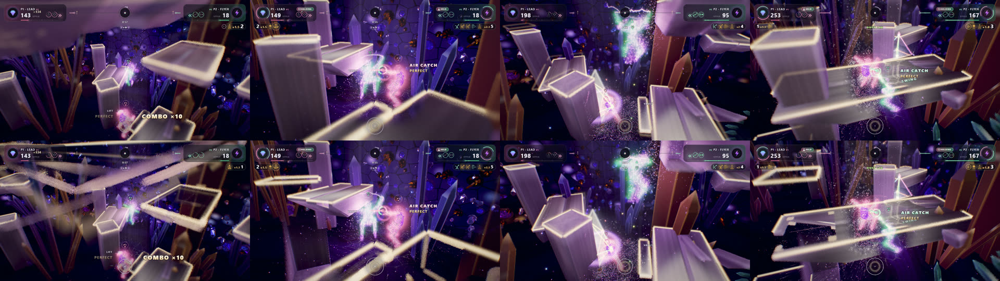
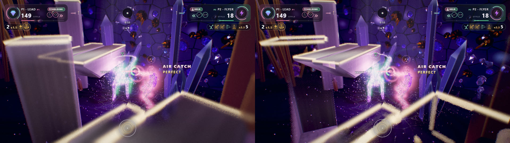
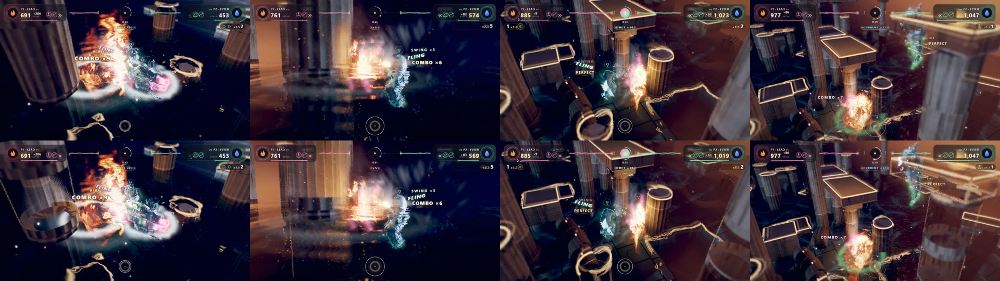
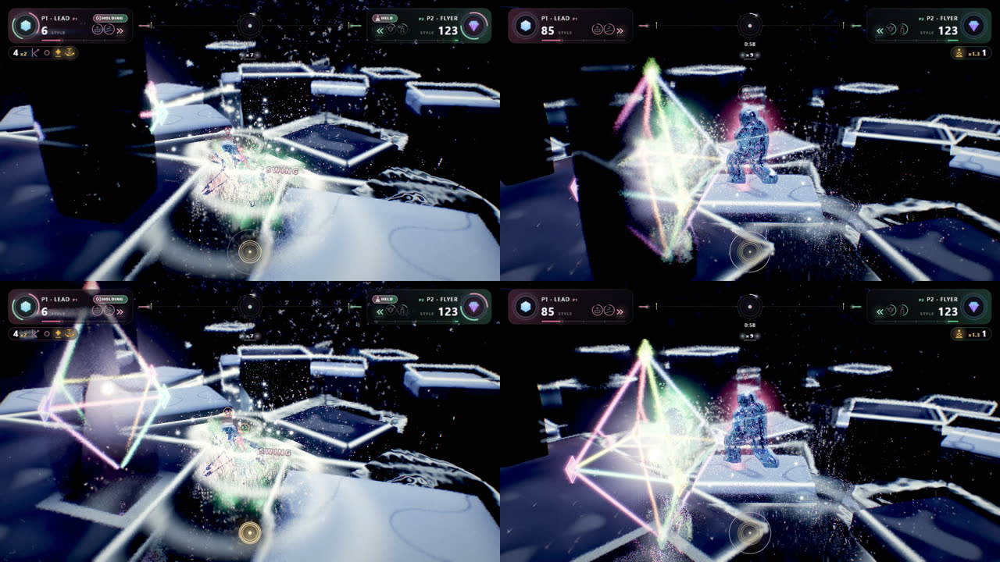

What I see in them: in the geode the beams and shelves that filled a third of the frame are gone but for a faint honey
outline; the pair and the floor behind read clearly, and the arena's shape still reads from the lines. In the temple the
near drums and columns open to a faint silhouette and what stood behind them (another broken column, the court) shows;
a column's upper drums at the pair's depth stay whole. In the Pool a dark standing stone opens on the prism behind it.
The outline is thicker than a pixel near the eye: the lens blurs it into a soft band, which reads as light, not stone.
An earlier take (before the patch-by-patch dissolve and the metre without lines) showed a half-dissolved temple column
as a pale veil over the pair, the lens blurring its dither; the stills here are after that fix.

### Tried and reverted: the geode's layout

The high shelves ending 0.25 m past the plane (not 0.7) and the drops' beams moved 0.2 m back off the camera's side:
the geode's near frame over a tenth went 4.0 → 4.2 % with the fade (11.1 → 12.3 % without), the eye in a solid 0.1 →
0.5 %, and the harness's falls doubled (0.10 → 0.20 a set; catches 21.6 → 22.5 a minute). Not kept: what remains is
mostly the pieces the pair stands on, which the fade must leave, and pulling them back changed the camera's choices for
the worse. With the fade the geode does not read cluttered in the stills, so its layout is as it was, and the harness's
numbers are master's (geode, 20 sets: falls 0.10 a set, catches 21.6 a minute, 3 fused).

### Files

`src/worlds/fade-frame.ts` (new: the test), `src/worlds/fade-frame.test.ts` (new), `src/worlds/fade.ts` (the camera's
axes and lens in, the pieces to the uniform, `strengthOf`), `src/worlds/light.wgsl` (`SightPiece`, `Sight.piece`, `.f`,
`.glow`; `sightFade`'s pieces; `sightLit`), one call in each world solid shader's return (`temple/stones`,
`geode/shelves`, `geode/crystals`, `pool/stones`, `redwoods/lanterns`, `redwoods/trunks`: its stage entry now calls the
fade before its own discard, in uniform control flow), the regenerated `.d.wgsl.ts`, `src/main.ts` (the camera to the
fade, the fade to the play app), `src/play/index.ts` (`PlayApp.fade`), `src/duel/index.ts` and `power-fx.ts` (the
pillar dims), `src/duel/camspace.ts` and `camera.ts` (the judge takes the dissolved pieces), `src/duel/camprobe.ts`
(the test on every pose, the numbers with the fade, `--nofade`, `--why`'s leftovers), `scripts/fade-cap.mjs` (new: A/B
stills of a duel), `scripts/steps/fade-frame-timings.json` (new), AGENTS.md.

```bash
node scripts/cam-sim.mjs [--world geode] [--why] [--nofade]
node scripts/fade-cap.mjs shots/fade --url http://127.0.0.1:<port>/energybending/ --world geode --dress gems,plasma --find 4 --seed 3
node scripts/shot.mjs shots/t scripts/steps/fade-frame-timings.json --url http://127.0.0.1:<port>/energybending/ --size 1280x720
```

### Not done

- The geode is still the densest: a piece over a tenth of the near frame in 4.0 % of frames with the fade (the temple
  0.4 %), nearly all of it a piece the pair stands on or has just left. Dissolving only a piece's near end while a body
  stands on its far end (the high blade reaches 0.7 m past the plane) would be the next step; the shaders' guard at the
  pair's depth already keeps the end under the body.
- A piece the camera sweeps into fast is seen whole for its first 0.1 to 0.2 s (537 frame-pieces in the geode).
- The powers' other temporary solids (the ice steps, the frozen bar) are set ice drawn by the water kind, not a world
  solid draw: they don't dissolve.
- The 16 slots' loop runs in every solid fragment while anything dissolves: not measured on a weak GPU.
