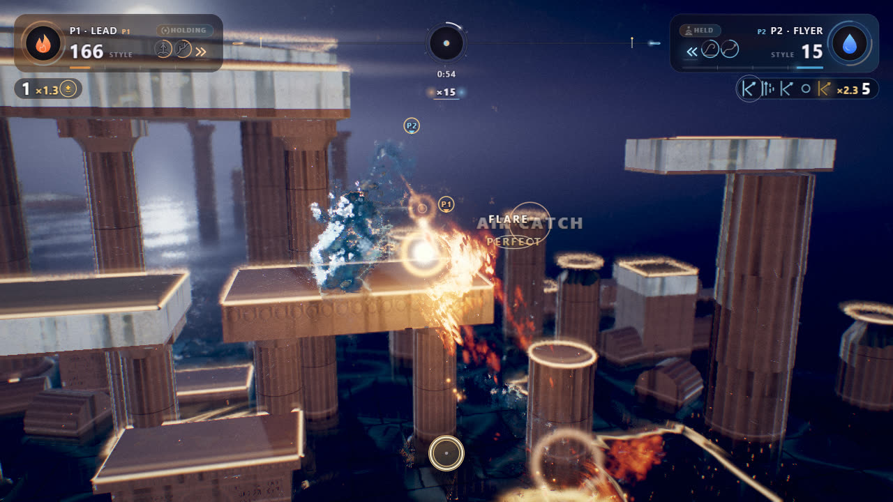
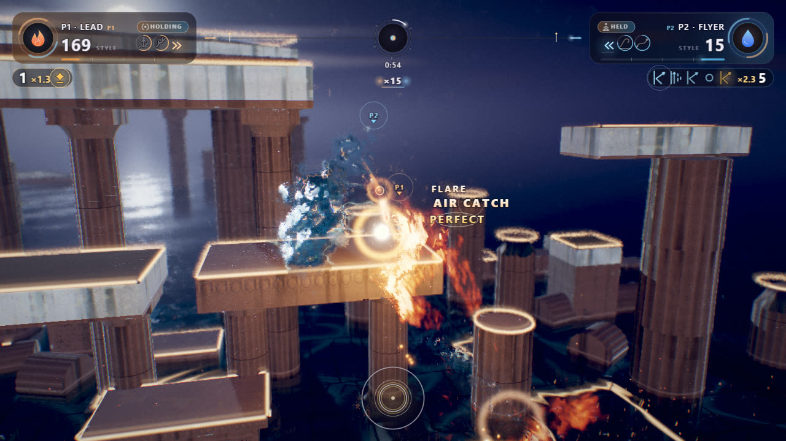
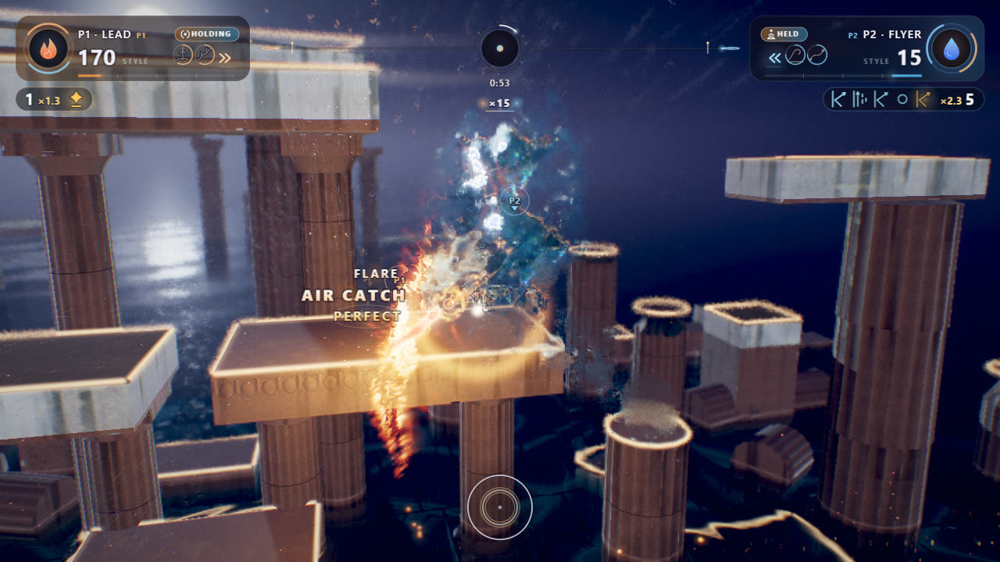
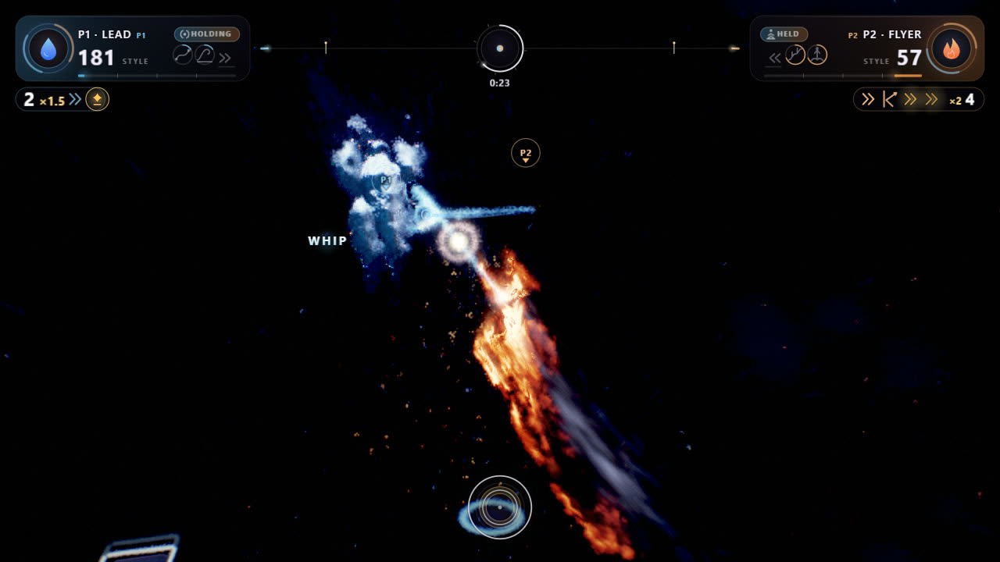
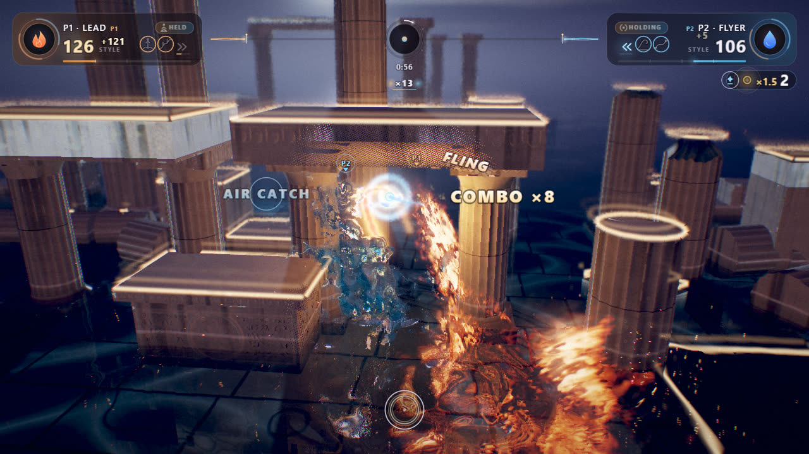
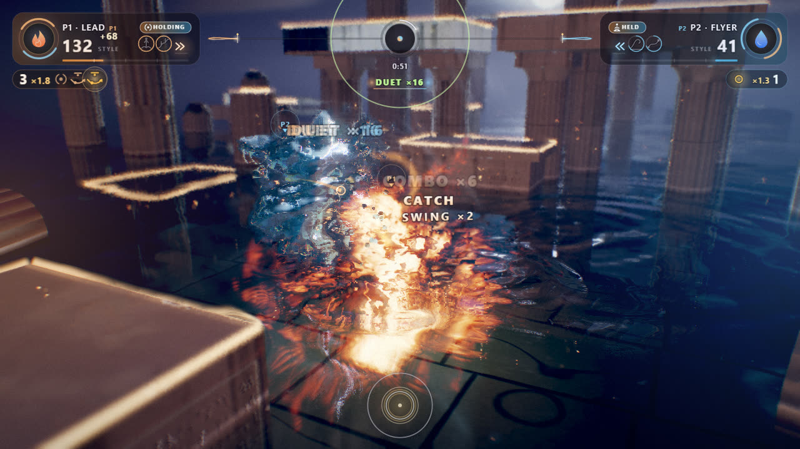
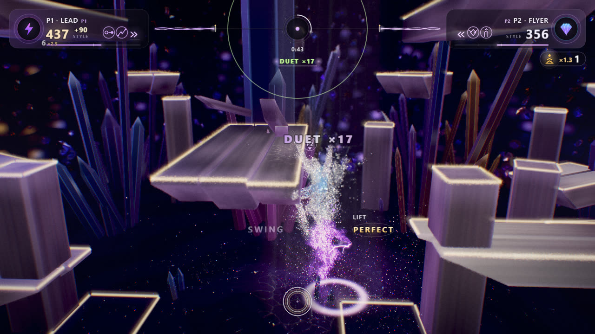
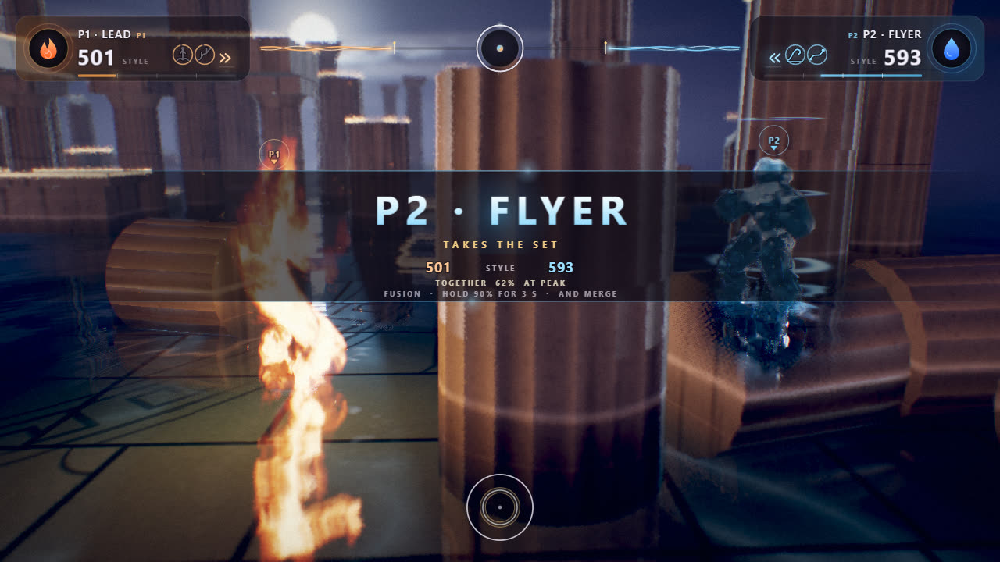

# 14: the duel's feel (phase 3, Juice): the weight of contact and pair combos

Branch `worktree-agent-a4133294e840a1cc0`, from master `ac4e6fe` (phase 2 and its film, report 13). One of six phase 3
tracks. This one: report 13's issue 1 ("a catch has no weight") and issue 3 ("the tiers reward running alone, not the
dance"), and two of its smaller things (the finale's powers running on under the duet, no "nearly" at the banner).

The tone holds throughout: nothing here is an impact. A hold is a breath at the moment two bodies meet; the pair's
tier is a flash of both their colours and a beat of slow motion; the camera's ease toward a catch is left to the camera
track and called as `impulse`.

**Measured:** 96 seeded Node sets before and after (temple, geode, pool; free; skill 0.85; four style pairs; eight seeds
each), the same with the warp off, and the probe's own 96 (free and locked); the hold and the slow motion in the page
(the bodies' travel through a hold, the warp's scale); seven headless stills of the page (low quality: `&class=laptop`,
720p); `npm run typecheck`; `node scripts/test-ts.mjs` (15 of 15 files). **Not measured:** a person playing; a phone;
the sound (another track's); the camera's ease (another track's `impulse`, not in this branch); the lock in the page;
the finale's lift hold in the page (Node only); `npm run test:net` (its port clashes with the other agents).

## What changed

### 1. The weight of contact (`src/duel/weight.ts`, new)

A **time warp for the bodies and the sim**, not a frozen page. `TimeWarp.step(dt)` gives the frame's scale for the
dance time; the page multiplies `f.danceDt` by it at the start of its input phase (`src/duel/index.ts`, a few lines),
so the bodies, the matter, the field, the powers and the rules' clock all slow together, while the music, the HUD
and the camera keep the page's own time. The contact's ring and the link's beads (fx.ts) are handed the unscaled
dance time, so they keep moving through a hold.

| moment | frames held | weight `w` |
|---|---|---|
| a catch on the ground | 3 | 0.4 |
| an air catch | 4 | 0.65 |
| a catch at range (the whip, the arc) | 6 | 0.9 |
| a catch at a geyser's top | 6 | 1 |
| a fling's release | 3 | 0.35 … 0.85 by its speed |
| the finale's lift at its top (fused) | 6 | 1 |
| a pair tier | none: one beat at 0.4, eased in 0.08 s and out 0.22 s | 0.7 … 1 |

During a hold the bodies run at 0.06 of their time (in the page, 2.5 cm of travel over the three frames of a catch's
hold, `bend.duel.match.warp.scale` 0.06), then ease back over 0.06 s. The pair tier's slow motion measured 0.40 in the
page. Each moment is a **`juice` event** in the duel's own stream (`DuelMatch.juice`, after the powers' step): `what`
(`catch`, `aerial`, `range`, `fling`, `tier`, `pair`, `merge`, `fusion`, `lift`), `w`, `hold`, `slow`/`slowS`, `at`,
`via` (`whip`, `arc`, `geyser`). It is in `bend.duel.events()`, `bend.duel.history` and so the film's duel log, for the
sound track to key off. Each is handed to the camera as `DuelCamera.impulse?.({ at, kind, k })` (kinds `catch`,
`fling`, `tier`, `lift`, `merge`), a no-op until the camera track's `impulse` lands.

### 2. Pair combos (shared/duel.ts, the HUD)

Every **contact link** either dancer makes (a catch, an air catch, a swing, a fling, the flown one's landing, a lift, a
vault, a counter, a power's catch) also goes on one chain shared by both: the **pair combo** (`DuelState.pair`). It has
its own tiers (`DUEL.PAIR_TIERS`: **DUET** at 14 varied links, **CURRENT** 28, **MURMURATION** 48, **AURORA** 108, a
colour each), its own place in the HUD (a chip under the set's orb: a dot of each dancer's colour either side of
`DUET ×17`, the tier's word in its colour, a line under it from one colour to the other; `src/hud/pair.ts`), and its own
pop (kind `pair`, above the pair, across both colours). It ends 2 s after its last link with the two apart, when both
have stood 0.9 s, with a fall (dropped) or with the set; each dancer banks its share (the worth of the links it made)
times the pair's multiplier (1 + 0.2 a link, at most ×3) times `PAIR_BANK` 0.2, more for a tier. A pair tier is the
loudest moment in the game now: a flash of the two's colours washing in from each one's side of the screen, a ring
of the tier's colour from the orb, a beat of slow motion. The HUD runs on the page's time, so its pops don't hang in
that slow motion (report 13's note; the film tool's own `rate` cue still slows everything, the HUD with it).

A **solo chain** stops adding after `SOLO_RUN` (4) of a dancer's own moves in a row (a dash, a wall jump, a wall run, a
flip, a kick, an aú): past it they keep the combo going (its idle clock) but add nothing, until a contact link comes.
Their `link` events still flow (`capped: true`, value 0), so the powers' flow and the energy read them as before.

### 3. The finale

FINALE settles the powers (`DuelPowers.settle`, a small public method beside `clear`: every live effect ends and fades
as it would; the bodies' updrafts, slicks and carries end), in the page and in the Node harness. A set that didn't fuse
says how near it came, under the banner's peak: `NEARLY · HELD 2.1 S OF 3 AT THE TOP` (and `· NO MERGE YET`), or for a
set never at the top, what the fusion asks: `FUSION · HOLD 90% FOR 3 S · AND MERGE` (`nearly` in src/hud/centre.ts,
from the new `shared.high`, `highFor`, `highAt`, `merges` and `set.fused`).

## The numbers

96 sets: temple, geode, pool; free; skill 0.85 both; lead & flyer, base & flyer, lead & lead, flyer & base; seeds
1 + 101 r (brains `seed`, `seed + 7`), 60 s sets. A tier counts as **contact** when it is a pair tier, or a solo
combo's whose links were at least half contact; else **solo**.

| | before (master) | after (warp on) | after (warp off) |
|---|---|---|---|
| tiers in all | 102 | 321 | 325 |
| from contact | **21 (21%)** | **305 (95%)**: 292 pair, 13 solo-combo | 300: 279 pair, 21 solo-combo |
| from solo chains | **81 (79%)** | **16 (5%)** | 25 |
| temple: tiers (sets with one) | 5 FLOW (5 of 32) | 134 pair (32 of 32): 73 DUET, 36 CURRENT, 19 MURMURATION, 6 AURORA; 2 solo | 136 pair, 5 solo |
| geode | 8 FLOW (8 of 32) | 136 pair (32 of 32): 79 / 41 / 16 / 0; 6 solo | 122 pair, 7 solo |
| pool | 89 (30 of 32): 64 FLOW, 19 BLOOM, 5 RADIANT, 1 SUBLIME, 79 of them solo | 22 pair (14 of 32), 21 solo (16 of them solo-led) | 21 pair, 34 solo |
| **fused finales** | **16 of 96** (10 temple, 6 geode) | **12 of 96** (7, 5) | 16 |
| **first MERGE**, soonest / mean | 25.1 s / 41.3 temple, 28.7 / 41.9 geode | **27.3 s** / 37.9 temple, 28.9 / 41.5 geode | 25.1 / 41.3, 28.7 / 41.9 |
| sets merged | 47 | 52 | 47 |
| style a dancer a set | 1179 temple, 1180 geode, 657 pool | 1596, 1522, 493 | 1575, 1516, 548 |
| page time a 60 s set takes (with its count-in) | 64.5 s | 68.2 s temple and geode, 66.1 pool | 64.5 |

The probe's own 96 (`node scripts/duel-sim.mjs --sets 4 --skills 0.85,0.85`: free and locked, four seeds): fused **9
before, 15 after**; first MERGE soonest **25.1 s before, 27.6 after**. Across both sets of 96, 25 of 192 fused before
and 27 of 192 after: the fusion stays the set's event (12 to 16 a hundred), and the gap between the two configurations
is as big as the change. The first MERGE's soonest was already under 28 s on master in both configurations (25.1 s,
lead & lead in the temple); after, 27.3 and 27.6 s. Nothing here changes the energy's rules: a capped solo link feeds
the energy as before, and the pair combo adds none. What moved it is the warp (the warp-off column matches master to the
tenth), which nudges every set's dance; read these as noise around the same pacing, not a change of it.

**Juice a set** (temple, after): 14 catches held, 14 flings, 8 air catches, 2.2 at range, 4.2 pair tiers slowed, 1.2
merges; the warp takes about 3.7 s of the page's time from the bodies in a 60 s set (6%), 1.6 s in the Pool. Pair
chains are long with virtual players (they are in contact about half the set: the eight longest chains in the temple ran 80 to 123 varied links),
so the tiers sit high: AURORA in about one set in ten (6 of 64 temple and geode sets), the same rarity as the fusion.

**Falls** (locked, skill 0.7, temple and geode, 8 seeds each, warp on against off): 24.3 against 21.7 falls a minute
summed over the eight pairings. Within the spread of a few sets, but noted: a hold changes when a jump meets a ledge.

## Files

- `src/duel/weight.ts` (new): the warp, the moments (`juiceOf`, `liftJuice`, `atGeyserTop`), the camera's kinds.
- `shared/duel.ts`: the pair combo (`PairCombo`, `PAIR_*`, `pairTierOf`, `pairMult`), `SOLO_RUN`, `CONTACT_LINKS`, the
  events `pairTier`, `pairCombo`, `juice`, `link.capped`. Every existing event name and field kept.
- `src/duel/match.ts`: `warp`, `juice()`. `src/duel/finale.ts`: `update` reports the lift's top, `topAt`.
- `src/duel/hud-state.ts`, `src/hud/state.ts`: `pair`, the `pair` pop, `shared.high`/`highFor`/`highAt`/`merges`,
  `set.fused`. `src/hud/pair.ts` (new), `hud.ts`, `pops.ts`, `centre.ts`.
- `src/duel/index.ts` (small): the warp on `f.danceDt`, the juice and the camera's impulse after the powers' step, the
  powers settled at FINALE, the ring on the unscaled time.
- `src/duel/powers.ts`: `settle()` only (beside `clear`).
- `src/duel/sim.ts`: `warp` (off by default, so the tests' sets are as they were); `src/duel/probe.ts`: `--warp on|off`
  (on by default, as the page plays).
- `src/duel/test/duel.test.ts`: the tier test updated for the solo run; six new tests (the solo run, the pair combo,
  the warp and the moments, juice in a played set, the finale's top and the banner's note, the HUD's pair).
- `docs/design/duel.md`: the Juice section, the HudState's phase 3 fields, the events' contract.

## What's not done, and what's unverified

- **The camera's ease** is called (`impulse?.`) but this branch's camera has none: unverified until the camera track's
  lands. The kinds and `k` follow the brief's signature.
- **The sound** isn't wired here: the `juice` events are there for the sound track to key off (duel.md lists them).
- **The film tool's slow motion** (`rate` cues in a film's timeline) still slows the HUD with everything else: it steps
  the page with a scaled frame time. The game's own slow motion doesn't.
- **The finale's lift hold** is tested in Node (one top, fused only) and wired in the page, but not seen in a still: no
  fused set was played to its end in the page.
- **The banner's "held 2.1 s of 3"** form is tested in Node; the page still shows the never-at-the-top form (a 20 s set).
- **The Pool** still makes most of its tiers from solo chains (16 of 21 solo-combo tiers), with fewer of them: its
  pair rarely meets (report 13's issue 2, another track's).
- **Tuning by feel**: the frames, the slow motion's depth and the pair tiers' thresholds were set from Node's virtual
  players, who stay in contact far more than people will; a person's pair chains will be shorter, and DUET (14) may be
  the tier they see. The constants are `WEIGHT` and `DUEL.PAIR_*`.
- The sets now run about 6% longer in the page's time (the bodies' clock is the set's); a film's in-points scouted
  before this branch move with it.
