# Phase 3 ("Juice"), the front: the menu offers the duel, and the first duel teaches it

Branch `worktree-agent-ab1f3388718b8abbe`. The duel used to be reachable only by its address. It is now a choice
beside the dance on the front's strip, with its own lobby, a first-duel lesson and a controls card. Everything below
was checked in headless Chrome on the RTX 5090, with real clicks, keys, touch taps and a scripted gamepad. The dev
server ran on port 5436. Phone takes used a 375×812 viewport with touch emulation (`pointer: coarse`) and
`?class=phone`. Every still was taken by reading the canvas back (`bend.grab`), laying it under the page, and
screenshotting the page so the menus' DOM sits over the frame. I looked at each still.

## The flows

### 1. The strip offers the duel

The strip gains a pair of buttons at its left, **dance** and **duel**, set off by a hairline. The game you chose is
kept for your next visit (`localStorage` `energybending.front.game`). With the duel chosen:

- **ways:** together (two on one keyboard or a pad: `p1=human&p2=human`), partner (a virtual player: `p2=bot`) and
  online. Solo is hidden.
- **worlds:** the same four (geode, pool, temple, redwoods; the forge is gone).
- **bodies:** the same two rows of swatches. A choice re-dresses the show's dancers at once.
- **view:** the duel defaults to 3D and the dance to the side view. Each game keeps its own setting.
- **? (how to play):** a new button that opens the controls card (section 4).

**Online.** Choosing online makes a room code at once. A code is a word from the worlds plus two digits (`FERN42`,
`TIDE34`, `CEDAR82`), which is easy to read out and fits the room server's `[A-Za-z0-9]{3,8}`. Beside it are a
button for a new code, the link (`host/energybending/?duel&net=FERN42`, shortened; the full address is in its
tooltip) and a copy button, which reads "copied" for a moment. It uses the clipboard API, or `execCommand` where that
is missing. The play button opens the room. You can also type a friend's code and press join. A stray key never
opens a room.

The duel's addresses (`menu.ts duelHref`): `?duel&world=W&dress=a,b&p1=human&p2=bot|human[&lock]`, and online
`?duel&net=ROOM&world=W&dress=a,b[&lock]` (`&server=` and the network debug keys are kept). The side view is `&lock`,
the duel's own flag, because the duel's default is free. The online agent's address mentions `&free`. Free is
already the default, so the menu writes `&lock` only when the side view is chosen. That needs agreeing (see "Not
done").

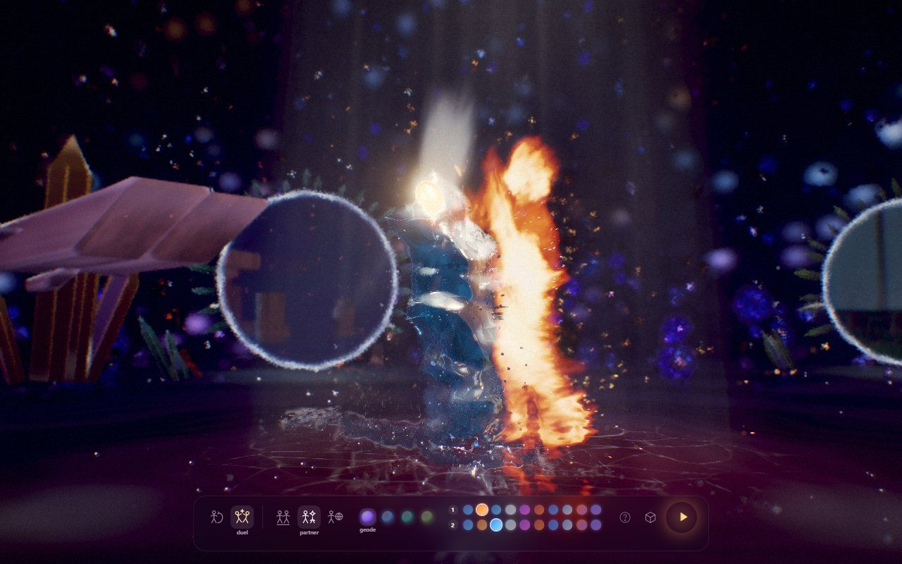
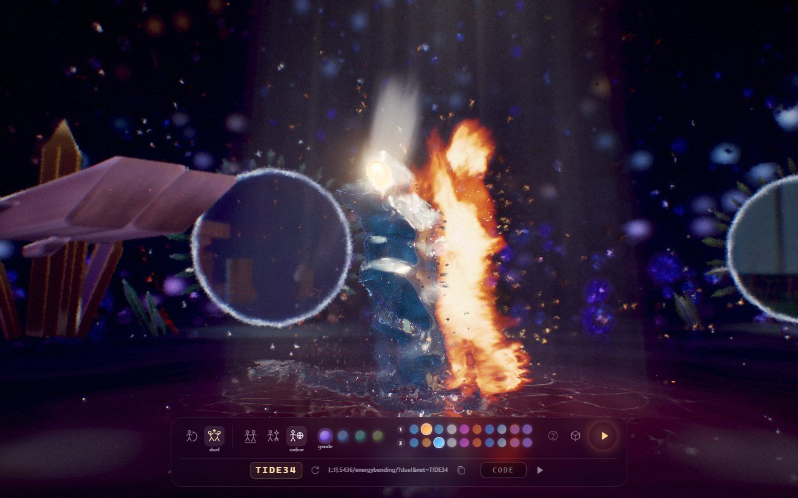

### 2. Beginning the duel, in the page

The duel begins in the same page, just as the dance does. The play button, a key away from the strip, a tap on the
dancers, or a gamepad's A on play (or Start) all go to `front.ts begin`. It does three things in order:

1. It writes the duel's address with `history.replaceState` **before** the duel starts. `dancer/play.ts` reads the
   address to give the bodies `DUEL_PHYS` and the devices the duel's buttons.
2. It calls `bend.front.begin('duel', query, joined)`. `play/index.ts` moves to the chosen world and runs
   `startDuel({ ...app, query }, { joined })` with the page's own parts. The sound carries on, and nothing reloads.
3. If the new world differs from the one on screen, a dark **veil** fades in (0.38 s) before the switch. It lifts
   (0.8 s) once the duel's camera has had 24 frames to find its players. No frame of the old stage reaches the new
   game. The online duel opens its address through the same veil.

Measured: from the click on play to `bend.duel` live took 0.92 to 1.14 s, veil included. The address read
`?duel&world=temple&dress=fire%2Cwater&p1=human&p2=bot`. The dance's path is unchanged: a key still begins the jogo in
the page, its lobby still shows `keyboard` and `partner`, and W in the jogo leaves the world where it is.

### 3. The lobby and the seats

`menu.ts duelLobby` is hooked into `src/duel/index.ts`. **The press that began the duel joins seat 1**, as commit
99fffc9 does for the jogo:

| began by | seat 1 joined as (probe) |
|---|---|
| a click on play | `keyboard-solo` (the mouse is part of the solo layout) |
| the D key | `keyboard-solo` |
| a tap on play (phone) | `touch` |
| a gamepad's Start | `gamepad-0` (new: `Joined` gains `{ device: 'gamepad', index }`; the jogo takes it too) |

Each card says who plays its seat (keyboard, keyboard · left or right, gamepad, touch, partner). **A waiting seat says
how to join** and is itself a button:

- Seat 1 says "press a key or click" ("tap to join" on touch).
- Seat 2 in "together" says "arrows, a pad, or click". A click splits the keyboard, so seat 1 takes the left half and
  seat 2 the right.
- Seat 2 also carries a small **"or a partner"** button. A seat nobody comes for goes to a virtual player, and the
  duel begins.

The cards stay 1.4 s after the duel begins, so who is who reads, then go. In the probe, D followed by ← gave
`keyboard-left` and `keyboard-right` with both cards on. "Or a partner" gave `keyboard-solo` against `duel-flyer`,
and the duel started.

**A fix found here:** the duel takes the input hub's joins itself (`hub.onJoin`), so `dancer/play.ts` never made the
touch pad. A touch player had **no buttons** in the duel. The lobby now makes the pad for a touch player. The probe
saw jump, strike, kick, spin, dash, power 1, power 2, dodge, form, lock and hand.

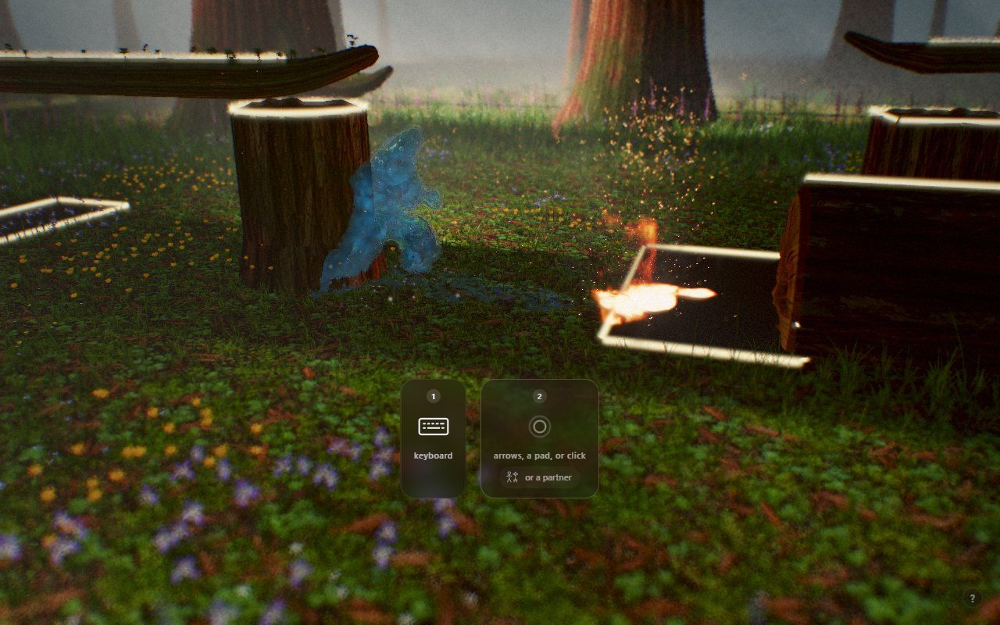

### 4. The controls card

`src/duel/help.ts` builds a small glass card in the HUD's look, with the keys in its gold. It opens from:

- the menu's ? button, or ? on the front;
- ? in the duel, or F1, which always works;
- a gamepad's Start;
- the faint ? chip in the corner (bottom right on a desktop, under the orb on a phone).

Esc, the same key, × or a tap outside closes it. It doesn't pause the duel.

The card has a tab per device: the keyboard alone, two on one keyboard (the left and right layouts side by side), a
gamepad, and touch. It opens on the player's own device. Under the keys, it lists what each seat's two powers do.

The table is the one source the lesson reads too. `src/duel/test/help.test.ts` checks it against the bindings the
duel actually listens to (`input/keyboard.ts LAYOUTS`, the HUD's `POWER_KEYS`, `POWER_BUTTONS`), so the card can't
drift from the game.

**? and the split keyboard.** The right half kicks with `/`, so `?` is Shift plus their kick. The card's key listener
is registered (in capture) as `help.ts` loads, before the duel's input hub listens. While someone plays the right
half, `?` stays theirs and F1 opens the card. Otherwise `?` opens it, and the hub never sees the `/`.

Before this fix, `?` split a lone keyboard player into the left layout. The probe caught it and it is fixed.

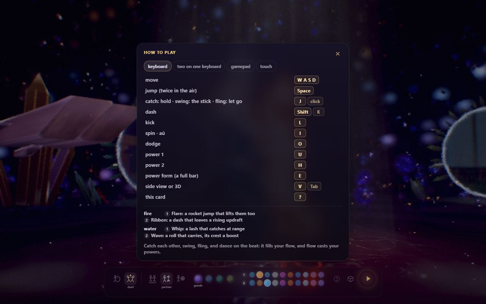
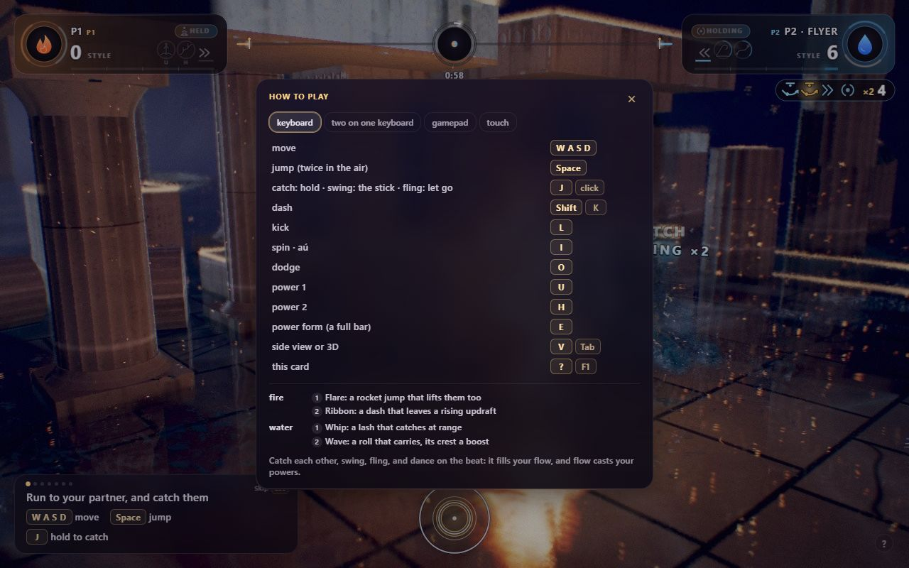

### 5. The first duel teaches: `src/duel/lesson.ts`

The lesson is offered once and kept in `localStorage` (`energybending.duel.taught`), like the jogo's teacher. It
starts when the first set's play begins. Each prompt is a calm card in the HUD's look:

- on a desktop it sits in the lower left corner, clear of the bodies the camera frames and of the beat;
- on a phone it sits under the panels;
- a dot marks each step;
- the keys are the player's own device's (WASD and J; arrows and `,`; left stick and X; the touch buttons' names);
- two people get both keys, seat by seat.

You can **skip** it with its chip, Esc or a pad's Start. The whole lesson is cut short at 58 s. Each step moves on
when it is done, with a soft "lovely" or "beautiful", or after its own few seconds, so nobody is stuck.

| step | says | done when | its time |
|---|---|---|---|
| catch | Run to your partner, and catch them (or, if the partner caught them first: jump to spin out, then catch them back) | the player's `catch` or `aerial` link | 14 s |
| fling | Swing them round with the stick, then let go to fling | the player's `fling` | 11 s |
| power 1 | Dancing on the beat fills your flow. Here is a little. Power 1, *Flare: a rocket jump that lifts them too* | a cast of slot 0 (flow topped to 0.55 first) | 9 s |
| power 2 | And power 2, *Ribbon: …* | a cast of slot 1 | 9 s |
| a reaction | the pair's own (below) | any reaction | 13 s |
| power form | Your bar is full: take the power form… | a form (the flow set to 1) | 9 s |
| end | That is the dance… | (the card's key shown) | 4 s |

During the power steps, if the two are joined (no cast is possible), the prompt says "Let go first". A press is never
silently ignored.

**The reaction step** is built for the pair's matters:

- **The player is fire, the partner water.** The virtual partner rolls a wave at the player every 3.6 s. The keys
  glow gold while the wave is on the player ("Flare as it reaches you").
- **The player is water, the partner fire.** The player rolls a wave at the partner, and the partner flares into it
  0.3, 0.75 and 1.25 s later.
- **Fire and ice (a melt), water and ice (the bar).** The same idea, with the partner's ice step or its answer.
- **Two people.** One shared prompt with both seats' keys.
- **A pair whose matters make no reaction.** The prompt says what does (steam, the melt, the freeze) and moves on
  after 7 s.

The flow is kept up through the step, so a mistimed cast is never the end of it.

The lesson gives only what a generous partner would: flow (`bend.duel.flow`) and the partner's casts
(`bend.duel.cast`). It never touches the rules. It isn't offered:

- in a film;
- with `&go` or online (`&net`);
- under automation (`navigator.webdriver`), so the playtests (`scripts/playtest.mjs`) are untouched.

`&lesson` asks for it and `&nolesson` never shows it.

**Measured** (address `?duel&…&p1=human&p2=bot&lesson`; the probe pressed U, H and E when asked, and did no catching
or flinging):

| run | catch | fling | power 1 | power 2 | reaction | form | end | the whole |
|---|---|---|---|---|---|---|---|---|
| Pool | 14 s, timed out | 11 s, timed out | 3 s ✓ | 3 s ✓ | 13 s, timed out | 3 s ✓ | 4 s | 51 s |
| temple | 14 s, timed out | 3.6 s ✓ | 9 s, timed out (joined) | 2.5 s ✓ | 1.8 s ✓ **STEAM** | 2.4 s ✓ | 4 s | 37 s |
| redwoods | 14 s, timed out | 11 s, timed out | 3.3 s ✓ | 3.4 s ✓ | 2.2 s ✓ **STEAM** | 3.2 s ✓ | 4 s | 40 s |

In two of three runs the geyser came the same way: the player's own ribbon (power 2) was still rising as an updraft
when the partner's first wave rolled into it. So the order (power 2, then the partner's wave) shows a new pair the
steam within seconds. Report 13 found new pairs might never see a fusion, and that the second power and the
reactions went unused. In every run the lesson had the player cast both powers and take the power form, and in two of
three it showed them a reaction.

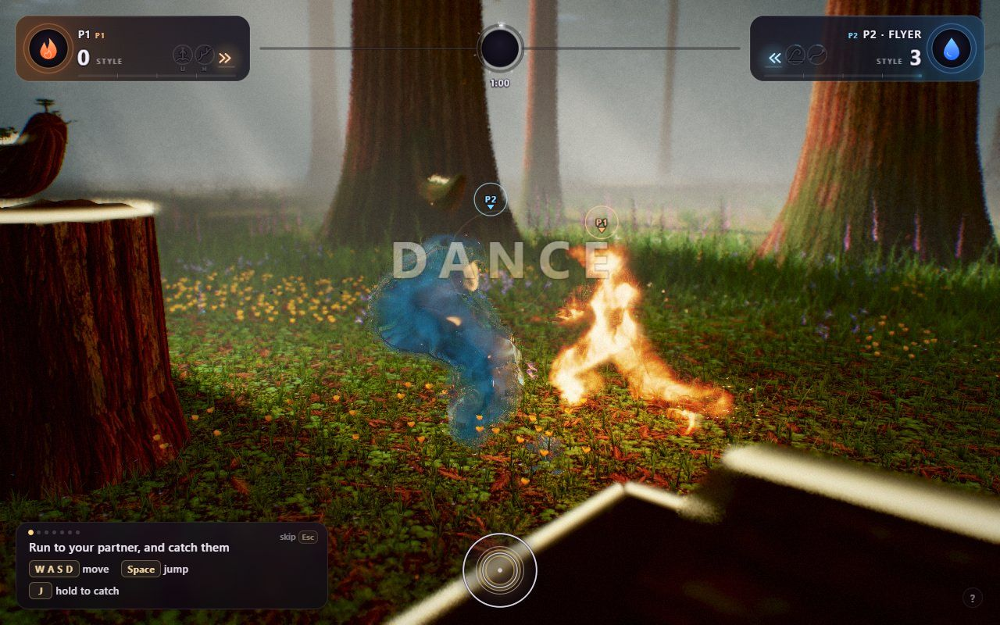
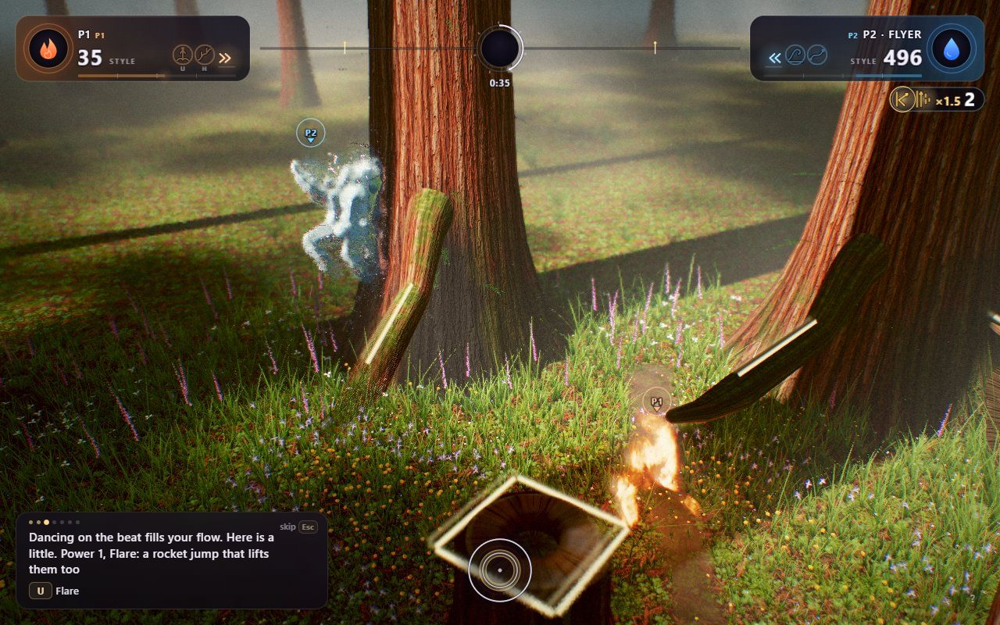
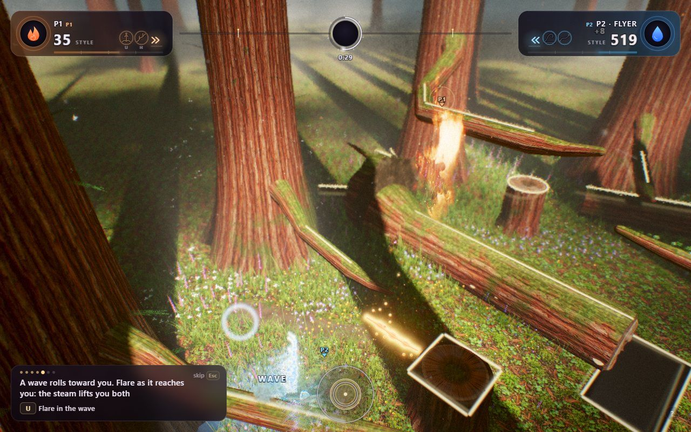
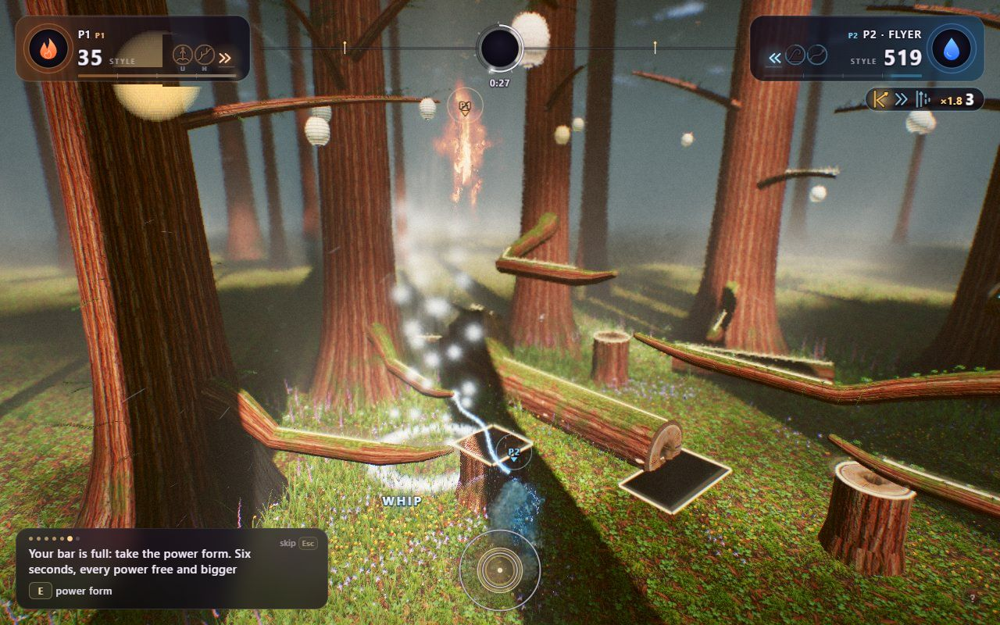
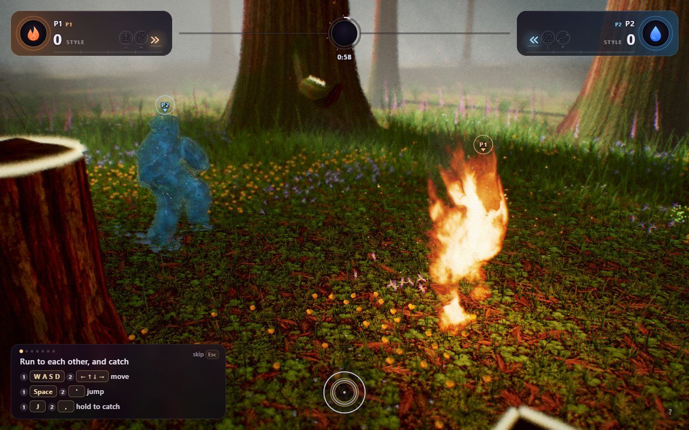
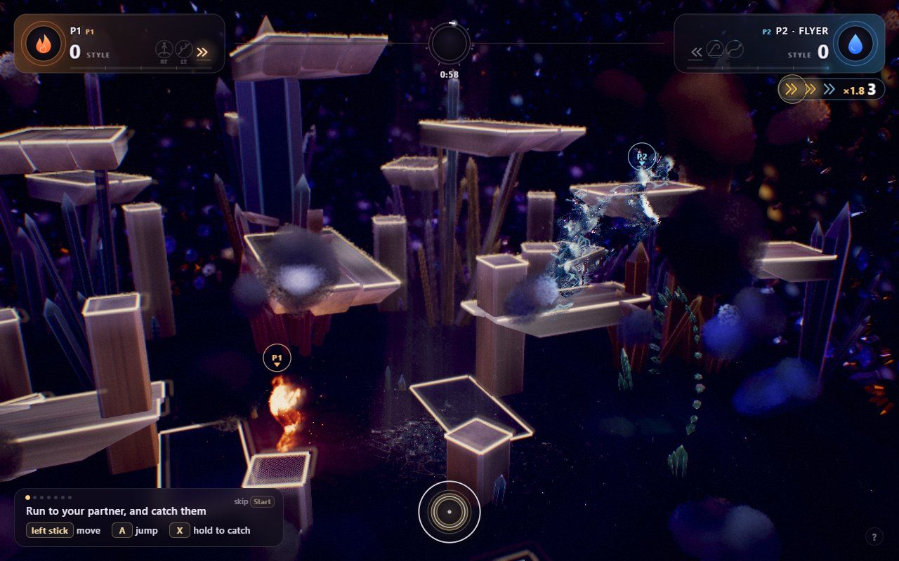

### 6. Every device, on the strip too

- **Keyboard:** the arrow keys walk the strip once something in it has the focus (Tab, or a click). Away from the
  strip, the arrows stay the right half of the keyboard and begin the game, as before. Enter on a button presses it.
  Enter on the strip or on play begins (it used to begin from any focused button).
- **Gamepad:** the d-pad or left stick walks the strip. A presses the focused button (A on play begins), and Start
  begins. In the probe, 30 presses of ← walked from play to "duel", A chose it, and Start began the duel with
  `gamepad-0` on seat 1.
- **Touch:** every button is a tap target. Choosing duel, online, a new code, copy, the card and play were all tapped
  on the 375×812 phone.

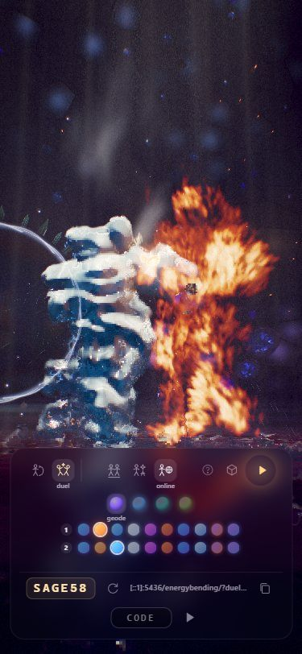
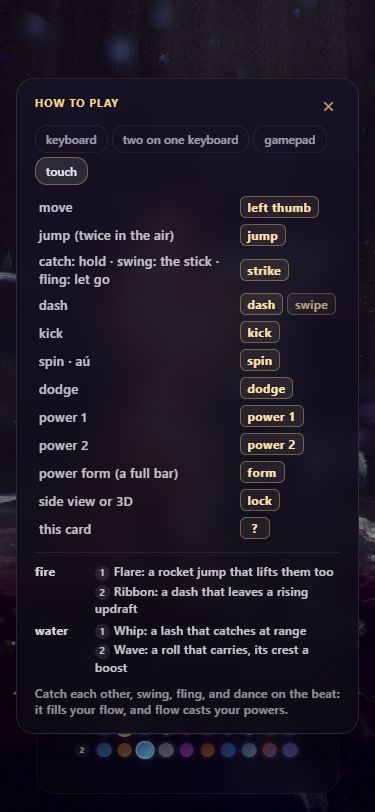
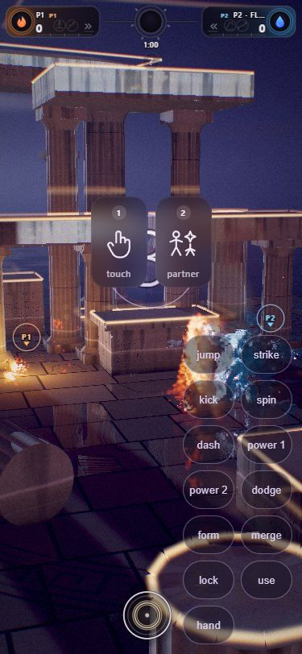
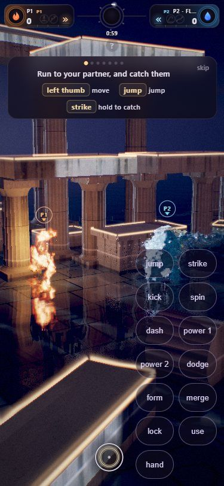
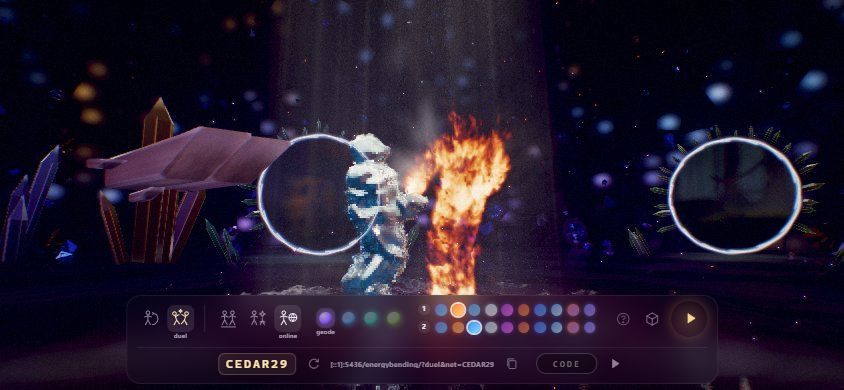

The rest are in `docs/reports/media/14-front-*.jpg`: the dance and pad-focused strips, the phone strip, the desktop
lobby.

## What changed

- **`src/play/menu.ts`:**
  - the game toggle (`Game`, `data-game`, kept);
  - `duelHref`, and `roomName`, the friendly codes;
  - the duel's online row (code, new, link, copy, a friend's code, join);
  - the ? button;
  - `moveFocus`, a d-pad walk of the strip;
  - Enter only on the strip or play;
  - `Lobby` takes a `hint` per seat and an `alt` button, and shows which keyboard half plays;
  - `duelLobby`, the duel's lobby, its joins and its touch pad;
  - new glyphs (dance, duel, help, copy, again).
- **`src/worlds/geode/front.ts`:**
  - beginning the chosen game (`Pick`), the duel in the page with its address first;
  - the veil;
  - an online duel's address;
  - ? on the front;
  - the gamepad walk (d-pad, A, Start) and a pad's join (`{ device: 'gamepad', index }`).
- **`src/play/index.ts`:**
  - `bend.front.begin('duel', …)` runs `startDuel` with `{ joined }`;
  - `Joined` gains the gamepad;
  - the jogo joins a pad that began it.
- **`src/duel/help.ts`** (new): the key table (`KEYS`, `devOf`, `POWER_SHORT`), the card (`toggleHelp`), and
  `installHelp` (?, F1, Start, the chip; Esc and Start skip the lesson first).
- **`src/duel/lesson.ts`** (new): `startLesson` and `Lesson`; `bend.duel.lesson.stats` for probes.
- **`src/duel/index.ts`:** four hooks.
  - `startDuel(app, opts = {})`;
  - the lobby, one statement after the begin;
  - the lesson and the card, two statements;
  - `Object.assign(api, { lesson })`.
- **`index.html`:**
  - the strip's grid with the games;
  - the duel's online row;
  - the veil;
  - the lobby's `alt` and the duel lobby's height;
  - the card (`.dh`) and its chip;
  - the lesson (`.dl`), desktop and compact;
  - phone layouts for each.
- **`src/duel/test/help.test.ts`** (new): 5 tests.

Tests: `npm run typecheck` is clean. `node scripts/test-ts.mjs` passes 16 of 16 files, the new one included. I didn't
run `npm run test:net` (the port clash).

## Not done, and not verified

- **The online duel's address is an assumption.** The menu writes `?duel&net=ROOM&world=…&dress=…[&lock]&server=…`
  from the brief. I haven't seen the online agent's code: today `?duel&net=X` opens a duel against a virtual partner.
  If they read `&free` rather than `&lock`, `duelHref` and `front.ts duelAddress` change in one place each.
- **No real hardware.**
  - The gamepad was a scripted `navigator.getGamepads`.
  - The phone was Chrome's touch emulation, not an iPhone, so Safari and the clipboard on iOS are untested.
  - No real sound was heard: headless runs muted.
- **The catch and fling steps never completed in a probe**, because the probe doesn't play. Their detection (the
  rules' `link` events for the player's seat) is the same the HUD's pops use, but I haven't seen it fire from the
  lesson.
- **The lesson for two people** was seen at its first step only. Its reaction step has no virtual helper, only a
  shared prompt.
- **Another owner's touch pad** shows the jogo's `merge` and `use` buttons in the duel, and labels the grab
  "strike". The lesson and card say "strike" because that is the button's label. The kinder "catch" belongs in
  `input/touch.ts`.
- **The HUD's panel** reads "P1 P1" (the name and its seat badge). That is the HUD's, seen in every still.
- **Opening the card with ?** also sends the Shift press to a solo or left player, which is a small dash. F1 doesn't.
- **Esc in a duel** skips the lesson or closes the card, and otherwise does nothing. It doesn't go back to the front
  as the jogo's does.
- **The veil** covers a world change on the front. A duel opened by its address loads as any page does (the loading
  pulse).
- **AGENTS.md** isn't mine. It should gain a line: "the front offers the duel (menu.ts, front.ts); the card help.ts
  (? or F1, Start); the lesson lesson.ts (once; `&lesson`, `&nolesson`)".
