# 15: the duel's phase 3 film (Juice), and what holds it back now

Branch `p3-film`, from master `da52ed7` (phase 3 merged: the weight of contact and the pair combos, the duel's sound,
the Pool as an arena and the gentle hazards, the clean eye, the seat colours and the near fade in the duel's frame,
online duels, the front's duel). The brief: make the phase 3 film of the contact dance (about 30 s, 720p60, the HUD
on, two virtual players, cut like a highlight reel on one Suno track's beats), showing what phase 3 added: the weight
of a catch, a pair combo's tiers and their flash, the seat colours, the hazards, the Pool, the second powers and the
reactions, the near fade, the duel's own sound, and a finale; then name, as someone who has watched a lot of it, the
five things that most hold it back, for phase 4.

**Measured:** 50 whole sets scouted as previews in the page (two virtual players, 76 s each: the count-in, 60 s of
play, the finale, the banner and the next count-in), at 640×360, all on the film's track, every rule, power, juice
and hazard event read from `info.json`'s duel log against the film's clock; the contact sheets of the moments I cut,
looked at frame by frame; two previews of the cut (960×540 without sound, then 1280×720 with it) and the master,
looked at as contact sheets; that every shot's dance matches its scout's, event for event (`match.mjs`, below); the
film's loudness and its two layers' (ffmpeg's ebur128); `npm run typecheck`. **Not measured:** a person playing; a
phone; the sound by ear (levels only); the lock (`?lock`, every shot is the free camera); the front's menu and an
online duel (neither can be filmed by the film tool: below); the Node harness (the page's numbers only).

## The film

`docs/reports/media/film/duel-p3.mp4` (git-ignored): **31.7 s, 1280×720, 60 fps, H.264 High at 4.87 Mbit/s (two
passes), AAC 192 kbit/s stereo at 48 kHz, 20.1 MB**; loudness **−14.7 LUFS integrated**, true peak −1.9 dBFS,
loudness range 3.2 LU (report 13's film: −14.4 LUFS). Encoded (`p3/final.sh`) from the film tool's master
(`docs/reports/media/film/p3/master/duel-3-master.mp4`, 117.5 MB, rendered at 1.5× and brought down on the GPU,
under the render lock; and its `duel-3-web.mp4`, 35.7 MB), the audio from the master's mix (one AAC generation). The
master took 32 minutes; its longest hold of the lock was 51 s.

The timeline is `films/duel-3.json`. The track is **the Pool's ("The Still Pool", 121.07 bpm, E♭ major)**, from bar
60's second beat to bar 76's second beat: the end of its long hush (bars 57 to 64, 6 to 8 dB under the song's body), the return
(bar 65, the loudest downbeat of that stretch) and eight bars of its body, with one short dip (bar 71's last three
beats). The Pool's is the phase's arena, and its track is the steadiest of the four (its beats within 3 ms of a
straight grid), so a cut on it lands. The shape is the reverse of phase 2's: the awe beats (the count-in, the tide,
the hum) in the hush, the juice on the return. The section marks are cuts or land on one: DANCE on bar 61's downbeat
(1.48 s), the return on bar 65 (9.42 s, the cut to the temple's MURMURATION), the dip (bar 71's last three beats) on
the cut into the finale's set (21.81 s), and FINALE on bar 73's downbeat (25.29 s; the bar is at 25.28).

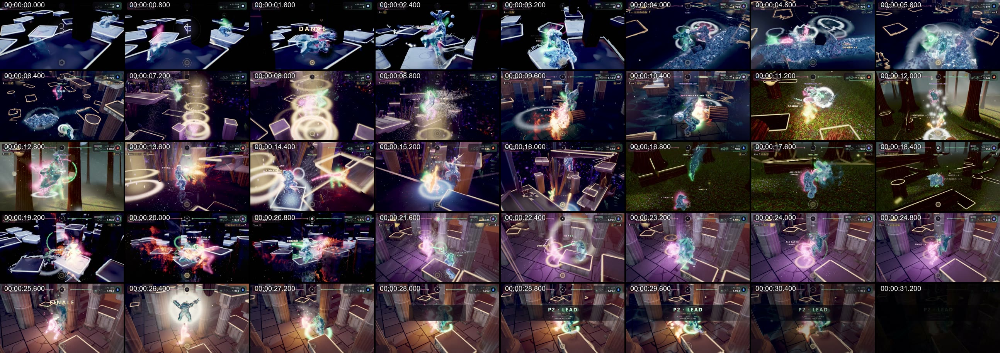

| time | shot | what happens |
|---|---|---|
| 0:00.0 | **the Pool** (water a lead in rose, ice a flyer in fern; seed 1) | **3, 2, 1** over the stones and the black water, **DANCE** at 0:01.5 on bar 61; ice kicks off the swell's crest out of the water (0:02.3) and water catches it out of the air (**AIR CATCH**, 0:02.7, held 4 frames) |
| 0:04.0 | **the temple at high tide** (ice in rose, water in fern; seed 13, skill 0.95) | the court drowned, the pair afloat and swinging: **DUET ×19** (0:04.8); ice sets a step, water's whip meets it: **FREEZE!** (0:05.3) and again (×2, 0:06.0), the bar of ice lying on the water |
| 0:06.9 | **the geode's hum** (plasma a base in rose, gems a flyer in fern; seed 4) | the column of honey light lifts both (0:06.9 to 0:07.9), rings rising round them, and they meet in the air inside it (**AIR CATCH**, 0:08.1) |
| 0:09.4 | **the temple, bar 65** (fire a lead in rose, ice a flyer in fern; seed 1) | the music back: fire flares up under ice and catches it out of the air (AIR CATCH 0:09.85; the game's hold keeps ice still about five frames), and the pair's chain reaches **MURMURATION ×61** (0:10.3): the flash of both colours, a beat at 0.4 |
| 0:11.4 | **the redwoods** (water a flyer in rose, fire a lead in fern; seed 2) | wave and ribbon meet: **STEAM!** (0:11.7); the geyser carries water up through the light between the trunks, fire leaps after it and catches it high (**AIR CATCH** at the geyser's top, 0:12.9, the 6-frame hold) |
| 0:13.9 | **the geode** (ice a lead in rose, fire a flyer in fern; seed 1) | ice sets a step, fire's ribbon runs into it: **MELT!** (0:15.1); the camera swings round the pair through the crystal beams, which the near fade opens to lines of light |
| 0:16.9 | **the redwoods' gust** (ice a lead in rose, water a flyer in fern; seed 2) | leaves and needles streaming across the clearing on a gust; the two meet in the air on it (**AIR CATCH**, 0:17.3) and swing |
| 0:19.3 | **the Pool** (fire a lead in rose, water a flyer in fern; seed 1) | fire and water swinging between the floes: **AURORA ×131** (0:19.7), the pair's highest tier, the flash and the slowed beat |
| 0:21.8 | **the temple's court** (fire a flyer in rose, water a lead in fern; seed 3, skill 0.85) | the set's last seconds: **MERGE** (0:22.0), an air catch (0:23.9), **FINALE** at 0:25.3 on bar 73; the fused lift, water raised overhead in the column of light with fire below it (its top at 0:26.4, held 6 frames), and they float down; the banner **P2 · LEAD TAKES THE SET**, 1,475 to 1,953, "together 96% at peak" (0:28.3); out at 0:31.7 on bar 76's second beat |

The **creative beats**: the reel opens and closes on structure (the Pool's count-in, the temple's fused lift) and puts
the hazards in the hush, where they are slow and calm enough to be seen: the swell's crest, the tide floating the pair
over the drowned court, the hum lifting both. Every slow moment is the game's own: the pair tiers' beat at 0.4 and the
holds; the film has no `rate` cue, so every shot's recorded sound is in it. The finale is a fused lift at normal skill
(0.85), from a set that also merged twice; one shot of nine is at skill 0.95 (the tide's freeze, the clearest
freeze at high water of the 50 sets).

Shot sheets (the master): `media/15-film-duel-3-<shot>-master-sheet.jpg`.

### How it was made

1. **Scouted, 50 sets** (`docs/reports/media/film/p3/`, git-ignored: `list1.txt`, `list2.txt`, `scout.mjs`, `info/`).
   Each a 76 s one-shot preview at 640×360 on the Pool's track (the brains dance on its tempo), without its score.
   Pairs of matter chosen for what phase 3 added: water and ice (rose and fern on two blue bodies; the freeze), plasma
   and gems (the same in purple), fire and water (steam), fire and ice (melt); styles rotated (lead, flyer, base);
   seeds 1 to 4 at skill 0.85 (38 sets), 11 to 16 at 0.95 (12 sets); temple 14, Pool 14, geode 12, redwoods 10.
2. **Two film-tool fixes** (below): the hazards' moments and the duel's sound counts in `info.json`, so a scout could
   find a crest or a hum lift and count sounds; and the film tool no longer leaves a lossless copy of every film in its
   `work/` folder, which filled the disk after 49 scouts.
3. **The moments.** An analyser (`analyse.mjs --moments`) listed each set's pair tiers, reactions, held catches at
   range and at a geyser's top, hum lifts, crest jumps, second powers, merges and finales; I looked at sheets (a frame
   every 0.03 to 0.33 s) around each candidate and chose by eye.
4. **Cut into the sets on the beat**, a whole number of beats into each set (report 12's method). Every shot's dance
   in the cut matched its scout's to the frame (the same events at the same times within 0.01 s), as it should with no
   `rate` cue.
5. **Previews, then the master.** The first preview had the bar-65 tier and the steam in the Pool (seeds 3 and 2): from
   the duel's camera, high over the floes, both read as white blocks in a black void, a standing stone half dissolved
   across the lens through the MURMURATION, and the steam's words over a field of floes (issue 1). They went to the
   temple (fire and ice, seed 1) and the redwoods (seed 2), and the Pool kept the opening and the AURORA. The second
   preview, at 720p with its sound, is the cut of the master.
6. **The finale.** 9 of 50 sets fused (below), 8 of them at skill 0.85. Of those, the temple's (seed 3) reads best: a
   warm court, both colours in the column, the banner over the pair. The Pool's one (seed 3, fire and water) had a
   dark standing stone beside the lift; I did not use the redwoods' seven because the redwoods already had two shots.

## The numbers (50 scouted sets, 50 minutes of play)

Phase 3 against phase 2 (report 13: 41 sets on the redwoods' track). The film's track is the Pool's at 121 bpm, so
every world here danced at 121 bpm, where its own track would play it at 94 (the temple), 111 (the geode) or 113 (the
redwoods); the brains wait for the 8th lines, so the tempo is part of the play.

| | phase 2 (41 sets) | **phase 3 (50 sets)** | skill 0.85 (38) | 0.95 (12) | temple (14) | redwoods (10) | Pool (14) | geode (12) |
|---|---|---|---|---|---|---|---|---|
| catches a minute (all) | 23.7 | **24.4** | 24.1 | 25.2 | 23.4 | 26.3 | **27.0** (11.7 before) | 20.9 |
| … out of the air | | 55 % | 54 % | 57 % | 46 % | 47 % | 78 % | 40 % |
| catches made by a power (whip, arc) a minute | 3.2 | 1.7 | | | | | | |
| casts a minute (both players) | 9.8 | **11.1** | 10.9 | 11.9 | 11.4 | 12.3 | 10.6 | 10.4 |
| whip and flare, share of casts | 55 % | **36 %** | | | | | | |
| power forms | 65 | 84 | 65 | 19 | 15 | 17 | 36 | 16 |
| reactions (steam, freeze, melt) | 10 (9, 0, 1) | **75 (25, 39, 11)** | 55 | 20 | 31 | 15 | 13 | 16 |
| pair tiers (DUET, CURRENT, MURMURATION, AURORA) | (none) | **112, 65, 27, 6** | 86, 49, 20, 4 | 26, 16, 7, 2 | 36, 19, 5, 0 | 26, 17, 7, 1 | 23, 17, 12, 5 | 27, 12, 3, 0 |
| sets whose top pair tier is CURRENT / MURMURATION / AURORA | | 21 / 21 / 6 (DUET 2) | | | 9 / 5 / 0 | 3 / 6 / 1 | 2 / 7 / 5 | 7 / 3 / 0 (DUET 2) |
| solo tiers | 18 (13 in the Pool) | **8** (all FLOW) | 6 | 2 | 2 | 0 | 5 | 1 |
| merges (sets with one) | 30 sets | 59 (40) | 41 (29) | 18 (11) | 16 (11) | 15 (9) | 21 (13) | 7 (7) |
| **fused finales** | **9 (22 %)**: 2 of 25 at 0.85, 7 of 16 at 0.95 | **9 (18 %)**: 8 of 38 at 0.85, 1 of 12 at 0.95 | 8 | 1 | 1 | **7** | 1 | **0** |
| the shared energy's peak, mean | 0.85 / 0.95 | 0.90 | 0.90 | 0.92 | 0.90 | 0.96 | 0.91 | 0.84 |
| falls | 51 (49 in the Pool) | **3** | 2 | 1 | 0 | 1 | 0 | 2 |
| hazards ridden (rides, seconds) | | tide 146 (241 s), gust 101 (41 s), swell 75 (57 s) and 72 crest jumps, hum 47 (39 s) | | | tide 10.4 a set | gust 10.1 a set | swell 5.4, crests 5.1 a set | hum 3.9 a set |
| the game's held moments (juice) a minute | | 44.8 | 44.0 | 47.4 | 43.3 | 49.3 | 49.4 | 37.6 |
| the duel's sounds a minute | (none of its own) | **238** | 234 | 250 | 226 | 219 | 278 | 221 |

- **Casts:** 11.1 a minute for the pair, 556 in all: whip 121 (21.8 %), flare 79 (14.2), wave 78 (14.0), step 72
  (12.9), ribbon 53 (9.5), slide 39 (7.0), pillar, prism and arc 29 each (5.2), blink 27 (4.9). Each matter's second
  power is cast 0.5 to 1.0 times as often as its first (wave 0.64 of whip, ribbon 0.67 of flare, slide 0.54 of step,
  prism 1.0 of pillar, arc 1.07 of blink), where phase 2 had 0.25 to 0.3. Plasma and gems were dressed in 12 of the
  50 sets, so their four powers' low shares are the dressing, not the brains.
- **Reactions:** 75 in 50 sets (10 in 41 before). The freeze, which phase 2 never saw, is the commonest (39); steam 25,
  melt 11. A pair able to react (water with fire or ice, fire with ice: 38 of the 50 sets) reacted 2.0 times a set.
- **Held moments** (`juice`, a minute): flings 14.7, air catches 11.7, catches 10.7, pair tiers 4.2, whip catches at
  range 1.3, arc catches at range 0.4, a geyser's top 0.2, merges 1.2. The holds are 3 to 6 frames each; about one
  moment in every 1.3 s of play.
- **Pair tiers:** every set reached a pair tier and 48 of 50 reached CURRENT; MURMURATION in 27 sets, AURORA in 6, all
  of them the Pool's (5) and the redwoods' (1). Solo tiers fell from 18 to 8 (all FLOW).
- **Finales:** by world the fusion is lopsided on this tempo: the redwoods fused 7 of 10 (6 of 8 at skill 0.85), the
  temple 1 of 14, the Pool 1 of 14 and the geode 0 of 12 (issue 4). The first MERGE came at 38.8 s of the set on average
  in the redwoods, 41.7 in the Pool, 45.4 in the temple and 46.5 in the geode (soonest 30.6 s, the Pool).
- **Falls:** 3 in 50 sets, none in the Pool (49 in 4 Pool sets before). The water is a floor.
- **Sound:** 238 of the duel's cues a minute, counted by `bend.duel.sound.stats()` from its first cue to its last in
  each 76 s capture (the most frequent: the swing's gust 48 a minute, a landing 41, a splash 17, a wall jump 16, a bank
  12, a fling 12, a dash 11; a catch 9, an air catch 10, a cast 9, a tier 3.4). Report 14-sound counted 199 to 263 in its
  four 80 s runs.
- **Power catches** fell from 3.2 to 1.7 a minute (`powers.felt.catches`, a whip or an arc that joined the two): with
  the casts spread over both powers, the whip is cast less (21.8 % of casts against report 13's 133 of 400).
- The film's power moments are real play, chosen from those 50 minutes; nothing was cast by the timeline.

## Five things that hold it back (for phase 4)

From the 50 scouted sets, the film's frames, and report 13's list (whose five were phase 3's work: a catch's weight
now holds, the Pool is an arena, the tiers are the pair's, the camera stands clear of the pieces, the seats have their
colours).

### 1. The Pool still reads as white blocks in a black void

The Pool plays like an arena now (27 catches a minute, the most of the four worlds, no falls, five of the six
AURORAs), but it does not look like one. From the duel's camera the water is black and featureless, the floes and
stepping stones are bright white slabs, the bodies (water and ice both pale blue) are lost among them, and a body
floating in the water reads as a body standing in nothing. The near fade's outline (report 14-camera) turns each
dissolved stone into a white wire box, so a dissolve in the Pool adds lines rather than removing a shape. The first
cut of this film had two Pool shots after bar 65 and both had to go: the MURMURATION's catch was behind a standing
stone half dissolved across the lens, and the steam was a few sparks over a field of slabs seen from above. The swell
(a 0.32 m crest) is invisible from this camera. For phase 4: give the water a surface the eye can read (the sky's
reflection, the ripples' light, a body's wake and the swell's crest lit), darken and soften the floes' tops, lower the
camera over water, and let the near fade's outline go where a piece is pale already.

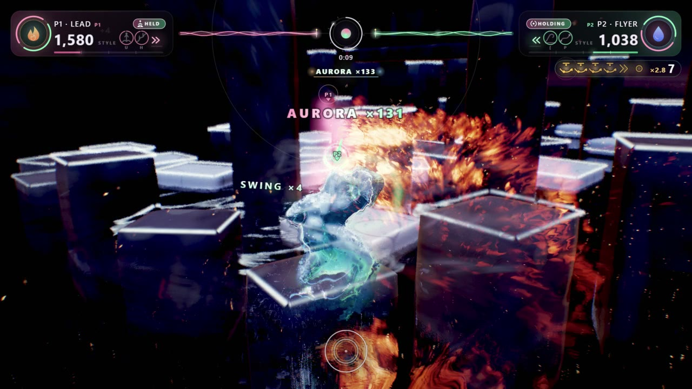

### 2. The big moments bury themselves in their own juice

When the game does the most, the bodies are hardest to see. The redwoods' steam (0:12.0 in the film, below in the
stills) has STEAM!, FLING, PERFECT and COMBO ×7 round the pair, the tier chip above, and the geyser's white ring and
spray over both bodies, so that water is an outline and fire a streak; the Pool's steam in seed 2 (48.2 s, below) has
STEAM!, FLARE, WAVE and AIR CATCH stacked on a body you cannot find. Where the moment reads (the temple's MURMURATION,
0:10.5) there are two words and the bodies are apart. Phase 3 gave every event a voice (a pop, a ring, a flash, a
sound, a hold), and the pops, the rings and the matter's light all land on the same spot, the contact, in the same
frame. For phase 4: a hierarchy at the moment of contact (one word, the biggest: the reaction or the tier, the rest
folded into the combo chip), pops placed off the pair's silhouette, and the reaction's own light (the geyser's ring,
the flare) kept off the bodies for the frames of the catch.

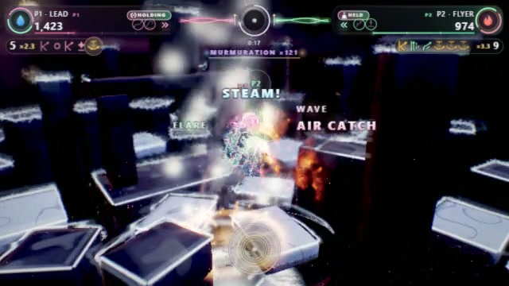

### 3. The weight is real but too short and too common to feel

The game now holds the bodies at a catch (3 frames on the ground, 4 in the air, 6 at range or a geyser's top), and
in the master's frames the hold is there: at the temple's air catch (AIR CATCH at 0:09.85) ice stands still for five
frames (0:09.87 to 0:09.93) while the ring opens. But at 60 fps that is 0.05 to 0.1 s, the camera keeps easing through it (it runs on
real time, by design), fire's particles keep moving, and the swing after it starts at full speed: it reads as a hitch,
not a breath. And it is everywhere: 45 held moments a minute, one every 1.3 s of play, so the catch at range (1.7 a
minute) feels the same as any fling's release (14.7 a minute). What does read in the film is the pair tier's
slowed beat (0.4 for a beat, 4.2 a minute). For phase 4: fewer, longer holds, scaled by the moment (nothing on a fling
or a ground catch; 8 to 12 frames for a catch at range, a geyser's top and the lift), with the camera's impulse
settling in the same frames, and the swing easing out of the hold rather than snapping back.

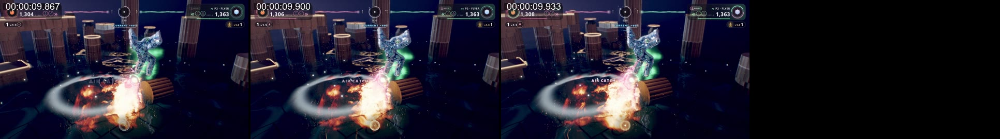

### 4. Where you play decides whether you fuse; the geode is the weakest arena

On one tempo (121 bpm) the redwoods fused 7 of 10 sets and the geode 0 of 12; the temple and the Pool 1 of 14 each.
The geode is behind on everything that leads to a fusion: the fewest catches (20.9 a minute against 23.4 to 27.0), the
fewest from the air (40 %), merges in 7 of 12 sets against 9 of 10 in the redwoods, the latest first merge (46.5 s),
the lowest peak (0.84), the fewest held moments (37.6 a minute), and the only falls but one. Its hum lifts a pair
together only when both are near this phrase's column (3.9 rides a set), and its shelves and beams still part the
two. The redwoods' energy peaks at 0.96 on average. Report 14-pool-fusion tuned the Pool to about one in eight in Node
at each world's own tempo; in the page at another tempo the worlds spread from 0 % to 70 %. Since the banner now shows
"nearly", a player in the geode will see it every time. For phase 4: measure each world's fusion in the page at its
own track (the scouts here can't separate the tempo from the world), and give the geode a reason to stay close (the
hum's columns nearer the pair, fewer beams between them).

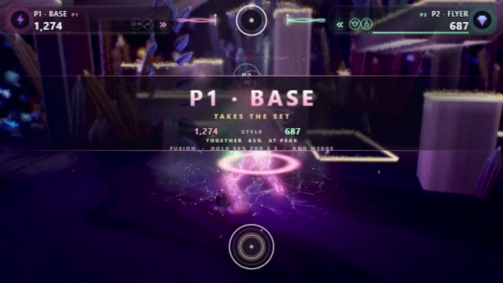

### 5. Lines of light everywhere

Three of phase 3's helpers draw lines, and together they draw a wireframe over the arenas. The near fade leaves a
dissolved piece as a faint outline of rim light; the temple's drops keep their rim of light under the high tide, so at
high water the drowned court is strewn with floating gold scribbles (the tide-and-freeze shot, 0:04 to 0:07, and
below); the geode's beams and blocks become honey boxes; the Pool's slabs become white ones (issue 1). Each was right
alone (the outline keeps the arena's shape readable when a piece dissolves), but in a moving frame the lines are
brighter than the pieces were and they flicker in and out as the camera turns (report 14-camera measured a piece
coming back and dissolving again 1.6 to 5.7 times a minute). For phase 4: dim the outline with distance from the
pair and drop it on pieces the pair is not near, and under the tide draw the drops' rims faintly or not at all.

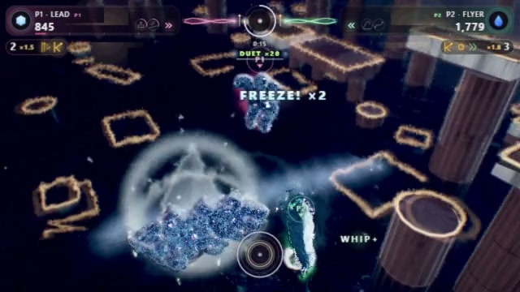

### Smaller things seen

- **The film's sound is hotter than the page's.** The shots' recorded scores, laid under the track at the game's
  balance as the film tool lays them (`layers.mjs`), come to −17.8 LUFS against the track's −17.4 over the same 31.7 s:
  level with the music, where report 14-sound measured the game's sounds 4 to 8 LU under the track in the page (and its
  own film clip 4 LU under). Part is the reel: every shot is a busy moment, and over the first 9.4 s (the track's hush)
  the score is 1.7 LU over the track (−18.5 against −20.2); but over the track's body it is still only 0.8 LU under
  (−17.5 against −16.7). The duel's voices are there and on the beat in the mix; whether the film's recorder or the
  page sits wrong I did not find, and nobody listened.
- **The page's chords follow the track's loop** (bars 10 to 46) while the film plays bars 60 to 76, so the duel's
  pitched cues take their chord from the loop's bar, not the bar sounding. The Pool's track sits on E♭ almost
  throughout, so it is close; not heard.
- **The water body's seat colour is faint.** Rose and fern read well in the redwoods and the temple (the halos and the
  split ring), but a water body in the Pool's dark shows its rose only as a thin edge (0:02.7).
- **A tier's word ghosts as it lands** ("MURMURATION ×61" drawn twice, offset, for its first five frames at 0:10.30
  to 0:10.38, in the master too); the cause not looked into.
- **AURORA only came in the Pool and the redwoods** (5 and 1), the worlds with the most air catches and contact.

## Fixes committed

- **Film tool: the hazards and the sound in the duel log** (`src/engine/film-shot.ts`). `info.json`'s `duel.log` now
  carries the hazards' moments (`k: 'hazard'`, `what`: a splash, a jump off the swell's crest, a lift in the hum), and
  `duel` carries the hazards' rides and seconds (`hazards.rides`, `waterS`) and the duel sound's counts
  (`sound`: `bend.duel.sound.stats()`). Without them a scout could not find a crest jump or a hum lift or count sounds.
- **Film tool: no lossless copies left behind** (`scripts/film.mjs`). Each run left the joined lossless pictures of its
  shots and of the whole film in `<out>/work/` (about 700 MB per 76 s scout at 640×360); 49 scouts filled the disk
  (33 GB) and the next join failed with "No space left on device". They are removed once encoded (`--keep-work` keeps
  them); the takes stay in the cache, so nothing is lost.

## Stills

`docs/reports/media/15-p3-*.jpg`: the film's sheet (`15-p3-film-sheet.jpg`), one still per moment from the master
(`15-p3-countdown.jpg`, `15-p3-crest-pool.jpg`, `15-p3-tide-freeze.jpg`, `15-p3-hum-geode.jpg`,
`15-p3-murmuration.jpg`, `15-p3-steam-redwoods.jpg`, `15-p3-melt-geode.jpg`, `15-p3-gust-redwoods.jpg`,
`15-p3-aurora-pool.jpg`, `15-p3-finale-lift.jpg`, `15-p3-banner.jpg`), and the issues' stills above
(`15-p3-issue-*.jpg`; the pile-up, the geode's banner and the tide's lines are from the 640×360 scouts). The master's
per-shot sheets: `15-film-duel-3-<shot>-master-sheet.jpg`.

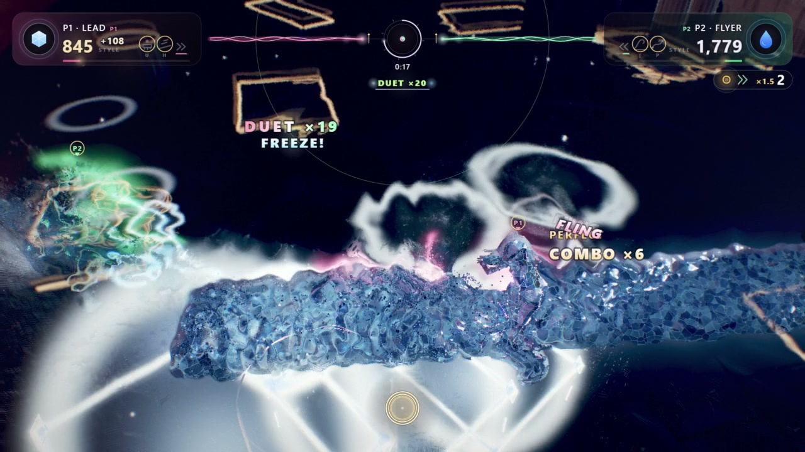
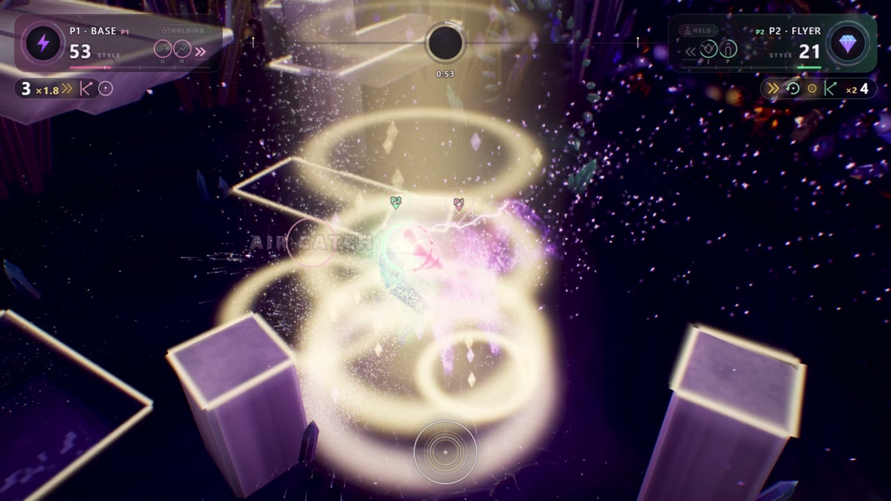
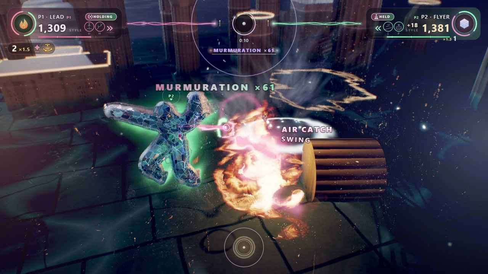
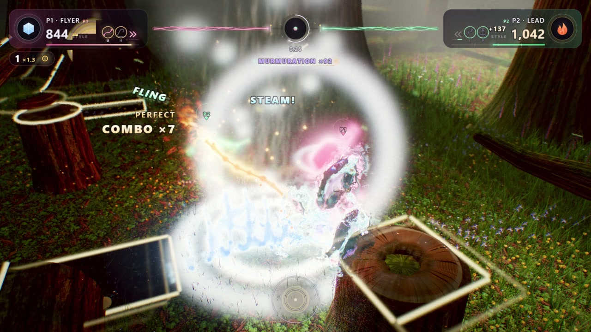
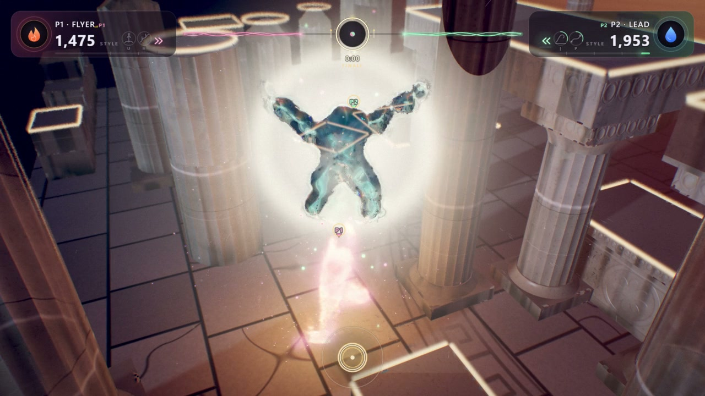

## Weak points of the film

- Two virtual players, seeded and chosen: every moment is real play, picked from 50 minutes.
- All on the Pool's tempo: every world danced at 121 bpm (its own track would be 94 to 113), which is the film's
  tempo, not the game's in those worlds.
- One of the nine shots is at skill 0.95 (the tide's freeze), because that moment read best; the finale is at 0.85.
- The Pool appears twice, and only where its frames held (issue 1): its swell is seen once (the opening's crest jump),
  and the swimming is not readable as swimming.
- The near fade is in every shot but read as its own thing only in the geode's melt; the geode's hum and melt are the
  geode's only appearances.
- The sound is the track with the shots' recorded scores at the game's balance: checked by its levels (and found
  level with the music, above), not heard.
- Nine shots from nine sets; the reel is 31.7 s, a little over the asked 30, to end on the banner on a beat of the track.

## Not done

- The five issues above: phase 4's.
- **The front's menu and an online duel** are not in the film. The film tool takes its frames from the GPU canvas
  (the front's menus are DOM, never in a frame), and plays one page (an online duel needs a room server and two
  pages). A screen capture of the front would be a different tool.
- The lock (`?lock`) was not filmed or scouted.
- The page's fusion rates at each world's own tempo (issue 4) were not measured.
