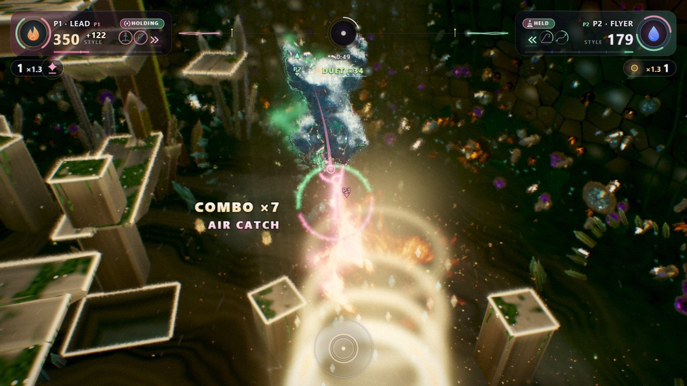
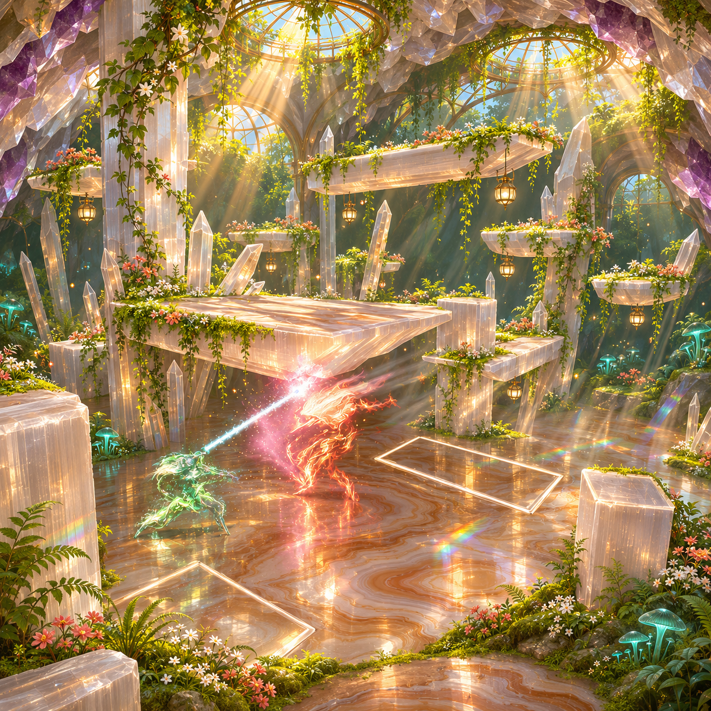
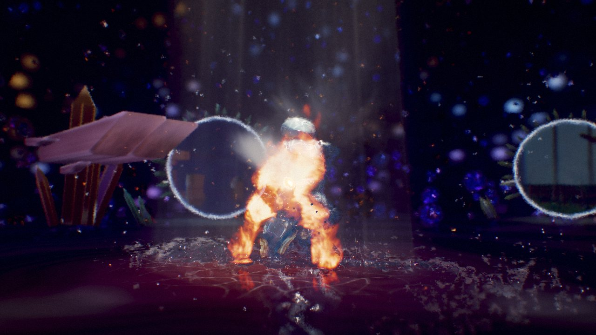
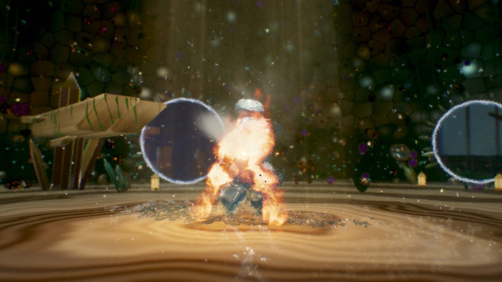
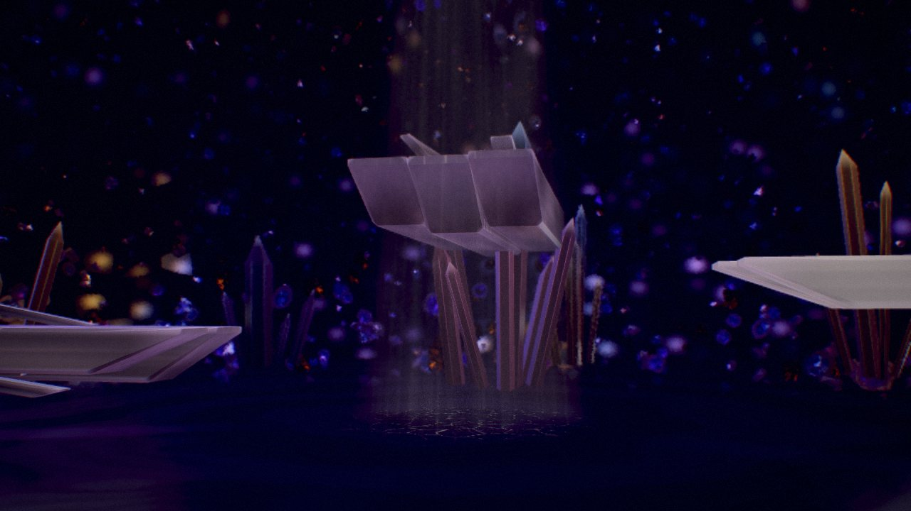
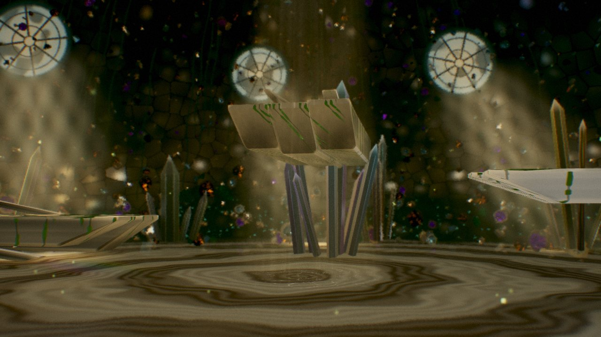
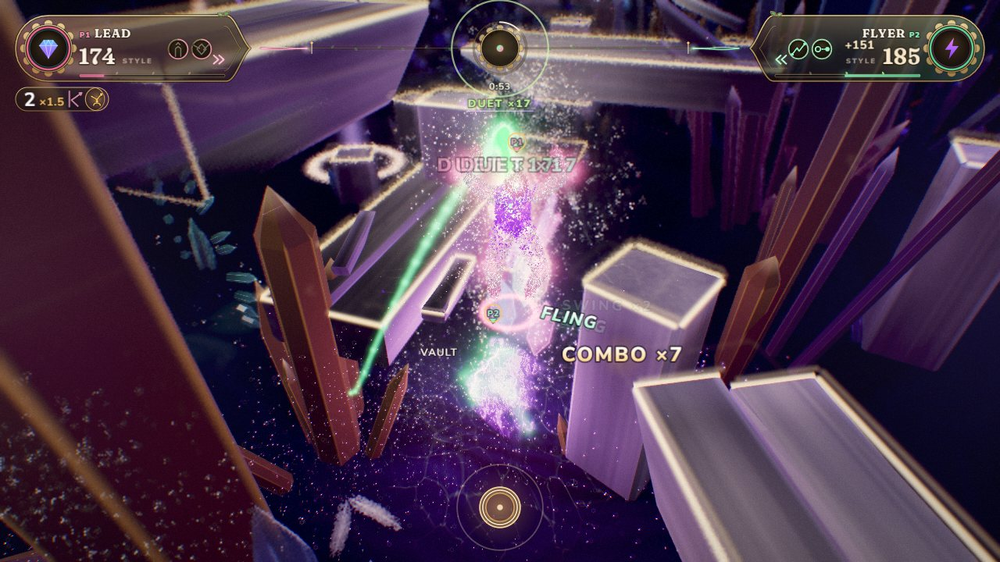
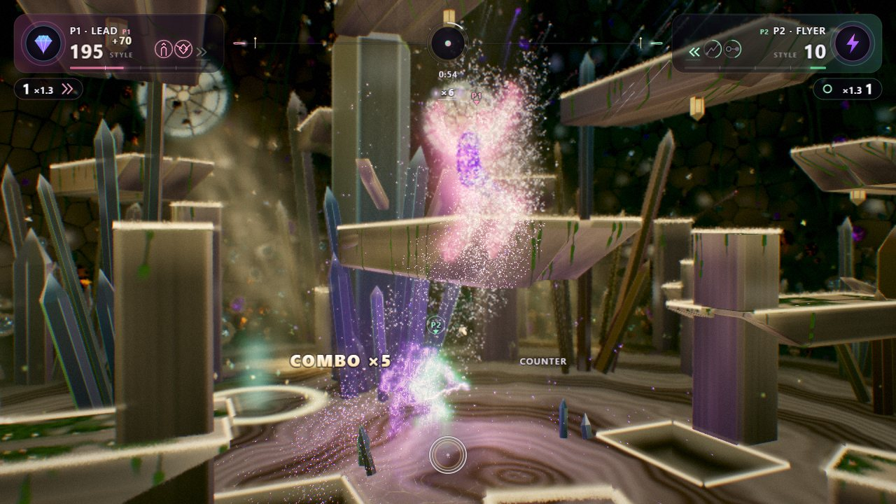
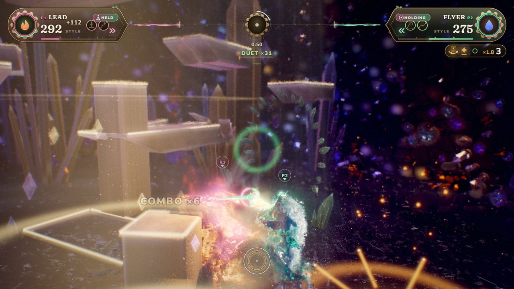
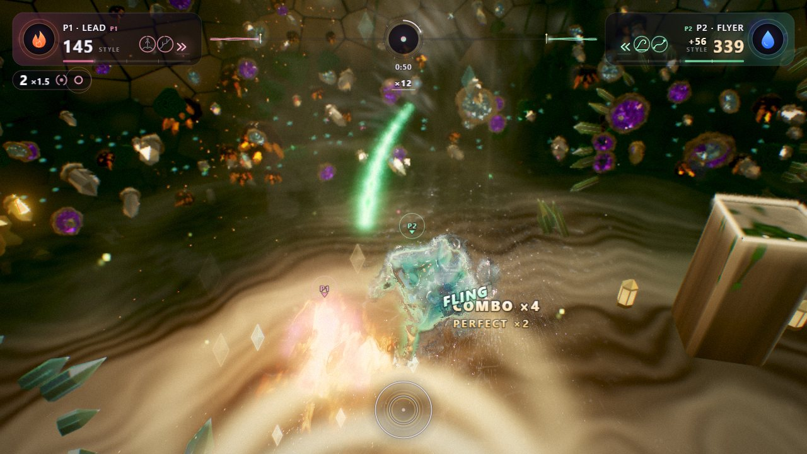

# 16: the geode, the fusion across the worlds, and the geode's first solarpunk pass

Branch `p4-geode`, from master `ffef1cd` (phase 3 and report 15). The brief, from report 15's issue 4 and the owner's
solarpunk direction (14 Nov 2026):

1. measure each world's fusion at its own track's tempo, in the page and in Node; find what drives the spread (tempo,
   the energy's per-beat gain, the arena, the time scale); bring each world to about 1 set in 8 at skill 0.85;
2. give the geode, the weakest arena, a reason to stay close: catches a minute in line with the others, falls near zero;
3. move the geode (the hub, the first thing a player sees) from a dark purple crystal cave toward a crystal grotto turned
   greenhouse, with the purple one accent and the bodies and seat colours standing out.

**Measured:** the Node harness (`scripts/duel-measure.mjs`, 40 sets of 60 s per world and setting, skill 0.85, free 3D,
dress and styles rotated, hazards on) at each world's own tempo (`--bpm own`, new), at 94, 112 and 121 bpm, with the
time warp off and on, before and after, three seeds for the geode's energy; the page itself (`scripts/duel-page.mjs`,
new: whole duels in headless Chrome on the RTX 5090, stepped at 60 fps on the frames' clock, each world on its own
track's tempo and its own set length), 16 sets per world before and after, and 12 sets of the geode and the redwoods
at 121 bpm before; where the geode's pair stands (a map of the midpoint, 10 sets) and how often a solid stands between
the two (12 sets per world); stills of the hub as the front page and of duels, before and after at the same frames
(master served beside the branch); GPU time per pass at those frames (`shot.mjs` timings); `npm run typecheck`;
`node scripts/test-ts.mjs` (19 of 19 files); `check-limits`, `check-bindings`. **Not measured:** a person playing; a
phone; the lock (`?lock`); online duels (the hum's choice of spot online, below); `npm run test:net` (not run, as
asked); the sound.

## 1. The fusion across the worlds

### What report 15's spread was

Report 15 scouted 50 sets in the page, every world on the Pool's track at 121 bpm: the redwoods fused 7 of 10, the
geode 0 of 12. Neither the page nor Node reproduces that spread.

- **In the page at one tempo** (master, 121 bpm, 60 s sets as a film's, the frames' clock): the geode fused **4 of 12**,
  the redwoods **2 of 12**. Report 15's scouts were 10 to 14 sets per world from four seeds and three dress pairs; at a
  rate near 1 in 6, 0 of 12 and 7 of 10 are both far out, and I could not find a cause in the worlds.
- **In the page at each world's own tempo** (master, 16 sets each): the geode 4, the Pool 2, the redwoods 3, the temple 2
  (11 of 64, 1 in 6). The spread across the worlds is inside the noise of 16 sets (about ±2).
- **In Node** (master, 40 sets each, 8 runs: own tempo, 94, 112, 121, warp off and on): every world fused 4 to 8 of 40
  in nearly every run; 42 to 50 of 320 per world over all eight. No world stands out.

A trap on the way, worth knowing: **a page stepped by hand hears the wrong beat.** With no sound and no film, the
page's music clock runs on `performance.now()`, so a page stepped faster or slower than real time (a headless capture)
heard its beat jump against the time it danced in (8.0 to 12.6 beats per 300 frames at 121 bpm, where 10.1 is right).
My first page runs did that and fused far more (the Pool 6 of 16, the temple 5 of 15); I threw them away.
`duel-page.mjs` puts the clock on the stepped frames, as a film's is. A film already does this, so report 15's scouts
were not affected; `shot.mjs` captures of a duel are (their dance is not the page's).

### What drives it: the tempo, through the on-beat window

The worlds don't spread, but **the tempo does**, a little, and through one rule. A link is on the beat (worth double to
the shared energy) within `PERFECT_MS`, 60 ms, of an 8th-note line. A window fixed in milliseconds is 38 % of the
8th-note grid at the temple's 94 bpm and 48 % at the Pool's 121, so a faster track made more links perfect, and the
energy sat near the top longer:

| Node, warp on, 24 sets | geode 94 bpm | geode 121 | Pool 94 | Pool 121 |
|---|---|---|---|---|
| links on the beat, before | 66 % | 72 % | 62 % | 71 % |
| seconds a set at 0.85 or over, before | 6.9 | 8.3 | 7.8 | 10.1 |
| links on the beat, **after** | 70 % | 70 % | 67 % | 69 % |
| seconds a set at 0.85 or over, **after** | 7.4 | 5.8 | 7.6 | 6.8 |

Over the four worlds (160 sets per tempo, master) the fusion went 10 % at 94 bpm, 14 % at 112, 14 % at 121, and the
mean peak 0.86 to 0.89. In the page the same: the share on the beat was 66 % in the temple (94 bpm) and 71 % in the
Pool (121) before, 70 % and 68 % after.

**The fix** (`shared/duel.ts`): the window scales with the beat. `perfectMs(bpm)` is `PERFECT_MS` at `PERFECT_BPM`
(112, where the rules were tuned) and the same share of the beat at any other tempo: 71 ms at 94 bpm, 60 at 112, 56 at
121. `onBeat` uses it, so the rules, the powers, the server and the client's prediction all do; the HUD's beat ring
shows the same window (`hud-state.ts`, one line). After it, 94 and 121 bpm fuse alike (Node, four worlds, 160 sets each:
24 and 22; mean peak 0.895 and 0.888).

The other suspects: the **energy's per-beat gain** is per link, and links a minute don't follow the tempo (Node: the
geode 158 and 160 a minute at 94 and 121 bpm, the Pool 185 and 183); the **arena** moves the fusion only through the
geode's hum (below); the **time scale** (the weight's warp) changes nothing measurable (Node, warp off against on: 4 to
11 of 40 either way). The page and Node agree within the noise on every world but the geode's energy scale (below);
where they differ I did not find why (one difference: the page's bodies play the move library's kicks and aús, and
travel with them; Node's don't).

### The table

Fused sets at skill 0.85, each world at its own track's tempo (94.0, 111.4, 113.1 and 121.1 bpm):

| | temple | redwoods | geode | Pool | all |
|---|---|---|---|---|---|
| page, before (16 sets each) | 2 | 3 | 4 | 2 | 11 of 64 (17 %) |
| page, after (16 sets each; the geode's energy not yet scaled) | 4 | 1 | 3 | 2 | 10 of 64 (16 %) |
| page, after, the geode's energy scaled (28 sets) | | | **3 of 28** (1 in 9) | | |
| Node, before (40 sets, warp on) | 6 | 8 | 8 | 5 | 27 of 160 (17 %) |
| Node, after (40 sets, warp on) | 6 | 5 | 6 (22 of 120 over three seeds) | 9 | 26 of 160 (16 %) |

About 1 in 7 in the page and in Node, every world within the noise of 1 in 8 (16 sets: ±2; 40 sets: ±3). The Pool's
9 of 40 after is one run (5 and 11 of 40 before it in the same setting).

**The geode's energy** (`Arena.energy`, `src/worlds/geode/arena.ts`): the geode's new hum (below) made it the easiest
world to fuse in Node, 28 of 120 sets over three seeds (8, 13, 7), its peak up from 0.86 to 0.91 (in the page 3 of 16,
peak 0.92, the highest). Scaled in Node first: gains ×0.96 and ebbs ×1.05 gave 15 of 120 there but **1 of 28 in the
page**, too rare; ×0.94 and ×1.1 gave 8 of 120. The scale kept is **gains ×0.98, ebbs ×1.025**: 22 of 120 in Node
(6, 10, 6) and **3 of 28 in the page**. The scale moves no body (the catches, rides and falls are the arena's).

## 2. The geode, given a reason to stay close

### What parted the two

- **The hum lifted the pair together rarely** because its column rose at four fixed spots in turn, two of them behind
  the stage. A map of where the pair stands (the midpoint, 10 Node sets) puts most of the time in front of the middle
  (a fifth of play within x −1 … 1, z 2 … 5) and on the right by the temple's gate; the two spots behind
  the stage saw almost none. The hum was ridden 2.5 times a set in the page and 3.0 in Node.
- **The beams and shelves part them less than in the other worlds.** A solid stands between the two (chest to chest,
  apart) 4.5 % of the time in the geode, against 6.7 % in the Pool, 6.9 % in the temple and 8.6 % in the redwoods
  (Node, 12 sets each). Taking the two low beams in front of the middle and the far one away made it 3.7 % and moved
  nothing else measurable (catches and fusion within noise), with a few more falls; I kept them: they are the arena's
  low walls to kick off, and the camera's near fade already dissolves them.
- **The drops took the falls.** In the page the geode fell 12 times in 16 sets (0.75 a set; every other world 0 to 2):
  the drops either side of the middle reached 2.2 m in front of the plane, into the place the pair dances most, and in
  the page a body's moves (an aú, a kick's travel) carry it further than Node's.

### What changed

- **The hum rises where the pair is** (`src/duel/hazards.ts` `chooseHum`, `src/worlds/geode/arena.ts`). Each phrase its
  column takes the open spot nearest the two as its warning begins, follows them to a spot a metre nearer through the
  warning's first bar, then stands for the second bar and the lift, so a player sees it coming where it will rise. Eight
  spots (from four), each on open agate with floor all round it and nothing over it for 6 m, spread where the pair
  dances: three in front of the middle, two by the drops' front corners, two behind the stage, one by the pool's gate.
  `HazardSight.lifts` (the brains) and the drawing read the choice through `humNow`, unchanged.
- **The drops reach 1.2 m in front of the plane** (2.2 before), still 2.4 m deep, still under the beams.
- The beams, shelves and great crystals are where they were.

| geode | page before | page after | Node before | Node after |
|---|---|---|---|---|
| catches a minute | 21.4 | **22.9** (72 sets; the others 23.4 to 24.9) | 22.4 | 23.1 |
| … from the air | 46 % | **53 %** | 39 % | 53 % |
| hum rides a set | 2.5 | **12.8** | 3.0 | 14.4 |
| falls | 12 in 16 sets (0.75 a set) | **9 in 72 (0.13 a set)** | 0.17 a set | 0.23 a set (0.15 over three seeds) |
| sets merged | 11 of 16 | 14 of 16 | 23 of 40 | 30 of 40 (26 with its energy scaled) |
| first MERGE, mean | 44.8 s | 41.9 s | | |
| the energy's peak, mean | 0.869 (the lowest) | 0.921 (the highest; before its energy was scaled) | 0.86 | 0.88 |

(The page's "after": the catches, air and falls over its 72 sets after, with the three energy scales tried, which move
no body; the rides, merges and peak from the 16 sets before the scale.) The geode's catches a minute came up from the
lowest by far (21.4) to just under the others (22.9 against 23.4 to 24.9), half of them from the air; its falls from
0.75 a set to 0.13. Node's falls a set rose a little (0.17 to 0.23 in one run; 0.05 to 0.23 over three seeds): a body
flung from the top of a column near a drop.

## 3. The geode's first solarpunk pass

From a dark purple crystal cave toward a grotto turned greenhouse, in the shaders and the layout, no textures:

- **Light wells**: four round windows of leaded glass high round the vault (eight spokes and three rings of leading,
  their rims copper gone green, a few leaves over them outside), the sky through them teal at the edge and gold to the
  middle, and from each **a beam of sun** slanting down through the haze (`geodeAir`: the view ray's closest approach to
  each beam's axis, no march) to **a warm pool on the agate**, with **a prism's rainbow** beside it. The main shaft from
  the opening over the stage is sun gold now, the opening glazed too.
- **The stone warm**: the wall's veins cream selenite, honey calcite, sky-teal celestite and citrine; **amethyst only
  here and there**, an accent (the gem dome's specimens quartz, citrine, celestite, malachite and amethyst, one in five).
  The agate floor cream and honey (it was mauve and violet), the rims and the hum sun gold and teal, the grade a little
  green in the shadows and gold in the light, the haze a mossy dusk.
- **Moss, vines, flowers**: moss over the wall's foot and in patches up it and on whatever faces up; cushions of moss on
  the shelves' and beams' tops with small flowers in it (cream, coral, gold); vines hanging from their edges down their
  faces in broken chains of leaves; moss grown in over the floor's edge.
- **In the shadows**: small fungi glowing teal in the wall's moss low down, each breathing in its own time, and the
  drops' depths glowing teal; **fireflies** (90) drifting round the floor's edge and the druses, each glowing warm
  yellow-green for a moment (after the dust in `motes.wgsl`).
- **Brass-and-glass lanterns** (`crystals.wgsl`, tint 5: warm panes in a brass frame, a brass cap and finial, a
  flicker): one either side of each path to a gate in the hub, standing; six hung under the arena's shelves. They are
  laid after everything else without the layouts' dice (so no crystal or solid moved) and are under 45 cm, so not
  solids.
- **The crystals as prisms**: seen at a glance their faces split the sun into a soft rainbow.

The bodies stand out: rose and fern, plasma's purple and the gems' white read against cream, honey and green, where they
were purple on purple.

| | before | after |
|---|---|---|
| the hub as the front page |  |  |
| the hub, looking up at the wells |  |  |
| a duel (gems and plasma, seed 3) |  |  |
| a duel (fire and water, seed 2) |  |  |

(The duels' after frames are at the same step but not the same moment: the rule and the arena changed the dance.)

**The GPU** (RTX 5090, 1280×720, 150 frames per window, master served beside the branch at the same steps):

| | scene, before → after | air | glow (motes, fireflies) | whole frame |
|---|---|---|---|---|
| the front page | 0.178 → 0.253 ms | 0.192 → 0.200 | 0.132 → 0.138 | 3.44 → 3.43 |
| the hub looking up | 0.127 → 0.167 | 0.085 → 0.091 | 0.040 → 0.040 | 0.51 → 0.53 |
| duel (gems, plasma) | 0.366 → 0.354 | 0.129 → 0.148 | 0.073 → 0.072 | 0.90 → 0.91 |
| duel (fire, water) | 0.216 → 0.265 | 0.147 → 0.187 | 0.124 → 0.123 | 1.49 → 1.67 |

About +0.05 ms on the scene (the wall's moss, fungi, vines and windows; the floor's pools and rainbows; the shelves'
moss and vines) and up to +0.04 on the air (the four beams), within the frame's noise. The world light uniform grew by
80 bytes (the wells and the sun; the fireflies, the moss and the dust's count took its three spare floats): 4,720 of
65,536.

## Files

- `shared/duel.ts`: `PERFECT_BPM`, `perfectMs(bpm)`, `onBeat` by it. `src/duel/hud-state.ts`: the beat ring's window.
- `src/duel/hazards.ts`: `chooseHum`, `Hazard.hum.chosen`, `HAZARD.HUM_PICK`, `HUM_SWITCH` (the hum only).
- `src/worlds/geode/arena.ts`: the hum's eight spots, the drops' front, the energy, the lanterns.
- `src/worlds/geode/geode.ts`, `geode.wgsl`, `backdrop.wgsl`, `shelves.wgsl`, `crystals.wgsl`, `motes.wgsl`,
  `shelves.ts` (the hub's lanterns); the regenerated `*.d.wgsl.ts` of every shader that includes the world light.
- `src/duel/hazards-fx.ts`: the hum's colours (honey and teal, no violet).
- `src/duel/measure.ts`: `--bpm own|N`, `--phrase`, links a minute and the share on the beat.
- `scripts/duel-page.mjs` (new): the duel measured in the page.
- `src/duel/test/hazards.test.ts`: a new test, the hum rises where the pair is and lifts both; every spot has floor round
  it.
- `docs/design/duel.md` (the window, the hum), `AGENTS.md` (the scripts, the uniform's size),
  `docs/design/solarpunk/geode-grotto.png` (the concept).

## Not done, unverified

- **People.** All of this is virtual players at skill 0.85. The hum now meets the pair where they are; a person who
  ignores it is still lifted when it rises under them, which may surprise.
- **Online.** The server and each page choose the hum's spot from the bodies each sees. They agree when the pair is
  clearly nearest one spot; a pair half-way between two might see the glints on one spot here and the column on
  another there. Not run online.
- **Noise.** 16 page sets per world is ±2 fusions; the page's per-world numbers can only say "about 1 in 8", not tune
  closer. Node and the page disagree on the geode's energy (×0.96 and ×1.05: 15 of 120 in Node, 1 of 28 in the page);
  the scale kept is the page's (3 of 28), which Node puts at 22 of 120.
- **The film's 121 bpm scouts** (report 15) were not re-run; the page at 121 bpm on master did not show their spread.
- **Visuals.** A first pass: the wall's cells still read as cobbles from up close, the vines on a shelf's slope read as
  stripes, the lanterns along the hub's paths stand in the arena's front when it is shown (not solids, but seen), and
  the windows are bright discs from below. The fireflies and fungi are small at 720p. Not looked at on a phone or in the
  lock.
- `npm run test:net` not run (port 5418); test-audio not run (nothing of the sound changed but the hum's colours).
