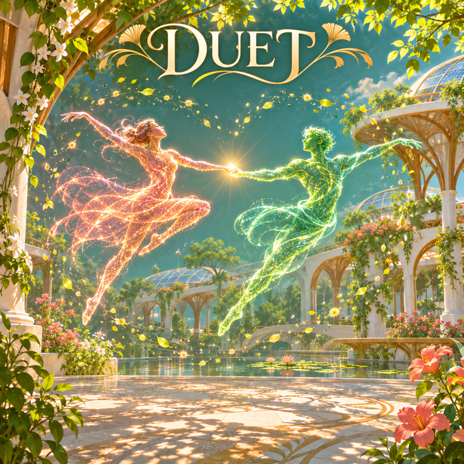
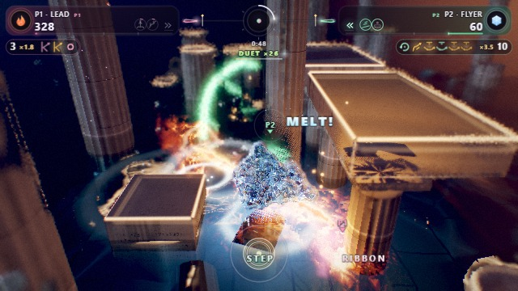
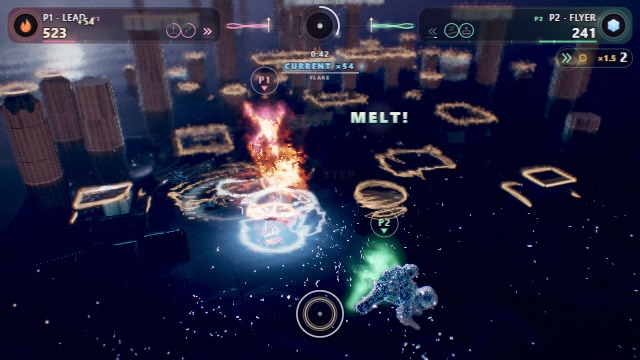
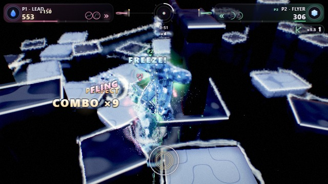
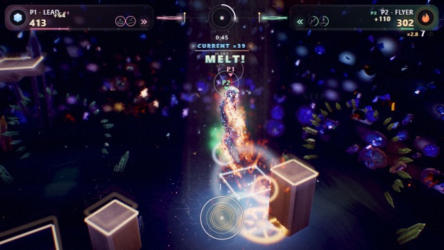
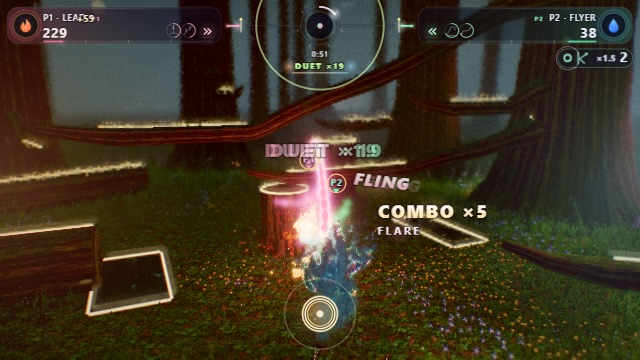
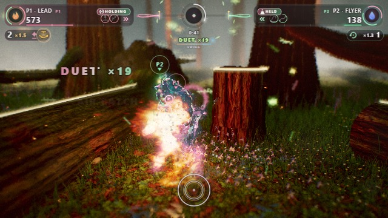
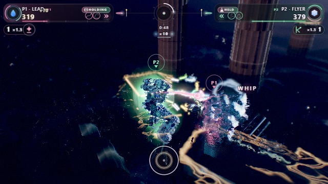

# 16: the big moments and the weight (phase 4)

Branch `p4-moments`, from master `ffef1cd` (phase 3 and its film, report 15). One of five phase 4 tracks. This one:
report 15's issue 2 ("the big moments bury themselves in their own juice") and issue 3 ("the weight is real but too
short and too common to feel"), and a first solarpunk pass on what those touch: the pops, the contact's rings and
flash, the tier flash and the reactions' light.

**Measured:** a new moments probe in the page (`src/duel/moments.ts`, `scripts/moments-cap.mjs`): eight seeded sets of
two virtual players (the four worlds, the reacting pairs: fire and water, water and ice, ice and fire), stepped by hand
at 60 fps at 640×360 and sampled every frame after it is drawn. Master was run twice (its sets are not frame-exact
from run to run), this branch once (at its final state but for the last fix, a word fading out as a new one comes in
fading faster, which can only lower the words on screen). The Node harness with the time warp on (`duel-measure.mjs
--warp 1`), 32 sets a world, 128 in all, before and after, for the holds and the fusion. GPU timings
(`shot.mjs --timings`, 960×540) before and after. `npm run typecheck`, `node scripts/test-ts.mjs` (19 of 19 files).
Stills from the probe's runs, looked at. **Not measured:** a person playing; the feel of the holds by eye at speed (I
looked at stills only, so the breath and the ease out are known from their numbers, not watched); a phone; the sound;
`npm run test:net` (its port clashes with the other agents); the lock (`?lock`).

## The numbers

### Moments that bury themselves (issue 2)

A **peak** is a reaction, a pair tier or a dancer's tier, a merge, a catch at range or at a geyser's top, and the
0.6 s after it. A body is **covered** in a frame when more than 15 % of its core on screen (hips to head, a torso's
width either side) is under a word, a HUD ring, or the moment's own light (the contact's ring and flash, a reaction's
bloom, the geyser's column: glows brighter than 0.3). "Most words" is the most words standing at once (alpha over 0.3)
in a peak's window.

| eight page sets | master (run a) | master (run b) | **p4-moments** |
|---|---|---|---|
| peaks | 73 | 91 | 78 |
| most words at once in a peak, mean | 3.05 | 3.29 | **0.98** |
| peaks by their most words (1 / 2 / 3 / 4 / 5) | 3 / 16 / 31 / 20 / 3 | 4 / 16 / 28 / 36 / 7 | **76 / 0 / 0 / 0 / 0** (2 with none) |
| words on screen in a peak's frames, mean | 2.32 | 2.56 | **0.63** |
| a body covered, of a peak's frames | 38.5 % | 43.8 % | **5.5 %** |
| … by a word | 19.2 % | 22.4 % | **0.0 %** |
| … by the moment's light | 24.4 % | 26.1 % | **5.5 %** |
| the core's mean share covered at peaks | 0.191 | 0.221 | **0.034** |
| a body covered, of every catch's 0.6 s | 15.8 % | 17.4 % | **3.5 %** |
| a body covered, all of play | 11.2 % | 12.9 % | **3.2 %** |

### Weight (issue 3)

| | master | **p4-moments** |
|---|---|---|
| holds a minute of play, the page (8 sets) | 44.7, 3.4 frames each | **12.2, 5.9 frames each** |
| holds a minute, Node (128 sets): temple / redwoods / geode / Pool | 41.0 / 39.5 / 37.0 / 43.9 | **9.6 / 9.1 / 8.6 / 18.8** |
| frames a hold, Node | 3.4 | **5.8** (air 5; range 10; a geyser's top 11; the lift 12) |
| what holds | catches 14 a minute, flings 15, air catches 8 (18 in the Pool), range 1.5 | air catches (the Pool's 17), range 1.5, a geyser's top 0.2 |
| pair tiers' slowed beats a minute | 4.2 | 4.2 |
| time the warp takes from a 60 s set | 3.75 s | 2.56 s |
| **fused finales (Node, 128 sets, 112 bpm)** | **24 (18.8 %)**: temple 5, redwoods 4, geode 7, Pool 8 of 32 | **26 (20.3 %)**: 9, 7, 5, 5 of 32 |
| sets that merged; first MERGE, mean (soonest) | 100 of 128; 41.7 s (22.2) | 101 of 128; 41.1 s (24.6) |
| GPU (temple, 960×540, `shot.mjs --timings`): frame / glow pass | 1.075 / 0.085 ms | 1.110 / 0.092 ms |

The fusion is unchanged within the noise (two more of 128; the per-world counts swing by 4 between two seed batches of
the same code). In this Node harness (every world at 112 bpm) master fuses about 1 set in 5, not the 1 in 8 that
report 14-pool-fusion tuned at each world's own tempo; the brief's "about 1 in 8" is that calibration, and this branch
keeps the rate where master has it. The first MERGE comes at the same time.

## What changed

### 1. One word at a moment (`src/duel/hud-state.ts`)

The pops no longer run on a budget of three words a second; they show **one word at a moment, the biggest**:

| rank | words |
|---|---|
| 9 | MERGE |
| 8 | a pair tier (DUET ×14, CURRENT, MURMURATION, AURORA) |
| 7 | a reaction (STEAM!, MELT!, FREEZE!), a dancer's tier (FLOW ×12, …) |
| 6 | POWER FORM |
| 5 | a power's name (WHIP, FLARE, …) |
| 4 | COMBO ×n (banked) |
| 3 | AIR CATCH (3.5), CATCH, FLING, LIFT, VAULT, COUNTER |
| 2.5, 2, 1 | FELL, PERFECT, SWING |

A frame's words are taken biggest first. While the word on screen has its **moment** (0.55 s, or 1 s for a word of
rank 7 and up), a word no bigger is **folded**: it is not drawn, and the pair chip under the orb **echoes** it small
under its line for 0.8 s (`pair.echo`, `src/hud/pair.ts`), so nothing the dancers did is lost. A bigger word takes the
place (in place, with a bump, when it is the same seat's and kind's; else the old one goes). Past its moment any new
word replaces it. One SWING per hold and one PERFECT per dancer still count up in place. The set's words (BEND, the
finale, the winner) are the centre's and always show; the finale clears the one word.

### 2. Placed off the pair's silhouette (`src/hud/pops.ts`, `players[].bounds`)

The duel now gives the HUD each body's **bounds on screen** (`players[].bounds`: the 38 joints projected, padded a
little; `screenBounds` in hud-state.ts, one line in index.ts's `hudSeats`). The lanes start at the bodies' edges (not
54 px from the heads), the words that are nobody's (MERGE, a tier, a reaction: before, a reaction's word was drawn at
the point of the reaction, which was the contact) stand above both bodies and their tags, and every word's place is
tested against both bodies (and the tags over them): one that would fall on a body moves to the nearest clear place
above the pair, beside it or under it. A word sliding to a new slot snaps rather than slide across a body. In the
probe, a word covered a body in 0 % of peak frames (19 to 22 % before).

When a new word comes in, a word fading out is all but gone already (`GONE`), so two never stand together; and the
pair tier's word's two halves (each sliding in from its own side) are now **clipped** to their halves, which fixes
report 15's "a tier's word ghosts as it lands" (MURMURATION ×61 drawn twice for five frames: it was the two whole
copies).

### 3. The moments' light kept off the bodies (`src/duel/fx.ts` `keepOff`, `src/duel/power-fx.ts`)

Every glow a moment draws (the contact's flash and ring, a merge's bloom, a catch at range, a reaction's bloom and
frost, the geyser's column and the puddle) is a range of the glow list (`fx.lit`, `powerFx.lit`). After they are
drawn, each glow whose middle (a segment's ends, a ring lying on the floor's points round it) falls on a body's core
on screen is dimmed, smoothly from the core's edge in: by 45 % at rest, and by up to 92 % through **a catch's
frames** (`DuelFx.quiet`: up at a catch, a merge, a catch at range or a reaction, gone over 0.6 s). A ring passing in
front of a body loses that piece, so the body reads through it. The field's fusion helix (the merge's charge, white
in steam) was wound at 0.32 m round the pair's middle, through both bodies; it is now as wide as the two stand apart
and a body's width more, and thinner through a catch's frames. The moment's light covered a body in 5.5 % of peak
frames (24 to 26 % before).

### 4. Fewer, longer holds, a breath (`src/duel/weight.ts`, `impulse` in `src/duel/camera.ts`)

- **What holds:** nothing on a ground catch or a fling's release; an air catch 5 frames; a catch at range (a whip, an
  arc) 10; at a geyser's top 11; the finale's lift at its top 12.
- **The shape:** the catch's first frame lands at 0.45 of the bodies' time and the second at 0.05 (the weight
  arriving, softer than a cut to a stop); through the hold the time breathes from 0.05 up to 0.16, so the bodies drift
  and gather; then it eases back to full over 0.12 s + 0.8 × the hold (0.25 s after a range catch) with a smootherstep,
  so the swing eases out of the hold, never snaps back (no step larger than 0.12 in a frame after the landing).
- **Fewer:** a hold within 1.5 s of the last one's end is let go unless it is longer (`GAP_S`); the juice event's
  `hold` is the one applied (0 when let go), so the sound and the film's log see the same thing.
- **The camera:** `DuelCamera.impulse` takes the hold (`hold`, s). A held moment's lean and push rise over the hold
  and half its ease back (0.25 s at the least) and settle over the rest of the kind's length, both smootherstep (no
  step in speed or acceleration), so the camera arrives as the bodies let go instead of peaking half a second later.
  Moments without a hold keep the old u³(1 − u)⁴ shape. index.ts passes `hold: j.hold / 60`.
- **The pair tier's slowed beat**, kept: one beat at 0.36 (0.4 before), eased in over its first 30 % and out over its
  last 55 % with smootherstep (0.08 s and 0.22 s with smoothstep before), so it settles in and out of the beat rather
  than dropping into it. The HUD's dappled sunlight plays over the same second.

In the Pool, three catches in four are out of the air (the water), so its holds stay at about 19 a minute; the other
worlds are at 9 to 10. A further cut (an air catch held only when the caught body is high or fast) needs a field the
contact does not report yet.

### 5. Solarpunk, a first pass

The concept (`docs/design/solarpunk/moments-catch.png`, GPT Image through the Codex CLI, low effort) is the aim: one
word in cream and gold above the pair, a glint of sun where the hands meet, a loose ring of leaves and pollen opening
round the two, dappled sunlight. Built from glows and the HUD's 2D canvas:

- **The catch** (fx.ts): a small glint of sun at the hands (two crossed rays for a fifth of a second) instead of the
  white flash, and a **ring of leaves and pollen** in the plane facing the eye (`leafRing`: short leaves in both seats'
  colours, leaf green and moss, pollen motes) opening out past the two to about 1 m, sinking and turning as it fades.
  Twelve leaves out of the air, nine on the ground; a catch at range the same, wider (power-fx.ts).
- **A merge** is a bloom: fourteen petals of both colours and pollen opening round the pair, a warm heart.
- **The fling's sparks** have pollen among them, and fall a little.
- **A freeze** is a frost flower (six crystal petals) instead of a ring; **steam's** bloom is smaller, cream and a mist
  of sky teal instead of white.
- **The pops** (pops.ts, `SUNLIT`: sun, sun-hi, leaf, moss, cream, coral, sky, plain values for the HUD theme to take
  over): CATCH closes a wreath of seven leaves on itself instead of a ring; PERFECT is sun gold with a four-pointed
  glint at its corner instead of an ellipse; MERGE and a pair tier bloom in warm sunlight instead of white; a reaction's
  word is cream over sky teal.
- **The tier flash** (pair.ts) is **dappled sunlight**: a warm light from the top of the screen, sixteen spots of sun as
  through leaves (each dancer's side in its colour mixed with the sun, drifting as a canopy does), and nine leaves of the
  tier's colour turning out from the orb and drifting down; none of it drawn on the bodies. It replaces the two big
  radial washes and the ring from the orb.

GPU: the glow pass 0.085 → 0.092 ms in the temple at 960×540 (a catch's leaves are about as many glows as the old split
ring's twenty segments). The dappled flash is sixteen cached glow sprites for about a second at a tier.

## Stills (before, after; 640×360 from the probe's runs, eight frames after the moment)

The same seeds; the dances differ after the first moment the weight changes, so the pairs are the same kind of moment,
not the same frame.

## Files

- `src/duel/weight.ts`: the holds, the breath and the ease, `GAP_S`, the pair tier's slowed beat.
- `src/duel/hud-state.ts`: one word at a moment (`RANK`, `MOMENT`), the echo, `screenBounds`, `players[].bounds`.
- `src/hud/pops.ts`: placement off the bodies and the tags, the halves clipped, the fade on a new word, `SUNLIT`, the
  leaf wreath and the sun glint, `cover` for the probe.
- `src/hud/pair.ts`: the dappled tier flash, the echo under the chip, `cover`.
- `src/duel/fx.ts`: `leafRing`, `keepOff`, `quiet`, the catch, the merge, the fling's pollen, the helix round the pair.
- `src/duel/power-fx.ts`: the range catch, the freeze, steam's bloom, the reactions' light kept off (`keepOff`, `hush`).
- `src/duel/camera.ts`: `impulse` takes `hold` (a few lines).
- `src/duel/moments.ts` (new), `scripts/moments-cap.mjs` (new): the probe. `src/hud/hud.ts`, `src/hud/index.ts`:
  `bend.hud.cover()` (what the HUD drew, for the probe). `src/duel/measure.ts`: prints the holds.
- `src/duel/index.ts` (shared, a few lines): `bounds` for the HUD, `viewProj` to the effects, `keepOff`/`hush`/`eye`
  to the powers' effects, `hold` to the camera, `bend.duel.moments`.
- `src/hud/state.ts` (shared, two optional fields): `players[].bounds`, `pair.echo`.
- `src/duel/test/duel.test.ts`: the weight's and the pops' tests rewritten for the new rules.
- `docs/design/duel.md`: the weight, the pair tier and one word at a moment. `docs/design/solarpunk/moments-catch.png`.
- `docs/reports/perf/16-moments-*.json`: the probe's runs (master twice, this branch).

## Not done, and weak points

- **Felt, not seen.** The holds' breath and ease out and the camera arriving with them are measured as numbers (the
  warp's scale frame by frame in the test, the holds a minute) and not watched at speed or by a person. A short test
  video of a range catch and an air catch, at 60 fps, is the next check.
- **The Pool still holds often** (19 a minute): its air catches are water catches. A hold only for a body caught high or
  fast needs the contact to report the caught body's height or speed.
- **The fusion in Node is 1 in 5, as on master**, not 1 in 8: this harness runs every world at 112 bpm. Not tuned here
  (the arenas' energy is another track's).
- **Light from outside the moments** still crosses the bodies: the field's helix and steam (now wider and thinner in a
  catch, not measured by the probe: it is the field's matter, not a glow), the flown body's streak, the power form's
  rings and the hazards' light. The probe counts only the moments' glows.
- **The chip's echo** only shows while the pair chip does (a pair chain of 3 or more); a word folded with no chain shown
  is simply not drawn.
- **The HUD's skin** (panels, fonts) is the front agent's: the moments' colours are plain values (`SUNLIT` in pops.ts,
  `SUNLIT_RGB` in fx.ts) for its theme tokens to replace.
- The probe's "covered" is a box test on the core and the glows' brightness, not the rendered pixels; its numbers are
  for comparing before and after, not an absolute.
- Master's page sets are not frame-exact from run to run (73 and 91 peaks in two runs of the same eight sets), so the
  table gives both.
