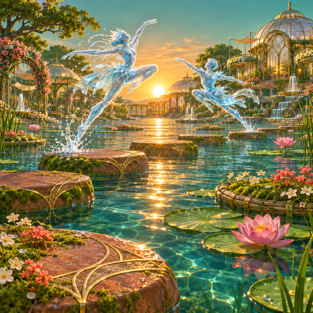
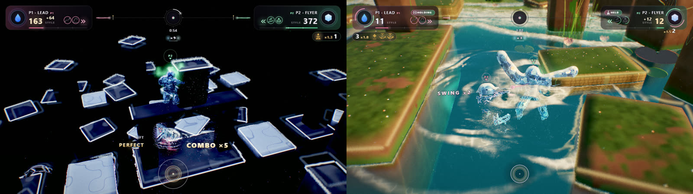
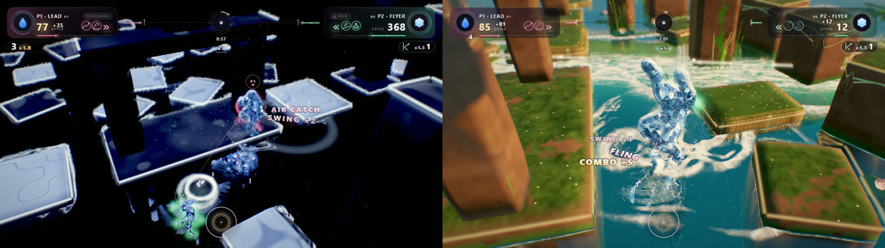
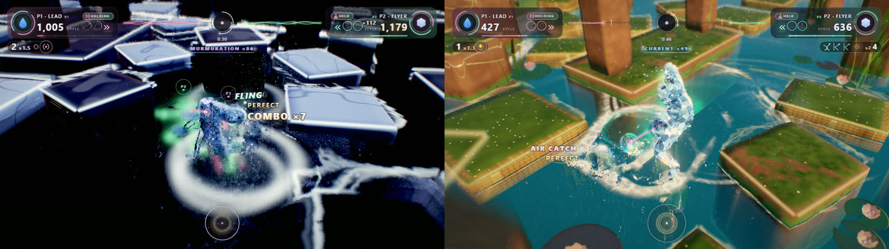
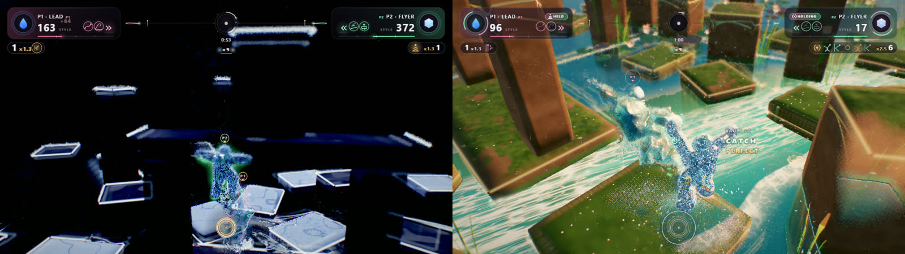
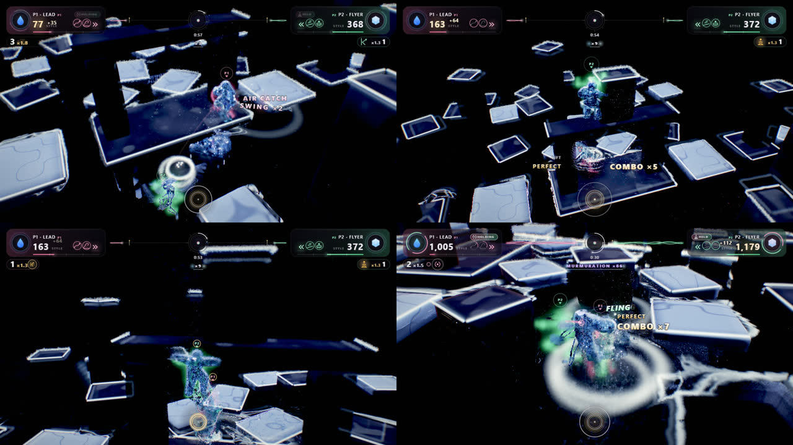
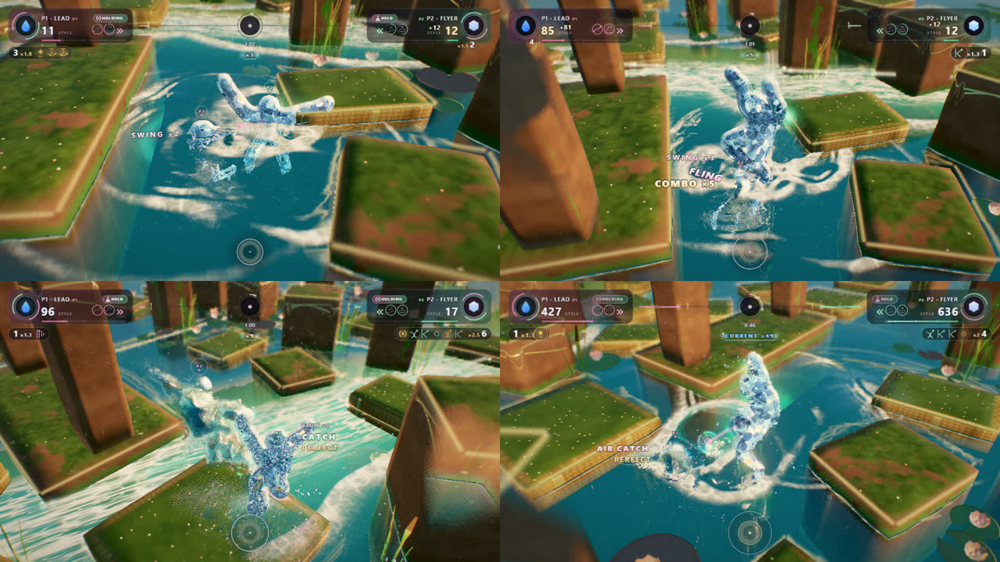
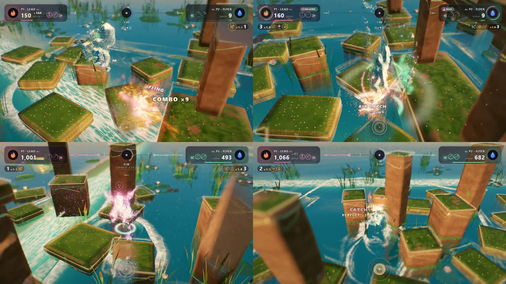
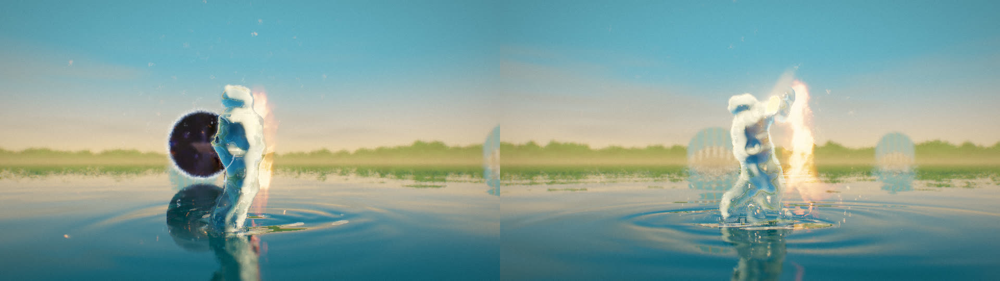
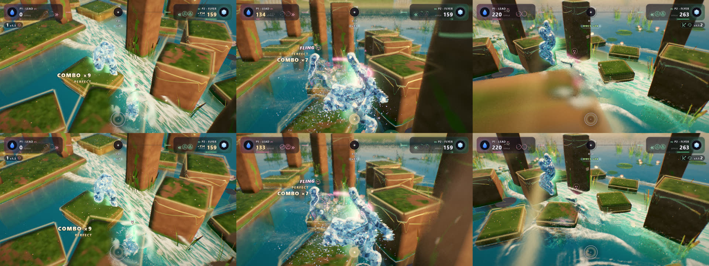

# 16: the Pool, a water garden at golden hour (phase 4, first solarpunk pass)

Branch `p4-pool`, from master `ffef1cd`. One of five agents on phase 4; mine is the Pool. The brief: report 15's issue 1
(the Pool reads as white blocks in a black void: black water, white slabs that drown the pale water and ice bodies, a
floating body that seems to stand in nothing, a swell nobody can see) and the Pool's first move toward solarpunk,
without touching its play.

**Measured:** stills from the duel's camera in the page (my dev server, port 5451, headless Chrome on the RTX 5090,
960×540), before (master, served from a clean copy on port 5452) and after, of the same four kinds of moment in the same
seeded duel (water and ice, seed 3): a body afloat, a body swimming, a catch with a body in the water, the swell's crest
passing the pair; the same after with fire and water (seed 2); the near fade's frame test on and off in the Pool
(`scripts/fade-cap.mjs`); GPU time per pass, master and this branch run back to back, twice each; the Node harness's Pool
(`scripts/duel-measure.mjs --world pool --sets 40`) before and after; the duel camera's measure in the Pool
(`scripts/cam-sim.mjs --world pool --sets 8`) before and after; `npm run typecheck`, `node scripts/test-ts.mjs`,
`check-bindings`, `check-limits`.
**Not measured:** a person playing; a phone; 1080p (no render above 960×540 was run); the jogo's own Pool (the flat
stage) beyond two sky stills; the sound (nothing of it changed).

## Why late gold, not noon and not night

The brief offered a sunlit garden or a night of bioluminescent shores. I chose the hour before sunset:

- **The water needs a sky to show.** Water is read by what it mirrors. Under the night's black sky the water mirrored
  black, so it could not read as water, which was report 15's problem. A teal sky going gold at the horizon gives the
  surface something to mirror: a gradient, the sun's glitter road, and the ripples bending both.
- **The bodies must stay the brightest thing.** At noon the water would mirror a pale sky and go pale, as pale as the
  water and ice bodies. Late gold keeps the water a deep clear teal, darker than the bodies and a different hue from
  them. The stones are warm terracotta under moss, so against both the water and the stones the bodies read pale and
  cool.
- **Low sun lights edges.** It puts gold rims on bodies and stones and long glints on the water, and its warm light is
  the solarpunk palette.
- **It keeps the Pool's own idea.** The Pool was a still sheet of water with one great light low behind the stage. That
  light was the moon; it is now the sun, sinking a few degrees over ten minutes.

## What changed

### The water (`src/worlds/pool/pool.wgsl`, `pool.ts`)

- **The sky.** It goes from teal overhead (`#5b9cbc`) to gold at the horizon, and is warmest on the sun's bearing. A few
  long low clouds are lit from below. The sun is low behind the stage (17° up, 18° round) and sinks 3° over ten
  minutes. Round the horizon stands a far garden shore: tree crowns, and nine pavilions, each a glass dome with brass
  ribs on a drum of white ceramic arches. The shore is front-lit and green away from the sun, a dark silhouette in more
  haze toward it, and mirrored in the water. Night stars remain as a parameter (`stars`, now 0).
- **The water's own colour.** Open water is a deep teal (`deep`). Whatever stands in the water fades into that teal
  with depth, red first (`absorbR/G/B`), so a stone's foot, a raft's sides and the gems' bodies sink visibly into clear
  water.
- **The mirror.** It went from 0.55 to 0.1. The old Pool mirrored more than real water does; now looking down you see
  into the water, and at a glance you see the sky.
- **The sun's glints.** Tiny facets of the ripples, each tilted its own way and turning, flash where one mirrors the
  sun to the eye. They are sparse and sharp nearby, and a field of sparks along the sun's road further off.
- **Foam, drawn as a lace** of thin bright webs, not blots, in three places:
  - where the ripples are steep: a landing, or a body moving through the water;
  - in a thin line where the water meets something standing in it (a stone's foot, a body);
  - in streaks along the swell's crest.
- **Caustics** from the sun play on the stones' and rafts' submerged sides (`poolCaustics`).
- **The swell's crest on the surface.** The Pool takes the duel's swell from the hazard each frame (way, crest,
  height: `Pool.swellNow`) and the surface draws it. Its slope bends the reflection, 2.5× steeper than it really is so
  the eye finds a 0.32 m crest. The crest's top is lit through in turquoise, strongest looking toward the sun, and foam
  streaks run along it.
- **The grade.** The night's blue shadows became teal shadows and gold highlights. Exposure went from 1.15 to 0.85.

### The stones and the floes (`stones.wgsl`; shapes, places and solids unchanged)

- **A stone** is warm terracotta, darker and wet toward the water, with a line of weed at the waterline. Moss covers
  its top and spills a little over the edge, with sparse cream and coral flowers in it. A brass inlay runs round its
  sides in a slow art-nouveau wave, with arches hanging from it. On the standing stones (tops over 2.9 m), a flowering
  vine climbs out of the water.
- **A floe** is now a raft of woven reed bound with brass ties, carpeted in moss and flowers to its woven rim. It still
  rides the swell as the floes did.
- **Values.** Both sit at mid to dark values (terracotta albedo about 0.14 to 0.2 red, moss about 0.03 to 0.09 green),
  so the pale bodies are the brightest things on them.
- **The rim light** (`arena.ts` `rim`) is now a faint warm gold, [0.34, 0.24, 0.11], in place of the cold
  [0.6, 0.78, 1.0].

### The water garden (`garden.ts`, `garden.wgsl`, new)

Three draws in the opaque phase, only while the duel's arena is shown:

- **Lily pads** in loose clusters near the stones and in drifts round the far water, plus a few giant pads with their
  rims turned up. They ride the ripples (they sample the height field) and a little of the swell.
- **Lotus flowers**, two rings of cream-to-pink petals round a golden seed head, lit through by the sun, standing on
  some of the pads.
- **Clumps of reeds** at the feet of the blocks and standing stones and in a broken ring round the arena. Some blades
  carry a cattail's head, and all sway.

The garden is placed once, seeded, from the arena's own description (`poolDuel().data`). It is kept off every piece's
top and out of the middle of the stage's band, where the bodies land and swim most. It is decoration only: not solid,
unseen by the camera and the brains, and it does not call the near fade (like the redwoods' grass and ferns).

### A body in the water (`src/duel/hazards-fx.ts`, the Pool's part)

- **The wake.** A body moving through the Pool's water pushes the ripples just behind itself every frame, by its
  speed. The ripple field turns that into a trailing wake, and the surface turns the wake's steep slopes into foam. The
  ripples also bend the sky and the sun's glints round the body.
- **Warm foam and glints.** The splash rings, the afloat rings and the crest's spray are a warm white in the Pool, and
  the swell's glints are gold. The temple keeps its moonlit blue-white.
- **The swell's glow line.** The surface now draws the crest, so the glow line is faint, and the cold blue sheet
  behind it is gone.

### The camera over water (`src/duel/camera.ts`)

`ARENA_CAM` is a per-arena parameter, keyed by the arena's world. In the Pool, while the bodies float (a body's root
0.6 m under the surface: both floating moves it the whole way, one floating moves it halfway, eased), the plain view
comes down by 0.1 rad (5.7°). The lower eye looks across the water, where the sky is on it. Only the plain view moves;
the higher views the clean eye rises to over the pieces are as they were.

The camera now takes `arena` in its input. `src/duel/index.ts` and `src/duel/camprobe.ts` pass `arena.world`, one
argument each, so `scripts/cam-sim.mjs` measures the change.

I tried 0.06 and 0.16 too. 0.1 was the cleanest of the three on the near frame and the dissolve flicker (below).

### Tools

`scripts/pool-cap.mjs` (new) captures the Pool's moments from the duel's camera. It finds the first body afloat, the
first body swimming, the first catch with a body in the water, and the swell's crest passing within 1.2 m of the pair,
and grabs each when found. It can also print GPU timings and make a sheet.

A page loaded again does not replay the same set (I checked: three reloads with the same seed gave different bodies at
the same times), so the before and after stills are the same kinds of moment in the same seeded duel, not the same
frames.

## The numbers

**The Node harness, the Pool** (40 sets of 60 s, skill 0.85, dress rotated): **unchanged, line for line.**

| | before (master) | after |
|---|---|---|
| catches a minute | 26.7 (76% from the air) | 26.7 (76% from the air) |
| falls a set | 0.00 | 0.00 |
| fused finales | 3 of 40 (54 merges) | 3 of 40 (54 merges) |
| swell rides / crest jumps a set | 3.98 / 3.33 | 3.98 / 3.33 |
| seconds in water a set | 39.2 | 39.2 |

Nothing the harness runs changed: the arena's pieces, solids, hazard and energy are as they were. The camera does not
feed the play.

**The duel camera in the Pool** (`cam-sim`, 8 sets of 40 s, 18,424 frames):

| | before | after |
|---|---|---|
| the eye in a solid | 0.1% | 0.0% |
| within the near fade's 0.6 m of one | 0.6% | 0.2% |
| a piece in the near frame (over a tenth of it) | 11.6% (4.7%) | 10.0% (4.0%) |
| a body hidden (any sight line) | 8.6% (16.3%) | 8.2% (14.1%) |
| a near corner filled (an eighth or more) | 8.1% (5.3%) | 7.0% (4.4%) |
| with the fade: near frame (over a tenth) | 4.6% (1.3%) | 4.5% (1.4%) |
| with the fade: a near corner (an eighth or more) | 2.9% (1.7%) | 2.9% (1.8%) |
| a piece dissolving | 70.6% of frames | 74.1% |
| a piece back and dissolving again within 1 s | 3.91 a minute | 1.95 a minute |
| pitch, mean (p90; over 35°) | 24° (35°; 3.6%) | 24° (35°; 3.5%) |
| flyer in frame, both whole | all, 100% | all, 100% |

Most measures improved. Over a tenth of the near frame with the fade is 1.3% to 1.4%, and a near corner (an eighth or
more) with the fade is 1.7% to 1.8%; both are within a frame or two in a thousand. The mean pitch doesn't move,
because the camera comes down only while a body floats.

The camera's own CPU time could not be compared under the machine's load from the other agents. The same master build
measured 0.59 and 1.29 ms a frame in two runs, and this branch 0.67 to 1.68 across five; with `waterLow` 0 it measured
0.67, as master. I can't say whether the lower view costs any CPU.

**GPU** (the Pool's duel at 20 s, 960×540, 150 frames, master and this branch back to back, twice each):

| ms | master | this branch |
|---|---|---|
| whole frame | 1.08, 1.16 | 1.35, 1.28 |
| scene (stones' new material, the garden's three draws) | 0.132, 0.131 | 0.182, 0.243 |
| surface (the Pool's water: `poolScene`) | 0.031, 0.034 | 0.057, 0.045 |
| air | 0.049, 0.052 | 0.075, 0.065 |
| water.surface (the water bodies, which mirror the Pool's sky) | 0.082, 0.079 | 0.101, 0.095 |

That is about +0.15 to +0.25 ms a frame at 960×540, mostly the scene pass. The garden is per-vertex work: a pad is 180
vertices, a flower 288, a clump of reeds 216, and the fragment shaders are cheap. The stones' fragment shader does more
noise than before. At 1080p the per-pixel parts (the surface, the air, the stones) scale about 4×; that was not
measured.

**The bindings:** within the baseline (153 entry points; the most uniforms still 9 of 12, the water surface's fragment
stage). The new garden shader takes one storage buffer and the light group, like the other world draws. The world light
uniform grows by five vec4 (80 bytes) in the Pool's slot.

## Stills

From the duel's camera, before on the left, after on the right. Each pair is the same kind of moment in the same
seeded duel (water and ice, seed 3), not the same frame.

- **Afloat.** The bodies' submerged parts fade into the teal, foam laces round them, and the stones' feet sink into
  clear water. Before: a body in black, among white slabs.

- **Swimming.** The swimmer leaves foam and rings behind it, and the reflection of the stones is bent round it.

- **A catch in the water.** The splash's ring, now warm, and the wake read as water. Lily pads and reeds frame the pair.

- **The swell's crest.** It crosses the frame as a lit band with streaks of foam. Before, a 0.32 m crest could not be
  seen from this camera.

- **Fire and water** (seed 2), after only. The flame body reads pink-gold on the moss and terracotta, less strongly
  than the pale bodies do. In the catch (lower right) both bodies are small behind the stones.

- **The sky and the far shore** (the jogo's Pool, the flat stage, looking across the water). The shore's crowns and
  two pavilions' glass domes show at the horizon. The dark disc is the gate to the geode.

## The near fade's outline in the Pool (for the fade's owner)

The brief asked whether the Pool's pale pieces still draw wire boxes. **They don't draw white wire boxes now.**

`scripts/fade-cap.mjs`, water and ice, seed 3, three moments of the most dissolve (cover 0.26, 0.72, 0.64):

- **The pieces aren't pale any more.** A dissolved stone leaves its outline in the world's rim colour. The Pool's rim
  colour is its glow, now a warm orange, × `rim` 1.6.
- **The outline is a faint gold line, not a white box.** Where the dissolved piece stood close to the lens, the depth
  of field smears that line into a soft gold streak (the third moment, lower left).
- **It no longer adds a wireframe of white boxes.** It is still a line where a shape was. I did not touch
  `light.wgsl`'s outline or `fade*.ts`.

## Not done, and weak points

- **Not a 1080p or film-length look.** All stills are 960×540 headless grabs. I did not watch the motion: whether
  the glints, the foam's lace and the crest's streaks shimmer or crawl was judged from stills only.
- **The water bodies are not cut by the surface.** A floating water body's lower half is still drawn whole over the
  water. The water matter composites its bodies after the Pool's surface, and its shaders are not mine. The foam line,
  the rings, the wake and the absorption round it carry "afloat" now. An opaque body (gems) does sink into the teal.
- **The swell's surface is flat.** The crest is drawn as slope, light and foam on a flat surface, not as a raised
  surface; the rafts and pads ride up while the surface beside them stays at 0.
- **The garden is not in the jogo's Pool** (the flat stage): there the sky, the shore and the water changed, but no pads
  or reeds stand on the water.
- **No 3D pavilions, trellises or fountains.** The garden's built things (glass-and-brass pavilions, ceramic arches)
  are painted into the sky as the far shore, not modelled. Trellises with flowers, fountains and channels are the next
  pass.
- **Smaller visual issues seen:**
  - The rafts' tops are a little busy (the flowers look like sprinkles at some distances).
  - The vines on the standing stones are blotchy up close.
  - The domes on the far shore are faint.
- **The camera's lowering is small** (0.1 rad while afloat) and invisible in the mean pitch. A larger one (0.16)
  measured a little worse on the near frame and the hidden bodies.
- **GPU at 1080p and on a phone not measured.** On a coarse device (`coarse`) the far garden has about half the drifts
  and stands. The stones' and the surface's shaders are not scaled.

## Files

- `src/worlds/pool/pool.wgsl`, `pool.ts`, `backdrop.wgsl`, `stones.wgsl`, `arena.ts` (the rim colour, the header)
- `src/worlds/pool/garden.ts`, `garden.wgsl` (new)
- `src/duel/hazards-fx.ts` (the Pool's foam, glints and wake)
- `src/duel/camera.ts` (`ARENA_CAM`, `CamInput.arena`)
- `src/duel/index.ts`, `src/duel/camprobe.ts` (one argument each: the arena)
- Weft's generated `*.d.wgsl.ts`. Every shader that includes the world light changed with the Pool's struct (25
  files with the new garden's, regenerated by the dev server; `pool.d.wgsl.ts` by hand to match, as nothing imports
  it). The world light uniform is now 4,720 bytes (AGENTS.md says 4,640; not edited, a shared file).
- `scripts/pool-cap.mjs` (new)
- `docs/design/solarpunk/pool-water-garden.png` (and its `.json`: the prompt)
- `docs/reports/media/16-pool-*.jpg`
