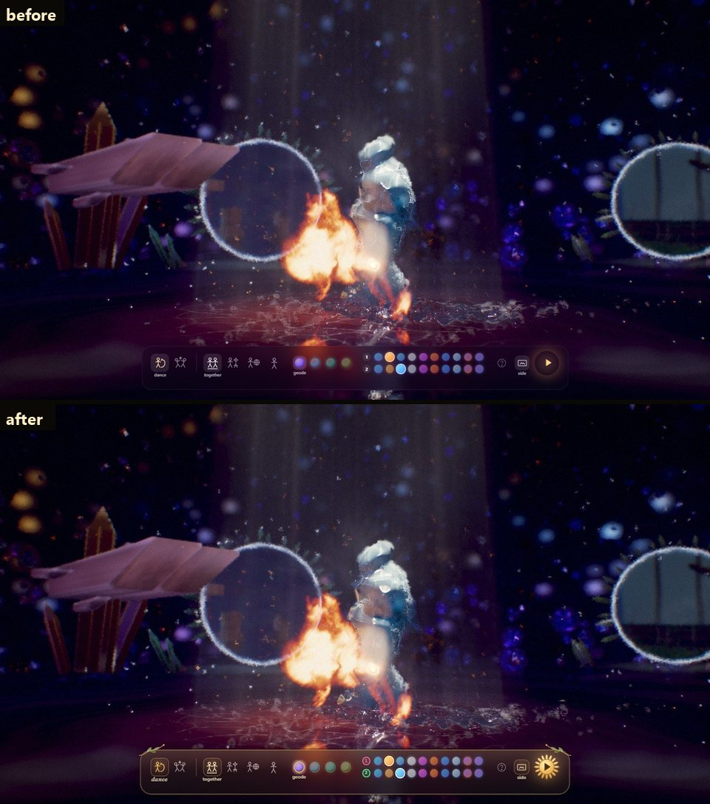
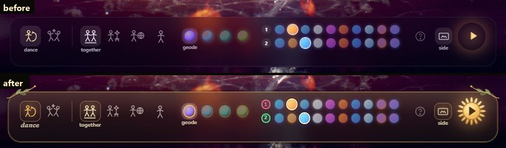
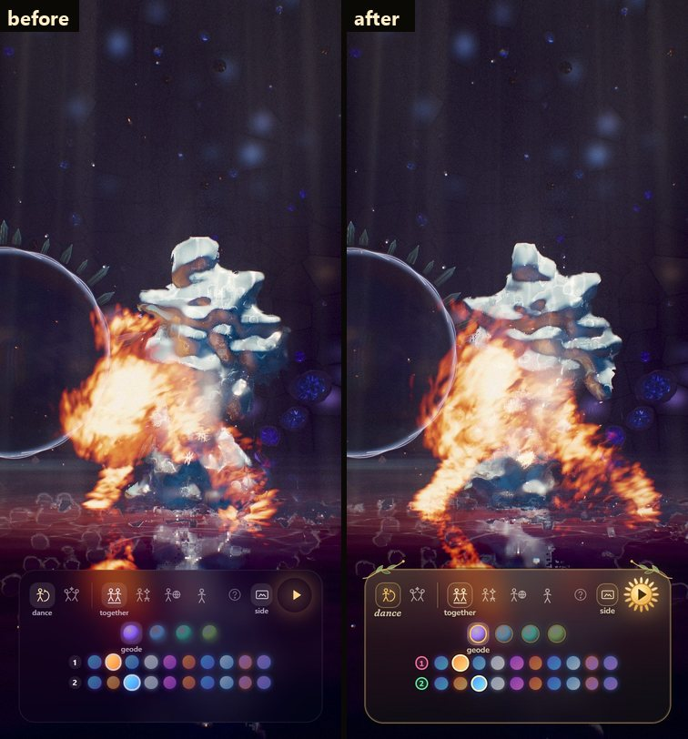
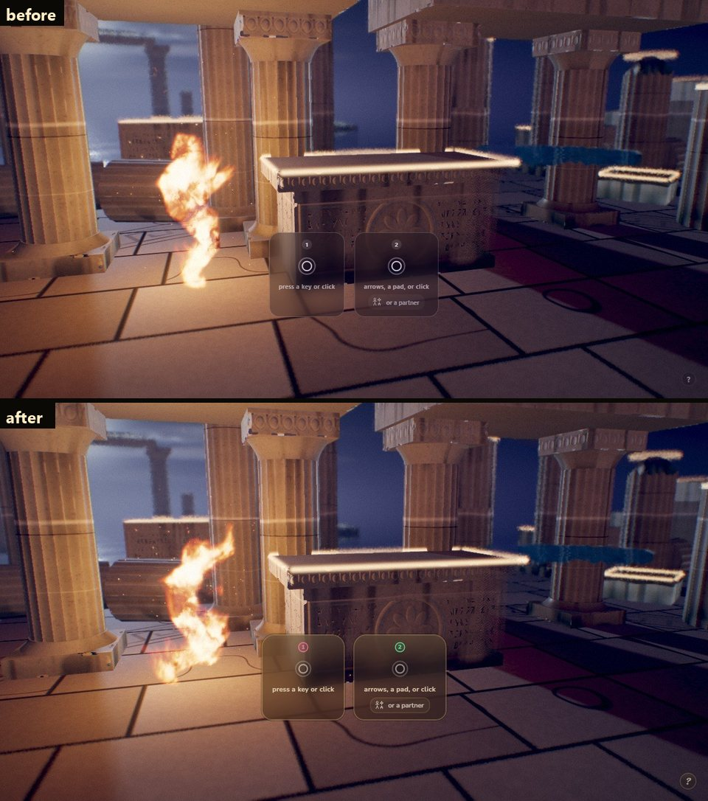
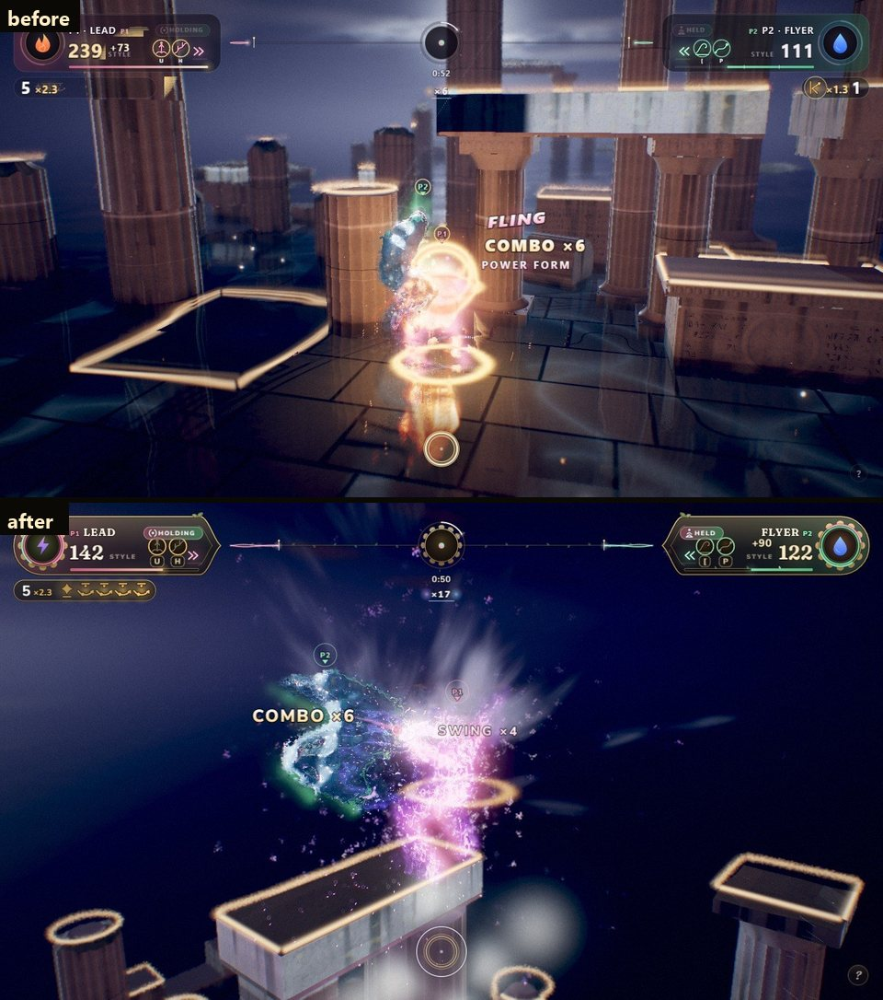
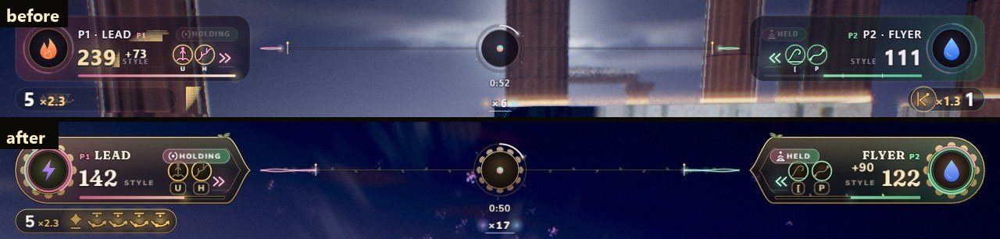
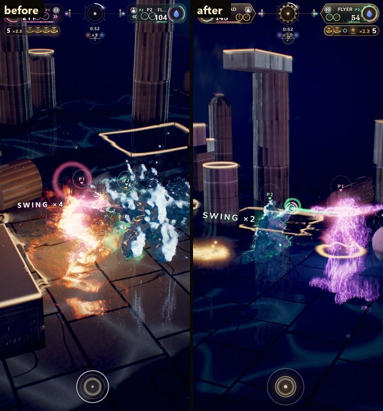
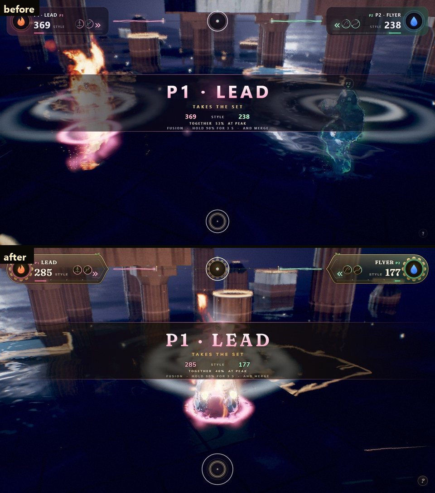
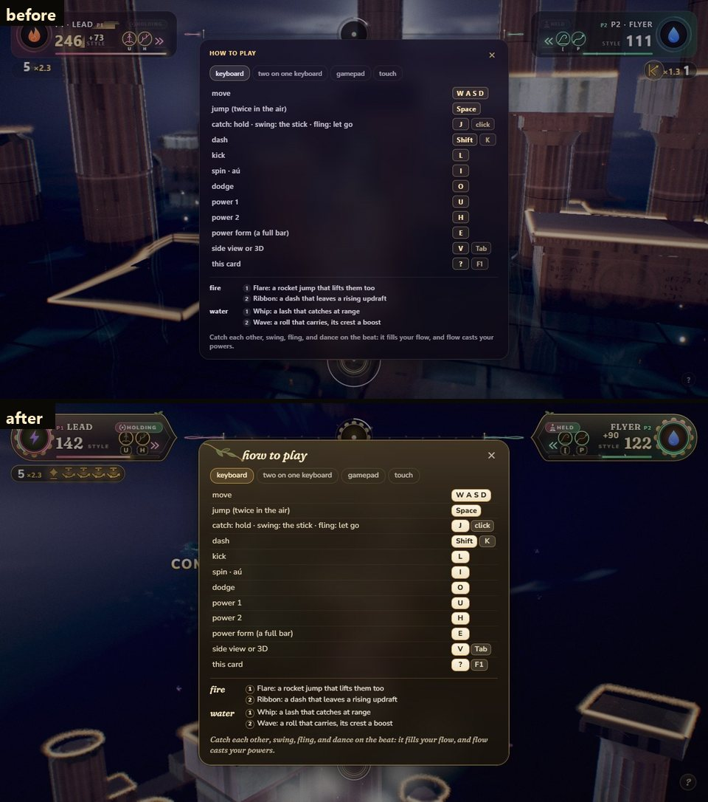
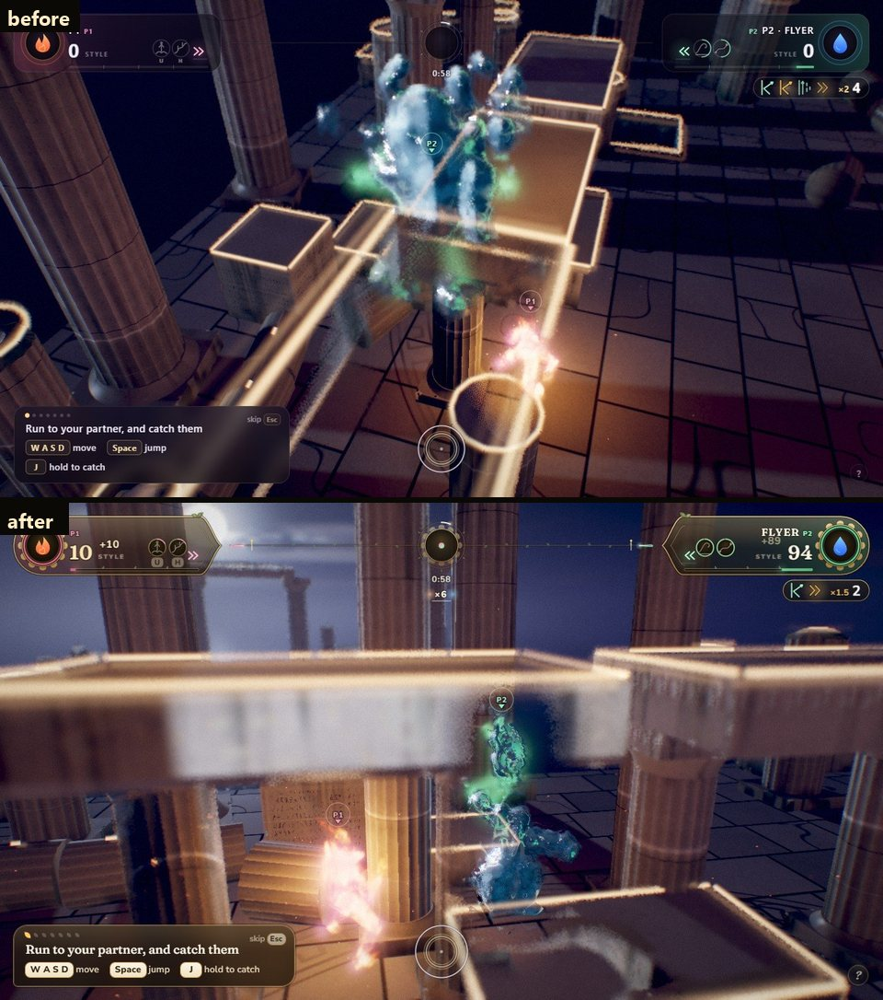

# 16: the skin, solarpunk's first pass

Phase 4, branch `p4-skin`. The art bible (`docs/design/solarpunk.md`) and six concept images, the palette and type as
tokens in one place, and the first solarpunk pass on everything that isn't a world: the front's strip, the lobby, the
duel's HUD (panels, medallions, powers, keys, flow bar, combo chip, the orb), the banner and countdown, the controls
card, the lesson and the veil. The worlds, front.ts's flow, the camera and the pops' logic are untouched.

## What changed

**The art bible**, `docs/design/solarpunk.md`: what solarpunk means for Energy Bending (feel, light, materials,
ornament, motion, sound), the palette as 17 named tokens with hex and use, the two faces, the shapes (art-nouveau
curves, leaf and petal forms, leaded lines) and the HUD's grammar built from them, a direction per world (the geode and
hub a crystal greenhouse grotto, the temple a sunlit water temple, the redwoods canopy walkways, the Pool a water
garden), each matter in a solarpunk world (fire as the sun and embers of growth, plasma as solar wind and aurora, gems
as crystal blossoms, ice as frost flowers), what to avoid, and four passes from here toward epic.

**Concept images**, `docs/design/solarpunk/*.jpg` (GPT Image through the Codex CLI, 1024 px JPEG, each with its prompt
and provenance as JSON): the hub and front, the temple, the redwoods, the Pool, a HUD mock and the matters. All six are
kept and linked from the bible, which says what to take from each and what to leave (the HUD mock's light cream glass
is unreadable over a bright world; the matter sheet's figures are people in dresses, while our dancers are bodies of
matter).

**Tokens.** `src/hud/theme.ts` (new) holds the palette (`PALETTE`), the seats (`SEAT`, equal to src/duel/seat.ts), the
faces (`TYPE`, `FACES`), the HUD's glass (`GLASS`) and `cssVars()`. `index.html`'s `:root` has the same as `--eb-*`
custom properties, plus `--eb-glass-bg`, `--eb-lead`, `--eb-blur` and `--eb-sprig` for the menus. `src/hud/style.ts`
now takes `GOLD`, `GOLD_HI`, `INK` and `FONT` from the theme, so every HUD file that imports them (the pops, the pair
chip, the beat, the link, the icons) moved warm without being edited. A new test, `src/hud/theme.test.ts`, keeps the CSS
and the TypeScript equal, the seats the duel's own, the fonts loaded, and the ink's contrast on the glass (cream 7:1 or
more, parchment and both seats 4.5:1 or more, a key's ink on its cap 7:1 or more).

**Type.** Fraunces (display: names, the style numbers, the banner, the countdown, the card's title, the lesson's
prompt; its SOFT axis pinned at 100 in the font's address, since a canvas can't set axes) and Nunito Sans (body:
labels, keys, pops, prose), from Google Fonts with `display=swap`. There is no CSP (server/site.ts sends none), and
index.html loaded no fonts before. The HUD asks for its faces when it mounts (`loadFaces`) and, when they arrive,
drops every sprite and measure and draws the base again (`fontEpoch`), so no sprite keeps the fallback face.

**The skin.**
- *The glass*: smoked honey glass, warm light along its top, a cream hairline inside and a thin gold came over a dark
  lead line round it (`glass()` and `leaded()` in style.ts, `--eb-glass-bg` / `--eb-lead` in CSS), in place of the
  violet-black glass with a white hairline.
- *The front's strip*: honey glass in gold leading, a sprig of leaves on a whiplash stem at each end, the chosen
  buttons gold-ringed, the game's names in Fraunces italic, the worlds as medallions in gold settings (their colours
  nudged toward the bible's worlds), the seats' numbers in rose and fern, and the play button a **sun disc in a crown
  of sixteen petals** (`sunGlyph()` in menu.ts), breathing.
- *The lobby*: each seat a pane of honey glass; a joined seat ringed in sun gold; the seats' numbers in their colours.
- *The HUD panels*: a **cartouche**, round at the outer end behind the medallion and drawn to a leaf's tip at the inner
  end, with an inner came echoing the tip and a sprig of two leaves where it begins; the **medallion** a crown of round
  gold petals, a came in the seat's colour and a deep honey well; the name in Fraunces after a seat tag in the seat's
  colour (a name that already starts "P1 ·" is no longer told its seat twice); the style number in Fraunces; the
  powers in **cabochons** with gold settings; their keys on **keycaps** (cream with dark ink when ready, dark with
  parchment ink when not) at 11.5 px for 10.5 px glyphs at 720p, up from 7.5 px text (report 13: the smallest text on
  screen); the flow bar a stem of dark glass in gold leading with a leaf where each power's cost falls, green once
  reached; the combo chip honey glass in gold leading.
- *The phone's panels*: the dash moved up to the name row and the powers into the tip, so the style number no longer
  runs under the power icons (it did at 375×812 before), and a long number steps down a size rather than overlap.
- *The orb*: a **sun disc**, a crown of twelve gold petals round a deep honey well in leading, the set's ring just
  outside it; the petals light to full gold as the merge grows. The strands' tracks are stems with small leaves.
- *The banner and finale words* (centre.ts, colours and faces only): the winner's name and the countdown in Fraunces,
  the countdown in pale sky, the band warm honey instead of violet-black, its notes in parchment.
- *The controls card*: honey glass, a sprig at its corner, "how to play" in Fraunces italic, the keys as cream keycaps
  (the HUD's), the matters' names in Fraunces italic, the closing line in italic.
- *The lesson's prompts*: honey glass, the prompt in Fraunces, "lovely" in italic gold, keys as keycaps, a small leaf
  per step (green when done, gold now).
- *The veil*: a warm dark with a faint sun in it and a breath of moss green below, instead of flat violet-black. The
  loading pulse and the page's colour are warm too.

**A fix on the way.** At full flow the flow bar's gold glow (a 60 px disc) was stamped outside the box the live layer
clears, so it was left behind frame after frame: the gold smear with a hard square edge under seat 1's style number in
the before stills (and in report 15's film frames whenever the flow was full). It is now flattened along the bar and
inside its cleared box.

## Numbers

| | before | after |
|---|---|---|
| HUD CPU a frame, duel of two virtual players, 720p (mean, 600 frames, two runs after) | 1.50 ms (worst 337) | 0.89 and 1.08 ms (worst 47 and 6.7) |
| HUD CPU a frame, phone 375×812 at 2× | 0.72 ms (worst 7.9) | 0.65 and 0.88 ms (worst 7.2 and 22) |
| the panels' key letters at 720p | 7.5 px text, no cap | 11.5 px keycap, 10.5 px glyph, dark on cream (ready) |
| cream ink on the HUD glass (WCAG) | | 7:1 or more (the test's floor) |
| GPU passes added | | none (2D canvases and CSS only) |
| fonts loaded (`document.fonts`, dev and the built site) | none (system faces) | Fraunces 300 to 700 and italic 400 to 600, Nunito Sans 400 to 900 and italic 600 to 900 |

The HUD's CPU numbers are noisy (one wall-clock timer round its draw, headless): the after is within the before's
spread, and the worst frames are first-draw spikes. The panel's still part is still one sprite made once; what is new
per frame is a few arcs and two cabochon and keycap stamps per panel.

Measured with `node scripts/steps/skin-16.mjs <out> --prefix before|after [--only …]` (new: the stills and the CPU
step), on the dev server (port 5455) for before and after, the before from master's files checked out over the
branch. The built site: `npm run build`, then `node server/index.ts 5465` serving dist; the front loads both faces
there (the strip's "dance" is Fraunces italic in the capture).

## Stills

Each is the same step before and after (stepped at 60 fps; the virtual players' moments and the temple's sky differ
between runs, so the HUD pairs show the same kind of moment, not the same frame).

The front at 720p, and its strip at 1.6×:

The front on a phone (375×812):

The duel's lobby:

A duel's HUD at a busy moment (seat 1 at full flow; in the before, the full flow's gold smear under its number), and
the panels at full size:

The HUD on a phone (before: the style number under the power icons):

The banner, the controls card and the lesson's first prompt:

## Tests

`npm run typecheck`, `node scripts/test-ts.mjs` (with the new `src/hud/theme.test.ts`), `node scripts/check-limits.mjs`
and `node scripts/check-bindings.mjs`: typecheck clean, 20 of 20 test files passed (theme.test.ts 4 of 4), limits
agree (14 caps), bindings within the baseline (149 entry points). `npm run test:net` not run (the brief).

## Not done, and seen on the way

- **A duel page in the built site never becomes ready headless** (`?duel&…` served from dist by `node server/index.ts`:
  no error, no console, `body.ready` never set after 180 s). Master's own build does the same, so it is not the skin;
  the front in the same build is fine. Not looked into; the duel's stills here come from the dev server.
- The pops (pops.ts) and the pair chip (pair.ts) are the other agent's: they changed only through the theme (the body
  face, the warm gold and cream). Their own shapes (rings, the chip's pill) are still the old ones.
- The beat ring at the bottom is still a plain ring (the bible keeps it a ring; a sundial was the mock's idea).
- The jogo's (the dance's) screens beyond the strip and the lobby (the online waiting chip) are skinned by the shared
  CSS but not captured.
- No change to the worlds, the matters' colours or the seat halos: those are the bible's later passes.
- The medallion's crown is round petals; at 720p it still reads a little like a toothed wheel from far off. A later
  pass could try fewer, longer petals or leaves.
- Not checked on a real phone or in Safari; the phone captures are Chrome's 375×812 emulation at 2×.
