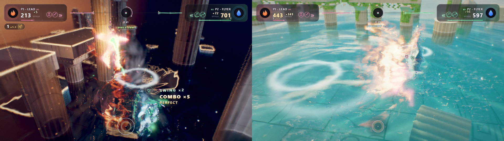
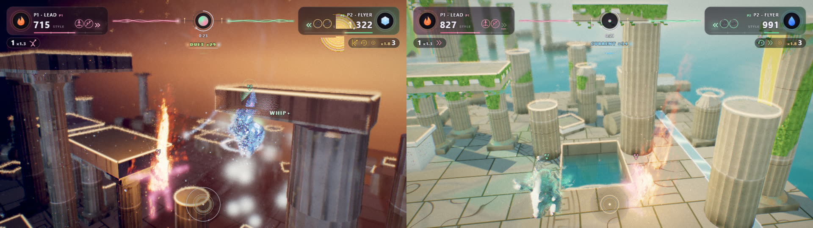
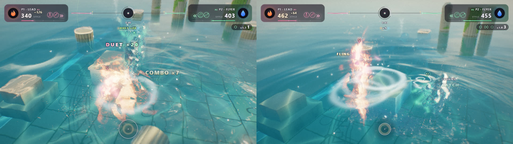
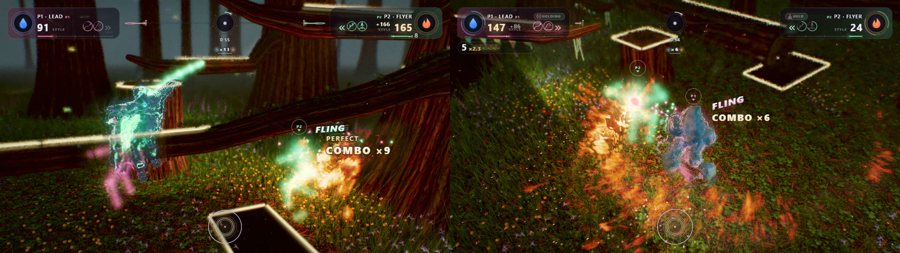
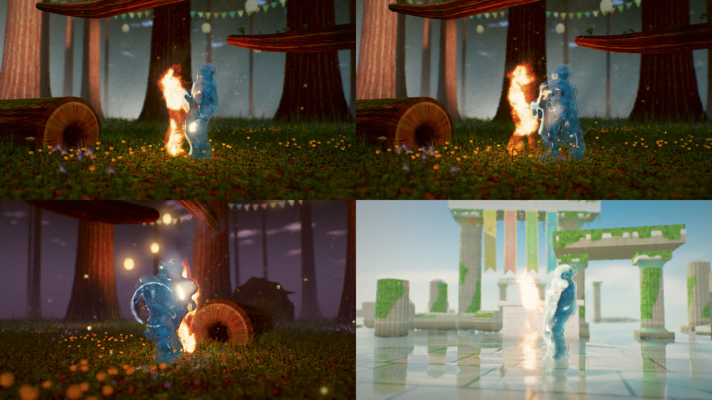

# 16 · The lines of light, and the first solarpunk temple (branch `p4-lines-temple`)

Phase 4, one of five tracks. Three jobs: report 15's issue 5 (lines of light everywhere), the first solarpunk pass on
the tide temple, and a lighter one on the redwoods.

**Measured:** `scripts/cam-sim.mjs` (24 seeded sets of 40 s, 55,272 frames, the same frames before and after; "before"
is phase 3's frame test, run as `--oldfade`, which gives master's numbers to the digit); `scripts/lines-cap.mjs` (new:
the outlines and the rim light on screen, counted in pixels, 97 moments of a bot-vs-bot duel in each world, every
0.5 s from 4 to 52 s), against master served from a clean copy and against this branch, on port 5454; GPU time with
`shot.mjs` (1280×720, 4 windows a world, against master); `npm run typecheck`; `node scripts/test-ts.mjs`;
`check-limits`, `check-bindings`. Headless stills at 960×540.
**Not measured:** a person playing; a phone; 1080p; `npm run test:net` (it uses port 5418); the GPU numbers are on a
GPU other agents were using at the same time, so they are noisy (±0.25 to 0.5 ms a frame). The duel in the page is not
deterministic run to run, so the before and after stills are the same seed and the same moment, not the same frame.

## 1. The lines of light (issue 5)

### What made the lines

Three things drew them:

- **The near fade's outline.** A dissolved piece kept its edges, brightened with the arena's rim light. This made the
  geode's honey boxes, the Pool's white boxes and the redwoods' gold capsules.
- **The arena's rim light under the tide.** The rim is drawn in the glow pass, which is laid over the water. So at high
  tide the drowned court's rims floated over the water as gold lines.
- **The pulse.** A piece came back and dissolved again within a second, 1.6 to 5.7 times a minute.

### What changed

**The outline only where the pair can use it** (`worlds/fade-frame.ts`, `worlds/light.wgsl`, `worlds/fade.ts`):

- Each piece has an eased outline weight (`FramePiece.line`, in `SightPiece.y.w`). It is 1 within 0.8 m of a body and
  0 past 2.2 m (`fadeFrame.lineNear`, `lineFar`), so a piece the pair is nowhere near dissolves whole.
- In the shader the line also fades with each fragment's distance from the nearer body. Along a long beam, the line
  stays only at the pair's end.
- **No outline where the piece is pale already.** `sightLit` measures the lit colour. Where it is pale (luma 0.25 to
  0.6), the kept edge is dropped by the same dither as the rest of the piece, and not brightened. That removes the
  Pool's white wire boxes and the temple's sunlit stone.
- **Dimmer.** `fade.outline` 0.35 → 0.2, and what is left is brightened ×1.25 rather than ×1.6. The lines no longer
  outshine the pieces they stand for.
- `fade.lines` (0 … 1) switches the kept edges off altogether. It is the measure's switch.

**The flicker: a held decision** (`fade-frame.ts`):

- The hold is 2 s (was 1 s).
- While the camera turns faster than 0.3 rad/s, the hold doesn't run down. A turn sweeps a piece out of the ray grid and
  back in, and the piece now stays dissolved through the turn.
- A piece that came back within 2.5 s needs twice the share of the frame to start again.
- After a body has been on a piece, it stays whole 1.0 s (was 0.8 s).

**The tide's rims** (`duel/arena-lines.wgsl`, `arena-layer.ts`):

- A rim under the water is drowned: a trace just under the surface (15 %), gone 0.2 m down.
- The water's height is the arena's tide (`Look.beat.w`). `arena.drown` switches this off for the measure.

### Numbers: on screen (`lines-cap.mjs`, 97 moments a world, % of the frame's pixels)

A pixel counts as outline where, in five frames held still in a row (outlines on, off, on, off, on), the on frames
agree, the off frames agree, and each frame differs from its neighbours. A mote drifting on real time can't pass that
test. Its noise floor is about 0.005 %.

| world | outline pixels, mean | 95th percentile | worst moment | moments over 0.05 % |
|---|---|---|---|---|
| temple | 0.088 → **0.009** % | 0.50 → 0.024 % | 1.27 → 0.061 % | 34 → **2** % |
| redwoods | 0.014 → **0.009** % | 0.047 → 0.016 % | 0.16 → 0.030 % | 4 → 0 % |
| geode | 0.026 → **0.004** % | 0.12 → 0.008 % | 0.64 → 0.032 % | 14 → 0 % |
| Pool | 0.099 → **0.010** % | 0.53 → 0.019 % | 2.69 → 0.025 % | 9 → 0 % |

- On average the outlines take very little of the frame. They hurt in the moments when a big piece near the eye
  dissolves (the worst moments, 0.6 to 2.7 % of the frame), and those are gone: the worst moment after is at the noise
  floor.
- **The drowned rims at high tide** (the temple, 17 moments between 14 and 30 s, the tide 0.5 to 1.45 m, counted with
  `--drowned` in one run, `arena.drown` off and on): **0.15 to 1.1 % of the frame, mean 0.47 %, removed.** That is as
  much again as the rim light that stays.

### Numbers: the frame test (`cam-sim.mjs`, the same 55,272 frames)

| world | pieces outlined a frame (× strength × weight) | again within 1 s | again within 3 s | near frame over a tenth | a near corner ≥ 1/8 |
|---|---|---|---|---|---|
| temple | 0.15 (0.12) → 0.09 (**0.04**) | 2.34 → **0** /min | 6.8 → 2.3 | 0.4 → 0.6 % | 0.5 → 0.7 % |
| redwoods | 0.15 (0.11) → 0.07 (**0.02**) | 1.56 → **0** | 2.9 → 0.3 | 0.8 → 0.8 % | 1.8 → 1.7 % |
| geode | 0.46 (0.36) → 0.30 (**0.15**) | 5.73 → **0** | 15.4 → 7.3 | 4.0 → 4.5 % | 4.7 → 5.5 % |
| Pool | 0.25 (0.19) → 0.17 (**0.07**) | 4.69 → **0** | 12.5 → 3.7 | 1.7 → 1.9 % | 2.1 → 2.3 % |
| all | 0.25 (0.20) → 0.16 (**0.07**) | 3.58 → **0** | 9.4 → 3.4 | 1.7 → 1.9 % | 2.3 → 2.5 % |

- **Weighted outlines:** about two thirds less. "Pieces outlined" counts a piece whose weight is past 0.05. The
  weighted figure is what the eye sees.
- **The pulse:** gone within a second, and down by two thirds within three seconds. What is left is all of one kind: a
  body was on the piece in between, so it came back for the body.
- **The camera judge's clean eye (every solid solid):** unchanged, frame for frame, because the camera never reads the
  fade. Eye in a solid 0.1 %, near frame 11.5 %, a body hidden 5.6 %, the flyer 17,262 of 17,262.

**The price** is a little more of the near frame left whole:

- Over a tenth: 1.7 → 1.9 % of frames overall, and 4.0 → 4.5 % in the geode.
- The cause is the longer rest after a body, and the doubled share for a piece that came back lately.
- Variants with a longer rest (1.6 s) cost the geode 5.6 %. With phase 3's 0.8 s rest the near frame is unchanged, but
  2 to 3 pulses a minute stay. I kept 1.0 s.
- The frame test now holds more pieces on, ones a turn has swept out of view: 2.4 → 3.6 a frame of the 16 slots. It is
  The test's CPU time is unchanged (0.19 → 0.16 ms a frame in Node: noise).

## 2. The temple, solarpunk (first pass)

The concept I aimed at: `docs/design/solarpunk/temple-concept.jpg` (GPT Image via Codex).

The moonlit dusk is now **a sunlit afternoon**. The court's stones, collision, ledges, drops and tide are untouched;
everything new is shading, light, and things hung in the air that are not solid.

**Light and sky** (`temple.wgsl`, `temple.ts`):

- The key light is now the sun: 34° high, behind the stage and to the left (`sunBearing`). The columns' sides and every
  top are sunlit, and the shadows fall across the court.
- A clear sky: teal overhead, pale near the sea, warm round the sun, with soft gold-edged clouds.
- The sky's fill is rescaled for day, the exposure is 0.9, and the grade is warmer.
- The light members keep their names (`moon*` is the key light).

**The stained solar glass** (`templeCanopy`):

- The sunlight on the floor, the stones and the hangings passes through a canopy of leaded panes high over the court
  (11.5 m), in an art-nouveau fan of petals: sun gold, teal, coral, leaf and cream.
- Its light falls in soft pools of colour across the middle of the court, with gentle seams for the lead. It is traced
  per pixel toward the sun, with no shadow map and no new binding.
- The canopy itself is never in the duel's frame, only its light.

**Pale stone, ceramic and bronze** (`stones.wgsl`):

- The stone is a pale cream limestone, tended: the rain's streaks are at a third, the weathered crust at a fifth, and
  wet stone darkens less.
- The carved bands and panels are glazed white ceramic, glossy (the altar's facing, the egg-and-dart bands).
- Every column's capital and base is bronze gone green: verdigris in the hollows, the bronze warm on the crowns.

**Vines and flowers** (`stones.wgsl`):

- Two leafy stems wind up most columns, each to a height of its own.
- Curtains of leaves drape from the high blocks' edges (the lintels, the architraves, the gate), breaking into strands
  lower down.
- Flowers in coral, rose, cream and gold.
- Only above the highest tide, and never on a top a body lands on.

**Water** (`temple.ts`, `backdrop.wgsl`):

- The tide is clean deep-teal water now, clear to the floor, with the sun's caustics and glitter on it.
- Channels lined in white tile with a teal lip run round the court's edge, outside the drops and the stage, always
  full.

**Banners, strands and chimes** (new: `temple/garden.ts`, `garden.wgsl`):

- Dyed-cloth banners hang in the great gate's opening and down the colonnades. They are swallowtail-cut, with a pale
  leaf and a gold border, and glow with the sun behind them.
- Flowering strands hang from every lintel's edge. Over the pair's lintels they are short, at most 0.45 m.
- Wind chimes of bronze gone green.
- All of it sways and ripples in the sea air.
- 64 hangings for the court (each chime is five tubes), and 83 more over the duel's lintels while the arena is shown.

**Fountains** (new: `temple/fountains.wgsl`): four jets at the channels' corners, droplets in arcs catching the sun.
They are drawn in the glow pass.

**The tide's glints and rings** (`duel/hazards-fx.ts`): a floating body's ring is softer (0.45 → 0.3), because in
bright water it hid the body.





What I see:

- **High tide.** The drowned court reads as clear water over pale flagstones, with no gold scribbles.
- **Low tide.** The court is a bright, warm place of cream stone, vines on the columns, banners in the gate and a tiled
  channel. The arena's shapes (the drops, the stumps, the lintels) read from their own light and shade.
- **The bodies.** Fire stands out everywhere. Water stands out against the stone, but less against the high tide's
  water (water in water), and the seat markers carry it there.
- **The vines are paint, not leaves.** On a column seen close they read as a green coat with a ragged edge. They have
  no silhouette of their own: they are shading on the stone's surface, a first pass.

## 3. The redwoods, a lighter touch

New: `redwoods/garden.ts` and `garden.wgsl`.

- **Bunting.** Strings of dyed pennants are slung between the ring's trees, 7 to 8 m up over the play (9 strings, 125
  pennants).
- **On the duel's boughs.** Small pennants are tied along the underside of each bough's level run, with a bronze chime
  at its tip (65 hangings, while the arena is shown).
- **The gusts.** Every pennant streams out along the duel's gust. The gust's direction and strength reach the shader
  through `forest.near.xyz`, which was free.
- **Fireflies from dusk.** They come out when the sun is under 10°, not only at night (`forest.horizon.w`).
- **Sun shafts and petals.** `godRays` is 1.3 (was 1). The gust carries petals (coral, cream, rose) among its leaves
  (`hazards-fx.ts`).
- The wood and its collision are untouched.




In the duel's own frame (low, looking down at the pair) the redwoods change little. The strings are above it, and the
boughs' pennants are small and in shade. In wider views (the jogo's lock, a film's crane, the plain world) the bunting
and the dusk fireflies read clearly.

## GPU (RTX 5090, 1280×720, 4 windows of 150 frames each side, a shared GPU)

| | master | this branch |
|---|---|---|
| temple duel, whole frame | 1.90 ± 0.25 ms | 1.89 ± 0.40 ms |
| … the scene pass | 0.432 ± 0.038 ms | 0.468 ± 0.067 ms |
| redwoods duel, whole frame | 2.98 ± 0.48 ms | 3.14 ± 0.53 ms |
| … the scene pass | 0.748 ± 0.075 ms | 0.773 ± 0.104 ms |

- The scene pass gains about 0.03 ms in each world: the hangings, the vines' noise, the canopy's per-pixel trace. That
  is within the noise of a shared GPU.
- The fountains add nothing measurable to the glow pass (0.147 → 0.130 ms, noise).
- The near fade's new body-distance loop runs only while a piece dissolves.
- `check-bindings`: the new shaders fit the "every other world draw" row (3/3 uniforms, at most 1 storage buffer, 2/2
  sampled textures).

## Tests

- `npm run typecheck`: clean.
- `node scripts/test-ts.mjs`: every file passes, and `src/worlds/fade-frame.test.ts` has 9 tests (2 new: the outline
  only near the pair, the held decision through a turn).
- `check-limits`, `check-bindings` (155 entry points): pass.

## Files

**The fade:**

- `src/worlds/fade-frame.ts`: the outline weight, the turn hold, the re-start hysteresis, a 2 s hold, a 1.0 s rest.
- `src/worlds/fade.ts`: `outline` 0.2, `lines`, the weights and the distances to the uniform.
- `src/worlds/light.wgsl`: `sightFade` (distance to the pair, `y.w`), `sightDrop`, `sightLit` (the pale test).
- `src/worlds/fade-frame.test.ts`.

**The arena layer** (a few lines): `src/duel/arena-lines.wgsl` (drowned rims), `src/duel/arena-layer.ts` (the tide's
height, `arena.drown`).

**The hazards:** `src/duel/hazards-fx.ts` (petals, the softer floating ring).

**The measures:** `src/duel/camprobe.ts` (the outlines, flicker within 3 s and why, `--oldfade`, `--fadeset`),
`scripts/lines-cap.mjs` (new), `scripts/steps/garden-timings.json` (new).

**The temple:** `src/worlds/temple/temple.ts`, `temple.wgsl`, `stones.wgsl`, `backdrop.wgsl`, and new: `garden.ts`,
`garden.wgsl`, `fountains.wgsl`.

**The redwoods:** `src/worlds/redwoods/redwoods.ts`, `arena.ts` (the boughs' runs exported), `day.ts`, `forest.wgsl`
(comments), `lanterns.wgsl` (fireflies from dusk), and new: `garden.ts`, `garden.wgsl`.

**The rest:** the regenerated `.d.wgsl.ts`, `AGENTS.md` (the near fade's paragraph),
`docs/design/solarpunk/temple-concept.jpg`.

```bash
node scripts/cam-sim.mjs [--oldfade] [--fadeset hold=2,turn=0.3]
node scripts/lines-cap.mjs shots/lines --url http://127.0.0.1:<port>/energybending/ --world temple --dress fire,water --from 4 --to 52 --every 0.5 [--drowned] [--stills 24 --masks]
node scripts/shot.mjs shots/t scripts/steps/garden-timings.json --url http://127.0.0.1:<port>/energybending/ --size 1280x720
```

## Not done

- **The vines are surface shading.** A next pass should give the columns real leaf cards (alpha-tested quads round the
  shaft, as the redwoods' ferns), and trellises.
- **The canopy is never drawn, only its light.** A crane or lock shot that looks up sees open sky.
- **A water body at high tide.** It reads less well against the teal water than against stone; the seat markers carry
  it.
- **The redwoods' canopy walkways and platforms with lanterns** are not built. The bunting, the bough pennants, the
  chimes, the fireflies from dusk and the petals are.
- **The near frame over a tenth** is 0.2 to 0.5 points worse in the geode and the Pool (the price of the steadier
  fade). A per-piece rest that counts only a body standing on the piece, not one brushing past, may win it back.
- The arena's rim light itself (the stump tops, the drops' edges above the water) is unchanged; only its drowned part
  is gone.
- **Not measured:** a phone, a person, 1080p, `test:net`. The old film (`films/film2.json`) still drives
  `temple.moonHeight`, which now moves the sun.
