# 17: the duel's phase 4 film (the first solarpunk pass), and what holds it back now

Branch `p4-film`, from master `83441cf` (phase 4 merged: the skin and the art bible, the Pool's golden-hour water
garden, the big moments and the weight, the geode's greenhouse grotto and the fusion across the worlds, the sunlit
temple and the lines of light). The brief: make the phase 4 film of the contact dance (about 30 s, 720p60, the new HUD
on, two virtual players, cut like a highlight reel on one Suno track's beats) showing what phase 4 brought (the
solarpunk worlds first; the calmer big moments; the longer holds; the hum rising where the pair is; a finale), check
the film's loudness and settle report 15's question about the duel's voices, then name, as someone who has watched a
lot of it, the five things that most hold it back, for phase 5.

**Measured:** 52 whole sets scouted as previews in the page (two virtual players, 80 s each: the count-in, 60 s of
play, the finale, the banner and the next count-in), at 640×360, all on the film's track at skill 0.85, every rule,
power, juice and hazard event read from `info.json`'s duel log, and two new logs (below): the HUD's words on screen
frame by frame, and where the camera stood every 0.1 s; the contact sheets of the moments I cut, looked at frame by
frame; two previews of the cut (one at 640×360, and the fades test of the fixes) and the master, looked at as sheets;
that every shot's dance in the master matches its scout's, event for event (`match.mjs`); the page's mix measured in
Chrome with a tone, and a whole temple set's recorded score against its track; the film's loudness and its two layers'
(ffmpeg's ebur128); `npm run typecheck`, `node scripts/test-audio.mjs` (34 passed), `check-bindings`, `check-limits`.
**Not measured:** a person playing; a phone; the sound by ear (levels only: nobody listened, before or after the
balance fix below); the lock (`?lock`); an online duel; the Node harness (the page's numbers only).

## The film

`docs/reports/media/film/duel-p4.mp4` (git-ignored): **32.4 s, 1280×720, 60 fps, H.264 High at 4.94 Mbit/s (two
passes), AAC 198 kbit/s stereo at 48 kHz, 20.8 MB**; loudness **−15.8 LUFS integrated**, true peak −2.9 dBFS,
loudness range 3.1 LU (report 15's: −14.7 LUFS; the film is quieter because the duel's sounds came down 4.9 dB, below).
Encoded (`p4/final.mjs`) from the film tool's master (`docs/reports/media/film/p4/master/duel-4-master.mp4`, 111.6 MB,
rendered at 1.5× and brought down on the GPU, under the render lock; and its `duel-4-web.mp4`, 33.1 MB) with the front
(2.1 s, `scripts/front-cap.mjs`, below) laid before it, the sound mixed as the film tool mixes it (one AAC generation).
The master took 15 minutes; the lock was held 18 to 44 s at a time (longest 43.7 s).

The timeline is `films/duel-4.json`. The track is **the redwoods' ("Embers in the Redwoods", 113.05 bpm, A minor)**,
from bar 59's second beat to bar 74's third beat. Why this one:

- **Its mood is the art bible's.** It was written as "warm, golden, enchanted, organic": kalimba, nylon-string guitar,
  cello, shakuhachi and "glockenspiel like fireflies" over berimbau, a forest at dusk with "a magical swell where two
  bodies fuse". That is the bible's sound (bowls, chimes, kalimba, struck wood) and its redwoods (golden hour going to
  dusk, the first fireflies). The Pool's track, the only one in a major key, was written for "a dance on black water
  under a full moon", the look phase 4 left (and phase 3's film used it); the temple's ("Moon Over the Tide Temple") is
  the moonlit temple's; the geode's is a cave's ambient groove.
- **It is the brightest of the four.** Its median spectral centroid per bar is 1.74 kHz (the temple's 1.54, the
  Pool's 1.14, the geode's 1.05; `p4/bars.py`), and bars 65 to 68, a shimmering swell after a hush, are the brightest
  stretch of any of them (2.3 to 2.8 kHz).
- **Its shape is a reel's:** the hush of bars 61 to 64 (−19 dB a bar against −12 to −14 round it), that bright swell,
  then the body from bar 69. And bars 59 to 76 lie inside its loop (bars 44 to 76), so the page's pitched cues take the
  chord of the bar sounding (report 15's smaller issue: its film played outside the Pool's loop).

The shape: the front and the count-in on the end of the loud stretch (bar 60), DANCE on bar 61's downbeat, the awe
beats in the hush (the temple's high tide, the hum lifting both), the dusk redwoods on bar 65's swell, the moments in
the body from bar 69, FINALE on bar 72 (0.07 s before its downbeat).

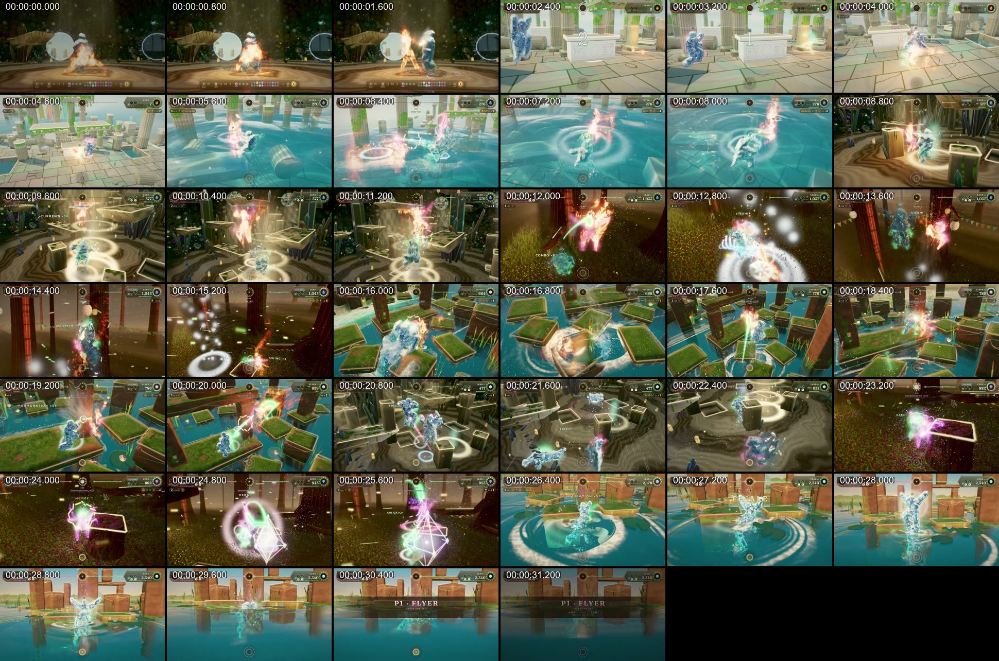

| time | shot | what happens |
|---|---|---|
| 0:00.0 | **the front** (the hub behind the warm glass strip; `front-cap.mjs`) | the geode's greenhouse grotto with its two dancers, the gates, the honey-glass strip in gold leading with the sun to press; 4 beats |
| 0:02.1 | **the temple, low tide** (ice a flyer in rose, fire a lead in fern; seed 3) | **3, 2, 1** over the cream court, **DANCE** at 0:03.7 on bar 61; fire catches ice, flings it, and catches it out of the air (AIR CATCH 0:05.1) by the vined lintels, the banners in the gate behind |
| 0:05.8 | **the temple at high tide** (fire a lead in rose, water a flyer in fern; seed 1) | the court under 1.2 m of clear water and rising: water throws **WHIP** across the water and catches fire at range (0:06.6, the 10-frame hold), they swing afloat, CURRENT ×39 (0:08.7) |
| 0:09.0 | **the geode's hum** (fire a flyer in rose, water a lead in fern; seed 3) | the column of honey rings rises where the pair is (0:09.6) and lifts both; they meet in the air inside it (AIR CATCH, 0:11.6) |
| 0:12.2 | **the redwoods at dusk, bar 65** (fire a flyer in rose, water a lead in fern; seed 3; hour 18.9) | wave and ribbon: **STEAM!** (0:13.0); the geyser carries both up past the lanterns into the bunting, and fire catches water at its top (AIR CATCH 0:14.4, the 11-frame hold) |
| 0:15.9 | **the Pool's water garden** (fire a lead in rose, water a flyer in fern; seed 1) | water whips fire in from a raft at range (0:16.35, held), they swing over the lily pads, an air catch and **MURMURATION ×55** (0:18.9), and another whip at range (0:20.4) |
| 0:20.7 | **the geode, bar 69** (water a flyer in rose, ice a lead in fern; seed 4) | water's whip meets ice's step: **FREEZE!** (0:21.05), the frost flower round the pair |
| 0:23.4 | **the redwoods at dusk** (plasma a flyer in rose, gems a lead in fern; seed 1; hour 18.9) | **MERGE** (0:24.2): the petals of both colours opening round the pair; the power form, gems' prism, an air catch (0:25.9) |
| 0:26.5 | **the Pool's last seconds** (water a flyer in rose, ice a lead in fern; seed 4, skill 0.85) | MURMURATION ×59, **FINALE** at 0:27.0 on bar 72, the fused lift out of the water into the low sun (its top at 0:28.2, held 12 frames), the banner **P1 · FLYER TAKES THE SET**, 2,462 to 2,340 (0:30.2); out at 0:32.4 on bar 74's third beat |

Every moment is the game's own, at skill 0.85; the film has no `rate` cue, so every shot's recorded sound is in it.
The two redwoods shots set the hour to 18.9 (dusk: the lanterns, the bunting in low light, the fireflies), which
changes the light only: each shot's dance matched its scout's at the default 8.2 (below). Shot sheets (the master):
`media/17-film-duel-4-<shot>-master-sheet.jpg`.

### How it was made

1. **Scouted, 52 sets** (`docs/reports/media/film/p4/`, git-ignored: `list1.txt`, `scout.mjs`, `inf/`): each an 80 s
   one-shot preview at 640×360 on the redwoods' track (the brains dance on its tempo), without its score; 13 sets a
   world, skill 0.85, seeds 1 to 4, the reacting pairs most (fire and water, water and ice, ice and fire) and plasma
   and gems twice a world, styles rotated.
2. **Two new logs in `info.json`** (`src/engine/film-shot.ts`): `duel.words`, the HUD's words standing on screen
   (alpha over 0.3, `bend.hud.cover()`), each time the count changes, so a scout can count the words at a peak; and
   `duel.cams`, every 0.1 s, the eye's distance from the pair's middle, the two apart, the taller body's height on
   screen and the water's height there (the high-tide question, below).
3. **The moments.** `analyse.mjs --moments` listed each set's tiers, reactions, held catches at range and at a
   geyser's top, hum lifts, merges and finales; I looked at sheets (a frame every 0.15 to 0.35 s) round each and chose
   by eye. Two fixes came out of the sheets (below): a temple banner filling the frame, reeds across a finale.
4. **Cut into the sets on the beat**, a whole number of beats in (report 12's method). The master's dance matched each
   scout's event for event, within 0.01 s (`match-master.txt`).
5. **A preview (640×360) of the cut, then the master**, then `final.mjs`: the front's first four beats, the master's
   picture, the track started four beats earlier so every cut stays on its beat, the shots' scores laid as `film.mjs`
   lays them.
6. **The finale.** 6 of 52 sets fused (below). The Pool's (seed 4) reads best once the reeds stop standing across the
   lens: the lift out of the water into the low sun, the banner over the water. The temple's two had the lift behind a
   column or a pale ring round it; the redwoods' (water and ice) was two pale-blue bodies in the dark of the trunks.

### The front

The film tool can't film it: its frames are the GPU canvas read back (with the HUD's canvases over it), and the front's
strip, lobby and cards are DOM. `scripts/front-cap.mjs` (new) films it a frame at a time: steps the page at 60 fps,
reads the canvas back (`bend.grab`), lays it under the page as its background, hides the canvas and screenshots the
page with the DOM over it (skin-16's still, made into a clip), the pointer resting on the strip so it doesn't idle
away. 4.5 s took 2 minutes. It is pictures only; the film's track plays under it.

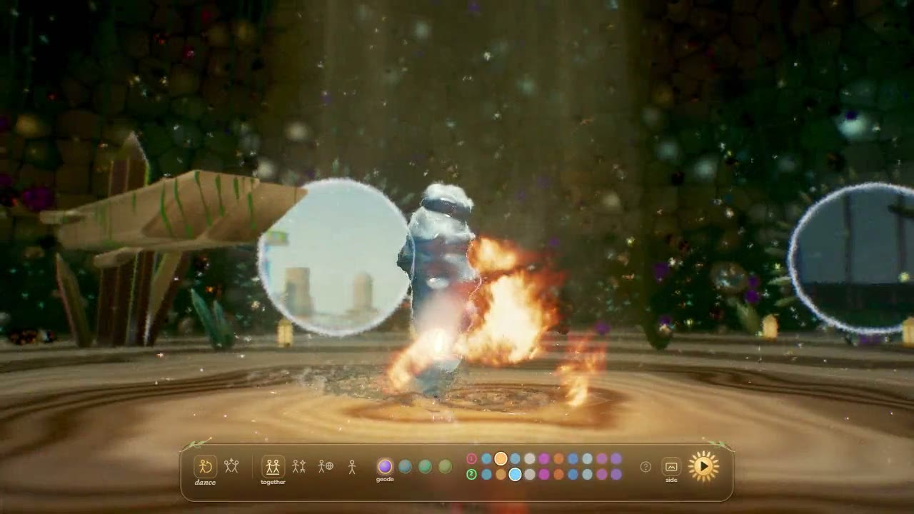

## The duel's voices: which was right

Report 15 found its film's score level with the track, where report 14-sound had measured the game's sounds 4 to 8 LU
under it in the page. **The film was right, and the page was as loud as the film: report 14's measure was wrong.**

- **The layering is the page's by construction.** In the page the track goes `track → trackLP → out (0.72)`; the game's
  sounds go `master → compressor → tanh → out (0.72)`. A film records the game's calls and renders them offline through
  the same `Mix` (out included), and `film.mjs` lays the track at its file's level and lifts the score by 1/0.72: the
  same ratio. (Report 14's own film clip compared the recorded score, after the 0.72, with the track's file, before it:
  2.85 dB off in the other direction.)
- **What report 14 left out.** It carried each bus through the master's gains, the tanh's small-signal gain and the
  output, "the compressor left out: it only lowers the loudest". But Web Audio's `DynamicsCompressorNode` adds an
  automatic make-up gain. Measured in Chrome (`p4/mixgain.mjs`, a tone, offline): the mix's compressor (threshold −15,
  knee 10, ratio 4.5) lifts everything under its threshold by **+4.9 dB** (+3.3 dB at −12 dBFS in). The duel's bus to
  the output measured −1.1 to −1.5 dB where report 14's model gives −6.1. So every one of report 14's "at the speakers"
  numbers for the game's sounds is 4.9 dB low.
- **Measured in a whole set:** a temple set's recorded score (fire and water, seed 1, 80 s; before the fix) against its
  track through the output: **0.1 LU under it** during play, 0.5 LU over the whole capture. Level with the music, as
  report 15's film was.

**Fixed (small):** the balance report 14 chose is the one it meant, 4 to 8 LU under; the compressor's make-up put the
duel 4.9 dB over it, in the page and in every film alike. `DUEL_BALANCE` (`src/duel/sound.ts`) now sets `all` to 0.114
(UNDER's 0.2 less 4.9 dB): the game's whole bus, in the duel only, under a track. In this film the shots' scores are
**5.0 LU under the track** (−21.9 against −16.9 LUFS over the duel's 30.3 s; 5.2 in the hush, 4.8 in the body,
`p4/levels.mjs`), where report 15's were 0.4 under. The jogo's balance (UNDER) is untouched. Not heard: whether a
catch still stands out enough is for an ear.

## The numbers (52 scouted sets, 52 minutes of play)

Phase 4 against phase 3 (report 15: 50 sets on the Pool's track). Here every world danced at 113 bpm (the redwoods'
track); phase 3's at 121. All 52 sets at skill 0.85 (phase 3: 38 at 0.85, 12 at 0.95). "Words at a peak" is the most
words standing at once in the 0.6 s after a reaction, a tier, a merge or a catch at range or a geyser's top (report
16-moments' measure); phase 3's film did not count it, so its column is report 16-moments' master (eight sets).

| | phase 3 (50 sets) | **phase 4 (52 sets)** | temple (13) | redwoods (13) | Pool (13) | geode (13) |
|---|---|---|---|---|---|---|
| catches a minute (all) | 24.4 | **25.1** | 24.8 | 23.9 | **27.2** | 24.5 |
| … out of the air | 55 % | 54 % | 46 % | 43 % | 71 % | 54 % |
| **held moments a minute** (frames each) | 44.8 (3 to 6) | **13.0 (5.8)** | 11.0 | 10.1 | 18.0 | 13.0 |
| juice events a minute (held or let go) | 44.8 | 46.6 | 45.9 | 44.3 | 50.3 | 46.1 |
| **words at a peak, most at once** | 3.05 to 3.29 (report 16's master) | **0.99**: 486 of 490 peaks one word, 4 none | 0.99 | 0.99 | 1.0 | 0.99 |
| … words on screen in a peak's frames, mean | 2.32 to 2.56 | **0.63** | 0.64 | 0.64 | 0.60 | 0.64 |
| casts a minute (both players) | 11.1 | 11.3 | 11.2 | 11.2 | 11.4 | 11.5 |
| power forms | 84 | 85 | 18 | 15 | 33 | 19 |
| reactions (steam, freeze, melt) | 75 (25, 39, 11) | **75 (22, 25, 28)** | 15 | 20 | 16 | 24 |
| pair tiers (DUET, CURRENT, MURMURATION, AURORA) | 112, 65, 27, 6 | **127, 76, 36, 3** | 35, 18, 7, 0 | 29, 15, 8, 0 | 29, 20, 14, 2 | 34, 23, 7, 1 |
| sets whose top pair tier is CURRENT / MURMURATION / AURORA | 21 / 21 / 6 (DUET 2) | **15 / 29 / 3 (DUET 5)** | 5 / 6 / 0 (2) | 4 / 7 / 0 (2) | 1 / 10 / 2 | 5 / 6 / 1 (1) |
| solo tiers | 8 (all FLOW) | 8 (all FLOW) | 1 | 1 | 3 | 3 |
| merges (sets with one) | 59 (40) | 57 (46) | 14 (11) | 12 (10) | 18 (13) | 13 (12) |
| **fused finales** | 9 (18 %): 8 of 38 at 0.85 | **6 (12 %)**, all at 0.85 | 2 | 2 | 2 | **0** |
| the shared energy's peak, mean | 0.90 | 0.89 | 0.90 | 0.85 | 0.92 | 0.91 |
| falls | 3 | 3 (all the redwoods) | 0 | 3 | 0 | 0 |
| hazards ridden (rides a set) | tide 10.4, gust 10.1, swell 5.4 and 5.1 crests, hum 3.9 | **tide 11.5 (254 s), gust 11.8 (70 s), swell 4.8 and 4.6 crests (55 s), hum 14.9 (195 s)** | tide 11.5 | gust 11.8 | swell 4.8 | **hum 14.9** |
| the duel's sounds a minute | 238 | **305** | 294 | 269 | 351 | 307 |

- **Holds:** the game now holds 13 moments a minute, not 45, and each longer (5.8 frames): air catches 5, a catch at
  range 10, a geyser's top 11, the lift 12 (`juice.hold`). The Pool holds most (18 a minute), its catches out of the
  water. Juice events are as many as before (46.6 a minute); most are let go (`hold` 0).
- **One word:** of 490 peaks, 486 had one word at most and 4 none (phase 3's film: two to five).
- **The hum** rides 14.9 times a set (3.9 in phase 3): it rises where the pair is now (report 16-geode). In the geode
  sets it often lifts both at once (the film's 0:09.6).
- **Reactions:** as many as phase 3 (75), spread evenly (melt 28, freeze 25, steam 22) where phase 3's were mostly
  freezes. 44 of the 52 sets could react (fire with water or ice, water with ice): 1.7 a set.
- **Pair tiers:** every set reached one; 29 sets peaked at MURMURATION, 3 at AURORA (the Pool's two, the geode's one),
  5 only at DUET.
- **Fusion:** 6 of 52 (12 %, about 1 in 8 as report 16-geode tuned it): two each in the temple, the redwoods and the
  Pool, **none in the geode** (0 of 13) though its peak is high (0.91) and it merged in 12 sets. Report 16-geode found
  the geode 3 of 28 in the page at its own tempo; 0 of 13 here is within the noise of a 1-in-8 rate (about 18 % odds),
  but it is the world a player sees first.
- **Casts:** whip 19.6 %, flare 16.0, step 14.5, wave 14.5, ribbon 13.1, slide 8.5, prism 3.7, arc 3.6, pillar 3.6,
  blink 3.1 (588 in all; plasma and gems were dressed in 8 of the 52 sets).
- **Sound:** 305 of the duel's cues a minute (238 in phase 3; counted the same way, `bend.duel.sound.stats()` over each
  capture's page time): a swing's gust 67 a minute, a landing 54, a splash 20, a wall jump 19, a bank 16, a fling 16, a
  dash 14, a catch 13, an air catch 13, a cast 12, the hum's two 2.5 each. More swings and landings at this tempo; the
  phase 4 work did not add cues.
- **Falls:** 3, all in the redwoods (two in one set, water and ice, seed 3, whose energy peaked at 0.37 with 14
  catches; one in gems and plasma, seed 2), none in the Pool or the geode (the geode's 12 in 16 sets before report
  16-geode).

### The camera at high tide

The owner saw a temple still at high tide with the duel camera far back and the bodies small. **In the scouts that is
not common, and it is not the tide.** Over the 52 sets' play (33,000 samples, `p4/cam.mjs`), the eye stands a median
5.6 m from the pair's middle (90th percentile 8.0 m) in every world, and the taller body is a median 0.33 of the
frame's height; it is under a sixth of the frame in 1 % of samples. In the temple:

| temple | samples | eye to pair, median (p90) | taller body on screen, median (p10) | body under 1/6 of the frame |
|---|---|---|---|---|
| tide under 0.4 m | 3,481 | 5.7 m (8.3) | 0.325 (0.231) | 1 % |
| tide 0.4 to 0.9 m | 1,495 | 5.6 m (7.5) | 0.332 (0.243) | 1 % |
| tide over 0.9 m | 3,159 | 5.6 m (8.0) | 0.325 (0.234) | 1 % |

What stands the camera back is the two being far apart, in every world: with them under 2 m apart (70 % of the time)
the eye is 5.5 m off and a body a third of the frame; 3 to 5 m apart, 7.2 m off and 0.27 of it; over 5 m apart (2.5 %
of the time), 8.7 m off, and a body is under a sixth of the frame a quarter of that time. At high tide the pair floats
and drifts apart a little less often than at low tide (13.5 % against 17.1 % of samples over 3 m apart). What does
change at high tide is the pitch: the camera looks down on the water from above (the film's 0:05.8), so the bodies are
seen from over their heads, foreshortened, against a bright, even teal; I think that is the "small" in the still.

## Five things that hold it back (for phase 5)

From the 52 sets, the cut's previews and the master's frames, against the art bible (`docs/design/solarpunk.md`).
Report 15's five were phase 4's work, and most of them show: the Pool has water and a garden (no more slabs in a void),
one word stands at a moment and the bodies read through it, the holds are fewer and longer, the hum meets the pair, the
lines over the temple's drowned court are gone.

### 1. The solarpunk stands above the duel's frame

Phase 4 built its sunlit worlds upward and the duel's camera looks down. Its eye stands 5.6 m off and a few metres up,
pitched 24° on average and over 35° a tenth of the time (report 16-pool), so the frame is the floor and the pieces: the
temple's stained-glass canopy is never drawn, only its light (pale pastel patches on the court); the geode's four leaded
light wells and their beams are over the top edge (the hum's still: honey rings, a wood-grained floor and dark
crystals); the redwoods' bunting hangs 7 to 8 m up and only shows when a geyser carries the pair into it (0:14.4); the
Pool's peach-and-teal sky, its far garden shore and its glass pavilions sit at the horizon, which the camera sees only
in the finale's low shot (0:28.2, the film's most solarpunk frame). The bible's "epic" is a place seen whole: the
concept images are all eye-level views with the sky, the glass and the architecture in them. For phase 5: bring the
look into the frame the player has (the canopy's glass seen in the water and the stone's reflections, things standing
at the stage's edge at the height of the bodies: trellises, fountains, sails, chimes, a pavilion behind the stage), let
the camera breathe up to a wider, lower view between moments, and give each world one landmark the duel's eye always
sees.

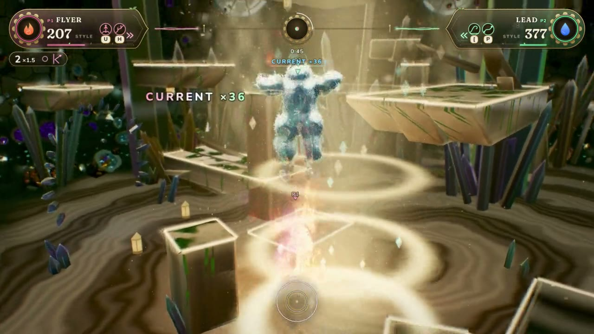

### 2. The materials are a first coat of paint, and the lines are back in other worlds

Seen in motion at 720p, each world's new matter reads as a pattern on a box. The geode's agate floor is brown and cream
wood grain; the Pool's rafts are square tiles of turf with white sprinkles (flowers) on terracotta boxes, a garden seen
as a grid from above (0:16 to 0:20); the temple at low tide is cream on cream on pale teal, flat and washed, its vines a
green coat on the columns (report 16-temple: shading, not leaves); the redwoods at dusk are a brown haze. The bible
asks for white ceramic, brass, copper gone green, leaded glass and petals that catch the sun; in the frames, the
highlights that would say "glaze" or "brass" are missing, and the bodies are the only bright things. And the outlines
report 16 removed from the temple and the Pool's slabs are still there elsewhere: the geode's dissolved blocks are
gold-edged boxes (the hum's still), the redwoods' stumps and boughs gold rectangles and sticks (the merge's still), and
in the Pool a frozen bar of ice drew as white wire boxes across the frame (seed 1, water and ice, 20.7 s). For phase 5:
real silhouettes for the planting (leaf cards, trellises, flowers on the pads), glaze and metal that answer the sun
(a sheen, a rim), each world's floor a material and not a texture, and the near fade's outline gone where the piece is
not a floor the pair needs to see.

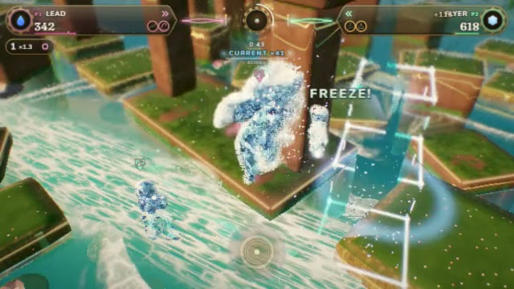

### 3. Steam and the geyser are still white blots on the bodies

Report 16-moments kept the moments' own light off the bodies; steam is the field's matter and the geyser the hazard's,
and neither is kept off. At a STEAM! the frame fills with opaque white puffs the size of a head (cotton balls), white
rings at the lens and the geyser's spray over the pair (the redwoods at 0:13.0 and 0:15.2; every geyser in the
scouts). The bible's steam is "morning mist in the sun's shafts: warm white, carrying light"; this is the old white
pile-up, the last one left. For phase 5: steam as a soft, sunlit veil that thins over the bodies (the same `keepOff`
the moments use), the geyser's ring and spray dimmed through the catch's frames, and no puff nearer the lens than the
pair.

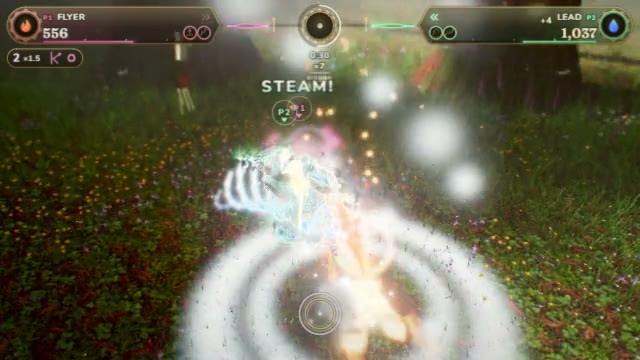

### 4. Two pale bodies are one shape

Water and ice are both pale blue, plasma and gems both violet-white, and in phase 4's brighter worlds the second body
is lost against the first and against the world: in the temple's teal water a water body is water in water (16-temple
said so), ice and water catching are one blue mass (seed 2, 22.95 s), and the film's fused lift (0:28.2) reads as one
crystal figure with the other body a glow at its feet. The seat colours are thin: a rim, a small tag and a ring at the
feet. The bible reserves rose and fern for exactly this ("so who is who always reads"); at 720p they don't carry a
body. For phase 5: give each body its seat's colour inside the matter (a tint in the light it carries, its core's
glow), not only round it; or deepen one of each same-hue pair (ice toward clear and white, water toward deep teal).

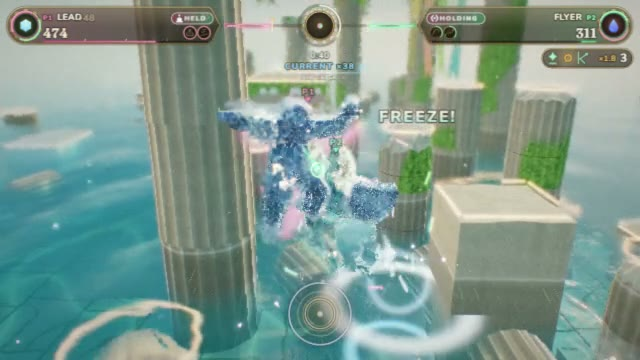

### 5. The fusion is not yet a bloom, and the first world never fuses

The bible: "a fusion is a bloom (a flower or a tree of light opening over the pair), a finale is the sun at its
height, the banner is a garland". In the film the fused lift is a soft white disc behind the lifted body, the column a
faint haze (0:28.2); in the temple's two fused sets the lift stood behind a column or inside a pale ring. The banner is
a dark band that arrives empty, a few frames before its words (in every finale's sheet I looked at in the scouts). And the fusion is rare
and lopsided again on this tempo: 6 of 52, none of 13 in the geode, the hub's world and the first thing a player sees,
though it merged in 12 of 13 sets with the second-highest peak (0.91). For phase 5: the bloom itself (petals or a tree
of light rising over the pair through the lift's 12-frame hold, in both seats' colours), the banner as a garland that
opens with its words, and the geode's fusion measured again in the page (a larger run, at 113 and its own 111 bpm)
before anything is tuned.

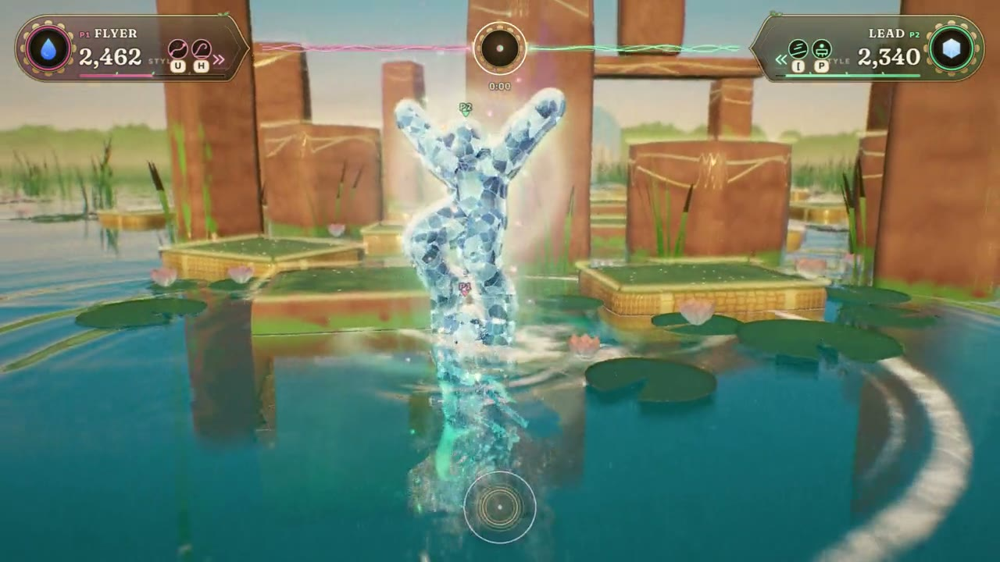

### Smaller things seen

- **The one word wanders.** It is one word now, but at a pair tier the word moves from slot to slot almost every frame
  (MURMURATION ×55 at 0:19.0 to 0:19.8 stood above the orb, under the pair, left and right of it in turn; AURORA ×135 in
  the geode the same): the placement is redone each frame as the bodies move and snaps when a slot is taken.

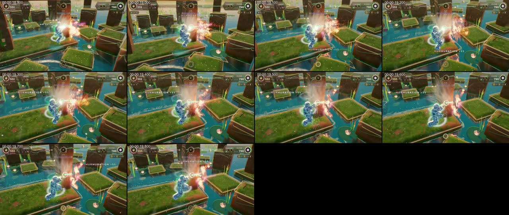

- **The dappled tier flash is not seen.** Report 16-moments' sixteen spots of sun at a pair tier did not show in the
  master's frames at 720p over the Pool's bright garden (0:18.9 to 0:19.9); the tier reads by its word and the slowed
  beat.
- **The HUD's panels are missing through the count-in** (0:02.1 to 0:04.6): only the orb and the count show until
  play; the cartouches fade in after DANCE.
- **The page is louder than its design said** (above, fixed for the duel); the jogo's balance under a track (UNDER)
  was set from a film's recorded score (report 9) and was not checked here.
- **Redwoods falls:** 3 in two sets, the only falls in 52; the set with two (water and ice, seed 3) never got going
  (14 catches, peak 0.37).
- **A scored scout is slow:** rendering an 80 s set's score offline took 18 minutes (the master's shots took 20 to 45 s
  each); the film tool's scouts stay `--no-score`.

## Fixes committed

- **The temple's banners and the Pool's reeds fade out of the way** (`src/worlds/light.wgsl` `decorFade`/`decorDrop`,
  `temple/garden.wgsl`, `pool/garden.wgsl`). They are decoration, not solids, so the near fade's CPU never found them
  in the way: in 3 of 13 temple scouts a banner the camera passed through filled the middle of the frame with a blur
  of dyed cloth for up to 3.6 % of the set's frames (seed 3 at 22.75 to 23.5 s and 25.75 s, the pair hidden; `p4/blank.py`
  measured the frames whose middle is a featureless saturated blur), and reeds stood across the lens through a Pool
  finale (seed 4). A decoration's fragment in the main view now drops by the near fade's dither within 2 to 3.6 m of
  the eye and across the line of sight to a framed body (the body capsules the fade keeps every frame). The same
  moments rendered again: the pair in view, the banners at the frame's edge half dissolved, the reeds gone from the
  finale.

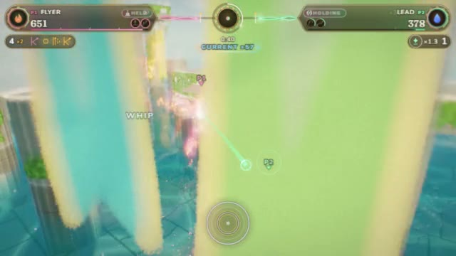

- **The duel's sounds 4.9 dB down under a track** (`src/duel/sound.ts` `DUEL_BALANCE.all`), above.
- **Film tool: the words on screen and where the camera stood** in a duel's `info.json` (`src/engine/film-shot.ts`),
  and **`scripts/front-cap.mjs`**, the front as a clip with its DOM. AGENTS.md lists it.

## Stills

`docs/reports/media/17-p4-*.jpg`: the film's sheet (`17-p4-film-sheet.jpg`), one still per moment from the final film
(`17-p4-front.jpg`, `17-p4-countdown.jpg`, `17-p4-dance.jpg`, `17-p4-tide-whip.jpg`, `17-p4-hum-geode.jpg`,
`17-p4-steam-redwoods.jpg`, `17-p4-geyser-top.jpg`, `17-p4-pool-whip.jpg`, `17-p4-murmuration.jpg`,
`17-p4-frost-geode.jpg`, `17-p4-merge-petals.jpg`, `17-p4-finale-lift.jpg`, `17-p4-banner.jpg`), and the issues'
(`17-p4-issue-*.jpg`; the lines, steam, pale, banner stills from the 640×360 scouts). The master's per-shot sheets:
`17-film-duel-4-<shot>-master-sheet.jpg`.

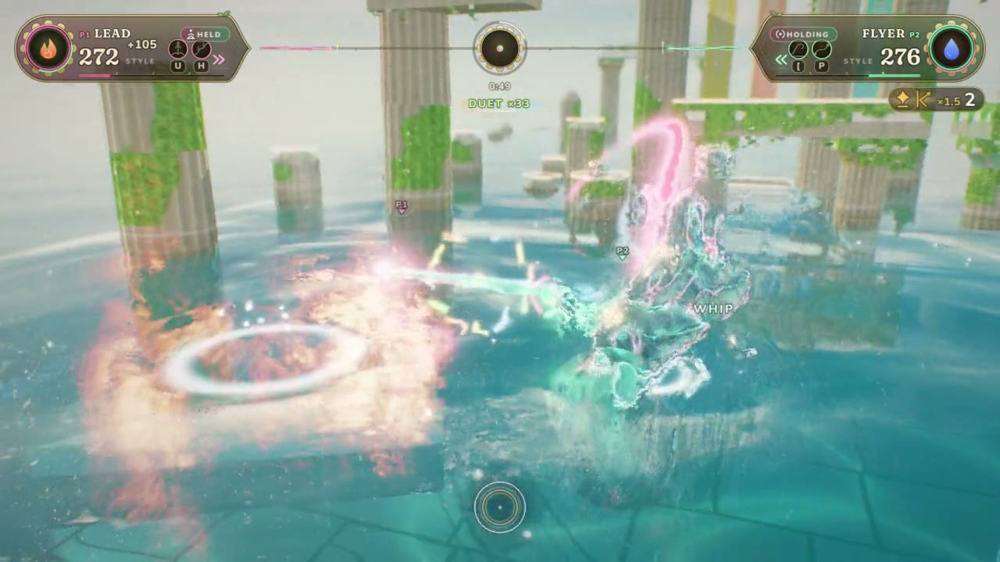
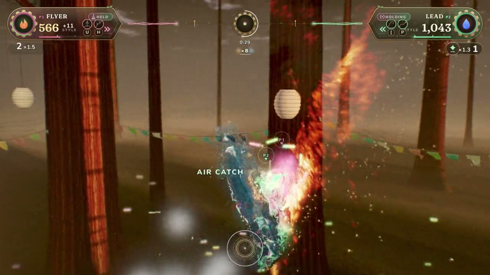
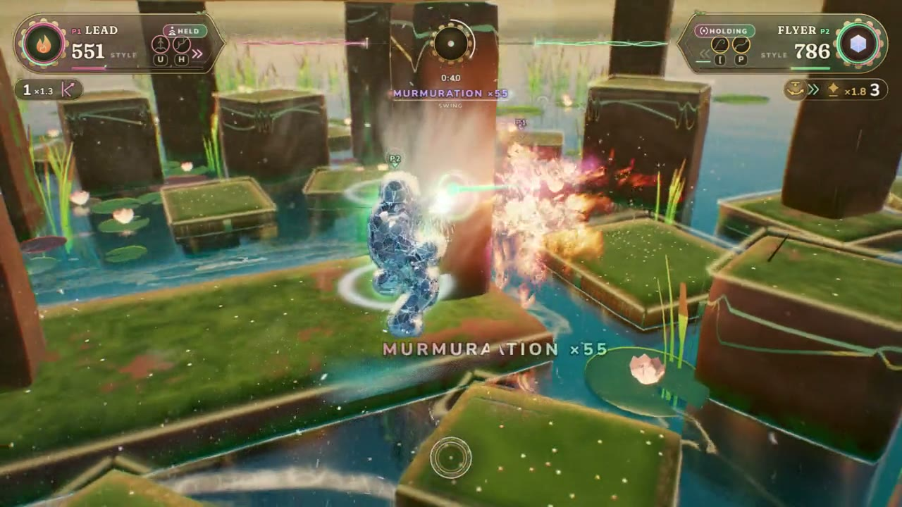
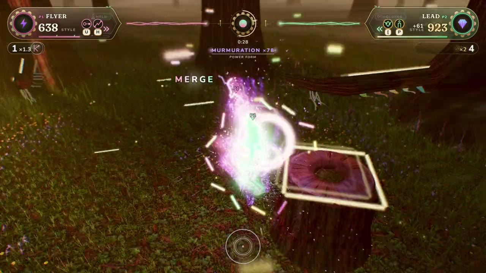
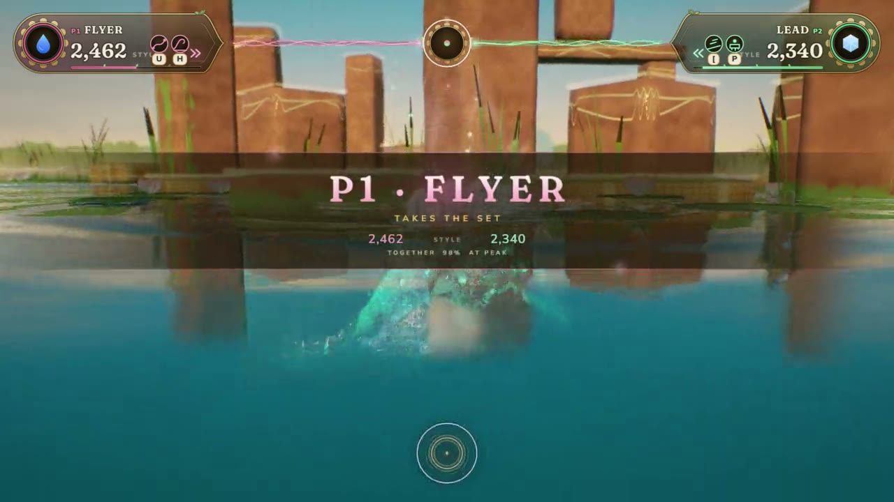

## Weak points of the film

- Two virtual players, seeded and chosen: every moment is real play, picked from 52 minutes at skill 0.85.
- All on the redwoods' tempo: every world danced at 113 bpm (the temple's own track is 94, the Pool's 121).
- The two redwoods shots are at dusk (hour 18.9) while their scouts ran at morning (8.2): the dance matched to the event,
  but the light is set by the film, not by the set; I could not pick out the fireflies at 720p.
- The front is 2.1 s, pictures only, filmed by a different tool (screenshots of the page) at 1280×720 without the
  master's 1.5× supersampling; the film's track plays under it, not the hub's.
- Each world twice (the temple, the geode, the redwoods, the Pool), the fountains and the temple's rose-window light
  hardly at all: the frame doesn't reach them (issue 1).
- The finale is a fused lift at normal skill, in the world where it read; the lift is a glow, not a bloom (issue 5).
- The sound is the track with the shots' recorded scores at the game's balance, the balance now 4.9 dB lower than in
  report 15's film: checked by its levels (5.0 LU under the track), not heard.
- 32.4 s, a little over the asked 30, to give the front its bar and end on the banner on a beat.

## Not done

- The five issues above: phase 5's.
- An online duel, the lock (`?lock`), a phone: not filmed or scouted.
- The geode's 0 of 13 fusions: not measured further (a larger page run at its own tempo is the next step).
- The jogo's balance under a track (UNDER) against the compressor's make-up gain: not checked.
- The word's wandering at a tier: seen, not looked into.
- The scouts' page time from 18:36 on used the decoration fix's shaders as they were being edited (two scouts failed
  to build and were run again on the final build); the decoration fade changes no play, so the numbers stand, but the
  temple's banner count above is from the 13 temple scouts as they ran.
