# 18: the fusion's bloom, the banner as a garland, the one word's place, and the geode's fusion measured again

Branch `p5-bloom`, from master `e91c9ee` (phase 4 and report 17). The brief: report 17's fifth issue (the fusion is not
yet a bloom, and the first world never fuses) and three of its smaller things (the word wanders at a pair tier, the
HUD's panels missing through the count-in), in the art bible's direction (`docs/design/solarpunk.md`: "a fusion is a
bloom, a flower or a tree of light opening over the pair, a finale is the sun at its height, the banner is a
garland"), pushed toward the epic.

**Measured:** fused finales in the page, two virtual players, from the duel's own camera at 1280×720 with the HUD
(`scripts/bloom-cap.mjs`, new: the set's merge and its stretch at the top written into the rules' state so its finale
fuses; a test of the look, not of the rules), three worlds before (master's `fx.ts`) and after, every frame of the
finale and the banner sampled for the bloom's light over each body's core (`moments.ts` `bloomCover`, the moments
probe's own measure), the GPU's time per pass with the flower open; the one word's place in 12 whole sets in the page
(six before, six after, the same worlds and seeds; `bend.hud.stats().place`); the geode's fusion in the page (48 sets
at 113 bpm and 48 at its own 111.4) and in Node (240 sets a world at each tempo, all four worlds), and the other three
worlds in the page at 113 (16 each); `npm run typecheck`, `node scripts/test-ts.mjs`, `check-limits`, `check-bindings`.
**Not measured:** a person playing; a phone; the bloom in an online duel; a master or 1080p render (none was made:
stills and a 640×360 test clip only); the lock (`?lock`).

## 1. The bloom

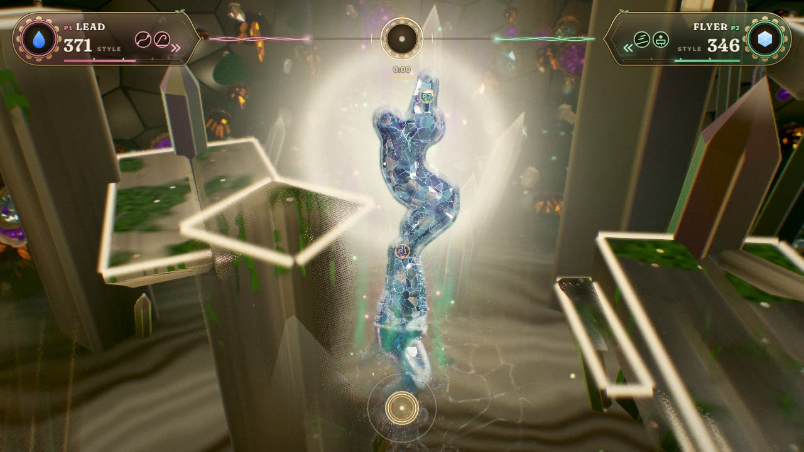
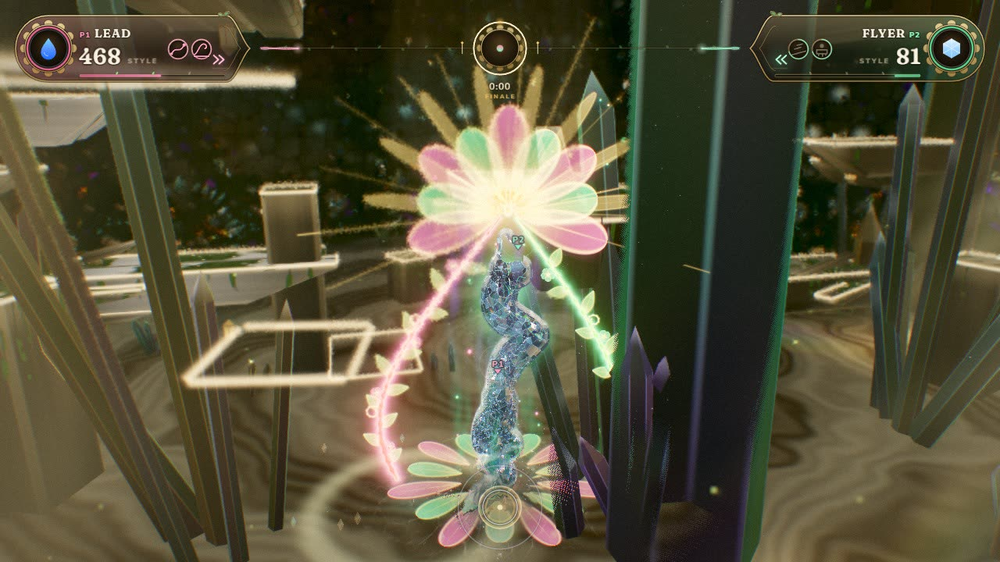

Phase 4's fused lift was a soft white disc (`G.dot` 0.35 to 1.25 m, intensity 0.55) and a faint ring on the flyer's
chest, the field's column round the two and motes rising up it. It sat on the body: half of its frames covered more
than 15 % of a body's core, and at the top of the lift all of it.

**What it is now** (`src/duel/bloom.ts`, drawn from `fx.ts`'s finale look; all of it the glow list's light):

- **A tree of light.** Two vines rise from the floor either side of the pair as the flyer is drawn in and lifted (u
  0.2 to 0.52 of the duet), one in each seat's colour (rose on the left, fern on the right) round a sunlit gold core,
  curving out and back in like an art-nouveau whiplash to meet over the flyer's head, a bud of light at each growing
  tip. Leaves unfurl along them (eleven a vine, out and in in turn), every third with a small five-petalled blossom in
  the stem's colour and a bead of pollen, and a tendril curls off each stem twice.
- **The flower over the pair.** Where the vines meet, a flower opens on the page's own clock from 0.47 of the duet,
  over 0.75 s, so it opens through the lift's 12 held frames (the hold slows the bodies' time, `weight.ts`; a flower
  timed on the bodies' clock stood still there). It is a fan, not a circle, so it never reaches down onto the bodies:
  nine petals of rose and fern (1.0 m, gold-rimmed, brighter toward the tip where the sun catches them), long gold
  sepals between them behind, an inner crown of gold petals, stamens and a glint at the heart, the sun's warm disc
  behind it and fourteen faint rays of sun turning slowly out over the fan: the finale as the sun at its height.
  Pollen drifts up out of it; petals fall from it, swaying, as the flyer comes down and through the banner.
- **A flower on the floor.** Fourteen petals of the two colours lie open round the base's feet as the flyer rises.
- **Where the flower stands.** Over the flyer's head as the duel's camera sees it: straight up from the head, as far
  as puts the heart 0.17 of the screen over it, never above 0.2 of the screen (the HUD's panels), 0.55 to 2.2 m up,
  then held still once it opens (`flowerAt`). The duel's camera frames the flower's top through a fused finale (a
  point added to the flyer's framed points, `index.ts`, two lines), so the frame makes room for it. My first flower
  stood 3.5 m over the feet and a little behind the pair: from the duel's camera, which looks down, it was off the
  top of the frame or behind a piece of the arena (the glow is depth-tested), and when I set it up the screen's own
  up it went far behind the pair; straight up, a little toward the eye, holds in every frame I took.
- **Kept off the bodies.** Its glows are one range of the list, dimmed by 0.95 where they fall on a body's core
  (`keepOff`, as the moments' light, phase 4), and the moments probe reads the same range.
- **The petals' look.** A new shape in the glow shader (`src/play/glow.wgsl`, kinds 8 and 9, 12 and 13 lying on the
  floor): a petal from its base to its tip, narrow at the base and swelling to a round tip (a leaf: pointed), its
  colour lit toward the tip, a gold rim and midrib, a gold heart at the base. Added light over a bright sky or water
  whitens, so the petals take the seat's colour unwashed (× 0.7) and the gold does the rest.

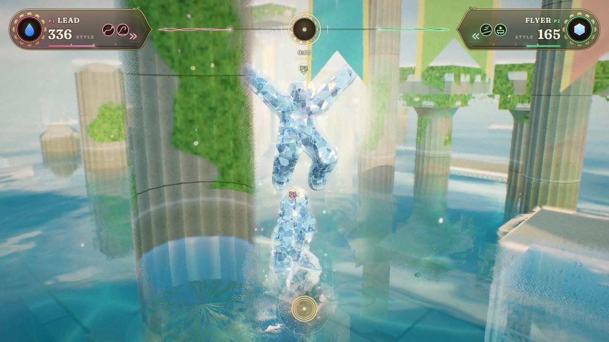
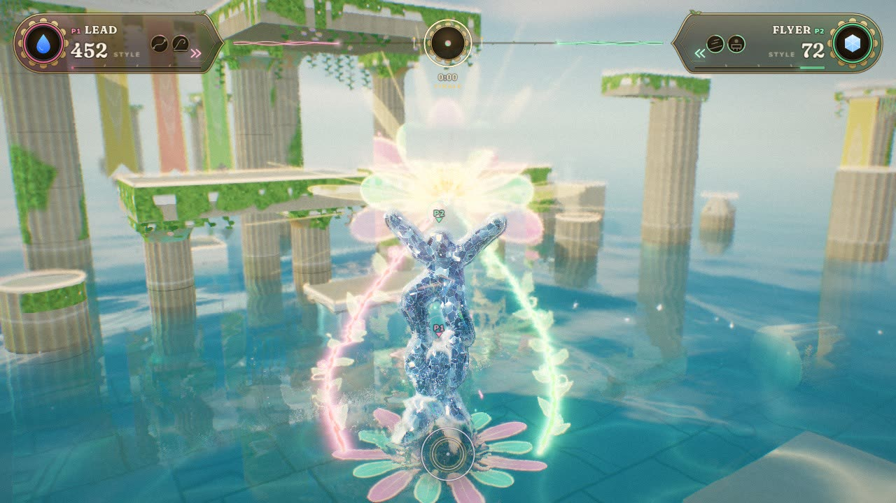
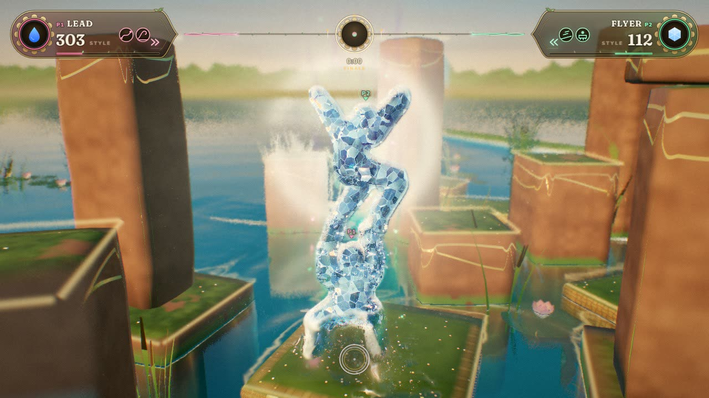
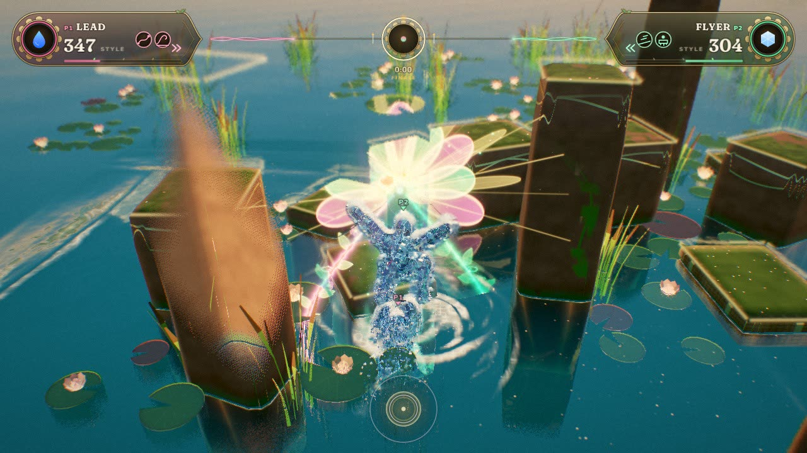
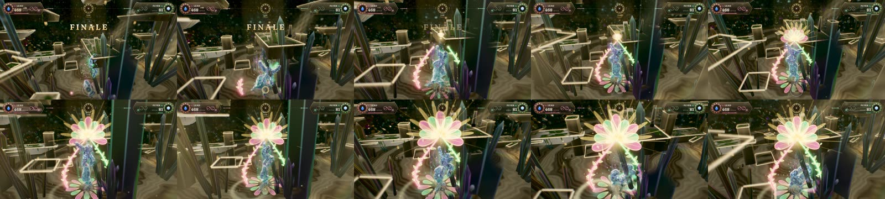

The clip: `media/18-bloom-finale-geode.mp4` (640×360, 30 fps, 9 s: the finale, the bloom, the banner; the duel's
camera, the HUD on). Videos are ignored by git here, so it stays in the branch's worktree, not in the commit; the
sheet above is its every 10th frame from the lift on.

| a fused finale, three worlds (geode, temple, Pool; water and ice) | before | **after** |
|---|---|---|
| frames with the bloom's light on screen | 174 (about 1 s a finale) | 645 (the duet and the banner's first seconds) |
| a body's core under it, mean | 51 % | **0.4 %** |
| frames with more than 15 % of a core under it | 51 % | **0.3 %** (2 frames, the Pool) |
| the most of a core under it in any frame | 100 % | 19.5 % |
| glows | 2 | 295 with the flower open |
| GPU, the glow pass with the flower open (1280×720, RTX 5090) | 0.14 ms | 0.31 to 0.35 ms (geode, Pool); 0.15 in the temple |

It costs about 0.2 ms in the glow pass for the five seconds it shows, nothing otherwise: the petals and the vines'
soft halo are wide quads drawn over each other. Its 295 glows are 3.6 % of the list's 8,192.

## 2. The banner as a garland

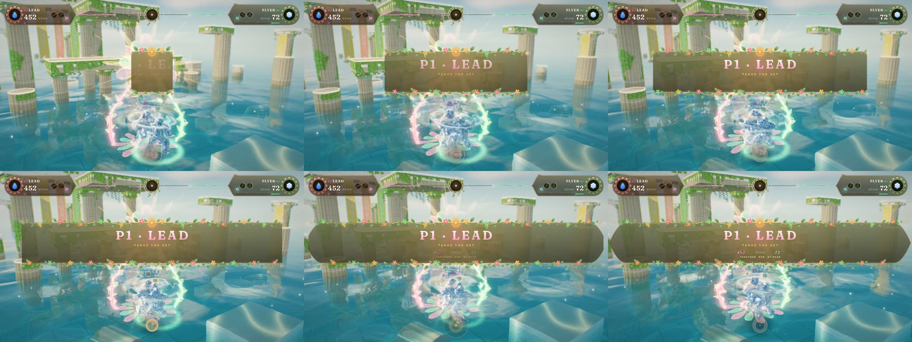
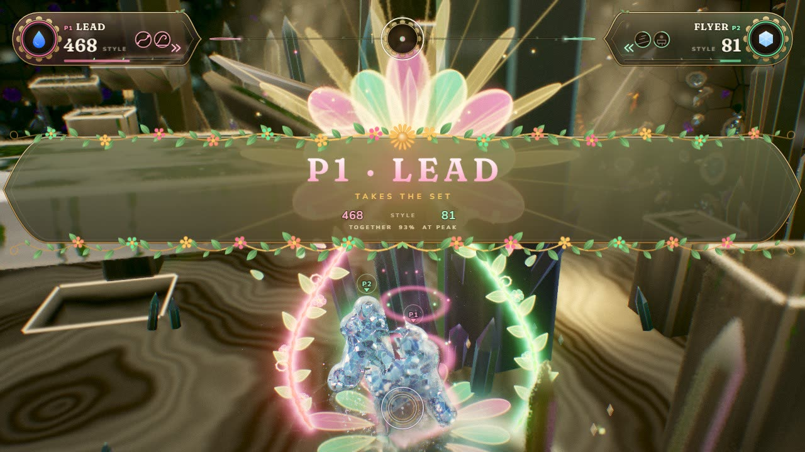

Phase 4's banner was a dark band opening from the middle over 0.45 s whose name came in from 0.15 to 0.5 s: for its
first frames an empty band. Now (`src/hud/garland.ts`, `centre.ts`):

- **A garland.** A pane of the HUD's smoked honey glass drawn to a leaf's tip at each end, its came gold over dark lead
  and a cream hairline inside, warm sun pooled behind the words; along its top a gold stem in a gentle wave, along its
  foot gold swags hanging between flowers; leaves all along both (moss to leaf green, a pale vein), small flowers in
  rose, fern, coral and sun on the swags' points and the wave's crests, a curl at each stem's end, a sun of fourteen
  gold petals at the top's middle and a sprig of two leaves under the foot's. Made once as a sprite (by size, ratio
  and the seats' colours), stamped each frame.
- **It opens with its words.** The garland is shown from the middle out over 0.7 s, a bud of sun at each stem's
  growing tip, and the name, "TAKES THE SET" and the numbers are clipped to the same window (the name at full
  strength by 0.6 of the opening, the numbers after it), so the first frame of the banner already has the middle
  letters of the name in it. The band is never seen empty.
- The words, sizes and layout are phase 4's (the winner's colour, Fraunces, the "nearly" line); the pops keep off the
  garland's box as they kept off the band's.

## 3. The geode's fusion, measured again

Report 17: the geode fused 0 of 13 sets (on the film's track at 113 bpm, skill 0.85), though it merged in 12 of 13
with a mean peak of 0.91. Measured again before tuning anything:

**In the page** (`scripts/duel-page.mjs`, two virtual players at skill 0.85, 480×270, stepped on the frames' clock,
sets of whole phrases (60.3 s), the dress and styles rotated; master's rules):

| page | sets | fused | merged | peak, mean | peak 0.9 or more | longest stretch at 0.9+, mean | not fused though 2 s or more at the top |
|---|---|---|---|---|---|---|---|
| geode, 113 bpm (the film's tempo) | 48 | **5** (10 %) | 33 (69 %) | 0.890 | 26 | 0.89 s | 3 |
| geode, its own 111.4 bpm | 48 | **5** (10 %) | 31 (65 %) | 0.885 | 23 | 0.90 s | 3 |
| temple, 113 bpm | 16 | 1 (6 %) | 9 (56 %) | 0.889 | 9 | 1.47 s | 3 |
| redwoods, 113 bpm | 16 | 3 (19 %) | 9 (56 %) | 0.882 | 9 | 1.54 s | 1 |
| Pool, 113 bpm | 16 | 1 (6 %) | 16 (100 %) | 0.893 | 5 | 0.56 s | 1 |
| the other three together, 113 bpm | 48 | **5** (10 %) | 34 (71 %) | 0.888 | 23 | | 5 |

(A first run of 7 sets at each tempo was cut short by a reload and is not in the table: 0 of 7 at 113, 3 of 7 at
111.4. With it, 5 of 55 and 8 of 55. The page's dance is not deterministic from run to run, so seeds 1 to 7 played
again are different sets.)

**In Node** (`scripts/duel-measure.mjs --warp 1 --phrase 1`, two seeds of 120 sets, 240 a cell):

| Node, 240 sets | geode | redwoods | temple | Pool | all |
|---|---|---|---|---|---|
| 113 bpm | **40 (16.7 %)** | 31 (12.9 %) | 39 (16.2 %) | 43 (17.9 %) | 153 of 960 (15.9 %) |
| each its own tempo (111.4, 113.1, 94.0, 121.1) | **33 (13.8 %)** | 40 (16.7 %) | 40 (16.7 %) | 52 (21.7 %) | 165 of 960 (17.2 %) |
| merged (sets), 113 / own | 76 % / 71 % | 62 % / 59 % | 72 % / 70 % | 91 % / 91 % | |
| peak, mean, 113 / own | 0.904 / 0.897 | 0.877 / 0.870 | 0.891 / 0.891 | 0.919 / 0.921 | |
| links on the beat | 70 % | 70 to 71 % | 71 % | 68 % | |

**Why 0 of 13: chance.** The geode fuses as often as the other worlds wherever it is measured: one set in ten in the page at
either tempo (5 of 48 each, the other three worlds 5 of 48 together), one in six or seven in Node (in Node it is the
second most likely at 113 bpm). At one in ten, 0 of 13 happens a quarter of the time (0.9¹³ = 0.25); at one in eight,
18 % of the time. Report 17's "merged in 12 of 13 with a peak of 0.91" is not what the fusion asks: it needs a merge
**and** three seconds held at 0.9 or more without a break (`FUSE_HOLD_MS`), and a peak of 0.9 is a moment there. In
the page half the geode's sets touch 0.9 (26 and 23 of 48), and their longest stretch there is 0.9 s on average; the
ones that fuse are the few that hold it. That is the rule doing what report 16 tuned it to do, in every world alike.

**Nothing tuned.** The cause is not in the geode's rules or its arena: in Node the geode fuses as the others do at
113 bpm, and in the page it fuses about one set in ten to twelve, within the noise of one in eight. `perfectMs(bpm)`
(report 16) holds: the share of links on the beat is 69 to 71 % in every world at both tempos. Two things the numbers show that I did not act on: the page fuses less than Node (one in ten against one in six:
report 16 saw the same, one in nine against one in seven; the page's bodies travel with their kicks and aús, Node's
don't), so "one in eight" sits between them; and in Node the Pool at its own 121 bpm fuses most (52 of 240, 21.7 %,
about 2.5 standard errors over the others), as it merges in 91 % of its sets, but in the page at 113 it fused 1 of
16. Its cause is not clear from these runs, so the Pool's energy (`gain 0.93, ebb 1.15`) is left as report 16 set it.

## 4. The one word holds its place

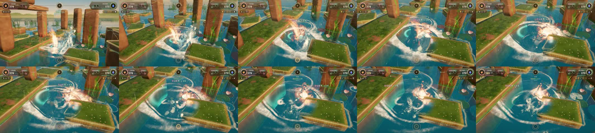
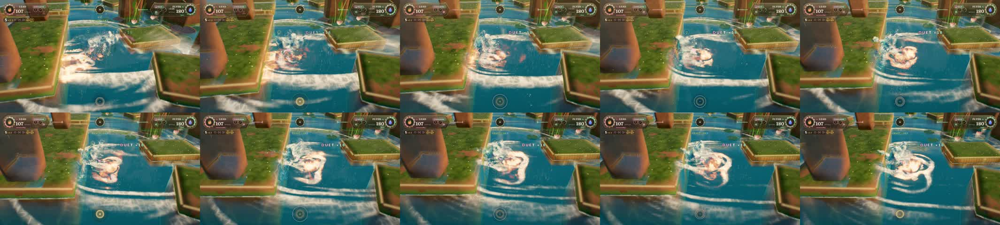

The words' placement is `src/hud/pops.ts` (the moments' probe is `moments.ts`; the placement is the HUD's). Phase 4
placed each word every frame from scratch: its home (beside its dancer, or over the pair for a tier's word), and when
that fell on a body, whichever of above, left, right or under the pair was nearest; and when the eased word touched a
body it snapped there. At a pair tier, with the two turning round each other in a swing, the nearest clear place
changed almost every frame.

Now a word **holds its slot** (home, above, left, right, under), following the bodies as they move, and changes it
only when that slot is **really blocked** (a body over the word by more than 3 px at 720p, `PLACE.BLOCKED`); then it
takes the clear slot nearest where it stands (home first if home is clear) and **glides** there (eased at 9 a second
for 0.45 s, no snap). It goes back home once home has been clear for 0.6 s and it has held its slot 0.9 s.

| six whole sets in the page (Pool seeds 2, 4, 6; geode 1; redwoods 3; temple 2; fire and water) | before | **after** |
|---|---|---|
| a pair tier's word: slot changes a second | **12.7** (228 in 18.0 s) | **0.59** (11 in 18.5 s) |
| … per set | 8.4 to 15.2 | 0.2 to 1.0 |
| every word: slot changes a second | 0.33 | **0.04** |
| a tier's word: the side of the pair's bounds it stands on, changes a second | 12.9 | 4.6 |

The last row is the geometry, not the choice: the side of the two bodies' joint bounds a word stands on changes when
the bodies move round a word that holds still (a body flung up past it), and it counts the glide's passage too. A
tier's word still changes that side 4.6 times a second; on the sheets it no longer jumps.

## 5. The HUD's panels in the count-in: not reproduced

Report 17 saw the panels missing from the count-in (0:02.1 to 0:04.6 of its film). I could not find that anywhere:
both panels are drawn through the count-in in the film's own frames (below: 0:02.6, the count-in, over 0:05.0,
play), in the master's sheet of that shot (`17-film-duel-4-temple-open-master-sheet.jpg`), and in the page in every
way I started a duel: two bots with `&go` (the first set, and a set restarted), a human seat from the URL started by
a key, at 1280×720 and at 640×360 (the compact layout). What does come after DANCE is the combo row under each panel
(it shows a combo, and there is none before play) and the dash's chevrons brightening. The film sheet's time stamps
cover the left panel in its count-in tiles, which may be what was read. Nothing changed.

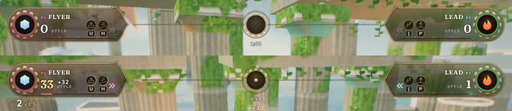

## Files

- `src/duel/bloom.ts` (new): the bloom; `src/duel/bloom.test.ts` (new): no bloom unless fused, it grows with the lift,
  the flower over the head and under the HUD's top, a few hundred glows, gone after the banner.
- `src/duel/fx.ts`: the finale's look draws the bloom in place of the disc, keeps it off the bodies, holds the
  flower's heart, `bloom` (its range) and `flowerTop`.
- `src/duel/index.ts` (two lines): the flyer's framed points take the flower's top in a fused finale; the moments
  probe gets the bloom's range.
- `src/duel/moments.ts`: `bloomCover()`; the petals counted as segments, not as rings on the floor. `fx.ts`'s
  `keepOff` the same.
- `src/play/glow.wgsl`, `glow.ts`: the petal and leaf shapes (`Glows.petal`), no binding added.
- `src/hud/garland.ts` (new), `src/hud/centre.ts`: the banner.
- `src/hud/pops.ts`, `src/hud/hud.ts`: the placement's hysteresis and glide (`PLACE`), and its measure
  (`bend.hud.stats().place`).
- `scripts/bloom-cap.mjs` (new): the finale (stills, a clip's frames, the bloom's cover, the GPU's time), the
  count-in, and the word's placement in the page. `scripts/duel-page.mjs`: a set whose page went away (a reload, a
  build error) is played again, at most twice.

## Tests

- `npm run typecheck` (the app, the server, the tests): passes.
- `node scripts/test-ts.mjs`: 21 of 21 files pass (`bloom.test.ts` new: 4 tests).
- `node scripts/check-limits.mjs`: limits agree. `node scripts/check-bindings.mjs`: within the baseline (159 entry
  points; the glow shader's bindings are unchanged). `test-audio` not run (no sound touched); `test:net` not run (the
  brief: its port clashes).

## Not done

- The bloom costs about 0.2 ms of the glow pass while it shows; I did not thin it (the vines' soft halo is the widest
  part to cut first) or look at it on a phone's budget.
- The flower can stand close over the flyer's raised hands when the camera is near and level (the temple's and the
  Pool's after stills): the hands are not the core, and it reads as a crown; a person may want it higher.
- The bloom's light is added light: over the temple's white noon the petals whiten toward cream (the colours hold in
  the geode and the Pool).
- The geode's fusion is untuned (above); the Pool's higher rate in Node at its own tempo is reported, not acted on.
- The count-in's panels: not reproduced, so nothing changed.
- The bloom was only seen with water and ice and fire and water, in three worlds (not the redwoods), at skill 0.85,
  with the fusion forced by the capture; the film tool's camera (`filmcam`) was not checked with it.
- The fused finale's lift itself (`finale.ts`'s path and pose) is unchanged.
