# 18 · Two bodies, two colours: the seat worn inside the matter (branch `p5-bodies`)

Phase 5, one of six tracks: report 17's issue 4, "two pale bodies are one shape". Water and ice were both pale blue,
plasma and gems both violet-white, and the seat colours (rose `#ff6fa3`, fern `#5ff0a4`) were a rim, a tag and a ring
at the feet. Now each body carries its seat's colour in its own light, the same-hue pairs are pulled apart in the
matter itself, and the separation is measured at scouted catches in all four worlds.

**Measured:** `scripts/bodies-cap.mjs` (new, below): seeded bot-v-bot duels in the page at 1280×720 from the duel's own
camera, 3 catches a duel, every pair of the five matters in every world (40 duels, 120 catches), and the two
same-hue pairs again with the seats swapped (8 duels, 24 catches), before (master) and after (this branch), on port
5489; GPU time with `shot.mjs --timings` (1280×720, three duels, master and branch); `npm run typecheck`,
`node scripts/test-ts.mjs`, `check-bindings`, `check-limits`. I looked at every still at the player's size.
**Not measured:** a person playing; a phone; a finale's fused lift (the film's 0:28.2 case: it needs a whole set that
fuses, and no scout I ran reached one); `npm run test:net` (port 5418); the GPU numbers are on a GPU other agents were
using, so they are noisy. The duel in the page is not deterministic run to run, so before and after are the same seed
and the same kind of moment (a catch held 14 frames), not the same frame.

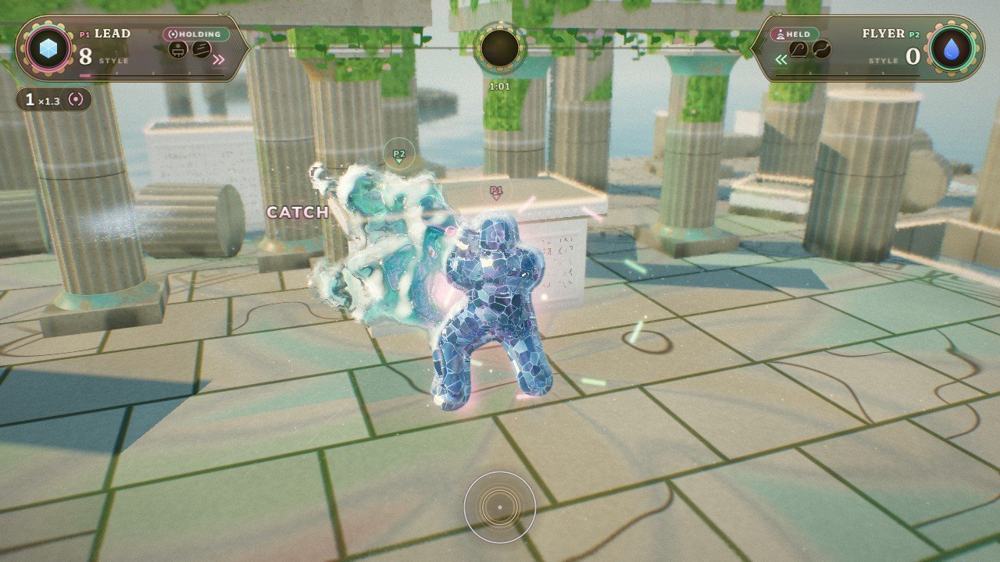
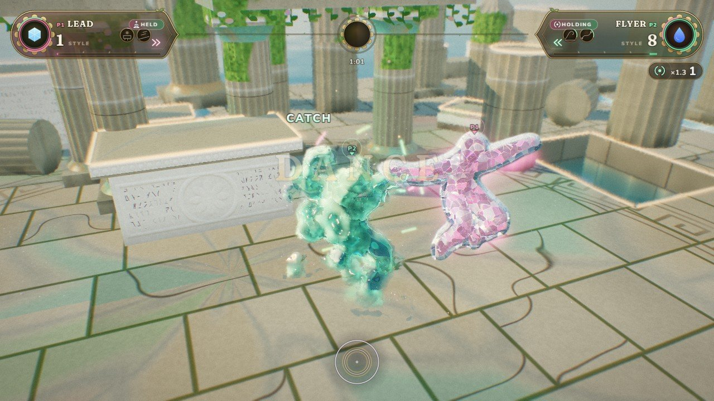

## What changed

### Who each body is, carried to every matter (`src/matter/core/seats.ts`, new)

A colour per dancer slot (rgb the seat's hue, w how strongly the matter wears it). The duel sets it every frame from
each seat's halo strength (`src/duel/fx.ts`, two lines beside the halo; `SEAT_MATTER` in `src/duel/seat.ts`: 0.85,
15 % more in the power form); anything else leaves it at zero, and it falls back to zero four frames after nobody sets
it (the duel stopped), so the Gem Dancers' show and the jogo look exactly as before. It rides:

- in the shared body uniform (`matter/core/body.wgsl` `Bodies.seat`, `seatOfSlot`): water and ice's surface reads it
  from the capsule each pixel lies on (the capsule the surface already finds for its facets and caustics);
- in each kind's own uniform where the shader doesn't include the body core: gems' `Look.seat`, ice's `IceLook.seat`
  (the shards), and fire's `FireField.seatSide`/`seatA`/`seatB`. Fire and plasma are one summed field, so each flame
  splats its seat side (+ the first colour, − the second, × the strength) into the field's spare channel (`flow.a`,
  unused until now); the composite divides by the temperature and gets the pixel's seat.

No new binding (`check-bindings`: the surface's fragment entry is at 9 of 12 uniforms, as before).

### How each matter wears it, and stays itself

| matter | the seat's colour | the matter's own look |
|---|---|---|
| **water** | the light scattered inside it takes half the seat's colour; its rising caustic is the seat's colour, bright in its lanes and a soft fill between, deeper where the water is thick; its rim, toward the light, a little of it | absorbs toward a **blue-teal** (`deep` `#62b2c6`, was the pale `#a4d4da`), its light inside and its own glow teal-blue: clear, deeper water |
| **ice** (surface) | a glow inside the crystal: a breath of it everywhere, more in the thick middle, and one cell in eight or so holding it deep, like a lantern behind clear glass; the facet edges carry a third of it | **clear white to a deep cool glass** (`thin` `#d4e8f2`, `thick` `#44709a`: was steel blue to navy), facet edges **prismatic** (each splits the light its own way), the frost white, what shows through clearer |
| **ice** (shards) | the same glow inside, deeper in some shards | the same colours; prismatic edges |
| **fire** | the licks and the cooler flame take a cast of it (rose-gold, fern-gold); the white-gold core stays the sun's | unchanged |
| **plasma** | its haze, the soft light between its threads, is the seat's colour | the ramp is now **aurora**: violet where thin, teal through its threads, a cyan-white core (it was violet, magenta-pink, white: the pink was the rose seat's hue, and a magenta body beside a violet gem body was one shape) |
| **gems** | light through each stone's edge (strongest where it turns from the eye) and a breath on its faces, more in crystal than crust | unchanged (amethyst, clear quartz, rose quartz) |

The art bible's "the bodies and their matter" says so now (`docs/design/solarpunk.md`).

What I tried and took back:

- **Ice all white** (`#e8f3f8` to `#8fb2c8`). It read as clear crystal, but against the temple's cream stone a white
  ice body was lost (its distance from the world round it fell by a quarter) and it lost the lightness that set it apart
  from plasma and fire (ice:plasma's ΔE fell from 15.9 to 6.9). The deep cool glass in the thick cells gives it back.
- **The seat's colour as a fill** (first pass, 0.12 + 0.9 of the caustic in water, a light in four cells of ten in ice).
  Every body read as rose or fern candy, water as pink cotton: who-is-who at any size, but no longer water. Now the fill
  is small (0.05) and the colour lives in the caustic's lanes and a few deep cells.
- **Fire's cast at 0.38** made the rose fire pink; 0.22, and only below the core, keeps it fire.

## The numbers

`scripts/bodies-cap.mjs`: at each catch (a contact link held 14 frames, both bodies' chests in the frame) the frame is
grabbed without the HUD. Each body's pixels are those inside its bones' capsules projected on the screen (seat.ts's
halo bones and radii; where the two bodies overlap, neither's); the world round a body is a band from 2 to 3.2 radii
off its bones, clear of both bodies. In OKLab (×100: 1 is about a just-noticeable step):

- **ΔE bodies**: the distance between the two bodies' mean colours; **colour only**: the same in a and b (hue and
  chroma), not lightness;
- **told apart**: how often a body's pixel is nearer its own body's mean than the other's (0.5: one shape; 1: two),
  the two bodies weighted equally;
- **v world**: each body's mean against the world round it; **weaker body v world**: the lesser of the two.

### Every pair, seat 1 the first named (40 duels, 120 catches each side)

| pair (seat 1 : seat 2) | catches | ΔE bodies | ΔE colour only | told apart | ΔE seat 1 v world | ΔE seat 2 v world | ΔE weaker body v world |
|---|---|---|---|---|---|---|---|
| fire:water | 12/12 |  17.01 →  12.57 |   7.38 →   6.31 |   0.80 →   0.80 |  15.98 →  17.64 |  13.39 →  11.56 |  10.35 →  11.53 |
| fire:ice | 12/12 |  15.57 →   8.77 |   6.67 →   5.73 |   0.81 →   0.83 |  16.69 →  15.80 |  12.97 →  15.46 |  10.27 →  12.67 |
| fire:plasma | 12/12 |   6.10 →   8.02 |   4.50 →   6.07 |   0.77 →   0.80 |  18.86 →  17.94 |  20.06 →  21.34 |  17.53 →  17.06 |
| fire:gems | 12/12 |   6.88 →   7.57 |   6.26 →   6.52 |   0.87 →   0.87 |  18.14 →  18.48 |  20.82 →  19.95 |  16.54 →  17.16 |
| water:ice | 12/12 |   7.43 →  15.65 |   2.78 →   6.50 |   0.66 →   0.81 |   9.63 →  10.83 |   9.74 →  18.05 |   6.94 →  10.31 |
| water:plasma | 12/12 |  19.43 →  19.46 |   4.15 →   6.48 |   0.83 →   0.84 |   9.76 →  12.29 |  23.99 →  21.90 |   9.72 →  12.28 |
| water:gems | 12/12 |  20.27 →  22.73 |   3.04 →   6.51 |   0.82 →   0.88 |   9.11 →  11.48 |  23.49 →  21.27 |   9.11 →  11.48 |
| ice:plasma | 12/12 |  15.86 →  11.28 |   4.66 →   6.16 |   0.76 →   0.85 |  15.20 →  13.19 |  21.73 →  20.68 |  13.11 →  11.90 |
| ice:gems | 12/12 |  19.45 →  10.97 |   5.06 →   6.85 |   0.80 →   0.84 |  10.82 →  15.49 |  19.01 →  20.40 |  10.26 →  15.21 |
| plasma:gems | 12/12 |   9.48 →   9.56 |   8.23 →   6.57 |   0.91 →   0.87 |  22.61 →  19.58 |  20.18 →  18.05 |  16.98 →  16.87 |
| **all** | 120/120 |  13.75 →  12.66 |   5.27 →   6.37 |   0.80 →   0.84 |  14.68 →  15.27 |  18.54 →  18.87 |  12.08 →  13.65 |

| world | catches | ΔE bodies | ΔE colour only | told apart | ΔE seat 1 v world | ΔE seat 2 v world | ΔE weaker body v world |
|---|---|---|---|---|---|---|---|
| geode | 30/30 |  13.18 →  12.34 |   5.22 →   6.19 |   0.81 →   0.83 |  13.94 →  15.32 |  20.48 →  16.90 |  12.79 →  12.90 |
| redwoods | 30/30 |  17.38 →  15.79 |   7.04 →   8.65 |   0.82 →   0.88 |  23.36 →  24.54 |  27.75 →  29.78 |  18.89 →  22.97 |
| temple | 30/30 |  13.29 →  10.64 |   4.02 →   5.12 |   0.81 →   0.86 |   8.90 →   7.75 |   9.69 →   9.93 |   6.80 →   5.94 |
| pool | 30/30 |  11.14 →  11.87 |   4.81 →   5.53 |   0.77 →   0.78 |  12.53 →  13.49 |  16.24 →  18.85 |   9.85 →  12.78 |

The same-hue pair per world (ΔE bodies, told apart): water:ice in the geode 10.3 → 11.7, 0.66 → 0.79; the redwoods
4.4 → 25.4, 0.64 → 0.92; the temple 9.8 → 10.1, 0.66 → 0.78; the Pool 5.2 → 15.4, 0.66 → 0.76.

### The same-hue pairs with the seats swapped (8 duels, 24 catches each side)

The first table's order puts plasma in rose, and the old plasma was magenta-pink: plasma:gems was told apart before
because the old plasma ramp happened to match the rose seat. With the seats swapped (gems in rose, plasma in fern)
both bodies were pink-violet:

| pair (seat 1 : seat 2) | catches | ΔE bodies | ΔE colour only | told apart | ΔE seat 1 v world | ΔE seat 2 v world | ΔE weaker body v world |
|---|---|---|---|---|---|---|---|
| ice:water | 12/12 |   8.76 →  13.65 |   4.85 →  10.00 |   0.72 →   0.85 |  13.18 →  17.86 |  11.26 →  13.82 |   8.18 →  12.71 |
| gems:plasma | 12/12 |   9.52 →  10.45 |   5.99 →   8.07 |   0.77 →   0.87 |  17.50 →  18.88 |  23.58 →  23.82 |  17.31 →  18.26 |
| **all** | 24/24 |   9.14 →  12.05 |   5.42 →   9.03 |   0.74 →   0.86 |  15.34 →  18.37 |  17.42 →  18.82 |  12.74 →  15.49 |

### Reading them

- **Told apart** is the number that says "two shapes or one", and it rose in every pair but one: 0.80 → 0.84 over all
  120 catches; **water:ice 0.66 → 0.81** (the worst pair, now level with the rest), and with the seats swapped
  **ice:water 0.72 → 0.85** and **gems:plasma 0.77 → 0.87**. The one that fell, plasma:gems in this order (0.91 → 0.87),
  was the lucky case: the old magenta plasma was the rose seat's colour, so in rose it read as its seat by accident and
  in fern it was a second violet-pink body (the swapped table). Now it reads the same in either seat.
- **Colour only** (hue and chroma, lightness left out) rose 5.3 → 6.4 over all, and **doubled for the swapped same-hue
  pairs** (4.9 → 10.0 for ice:water, 6.0 → 8.1 for gems:plasma): the seat's colour is in the bodies now, not only round
  them.
- **ΔE bodies with lightness** fell over all (13.8 → 12.7), all of it in the pairs with ice and something bright
  (fire:ice 15.6 → 8.8, ice:plasma 15.9 → 11.3, ice:gems 19.5 → 11.0). The old ice was navy, darker than anything; the
  new ice is clear with deep cells, as bright as the others on average. Those pairs are still told apart better than
  before (0.81 → 0.83, 0.76 → 0.85, 0.80 → 0.84): they differ in colour now where they differed in darkness.
- **Each body against the world** rose (the weaker of the two 12.1 → 13.7), most in the redwoods (18.9 → 23.0) and the
  Pool (9.9 → 12.8), but not in the temple (6.8 → 5.9): a pale body on cream stone and pale water is still the hardest
  frame, and the clearer ice gives a little of its contrast there.

### GPU time

`shot.mjs --timings`, 1280×720, three duels (temple water v ice, geode plasma v gems, redwoods fire v ice), 150
frames each after 7 s of play, master then this branch:

| duel | GPU frame (master → branch) | the passes that changed |
|---|---|---|
| temple, water v ice | 1.99 → 1.64 ms | `water.surface` 0.112 → 0.112 ms |
| geode, plasma v gems | 0.92 → 0.95 ms | `fire.splat` 0.078 → 0.077, `fire.composite` 0.006 → 0.006 ms |
| redwoods, fire v ice | 4.25 → 3.38 ms | `water.surface` 0.178 → 0.189, `fire.composite` 0.007 → 0.009 ms |

The added work is a few multiply-adds per pixel in passes that already run; the frame totals move with the GPU's
other load, not with this.

## Stills

From the duel's own camera at 1280×720, the HUD on (a frame after the measured one), before on master and after on
this branch, same seed:

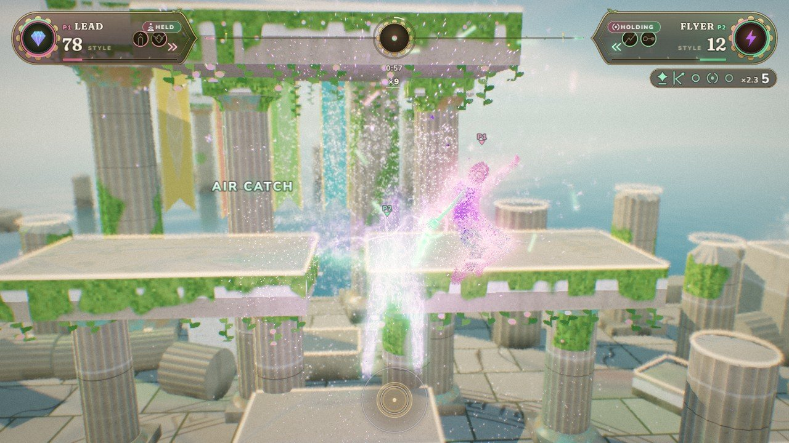
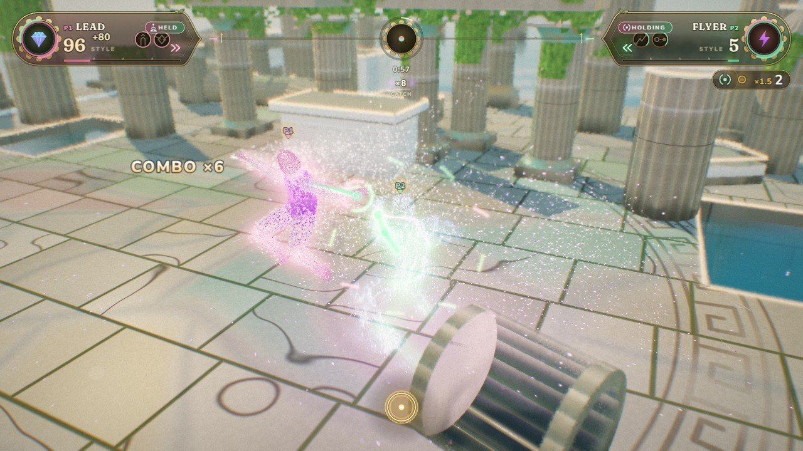
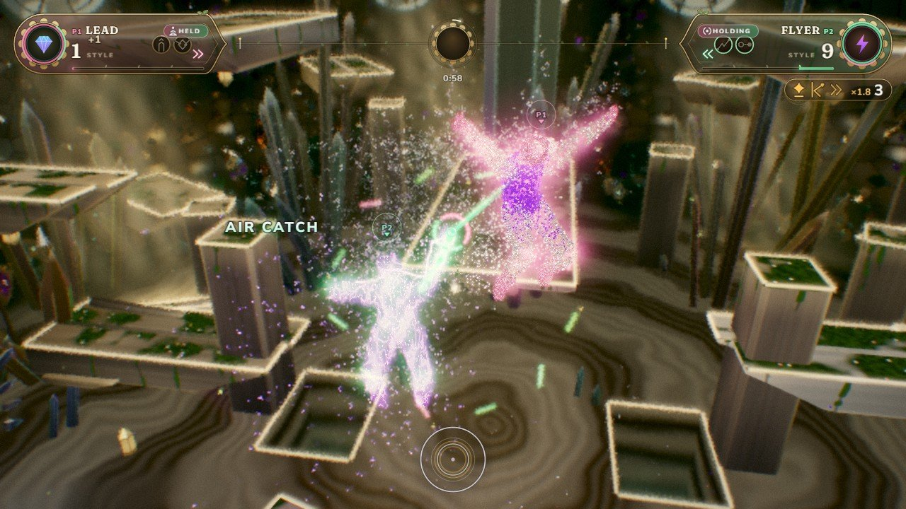
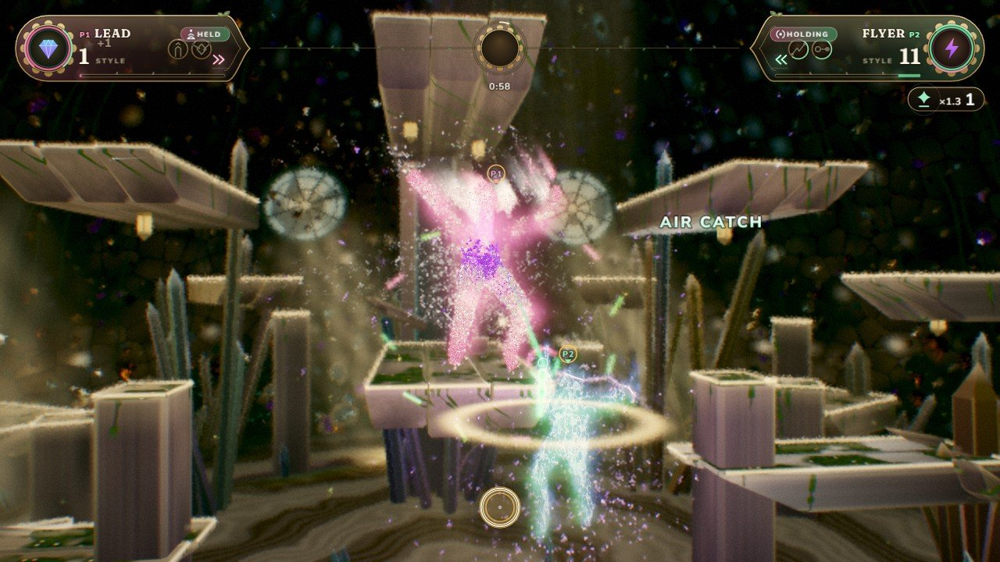
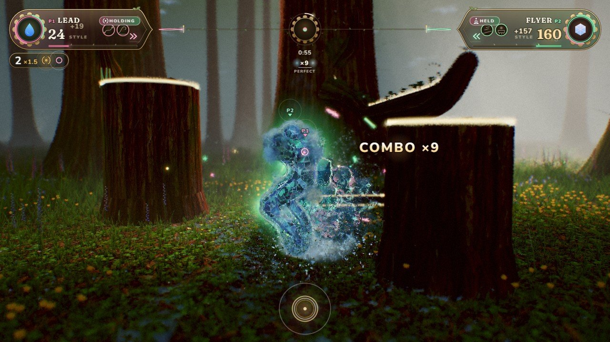
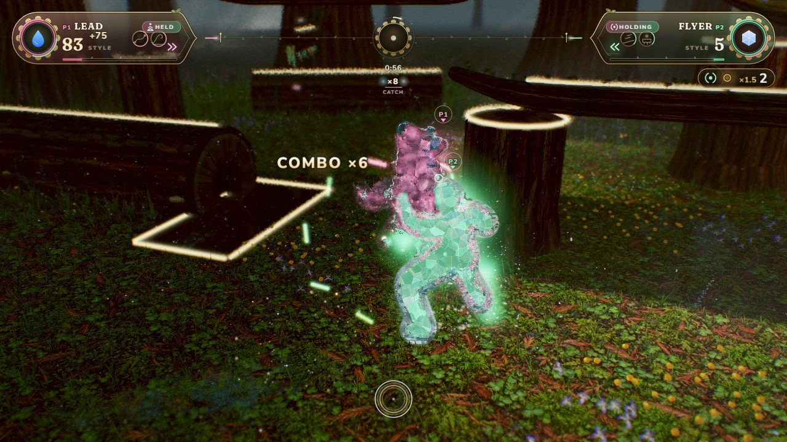
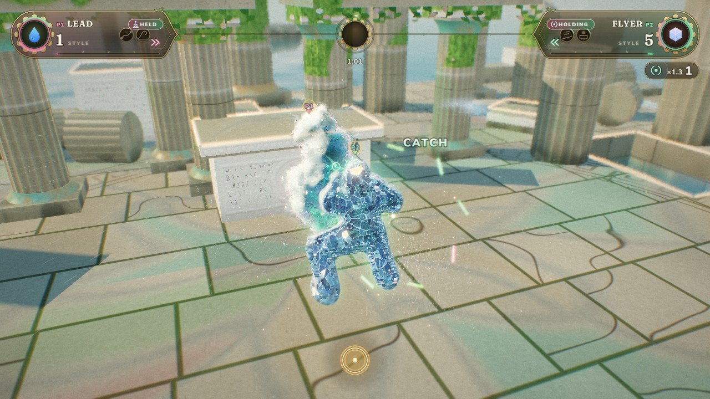
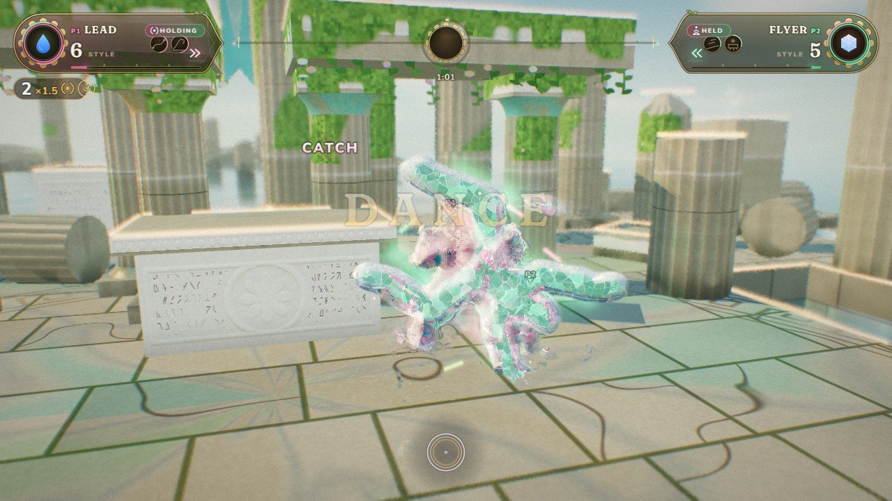

Two sheets, before on the left, after on the right: `18-bodies-sheet.jpg` (the redwoods' water:ice twice, the Pool's,
the temple's, the geode's plasma:gems, the Pool's fire:water) and `18-bodies-sheet-reversed.jpg` (gems:plasma and
ice:water with the seats swapped).

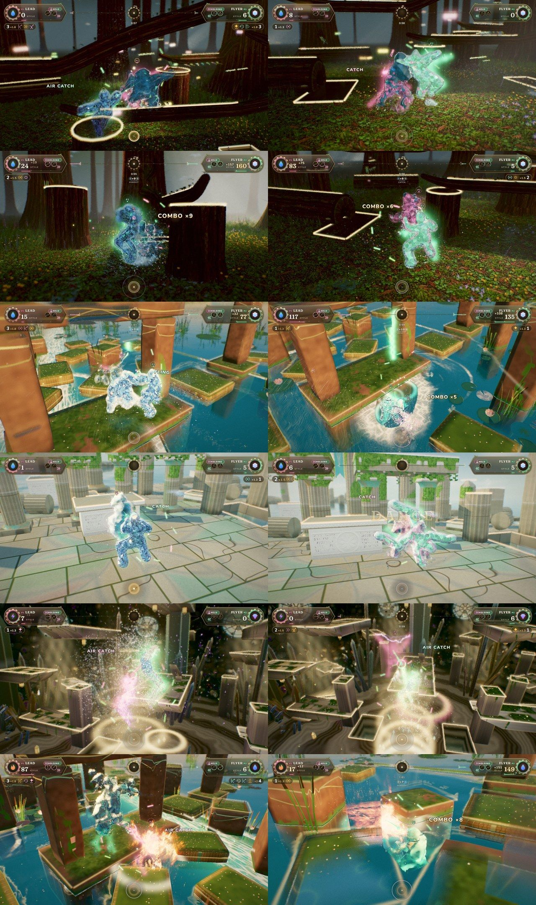

## Not done

- **The fused lift** (0:28.2 in the film, "one crystal figure with the other body a glow at its feet"): not captured.
  The fusion's column is drawn by the fire field's fusion look (both bodies' flames as one), which keeps its own colours;
  only the parting at the release returns each body to its own matter. The bloom is p5-bloom's.
- **Water that freezes beside ice** shades as ice (that is the matter: water freezes within 40 cm of an ice body), so in
  a long hold the water body grows facets; it keeps its seat's colour, not its blue-teal.
- **The trails** carry the seat's colour where the matter's own light is laid in the glow target (fire, plasma); water,
  ice and gems are drawn in the scene and leave no trail of their own (the halo's trail is in the seat's colour as
  before).
- **The gem body in a catch** is often half thrown off (stones in flight), so it reads as a cloud of sparks in its
  colour more than a figure. Its streaks and sparkles don't carry the seat.
- **The temple is still the hardest world**: a pale body against cream stone and pale teal water (the weaker body v
  world is the lowest of the four worlds, before and after).
- The HUD's matter swatch for plasma (`MATTER` in src/hud/style.ts, `#c27bff`) is still violet: right for the icon,
  not for the aurora's teal; left for the skin's owner.
