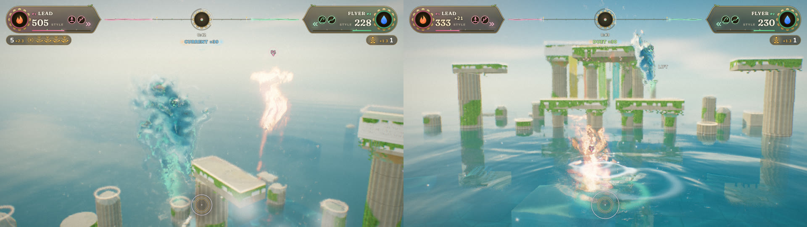
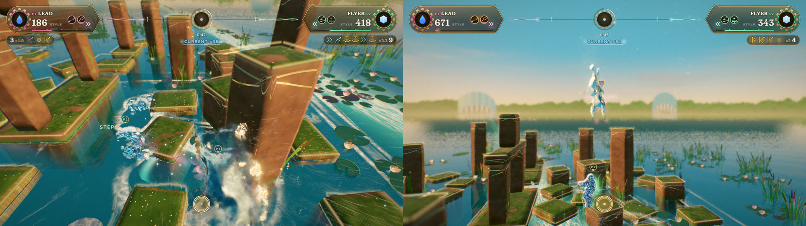
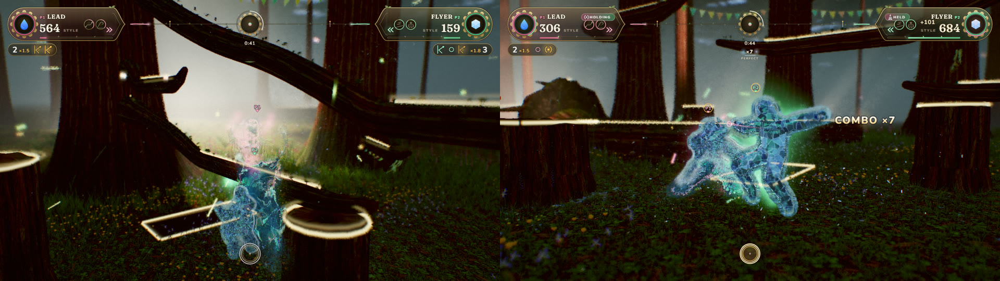
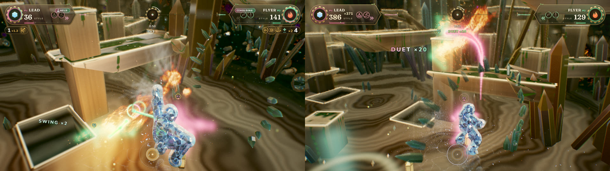

# 18: the camera holds the place (phase 5, second solarpunk pass)

Branch `p5-camera`, from master `e91c9ee`. One of six agents on phase 5. Mine is the duel camera's side of report 17's
issue 1, "the solarpunk stands above the duel's frame". Phase 4 built its sunlit worlds upward, and the duel's camera
looked down at the floor. The temple's sea and colonnade, the geode's light wells, the redwoods' bunting (7 to 8 m up)
and the Pool's sky, far shore and glass pavilions were all out of the frame.

**Measured:**

- **The Node harness**, `scripts/cam-sim.mjs`, extended (below). It ran 12 seeded sets of 40 s in each of the four
  worlds, 110,544 frames a run, with an impulse at every catch, fling, lift and merge. Before and after use the same
  seeds and the same bodies.
  - The "before" run is master's camera reproduced with the probe's new `--tune`. On the temple at 8 sets it gave
    master's numbers exactly.
- **The page's own duels** in headless Chrome on the RTX 5090, with the new `scripts/cam-page.mjs`. Every pose the camera
  gave was recorded: 7 sets of 40 s per world before and after (the Pool 11 before and 8 after), about 16,000 frames
  per world and more. For the "before" run, master's `camera.ts` was put back in this tree under the same dev server.
- **Stills from the duel's own camera at 1280×720**: 12 per world, one every 2 s from 8 to 30 s, before and after.
  Contact sheets were made of them. I looked at all of them.
- `npm run typecheck`, and `node scripts/test-ts.mjs` (20 of 20 files).

**Not measured:**

- A person playing, a phone, portrait aspect, the lock, an online duel.
- A finale in the page (see "What's not done").
- The other phase 5 agents' new landmarks, which were not on master.
- GPU time: nothing is drawn differently, and the camera runs on the CPU. Its Node cost per frame is in the same range
  as before.

## What changed (src/duel/camera.ts)

1. **The plain view is nearly level.** `pitches` went from `[0.2, 0.38, 0.55]` to `[0.05, 0.28, 0.45]`. The view
   that wins when nothing is in the way is now 3° (was 11.5°), with the eye at about chest height on the pair, so the
   horizon runs through the upper part of the frame. The two higher choices for rising over pieces came down with it.

2. **The clean eye rises less often and comes back down sooner.** Before, the fallback's tilt over the pieces was
   active in 4 frames of 5 and added 4 to 8° to the mean. Most of that was its slow tail, plus the eye tilting up over
   slivers that the near fade already dissolves. The changes:
   - `fgOk` 0.03 → 0.08. A piece covering less than a twelfth of the near frame is left to the near fade, whose frame
     test starts at 3 %.
   - `riseHold` 0.6 → 0.4 s.
   - The ease back down approaches at 3/s (was 1.5/s). Its top speed is unchanged at 0.5 rad/s.
   - The rises themselves, the 35° soft ceiling and the 43° hard one are unchanged.

3. **The breath** (`DUEL_CAM.breathe`). Between moments, the frame opens to a wider, lower view and comes back in for
   the action.
   - **When it is calm:** after a moment of contact has settled (its hold and 0.6 of its ease; for a catch, 0.72 s),
     plus 0.4 s.
   - **It comes back in before a catch, not after it:** calm ends at once when the two are closing to meet within
     0.6 s.
   - **At full calm:** the plain view looks 0.07 rad (4°) less down (slightly up), the lens opens 10°, there is 0.08
     more head room (the pair sits lower), and 0.03 more room at the sides.
   - **No jolts:** calm is a critically damped spring, at 3 rad/s going out and 5 rad/s coming back in, so its speed
     never steps. A new test checks that the eye's acceleration stays under 12 m/s² through a catch: it was 6.8.
   - **How often:** the dance is mostly in the air and a moment comes every 1.3 s (median), so calm is over half in
     13 to 19 % of frames. A first version waited for both bodies to be on their feet, and that happened in 0.2 % of
     frames.

4. **Each world faces its landmarks** (`ARENA_CAM.face`). There are two sides from which the pair is seen side on. The
   choice now pays up to 0.5 (`costs.face`) for looking away from a world's direction.
   - All four worlds face −z, behind the stage as the lock looks. The sun and the sky's glow are there in every world,
     along with three of the geode's four wells and the Pool's sunset shore.
   - Other things being equal, the camera takes that side. The worlds' agents can point `face` at their new landmarks.
   - At 1.0 the yaw hunted more (more reversals). At 0.5 the Pool's edge landmark was in frame 61 % of the time against
     38 % with no preference, and its hidden bodies dropped from 9.8 to 7.0 %.

5. **A fix: the 8° snap.** The ceiling switched between the soft 35° and the hard 43° in a single frame whenever the
   "steep" state flipped. That moved the look down by 8° in one frame, 481°/s. This existed on master. The ceiling now
   moves at the rise's own pace: up at 1.6 rad/s, down at 0.5 rad/s. The worst pitch speed in 110,544 frames fell from
   481°/s to 143°/s. The 99th percentile is unchanged at 108°/s: that is the fallback's quick rise, which was kept.

Also:

- Over the Pool's water, `waterLow` went from 0.1 to 0.04, and the plain view never looks up more than 0.03 rad
  (`breathe.lowest`; see the page's numbers). `ARENA_CAM`'s water entry is now optional per world.
- The probe can ask the camera why it is unclean (`last.why`, `last.calmWhy`; with `debug` only).
- The test that compares impulses on and off now holds the breath still in both runs. The impulses keep the breath in
  by design, so with it on, the two sets frame differently.

## The measure (scripts/cam-sim.mjs, src/duel/camprobe.ts, src/duel/camworlds.ts)

New per-world output: one `place` line, a `landmarks` line, a `pitch from` line, and with `--key` one line per world
to compare runs. `--tune k=v,...` sets any `DUEL_CAM` number for a run (`costs.face=0`, `pitches=0.2/0.38/0.55`).

- **Eye height:** over the ground under the eye, and over the lower body's feet.
- **The horizon:** the share of frames with the level line through the eye inside the lens, the share of the frame
  above it, and how high the frame's top edge looks above level.
- **Body size:** head top to feet, as a share of the frame's height. Reported as the median of the two, the smaller,
  and its 10th percentile.
- **In frame:** both bodies' heads and hips (as before), and every point of both (hands and feet too).
- **Comfort:** the pitch's speed (99th percentile and maximum), and the boom's and the lens's speeds.
- **Where the pitch comes from:** the choice's own pitch versus the fallback's rise. Also the breath (how calm, and how
  often) and the gaps between moments.
- **Each world's landmarks** (`camworlds.ts landmarksOf`). A frame shows a landmark when one of its points is in the
  lens and the line to it is not crossed by a solid:
  - **temple:** the colonnade's tops (lintels and drums above 4.5 m), and the sky above the sea's horizon.
  - **redwoods:** the bunting strung between the ring's trees (`garden.ts`, 7.2 to 8.1 m).
  - **geode:** the four leaded light wells on the vault (`geode.ts` WELLS, at about 6.5 m and 10.6 m out).
  - **Pool:** the far garden shore and its pavilions, 1.6° above the horizon all round.
  - **every world, `edge`:** the stage's edge behind the stage (−z) at 1 and 2.5 m, where the worlds are standing their
    phase 5 landmarks at the bodies' height.

## Numbers: Node (12 sets × 40 s per world, 110,544 frames, impulses on)

| | before | after |
|---|---|---|
| **pitch, mean / p90** | **22° / 35°** | **16° / 33°** |
| over 35° | 1.9 % | 1.8 % |
| **eye over the ground** (over the lower feet) | **4.19 m** (3.78) | **3.65 m** (3.24) |
| **horizon in frame** | **55.9 %** | **73.8 %** |
| frame above the horizon / top edge above level | 11.5 % / 1.9° | 21.9 % / 9.1° |
| **a landmark in frame** (not counting `edge`) | **33.1 %** | **50.0 %** |
| **body height, median** (the smaller; its p10) | **37.0 %** (34.8; 21.3) | **about 36.2 %** (33.5; 21.2) |
| **both bodies whole in frame** (every point) | **100 %** (100) | **100 %** (100: 99.9 in two worlds) |
| flyer's head in frame | 33,949 / 33,950 | 33,950 / 33,950 |
| **a body hidden** (any sight line crossed) | **4.7 %** (7.9) | **4.4 %** (7.9) |
| a piece in the near frame, with the fade (over a tenth of it) | 5.4 % (1.6) | 6.0 % (1.2) |
| eye in a solid / within 0.6 m of one | 0.1 % / 0.7 % | 0.1 % / 0.6 % |
| pitch speed p99 / max | 109 / 481°/s | 108 / 143°/s |

Per world (before → after):

| | temple | redwoods | geode | Pool |
|---|---|---|---|---|
| pitch mean / p90 | 20.4 / 34° → **16.0 / 30°** | 22.5 / 35° → **14.9 / 33°** | 21.0 / 35° → **14.4 / 33°** | 23.7 / 35° → **18.8 / 35°** |
| over 35° | 0.6 → 1.1 % | 0.6 → 0.3 % | 2.8 → 1.5 % | 3.7 → 4.1 % |
| eye over the ground | 3.72 → **3.29 m** | 3.84 → **3.17 m** | 4.40 → **3.83 m** | 4.78 → **4.31 m** |
| horizon in frame | 66 → **81 %** | 55 → **75 %** | 56 → **78 %** | 47 → **61 %** |
| top edge above level | 2.7 → **8.4°** | 1.2 → **10.1°** | 3.7 → **11.9°** | −0.2 → **6.0°** |
| landmark | sea sky 50 → **68 %**, colonnade 37 → **51 %** | bunting 11 → **33 %** | wells 23 → **40 %** | shore sky 39 → **51 %** |
| stage's back edge | 51 → 53 % | 36 → 42 % | 37 → 49 % | 36 → **62 %** |
| body height median (p10) | 39.0 → 37.8 % (22.1 → 22.5) | 37.4 → 37.2 % (22.4 → 22.6) | 36.5 → 35.6 % (20.4 → 20.5) | 35.1 → 33.7 % (20.6 → 20.5) |
| body hidden (any line) | 2.5 → **3.3 %** (3.7 → 4.5) | 1.5 → 1.3 % (4.4 → 4.3) | 7.1 → 6.3 % (10.3 → 9.1) | 7.4 → 6.7 % (13.1 → 13.5) |
| near frame with the fade (over a tenth) | 2.4 → 3.4 % (0.7 → 0.7) | 4.1 → 5.6 % (0.3 → 0.6) | 9.5 → 10.3 % (3.5 → 2.5) | 5.8 → 4.8 % (1.9 → 1.1) |
| yaw reversals / min | 21.9 → 24.0 | 24.4 → 26.4 | 35.2 → 38.7 | 25.3 → 27.9 |

## Numbers: the page (`cam-page.mjs`, 7 or more sets × 40 s per world, 16,000 to 25,000 frames each)

| | temple | redwoods | geode | Pool |
|---|---|---|---|---|
| pitch mean, before → after | 21.2 → **17.0°** | 22.3 → **14.7°** | 21.2 → **15.9°** | 27.0 → **23.3°** |
| horizon in frame, before → after | 60 → **76 %** | 53 → **78 %** | 57 → **70 %** | 34 → **47 %** |
| over 35°, before → after | 0.6 → 0.4 % | 1.3 → 0.9 % | 3.6 → 2.1 % | 6.1 → **8.5 %** |

The page agrees with Node in the temple, the redwoods and the geode. **The Pool is the exception.**

- Its eye is unclean in about 60 % of frames, before and after: the bodies swim beside the rafts and monoliths, and
  their sight lines graze the rafts' tops.
- So the clean eye's rises decide its look down, more than the plain view does. The steep 43° ceiling is allowed in
  23 % of its frames, against 24 % on master.
- It also varies more than any other world from one batch of sets to the next, because the page does not replay a
  seed's dance. Four batches of the after camera gave 18.8 to 26.5° and 4 to 14 % over 35°. Three batches of master
  gave 25.4 to 28.6° and 4 to 8 %.
- Its share over 35° may be a little higher than master's, but not clearly beyond that spread.
- Over water, the plain view's extra look up for a floating body (`waterLow`) went from 0.1 to 0.04 rad. The plain view
  now never looks up more than 0.03 rad (`breathe.lowest`). The old 0.1 was set against an 11.5° plain view, and from a
  3° one it put the eye at the water looking up into the rafts.

## How it reads (stills from the duel's own camera, 1280×720; before on the left, after on the right)

Every pair is from the same seeded duel at the same second. A page loaded again does not replay a seed's dance, so
these are the same kind of moment, not the same frame.

**Temple** (24 s): before, the court's water is seen from above. After, the sea's horizon, the colonnade, the banners
and the sky are in the frame, with the pair in the water in front of them. Across the twelve stills, the after sheet
shows the sea's horizon in about two thirds, and the before sheet in about a third. At high tide a third of the after
stills still look down at the water: the fallback rising over the drums.

**Pool** (24 s): before, rafts and water from above. After, the flyer against the sunset sky, the far shore with two
pavilions' glass domes, the monoliths and the reeds. This batch is one of the Pool's poorer ones in the page (see
above): about a third of its twelve after stills show the horizon, against about a quarter before. The others look
down at the rafts while the clean eye rises over them. An earlier batch, with the Pool's old `waterLow`, showed the
shore in nearly all twelve.

**Redwoods** (20 s): before, grass and the pair from above. After, the eye is at the bodies' height between the
trunks: the bunting strung overhead, the boughs, the stumps at the sides. The bunting is in about a third of the
after stills, and in hardly any before.

**Geode** (12 s): lower, and the shelves and crystals stand at eye level around the pair. It is still a room seen
from inside: the hollow is small (its camera room is 10.5 m), and the wells are 6.5 m up and 10 m out, near the top
of the frame when the yaw is right. Of the four worlds it changed least to the eye.

The contact sheets, twelve stills a world: `media/18-camera-sheet-<world>-before.jpg` and `-after.jpg`.

The temple, redwoods and geode after stills were taken one small change before the final camera: the steep ceiling
then dropped at a bounded rate but still rose in a frame. The Pool's were taken with the final camera.

## Judged honestly

- **Temple:** it reads as a place now. The sea, the sky, the colonnade and its banners are behind the pair most of the
  time.
- **Pool:** when the eye is clean, the sunset shore and its pavilions are behind the pair, and these are the best
  frames of the four worlds. But in the page the eye is unclean in most frames, and then it looks down at the rafts as
  before. Node says the Pool improved as much as the others (horizon 47 → 61 %). The page says less (34 → 47 %), with
  a wide spread.
- **Redwoods:** better. The bunting and the trunks frame the pair, but much of the frame is still dark meadow.
- **Geode:** the camera is lower, but the frame is still the floor and the shelves most of the time. The wells need the
  geode agent's help (a landmark at body height, or wells lower on the vault) as much as the camera's.
- **The cost:**
  - The bodies are about a point smaller (median 37.0 → 36.2 % of the frame; the 10th percentile is unchanged).
  - The temple's hidden-body share went from 2.5 to 3.3 %. Runs of nearby settings (8 and 12 sets) gave 2.3 to 4.3 %,
    so it is within the spread, but it is the one world where it rose.
  - Small pieces in the near frame are a little more frequent in the temple and the redwoods (the near fade dissolves
    them). The large ones (over a tenth of the near frame) are fewer overall: 1.6 → 1.2 %.
  - The yaw reverses a little more often: 1 to 3.5 more reversals a minute.
- **The breath is small.** In this dance it is fully out only in the longer gaps, because a moment comes every 1.3 s.
  The lower plain view does most of the work.

## What's not done

- **The finale's low shot was not re-rendered.**
  - The film's shot came from the Pool's plain view over water. That view was 0.1 rad (0.2 − 0.1 afloat) and is now
    about 0.01 (0.05 − 0.04), so the shot should be lower still.
  - The finale's `framePad` and the rises are as they were. The breath stays in during a finale's lift and merge,
    because those are impulses.
  - I did not capture a finale.
- **The Pool in the page** (above): its rafts and monoliths at the bodies' height keep the clean eye high. To do better
  needs either the Pool's agent (the rafts' top edges lower, or fewer monoliths across the side-on line), or a change
  to what counts as a swimmer's sight line (its head and shoulders, not its hips under the surface). The second would
  also change the judge, so I left it.
- **`face` points behind the stage for every world.** The world agents' new landmarks were not on master, so I could not
  check where they stand. If one stands elsewhere, that world's `ARENA_CAM.face` is the one number to change, and
  `camworlds.ts landmarksOf` the place to measure it.
- **The geode** needs more than the camera can give in its small hollow (above).
- **The quick rise is unchanged.** It reaches 92°/s (99th percentile, about 108°/s with the pitch's own ease). It is the
  fallback's answer to a piece coming into the lens. A slower rise would mean more occlusion. That is a trade for a
  later pass, with a person playing.
- **Not tried with a person playing,** on a phone, or in the lock.
