# 18: the geode and the redwoods, second solarpunk pass (materials, planting, a landmark each), and the outlines

Branch `p5-geode-redwoods`, from master `e91c9ee` (phase 4 and report 17). The brief: report 17's issues 1 and 2 for the
geode (the greenhouse, the hub's world) and the redwoods (dusk), and the shared near-fade outline:

1. each floor a material that answers the light, planting with real silhouettes, the redwoods at dusk glowing rather
   than hazed;
2. the near fade's outline gone wherever the piece is not a floor the pair needs to see (the geode's gold-edged boxes,
   the redwoods' gold rectangles and sticks; and whether the Pool's white wire boxes come from the same code);
3. one landmark per world at the stage's edge at about body height, which the duel's lower camera always has in frame.

**Measured:** stills from the duel's own camera at 1280×720 (`bend.grab`, two virtual players at skill 0.85, the music's
clock on the stepped frames as `duel-page.mjs` does), the same seeds and set times before (master) and after; GPU time
per pass at the same moments, master and the branch served in turn on port 5483; where the duel's eye looks in each
world (its forward's bearing over a set); `npm run typecheck`; `node scripts/test-ts.mjs` (20 of 20 files);
`check-limits`, `check-bindings`. **Not measured:** a person playing, a phone, the lock, an online duel, the sound; the
duel sims (no collision or play surface changed, below); `npm run test:net` (as asked).

A caution on every still pair: the page's dance is not frame-for-frame repeatable between two loads (the same seed and
step put the pieces in different places), so the "after" stills are the same set and second, not the same moment.

## 1. The outlines

### What drew the boxes

Grabbing the same frame with the near fade's lines off (`fade.lines` 0) and with the arena's rim light off
(`arena.rim` 0) showed three sources, not one:

- **The arena's rim light** (`src/duel/arena-lines.wgsl`): a ribbon round every top a body can stand on. When the near
  fade dissolved a block, its rim stayed, floating: the gold square over a missing block, the gold stick along a
  missing bough. With the near fade's lines off, the boxes were still there.
- **The geode's selenite itself** (`shelves.wgsl`): every blade glowed along its long edges ("a line of light"), so a
  standing beam was a box drawn in honey light even when nothing dissolved it.
- **The near fade's own outline** (`light.wgsl sightFade`): every edge of a dissolved box near the pair, and the
  silhouette of anything round, kept as a line.

### What changed

- **The near fade keeps only a floor's top edges** (`src/worlds/light.wgsl`, `src/worlds/fade.ts`). A dissolved
  piece keeps a line only where it is a square box whose top is flat (`isFloor`: one axis within 10° of upright), only
  along that top's edges (not its sides, not its outline against what is behind), and only near the pair, as before.
  A tilted blade, a wall's face, a trunk and a bough (a capsule) keep nothing; neither does a box in the redwoods,
  where a short stump is a box to the movement (`drumSolid`) and its square top would be drawn over a round stump
  (`ROUND`). The derivative-based facet the old silhouette line needed is gone, so `sightDrop` no longer has to be
  called in uniform control flow.
- **The arena's rim fades with a dissolved piece** (`src/duel/arena-lines.wgsl` `holeKeep`,
  `src/duel/arena-layer.ts`, one line in `src/main.ts`): the near fade hands its dissolved pieces to the rim layer
  (`NearFade.holes`, the same 16 slots as `Sight.piece`); a rim inside one is dimmed by its strength, but a top near the
  pair (a floor it needs) keeps 60 % of its rim.
- **The rim is softer in both worlds** (`geode/arena.ts`, `redwoods/arena.ts`): 0.6 of its old colour, a sheen along
  the tops rather than a gold line round every block.
- **The selenite's edges no longer glow** (`shelves.wgsl`): the bevels catch the room's light instead (a highlight that
  moves with the eye, not a drawn line).
- **The dithered fade itself is unchanged**: the same patches and holes, the same strengths, the same frame test.

### The Pool's white wire boxes

Not the near fade. The Pool's outline is its arena rim colour (a dark brown) × 0.2, and `sightLit` drops a kept edge on
anything pale; with both the near fade's lines and the rim light off, the cyan-white wire shapes stayed
(`media/18-geode-redwoods-pool-ice-wire.jpg`, seed 1, water and ice, 53 s, both off). They are the ice step's own frost
(`src/duel/power-fx.ts`, `step`): a square of soft glow along each step's four top edges and an icicle at each corner, so
a stair of steps seen from the side is a stack of wire boxes. Fixed with a few lines: the frost is a short tuft along
each edge from each corner (18 % of the edge, fainter), so a step reads as frost at its corners. Not verified in a still
at a FREEZE (the reloaded dance didn't put a stair of steps in frame again); the Pool/temple agent should look at it.

## 2. The geode: a greenhouse in materials

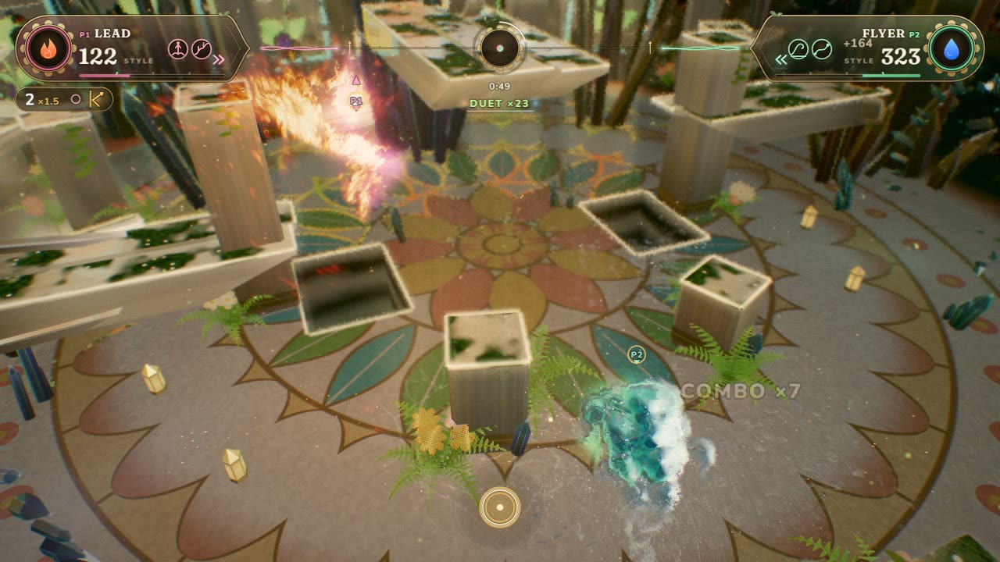

| | before (master) | after |
|---|---|---|
| seed 2, 14 s | 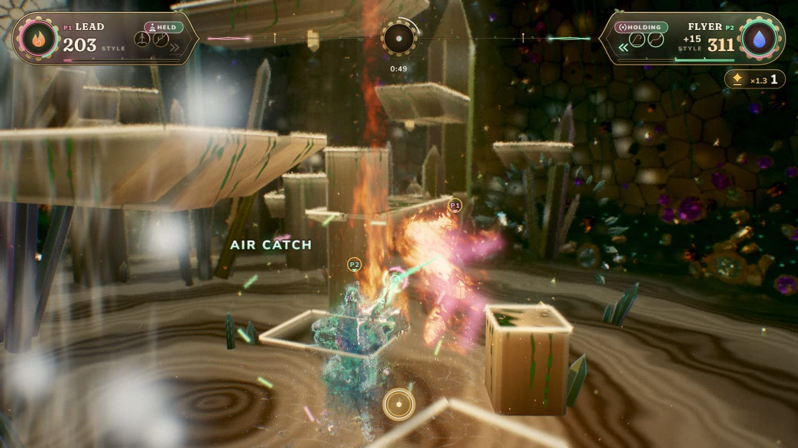 |  |
| seed 2, 20 s | 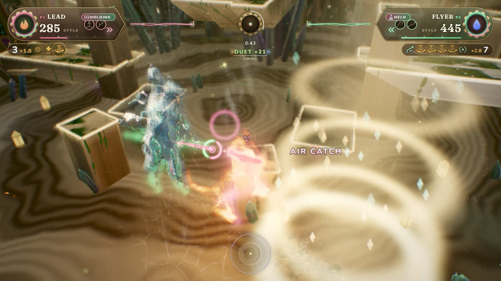 | 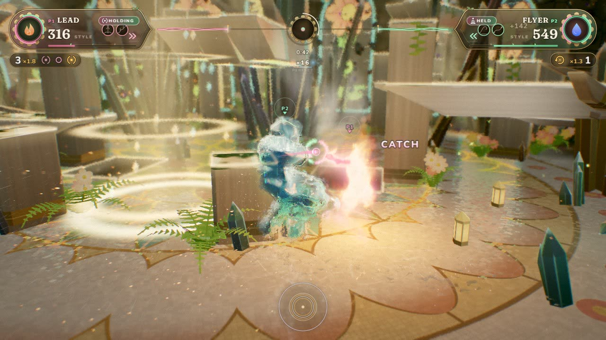 |
| seed 2, 32 s | 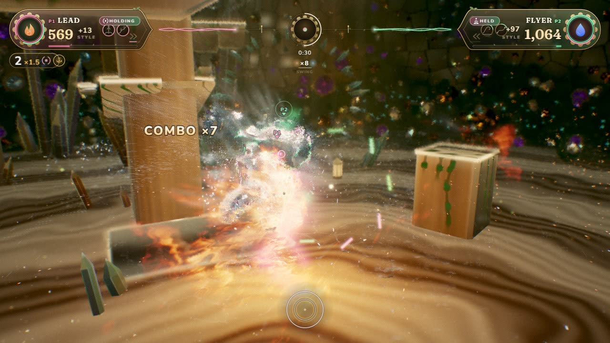 | 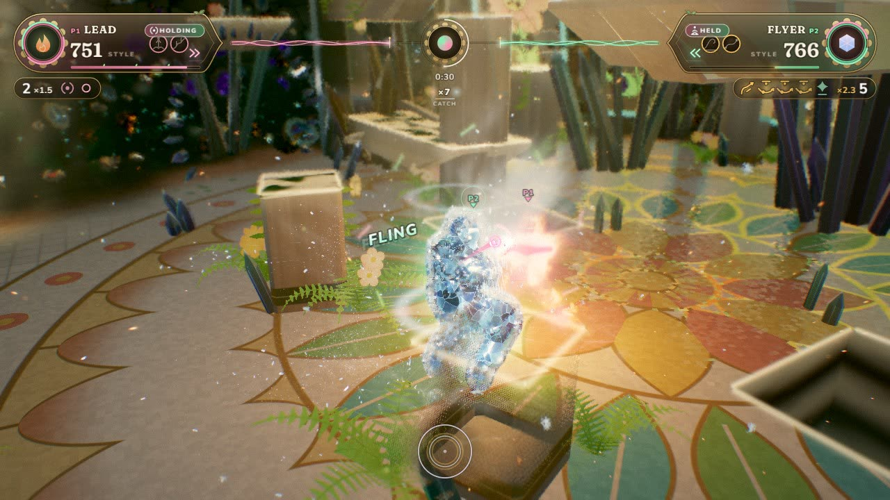 |

- **The floor is a glazed mosaic** (`backdrop.wgsl geodeMosaic`), not agate rings: a petal mandala round the stage's
  middle in small tesserae laid along its rings (a sun disc of gold glaze, a crown of twelve coral and sun-gold petals,
  a ring of 24 leaves in leaf green and sky teal, a band of cream lotus petals tipped terracotta, a ring of small
  flowers), brass inlaid between the rings and round every petal, then a field of 30 cm cream tiles going honey
  terracotta toward the wall. It answers the light: each tile is set a little askew, so its glaze mirrors the softbox,
  the wall's glow and the great window tile by tile (Fresnel, a sharp glint and a soft one); the brass mirrors them warm
  and sharper; the grout mirrors nothing, and fades to an even tone where the tiles get smaller than a few pixels (no
  shimmer). The pools of sun from the wells, the caustics, the paths to the gates and the mirror for matter are as they
  were.
- **The selenite is milky crystal, not planks** (`shelves.wgsl`): the fibres finer and fainter, the stone white going
  honey where it is deep, lit by a near-white room light (a milky stone lit warm and dim read as brown wood); it answers
  the wells' sun with a wrapped light, the sun coming through it on the faces turned away, and a satin streak across its
  fibres; the bevels catch the room. A **brass collar** where each blade leaves the floor, the wall or its druse. The
  vines that were painted down the faces (green streaks on a box) are gone: real ones hang there now.
- **Planting with silhouettes** (`garden.wgsl`, `garden.ts`, new): ferns (fronds arching out of a clump, leaflets in
  pairs cut in the fragment shader), broad heart leaves on stalks, trailing vines (small heart leaves either side in
  turn) and flowers (a stem and a bloom turned to the eye: cream, coral, sun gold, pale rose). In the duel: ferns,
  flowers and leaves at two corners of each standing beam (off the drops), vines down the beams from their tops, vines
  trailing over the shelves' long edges every 30 to 60 cm, and ferns or flowers on the shelves' tops. Everywhere: the
  planters under the great window, below. Decoration, not solids (`decorDrop`); the room's light, the sun through a
  leaf from behind, a little gloss.
- The room's ground bounce is the mosaic's cream now (`geodeAmbient`), not the agate's brown.

### The landmark: the great window

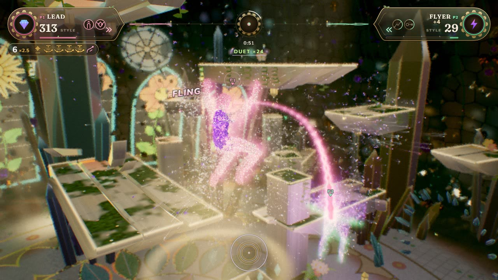

The duel's eye in the geode looks toward −z most of the time (its forward's bearing over a set, seed 2: −90° to −150°
in 93 of 120 samples), so the landmark is there, behind the stage: the light wells brought down to the floor as **a row
of seven tall lancets of leaded glass** in the wall (`geode.wgsl geodeGreatWindow`), the middle one 6.9 m, the outer
ones stepping down, from a 30 cm sill, so their lower halves are at the bodies' height. Up each, an art-nouveau stem
sways with leaves in pairs, and a flower opens in its pointed arch (a sun disc of sixteen petals in the middle one), on
pale cathedral glass going from gold low down to cream to sky teal at the top, a band of teal glass inside a frame of
copper gone green, dark lead with a gold came along it. The wells' sun stands behind it, so it glows (it is the
brightest thing in the room after the bodies), the stone round it warms, the floor's glaze mirrors it, and it throws
its colours onto the floor in front of it along the sun (`geodeWindowFloor`). At its foot, between the lancets, **eight
white-glazed planters with brass rims** and a band of copper green, each with a fern, broad leaves, flowers and vines
over its rim. All in the backdrop and two small draws: no solid, nothing in play.

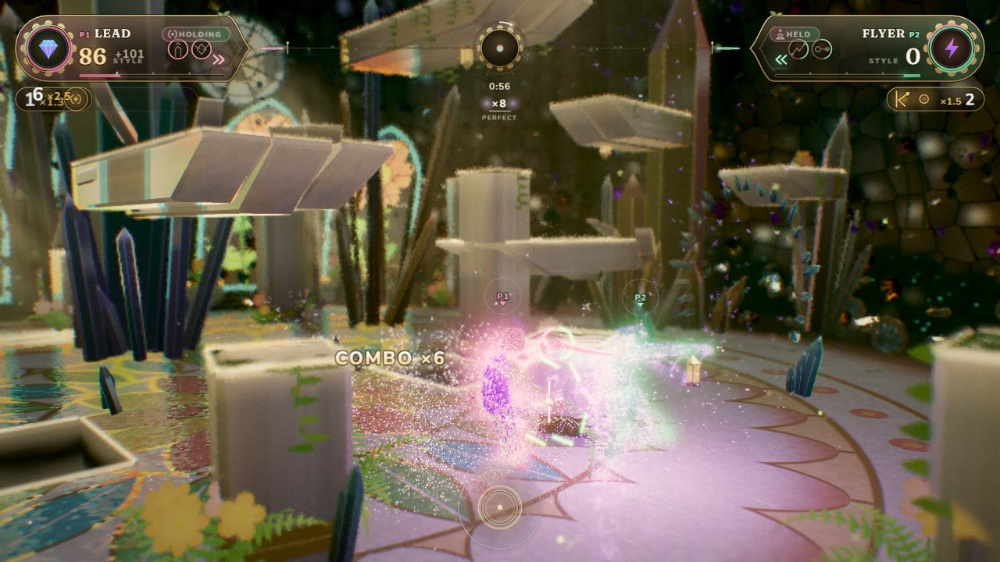

The hub's front page doesn't see it (its camera looks the other way, toward the temple's and the redwoods' gates); it
sees the mosaic:

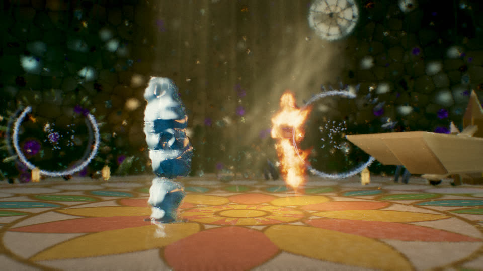

## 3. The redwoods: dusk, glowing

| | before (master, hour 18.9 fixed) | after (hour 18.9 fixed) |
|---|---|---|
| seed 3, 14 s | 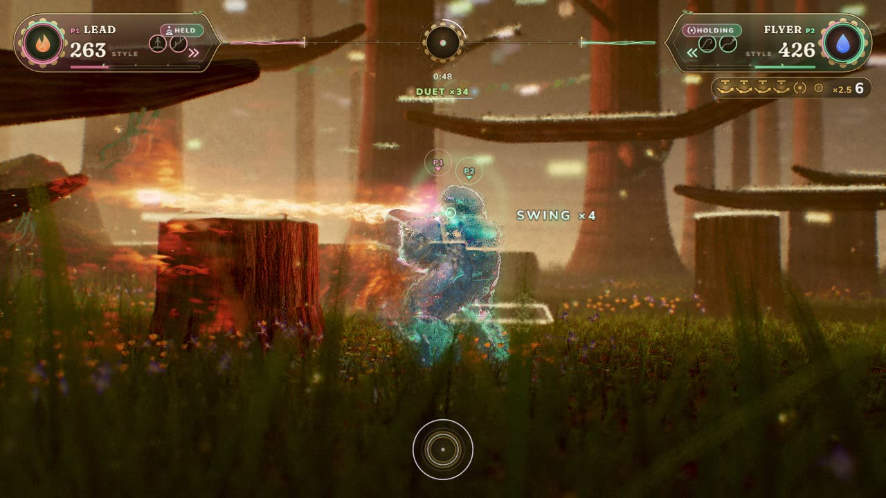 | 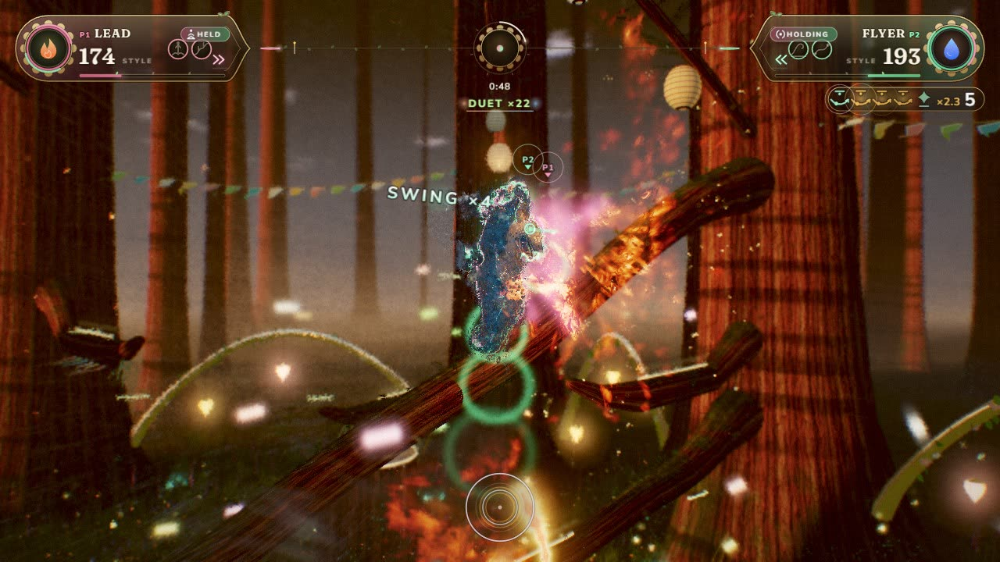 |
| seed 3, 26 s | 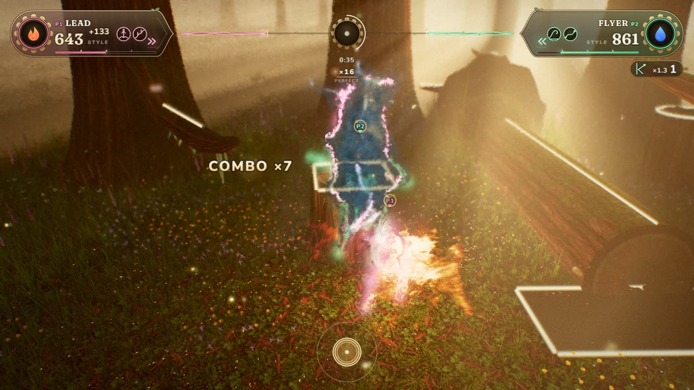 | 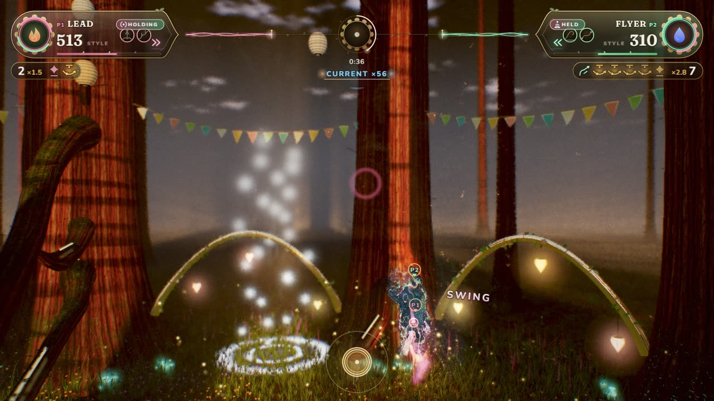 |
| seed 3, 32 s | 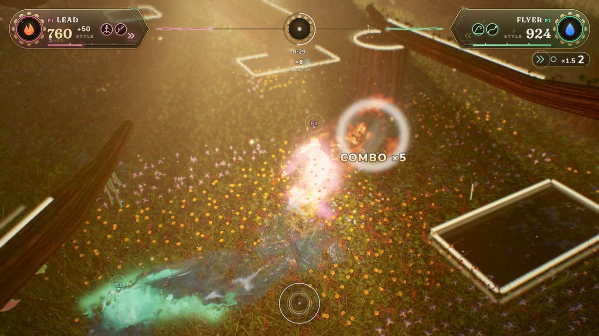 | 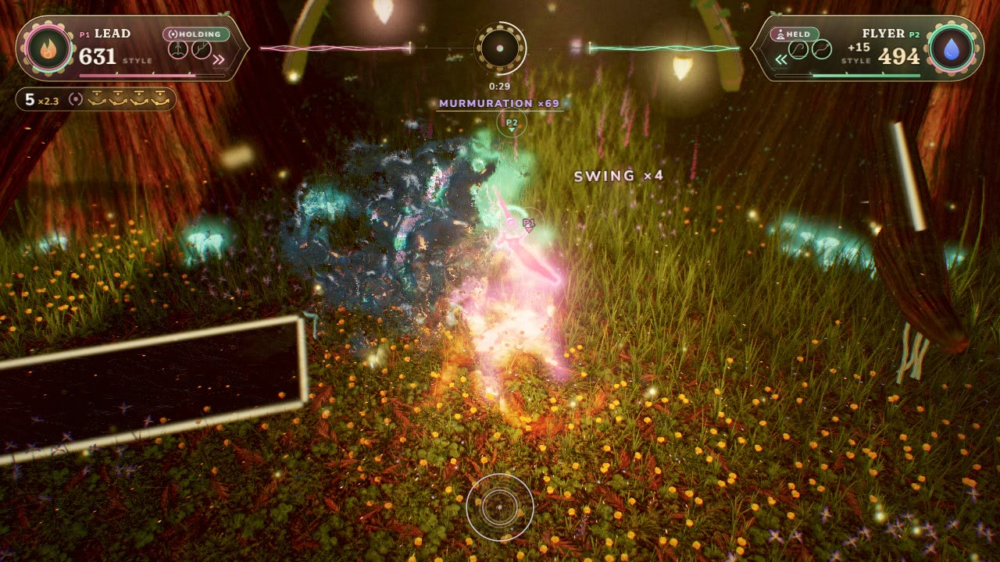 |

- **A duel here is danced from golden hour into dusk** (`redwoods.ts`): it opens at 18.5 h (the sun 8° up) and the
  light goes on an hour every 80 s, stopping at 19.5 h (2° under), so a set's count-in is gold and its end is blue dusk
  with everything glowing. It was 8.2 h and going on at three hours a minute; the film already set 18.9 by hand. A film
  still moves the hour itself; the redwoods outside a duel keep their day.
- **The haze thinned and cooled** (`day.ts`): the mist from golden hour to just after sunset is about half as thick
  (0.022 to 0.026 a metre → 0.012 to 0.013) and lavender-teal, not brown, and the light under the trees a little cooler,
  so the warm last light reads against it: the trunks go back into blue depth instead of a beige wall.
- **Bioluminescence**: points of teal-green glowing in the moss on the trunks' feet and the stage's wood, breathing
  (`trunks.wgsl`); the log's shelf fungus glowing from within, paler at its rim (`ferns.wgsl`); fungi on cream stems in
  clusters round the ring's feet and the duel's stumps, their caps glowing teal-green with a halo (`arbour.wgsl`); the
  fireflies glow longer after each flash, a little between, and are half as big again (`lanterns.wgsl`). All of it
  scales with the woods' dusk (`forest.horizon.w`), so the morning is as it was.
- **The stumps' tops are finished wood** (`trunks.wgsl` end 4, `redwoods/arena.ts`): sanded honey wood, its rings soft
  under the oil, a band of brass round the rim, mirroring the last light and the sky, a floor someone made. They were
  drawn as broken ends with a hollow and splinters bulging past the flat top the body stands on. The solid is the same.

### The landmark: the arbour round the ring

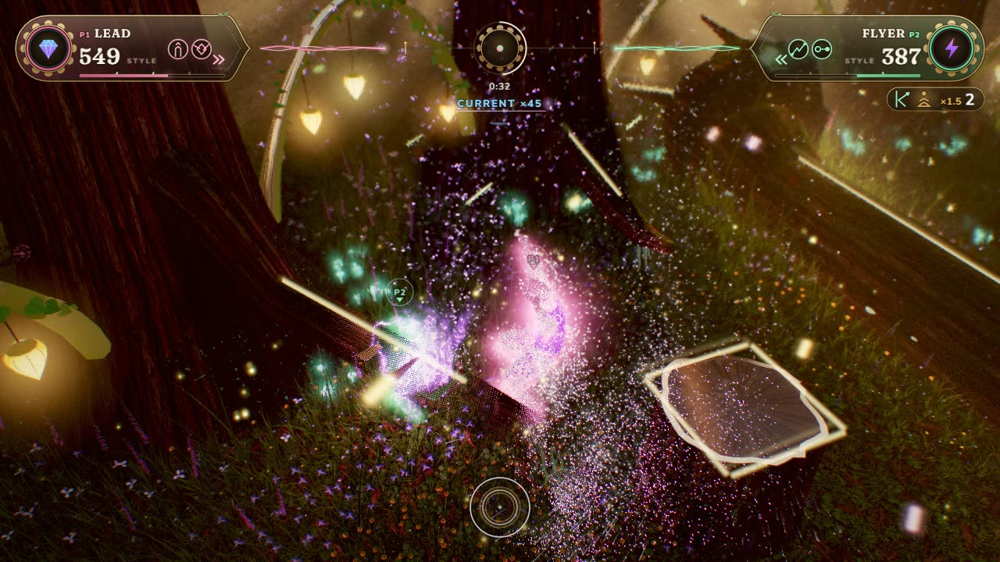

The duel's eye in the redwoods looks both ways across the stage (its forward's bearing over a set, seed 3: two clusters
half a turn apart), so a landmark in one place would be behind the pair half the time. The arbour goes all the way
round instead (`arbour.wgsl`, `arbour.ts`, new): **an arch of honey wood from each tree of the fairy ring to the next**,
its feet bound to the trunks 1.1 m up, its crown 3.7 m, drawn up like art nouveau's pointed arches with a slight
whiplash, banded in brass every 70 cm; **a vine climbing each** with heart leaves and small cream and coral flowers;
**seed-pod lanterns** of solar glass in brass ribs hanging from them on cords (two or three an arch), amber, gold or rose,
glowing a little by day and fully from dusk, each with a halo. It stands at the ring, outside the duel's space (the trees
are its walls), so no body dances through it; decoration, not solids.

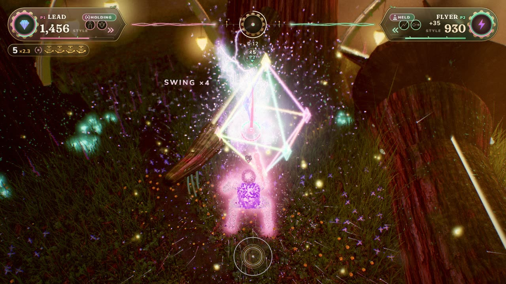
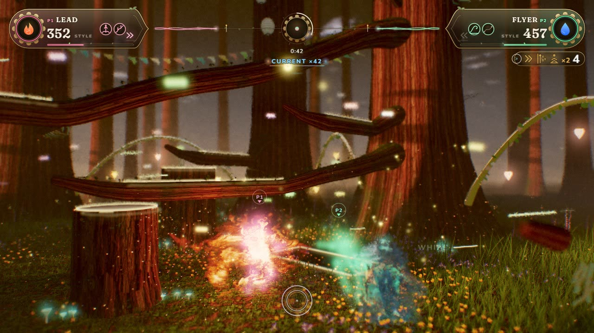

## The GPU

RTX 5090, 1280×720. Other agents shared the GPU throughout (77 % busy before my runs), so whole-frame numbers moved by
up to 1 ms between identical runs; the scene pass's own time is steadier. Master (`e91c9ee`) and the branch were served
in turn on port 5483 and measured at the same moments, three rounds of 40 frames each:

| | scene, master → branch (ms, mean of 3) | whole frame, master → branch |
|---|---|---|
| geode, seed 2, 20 s | 0.367 → 0.480 | 2.03 → 2.00 |
| geode, seed 2, 32 s | 0.402 (median 0.368) → 0.341 (median 0.317) | 1.88 → 1.94 |
| redwoods, seed 3, 14 s, hour 18.9 | 0.947 → 0.995 | 3.31 → 4.10 |
| redwoods, seed 3, 26 s, hour 18.9 | 0.825 → 0.820 | 3.55 → 3.08 |

The geode's scene costs up to about +0.1 ms where the camera sees a lot of floor and window (the mosaic, the window's
light on the floor, the glaze's reflection of the wall and window), nothing measurable elsewhere; the planting is in the
noise (green off against on at the same moment: within ±0.1). The redwoods' scene is unchanged within the noise (the
arbour, pods and fungi are a few thousand triangles; the thinner mist doesn't change the air's march). The redwoods'
whole frame moved both ways by 0.5 to 0.8 ms between runs of the same build, which is the shared GPU, not the change.
From the first session (quieter, `--timings` after each still): the geode's frames 1.59 to 1.98 ms before, the
redwoods' 3.0 to 3.25 before and 2.75 to 3.14 after, air 0.43 to 0.51 both.

## Play

No collision or play surface changed: the arenas' pieces, ledges, walls, drops and the stumps' solids are the same
numbers (the planting reads the geode's beams and shelves as they are laid, without the layout's dice, and the arbour
reads the ring's trees and the stumps), the frame test and its strengths are unchanged, and nothing new is a solid. The
hour doesn't reach the rules, the brains or the hazards. So the duel sims were not run.

## Files

- Outlines: `src/worlds/light.wgsl` (`sightFade`'s outline part), `src/worlds/fade.ts` (`isFloor`, `ROUND`, `holes`),
  `src/duel/arena-lines.wgsl` (`holeKeep`) and its `.d.wgsl.ts`, `src/duel/arena-layer.ts` (`holes`), `src/main.ts` (one
  line), `src/duel/power-fx.ts` (the ice step's frost), `AGENTS.md` (the near fade's paragraph).
- Geode: `geode.wgsl` (the great window, the room's bounce, the wall soft), `backdrop.wgsl` (the mosaic and its glaze),
  `shelves.wgsl` (the selenite), `garden.wgsl` and `garden.ts` (new: the planting and the planters), `geode.ts` (their
  draws), `arena.ts` (`decor`, the rim).
- Redwoods: `redwoods.ts` (the duel's dusk, the arbour's draws), `day.ts` (the mist), `trunks.wgsl` (finished tops, the
  moss's glow), `ferns.wgsl` (the fungus's glow), `lanterns.wgsl` (the fireflies), `arbour.wgsl` and `arbour.ts` (new),
  `arena.ts` (the stumps' tops, `stumps`, the rim).

## Not done

- **A square rim on one stump**: the arena's rim light draws the top of a box, and the redwoods' one short stump
  (`stumpL`, top 1.2 m) is a box to the movement, so its rim is a square over a round top (dimmer now, and gone while
  the stump dissolves). A fix belongs in `duel/arena-segments.ts` (a ring for a drum stand-in) or in `drumSolid`; I left
  the shared code and the collision alone.
- **The Pool's ice steps** are fixed in code and not seen at a FREEZE in a still.
- **The gem dome stands in front of the great window**: the wall's crystal fixture (the gems kind's, not the geode's)
  is drawn over the window's lower part; a gap in the dome there would need the gems kind's `buildDome`.
- **The camera**: these stills are master's duel camera; the camera agent is lowering it, which should show more of the
  window and the arbour. Not seen together.
- The mosaic's far field and the drops' rims still show some hard lines at a glance; the hub's front page doesn't see
  the window; no concept image was made; the hour's change in the redwoods was not checked against the film tool's
  hour curve (a film sets the hour itself, untouched).
- `check-bindings` needed a junction to the main checkout's `@ericrius1` in this worktree's `node_modules` (git-ignored)
  to find weft's shaders; the result is within the baseline.
