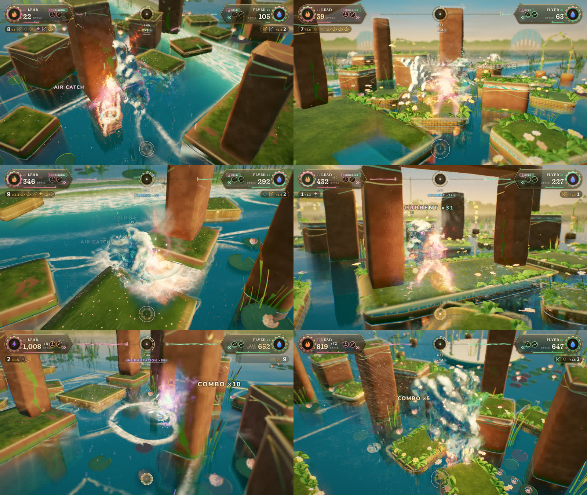
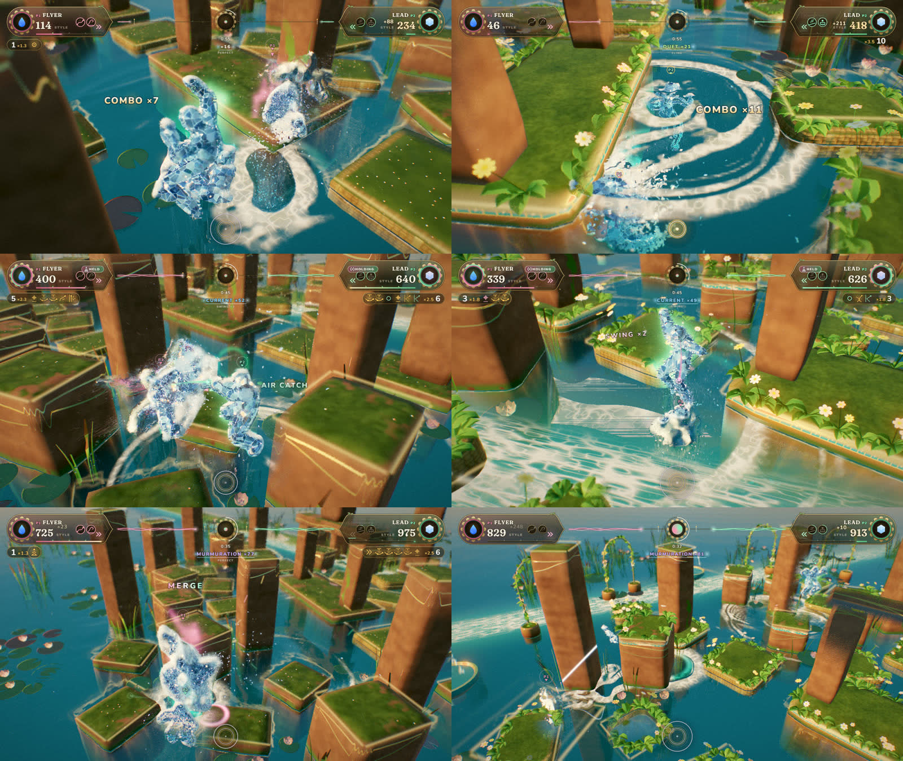
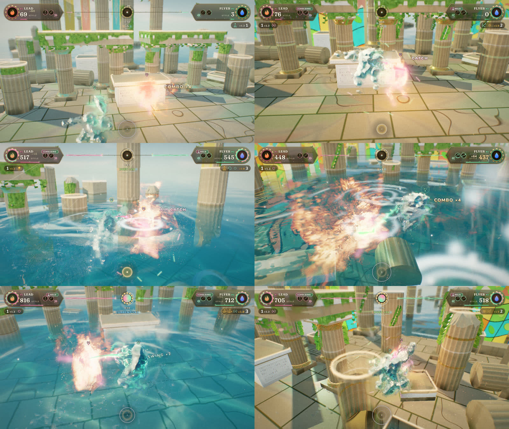
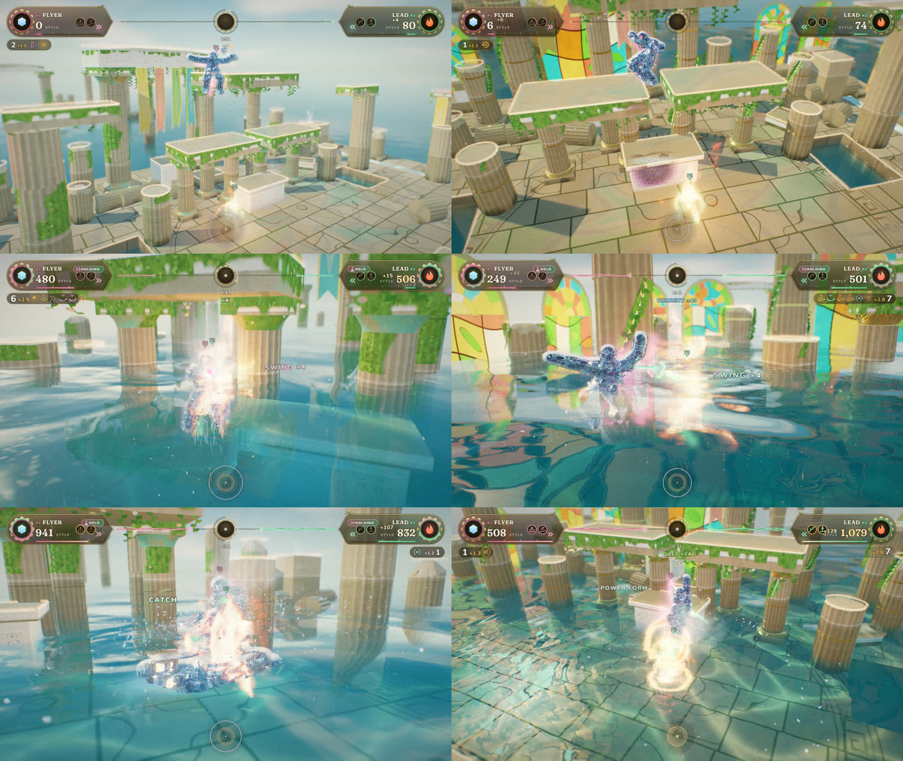
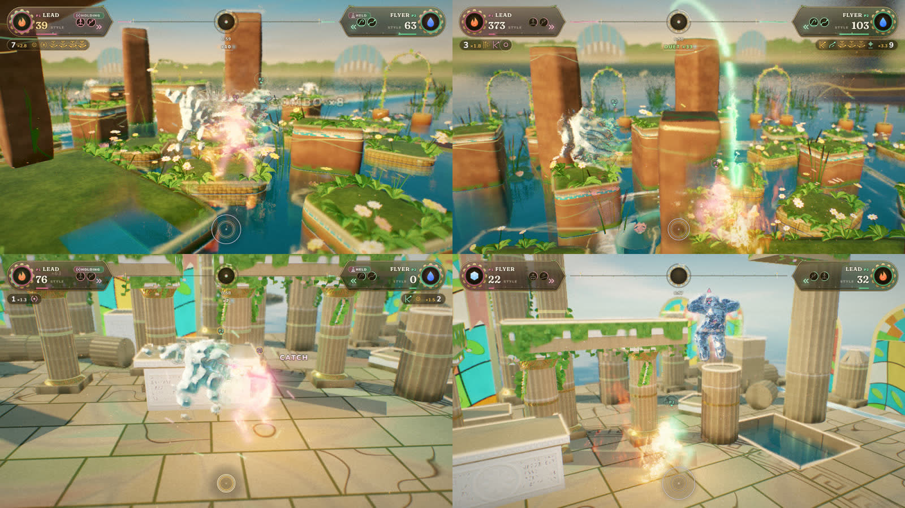
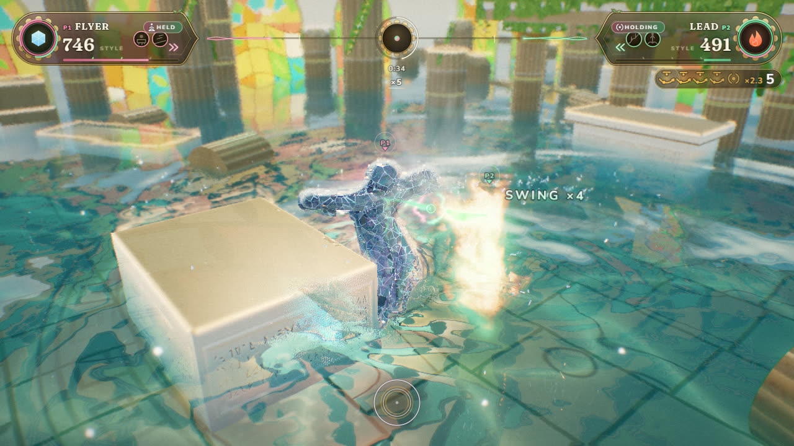

# 18: the Pool and the temple, the second solarpunk pass (materials, planting, a landmark at the edge)

Branch `p5-pool-temple`, from master `e91c9ee` (phase 4 merged, report 17). One of the phase 5 agents; mine is the Pool's
golden-hour water garden and the sunlit temple with its tide. The brief: report 17's issues 1 and 2 for these two
worlds. The materials read as a first coat of paint (the Pool's rafts square turf tiles with white sprinkles on
terracotta boxes; the temple cream on cream on pale teal, its vines a green coat); the look stands above the duel's
frame (the temple's canopy is never drawn, the Pool's garden sits at the horizon). And keep the bodies readable: they
were the only bright things, and a water body vanished in the temple's teal water.

**Measured:** stills from the duel's own camera in the page (my dev server, port 5485, headless Chrome on the RTX 5090,
1280×720), master and this branch, the same four seeded duels grabbed at the same six times (6, 12, 18, 24, 30, 36 s):
the Pool with fire and water (seed 1) and with water and ice (seed 4), the temple with fire and water (seed 3) and with
ice and fire (seed 3), the temple's spring tide logged at each grab (low −0.4 m at 6 s, high 1.4 m at 24 to 30 s); a
few more with the camera turned by hand (`bend.rig.yaw`) to look at the edge; GPU time per pass with `shot.mjs
--timings` (three windows a world, master and this branch back to back); `npm run typecheck`, `node
scripts/test-ts.mjs` (20 of 20 files), `check-bindings`, `check-limits`.
**Not measured:** a person playing; a phone; 1080p; motion (stills only: whether the leaves' flutter or the vault's
reflection crawl in motion is not judged); the Node duel harness (nothing it runs changed: no solid, ledge, hazard or
spawn moved, so there are no falls or catches to compare); `npm run test:net` (port 5418, other agents).

## The Pool

### The pieces are crafted things, not tiles (`stones.wgsl`, `arena.ts`)

Report 17 saw "square tiles of turf with white sprinkles on terracotta boxes". Each piece now says what it is made of,
and each material answers the low sun:

- **Planters** (the low stones a body steps on, top under 0.5 m, the stage's three big flat stones among them). Seen
  from above their corners are rounded off by up to 0.4 m, so they read as pads, not tiles. The vertex shader now rounds
  a box in plan as well as at its rim, closed over the cube's faces. The drawing only: the solid stays the box, and its
  corner stands up to 17 cm past the drawn one along the diagonal, where nobody stands. Their sides are amber glaze
  over terracotta, pooling darker low on the side, with a fine crackle; under a **brass rim** runs a band of **teal and
  cream tile** with gold joints, a leaf in every other tile; a brass whiplash is inlaid in the glaze. The glaze is a
  clear coat (`poolGlaze`, `pool.wgsl`): the sky and the water mirrored at a fresnel, the sun a small hard highlight.
  The brass (`poolBrass`) is a warm mirror with a bright streak. The top is a lawn of moss, with no sprinkles.
- **Rafts** (the floes): woven fibre round the sides, each strand's normal tipped so the weave catches the light,
  brass ties, a brass edge on the woven rim, the same rounded plan. They still ride the swell.
- **Blocks** (a jump high): terracotta with a band of glazed tile (teal and cream in a running bond, gold joints) under
  the top, and the brass inlay.
- **Standing stones**: terracotta and brass as before, with the vine.
- `arena.ts` packs what each piece is (`ROCK_LOOK`) and its plan radius into the two free floats of its row. The
  solids, the ledges, the movers and the spawns are built exactly as before.
- The faces have 8 quads each way (6 before), so the rounded corners hold their shape.

### Real planting on every planter and raft (`beds.wgsl`, `garden.ts` `bedsOf`)

- Clumps of planting go round the rim of each planter, raft and block. They stand a hand in from the edge, about a
  stride apart, and none sits where a piece stands on the top (the arch's pillars).
- Each clump has seven broad leaf cards and up to three flowers:
  - A leaf has a midrib and two halves folded up. It arches out over the rim and down, and is cut to a pointed oval in
    the fragment shader.
  - A flower is a thin stem with a head of petals round a gold disc, turned to the sky and a little toward the sun. The
    petals are cream, sun gold, coral and peach. None is rose or fern, which are the seats' colours.
- Leaves and petals are lit through from behind by the low sun, so a piece's rim glows gold against the light.
- A clump is placed in its piece's own frame and reads the stones' live buffer, so it rides a raft on the swell.
- It fades by `decorDrop` near the eye and across the line of sight to a body. A body's feet go into it as into grass.

### The landmark at the edge: the Pool's built garden (`edge.ts`, `edge.wgsl`)

The duel's camera turns all the way round the pair in the Pool. Measured over 40 s, its eye stood anywhere from x = −12
to +3 and z = −4 to +8. So one object behind the stage would be out of frame half the time. The landmark is a ring, all
of it outside the arena's water (radius 13.4; the stones reach 11.6), so no body reaches it:

- **The pavilion**, behind the stage and left of the sun's bearing, at (−5.2, −15.6). It has a ceramic plinth and
  floor, eight white ceramic columns, and a brass ring beam. Its glass dome has brass ribs: the panes mirror the sky and
  show the plants inside, warm green, and the sun behind glows through them. On top is a brass finial. Vines climb
  every other column, and leaves hang from the beam.
- **Three sailcloth shades** on four brass masts in glazed tubs, stretched toward the sun's side. They are cream and
  sun-gold panels with a hem, billowing a little, and the low sun glows through them from behind.
- **Round the rest of the rim**, in turn:
  - **trellis arches**: brass posts in amber-glazed tubs, the round top in eight pieces, and a flowering vine up one
    post, over the top and down the other (leaf and flower cards);
  - **fountains**: a basin in teal glaze on a white foot with a brass lip, its water rippling, and a brass spout. Its
    jet is four arcs into the bowl and a plume, drawn in the glow pass and faded near the eye as the decorations are.
- Everything is made from the vertex index, in four opaque draws (lathe, tube, leaf, sail) and one glow draw. The lathe
  is one profile turned on its axis, each segment its own material, the gaps collapsed.

### The water stays as it was

The surface, the sky, the glints, the foam and the swell are unchanged. The water mirrors the new things on screen as it
mirrors the stones.

## The temple

### White glaze and brass that answer the sun (`stones.wgsl`)

- **Glaze**: the carved bands, the panels and the altar's facing are white glaze (a step whiter than before). It is now
  a clear coat at every angle, not only when wet. It mirrors the sky and the canopy's glass (below) at a fresnel, and
  the sun is a small hard highlight on it.
- **Brass**: the capitals and bases were mostly verdigris; now they are brass rubbed bright, with verdigris only in the
  hollows. They shade as metal: the sky and the canopy mirrored in their own colour, a sharp sun streak, little diffuse.
  Every tall shaft has a **brass collar** a hand wide at each joint between its drums.
- **The stone**: honey sandstone (`stone` `#c2b8a4` → `#c3ad8d`), a step warmer and deeper, so the white glaze, the brass
  and the pale bodies stand off it. The flagstones take the same stone.
- **The air**: half the sea haze (`haze` 0.006 → 0.003). The court was washed out by it.
- **The water**: the sea a little deeper (`#0f5e66` → `#0c5561`).

### Real leaves and flowers on the columns (`garden.wgsl` `vs_vine`, `garden.ts`)

- The green coat on the shafts is gone. `stones.wgsl` now draws only the two woody stems winding up a shaft, as a thin
  line.
- Leaf cards stand out from the stone along those same two helices: 56 to a stem (32 on a phone), alternating sides,
  hanging a little and fluttering. One in seven is a five-petalled flower: jasmine cream, coral, sun gold or peach.
- `garden.ts` places them from each stone's seed, by the same `has`, `reach` and `wind` the shader uses, so the leaves
  sit on the stems.
- They grow only above the spring tide (1.6 m), on the court's columns and the duel's.
- The strands of flowering vine from the lintels (phase 4) stay.

### The canopy, seen in its reflections (`temple.wgsl` `templeVault`)

- The canopy is never in the duel's frame. Its glass is now the sky over the court above about 13° (`templeVault`, in
  `templeSky`): an art-nouveau fan of petals round the zenith, in sun gold, teal, coral, leaf and cream. Dark bronze
  cames with a gold line run between the panes, and a brass ring runs round its rim.
- It is lit through by the sun: brightest round the sun's disc, which glows through the glass.
- Everything that mirrors the sky now mirrors the glass:
  - the tide's water (`templeScene`);
  - wet stone and the floor's wet sheen;
  - the white glaze and the brass;
  - the screens' faces;
  - the water bodies' own reflections (`worldEnv`).
- It is kept dim (0.17 of the sun in a pane, rising round the sun), so the water stays clean teal with broken coloured
  light in it. At 0.75 it turned the water into a map of colour (below, "what I tried").
- Its light on the court (`templeCanopy`) is unchanged.

### The landmark at the edge: stained-glass screens (`garden.wgsl` `vs_screen`, `garden.ts`)

The duel's camera in the temple mostly looks from the front toward the back and the left. The screens bring the
canopy's glass down to the height of the bodies, at the court's edge:

- **One fills the great gate** behind the stage, 4.1 m wide and up to the lintel. The gate's four banners are now two,
  framing it.
- **Eight stand between the colonnades' columns** down both sides, 2.5 × 3.6 m.
- **Four stand behind the low walls** either side of the gate, 2.4 × 4.0 m.
- Each is one quad, cut in the fragment shader to an arched outline with a brass frame and a transom. A rose of petals
  fills the arch round a gold sun disc. Below it, the panes are a curved grid, so the leads bow like stems, with leaves
  in some panes.
- The glass is deep (its tint squared). The sky behind it shines through, and the sun when it stands behind the screen
  from the eye; the court-side face mirrors the sky. The sun is behind and to the left of the stage, so the gate and the
  left-hand screens glow.
- They are not solid, and they fade by `decorDrop`. They stand outside where the bodies dance: the colonnades, the walls
  and the gate's columns are between.

## Contrast: the bodies against the world

- **Pool**: the new brights are small: a brass rim, a glaze highlight, petals. The large areas stay mid to dark: amber
  glaze, moss, woven reed, the deep teal water. The pale water and ice bodies are still the brightest large shapes,
  and the fire body reads gold-pink against moss and teal.
- **Temple**: honey stone in place of cream, half the haze, and a deeper sea. A water body at high tide now reads pale
  against deeper teal: compare the high-tide pairs below. The bodies agent is deepening the bodies' own colours too.
  Neither has been judged together with the other.

## Numbers

**GPU** (`shot.mjs --timings`, 1280×720, the Pool fire and water seed 1 and the temple fire and water seed 3, three
windows of 150 frames a world, at 20 s, 22 s and 24 s; master then this branch, back to back; a GPU other agents were
using):

| ms (three windows) | master | this branch, first run | this branch, final code |
|---|---|---|---|
| Pool: scene pass | 0.254, 0.209, 0.152 | 0.316, 0.472, 0.224 | 0.192, 0.130, 0.235 |
| Pool: glow pass (the jets) | 0.135, 0.124, 0.124 | 0.146, 0.159, 0.125 | 0.123, 0.130, 0.185 |
| Pool: whole frame | 1.60, 1.84, 1.90 | 2.01, 1.90, 1.70 | 2.39, 2.52, 1.97 |
| temple: scene pass | 0.487, 0.525, 0.416 | 0.584, 0.555, 0.647 | 0.680, 0.438, 0.411 |
| temple: glow pass | 0.131, 0.125, 0.125 | 0.202, 0.128, 0.126 | 0.185, 0.162, 0.125 |
| temple: whole frame | 2.24, 1.74, 1.86 | 2.24, 2.00, 1.88 | 3.20, 2.66, 3.15 |

- **These numbers are noisy.** The GPU was 45 to 93 % busy with other agents' work while the final run ran. The page
  doesn't replay a set exactly, so each window is a different frame. Read them as ranges.
- **The scene pass**: in the Pool it is about where it was (master 0.15 to 0.25 ms, final 0.13 to 0.24). In the temple
  it is up to about +0.1 to 0.15 ms (master 0.42 to 0.53, this branch 0.41 to 0.68).
- **The Pool's first run** was 0.07 to 0.26 ms over master. Two changes brought it back:
  - one look at the sky per stone fragment, shared by the glaze and the brass (the first run looked twice);
  - the GPU being less busy, which I can't separate from the first.
- **The temple's cost** is the vines, the screens and the canopy in every reflection of the sky.
- **The whole frames** in the final run are higher in both worlds, past what the passes listed add up to. The other
  passes didn't change: that is the busy GPU.
- One more run of the final code, on a busier GPU still (whole frames 2.1 to 5.5 ms, the scene 0.26 to 1.17), is left
  out.
- **Not measured**: 1080p, and a quiet GPU. The scene pass's growth there should be checked before this merges.

**Bindings** (`check-bindings`): within the baseline, 170 entry points. The new ones:

| shader | storage buffers | uniform buffers | sampled textures |
|---|---|---|---|
| `pool/beds.wgsl` (vertex) | 2: the stones and the beds | 3 | 2 |
| `pool/edge.wgsl` | 1 | 3 | 2 |
| `temple/garden.wgsl` `vs_vine`, `vs_screen` | 1, its own as before | 3 | 2 |

No uniform member was added to the world light.

**Play: unchanged.** No solid, ledge, wall, hazard, spawn or tide changed:

- the Pool's water is still the floor;
- the rafts ride the same swell;
- the temple's tide is the same.

So the duel harness has nothing new to measure, and I did not run it. `test-ts`'s camera and solids tests pass as
before.

## Stills

From the duel's own camera at 1280×720, before (master) on the left, after (this branch) on the right. Each row is the
same seeded duel at the same second, but not the same frame: the page doesn't replay a set exactly.

**The Pool, fire and water (seed 1), at 6, 18 and 30 s.** The pieces are planted pads with glazed and brass edges. At
6 s the camera came down to the water, and the ring of arches and the far shore's domes stand at the horizon.

**The Pool, water and ice (seed 4), at 12, 24 and 36 s.**

**The temple, fire and water (seed 3), at 6 s (low tide, −0.4 / −0.3 m), 24 s (high, 1.4 / 1.3 m) and 36 s (0.9 m /
low again, −0.2 m).** Honey stone, white glaze, brass collars and capitals, leaves on the columns, the screens at the top
of the frame; at high tide the water is a deeper teal.

**The temple, ice and fire (seed 3), at 6 s (low), 24 s (high, 1.45 / 1.44 m) and 36 s (0.6 / 0.5 m).**

**The landmarks in the duel's frame.**

- Top left: the Pool's arches and the far shore at 6 s, the duel camera's own.
- Top right: the arches round the rim, with the camera turned by hand (`bend.rig.yaw`).
- Bottom left: the temple's screens at the top of the duel's frame.
- Bottom right: the temple at low tide with the screens, the brass and the vines.

**The canopy in the water at high tide** (ice and fire, about 28 s). The glass's colours are broken in the tide by the
ripples, the screens are behind the stage, and the ice body reads against the teal.

## What I tried and dropped

- **White glaze on the planters' sides** (the bible's white ceramic). From the duel's camera the large pale sides were
  as bright as the pale bodies, so I used amber glaze over terracotta with a teal and cream band.
- **The canopy's glass at 0.75 and then 0.32 of the sun**, in larger panes. The rippled reflection turned the tide into
  a camouflage map of colour, so it is now 0.17, with smaller panes and heavier cames. (The iteration stills were not
  kept in the repository.)
- **Four banners in the great gate**: they would cover the screen, so there are two now.

## Not done, and weak points

- **The depth of field blurs the landmarks.** From the duel's camera the Pool's pavilion and the arches at 12 to 16 m,
  and the temple's gate screen at 13 m, are often soft. They read as shapes and colour, not detail. That is the
  camera's and the lens's business (p5-camera); a lower camera will bring them further in.
- **The pavilion is rarely in frame.** The duel camera looks down most of the time. In these stills the pavilion
  showed only as a dome and a sail at the frame's top edge (low views), and it was never judged up close at 720p. The
  arch ring is what the camera sees most.
- **No kites.** The Pool has sails and fountains but no kites; the temple's fountains are phase 4's.
- **The canopy itself is still not drawn as an object.** It is in the sky above 13°, so a camera looking up sees a
  stained-glass vault with nothing holding it up. In the duel's frame (the top edge at about −4 to +10°) it is never seen
  directly.
- **The rounded planters** leave a box corner 17 cm past the drawn corner. A body standing on that exact corner would
  stand on air; I didn't see one in the stills.
- **The planting is uniform** round each rim: the same clump, varied in size, angle and flowers. Up close it reads as a
  planted border more than a wild garden.
- **Motion not judged.** The leaves flutter, the sails billow, the jets fall; none of it was watched moving.
- **Not measured:** a phone (`coarse` thins the beds, vines, arches and screens, but its frame time wasn't measured),
  1080p, a person playing.

## Files

- **The Pool**:
  - `src/worlds/pool/stones.wgsl`: the planters, rafts, blocks, glaze and brass, and the rounded plan.
  - `src/worlds/pool/arena.ts`: `ROCK_LOOK`, the plan radius.
  - `src/worlds/pool/pool.wgsl`: `poolGlaze`, `poolBrass`.
  - `src/worlds/pool/pool.ts`: the edge's draws.
  - `src/worlds/pool/garden.ts`: `bedsOf`, the beds' draw.
  - New: `src/worlds/pool/beds.wgsl`, `edge.ts`, `edge.wgsl`.
- **The temple**:
  - `src/worlds/temple/stones.wgsl`: glaze, brass, collars, the stems.
  - `src/worlds/temple/temple.wgsl`: `templeVault`.
  - `src/worlds/temple/temple.ts`: the vines' and screens' draws, stone, haze, sea.
  - `src/worlds/temple/garden.wgsl`: `vs_vine`, `vs_screen`, the screens' glass.
  - `src/worlds/temple/garden.ts`: the vines, the screens, two banners in the gate.
  - `src/worlds/temple/arena.ts`: `TempleDuel.stones`.
- **Generated**: the regenerated `*.d.wgsl.ts`.
- **This report and its stills**: `docs/reports/media/18-pool-temple-*.jpg`.
- **Not touched**: `src/worlds/fade*.ts` and `src/worlds/light.wgsl`. Every new decoration calls `decorDrop`, the jets
  `decorFade`.
