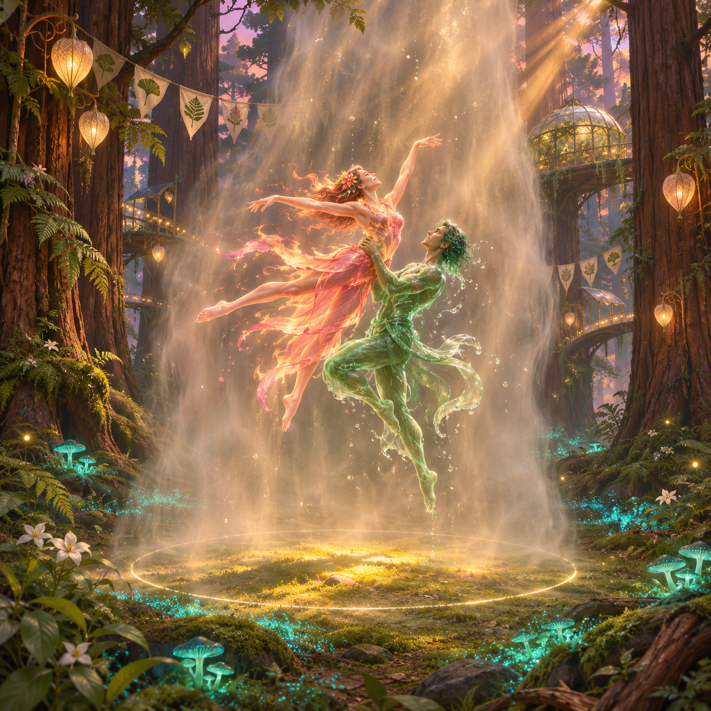
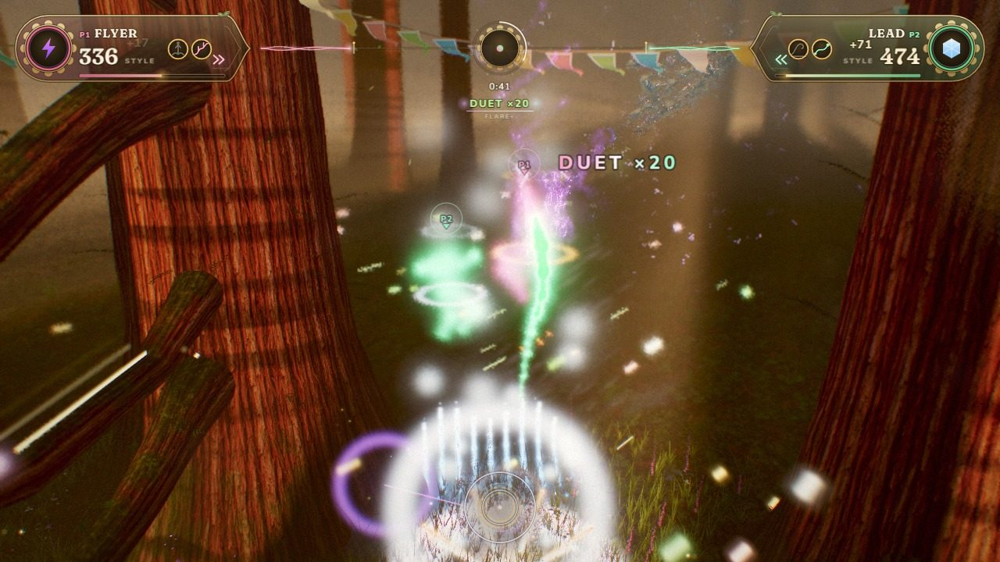
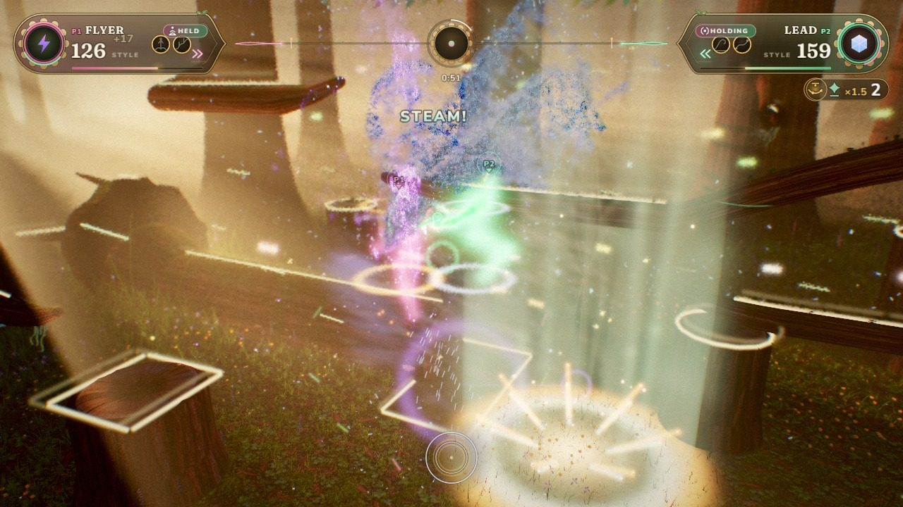
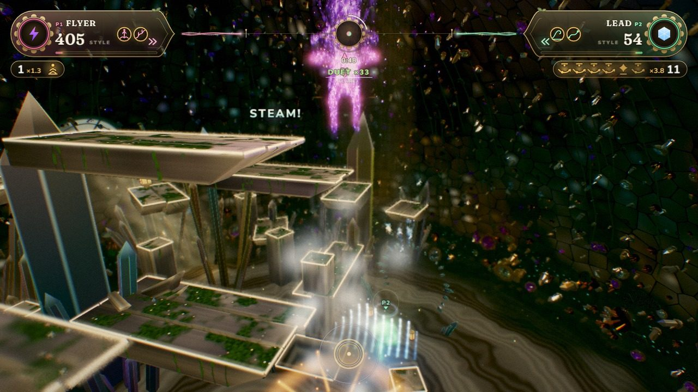
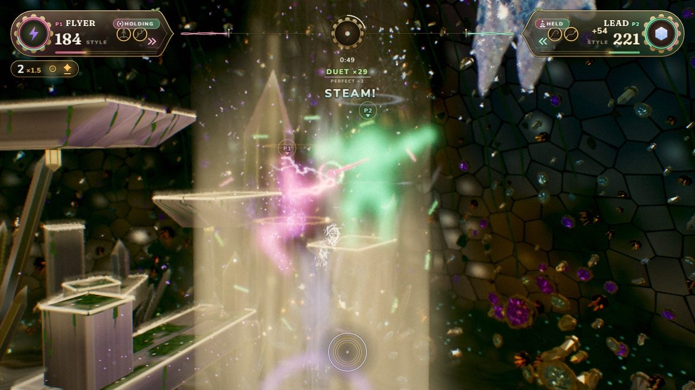
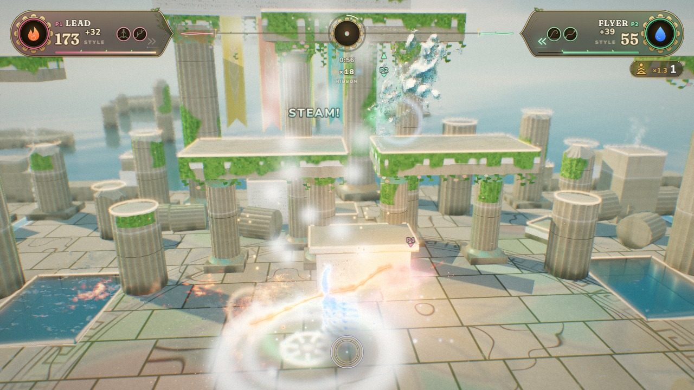
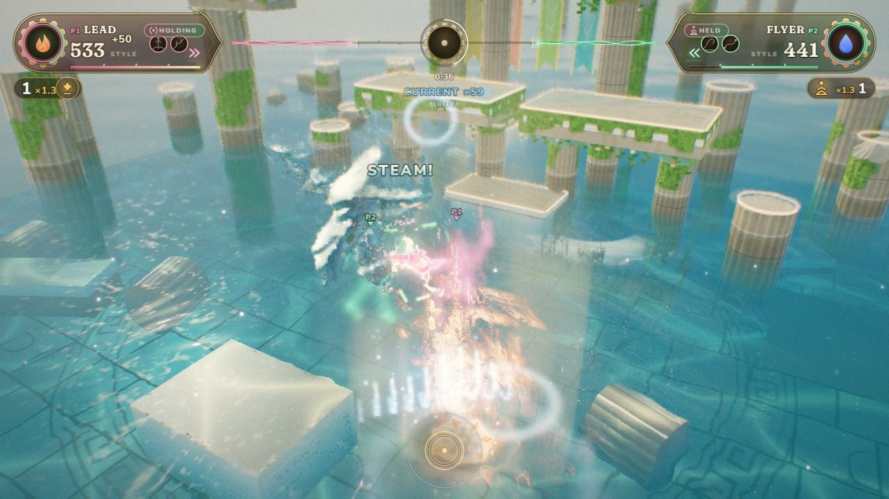
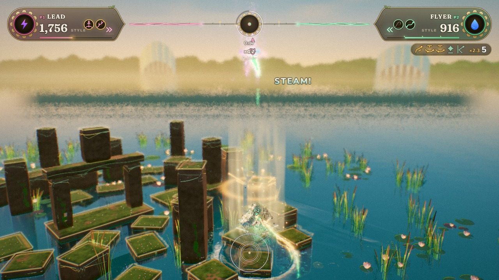
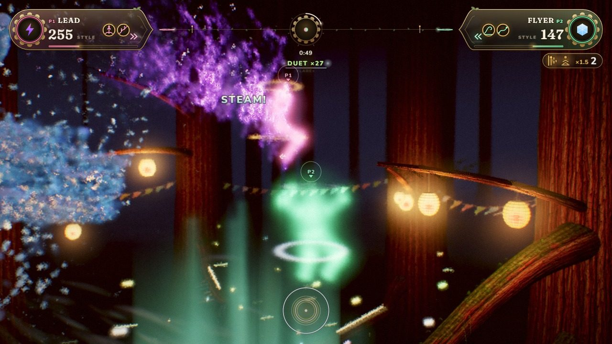
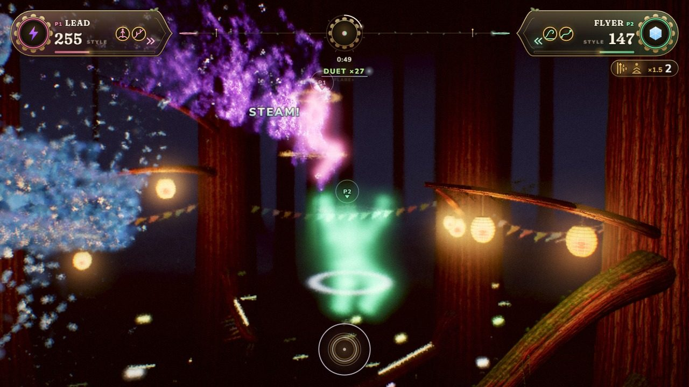

# 18: steam and the geyser, from white blots to mist in the sun's shafts (phase 5)

Branch `p5-steam`, from master `e91c9ee` (phase 4 and its film, report 17). This branch takes report 17's issue 3,
"Steam and the geyser are still white blots on the bodies": at a STEAM! the frame filled with opaque white puffs the
size of a head, white rings and the geyser's spray over the pair. The art bible's steam is "morning mist in the sun's
shafts: warm white, carrying light".

**Measured:** a new steam probe in the page (`src/duel/steam-probe.ts`, `scripts/steam-cap.mjs`). It looks at the
rendered pixels, not at boxes. 12 seeded fire-and-water sets were played as they come (the four worlds, the film's
redwoods set among them), and 12 more with a geyser forced every 10 s. Both ran at 640×360 before (master plus the
probe, from a production build) and after (this branch, from a production build). Three control runs measured the
probe's own noise, before and after. There are stills at 720p from the duel's own camera, with the HUD: four sets at
hour 18.9 before and after, and two night sets (hour 21) after, each still also grabbed with steam hidden. GPU
timings come from a geyser in the redwoods at 1280×720, before and after. Checks: `npm run typecheck`,
`node scripts/test-ts.mjs` (20 of 20 files), `check-bindings`, `check-limits`.

**Not measured:** a person playing; the look in motion at speed (only stills and sheets were looked at); a phone or
laptop budget; the Node harness (none of this touches the rules); `npm run test:net` (its port clashes with the other
agents).

## How it is measured

For each sampled frame, the probe steps the frame as the player sees it. It then grabs that frame twice, 0.1 ms of
time apart, so nothing moves: once as drawn, and once with steam's matter and the geyser's light hidden. A frame at
dt 0 throws in fire's voice, which divides by dt; 1e-4 s is enough.

A pixel's **veil** is how far steam took it toward white:
(luma with − luma without) / (1 − luma without), clamped to 0 … 1.

A body is **covered** when more than 15 % of its core is under a veil over 0.5. The core is the moments probe's box,
hips to head and a torso's width either side. 15 % is report 16-moments' X.

Frames are tallied in three windows:
- **steam on screen:** more than 0.5 % of the frame is veiled past 0.1.
- **geyser:** a geyser stands.
- **after STEAM!:** the second after the reaction.

A frame is sampled every 4th frame, and every other frame while a geyser stands or after a STEAM!.

**The control** hides nothing, so it measures what two grabs a hair apart differ by anyway (fire's flicker, the
fronts' per-frame hiss). It is 0.4 to 1.1 % covered and a core veil of 0.08 in every window. That is the floor; read
every number below against it.

The sets are seeded, but the page's dances are not frame-exact from build to build, so before and after are the same
sets, not the same frames. Before had 11 STEAM!s in natural play and after had 17 (the counts come from the probe's
own event windows: 384 and 506 frames). The forced runs had 32 and 59.

## The numbers

| 12 natural sets (fire and water, four worlds) | before | **after** |
|---|---|---|
| a body covered, geyser frames | 8.7 % | **1.8 %** |
| a body covered, the second after a STEAM! | 12.7 % | **2.4 %** |
| a body covered, any frame with steam on screen | 3.4 % | **1.6 %** |
| the core's mean veil, geyser frames | 0.120 | **0.088** |
| the screen veiled past 0.1, geyser frames | 8.7 % | **13.5 %** |
| … after a STEAM! | 10.4 % | **16.1 %** |

| 12 sets with a geyser every 10 s | before | **after** |
|---|---|---|
| a body covered, geyser frames | 7.7 % | **2.8 %** |
| a body covered, the second after a STEAM! | 10.4 % | **4.2 %** |
| the core's mean veil, geyser frames | 0.120 | **0.090** |
| the screen veiled past 0.1, geyser frames | 10.4 % | **12.9 %** |
| … after a STEAM! | 12.0 % | **17.0 %** |

| control (nothing hidden: the probe's noise) | before | after |
|---|---|---|
| a body covered, geyser frames / after a STEAM! | 0.4 % / 0.5 % | 1.0 % / 0.7 % |
| the core's mean veil | 0.081 | 0.080 |

So steam is kept off the bodies to within a point or two of the noise, and it is **bigger** on screen than it was. The
geyser now veils 13 to 17 % of the frame, against 9 to 12 % before.

By world, in geyser frames (natural / forced):

| world | before | after |
|---|---|---|
| geode | 4.4 / 8.1 % | 0.0 / 2.5 % |
| Pool | 14.3 / 7.8 % | 0.4 / 3.8 % |
| temple | 10.9 / 8.7 % | 0.5 / 1.8 % |
| redwoods | 5.4 / 6.6 % | 4.5 / 3.0 % |

The redwoods are what is left; see "Not done".

**GPU** (a geyser standing in the redwoods, 1280×720, 90 profiled frames, three geysers in two sets):
- `steam.low` (the wisps) went from 0.010 to 0.022 ms.
- `lens`, which holds steam's composite and now the column, went from 0.017 to 0.019 ms.
- `glow` was 0.152 before and 0.131 after (fewer, smaller glows).

The whole frames were different scenes (3.19 and 2.60 ms), so they don't compare. About +0.015 ms in all.

## What changed

### 1. The geyser: a column of mist, not white balls (`src/duel/power-fx.ts`, `steam_comp.wgsl`)

The geyser drew 26 soft white glows of up to 0.35 m spiralling up it, and two white foam rings on the floor. Through
the depth of field those were the cotton balls and the rings. With them hidden, the frame lost every blot; the wisps
were barely there. All of that is gone.

The concept (`docs/design/solarpunk/steam-geyser.png`, GPT Image through the Codex CLI) is what this aims at. The
geyser is now built from these parts:

- **The column itself** is drawn by steam's composite (`columnMist`). The eye's ray is marched in 5 steps through a
  soft upright cylinder over the geyser (its radius 1.4 m, its height 6.5 m). The mist is strands round the axis with
  patches rising up them, thicker toward the rim, fading at the foot and the top.
  - It stops at whatever the scene shows in front of it.
  - It is **cut at the pair's distance** (the nearer body less 0.5 m), so only the half behind and beside the pair is
    drawn. That makes it a curtain round them, and none of it is ever nearer the lens than they are.
  - It is warm by day (1.0, 0.8, 0.52) and capped at 0.5 coverage.
  - After dusk it is the moss's teal, brighter low down (lit from below).
  - It is cleared round each body (95 % within 1.3× the body's capsule).
  - Its amount follows the geyser's fade, less 60 % through a catch's frames.
- **Its light** is drawn with glows:
  - six warm shafts of sun rising through it, each in four pieces, breathing;
  - sixteen wide, faint strands of vapour at its rim, in patches drifting up;
  - thirty small motes of sun and dew spiralling up;
  - a soft pool of sunlight on the floor, with one slow cream ring opening in it.
  - After dusk the shafts fade, the strands turn moss teal and the motes become fireflies (`dusk`, read from the
    redwoods' night and fireflies).
- **Dimmed through a catch's frames:** the light is lowered by 75 % at `DuelFx.quiet` 1. A reaction hushes, so STEAM!
  itself opens quietly and the column rises as the moment passes.
- **Kept clear of the bodies by its reach on screen** (`keepClear`). keepOff (fx.ts) tests only a glow's middle
  against a box, which let a wide soft glow, or a long shaft standing beside a body, lie over it. keepClear tests each
  steam glow's ends and middle, and their radius, against each dancer's capsule on screen (hips to head, 0.3 m about
  the spine). It dims them by 85 %, or 97 % through a catch's frames. A ring or pool on the floor is tested by points
  round it, and dimmed by 60 % of that.
  - **No glow of the geyser's is nearer the lens than the pair:** each fades out from 0.3 to 1.3 m nearer than the
    nearer body.
- **The STEAM! bloom** on the floor is sun and sky teal at 0.6 of its strength. It was steam's white.
- **The wave that makes a geyser goes up into it:** its crest and spray fade over 0.35 s once it has reacted. They had
  rolled on as white spray over the pair and against the lens.
- The geyser lays a little more heat and wet up the column (three deposits, not two), for its wisps.

### 2. Steam's matter: a warm veil that carries light (`src/matter/reactions/`)

- **Warm cream white** for fire and water: `warm` 0.8 toward (1.0, 0.9, 0.74). It was a cool grey-white.
- **Forward scattering of the key** (Henyey-Greenstein, g 0.55): mist toward the sun glows up to 2.6×, and mist with
  the sun behind the eye is soft.
- **The sun's shafts:** bands radiating from where the key stands on screen and drifting slowly. They light the mist
  0.25 to 1.9× (`shafts` 0.8).
- **After dusk, lit from below** by the redwoods' moss and fungi (teal), the fireflies and the lanterns (`duskGlow`).
- **No wisp nearer the lens than the pair:** wisps fade from 1.5 to 0.4 m nearer than the nearer body.
- **Thinned over the bodies:** each dancer's core on screen is a capsule from its hips to its head, 0.3 m about the
  spine (`Steam.keep`, computed in `steam.ts` from the frame's dancers, so it works in any mode). It takes `keepOff`
  0.8 of the veil off, or 0.92 through a catch's frames (`keepOffCatch`; the duel sets `SteamPasses.quiet`).
- **The fronts** are a line of sun gold where the bodies meet, not white-hot (`frontGlow` 2.0 to 1.2), and they are
  thinned over the cores too.
- The wisps grow a little larger and thinner (`sizeEnd` 0.22 to 0.3, `density` 0.3 to 0.26).

### 3. The probe (`src/duel/steam-probe.ts`, `scripts/steam-cap.mjs`)

The probe is exposed in the page as `bend.duel.steam`.

| call or option | what it does |
|---|---|
| `sample()` | the a/b of one frame |
| `step()` | a frame without the a/b |
| `hidden(part)` | hides steam for stills: `'all'`, `'glow'` (the geyser's light and column) or `'matter'` (the wisps and fronts) |
| `result()` | the tallies |

`power-fx.ts` tags its steam light (`steamLit`, `hideSteam`) for it.

`steam-cap.mjs` options:

| option | what it does |
|---|---|
| `--force S` | water rolls its wave at fire every S s and fire flares in it, so a geyser is made, not waited for |
| `--part glow\|matter` | measures the veil of one part only |
| `--control` | hides nothing (the probe's noise) |
| `--stills dir --stills-at 8,30 --parts all` | stills after each STEAM!, again without steam |
| `--hour h` | sets the redwoods' hour |

## Stills (720p, the duel's own camera, the HUD on; same seeds, so the same kind of moment, not the same frame)

## Files

| file | what changed |
|---|---|
| `src/duel/power-fx.ts` | the geyser's light, `column`, `keepClear`, `pairNear`, the reacted wave's fade, the STEAM! bloom, `steamLit` / `hideSteam` |
| `src/matter/reactions/steam.wgsl` | `keep`, `keepR`, `keepK`, `look`, `column*`, `keptAt` |
| `src/matter/reactions/steam.ts` | the dancers' capsules on screen, `quiet`, `column` |
| `src/matter/reactions/steam_draw.wgsl` | the warm white, the scattering, the shafts, the dusk, the near cut |
| `src/matter/reactions/steam_comp.wgsl` | thinning over the bodies, `columnMist` (a new binding: `sceneTex`) |
| `src/matter/reactions/steam_front.wgsl` | sun gold, thinned over the bodies |
| `src/matter/reactions/params.ts` | `keepOff`, `keepOffCatch`, `shafts`, `scatter`, `dusk`, `warm`, `column`, `columnDensity`; `frontGlow`, `sizeEnd`, `density` |
| `src/matter/reactions/README.md` | the look |
| the steam `.d.wgsl.ts` | regenerated |
| `src/duel/index.ts` (shared, a few lines) | `quiet`, `viewProj` and `dusk` to the powers' effects; the steam kind's `quiet` and `column`; `bend.duel.steam` |
| `src/duel/steam-probe.ts` (new), `scripts/steam-cap.mjs` (new) | the probe |
| `AGENTS.md` | steam_comp's binding row (2 sampled textures) |
| `docs/design/solarpunk/steam-geyser.png` (+ .json) | the concept |
| `docs/reports/perf/18-steam-*.json`, `*-timing.txt` | the probe's runs, before and after |
| `docs/reports/media/18-steam-*.jpg` | the stills |

## Not done, and weak points

- **The redwoods still cover a body 3 to 4.5 % of geyser frames, and about 6 % after a STEAM!** Each part measured
  alone sits near the noise (the glow ~1 %, the matter ~2 to 3 %). Together they cross the 0.5 threshold over a
  flyer high in the column, where the wisps boil up round it and the core box is wider than the capsule the veil
  keeps off. A wider capsule for a flying body, or the capsule from all 38 joints, is the next step.
- **The "white rings at the lens" in report 17's frame are mostly not steam.**
  - The concentric rings round the bottom centre are the HUD's beat indicator: its closing ring and its flash
    (`src/hud/beat.ts`, p5-bloom's area). They stay in every still with steam hidden.
  - A cast's bloom ring at the caster's chest and the flare's bloom (power-fx `cast`) are white or gold rings at the
    lens when a body stands near the camera. They are the powers' own casts, not steam. They could take the same
    near-lens fade as the geyser's light.
  - Water's wave (white foam bars) is drawn as before unless it has made a geyser.
- **Steam's wisps are still faint.** The column carries the look; the wisps boiling from a contact add little at
  640×360 (their screen veil is near the probe's noise). Denser wisps would now be safe over the bodies.
- **Seen in stills only.** The column's rising patches, the shafts' drift and the fade-in after a catch were not
  watched at speed. A short test video of a geyser in each world is the next check.
- **The sun's shafts in the wisps** use the key's direction projected on screen. When the key stands behind the eye,
  the bands radiate from the opposite point. That is right for anti-crepuscular rays, but not looked at closely.
- **The dusk** is read from the redwoods only (`woods.values.night`, the fireflies). The other worlds have no night,
  so their steam is always the day's.
- **The probe's numbers compare before and after;** they are not absolute. "Covered" uses a fixed threshold on a
  luma difference, the core box comes from report 16, and the control shows about 0.5 to 1 % covered from per-frame
  flicker alone. The dances differ between builds, so before and after are the same seeds and kinds of moment, not
  the same frames.
- **A geyser forced every 10 s** (`--force`) is the probe's, not play's: the brains make about one geyser in two
  sets.
