# Phase 5: wayfinding. The worlds as one flowing world, joined by mirrors

Branch `p5-wayfinding`. The owner played the build and said it was "having trouble figuring out how to go to other
levels, feels a little stifling". Mid-task the brief widened. The worlds should feel like one flowing world: "I should
be able to walk through the mirrors into other worlds as I dance". The mirrors became the main work, and the menus
and hints became secondary.

Everything was measured in headless Chrome on the RTX 5090 at 1280×720 (a phone at 375×812), with the page stepped
at 60 fps. The probes are `scripts/steps/wf-probe.mjs` (a query and a script run in the page, with stills taken with
the DOM over the canvas) and `scripts/steps/wf-timings.json` / `wf-frame-timings.json` (for `shot.mjs`). I looked at
every still below.

The dev server ran on **5583**, not 5483. Port 5483 was already held by a vite started at 20:02 from another worktree.
I left it alone.

## How a first-timer reached each world before

| from | the way to another world | what a first-timer can't see or guess |
|---|---|---|
| the front | the strip's four world dots, then play: 2 clicks, about 1 s through the veil (14-front.md) | the dots are bare colours; only the chosen one is named; nothing says they are places |
| free play in the hub | walk into one of the three gates | the gates are white-rimmed discs with no name, and the stills inside them read as noise, not places |
| inside a world | its one gate, back to the hub | each world was a dead end: the temple to the Pool took two crossings by way of the hub |
| the duel | **none** | the duel shut every gate; it had no Esc and no world choice between sets. Leaving meant editing the address |
| debug | `w` (next world), `?world=` | `w` works only in the show, never in a game |

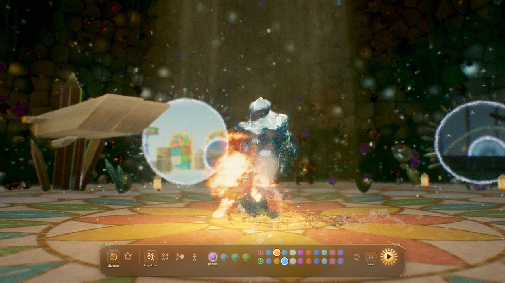
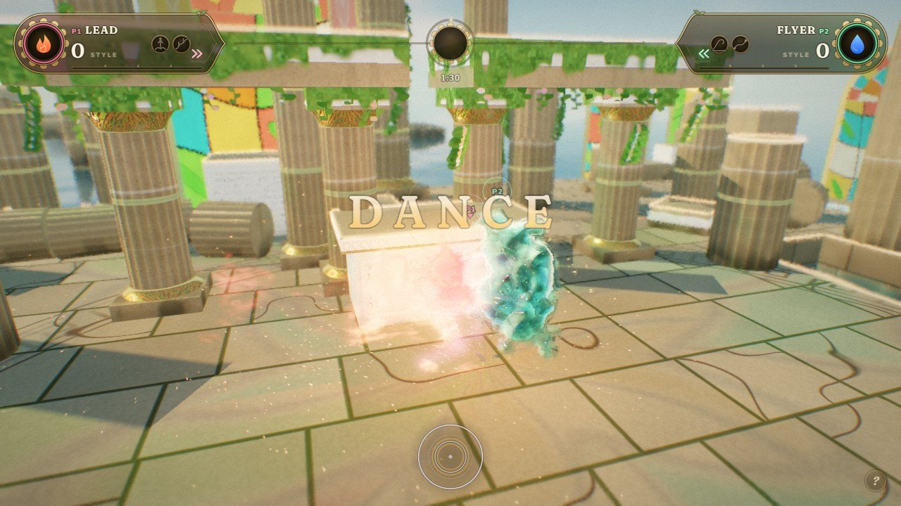

## What changed

### 1. A mirror between every pair of worlds (`src/portals/mirrors.ts`)

Each world (the temple, the Pool, the redwoods) gains two mirrors, one to each of the other two. The geode already had
one to each. Every world is now one walk, or one fling, from every other. The sites sit at the edge of each duel
arena, inside its soft wall, on open level ground. They face the middle and stay clear of the solids, the spawns and
the world's own gate. I found them by sweeping the arena's edge with `clearOf` against the world's and the arena's
solids. They are ordinary gates: live on screen, crossed as one rigid move, and listed in one table, so no world folder
was touched.

| world | mirror | at (x, z) |
|---|---|---|
| temple | to the Pool | 8.5, -0.5 (east side of the court) |
| temple | to the redwoods | -8.0, 0.2 (west side). The first site, behind the stage under the great gate, left the camera jammed against the stained-glass screen on arrival, so it was moved |
| Pool | to the temple | 7.5, 4.5 (it stands on the water, as the Pool's own hub gate does) |
| Pool | to the redwoods | 0, -8.5 |
| redwoods | to the temple | 7.7, 6.1 |
| redwoods | to the Pool | 5.85, -7.8 |

**For p5-flow:** please keep a 1.4 m disc and about 3 m in front of each of these sites clear when opening the arenas.

### 2. The mirror's frame (`surface.wgsl` `vs_frame` / `fs_frame`)

Every gate, the hub's included, now wears an art-nouveau frame:

- a ring of brass that has gone green in its hollows;
- a crown of seven stained-glass panes between brass spokes. The keystone is the far world's colour, the rest are
  gold, teal, rose and leaf, with a lead petal in each;
- whiplash tendrils sweeping up to the crown's ends;
- two feet curling onto the floor;
- two vines with forty leaves climbing the ring.

It is real geometry built from the vertex index: 14 tubes of 40 × 6 quads, plus the panes and the leaves, about
21,000 vertices per gate. Each world's sun and sky light it (`FRAME_LITE` in portals.ts, matched by eye in each
world). It grows in as the gate opens, and a piece within 1.6 m of the eye dissolves, as the near fade does.
`gates.frame` turns it off.

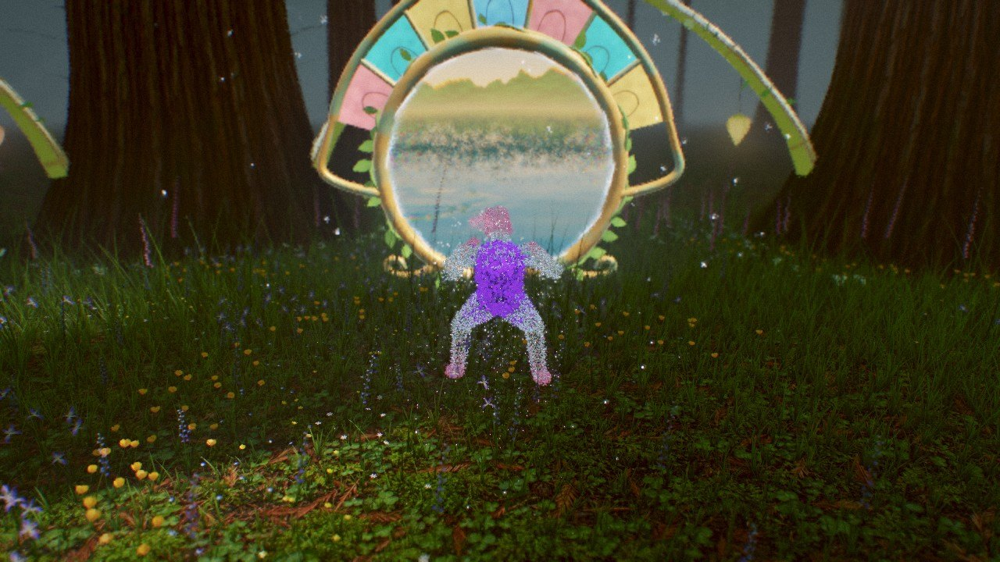

### 3. The world's name over each mirror, and a shortcut (`src/portals/labels.ts`)

- **The plaque.** A plaque of the HUD's honey glass hangs over each mirror's crown. It names the world beyond ("the
  Tide Temple", "the Pool") with a leaf of that world's colour. It fades in from 20 m (fully shown by 13 m), fades
  out at the disc, and stays whole on screen.
- **The shortcut.** M on the keyboard, the d-pad's left on a gamepad, or a tap or click on the small "mirrors" chip
  names every mirror of the world for 4 s, however far off. Mirrors off screen are named at the screen's edge with an
  arrow toward them. The chip shows for 14 s once a duel begins.
- **Esc in the duel.** With no card or lesson open, Esc goes back to the front and its world picker, as the jogo's
  Esc already did.
- **Styling.** Everything uses the `--eb-*` tokens. `?labels=0` hides the plaques.

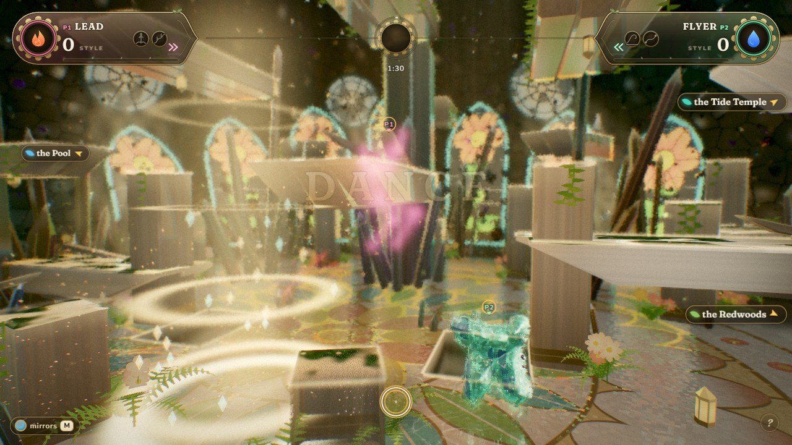
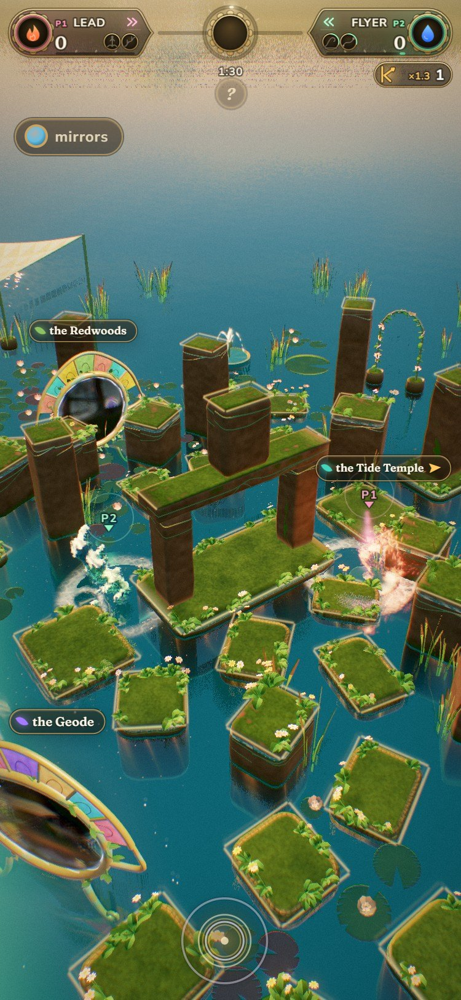
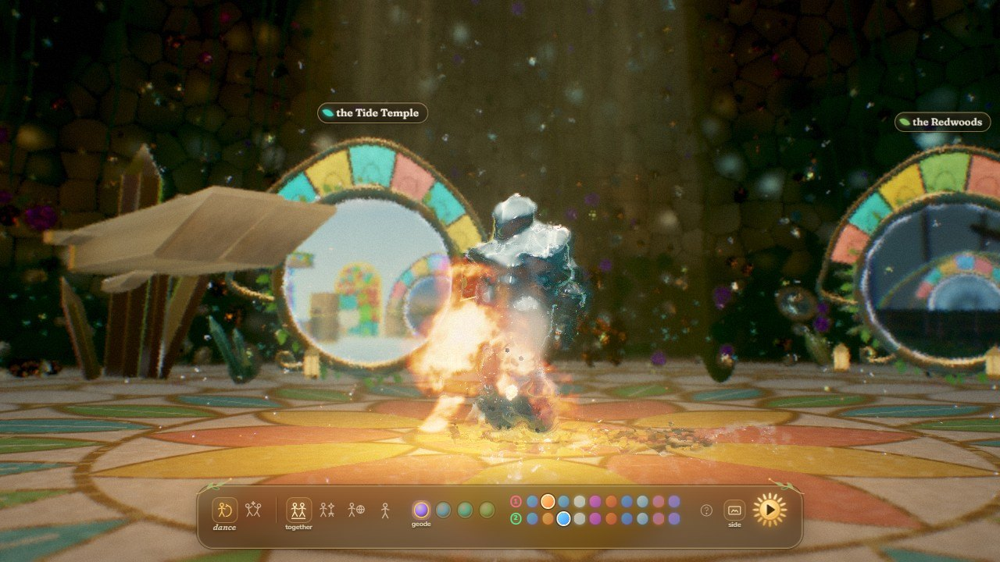

### 4. Free play: walk through, seamless

This was already the gates' own machinery. A body crossing a disc is carried by one rigid move, with its matter, its
momentum and the camera. The eye comes through the disc a second later, and the music takes the new world's track
from its next bar line. Now it reaches every world directly.

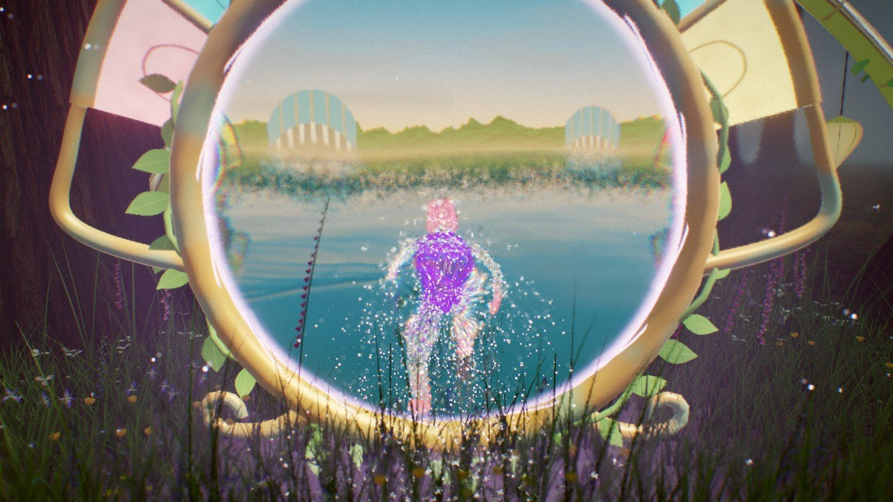
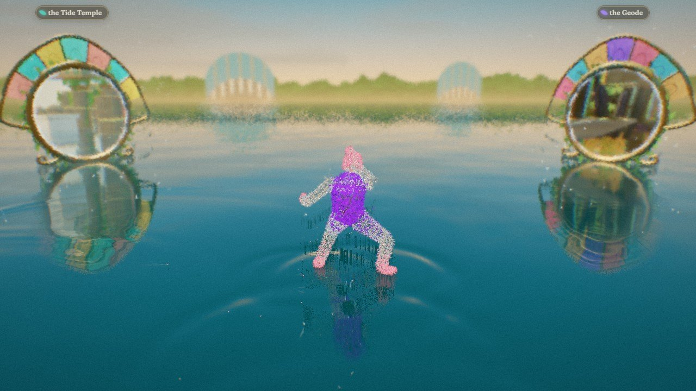

### 5. The duel dances through the mirrors (`src/duel/index.ts`, `Portals.bring`)

Offline, the duel keeps its gates open. When one of the pair crosses a mirror:

1. **The partner is brought along** (`Portals.bring`):
   - **Free:** by the same move, then out onto the side its partner came out of, within 1.6 m of the disc, as if it
     had come through just behind.
   - **Held** (a grip): by the gate's own move, so the grip keeps its shape. It lands just behind the far disc and is
     not carried back for 1.5 s while it comes through.
2. **The duel moves to that world** (`moveTo`):
   - The old world gets its room and solids back, its hazard comes to rest and the powers' effects settle.
   - The new world's arena, plane, solids and room are taken. The match is given the new arena and plane, and a new
     hazard is made.
   - **The set goes on** with the same clock, style and combos.
3. **The camera.** The rig's own follow brings the eye through the disc behind the pair, then the duel camera carries
   on from where the eye is (`DuelCamera.from`, a few lines in camera.ts, no snap). If the eye stood past the mirror's
   plane beside the disc, it would never come through it. Then the main view cuts over at once under a half-second
   wash of the mirror's light (`Portals.arrive`, `mirrorFlash`), and does the same if 3 s pass.
4. **The music** (`Music.retone`, as the main view goes through) takes the new world's track at the next bar line.

While the duel plays, a mirror more than 10 m from the eye shows its still rather than a live view, and no gate is
drawn live through another (`gates.liveNear`, `depth: 1`). Both are restored when the duel stops.

Films, `&mirrors=0` and online duels keep the old behaviour: the world's gates shut.

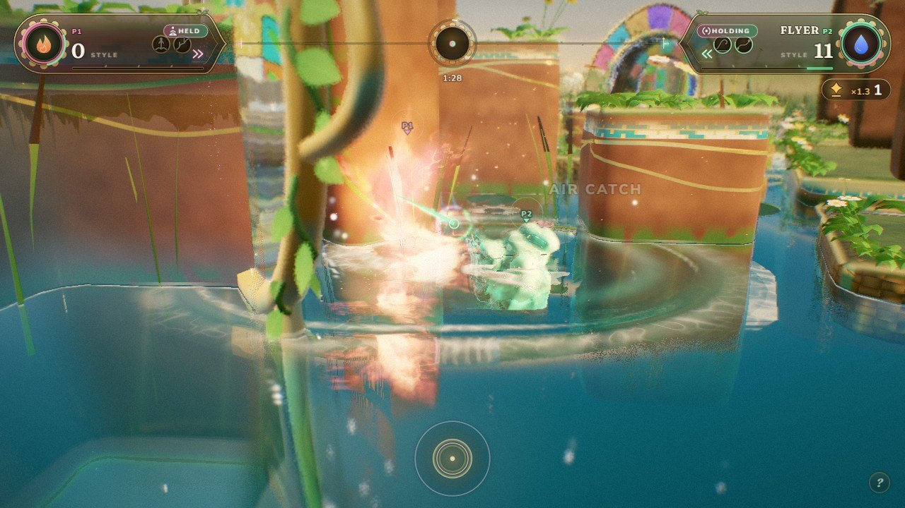
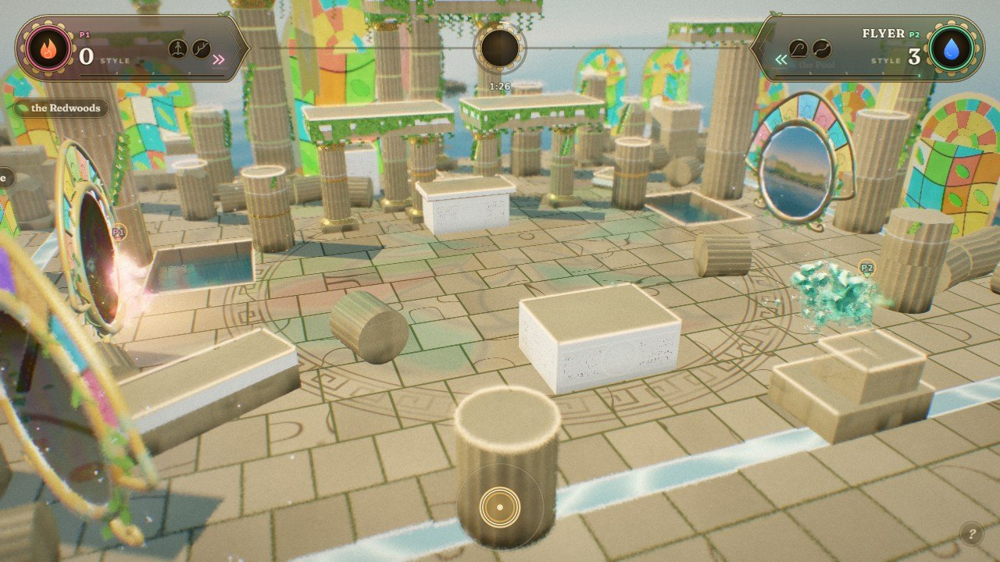
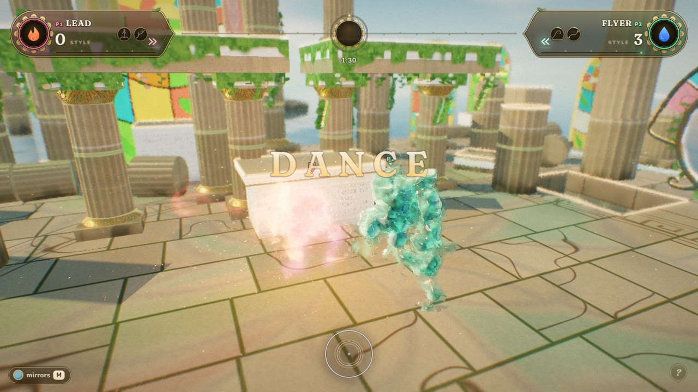

## Numbers

**A first-timer's path in the duel** (`p1=human&p2=bot`): seat 1 walks from its spawn straight at the nearest mirror
until the duel's world changes.

| start | before | after: names on screen in the first 3 s | after: nearest mirror | after: time to the other world |
|---|---|---|---|---|
| geode | no way | the Pool | to the Pool, 5.3 m | 2.8 s |
| temple | no way | the Pool | to the redwoods, 6.0 m | 1.0 s (13.3 s from the first site, behind the stage) |
| Pool | no way | the temple, the geode | to the temple, 8.3 m | 9.5 s (swimming: the Pool's water is slow) |
| redwoods | no way | the Pool | to the temple, 7.9 m | 1.6 s |

In every run, the main view and the duel's world agreed after the crossing (`viewIn` = `arrived`). The production
build (`vite build`, then `vite preview`) boots, and the redwoods-to-temple crossing works in it.

**One crossing, traced** (temple to the Pool):

- the partner is brought to 1.6 m in front of the far disc;
- the duel's world, arena and hazard switch on the same frame;
- the set clock carries on (set 1);
- the eye comes through the disc in about 1.1 s when it stood behind the plane, and otherwise cuts under the light;
- the track is the Pool's about 1.1 s later, on the bar line.

**The held crossing.** I could not script a real grip (the contact reads the device's intent, not a script), so I
called `bring` directly with `rigid`. A dancer 1.13 m in front of the temple's mirror landed 1.13 m behind the Pool's
mirror, was not carried back, and walked out through the disc into the Pool.

**GPU, at 720p on the 5090** (`gpu frame`, weft's profiler):

| case | ms |
|---|---|
| the duel in the temple, gates shut (as before) | 1.69 / 1.94 (two runs) |
| the duel in the temple, a mirror in frame at 9, 6, 3 m | 1.55, 1.45, 1.64 |
| the same, the gate views' share | 0.60, 0.67, 0.96 (live views 0, 0, 1) |
| the duel in the Pool / the redwoods, mirrors open and mostly out of frame | 1.38–1.42 / 2.60–2.74 (shut: 1.31–1.50 / 2.52–2.68) |
| the hub's front, frames off | 4.63 |
| the hub's front, frames on | 4.69 |

The frame itself is within noise. The cost of mirrors is their live views, which the duel now keeps to near mirrors.

## Tests

- `npm run typecheck`: clean.
- `node scripts/test-ts.mjs`: 22 of 22 files pass.
- `check-limits`, `check-bindings` (the new `lite` field and `vs_frame` add no binding) and `check-portals` (10,037
  checks): pass.
- `npm run test:net` was not run (it uses port 5418, per the brief).

## Not done, and next

- **Online crossing.** The room server (`server/duel.ts`, `online.ts`) plays the duel in one world, so online duels
  keep their gates shut. Next: the server judges the crossing, sends a `travel` for both seats, switches its arena and
  hazards, and the clients follow it.
- **Node harness.** `src/duel/sim.ts` and `match.ts` have no world change. The page swaps the match's arena and plane
  from outside (`Object.assign`).
- **Measurements.** Virtual players can now stray or be flung through a mirror mid-set. `scripts/duel-page.mjs`
  fusion tables should run with `&mirrors=0` to stay comparable.
- **The music's tempo.** A set's length was cut to whole phrases of the first world's track. A crossing that changes
  tempo (the temple's 94 to the Pool's 121) moves the finale off its phrase line. Not measured.
- **Verified only in part:**
  - the held crossing (by a direct call, not a real grip);
  - the d-pad left on a gamepad (code only, not driven headless);
  - a tap on the chip (the click path runs; a real touch was not tried).
- **Stills, not live views.** The Pool's two mirrors stand on the water, so a pair arriving there floats low until it
  reaches a stone. Mirrors more than 10 m off in the duel show their soft still rather than a live view.
- **Secondary items not built:**
  - a world choice between duel sets, superseded by the mirrors;
  - the front's world dots, which are still bare colours (only the chosen one is named);
  - M and Esc in the controls card (help.ts's table is tested against the bindings; adding them there is a small
    follow-up).
- **The cut.** When the duel camera stood beside a mirror's plane, the crossing is a cut under the mirror's light, not
  a pass through the disc. I didn't measure how often that happens. Making the duel camera itself steer the eye
  through the disc would remove it.
- **No concept image.** The frame was built straight from the art bible.
