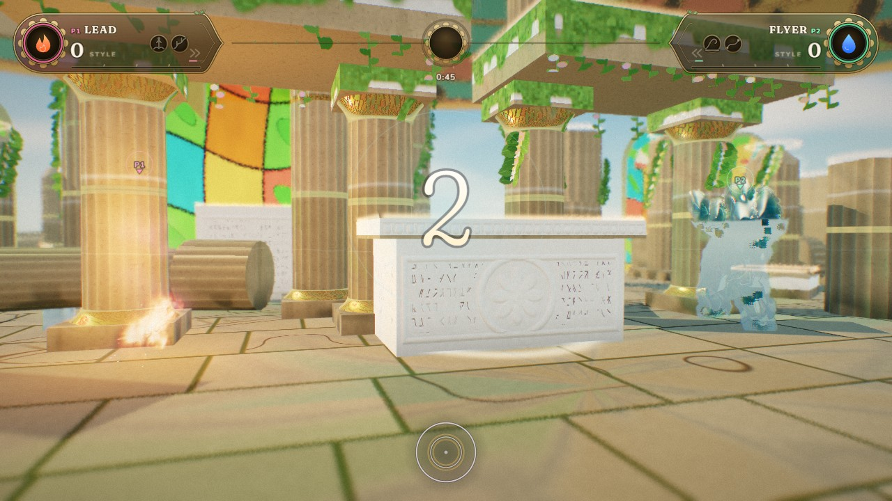
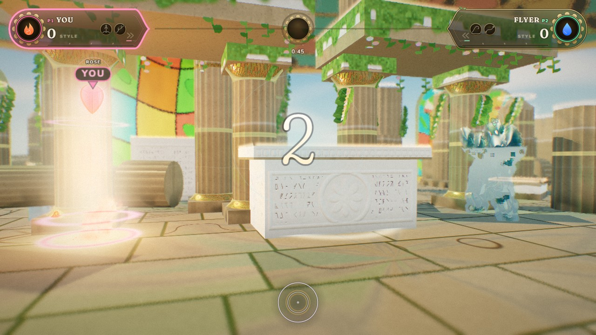
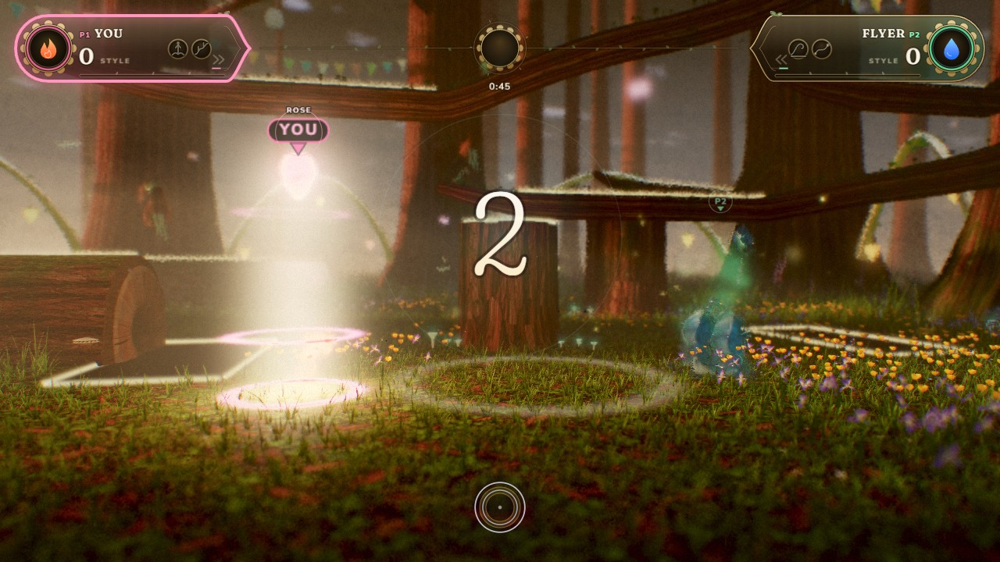
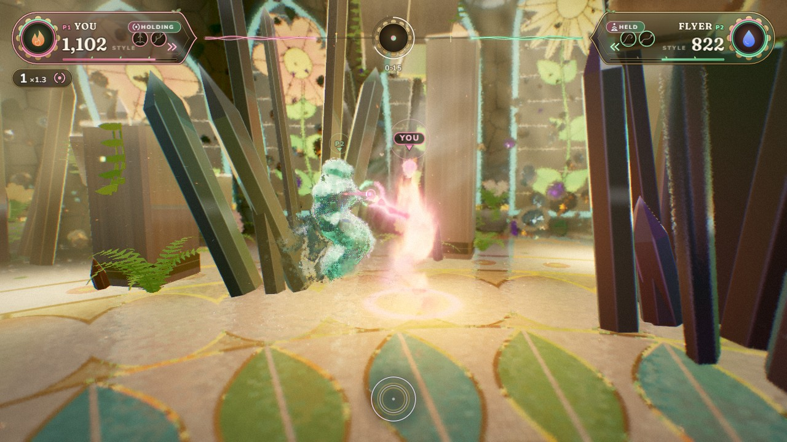
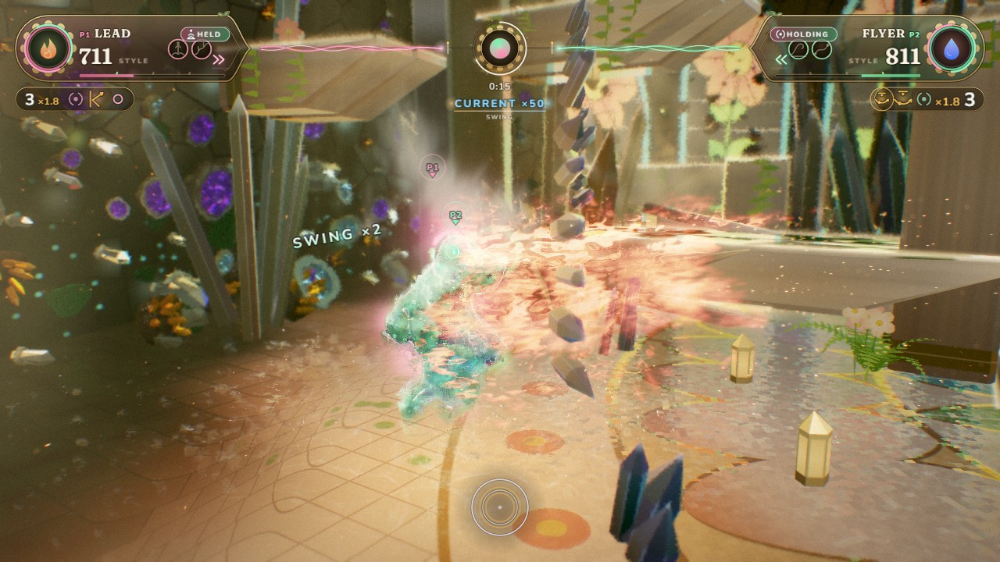
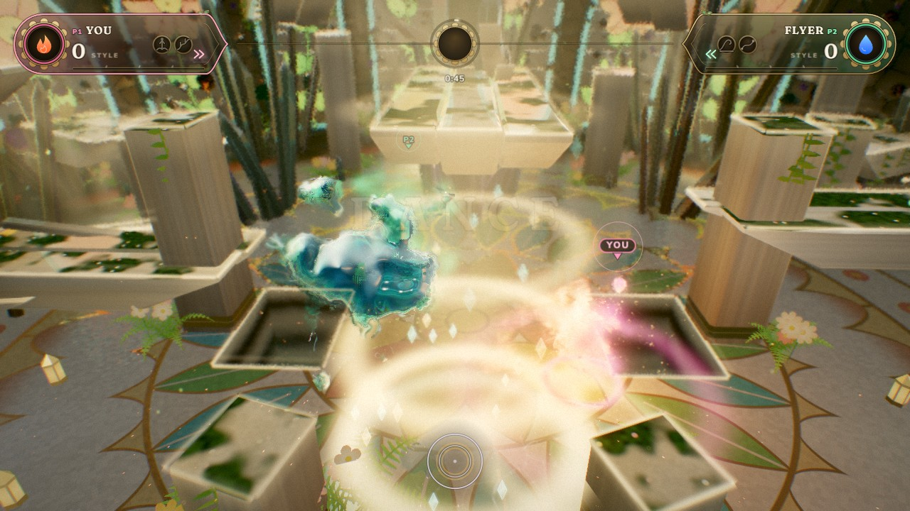
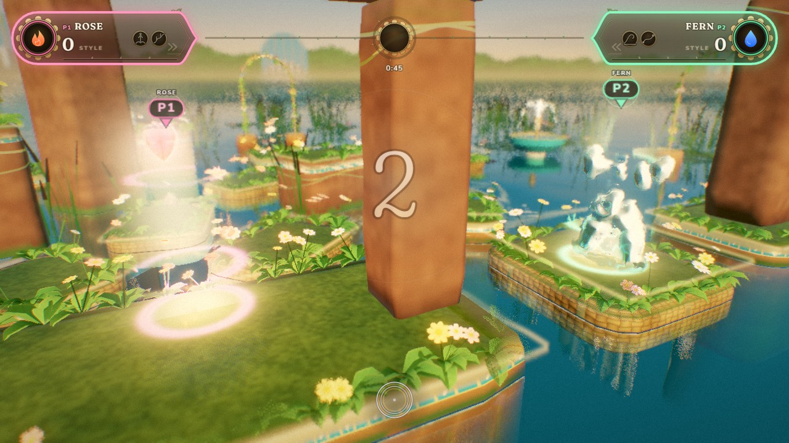
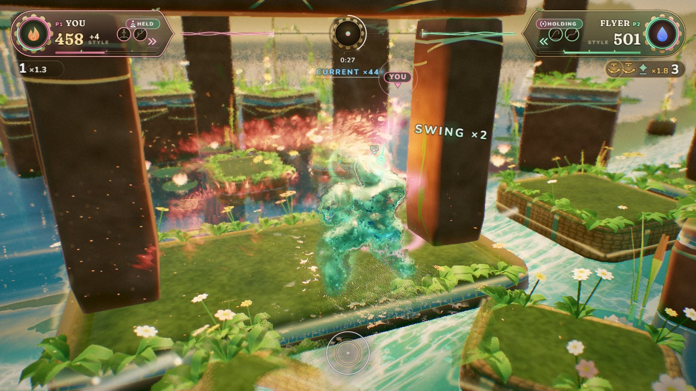

# 18 — Which one is me (phase 5, p5-you)

The owner, after playing: "took me a bit to figure out which character i was controlling." This pass makes the
player's own body obvious from the first second of a set, and keeps a light tell on it, and only on it, all through
play.

## Why it failed at first sight

Everything that told the bodies apart was **symmetric**. Nothing on screen said which seat was the player's:

- each body wears its seat's colour (rose, fern: `seat.ts`, and since 18-bodies inside the matter), but nobody is told
  that they are rose;
- each head has a tag, "P1" or "P2", 10.5 px type over a small pointer, about 300 px of change at 720p
  (measured below). The bot's tag is as big and as bright as yours;
- each seat has a panel, the two the same but mirrored, and a played seat's name was just "P1";
- the camera stood "a little behind seat 1" whoever played it. Online that was the other player for seat 2;
- at the set's start your body is still forming out of matter (the count-in is a reform), so for the first second there
  is a ring of flame or water, not a figure. That is exactly when you look for yourself.

## What changed

`src/duel/you.ts` (new, pure; tested in `you.test.ts`) knows the page's own seats:
- local v bot: the human seat;
- two at one screen: both seats;
- a human seat handed to a virtual partner by the lobby: not yours;
- online: `net.seat`, and none for a watcher;
- a film: none.

It draws the tell after the moments' light, outside every range `keepOff` dims, so it never fights the bloom or a catch's
frames. It fades only in the finale's duet, where the bloom belongs to both of you.

**The opening** (the first 4.5 s of a duel's first set, 2.2 s of a later set; the count-in is about 2 s):
- a shaft of soft sunlight on your body and a sunlit disc at your feet;
- a ring of your colour rising up you on each count;
- your marker at 1.9× size, bobbing gently;
- the HUD tag reads **YOU**, 1.55× larger, on a sunlit glow, with your colour's name over it (ROSE / FERN);
- your panel's outline glows in your colour and its name reads "P1 · YOU";
- the camera turns up to 0.2 rad more behind your body (`CamInput.you`). It favours your seat, not seat 1, so online
  seat 2 is favoured on its own page.

**The answer**: your first press after a set begins (in the count-in or after, once a set) gets:
- a ring of your colour that opens on the floor round you and another that rises up the body;
- the marker flashes;
- the tag pops;
- the panel's rim flares.

The press is read from the seat's own device before the count-in's hold (`SeatGate.pressed`), or online from what the
page sent.

**All through play**, on your body only:
- **the marker**: a small petal of your colour standing on its point over your head, with a gold rim and heart (the
  bloom's petal shape). It is held at a steady size on screen (0.75 to 1.6× by distance), about 23 × 16 px at 720p;
- **a soft ring** of your colour round your feet, on the ground under you when you are in the air;
- **the tag** "YOU" on a dark pill rimmed in your colour, so it reads over the brightest sky and through any effect. It
  stands over the marker;
- **the other body's tag** at 62 % so yours leads;
- **your panel's rim**: a thin line in your colour.

**Two at one screen**:
- both seats get the tell, each in its own colour;
- the tags read P1 and P2 (not YOU);
- the word over each in the opening is the seat's device: W A S D, ARROWS or PAD, so each player knows their seat by
  the keys under their hands;
- the panels read "P1 · W A S D" and "P2 · ARROWS";
- the camera stays as it was.

Free play (`?play`, the hub and the worlds): there is one played dancer, with the camera behind it. I saw no doubt there
(a still in the geode), so I left it alone.

## Numbers (720p, the duel's own camera, the HUD over it)

These come from `scripts/you-cap.mjs`, which takes stills at these points of the set: 0.3, 0.9, 1.6, 2.4 and 3.4 s (the
opening) and 20 and 32 s (mid-play). Each still is grabbed three times with the bodies held still: as seen; with the
HUD off; and with the HUD and the tell off.

"Before" is the same build with `bend.duel.you.show = false`, which is exactly master's behaviour: the P1 and P2 tags,
no rim, the camera behind seat 1.

The tell is measured in a box over each head, 140 × 185 px:
- its pixels: OKLab ΔE over 0.06 against the bare frame;
- their mean ΔE;
- the Weber luminance contrast.

The figures are medians per world.

| solo, the opening | yours before | other's before | yours after | other's after | the world marker alone (no HUD) | the ring at the feet |
|---|---|---|---|---|---|---|
| geode | 1010 px | 574 | **13 885** (ΔE 0.21, Weber 1.16) | 547 | 11 028 | 3 865 |
| redwoods | 408 | 382 | **17 654** (0.20, 1.20) | 342 | 16 122 | 8 808 |
| pool | 864 | 1 851 | **12 743** (0.18, 0.71) | 2 532 | 11 229 | 11 419 |
| temple | 678 | 348 | **13 690** (0.16, 0.51) | 251 | 12 247 | 5 999 |

| solo, mid-play | yours before | other's before | yours after | other's after | the marker alone | the ring |
|---|---|---|---|---|---|---|
| geode | 2 425 | 1 119 | 2 799 | 1 212 | 1 324 | 362 |
| redwoods | 1 057 | 2 162 | 4 412 | 2 084 | 2 249 | 2 232 |
| pool | 3 016 | 3 002 | 4 524 | 3 329 | 961 | 2 548 |
| temple | 2 110 | 2 396 | 3 780 | 1 439 | 1 913 | 4 364 |

How to read them:
- **The opening: from symmetric to 20 to 50 times the other's.** Before, the two heads' tags were the same size, and
  the bot's was often bigger in a box crowded with its own pops. After, yours is 13 000 to 18 000 px against 250 to
  2 500 for the other.
- **Mid-play:** the boxes also catch the moves' words that land near the heads (the other's "before" is all words), so
  the numbers there are noisy. The tell itself is measured by its parts:
  - without the HUD, the marker (960 to 2 250 px) and the ring (360 to 4 360 px) are on your body and nowhere else;
  - with the HUD, YOU reads where the pair is. The contrast holds in every world: ΔE 0.18 to 0.25 and Weber 0.7 to 2.1
    over what lies under it.
- **Two at one screen** (pool, redwoods; the opening):
  - each seat's tell is 16 300 to 24 400 px against 350 to 3 900 before;
  - each body's tag stands over its own body, and the two are told apart by colour and by device.
- **The cost:** at most 9 glow instances a seat, in the jogo's existing glow draw: no new pass and no new binding.
  `check-bindings` is unchanged. I did not time it with `shot.mjs --timings`.

## Files

- `src/duel/you.ts`, `src/duel/you.test.ts` (new)
- `src/duel/index.ts`:
  - `SeatGate.pressed`;
  - the tell made and updated after the moments' light;
  - the HUD seats' `you` and name;
  - `CamInput.you`;
  - `bend.duel.you`.
- `src/duel/camera.ts`: `CamInput.you`, which makes the "behind" turn favour the player's seat (a few lines).
- `src/duel/hud-state.ts`, `src/hud/state.ts`: `you?: { label, sub, intro, pulse }` on a player.
- `src/hud/pops.ts`: the YOU tag (`youTag`, `youSub`), its opening and its pop. The other's tag is quieter beside it.
- `src/hud/panel.ts`: `youRim`, the panel's outline lit in the seat's colour.
- `scripts/you-cap.mjs`: the stills and the measure (`--off` takes the before).

## Not done, or unverified

- **Online is not captured.** It would need a room server and a second port. Its logic is unit-tested:
  - the page's seat is `net.seat`, and a watcher has none;
  - the first press is read from what the page sent.

  The camera favouring seat 2 on seat 2's page is untested in a page.
- **Real devices:** the captures drive the human seats with virtual players, so in two-at-one-screen stills the word
  over each tag shows the colour's name (ROSE, FERN), not the device. W A S D / ARROWS / PAD come from the device's name
  (`deviceLabel`), checked in the test only.
- **Lobby partner:** a human seat given to a partner from the lobby (`setBrain`) stops being "yours". A capture that
  drives a human seat with a brain sets `bend.duel.you.seats` by hand.
- **Arena pieces:** in the temple and the geode the arena can stand between the camera and your spawn in the count-in
  (the altar, the hum's blocks). The tag, the shaft and the rings still show where you are. The arena is p5-flow's.
- **Port:** the dev server ran on 5589. My assigned port, 5489, was held by p5-bodies' leftover vite server, which I did
  not touch.
- The opening's shaft lies over the forming body. It is soft (0.24) and only in the opening, but it lifts the body's
  core a little in the darker worlds.
