# 19: the duel's phase 5 film (the second solarpunk pass, the flowing world), and what holds it back now

Branch `p5-film`, from master `c810542` (phase 5 merged: the lower, breathing camera; the geode and the redwoods' and
the Pool and the temple's materials and landmarks; steam as a sunlit veil; the seat's colour inside the matter; the
fusion's bloom, the garland banner and the word's hysteresis; the YOU tell; the mirrors between all the worlds, which
the offline duel crosses mid-set; open arenas and movement that keeps its momentum). The brief: make the phase 5 film
around what the owner said after playing phase 4 (it was hard to see how to reach the other worlds; it felt "a little
stifling"; they wanted "a flowing world between scenes that seamlessly can transition… walk through the mirrors into
other worlds as i dance"; it took a while to see which body was theirs): about 30 s from a player's view with the HUD,
two virtual players, the YOU opening, a mirror crossed mid-dance without a cut and the music changing on the bar, open
flowing movement, the new materials and landmarks, a fused bloom with the garland. Then the numbers against phase 4,
the crossings, the soft edge at the rim mirrors, the "CURRE NT ×36" word, and five things for phase 6.

**Measured:** 84 whole sets scouted in the page with the mirrors open (two virtual players, about 76 s each: the
count-in, 60 s of play, the finale, the banner and the next count-in, 640×360, skill 0.85, every rule, power, juice
and hazard event, the words on screen, the camera every 0.1 s, and two new logs: each crossing and how the view went
over, and each track change): 40 on the redwoods' track (ten a world, the table below), 24 on the temple's track and
20 on the Pool's (looking for finales, and counted for the crossings). Before the fixes below, 12 more (`info-pre`).
Sheets of the moments I cut, looked at frame by frame; a 1280×720 preview of the cut and the master, looked at as
sheets; every shot's dance against its scout's, event for event (`match.mjs`); the film's loudness (ffmpeg's
ebur128); a Node test of the soft edge at every way out; `npm run typecheck`, `node scripts/test-ts.mjs`,
`node scripts/test-audio.mjs`. **Not measured:** a person playing; a phone; the sound by ear (levels only); an online
duel (its crossing doesn't exist yet); the lock.

## The film

`docs/reports/media/film/duel-p5.mp4` (git-ignored): **28.15 s, 1280×720, 60 fps, H.264 High at 5.1 Mbit/s (two
passes), AAC 308 kbit/s stereo at 48 kHz, 19.1 MB**; loudness **−17.1 LUFS integrated**, true peak −3.5 dBFS, loudness
range 3.7 LU (phase 4's: −15.8 LUFS); the crossing shot before the switch −16.7 LUFS, the stretch on
the temple's −17.1 (the change doesn't drop the level). Encoded from the film tool's master
(`docs/reports/media/film/duel-5-master.mp4`, 102.9 MB, rendered at 1.5× and brought down on the GPU, under the render
lock; and its `duel-5-web.mp4`, 30.2 MB), its sound copied (one AAC generation). The master took 12.5 minutes; the lock
was held 14 to 58 s at a time.

The timeline is `films/duel-5.json`. The music is **two tracks, joined where the film crosses**: the redwoods' ("Embers
in the Redwoods", 113.05 bpm, A minor) from bar 60's second beat, as phase 4's film, and from the bar line after the
crossing the temple's ("Moon Over the Tide Temple", 94.02 bpm, B minor) from its bar 1, the redwoods' fading under it
over 1.2 s as the page's own deck fades it. That is what the game does when you dance through a mirror: the new
world's track from its next bar line. The film tool could not do it (a film had one track and shut the mirrors), so it
does now (below).

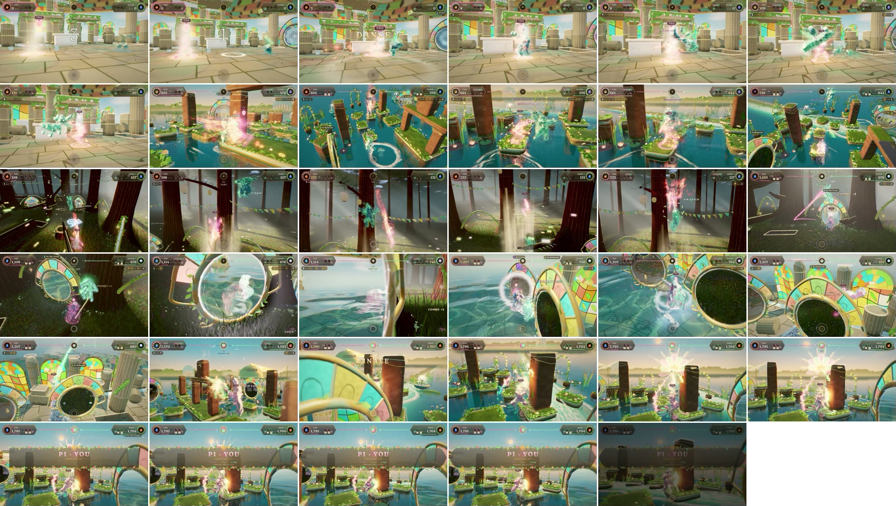

| time | shot | what happens |
|---|---|---|
| 0:00.0 | **the YOU opening, the temple's open court** (fire, a lead, rose: the player; water, a flyer, fern; seed 1) | **3, 2, 1** with the YOU tell: a shaft of sun on the rose body and a sunlit disc at its feet, a ring rising on each count, `YOU` over `ROSE` at 1.55×, the panel `P1 · YOU` in rose, the other's tag quieter; **DANCE** at 0:01.6 on bar 61; a catch and swings in the open court, the stage, the colonnade, the stained glass and the sky behind, the mirror to the Pool at the right edge |
| 0:05.3 | **the Pool's water garden** (fire, a base; water, a flyer; seed 1) | glazed planters and woven rafts, the arches of flowers, the far shore; the mirrors named over their crowns (the Tide Temple, the Geode, the Redwoods); a catch at the planters and **MURMURATION ×60** over the water (0:07.0) |
| 0:09.6 | **steam in the redwoods, bar 65's swell** (fire, a flyer; water, a lead; seed 9) | wave and ribbon, **STEAM!** (0:10.1): the geyser's column a veil of mist in the sun's shafts, the bunting and lanterns, the bodies read through it; a catch in the air at its top (0:13.0) |
| 0:13.3 | **through the mirror, one shot, no cut** (water, a lead, rose; ice, a flyer, fern; seed 2) | in the redwoods the pair swing and fling at the mirror to the Tide Temple (its plaque over the crown), the temple's water seen in the disc; a catch at the disc (0:15.4) and through it, the camera through the disc behind them (0:16.0) into the temple's clear high water, **CURRENT ×35** coming in whole (0:16.6), the eye coming round inside the temple's mirror; **the music turns to the temple's track on the bar** (0:18.6) |
| 0:19.9 | **the fused finale in the Pool, on the temple's track** (water, a flyer, rose; fire, a base, fern; seed 34) | **FINALE** (0:20.9), the fused lift out of the water among the planters and arches, the bloom's two vines and its flower of rose and fern petals opening over the pair with the low sun behind (0:22.3, the 12-frame hold), the garland opening with its words, **P1 · YOU TAKES THE SET**, 1,795 to 1,704 (0:24.1); out at 0:28.15 on the temple track's beat |

Every moment is the game's own, at skill 0.85, two virtual players; each shot's dance matched its scout's event for
event (`match.mjs`, all five: 15, 94, 25, 132 and 181 events, 0.000 s apart). Seat 1 (rose) is shown as the player's in
every shot (`bend.duel.you.seats = [0]`: in a film no seat is the page's, so the tell is off unless asked): the YOU
tag, its petal marker and ring, the panel `P1 · YOU`, and at the end the garland's `P1 · YOU TAKES THE SET`. Shot sheets
(the master): `media/19-film-duel-5-<shot>-master-sheet.jpg`.

### How it was made

1. **The film tool learned the mirrors** (committed): a duel shot with `"query": { "mirrors": 1 }` keeps its world's
   gates open (`src/duel/index.ts`, one line); its page follows the crossing into the new world's track from the next
   bar line, as play does, and says when in `info.json` (`track.switches`); `scripts/film.mjs` then lays the film's
   music in two tracks, the later shots on the new one's grid and tempo (their beats in its tempo). The mirrors' plaques
   ("the Tide Temple", "the Pool"), DOM on screen and so never in a film, are painted into the frames
   (`Hud.under`, `GateNames.paint`), so the film shows the names the player sees. `docs/extending/film.md` says how.
2. **Scouted** (`docs/reports/media/film/p5/`, git-ignored: `list1.txt`, `list3.txt`, `scout.mjs`, `numbers.mjs`,
   `cross.mjs`, `match.mjs`): the 40 sets on the redwoods' track, then 24 on the temple's for the finale (a shot after
   the crossing is on the temple's track and tempo, and the dance depends on the tempo).
3. **The crossing** had to be a set's first crossing, out of a world whose track the film was on, into another, through
   the disc and not under the flash, staying long enough for the bar line. Of 52 crossings in the 40 sets, two were all
   of that: the redwoods into the temple, water and ice, seed 2, at 41.4 s (`sc-redwoods-wi1-2`, the film's), and the
   temple into the geode a second before a set's finale (`sc-temple-wf4-5`). The temple's into the
   Pool (`sc-temple-gp7-8`, the best-looking one) came after two crossings that had changed the track already.
4. **The finale:** 6 of the 24 temple-track sets fused, two in the Pool with no crossing before it; this one ends with
   the rose seat, the player, taking the set.
5. **A preview at 1280×720, then the master** (rendered at 1.5× and brought down, under the render lock): the film
   tool's own encode, the front left out (the YOU opening is the film's opening).

## The crossings through the mirrors

Each page now logs every crossing (`bend.duel.crossings`: the set's second, the two worlds, and how the main view went
over: `through` the disc behind the pair, or cut under the mirror's `flash` because the eye stood beside the disc past
its plane, or `late` when the eye hadn't come through in 3 s), and every change of track.

| 84 sets, mirrors open (skill 0.85) | sets | crossings | a set | sets that crossed | **through the disc** | **under the flash** |
|---|---|---|---|---|---|---|
| on the redwoods' track (ten a world) | 40 | 52 | 1.3 | 24 (60 %) | 8 | 43 |
| on the temple's track (the Pool 16, the temple 8) | 24 | 23 | 1.0 | 11 | 3 | 20 |
| on the Pool's track (the Pool) | 20 | 15 | 0.75 | 7 | 3 | 12 |
| **all** | **84** | **90** | **1.07** | **42 (50 %)** | **14 (16 %)** | **75 (84 %)** |

(One crossing has no `how`: the pair were carried back before the view went over.)

- **Half the sets cross a mirror**, about once a set; no virtual player aims at one (src/ai doesn't know the mirrors):
  every crossing is a fling, a swing or a run that happened to pass through a disc at the arena's rim. By the world the
  set began in (the redwoods' track): the geode 1.7 a set, the temple 1.5, the redwoods 0.9, the Pool 0.9.
- **Five crossings in six fall back to the flash cut.** The duel's camera stands side on to the pair, about 5.5 m off;
  when the pair go into a disc at the rim, the eye is beside the disc and usually past its plane, and can never come
  through it, so the main view goes over at once under a half second of the mirror's light. Through the disc is the
  exception: 14 of 89. And in a film the mirror's light is DOM, so a film shows the flash cut as a plain cut.
- **Back and forth.** Before the fixes below, a pair went through and straight back: five crossings in five frames in
  one set (the redwoods and the Pool, 53.93 to 54.02 s), and in another back after exactly 1.5 s, twice (a held partner,
  brought through behind the far disc, was carried back once its 1.5 s ran out, and its partner after it). After them,
  12 of 90 crossings still come back within 3 s (a pair dancing at a mirror swings through it again), and 8 of 84 sets
  changed track three times or more (one temple-track set six times in 48 s: temple, redwoods, temple, redwoods, Pool).
- **The music.** In the page a crossing takes the new world's track from the next bar line after the main view goes
  over, from the new track's bar 1. In the film's crossing that is 3.2 s after the catch at the disc (the catch 15.4 s,
  the view through about 16.4 s, the temple's track at 18.6 s). Before the fix below, crossing back within a bar started
  the track that was playing again from its bar 1.

## Does the soft edge stop bodies reaching a rim mirror?

**Not at the six mirrors; yes at one of the hub's gates, now fixed.** A new Node test (`src/duel/test/edge.test.ts`) runs
a body straight at every way out of every arena (`Arena.exits`: the mirrors and the gates to and from the hub), from
3.5 m in front, the stick held on the disc, on the world's own floor and solids, with the match's soft edge applied each
frame: it must cross the gate's plane inside its disc within 2 s.

| way out | from the space's middle / its radius | before | after |
|---|---|---|---|
| the temple's mirrors to the Pool / the redwoods | 8.50 / 8.03 of 11 m | reached | reached |
| the Pool's mirrors to the temple / the redwoods | 8.75 / 8.50 of 12 m | reached | reached |
| the redwoods' mirrors to the temple / the Pool | 9.51 / 9.52 of 11 m (0.1 m into the 1.6 m band) | reached | reached |
| the temple's and the Pool's gates to the hub | 9.14 of 11, 8.75 of 12 m | reached | reached |
| the geode's gates to the Pool, the temple | 7.32 of 10.5 m | reached | reached |
| **the geode's gate to the redwoods** | **10.90 of 10.5 m (past the radius)** | **short by 0.34 m: the edge took 16 m/s** | reached |
| the redwoods' gate to the hub | 11.67 of 11 m | short by 2.28 m | short by 2.28 m |

- The rim mirrors stand inside the space's radius, and the edge's turn starts gently (it grows with the square of the
  depth into its 1.6 m band): the redwoods' two, the deepest, are only 0.1 m into it. In the page they were all crossed.
- The geode's gate to the redwoods stands 0.4 m past its space's radius, where the edge turns every bit of a body's
  way out along it: at a run, a body could never reach it. **Fixed:** the edge is open in a way out's lane (within its
  disc's radius across, up to 0.6 m past its plane: `match.ts softWall`, a few lines); the test passes for it now. The
  lane opens the redwoods' gate to the hub as well (past its radius too): the same seeded set that never crossed
  before the fix (`sc-redwoods-fw0-1`) went through it into the geode at 42.4 s after it.
- The redwoods' own gate to the hub is not the edge: a bough 1.4 m high lies across its lane (`flow.test.ts` doesn't
  keep a world's own gate's lane clear), so a run stops at it; a jump clears it. Reported, not changed (the redwoods'
  layout is that world's).

## The "CURRE NT ×36" word in the redwoods

**The cause: the pair tier word's entrance.** A pair tier's word (DUET, CURRENT, MURMURATION, AURORA) came in as its two
halves sliding together, each half clipped to its own side of the word's middle (`src/hud/pops.ts`, `case 'pair'`,
"never a doubled word"). For the 0.32 s they slid, the space between them was a gap in the word: 60 px at 720p at
the start, closing to nothing. The word's middle is the middle of its pixels, which in "CURRENT ×36" falls between the E
and the N (the capitals are wide, "×36" narrow), so the word read "CURRE NT ×36". It was not the font or the kerning:
the sprite is one `fillText`. It shows in any world; the redwoods' scouts caught it at every CURRENT
(`sc-redwoods-fw0-1`, CURRENT ×35 at 17.98 s: "CURRE NT" in 6 frames of 30), and a still taken in that third of a
second has it.

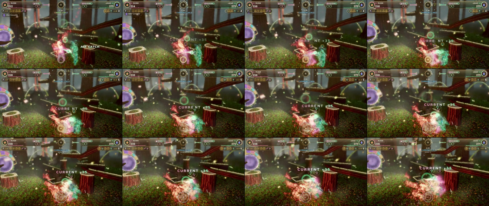

**Fixed:** the word now comes in whole, its letters gathering in from a spread 1.32 times as wide as they brighten,
then the warm flash as before (`pops.ts`, a few lines). In the film's crossing, CURRENT ×35 comes in whole.

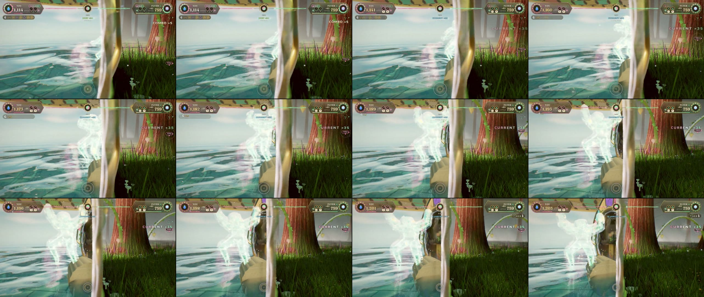

## The numbers (40 scouted sets on the redwoods' track, 40 minutes of play)

Phase 5 against phase 4 (report 17: 52 sets on the same track, the mirrors shut, as a film's were). Here the mirrors
are open, so a set can end in another world than it began in: the worlds' columns are by the world a set **began**
in (half the sets crossed, most of them in their second half). Ten sets a world, not thirteen, seeds 1 to 10 (phase 4:
1 to 4), skill 0.85, all on the redwoods' track (113 bpm). "Words at a peak" is the most words standing at once in the
0.6 s after a reaction, a tier, a merge or a catch at range or at a geyser's top (report 17's measure).

| | phase 4 (52 sets) | **phase 5 (40 sets)** | temple (10) | redwoods (10) | Pool (10) | geode (10) |
|---|---|---|---|---|---|---|
| catches a minute (all) | 25.1 | **22.6** | 22.7 | 22.5 | 23.8 | 21.4 |
| … out of the air | 54 % | 52 % | 44 % | 40 % | 68 % | 57 % |
| held moments a minute (frames each) | 13.0 (5.8) | 11.4 (5.9) | 9.5 | 8.8 | 15.8 | 11.7 |
| juice events a minute | 46.6 | 41.2 | 41.4 | 41.0 | 43.9 | 38.7 |
| words at a peak, most at once | 0.99: 486 of 490 one word, 4 none | **0.98: all 321 one word or none (5 none)** | 0.97 | 0.99 | 0.99 | 0.99 |
| … words on screen in a peak's frames, mean | 0.63 | 0.64 | 0.62 | 0.65 | 0.63 | 0.64 |
| casts a minute (both players) | 11.3 | 10.6 | 10.4 | 10.9 | 10.3 | 10.7 |
| power forms (a set) | 85 (1.6) | 60 (1.5) | 13 | 12 | 19 | 16 |
| reactions (steam, freeze, melt) | 75 (22, 25, 28): 1.4 a set | **46 (16, 13, 17): 1.15 a set** | 10 | 14 | 11 | 11 |
| pair tiers (DUET, CURRENT, MURMURATION, AURORA) | 127, 76, 36, 3 | 93, 45, 15, 1 | 27, 10, 2, 0 | 19, 12, 4, 0 | 22, 14, 6, 1 | 25, 9, 3, 0 |
| sets whose top pair tier is CURRENT / MURMURATION / AURORA | 15 / 29 / 3 (DUET 5) | **20 / 14 / 1 (DUET 5)** | 5 / 2 / 0 (3) | 5 / 4 / 0 (1) | 4 / 5 / 1 | 6 / 3 / 0 (1) |
| solo tiers | 8 | 5 | 1 | 1 | 0 | 3 |
| merges (sets with one) | 57 (46) | 36 (27) | 9 (7) | 7 (5) | 10 (8) | 10 (7) |
| **fused finales** | 6 (12 %) | **4 (10 %)** | 1 | 2 | 1 | 0 |
| the shared energy's peak, mean | 0.89 | 0.90 | 0.91 | 0.86 | 0.91 | 0.90 |
| falls | 3 | 1 | 0 | 1 | 0 | 0 |
| the duel's sounds a minute | 305 | 282 | 269 | 259 | 310 | 290 |
| eye to the pair, median (p90) | 5.6 m (8.0) | 5.5 m (7.7) | 5.4 (7.5) | 5.6 (7.7) | 5.6 (7.7) | 5.6 (7.8) |
| the taller body on screen, median (p10); under a sixth of the frame | 0.33; 1 % | **0.31 (0.22); 2.0 %** | 0.32; 1.1 % | 0.31; 2.0 % | 0.32; 2.0 % | 0.31; 2.8 % |
| **mirror crossings a set** (sets that crossed) | none (shut) | **1.25 (23 of 40)** | 1.5 | 0.9 | 0.9 | 1.7 |
| … through the disc / under the flash | | **8 / 41 (one carried back first)** | 4 / 10 | 2 / 7 | 1 / 8 | 1 / 16 |

(The crossings here are those before each set's finale; the section above counts every crossing in all 84 sets.)

- **Fewer catches, the same one word.** 22.6 catches a minute against 25.1: report 18-flow measured the same drop in
  Node (a fling carries 2 to 2.6 m now, so the catch back is further). The air share is phase 4's. One word at a moment
  holds exactly (no peak had two), and the word holds its place (report 18-bloom).
- **Fewer big moments.** Reactions 1.15 a set against 1.4, MURMURATION the top tier in 14 sets of 40 against 29 of 52,
  merges 0.9 a set against 1.1. The two drift further apart now (report 18-flow: 1.8 m against 1.6 in Node); what a
  crossing does to a chain wasn't measured apart.
- **Fusion** about as rare as tuned: 4 of 40 on the redwoods' track, 6 of 24 on the temple's, 3 of 20 on the Pool's: 13
  of 84 (15 %). The geode's 0 of 10 is chance again (report 18-bloom: one in ten in the page).
- **The camera** a little further and the bodies a little smaller than phase 4's (0.31 of the frame against 0.33,
  under a sixth of it 2 % of the time against 1 %): the breath and the lower view (report 18-camera) open the frame
  wider; the sets also range further (report 18-flow).
- **Hazards ridden** (all 40 sets, wherever the pair was): the tide 62 times (100 s), the gust 74 (35 s), the swell 52 and
  49 crests (45 s), the hum 37 (33 s). Their columns aren't per world any more: a pair crossing into the temple rides
  its tide.

## Five things that hold it back (for phase 6)

From the 84 sets, the preview and the master's frames, against the art bible (`docs/design/solarpunk.md`) and the
owner's four notes. Report 17's five were phase 5's work, and they show: the frame is lower and holds the horizon,
the colonnade and the sea (report 18-camera); the Pool's pieces are glazed planters and woven rafts with the pavilions
and arches at the horizon, the film's most solarpunk frames; steam is a veil in the sun's shafts and the bodies read
through it; rose and fern carry each body; the finale is a bloom and the banner a garland that opens with its words.
And the owner's four: YOU is unmissable from the first second, the arenas are open, every mirror is named, and the
pair can dance through one into another world.

### 1. The look is a garden of props on a floor, not yet a place (EPIC, the materials)

Seen at the player's size the worlds are still pieces standing on a ground. **The redwoods** are dark trunks over a
dim meadow, and on the grass lie **floating rectangles of gold light**: the arena's rim light round the tops of the low
blocks and stumps (report 18-geode-redwoods dimmed it and cut it where a piece dissolves, but it stays round every
standing one), in every redwoods frame of the film (0:09.6 to 0:15.5). They read as
a game's debug over a painting. **The temple** at low tide is cream on cream under a white noon (the opening), and at
high tide a crowd of cream drums and columns in pale water. **The geode** didn't make the film: its frames are still a
room of shelves. The landmarks (the temple's gate screen, the Pool's pavilion, the geode's window) are at the frame's
edge and soft under the depth of field. Only the Pool reads as the bible's place. For phase 6: the arena's rim light
off wherever a piece isn't the edge the player must see (or drawn as a planted lip, moss and flowers along the top,
not a line); the redwoods lit by a low sun (the golden shafts the steam shot has, everywhere, not only in a geyser);
the temple's noon warmed and its court given colour (tiles, water channels, flowers); one hero landmark per world big
enough to read at 720p behind the pair.

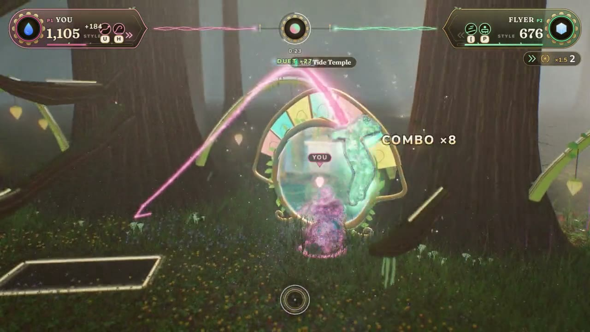

### 2. The epic moments are small, pastel and the world doesn't answer them (EPIC, scale and light)

The finale is the film's most solarpunk frame (0:22.9): the bloom's flower of rose and fern opens over the pair in
front of the low sun, among the Pool's planters and arches. It is still a small thing on a big still world. The flower
is about a fifth of the frame high and pale: added light over a bright sky washes its petals to pastel, and the vines
are hairlines at 720p. The lifted body stands half behind one of the Pool's standing stones; in both Pool finales that
fused without a crossing (of 24 sets), a monolith stood beside or across the lift. And nothing else in the frame moves
with the moment: no kites, sails or banners turning, no fountain rising, no light changing; the moments are the HUD's
and the bodies' (one word, the held frames). The bible's "epic" is a place that responds. For phase 6: the finale's
camera kept clear of the arena's pieces (its sight line to the flower pushing the eye round a stone as the near fade
does for the bodies); a bloom with the sky's scale (the sun disc and its rays across the horizon, the water catching
them, the petals drawn so they keep their colour over a bright sky); the world answering a moment (the Pool's fountains
rising at a pair tier, the redwoods' lanterns lighting, the temple's banners and chimes lifting).

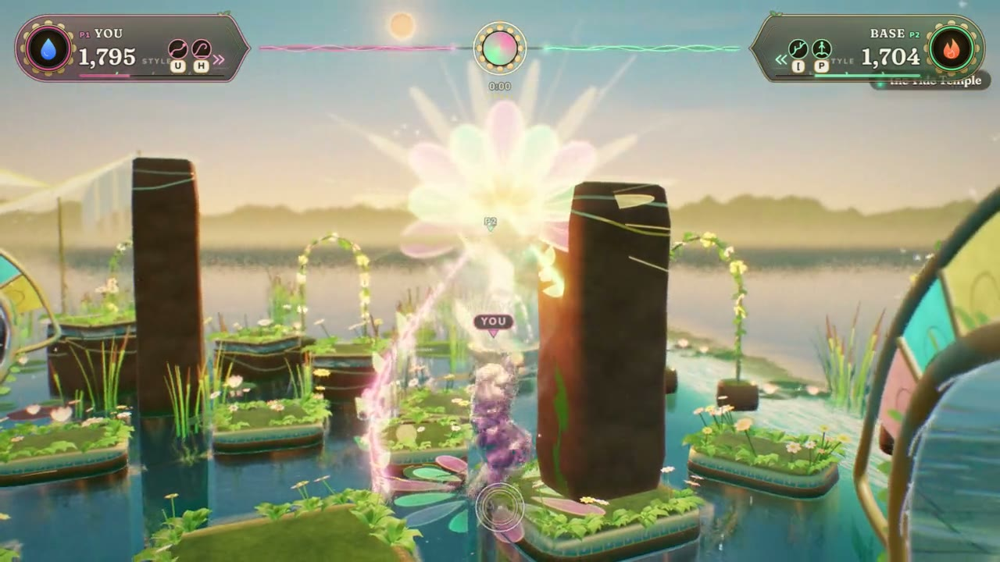

### 3. Five crossings in six are a cut, not a passage (the flowing world)

The owner wants to "walk through the mirrors into other worlds as I dance", seamless. In the page 75 of 89 crossings
(84 %) go over under the flash: the side-on duel camera is beside the disc, past its plane, and can never come through
it. In a film, the flash is DOM, so it's a plain cut. And when the camera does come through (the film's crossing), it
lands inside the far mirror's brass ring looking back at its dark disc for about two seconds (0:16.6 to 0:18.4),
the bodies small beside the frame, before the duel camera finds the pair again. For phase 6: when a crossing is coming
(the pair moving at a disc within a second), the duel camera swings round behind them so it goes through the disc on
their line (report 18-wayfinding's suggestion); on the far side, the eye takes the far disc's front and clears its frame
(the frame's near dissolve at 1.6 m is too close for a camera following through it).

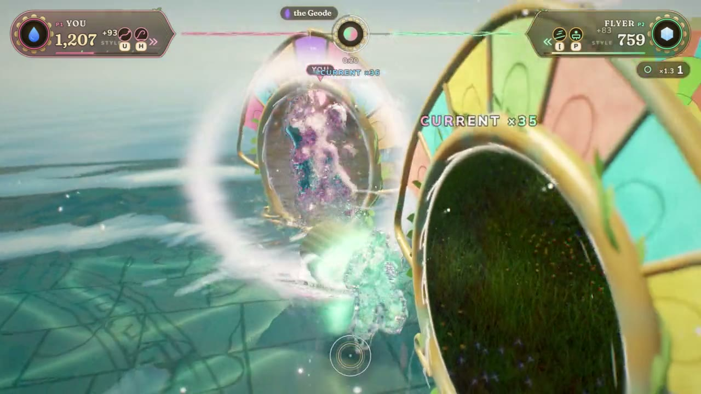

### 4. The crossings are accidents, they bounce, and online they don't exist (the flowing world)

No virtual player chooses a mirror: half the sets cross, by a fling or a swing that passes a disc at the rim, and a pair
dancing at a mirror swings back through it (12 of 90 crossings within 3 s; 8 of 84 sets changed track three times or
more, one six times in 48 s). A player who wants to go somewhere has no help in the dance itself: the plaques name the
worlds, but nothing in the contact draws the pair through together (a fling *at* a mirror, a lift through it). And the
room server plays an online duel in one world: online, the mirrors are shut (report 18-wayfinding). So the flowing world
works only for one player at a keyboard with a bot, and only offline. For phase 6: the online crossing (the server
judges it, sends `travel` for both seats, switches its arena and hazard, and the clients follow), the brains given the
mirrors (a pair at a high moment flings or lifts through the nearest, sometimes), and a short settle after a crossing in
which the pair dance away from the disc they came out of.

### 5. The music changes late and quietly (the flowing world)

The crossing's music is right in kind (the new world's track on its bar line) but reads as nothing happening. The new
track starts 2 to 3.5 s after the pair go through (the next bar line after the main view goes over: 3.2 s after the
catch at the disc in the film), and from its bar 1, the song's quiet intro, so a crossing in the middle of a set's
energy drops into an intro; the old track fades over 1.2 s under it. Between two worlds of different tempo the brains
jump tempo at that bar (113 to 94 bpm in the film); a set's phrase-length finale (report 18-wayfinding) no longer lands
on a phrase. For phase 6: the crossing as a musical moment (a swell or a bell on the bar the pair go through, the new
track entering at the part of the song that matches the set's energy, its tempo eased over a bar), and the set's finale
timed to the track it ends on.

## Fixes committed

- **Film tool: a duel shot can dance through the mirrors** (`"query": { "mirrors": 1 }`: `src/duel/index.ts`,
  `src/engine/film-shot.ts`, `scripts/film.mjs`): the page follows the crossing into the new world's track on the next bar
  line and says when; the film's music goes on in that track, the later shots on its grid and tempo. Each crossing and
  how it went over is in `bend.duel.crossings` and a shot's `info.json`. `docs/extending/film.md` says how.
- **The mirrors' plaques in the captures** (`src/hud/hud.ts` `Hud.under`, `src/portals/labels.ts` `GateNames.paint`,
  `src/main.ts`, one line): drawn as the page's CSS draws them, into a film's frames and `bend.grab`'s stills.
- **No crossing straight back** (`src/duel/index.ts`, `src/portals/portals.ts` `holdBack`): the one who crossed is held
  back as its brought partner is (0.6 s free, 1.5 s held), and a body still behind the disc it came out of is kept from
  crossing while it is there (up to 4 s). Before: five crossings in five frames, or back after exactly 1.5 s.
- **The soft edge open in a way out's lane** (`src/duel/match.ts` `softWall`) and its test (`src/duel/test/edge.test.ts`,
  new): the geode's gate to the redwoods could not be reached.
- **A track kept when a crossing comes back within the bar** (`src/audio/engine.ts` `setTrack`), and a new track's
  chords from its own bar 1 in a film's page (`trackBeat0` reset at the switch).
- **The pair tier's word comes in whole** (`src/hud/pops.ts`): no "CURRE NT".

## Stills

`docs/reports/media/19-p5-*.jpg`, from the final film: the sheet (`19-p5-film-sheet.jpg`), `19-p5-countdown.jpg`,
`19-p5-dance.jpg`, `19-p5-pool-murmuration.jpg`, `19-p5-steam.jpg`, `19-p5-steam-catch.jpg`, `19-p5-mirror-approach.jpg`,
`19-p5-mirror-through.jpg`, `19-p5-issue-arrival.jpg`, `19-p5-finale-bloom.jpg`, `19-p5-banner.jpg`,
`19-p5-issue-rims.jpg`, `19-p5-word-after.jpg`; and `19-p5-word-before.jpg` from a 640×360 scout. The master's sheets:
`19-film-duel-5-<shot>-master-sheet.jpg`.

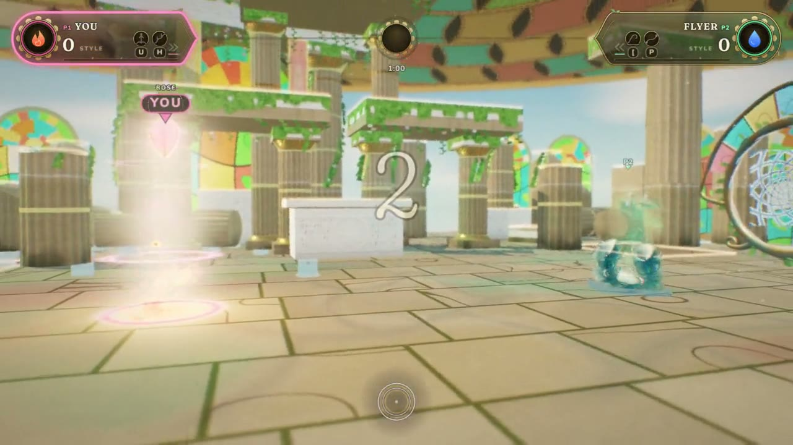
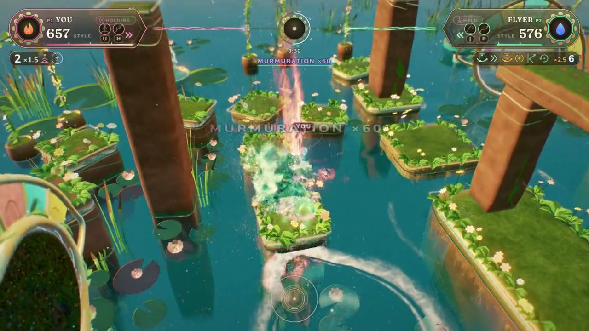
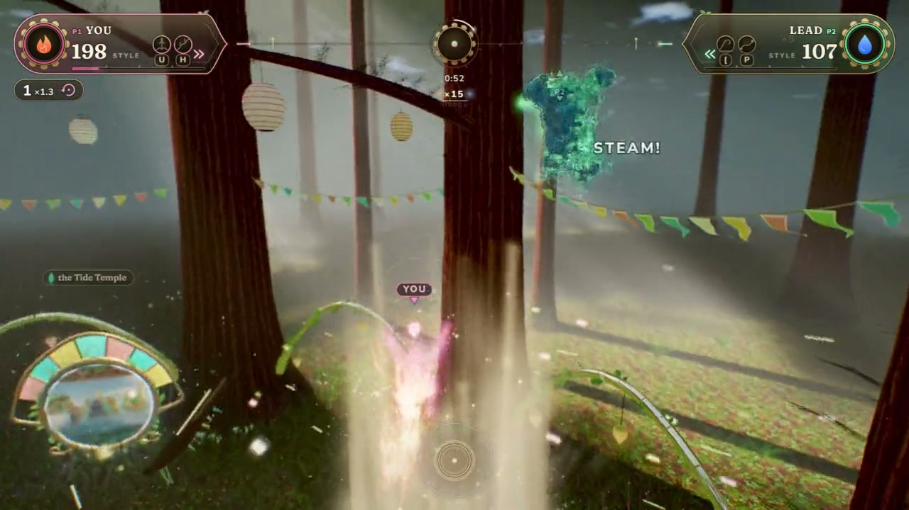
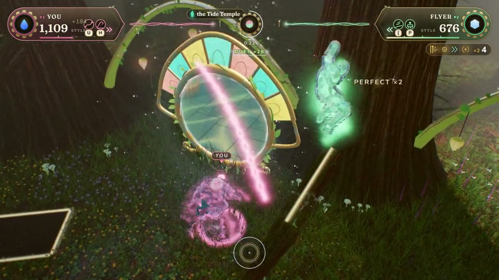
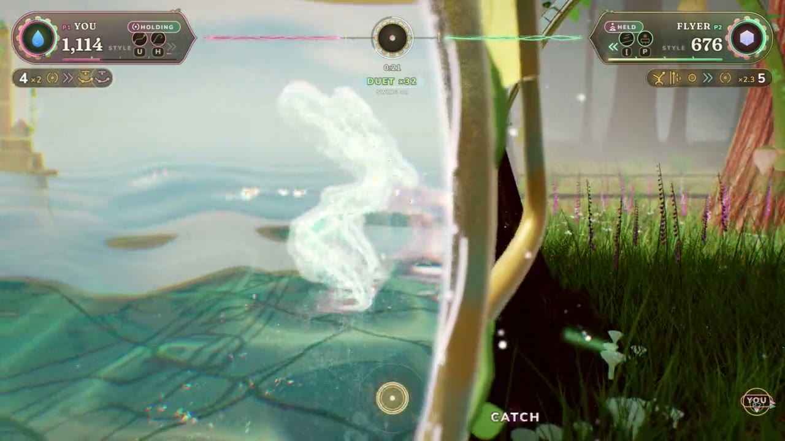
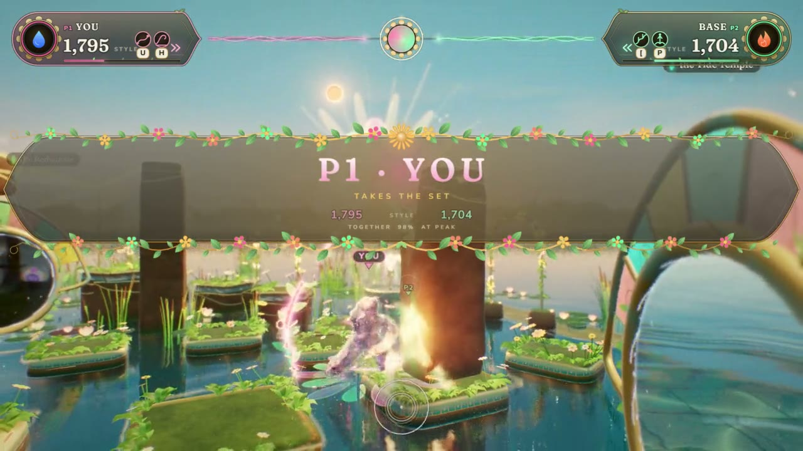

## Weak points of the film

- Two virtual players, seeded and chosen from 84 sets. The crossing is the one set of 40 whose first crossing went
  through the disc and changed the track cleanly; most crossings would be a cut (above).
- The music changes 3.2 s after the pair reach the disc, and into the temple track's bar 1 (its intro): what the game
  does, not yet what the moment wants (issue 5). Its tempo drops from 113 to 94 bpm there, and the finale's set danced at
  94.
- The temple's track then plays under the Pool's finale: a cut to another set in another world, as phase 4's reel cut
  between worlds on one track.
- The YOU tell is switched on by a cue (a film has no seat of its own); the same seat (rose) is the player in every shot,
  with a different matter in each.
- 28.2 s, a little under the asked 30, to end on the garland before the next set's count-in.
- The front is left out (the YOU opening is the film's first frame).
- Sound: levels measured, not heard.

## Not done

- The five issues above: phase 6's.
- Online: no crossing (the server plays one world), not filmed or scouted; the YOU tell online not filmed.
- The flash cut in a film: the mirror's light is DOM and isn't painted into the frames (the plaques are); a film that
  used a flash crossing would show a plain cut.
- The mirrors' plaques can sit on the HUD's centre line (the redwoods' plaque under the orb's DUET ×27,
  `19-p5-issue-rims.jpg`): the plaques keep on screen but not off the HUD.
- The fusion rate in the page with the mirrors open was counted (13 of 84) but not compared with the mirrors shut in the
  same run.
- The numbers' per-world columns are by the world a set began in.
- The Node harness: the crossings and the music aren't in it (report 18-wayfinding).
- The lock, a phone, a person playing: not tried.
