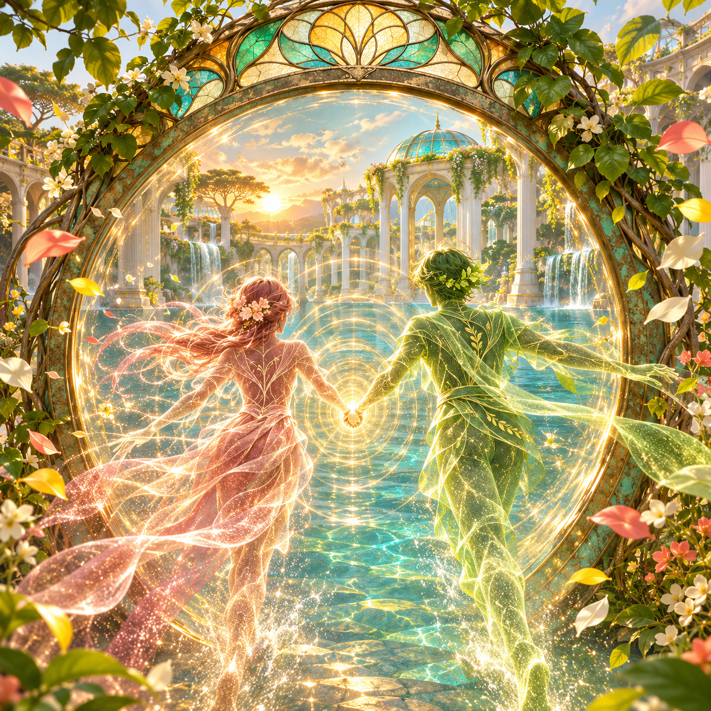
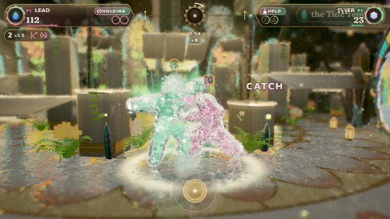
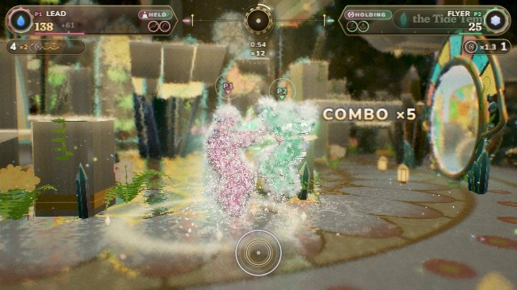
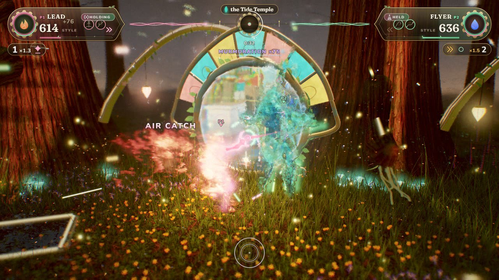
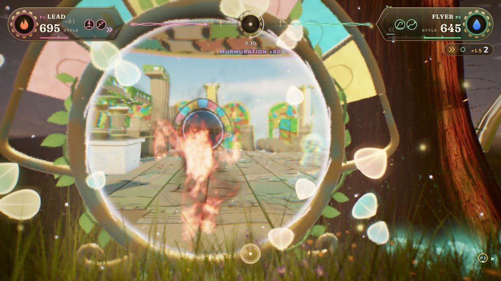
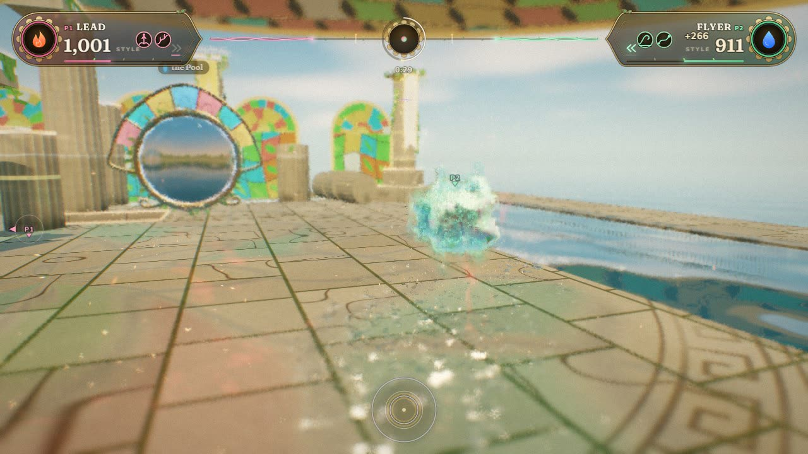
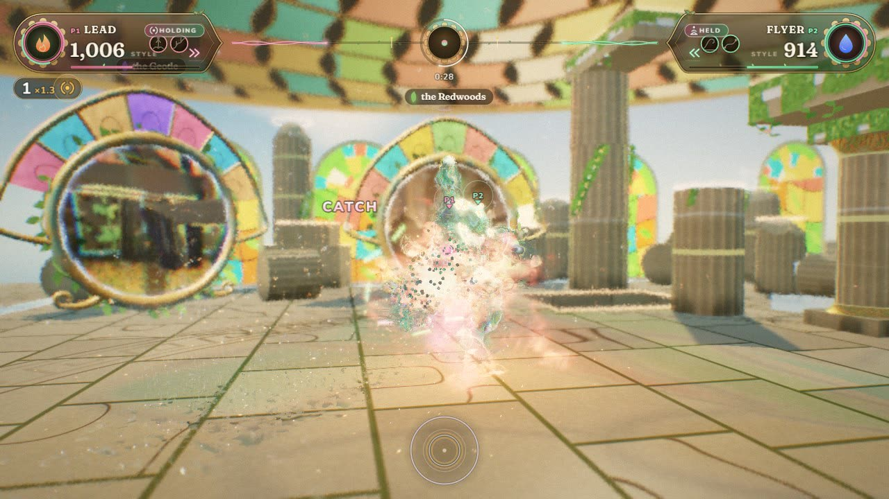
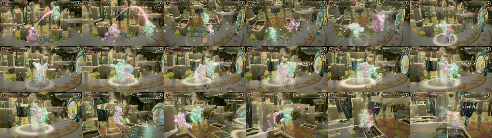
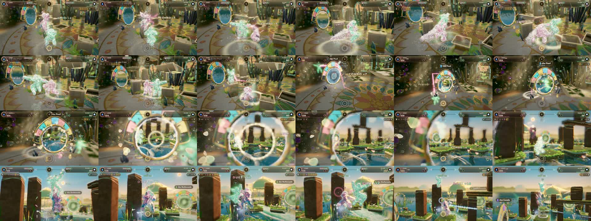
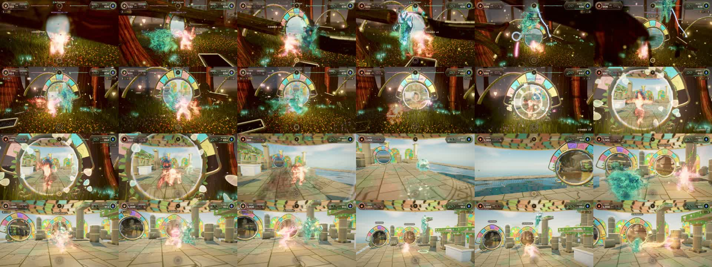

# 20: the crossing. Through a mirror as one seamless, magical move

Branch `p6-crossing`, from master `48f568c` (phase 5). The brief: report 19's issues 3 and 5 and the local half of 4.
Make the camera come through the disc nearly every time and turn onto the pair in the new world without staring at the
far mirror; make the music change on the beat, at a matching place in the new track, with the tempo bridged; give the
virtual players crossings they mean, with a grace after so the pair doesn't bounce back; and make the crossing itself a
moment (light, petals, ripples, a chime on the beat). Keep fusion and catches near phase 5's. Leave the crossing
server-friendly for p6-online.

**Measured:** whole sets in the page, two virtual players (skill 0.85, the dress and styles rotated as
`duel-page.mjs` rotates them), stepped at 60 fps in headless Chrome on the 5090 at 480×270, the music's engine ticked on
the frames' clock, every frame sampled (`scripts/cross-measure.mjs`, new). Before: master served from a clean export,
48 sets with the mirrors open and 24 with `&mirrors=0`. After: 72 sets open and 24 shut. Clips and stills from the
duel's own camera with the HUD (`scripts/cross-clip.mjs`, new), at 640×360 and 1280×720. **Not measured:** the sound by
ear (headless has no audio device: the music is checked as a schedule and in Node), a person playing, a phone, online.

## What changed

### 1. The camera through the disc (`src/duel/crossing.ts` ThroughCam, `src/duel/index.ts`'s camera tick, `camera.ts`)

- **The swing in behind.** As the pair runs at a disc (its plane within 1.4 s at the speed they go, passing inside its
  radius) or nears a voyage's mirror (below), the duel camera's pose is blended, about its look point and by the
  shorter way round, toward a pose behind the pair on the disc's axis (`approachOf`, `behindPose`, `blendPose`). It
  eases in at 2.6/s and out at 1.2/s, so a fling that falls short swings the eye in a little and lets it go.
- **The way through.** From the frame the pair crosses, the camera follows one path in the new world's coordinates (the
  view still drawn from the old world through the portals' offset until the eye comes through):
  1. *round*: an eye that stood beside the disc goes round its rim outside the frame (at least the radius + 0.9 m from
     its middle while beside its plane) onto its axis behind it, looking at the disc, so the pair is seen live through
     it with the rings and petals on the glass; an eye already behind it only settles;
  2. *through*: a cubic Bézier whose two inner points lie on the disc's axis, one in its plane, so the eye crosses the
     plane within centimetres of the middle, then on round onto the duel camera's own pose of the pair (the duel camera
     runs all along, restarted in the new world; the way ends exactly on its pose). The look point runs ahead of the eye
     along the axis, never behind it. Paths are timed by their length (about 10 m/s at the fastest).
  The main view goes over when the eye crosses the old disc (the portals' own camera crossing), as before; the music
  doesn't wait for it any more.
- **No more staring at the far mirror.** The way ends on a pose the duel camera chose, and the duel camera now pays for
  a mirror (`discCost`): an eye in or by its frame, just behind it beside the disc, or seeing the pair through it. A pose
  it chose behind the far disc is held in front of it (`clamped`) and the duel camera goes on from there.
- **The flash, rare and softer.** Left only for a locked camera, a pair that goes on through a second mirror before the
  view came through the first, or a way whose eye didn't come through (`crossings[].why` says which). The DOM wash is
  now an iris of honey light opening from the middle with a ring of the far world's colour running ahead of it and the
  screen's edges a moment longer in that colour, as a disc's rim (`labels.ts mirrorFlash`), gone in 1.3 s.
- A pair that crosses back before the view went over: the view never left (`how: 'stayed'`).

The whole of each (a frame every third of a second):

The test clips: `docs/reports/media/20-crossing-clip.mp4` (after, 8 s, 640×360) and `20-crossing-before-clip.mp4`
(git-ignored as media mp4s are; remake with `scripts/cross-clip.mjs`).

### 2. The music (`src/audio/engine.ts` crossTo, `clock.ts` glides, `deck.ts` ramps, `src/duel/sound.ts` SetMusic.cross)

- **On the next beat, from the crossing.** The new world's track is asked for at the crossing itself (not when the main
  view goes over) and comes in on the clock's next beat at least 0.2 s off (the scheduler's lookahead), at the same beat
  of the bar, so the clock's bar lines stay the tracks' bar lines (`trackBeat0` moves by whole bars).
- **At a place of matching energy.** `scripts/music-energy.mjs` (new) measures each track's loudness bar by bar from the
  .m4a files into `src/audio/energy.ts`. The crossing enters the new track at the first bar of a 4-bar phrase of its body
  (its loop, never its intro) whose loudness is nearest the old track's around where it was, lifted a little for a set in
  full flow (`entryBar`).
- **The tempo bridged.** From the crossing to that beat the clock (and the old track, played by the deck at the clock's
  rate) bends toward the geometric mean of the two tempi, at most 10 %; the new track comes in at most 6 % off its own
  tempo toward it and eases onto its own over a bar and a half. The clock's tempo is linear in its steps and the deck's
  playback rate linear in time, and the two agree: the deck's place in each file stays within 1.1 ms of where the clock
  says (Node, `bridge.test.ts`). The old track fades over 0.75 s from the beat.
- **A chime on that beat** (`'cross'`, `synth/duel.ts c_cross`): a glass bowl on the new key's root and a crystal bell over
  it, a run of six chimes rising on its pentatonic in 16ths, a breath of air, and the chord held as a soft pad that
  swells and fades over two beats, the one sound both worlds share while the tempo turns; both dancers' colours on top.

| a crossing (Node, the engine's own schedule) | in | entered at | old bent to | new in at | tempo's largest step (was) | heard seam |
|---|---|---|---|---|---|---|
| the redwoods (113.1) to the temple (94.0) | 0.71 s | bar 53 | 91.2 % | 106.0 % | 5.2 bpm (19.0) | 3.4 bpm |
| the temple (94.0) to the Pool (121.1) | 0.38 s | bar 19 | 110 % | 94 % | 12.1 bpm (27.0) | 10.4 bpm |
| the Pool (121.1) to the redwoods (113.1) | 0.66 s | bar 65 | 96.6 % | 103.5 % | 2.0 bpm (8.0) | 0 |
| the geode (111.4) to the temple (94.0) | 0.27 s | bar 53 | 91.9 % | 106.0 % | 4.0 bpm (17.4) | 2.7 bpm |

Between the two furthest tempi (the temple and the Pool, 29 % apart) the caps leave a 10 bpm seam at the beat the new
track comes in, under the chime; everywhere else it is a few bpm or none.

### 3. Crossings the virtual players mean, and a grace after (`crossing.ts` Voyage, `src/ai/duel-brain.ts`)

- **The voyage.** Seeded (a set plays the same), never in a set's first or last 12 s: while the pair is in flow (the
  shared energy at 0.3 or more, or joined), about once in 22 s a voyage is set for the nearest mirror the pair is in front
  of, for up to 11 s. The brains see it (`DuelSight.voyage`): they dance to the front of its disc, a little to each side;
  holding, the lead's fling is aimed through the disc's middle and comes as soon as the swing turns that way (after
  0.7 s of hold); not joined and both near, the one nearer the disc runs through and the other is brought after it. A
  crossing during a voyage through its mirror is `meant`.
- **The grace.** After any crossing, no new voyage for 18 s; for 3.5 s the brains' goals are kept 3.2 m out in front of
  the disc they came out of (`DuelSight.cameOut`); and each body is held from crossing back for 1.1 s (1.6 s held: was
  0.6 s for the one who crossed only when a partner was brought).
- In Node (`simulateDuel`, 24 sets, no world change there), 18 of 19 voyages ended in a crossing, a median 3.5 s after
  they began; catches 23.7 a minute against 23.5 without.

### 4. The crossing's light (`src/duel/crossing-fx.ts`, `Portals.ripple`)

At the door, in whichever world the main view is in (the old disc while the eye is on its way, the new one after):

- a ring of light runs out across the glass from near its middle as the pair goes through, and again, brighter, on the
  music's beat, when the glass ripples from its middle and its rim flashes (`Portals.ripple`);
- 44 petals blow out of the disc on both sides, turning and drifting down on the air, in sun gold, cream, coral, leaf
  and sky teal with the far world's own colour (never the seats' rose and fern), and a few motes rise; anything within a
  metre or so of the eye fades (a petal at the lens is a blur over the frame).

Glows only. GPU at 720p in the redwoods (weft's frame time, `&debug`): 3.37 ms a frame in the 2.5 s before the crossing,
2.85 ms (at most 3.74) in the 3 s after it: nothing measurable.

## Numbers

| | **before** (master) | **after** |
|---|---|---|
| sets with the mirrors open | 48 | 72 |
| crossings (a set) | 57 (1.19) | 115 (1.60) |
| **through the disc** / under the flash | **4 (7 %) / 53 (93 %)** | **106 (92 %) / 4 (3.5 %)**; 4 stayed (back before the view went over), 1 still on its way at the set's end |
| … of those where the view had to go over | 4 of 57 | **106 of 111 (95.5 %)** |
| the flash's reasons | the eye beside the disc | on through a second mirror (2), the eye came through and the view didn't (2) |
| **meant** (a voyage) / by accident | 0 / 57 | **46 / 65** of 111 |
| **back within 3 s** | **5 of 57 (8.8 %)** (report 19: 12 of 90) | **3 of 115 (2.6 %)** |
| **the music's delay** after a crossing (the new track's first beat), median / most | **1.23 s / 2.72 s** | **0.51 s / 0.85 s** |
| the clock's largest tempo step in the 4 s after, median / most | **17.4 / 27.0 bpm** | **4.3 / 15.5 bpm** |
| the new track enters at | its bar 1 (the intro) | an energy-matched phrase of its body |
| **frames (of 180) in the 3 s after arriving with the mirror the pair came out of over a tenth of the frame**, mean / median (24 sets each) | **71 / 69** | **29 / 16** |
| … with the eye also within 3 m of it (inside its ring) | 6.6 | 9.4 |
| fused finales, mirrors open | 5 of 48 (10 %) | 9 of 72 (12.5 %) |
| catches a minute (out of the air), mirrors open | 22.4 (52 %) | 22.6 (51 %) |
| fused finales, `&mirrors=0` (24 sets) | 1 (4 %) | 1 (4 %) |
| catches a minute, `&mirrors=0` | 21.9 (52 %) | 22.0 (54 %) |

- *Looking at the mirror:* rays through a 16×9 grid of the lens meeting the disc and its frame (radius + 0.45 m) between
  0.3 and 8 m, in the 3 s from the frame the main view is in the new world. After, most of what is left is the pair
  dancing just in front of the disc they came out of with the mirror behind them, seen from 4 to 8 m; the frames with
  the eye within 3 m of it went up a little (6.6 to 9.4): the way's end and the duel camera's first choices near the
  disc. The before figure counts the flash's cut too: it arrived beside the disc at once.
- *Fusion and catches* are as they were within what 24 to 72 sets can tell (a fusion is one set in eight to ten).
  Voyages add 0.65 crossings a set; the walk to the mirror costs no catches.
- *Delay* here is to the first beat of the new track; the chime and the old track's bend start from the crossing.

## Tests

- `npm run typecheck`: clean.
- `node scripts/test-ts.mjs`: 26 of 26 files pass, with `src/duel/test/crossing.test.ts` (new: the way through from six
  starting eyes, round outside the frame and through within 0.8 of the radius, ending on the duel camera's pose, no jump
  over 11 m/s; a pose behind the disc held in front; the approach; the judgement; voyages seeded, outside the set's ends,
  18 s apart; the mirror's cost; the pose blend).
- `node scripts/test-audio.mjs`: 37 pass, with `bridge.test.ts` (new: on the next beat, a body phrase, bar lines kept; the
  tempo bent, the deck within 12 ms of the clock (1.1 ms at most); a track the bridge brings not started again at the
  bar line when the view goes over).
- `check-limits`, `check-bindings` (no shader changed), `check-portals` (10,037 checks): pass.
- `npm run test:net` not run (the brief).

## For p6-online

The crossing is in `src/duel/crossing.ts`, pure: `crossedDisc(a, b, discs)` is the judgement (a root's segment through a
disc inside its radius, and which face), `CrossEvent` the shape of what to send (`{ k: 'cross', seat, gate, to, front,
meant, t }`), `Voyage` the pair's seeded wish (the server can run it for its virtual players and send `voyage` in the
sight), `CROSS.holdBack` the grace. The camera's way, the music's bridge (`Engine.crossTo`, free clock only: a room's
shared clock should make the new track's bar 1 its new epoch) and the light are each page's own, keyed off the event.

## Not done, and weak points

- **Accidental crossings from behind a mirror.** A pair that goes in at a disc's back (from outside the arena) comes out
  of the far mirror's back, at that arena's edge; the camera follows and frames them there, the mirror large in the
  frame. Voyages only use a mirror's front.
- **The round case is long.** An eye that stood beside the disc takes 1.6 to 2.6 s to come through (the pair seen live
  through the glass meanwhile); straight in behind, about 1.3 s.
- **A moment inside the frame.** Passing through a 1.25 m disc, the brass ring and the crown fill the lens for a few
  tenths of a second; on one take the camera passed through the water body of a dancer just out of the disc (a teal blur
  for a few frames, before the petals' near fade).
- **Films** keep the old music path (the film tool lays the track itself; `SetMusic.cross` is off in a film), and a film
  shows the flash as a plain cut, as before.
- **The sound** was checked as a schedule and in Node, not heard; the pitch bend (up to 10 % on the fading old track, 6 %
  on the incoming one) should be listened to.
- The deck's rate ramps were checked in Node, not against a live AudioContext.
- A held crossing's partner (brought behind the far disc) and the human seat's experience of a bot's voyage were not
  looked at specifically.
- The 72 "after" sets were measured just before the last two fixes (the side the pair came out on taken from the
  crossing's face, and no petals at the lens); the meant clip and its stills are after them. The side fix changes which
  way a held crossing's camera goes through, not whether it does; not re-measured.
- A page reloaded doesn't always dance the same set twice (shaders compiling on the first frames shift it), so
  `cross-clip.mjs` grabs in one pass and the before and after clips are different crossings.
