# 20: the big moments made big, and the world answers them

Branch `p6-moments`, from master `48f568c` (phase 5 and report 19). The brief: report 19's second issue ("the epic
moments are small, pastel and the world doesn't answer them"): the fused bloom is a fifth of the frame and pastel, the
lifted body stands half behind a standing stone, and nothing in the world moves with the moment.

**Measured:** in the page, two virtual players at skill 0.85, stepped by hand at 60 fps, from the duel's own camera at
1280×720 with the HUD, the mirrors shut so a crossing doesn't take the take elsewhere (`scripts/answer-cap.mjs`, new).
Eight fused finales (the four worlds, two seeds each, the fusion written into the rules' state as `bloom-cap.mjs` does)
on master at `48f568c` (a second worktree, served on this branch's port) and on this branch; the four pair tiers in
each world (16 takes, the tier reached by writing the pair's varied links to one short of it, so the rules fire it and
its word as ever) on this branch, and AURORA in each world on master. Each frame: the bloom's footprint on screen
(`moments.ts` `sizeOf`: its box and the share of the screen under its lit glows), how much of a body's core it covers
(`bloomCover`, report 18's measure), how much of each body a solid hides from the eye (`moments.ts` `hidden`: hips,
chest and head). The world's answer: the same frame drawn with it and without it (the answer switched off, five frames
held at a ten-thousandth of a second each so the trails settle, grabbed with no step), the share of pixels whose light
changed by more than 3 %, and the same frame held twice as the noise floor. GPU time per pass with and without, held
frames. `npm run typecheck`, `node scripts/test-ts.mjs` (26 of 26 files), `check-limits`, `check-bindings`.
**Not measured:** a person playing; a phone; an online duel; the lock (`?lock`); the film tool's camera with the new
bloom; the sound (untouched). No master or 1080p render: stills and two 640×360 test clips.

## 1. The bloom over the whole stage

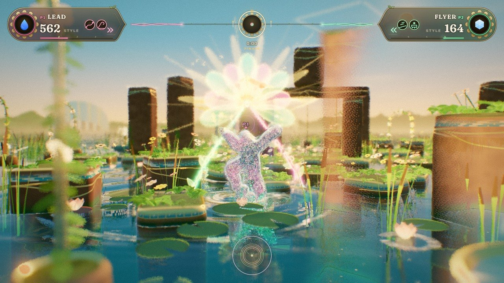
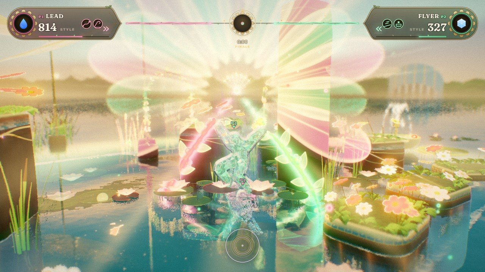
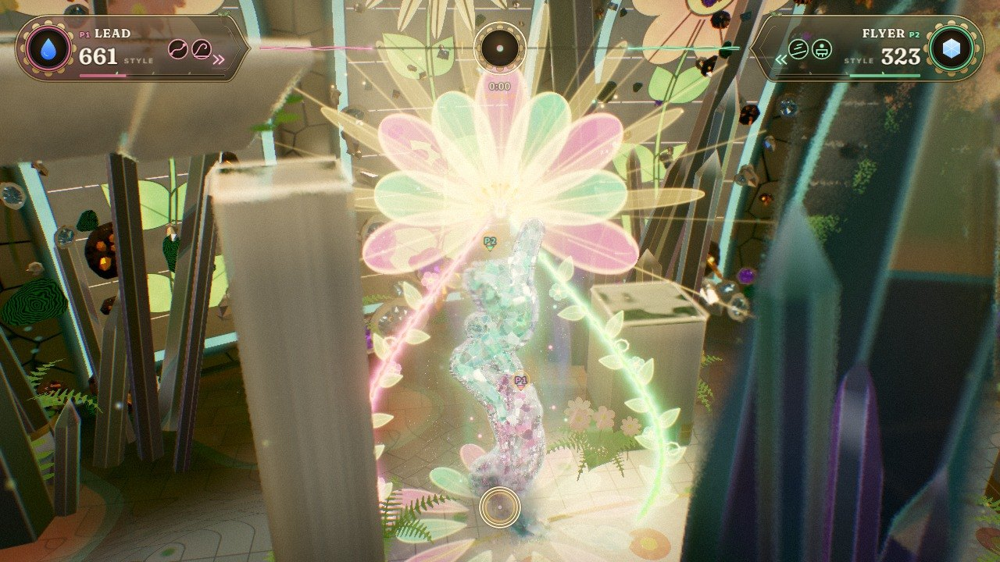
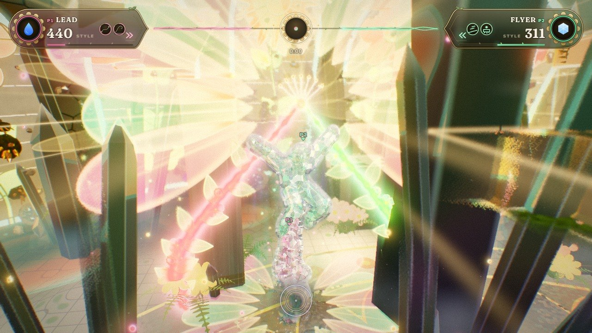
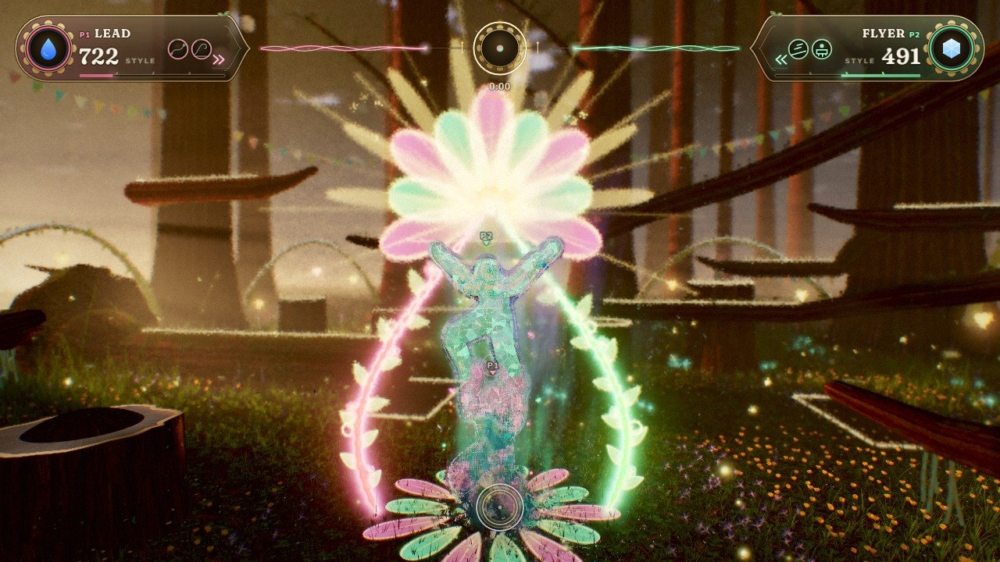
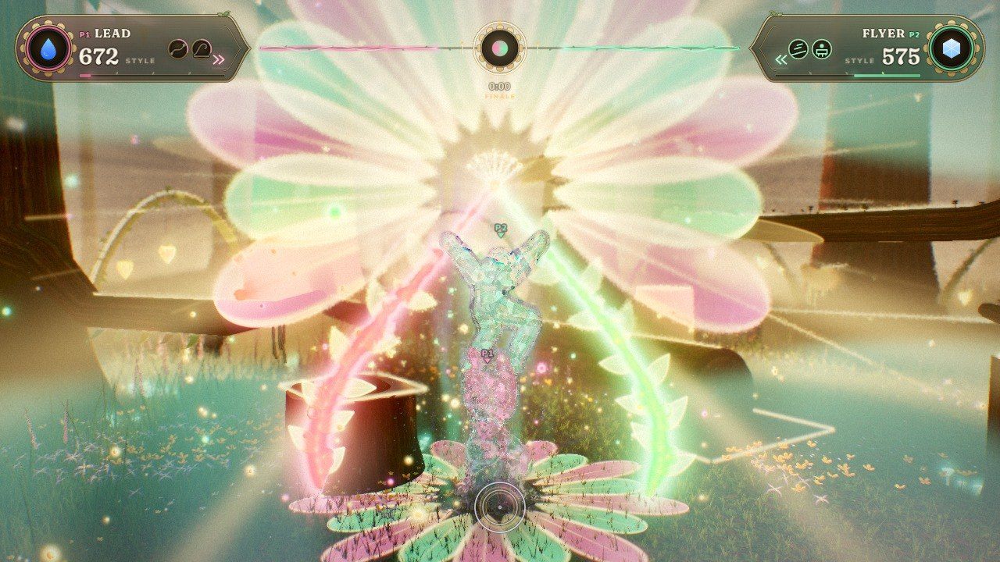
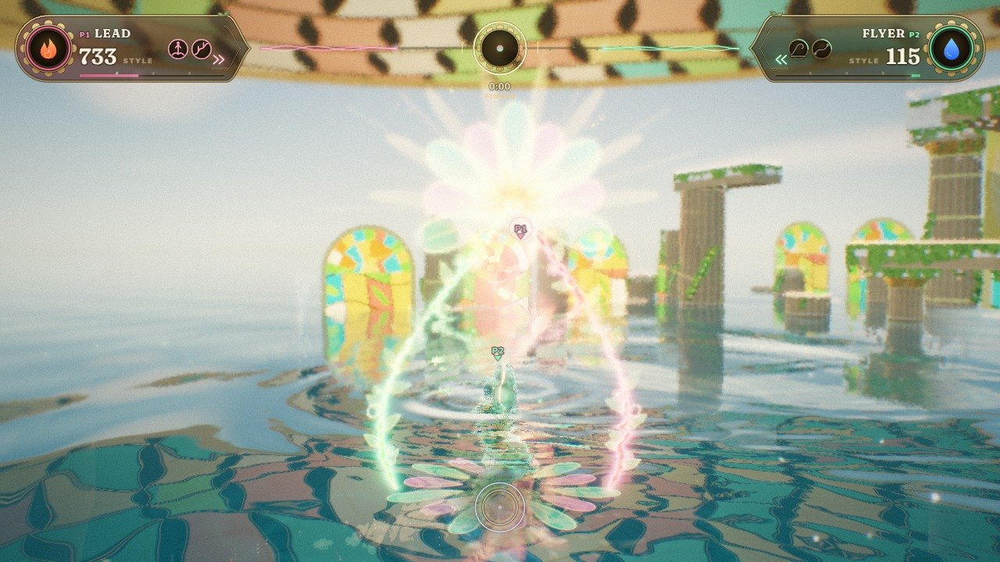
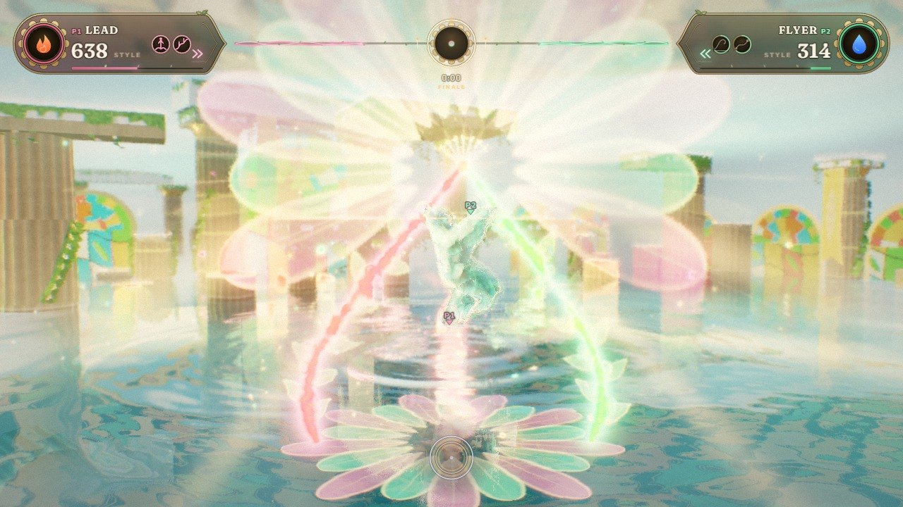
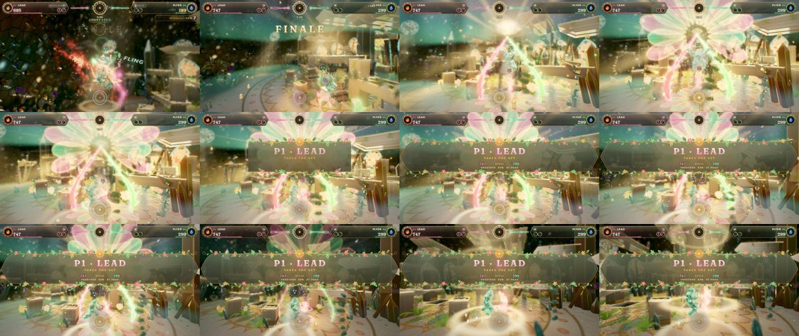

`src/duel/bloom.ts` (and its range kept off the bodies in `fx.ts`):

- **Big.** Thirteen outer petals 2.5 m long (were nine of 1 m) and 0.46 m wide in rose and fern, fanned from a little
  below level on each side to straight up; behind them thirteen long gold sepals and 26 rays of sun up to 4.8 m; an inner
  crown, seven stamens; 40 motes of pollen spreading 3.6 m out (were 18 over 1.6); 36 falling petals from 2 m round
  (were 22 from 0.8). The heart stands at least 0.9 m over the flyer's head (was 0.55) and 0.2 of the screen over it, and
  the camera frames 0.8 m over the heart (was the petals' top): the petals run off the frame's top and sides, so the
  flower reads as opening over the stage, not as a badge on the pair. The vines are a hand's width (0.12 m, were 0.065)
  with leaves and blossoms nearly twice the size; the floor's flower is 18 petals out to 2 m.
- **Saturated.** The petals were washed to cream by three things, found one by one against the A/B frames: thirteen
  gold petal bases and sepals laid over each other at the heart (now the petals start from a ring 0.6 m round it); the
  sun's disc and beams added over the petals (in a fusion the beams now come out from behind the flower, none over it,
  no disc: `answer.wgsl` `hole`); and the white noon behind (the world behind the flower is dimmed by up to a half in a
  cone round its heart, never the bodies and never the glow: `answerVeil`, three lines in `post/air.wgsl`). The petals
  are the seat colour at 0.95 (were 0.7), the gold only their rim and heart.
- **Light on the world.** The flower is a lamp: the world round its heart is lit warm (falling off with the square of
  the distance), the sun's shafts fan out from it, the wave of light runs out across the ground from the base's feet,
  the aurora opens (section 2).
- **The bodies uncovered.** `keepOff` now judges a long glow along its length (up to 8 points) and a wide one (a petal)
  by its edge, not only its middle line; the answer's added light keeps off the framed bodies in the air pass
  (`answerClear`, from the near fade's body capsules) and its lift on a body's own pixels is a third.
- **Framed clear of solids.** In a fused finale the lifted body's sight lines, and one to the flower's heart, cost three
  times as much in the duel camera's choice (`CamBody.keep`, camera.ts, a field and two lines; index.ts gives the flyer
  `keep: 3` and the heart as a sight point).

| eight fused finales, master → this branch | geode 3 | geode 7 | temple 4 | temple 8 | redwoods 5 | redwoods 9 | Pool 2 | Pool 6 |
|---|---|---|---|---|---|---|---|---|
| the bloom's lit share of the screen, most | 9.2 → **46.4 %** | 13.2 → **58.1** | 8.8 → **37.7** | 9.8 → **39.4** | 11.3 → **40.2** | 9.6 → **40.2** | 8.2 → **40.9** | 9.3 → **45.6** |
| … mean over the frames it shows | 4.6 → 26.7 % | 6.3 → 29.7 | 5.1 → 22.1 | 4.9 → 22.7 | 5.3 → 24.9 | 4.8 → 24.4 | 4.5 → 22.0 | 5.2 → 27.5 |
| its width on screen, most | 0.35 → 0.80 | 0.49 → 1.00 | 0.40 → 0.66 | 0.36 → 0.69 | 0.35 → 0.68 | 0.38 → 0.68 | 0.29 → 0.70 | 0.38 → 0.76 |
| a body's core under it, mean | 1.14 → 0.05 % | 0.57 → 0.01 | 0.11 → 0.28 | 0.82 → 0.00 | 0.88 → 0.34 | 0.80 → 0.57 | 0.72 → 0.00 | 0.08 → 0.02 |
| … the most in any frame | 13.0 → 3.9 % | 10.4 → 2.6 | 2.6 → 5.2 | 11.7 → 0.0 | 10.4 → 6.5 | **42.9 → 6.5** | 10.4 → 0.0 | 2.6 → 2.6 |
| frames over 15 % | 0 → 0 | 0 → 0 | 0 → 0 | 0 → 0 | 0 → 0 | 1 → 0 | 0 → 0 | 0 → 0 |
| frames a body is hidden by a solid (finale and banner) | 0 → **52** | **24** → 0 | 0 → 0 | 0 → 0 | 0 → 0 | 0 → 0 | 1 → 0 | **35** → 0 |

The bloom is four to five times the size on screen (a tenth of the screen lit at its most, now two fifths to more than
half), and covers the bodies less than before in seven takes of eight. The hidden frames are not a clean result: two
takes on master had a body behind a piece (24 and 35 frames) and none of those here, but one take here (geode 3: 52
frames, the pair standing behind a planter block as the finale begins, the camera turning round it within a second)
had one where master's did not. The page's dance differs from run to run, so each take is the same seed, not the same
frames; a stone across the lift is a few takes in a hundred and eight takes can't show the camera's change works.

## 2. The world answers

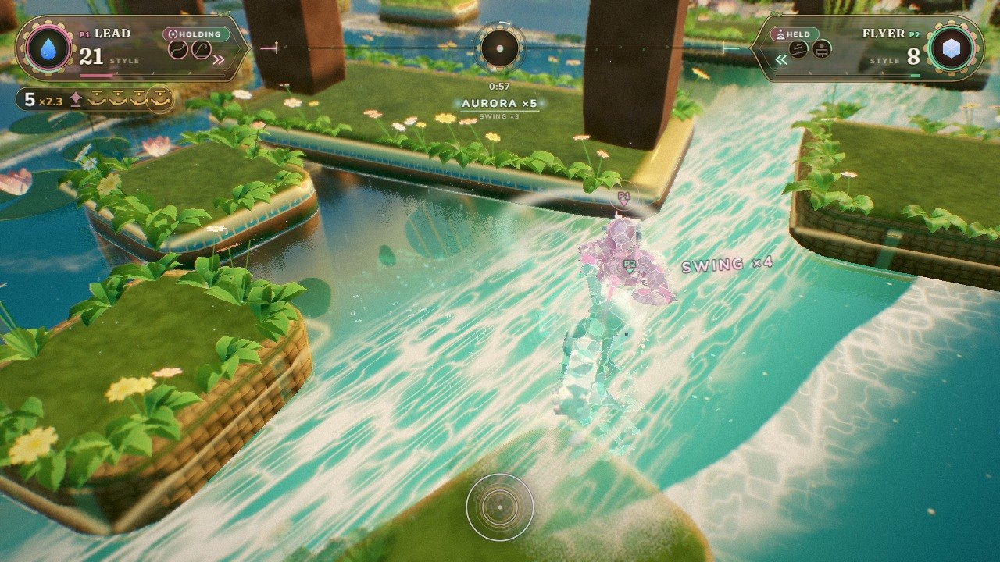
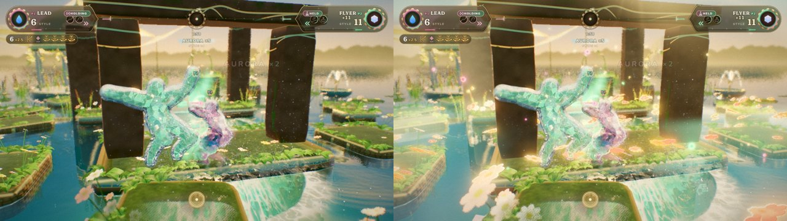
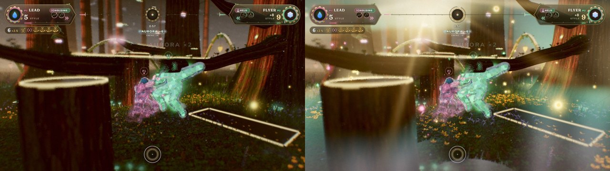
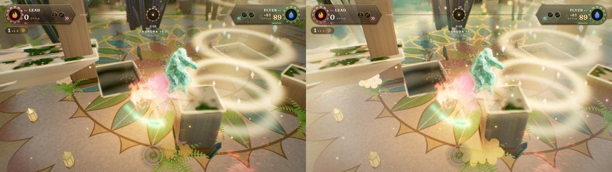
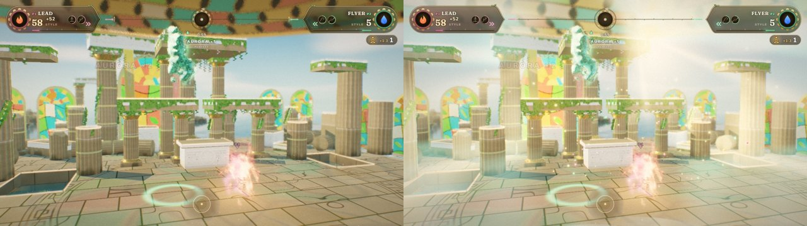
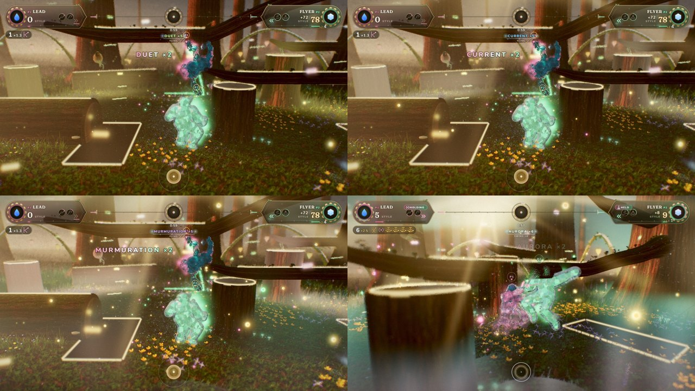
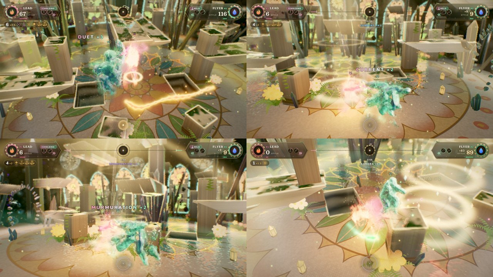

**One hook.** `worldLight.answer` (`src/worlds/answer.wgsl`, a member of the world light uniform after `sight`: no
binding, 80 bytes): where the moment happened, how strongly the world answers (0 … 1), which world (its light number,
so a gate's view of another world never answers), the tier (1 … 4, 5 a fusion), the wave's age, the beat, a light's
source and strength, the moment's colour, the aurora and the shafts. `src/worlds/answer.ts` writes it (`WorldAnswer`,
pure: the slot is handed in); `src/duel/answer.ts` drives it from the duel (`DuelAnswer`: a pair tier's event, a fused
finale's look, the music's beat; `bend.duel.answer`). Functions any world shader can call, each one uniform branch when
nothing answers: `answerOf(w)`, `answerReach(w, p)` (1 behind the wave's front, 7 m/s out from the pair),
`answerFront`, `answerBeat`, `answerLift`, `answerGlow`.

**Everywhere, in the air** (`worldAir`, a few lines in `worlds/light.wgsl`): where the wave has passed the world lifts
warmer, a ring of gold and the tier's colour runs out over the ground and the low things; a fusion's flower lights the
world round it; the sun breaks through in beams from a point 9 m over and 14 m beyond the pair (from CURRENT; from the
flower in a fusion); an aurora of fern and teal with a rose fringe in the sky (a little from MURMURATION, whole at
AURORA and a fusion; mirrored in the water and floor round the pair, on the vault in the geode) and the sky warmed. Its
added light keeps off the framed bodies. And from MURMURATION 96 motes of pollen and fireflies, gold with the two seats'
colours, swirl up round the pair in a widening spiral (the glow list, kept off the bodies; a third as many at CURRENT).

**Each world's own pieces** (small edits, each marked `(… answer.wgsl, report 20)`):

| world | what answers |
|---|---|
| Pool | the flowers on the planters open to nearly twice their size and glow as the wave passes (`beds.wgsl`); the lotuses open flat and wide and glow (`garden.wgsl`); the rim's fountains leap two and a half times as high on the beat and catch more sun, the sails fill (`edge.wgsl`) |
| temple | the banners lift out on the air and stream, the vines' strands and chimes swing (`garden.wgsl`); the stained-glass screens brighten (`garden.wgsl`) and so does the canopy's glass and its coloured light on the court (`temple.wgsl`, `stones.wgsl`); the channels' fountains leap (`fountains.wgsl`) |
| redwoods | the wildflowers open wide and glow (`flowers.wgsl`); the lanterns light, by day too, and the fireflies flash brighter (`lanterns.wgsl`); the pollen lights where the wave has passed, sun or no (`pollen.wgsl`); the pennants stream out and the chimes swing (`garden.wgsl`) |
| geode | the planters' flowers open wide and glow (`garden.wgsl`); the fireflies brighten and blink with the beat (`motes.wgsl`); the great window's leaded glass brightens (`geode.wgsl`) |

**It builds with the tier, and settles.** Peak level 0.45, 0.65, 0.85, 1.0 (DUET … AURORA); up in 0.35 s, held 1.0 to
3.2 s, down over 2.0 to 3.4 s, so a DUET is gone in about 3.5 s and AURORA in about 7. A tier on top of one still
answering takes over from where it stands. Nothing answers between moments (the test: nothing until a moment, nothing
once settled); the hit-stop, the holds and the words are Phase 5's, untouched.

**How much of the frame it changes** (the share of pixels whose light changed by more than 3 %, the same frame with the
answer and without; the noise floor is the same frame held twice, the most of the five samples):

| a second after (and after) | Pool | temple | redwoods | geode |
|---|---|---|---|---|
| DUET (+0.33 / +1 / +2 / +4 / +6 s) | 63 / 28 / 23 / 14 / 8 % (noise 19) | 33 / 25 / 11 / 2 / 4 (4) | 37 / 18 / 12 / 6 / 2 (6) | 45 / 35 / 17 / 3 / 0 (5) |
| CURRENT | 46 / 43 / 47 / 8 / 14 (13) | 45 / 48 / 39 / 1 / 4 (4) | 55 / 37 / 47 / 6 / 4 (6) | 44 / 49 / 49 / 7 / 7 (6) |
| MURMURATION | 64 / 65 / 63 / 56 / 10 (16) | 59 / 72 / 69 / 40 / 5 (5) | 73 / 76 / 74 / 42 / 2 (7) | 72 / 78 / 81 / 42 / 2 (4) |
| AURORA | 71 / 74 / 76 / 91 / 23 (22) | 69 / 84 / 81 / 60 / 10 (10) | 86 / 86 / 64 / 76 / 7 (6) | 72 / 81 / 78 / 75 / 3 (3) |
| a fused finale (lift's top +10 / +40 / +90 / +150 frames), two takes a world | 72–79 / 68–76 / 66–81 / 51–63 (noise 6–10) | 76 / 76 / 67 / 68 (temple 4) | 79–92 / 73–87 / 66–79 / 60–73 | 80–83 / 73–78 / 71–75 / 60–63 |

(The Pool's noise floor is its water's own ripples, which keep moving at a ten-thousandth of a second a step; past the
answer the change falls to it.)

## 3. The cost at a peak

GPU, RTX 5090, 1280×720, the mean of six held frames (the profiler's per-frame totals swing by up to 1 ms from take to
take here, so the passes are the numbers to trust):

| | without | with |
|---|---|---|
| the air pass at AURORA (the answer's light), four worlds | 0.055 / 0.113 / 0.183 / 0.484 ms | 0.064 / 0.125 / 0.195 / 0.496 (+0.01) |
| the air pass in a fused finale, master → here (the answer and the veil's second `worldAir`) | 0.065 to 0.44 | 0.14 to 0.75 (+0.08 to +0.31; the redwoods' fog march, whose air is the heaviest, pays most) |
| the glow pass in a fused finale, master → here (the bigger bloom) | 0.13 to 0.26 | 0.13 to 0.32 (+0.0 to +0.17: in most takes the same) |
| the scene pass (the worlds' pieces reading the answer) | | within the noise (±0.05) |
| glows in a fused finale (the Pool, the most in a frame) | 311 | 402, and up to 96 motes (6 % of the list's 8,192) |

At most about 0.5 ms more at a fused finale's peak in the redwoods, nothing measurable between moments (a uniform
branch per world fragment and per air pixel).

## Files

- `src/worlds/answer.wgsl` (new), `answer.d.wgsl.ts`, `src/worlds/answer.ts` (new): the hook.
- `src/worlds/light.wgsl` (shared, a few lines): the include, the `answer` member, `worldAir` calling it.
- `src/post/air.wgsl` (three lines): the veil behind a fusion's flower, off the world and never off the glow.
- `src/duel/answer.ts` (new), `answer.test.ts` (new, 4 tests): the duel's answer and its motes.
- `src/duel/bloom.ts`, `bloom.test.ts` (one assertion: the heart may stand over the HUD's line to keep 0.9 m over the
  head), `src/duel/fx.ts` (`keepOff` along long and by wide glows, `heartNow`, `flowerTop` from `FRAME_TOP`).
- `src/duel/camera.ts` (a field and two lines: `CamBody.keep`), `src/duel/index.ts` (the answer made, updated, kept off
  the bodies, written off at the duel's end, `bend.duel.answer`; the flyer's `keep` and the heart's sight line).
- `src/duel/moments.ts`: `sizeOf`, `bloomSize()`, `hidden()` (measures only).
- Per world, small and marked: `pool/beds.wgsl`, `pool/garden.wgsl`, `pool/edge.wgsl`, `temple/garden.wgsl`,
  `temple/fountains.wgsl`, `temple/temple.wgsl`, `temple/stones.wgsl`, `redwoods/flowers.wgsl`,
  `redwoods/lanterns.wgsl`, `redwoods/pollen.wgsl`, `redwoods/garden.wgsl`, `geode/garden.wgsl`, `geode/motes.wgsl`,
  `geode/geode.wgsl`; and the regenerated `.d.wgsl.ts` of every shader that includes the world light.
- `scripts/answer-cap.mjs` (new): the measures above.
- Clips (videos are ignored by git: in the branch's worktree, `docs/reports/media/`): `20-moments-clip-finale-geode.mp4`
  (640×360, 30 fps, 4.6 s: the fused finale and the banner), `20-moments-clip-aurora-pool.mp4` (7 s from AURORA).

## Tests

- `npm run typecheck`: passes. `node scripts/test-ts.mjs`: 26 of 26 files (`answer.test.ts` new).
- `node scripts/check-limits.mjs`: limits agree. `node scripts/check-bindings.mjs`: within the baseline (186 entry
  points; no binding added: the world light uniform is 80 bytes larger, 4,800 of 65,536).
- `test-audio` not run (no sound touched); `test:net` not run (the brief).

## Not done, and weak points

- **The aurora is mostly out of sight.** The duel's camera looks nearly level at the pair among the arena's pieces; the
  aurora's band starts 8° over the horizon and in most frames the pieces, the trees or the haze stand there. It shows
  in the water's mirror and the sky's warmth more than as curtains. A lower band, or the camera lifting its look at an
  AURORA, is the next step.
- **Pastel still, in places.** Over the Pool's sunset and the temple's noon the petals keep their rose and fern now, but
  with the world's warm lift on the petals read lighter than in the A/B frames without it; the geode and the redwoods
  hold the colour best.
- **The camera's change is unproven** (section 1's last row). It is small and only in a fused finale.
- **Merges with the worlds' agents.** p6-sun-worlds and p6-dusk-worlds rebuild the files the per-world hooks are in;
  each hook is a line or three, marked `report 20`, and needs carrying over by hand where those files changed.
- The answer's level follows the pair tier's event, not the chain: a chain broken a second after AURORA still answers
  for its seven seconds.
- The film tool's camera (`filmcam`), the lock, a phone's budget and an online duel were not looked at.
