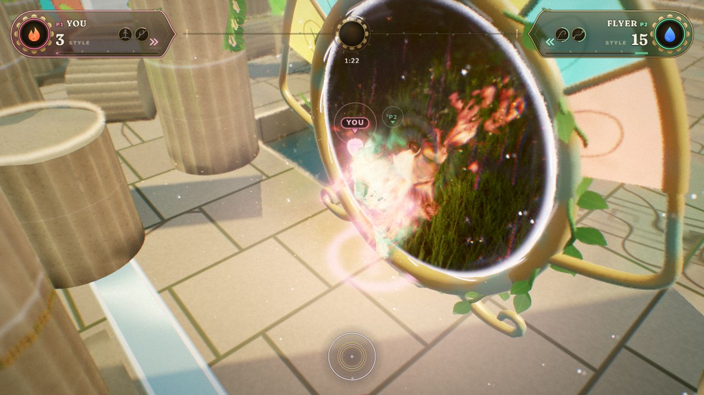
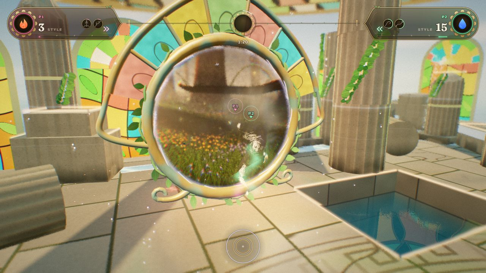
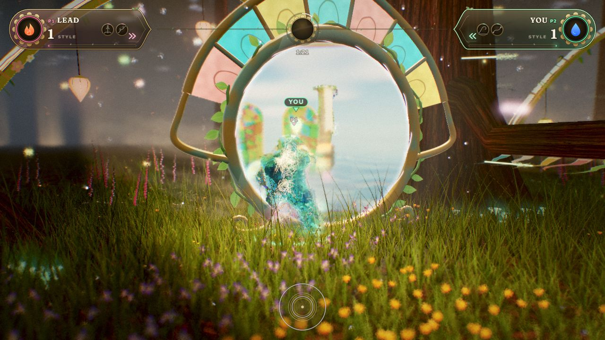

# Phase 6: online. The duel crosses the mirrors over the network

Branch `p6-online`. Report 19, issue 4: online, the mirrors were shut. The room server (`server/duel.ts`) played the
whole duel in the world the room began in, so the flowing world only worked for one player at a keyboard, offline.
Now an online duel crosses the mirrors the way the offline one does:
- the server judges the crossing and brings both bodies through;
- it switches the arena, the solids, the hazard and the music's clock, and the set goes on;
- each page predicts its own crossing and follows the server's;
- a watcher follows too.

Dev server on **5487**. `npm run test:net` (port 5418) was run by this agent only, as the brief allows. The two-page
check used a room server on 5419.

## Before

| | online duel, before |
|---|---|
| mirrors | shut while the duel is on (`keep = online || …` in index.ts) |
| the server's world | the room's first world, for the whole set |
| Node harness (`sim.ts`, `match.ts`) | no world change; the page swapped the match's arena from outside |
| crossings counted | 0 (nowhere to count them) |

The "before" still is report 18's: an online duel in the temple with its gates shut, the same frame as
`media/18-wayfinding-duel-before.jpg`.

## What changed

### 1. The crossing as one piece of shared code (`src/duel/crossing.ts`, new)

The page's gates (`Portals.travelPhase`, `bring`) do the crossing with the drawing in hand. `crossing.ts` is the same
rule as pure numbers, and it is used in three places: the Node harness, the server's authority and each page's
prediction. It holds:

- **The gates' table** (`duelGateDefs`, `Doors`): every gate between the four worlds, paired as the page pairs them.
  That is the geode's three, each world's gate back to the geode, and the six mirrors. Each world's own gate to the
  geode is written in its world class, which Node can't import, so `OWN_GATES` copies them. `gateDiff` lets the page
  check its open gates against the table: online.ts warns if they drift apart.
- **The judge** (`CrossJudge`): a body whose middle passes an open disc within 15 cm of its rim crosses (the page's
  margin). After a crossing, both bodies are held back:
  - for 1.5 s;
  - for 4 s more while a body is behind the disc it came out of (report 19: the pair went back and forth through one
    mirror).

  It counts the crossings it held back (`held`), for the measures.
- **The carry**:
  - `carryBody` moves a Character by the gate's move: its root, velocity, yaw, pose, the move under way, its floors
    and walls.
  - `bringMove` brings the partner along as `Portals.bring` does. Joined, it goes by the gate's own move. Free, it
    comes out in front of the far disc, 0.7 to 1.6 m out.
  - `carryLink` carries a joined pair's link.
- **The event shape**, `DuelCross`: who passed which gate, the gate it came out of, from and to which world, through
  which face, where on the disc, and joined or not. The server adds its tick, the count and the new music clock
  (`DuelCrossing` in `shared/protocol.ts`).

**The middle is the root, 0.95 m up, not the drawn hips.** Server and prediction agree on the root to a millimetre.
The pose's hips are turned by where each side thinks the other body is, and differ by centimetres. With the hips, a
follower's predicted crossing landed three ticks before the server's and was put back a moment later: 5 times in a
20 s run, and the shown world flipped each time. With the root, it never happened in the in-process runs.

**The hold is 1.5 s, joined or free.** The page's offline duel holds a free pair 0.6 s. Online, a pair at a mirror
went through every 0.7 s, faster than a page 400 ms away could hear of one crossing before the next.

### 2. The Node harness changes world (`sim.ts`, `match.ts`, `measure.ts`)

- `DuelMatch.moveTo(arena, plane)` replaces the page's `Object.assign` from outside.
- `simulateDuel({ mirrors: true })` judges a crossing every step. When one happens it:
  - takes the new world's arena, solids, hazard and plane;
  - settles the powers;
  - lets the set go on;
  - records each crossing in `result.crossings` (`{ t, ...DuelCross }`) and `result.world`.

  Hazard rides are summed across the worlds. With mirrors off (the default) nothing changes, so the measures stay
  comparable.
- `node scripts/duel-measure.mjs --mirrors 1` prints the crossings: how many a set, into which worlds, how many joined,
  how many within 3 s of the one before.

| `duel-measure --mirrors 1 --sets 8` | crossings | a set | sets that crossed | into | joined | within 3 s of the last |
|---|---|---|---|---|---|---|
| temple | 5 | 0.63 | 3 of 8 | geode 1, Pool 2, redwoods 1, temple 1 | 3 | 0 |
| redwoods | 6 | 0.75 | 3 of 8 | temple 3, redwoods 1, geode 1, Pool 1 | 3 | 1 |

These are the virtual players' accidental crossings (they don't aim at mirrors yet: p6-crossing). The 1.5 s hold
already keeps them from going back and forth.

### 3. The server crosses (`src/net/duel-authority.ts`, `server/duel.ts`)

After each tick's bodies, contact, powers and hazard, the authority runs `crossPair`. When it returns a crossing,
`moveTo` does the following:

- **The world:** the room's world, arena, solids, hazard and plane become the new world's. The powers settle. The
  past poses kept for the rewound catch are cleared, since they were in the other world's coordinates.
- **The music:** the clock becomes the new world's tempo from the old clock's next bar line. This is the jogo's
  `retempo` rule, so a page's beat stays on the bar.
- **The tick's events:** the crossing goes out to every page as `x` in the tick's `dev` message, in order with the
  rules' events.
- **Every snapshot** carries the world it is in (`w`) and the crossings so far (`xi`).
- **The welcome** (what a joiner is told) has the current world, the crossing count and the last crossing. A seat that
  drops and comes back, a new watcher, or a page reloaded after a missed crossing lands in the world the duel is in
  now. The address contract holds: `?duel&net=ROOM&world=…` gives a new room's first world, and a page opened on another
  world is sent to the room's, as before.
- `/duels` lists each room's world, its crossings and the crossings the judge held back.

A hello for a world the server can't build is still refused with `error duel` (tested).

### 4. The pages cross (`src/net/duel-client.ts`, `src/duel/online.ts`, a few lines of `src/duel/index.ts`)

- **This seat's own crossing is predicted.** The predicted body runs the same judge and carry as the server, so it goes
  through the disc the moment its middle passes, with no round trip.
- **The judge runs on the server's tick.** It uses the tick the input will be stepped on, estimated from the last ack.
  A crossing heard from the server holds the body back from the server's tick, however late the page heard of it. The
  page holds back 0.1 s longer than the server (`CLIENT.HOLD_PAD`). Predicted a tick early, a crossing at the end of
  its hold was put back a moment later. Predicted a tick late, the server's word brings the body along instead,
  without a flip.
- **Brought along on the server's word.** When the other body crosses, the server's event brings this body along
  straight away, from where it stood at the input stepped on the crossing's tick (the hist, by the last ack). Every
  state predicted since is moved by the same rigid move, so the acks to come match. Without this the partner's error
  around a crossing was 1 to 5 m (p95). With it, it is 20 to 64 mm.
- **Corrections work across worlds.** The kept state is carried into the server's world before the replay (its pose,
  its move under way: a move's start point left in the old world dragged the body 16 m). The error is measured where
  the gate puts it.
- **The other body's playback goes through the disc without a cut.** Snapshots are kept in one frame across worlds
  (`toF`: each world's coordinates in the first world's), and sampled back into the shown world.
- **One shown world** (`shownWorld`):
  - a seat shows its predicted world;
  - a watcher shows the world its playback (a little in the past) has reached.

  Each change is queued for the page (`takeCrossings`: the gate, the face, joined or not, and why). online.ts hands it
  to index.ts, which brings both dancers through with `Portals.bring` and moves the duel with its own `moveTo`
  (camera transit, music, hazards: the offline crossing's own path).
- **No flip-flop on screen:**
  - a seat's shown world going straight back to the world it just left is shown only once the prediction has held
    there 250 ms;
  - a seat no longer switches its shown world when its body starts or stops being shown from the server (joined,
    carried). That alone made 3 of the flips in one run.
- **The page's own gates judge nothing of the duel's two bodies online.** They are held back each frame, and the
  server's word is the crossing. The mirrors are open online, and the "mirrors" chip is offered online too.
- **A missed crossing.** A snapshot can arrive before the event of its crossing (the conditioner can let it pass the
  events), so it is kept back until the event comes. Still ahead after 2.5 s, the crossing was missed, as on a dropped
  connection. The page then reloads into the room's world, and its token keeps the seat.

**For p6-crossing.** The camera, the music's moment and the virtual players' aim plug into these hooks:
- `DuelCross` / `DuelCrossing` (the event shape);
- `index.ts`'s `crossed` hook, which takes a `ShownCrossing` with `why`: predicted, server or corrected;
- `CrossJudge` / `CROSS` (the hold and behind rules, now 1.5 s both ways).

The offline duel still uses `Portals`' own judge with its 0.6 s free hold. Moving it onto `crossing.ts` would make
offline and online the same rule. I left that to the crossing agent's index.ts work.

**For p6-roam (the jogo's room).** The jogo's online room could reuse:
- `crossing.ts` as is: `Doors`, `CrossJudge`, `carryBody`, `bringMove`;
- the `DuelCrossing` message shape, with the music change already using the jogo's `retempo` rule (next bar line);
- the client-side pieces: the one-frame playback across worlds (`toF`, `move(a, b)`) and the shown-world change queue.

The jogo's server is not authoritative over bodies, so it would judge with the reporting page's `travel`. The shapes
fit as they are.

## Numbers

### test:net: two virtual players crossing at 0, 80 and 200 ms (`test/duel.test.ts`, real sockets)

- **Seat 1** walks through the mirror of whichever world the duel is in: the temple's to the redwoods, and back.
  Report 18-wayfinding's crossing, there and back.
- **Seat 2** follows seat 1 as its page shows it.
- **A third page** watches.
- Each run is 23 s.
- **"Error near a crossing"** is the prediction's error at every ack within a second of a crossing (the server's, or
  this page's predicted one), measured where the gate puts the body. It leaves out acks shown from the server, frozen,
  or pushed by the other or a power, as the error at large does.
- **The p95 at all acks** sits beside it, for comparison.

| lag | server crossings | page | predicted (server agreed) | brought along | put back | shown world changes | back and forth | error near a crossing p50 / p95 / max (mm) | all acks p95 |
|---|---|---|---|---|---|---|---|---|---|
| 0 | 6 | seat 1 | 5 (4) | 2 | 1 | 6 | 0 | 3.2 / 48 / 824 | 13 |
| | | seat 2 | 1 (1) | 5 | 0 | 6 | 0 | 1.5 / 3.0 / 92 | 4.1 |
| | | watcher | | | | 6 | 0 | | |
| 80 | 8 | seat 1 | 3 (3) | 5 | 0 | 8 | 0 | 1.9 / 61 / 542 | 15 |
| | | seat 2 | 4 (3) | 5 | 1 | 8 | 0 | 0.4 / 19.5 / 94 | 4.0 |
| | | watcher | | | | 8 | 0 | | |
| 200 | 5 | seat 1 | 3 (3) | 2 | 0 | 5 | 0 | 7.9 / 28 / 867 | 15 |
| | | seat 2 | 1 (1) | 4 | 0 | 5 | 0 | 2.3 / 7.2 / 1629 | 7.3 |
| | | watcher | | | | 5 | 0 | | |

Every page ended in the server's world, shown and predicted. The two seats' event logs, crossings included, were
identical. The server's tick stayed at 0.2 to 0.9 ms mean.

The maxima of 0.5 to 1.6 m are single acks when the partner was brought along free. The partner's free bring depends on
where it stood at the crossing's tick, and the tick is only known to one or two (a queue that leaned meanwhile). The
correction then eases it, or cuts it (1 to 3 cuts a run).

### In process (`src/net/duel-cross.test.ts`, `npm test`): server and pages in one process, fixed delays

Deterministic, with no sockets.

| run | crossings | error near the crossing, p95: crosser / brought | shown changes per page | put back |
|---|---|---|---|---|
| 0 ms round trip, once to the Pool | 1 | 6.9 / 19.4 mm | 1, 1, 1 | 0 |
| 80 ms | 1 | 19.6 / 20.1 mm | 1, 1, 1 | 0 |
| 200 ms | 1 | 19.6 / 19.3 mm | 1, 1, 1 | 0 |
| 200 ms + 40 ms jitter, there and back for 40 s | 6 | 10.5 / 18.3 mm | 6 each | 0 |

### Two real pages in headless Chrome against my own server (`test/two-duel-cross.mjs`)

Three Chromes on the 5090 at 1280×720: seat 1, seat 2 and a watcher. The game is from the dev server on 5487 and the
room server on 5419. The walker and the follower are virtual players set through `bend.duel.setBrain`, and their thumbs
go to the server as a person's do. Each run is 25 s.

| lag | server crossings | seat 1: predicted (agreed), brought, put back, back and forth, error near p95 | seat 2: same | watcher: changes, back and forth | every page in the server's world |
|---|---|---|---|---|---|
| 0 | 7 | 8 (6), 1, 1, 2, 18 mm | 1 (1), 6, 0, 0, 2.8 mm | 7, 0 | yes |
| 80 | 8 | 7 (6), 2, 1, 0, 32 mm | 1 (0), 8, 1, 0, 7.9 mm | 8, 0 | yes |
| 200 | 8 | 8 (7), 1, 1, 1, 16 mm | 2 (1), 7, 0, 1, 14 mm | 8, 0 | yes |

How the page's main view went over (offline's `how`): mostly `flash`, the cut under the mirror's light, because the
duel camera stood beside the mirror's plane. A few went `through`, and one `late` a run. That is p6-crossing's area.

Seat 1 walks back into the disc the moment it is through, which is the hardest case. Its pages still show 0 to 2
back-and-forths a run. Each is a seat-1 prediction the server didn't make (1 a run), shown for under 250 ms, or
returning after the 250 ms hold. The watcher never goes back and forth.

## Tests

- `npm run typecheck`: clean (src, server, test).
- `node scripts/test-ts.mjs`: 27 of 27 files pass, two of them new:
  - `src/duel/crossing.test.ts`: the table's 12 gates are paired; walked through, the pair comes out with the partner
    in front; no walking straight back through; joined keeps its shape; the harness counts crossings.
  - `src/net/duel-cross.test.ts`: the in-process server and pages.
- `npm run test:net`:
  - rules, room, codec, localnet, integration and smoothness pass.
  - `duel.test.ts`: 10 of 11 in the last full run. The 0 ms run of the existing "two virtual players" step failed its
    "at no lag the prediction is close" check (p95 67 mm against 60) in that run.
    - Run alone three times, it passed at 0 ms twice.
    - In the one run that failed, the server's tick hit 718 ms and snapshots dropped to 18/s: the machine is shared
      with other agents' GPU captures.
    - That step's virtual players now sometimes cross a mirror by accident: 1 to 2 crossings a run. Their sight is
      fixed to the temple.
  - The three new crossing steps, the watcher and refusal step, and the rejoin step passed. The crossing step checks:
    - a snapshot says its world;
    - a seat that drops after the crossings comes back with its token and is told the duel's current world and count;
    - a client made from that welcome stands in the right world.
- check-limits, check-bindings, test-audio: not run (no shaders, audio or bindings touched).

## Files

New:
- `src/duel/crossing.ts`
- `src/duel/crossing.test.ts`
- `src/net/duel-cross.test.ts`
- `test/two-duel-cross.mjs`

Changed:
- `shared/protocol.ts`: `DuelCrossing`; `x` in the tick's events; the welcome's crossings
- `server/duel.ts`: `x` in `dev`
- `src/net/duel-authority.ts`
- `src/net/duel-client.ts`
- `src/net/duel-entry.ts`
- `src/duel/online.ts`
- `src/duel/index.ts`: five lines (the `crossed` and `dancers` hooks, gates open online, the chip)
- `src/duel/match.ts`: `moveTo`
- `src/duel/sim.ts`
- `src/duel/measure.ts`
- `test/duel.test.ts`
- `docs/extending/network.md`
- this report and its three stills

## Not done, and unverified

- **A joined crossing over the network is not exercised.** The scenario's crossings are all free. The joined rule is
  unit-tested (`crossing.test.ts`: the pair keeps its shape) and shared code, but no test grips across a mirror online.
- **The page's look of an online crossing is not verified:**
  - the camera mostly cuts under the light (`flash`), as offline;
  - in one still, seat 2's own body is seen through the disc toward the old world a moment after the page moved;
  - the dancers' matter carried by `bring`, the music's change at the bar, and the hazard handed over are seen only in
    stills and logs;
  - p6-crossing owns the camera and the music.
- **The offline duel still uses its own judge** (Portals, 0.6 s free hold). The online rule is 1.5 s. Making them one is
  a small change in index.ts's offline listener.
- **A reload is the recovery for a missed crossing.** A seat that drops during a crossing reloads into the room's world
  (the token keeps the seat). It is not a seamless rejoin, and it is not exercised in a browser. The Node rejoin test
  covers the welcome.
- **The soft edge (match.ts) is not predicted.** It pushes a body near the arena's rim, outside the mirror lanes, and
  the prediction doesn't know (it never did). Near the redwoods' mirrors, which stand 9.5 m out on an 11 m space, it
  shows up as corrections.
- **The flip-flop isn't zero in the hardest case:** a walker that turns back into the disc it just came out of, at
  200 ms. It is 0 to 2 shown back-and-forths in 25 s on seat 1's page, each under a quarter second. A person dancing
  through a mirror and away doesn't do this. The scripted walker does, every time.
- **`test/two-duel-cross.mjs` is not in `npm test`.** It needs a GPU and a dev server. After a still, the script
  restarts the page's loop: `bend.grab` leaves `kit.manual` on, and the loop stops for good. Other capture scripts
  that grab mid-run should know this.
