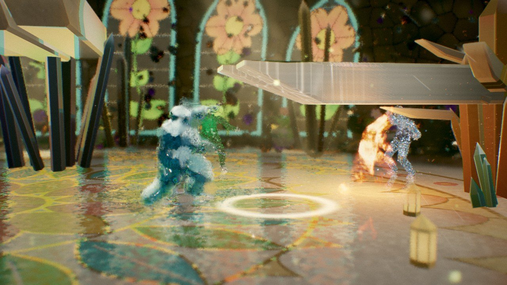
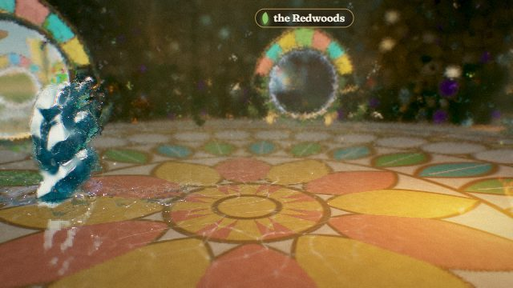
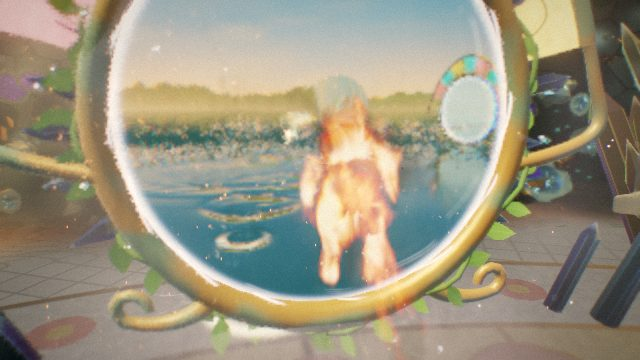
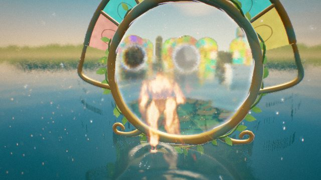
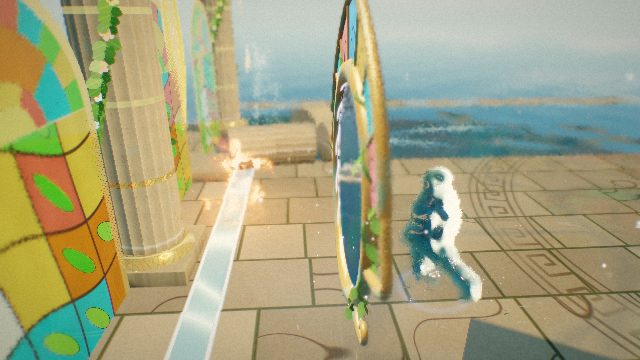
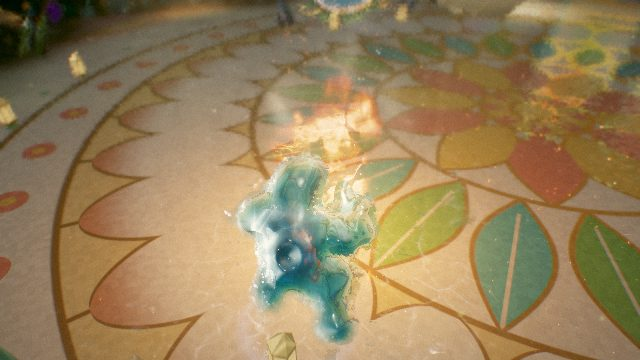
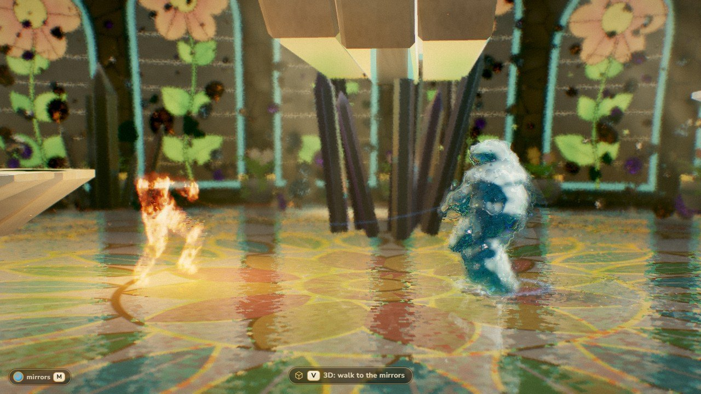
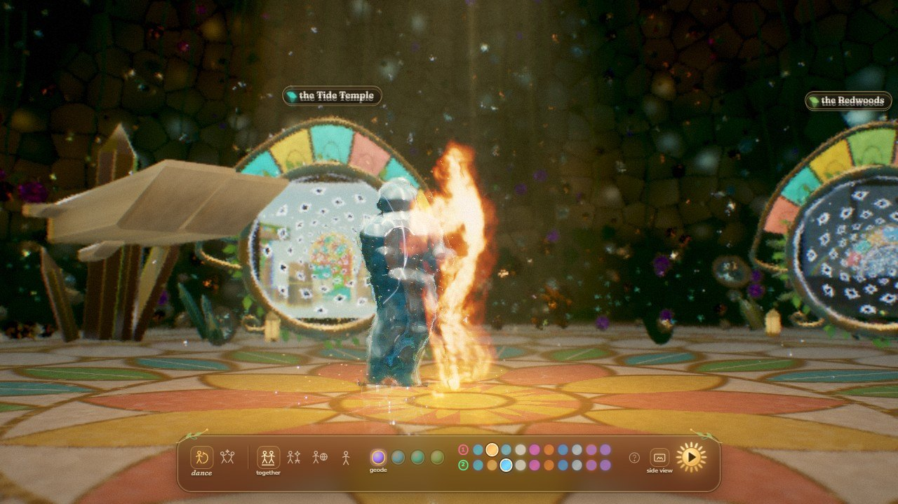
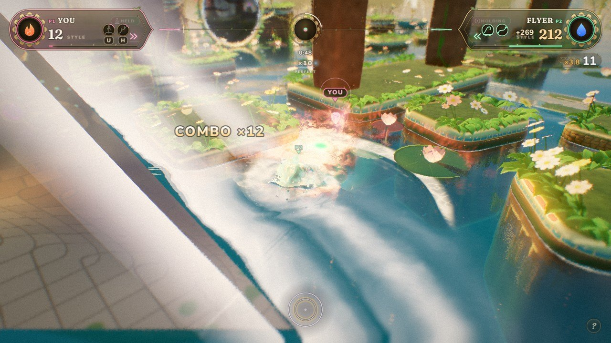

# Phase 6: roam. The dance in open 3D, through the mirrors

Branch `p6-roam`. After Phase 5 the owner played the live site and said: "i still cant go through mirrors. im
constrained to 2d plane still."

**Why.** The front's default game is the dance (the jogo, `src/play/`). It opened locked to a side-view plane unless the
address had `&free`. Phase 5's mirrors and open movement were built and tested in `?play` free play and in the duel
only. In the game the owner actually opens, the lock plane runs along the hub's floor at z = 0, and every gate stands
off it (the Pool's and the temple's at z = 3, the redwoods' at z = 9.7). Nothing on screen said that V (or Tab) frees
the view. So there was no way to reach a mirror.

Everything below was measured in headless Chrome on the RTX 5090 (1280×720; the clip at 640×360), stepped at 60 fps,
and driven with **real keyboard input**. The page's own keyboard got W, A, S and D presses from Puppeteer; no
`bend.place` or `bend.intent` was used. The dev server ran on 5481. The production build ran through `npm run build`
and the room server (`node server/index.ts 5690`, serving `dist/`).

## Before

| | before |
|---|---|
| the front's default | dance, together, the hub, **side view** |
| from the front to the first crossing | **never**: the lock plane doesn't reach any gate, and nothing says V frees the view |
| the "mirrors" chip (M) in a game begun from the front | never shown. It hid while `body.front` was set, and the front never clears that class. This also hid it in the duel begun from the front |

## What changed

### 1. The dance opens in 3D (`src/play/index.ts`, `src/play/menu.ts`, `src/worlds/geode/front.ts`)

- **The default.** The jogo locks to the side view only for `&lock`. Without it, the dance plays in open 3D. `&free`
  still works (it opens 3D, as it always did), so old links keep working.
- **Scripted jogos** (the films) keep the old default: the side view unless `&free` or the script's own
  `lock: false`. No film changes.
- **The front's view button.** It now reads **3D** (the cube glyph), or **side view** once pressed. Its tooltip and
  aria label say what each view means: "3D, free to walk to the mirrors: press for the side view".
- **The button's choice is kept per game**, under a new key, `energybending.front.side.v2`. Nothing stored before this
  can keep anyone in 2D. Both games open in 3D until someone presses the button.
- **The address.** A choice is written as `&lock` for both games (`hrefOf`, `duelHref`, `front.ts begin`). The dance
  no longer writes `&free`.
- **AGENTS.md** says the same.

### 2. The pair walks through the mirrors together (`src/play/roam.ts`, new)

The jogo already heard crossings. It paused itself while travelling, and the room moved its world and music. But the
partner was left behind, and the jogo stayed paused until the partner happened to walk through too. `roam()` now uses
what Phase 5 built for the duel:

- **The partner comes along.** When one seat's dancer crosses, the other seat's dancer is brought through just behind
  with `Portals.bring` (free, about 1.6 m out of the far disc), if it is this page's own (the partner brain, or a second
  player on this screen). The one who crossed is held from crossing straight back for 0.6 s (`Portals.holdBack`).
- **The main view follows.** The follow camera brings the eye through the disc behind the pair.
  - If the eye stands on the pair's side of the far disc for 6 frames running, the view goes over at once under the
    mirror's light (`Portals.arrive` and `flash`, as the duel does). That means it is beside the disc and would never
    come through it.
  - It does the same if the eye isn't through in 1.6 s, because the dance waits for it.
  - The 6-frame rule matters: on the frame the eye passes through the disc, it is already on the pair's side for one
    camera phase, before the gates' phase carries it. A one-frame test turned real crossings into cuts.
- **The new world.** The room's travel (as before) moves the jogo's world. Its music takes the new world's track from
  the room's next bar line. The jogo resumes once both seats are in the world on screen. A locked player is locked
  again onto the new world's stage.
- **Saying the way.** The "mirrors" chip (M) now shows when the dance begins, and in a duel begun from the front
  (`labels.ts`: hidden on the front only while nothing plays).
- **`bend.jogo.stats()`** gains `crossings` (from, to, how the view went over: `through`, `flash`, `late`), each seat's
  `world`, the `world` on screen, and `side`.

The test clip (640×360, about 18 s, every third frame) is `docs/reports/media/20-roam-clip.mp4`. It is git-ignored,
like all media there, and stays on disk. It shows the front, one key, and the walk geode → Pool → temple → hub.

### 3. The side view says how to roam

When the view is locked (chosen on the front, or toggled in play), a chip at the bottom of the screen says
**[V] 3D: walk to the mirrors**. On touch it says "tap for 3D: walk to the mirrors". Clicking or tapping the chip
frees the view, as do V, Tab, a gamepad's View button and the touch pad's lock button. The chip fades out in 3D.

I chose this over making mirrors crossable from the plane. No mirror or hub gate stands on any world's lock plane, and
moving them onto it would cut across p6-crossing's and the worlds' sites.

### 4. Online (the jogo's room): the crossing follows

The jogo's room turned out simpler than the duel's server: its `travel` message already moves the room's world and its
music. Three small fixes in `index.ts`:

- **Each page sends its own dancer's world** with its pose (`gates.worldOf`), not the world on its screen, which lags
  the crossing by up to a second.
- **The receiving page draws the other seat in the world its poses name** (`Portals.place`). The other seat is seen
  through the mirror, not standing in the wrong world's coordinates.
- **The receiving page's own dancer is brought along** when its gates see the other seat pass through the disc
  (`roam`, `local`: this page's seat only). The pair goes through together on both screens.

`scripts/steps/roam-online.mjs` checked this. Two live pages (each its own headless Chrome) joined one room on a room
server on port 5689. Seat 1 stood 3 m in front of the hub's gate to the Pool and walked in on the real W key.

| page | before | 2.5 s after seat 1 went through (0.8 s of W) |
|---|---|---|
| A (seat 1, walked) | room geode, view geode, both seats geode, "Inside the Geode" | room **pool**, view **pool**, both seats **pool**, "The Still Pool" |
| B (seat 2) | the same | room **pool**, view **pool** (under the light), both seats **pool**, "The Still Pool" |

This is one run. The pull on B depends on B's gates seeing A's poses pass through the disc. If B's jitter buffer cut
across the disc (a pose more than 3 m from the last), B would only re-home A, and B's own player would walk through
themselves. I didn't measure that case.

## Numbers

**From the front to the first crossing.** One key (W) on the front, then a scripted "first-timer" who steers W, A, S
and D by what the camera shows toward the nearest gate it sees. The clock is game seconds stepped at 60 fps, from the
key press.

| | before | after (dev) | after (production build) |
|---|---|---|---|
| dance, defaults, hub: to the first crossing | **never** | **5.1 to 6.2 s** (runs of 6.2, 5.3 and 5.1 s; 7.5 s with an earlier, clumsier walker) | **5.5 s** |
| dance, side view chosen on the front: V, then to the first crossing | never (no hint) | **6.1 s** (the chip shown; V; walk) | |
| the tour, geode → Pool → temple → hub | impossible | 5.1 s, 13.2 s, 23.5 s from the key; every leg had the partner through on the same frame and the new world's track | |
| the duel, defaults (partner, 3D, hub): to the first crossing | (Phase 5: works) | crossed geode → Pool, duel world, seats and view all Pool (18.3 s, mostly the bot steering under the duel's own camera) | |

**How the main view went over** (the tour, `stats().crossings[].how`):

| crossing | how |
|---|---|
| geode → Pool | `late`. The Pool is water: the pair swims slowly out of the disc, and the eye won't come nearer than 1.5 m to a player standing at the face, so it waited. Now cut under the light at 1.6 s, not 3 s |
| Pool → temple | `flash`. The eye swung beside the disc as the partner came out 1.6 m in front |
| temple → hub | `through`. The eye came through the disc behind the pair, no cut |
| redwoods → hub (a straight walk) | `through`, 0.2 s after the player |

**Controls in 3D.**
- **Keyboard:** checked with real keys, every number above.
- **Touch:** checked on a phone (`--phone`). A tap on the dancers begins the dance in 3D, both seats join, the touch
  pad and its lock button show, and the "mirrors" chip shows.
- **Gamepad:** not driven here. Its free-mode mapping is covered by `src/input/test/input.test.ts`, and its View
  button toggles the view as V does.
- **The partner brain** plays in 3D (`plane: null`: src/ai's PartnerBrain has its own free branch). It followed through
  every crossing because it was brought, not because it walked.

**GPU.** Nothing new is drawn; the chips are DOM.

## Tests

- `npm run typecheck`: clean.
- `node scripts/test-ts.mjs`: 25 of 25 files pass.
- `npm run build`: builds. The production build's tour crossed at 5.5 s.
- `npm run test:net`: not run (port 5418, per the brief).

## Probes (in `scripts/steps/`)

- `roam-probe.mjs`: the wf-probe with `grab` (canvas frames for a clip), `--size` and `--lib`.
- `roam-lib.js`: the first-timer's steering. A held key keeps the camera's turn from when it went down
  (`CameraRig.stickYaw`), so the walker judges its keys by that turn and lets go a frame to change them.
- `roam-tour.js`, `roam-side.js`, `roam-duel.js`, `roam-phone.js`, `roam-online.mjs`.
- Run: `node scripts/steps/roam-probe.mjs "" scripts/steps/roam-tour.js --lib scripts/steps/roam-lib.js`.

## What's not done, and seen along the way

- **Cuts.** Two of three tour crossings still go over under the mirror's light rather than through the disc. When the
  partner comes out in front, the follow camera swings beside the disc. This is camera feel (`engine/camera.ts`
  `passThrough`, p6-crossing's area). The fallback is the duel's.
- **The duel has the same one-frame race** (`src/duel/index.ts`, the `stuck` test in the camera tick). It may call a
  real crossing a flash. I left it to p6-crossing.
- **The duel still image:** 1.5 s after the crossing, the duel's camera stands against the mirror's frame (the white
  blur on the left of `20-roam-duel-crossed.jpg`). Also p6-crossing's area.
- **Online:** one run, two pages, and the plain case only. A crossing while held, the other seat's pull when the
  buffer cuts, and a guest watching are not measured. The receiving page hears the new world's track before its own
  dancer is through (the room's world is the room's).
- **On a phone** the "mirrors" chip (top left) overlaps a gate's plaque. That layout is from Phase 5.
- **The headless probe's own quirk:** with `bend.grab` between held keys, the walker sometimes ran into a wall until it
  re-read the camera. That was the bot's model, not the game, and it is fixed in `roam-lib.js` (it looks again when it
  gets no nearer).

