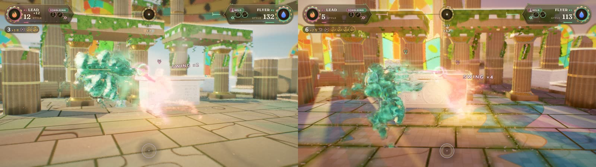
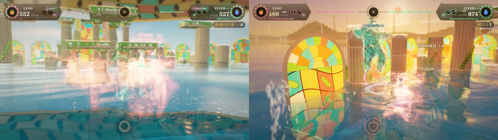
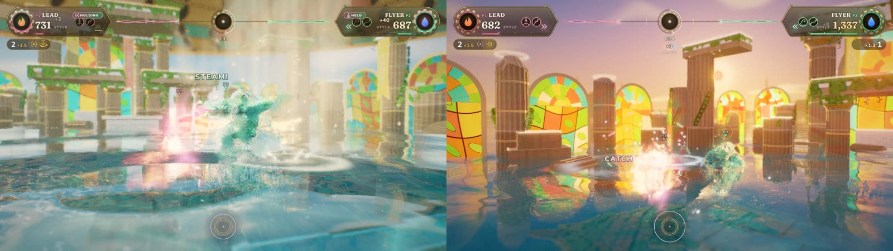
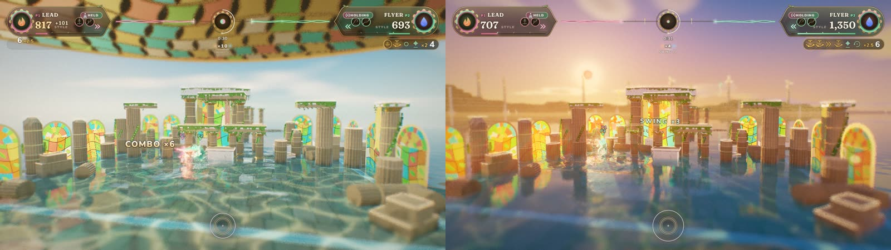
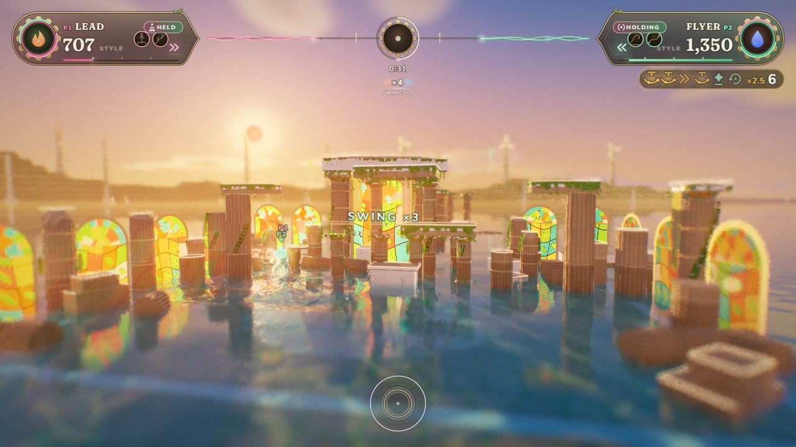
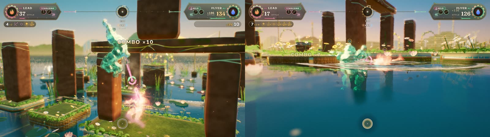
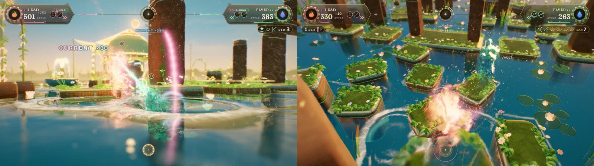
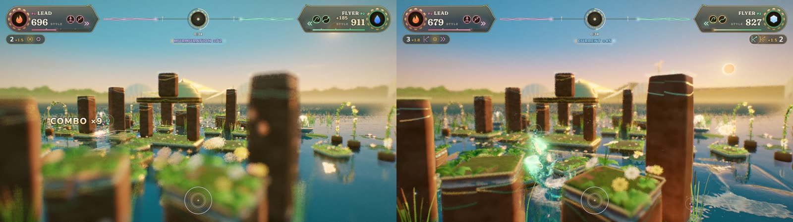
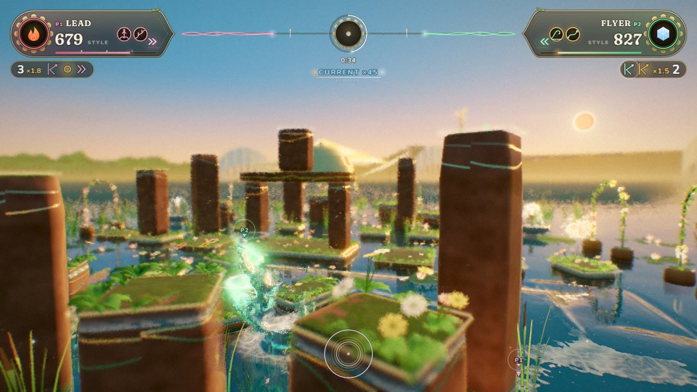

# 20: the sun worlds, the third coat (the temple at golden hour, the far world round the temple and the Pool)

Branch `p6-sun-worlds`, from master `48f568c` (phase 5 merged, report 19). One of the phase 6 agents. Mine is report 19's
issue 1 for the temple and the Pool. They still read as "props on a floor", and the temple was cream on cream under a
white noon. The aim is a place seen whole, with a world beyond the stage, golden light, and a sky that is part of the
art.

**Measured:**

- Stills from the duel's own camera at 1280×720 in the page (my dev server, port 5489, headless Chrome on the RTX 5090),
  master and this branch. The same seeded duels were grabbed at 6, 12, 18, 24 and 30 s:
  - the temple, fire and water, seed 3, with the spring tide logged at each grab;
  - the Pool, fire and water, seed 1.
- A wide establishing still of each world, taken from a fixed pose held by hand. The new `scripts/sun-cap.mjs` does
  all of this. The mirrors were shut for the stills (`&mirrors=0`), so the pair stays in the world asked for (an open
  run crossed into the redwoods at 24 s).
- GPU time per pass with the script's `--timings` (150 frames at the duel's camera, after the 30 s grab).
- `npm run typecheck`, `node scripts/test-ts.mjs` (25 of 25 files; `src/duel/test/edge.test.ts` among them),
  `check-bindings`, `check-limits`.

**Not measured:**

- a person playing, a phone, 1080p;
- motion: the turbines, falls, kites and birds move, but they were judged only in stills;
- the Node duel harness: no solid, ledge, wall, spawn, hazard or mirror moved, so there are no catches or falls to
  compare.

## The far world: `src/worlds/vista.wgsl` (new, shared)

Both worlds had nothing past their stage: an empty sea, or a low line of trees. Now a far world is painted on each
world's sky as a function of the direction looked in. It has no geometry and no texture. Each world gives it its own
seed, sun and haze (`VistaLook`). The layers, far to near, each in more haze:

- **ranges of hills** far off, a blue line in the haze;
- **terraced garden islands**. Each tier is a cream retaining wall (some with arcades) under a green garden of tree
  crowns, a few in flower. The low sun catches each tier's lip, and the islands toward the sun stand back-lit and
  darker. **Waterfalls** run down them, white threads that widen at each tier, with mist at the foot;
- **garden spires** on the islands: white ceramic towers with vines and a band of solar glass. Some carry a glass dome
  on brass ribs with a finial. Others carry a **turbine like a flower**, three broad petals turning slowly, lit through
  by the sun;
- nearer, an **aqueduct** on its arches, mossy along its channel, spilling a fall into the sea at its end, and **sails**
  on the water;
- over them, **kites** on long waving tails with bows, and a small flock of **birds** gliding across, their wings
  beating now and then.

How it is drawn:

- The backdrop writes each layer's own distance (110 to 600 m) as the pixel's depth, so the air's haze lies over it by
  that much.
- Everything that mirrors the full sky mirrors it for free (the water's reflection, `templeSky(r, 1.0)` and
  `poolSky(rs, 1.0)`).
- Edges are a pixel soft, from the lens's pixel angle.
- In the Pool it stands behind the garden shore, which hides its foot.
- It is infinitely far, so it is never in play's way, and the mirrors show it from the other side.

## The temple: golden hour (`temple.ts`, `temple.wgsl`, `backdrop.wgsl`)

### The light

- **The sun** is low and inside the duel's frame: 9.5° up in place of 34°, and −0.55 rad round in place of −1.05, so
  it stands behind the stage and to the left. It is warmer (`#ffc485`) and stronger (2.1). Its disc is less fierce
  (9× in place of 30×), or its bloom veiled the whole frame.
- **The sky** is deep teal overhead going down to warm gold. Low on the far side it is cooler, pale teal to lavender.
  The warm glow gathers round the sun.
- **The clouds** are cumulus banks over the sea. Each is lit by how much less cloud lies toward the sun from it, so it
  is lit on its sun side and shaded on its far side. They are peach and gold where lit and lavender in their own
  shade, with a silver lining on the thin edges near the sun.
- **The shade** is cooler and deeper. The ambient takes more of the zenith's blue and less of the warm horizon, and the
  warm bounce on the stones' fronts is lower (`afterglow` 0.32 → 0.2).
- **The haze** is less than half what it was (`haze` 0.003 → 0.0011).
- **Long shadows.** At this sun a column's shadow runs across the whole court. In the duel the arena's own standing
  stacks and tall columns now throw shadows too: `cols` is switched to the duel's set while its arena is shown, the 24
  nearest the middle.
- **The vault is gone from the frame.** The stained-glass canopy painted into the sky started 13° up. The lower phase 5
  camera had it across the top of every frame, a striped awning with dark blotches (the "before" stills). It now starts
  at about 32°, out of the duel's frame, still overhead and in steep reflections. Lit clouds stand where it was.

### The stained glass's light

The screens are the 13 stained-glass windows of report 18: the gate, the colonnades and the back walls. Their places
now ride in the light uniform (`Temple.screens`, from `garden.ts`'s layout).

- **Coloured light pooled on the stone** (`templeScreenLight`). Each screen the sun stands behind throws its window
  along the light. At this sun the window is long. It softens and fades the further it falls, and its colour is added
  to the floor's light. The panes are laid out as the screen lays them: a curved grid below and a rose of petals in the
  arch.
- **Shafts of coloured light in the air** (`templeShafts`, in the air pass). For each screen the sun is behind, the
  shaft is the screen's rectangle swept away from the sun. Along the view ray, its length inside each shaft is found in
  closed form, as the overlap of four slabs. That length is lit in the colour of the glass the ray's middle came
  through, brighter looking toward the sun.
- **The sun's glow in the air** toward it over the court (`sunAir`).

### The ground

- **A lotus mosaic** of glazed tesserae inside the carved ring: teal petals, a gold inner flower, a gold disc in the
  middle, worn where the most feet go. It reads through the tide at high water, as in the concept.
- **Moss creeping out of the joints**, greener and further in than before, with a small cream or coral flower in some.
- **Play is unchanged.** The floor's surface, the drops, every solid and the tide are as they were.

### Its params

`screenPool` 0.22, `shafts` 0.012, `sunAir` 0.08. At my first numbers (0.55, 0.05, 0.35) the court was a patchwork of
pastel light and the frame looked milky.

## The Pool: the golden hour made to glow (`pool.ts`, `pool.wgsl`, `backdrop.wgsl`)

- **The sun** stands at 7.5° in place of 17°, so it is in the duel's frame. It is a little larger (2.2°) and sinks
  less over ten minutes (1.5°). Its face is a little softer (10), and two wider glows were added round it.
- **The sky and the haze:** the sky is deeper overhead (`#4a8ab8`), the horizon warmer (`#f5b77a`), and the horizon's
  glow stronger (`glowAmt` 0.55 → 1.05). The mist is warmer and lighter.
- **The far world** (above) rises behind the garden shore and its pavilions: the terraced islands with their falls,
  the spires and turbines, the aqueduct and the kites.
- **The water** mirrors all of it. The sun's road, the glints and the swell are unchanged.

## Contrast and the bodies

- **The temple at low tide.** The pair stand on the warm floor with coloured pools of light round them.
  - The fire body is still the brightest thing.
  - The water body is teal against honey stone and warm light, which reads better than against cream.
- **The temple at high tide.** The water is a deeper teal with the warm sky and the glass broken in it.
  - The pale fire body reads well against it.
  - A water body on teal water reads about as it did before.
- **The coloured pools.** Their strength is kept low (0.22 of the sun's) and their colours are deep, so they never come
  up to a body's brightness.
- **The Pool.** Little changed near the pair. The sun and the far world sit above and behind them, at the horizon.
- **The sun in frame.** It sometimes stands near a flying body. Its disc is small, but its glow lightens the sky behind
  a body there. I saw no body lost against it in these stills.

## Numbers

**GPU** (1280×720, 150 frames at the duel's camera after the 30 s grab, mirrors shut). The GPU was shared with other
agents (86 % busy in one check), so each figure is one run, and noisy:

| ms | temple, master | temple, this branch | Pool, master | Pool, this branch |
|---|---|---|---|---|
| scene pass | 0.545 | 0.475 / 0.737 (two runs) | 0.205 | 0.215 |
| air pass | 0.071 | 0.134 / 0.150 | 0.095 | 0.123 / 0.153 |
| glow pass | 0.127 | 0.130 / 0.127 | 0.128 | 0.133 / 0.193 |
| whole frame | 1.90 | 2.01 / 2.22 | 1.51 | 1.67 |

- **The temple's air pass:** about +0.07 ms. That is the coloured shafts: 13 screens, a slab test each per pixel.
- **The temple's scene pass:** the backdrop's clouds, the vista, the mosaic and the screens' light on the floor. Two
  runs gave −0.07 and +0.19 ms against master's one run. Call it up to about +0.2 ms.
- **The Pool's scene pass:** about where it was. The vista only touches sky pixels.
- **The Pool's air pass:** its code did not change. The difference there is the busy GPU.
- **Not measured:** 1080p, a quiet GPU, a phone.

**Bindings and uniform** (`check-bindings`): within the baseline, 186 entry points, nothing new bound. The world light
uniform grew by 528 bytes, from 4,720 to about 5,250 of 65,536: `Temple.screens` (32 vec4) and `Temple.shafts`.

**Play:** no solid, ledge, wall, drop, spawn, hazard or mirror site changed. `edge.test.ts` (the mirrors' lanes) passes.

## Stills

From the duel's own camera at 1280×720, master on the left and this branch on the right. Each pair is the same seeded
duel at the same second, but not the same frame (a page does not replay a set exactly).

**The temple at low tide** (6 s, −0.29 m): golden light, the stained glass's colour pooled on the floor, the moss and
the mosaic, the striped vault gone from the top of the frame.

**The temple at high tide** (24 s, 1.34 m before / 1.42 m after): the sun and its glow in the frame, the warm sky and the
glass broken in a deeper teal tide, the terraces on the horizon.

**The temple on the ebb** (30 s, 0.6 m / 0.7 m): the screens lit through, the long light on the water.

**The temple, wide** (a held pose over the court's front, looking over the stage). The sea beyond is now a world: the
terraced islands, spires and turbines under the sun.

**The Pool** (6 s and 18 s): the sun low in the frame, the far terraces and turbines behind the shore.

**The Pool, wide.**

## Judged honestly

- **The temple is the big change.** It is no longer cream on cream at noon. Every frame of these stills now has warm low
  light, coloured glass light and a sky with lit clouds. At high tide it is the closest the temple has come to its
  concept image.
- **The far world is soft.** The duel's depth of field blurs everything past about 15 m, and the vista with it. At 720p
  it reads as hazy terraces and pale towers, not crisp detail. The camera agent's lens could give the horizon more
  focus. I did not touch it (`src/duel/camera.ts` and the post chain are not mine).
- **The duel's camera rarely shows the horizon.** In most frames it is among the stones; the vista shows in about a
  third of these stills. The wide stills show what is there.
- **The Pool changed less.** The sun is in the frame and the far world rises behind the shore. But the duel camera in
  the Pool mostly looks down at the planters (report 18-camera), so most frames are much as before.
- **The terraces read a little blocky** (stepped bands) in the wide stills. They are softer than in my first version.
- **Not done from the brief:**
  - built terraces stepping down from the court into the sea, and falls over the court's edge (geometry outside the
    arena);
  - real geometry at middle distance, which would parallax as the camera moves (the vista is all at infinity);
  - a concept image (none made: I worked from the existing temple and Pool concepts).

## Not done

- Terraced steps and falls as geometry round the temple's court; birds and kites as geometry nearer the stage.
- The vista in a gate's live view and the inset were not looked at apart. They draw the same backdrop, so they should
  show it.
- A world answering a moment (p6-moments' area).
- Not measured: motion, a phone, 1080p, a quiet GPU, a person playing.

## Files

- **New:**
  - `src/worlds/vista.wgsl`: the far world, shared by the two worlds;
  - `scripts/sun-cap.mjs`: the duel's stills at given seconds, the wide still, the timings (`--set` sets params,
    `--open` keeps the mirrors open).
- **The temple:**
  - `src/worlds/temple/temple.wgsl`: the sky, clouds and sun; the vault raised; `templeVista`, `templeScreenLight`,
    `templeShafts`; the air; the cooler ambient. New members `screens` and `shafts`;
  - `src/worlds/temple/temple.ts`: the golden-hour params, the screens and shafts uploaded, the duel's shadow casters;
  - `src/worlds/temple/backdrop.wgsl`: the vista's depth, the mosaic, the moss, the glass's light on the floor.
- **The Pool:**
  - `src/worlds/pool/pool.wgsl`: `poolVista`, `poolSkyWith`, the sun's wider glow;
  - `src/worlds/pool/pool.ts`: the sun and sky params;
  - `src/worlds/pool/backdrop.wgsl`: the vista's depth.
- **Generated:** the `*.d.wgsl.ts` beside them, and those of every shader that includes the world light.
- **Not touched:** `src/worlds/light.wgsl`, the arenas, solids, mirrors and camera.
