# 23: the duel's phase 6 film (one flowing world, the third solarpunk pass), and what holds it back now

Branch `p6-film`, from master `c59f64b` (phase 6 merged: the dance in open 3D and through its mirrors, report 20-roam;
the camera through the disc, the music on the beat, crossings the players mean, report 20-crossing; the online crossing,
20-online; the golden-hour temple and the far world, 20-sun-worlds; the geode's glass vault and the redwoods' canopy
village, 20-dusk-worlds; the world answering a tier and the full-stage bloom, 20-moments; phone fluidity, 21). The
brief: about 30 s from a player's view with the HUD, two virtual players: the front, then the duel in 3D; a crossing
with the camera through the glass, the music on the beat, petals and a ripple; a second crossing if it fits; the
golden-hour temple and its stained glass; the geode's vault and the redwoods at dusk; the world answering a tier; the
bloom and the garland. The owner, after phase 5: they couldn't go through mirrors (the dance was locked to 2D); they
want one flowing world, dancing through mirrors with no cut; the background gem dancers were stilted (gone); the two
bodies must never be one colour family.

**Measured:** 72 whole sets scouted through the film tool itself (so each set dances as it will in the film), the
mirrors open, two virtual players at skill 0.85, about 76 s each (the count-in, 60 s of play, the finale, the banner,
the next count-in), 480×270, every rule, power and hazard event, the words on screen, the camera every 0.1 s, each
crossing and how the view went over, and each change of track with its bridge: 40 on the redwoods' track (ten a world,
seeds 1 to 10: the table below), 16 on the geode's (all begun in the geode) and 16 on the temple's (all begun in the
temple), for the crossings and the film's shots. The dress rotated fire and water, water and fire, ice and fire, fire
and ice (never one colour family: no water with ice, so no freeze), the styles as `duel-page.mjs` rotates them. Each
of the film's three shots against its scout, event for event (`match.mjs`). The film's loudness (ffmpeg's ebur128).
A newcomer's path from the front with real keys (W held, one Enter), stills at 1, 3 and 6 s. `npm run typecheck`,
`node scripts/test-ts.mjs` (30 of 30 files), `check-portals` (10,037 checks). **Not measured:** a person playing; a
phone; the sound by ear (levels and the beat grid only); an online duel; the lock.

## The film

`docs/reports/media/film/duel-p6.mp4` (git-ignored; a copy in the main checkout's `docs/reports/media/film/`):
**31.05 s, 1280×720, 60 fps, H.264 High at 6.1 Mbit/s (two passes), AAC 316 kbit/s stereo at 48 kHz, 25.0 MB**;
loudness **−14.9 LUFS integrated**, true peak −1.8 dBFS, loudness range 1.4 LU (phase 5's: −17.1 LUFS, 3.7 LU). It is
the front (2.15 s, `scripts/front-cap.mjs`, the geode's track under it read from the same file just before the film's
first frame, so the join has no seam) laid before the film tool's picture (`docs/reports/media/film/duel-6-master.mp4`,
111.3 MB, rendered at 1.5× and brought down on the GPU, under the render lock, which was held 22 to 86 s at a time; the
render took 16.3 minutes, most of it the shots' offline scores), the score the film tool laid, one AAC generation.

The timeline is `films/duel-6.json`. **The music is four tracks joined where the pair cross, as the game joins them**:
the geode's ("Inside the Geode", 111.4 bpm) from bar 57, the temple's (94.0 bpm) on the beat after the first crossing,
the redwoods' (113.1 bpm) on the beat after the second, each entering at a phrase of its body whose loudness matches,
the old one bent toward the new tempo and faded over 0.75 s, the new one eased onto its own tempo over a bar and a
half, with the crossing's chime on that beat (in the shot's own score). The last shot is another set, which had danced
into the Pool before its in-point, so the film cuts to the Pool's track on its cut.

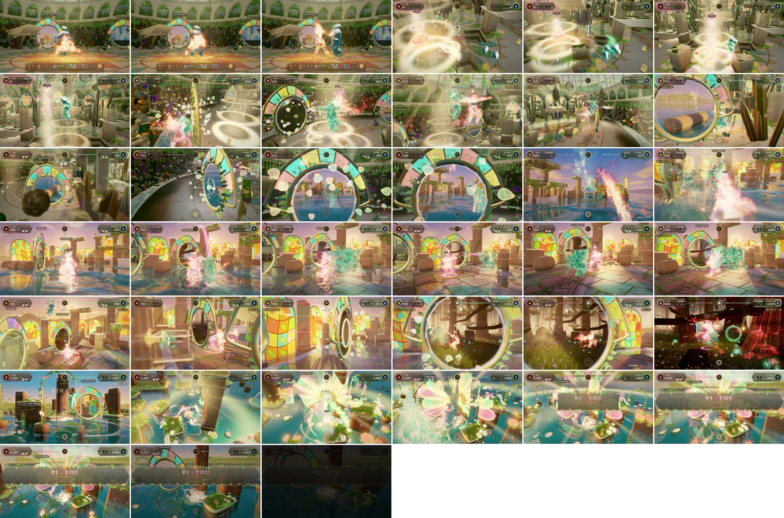

| time | shot | what happens |
|---|---|---|
| 0:00.0 | **the front** (the geode's greenhouse, `front-cap.mjs`) | the two dancers on the lotus floor under the glass vault and its arcade, the mirrors to the Tide Temple and the Redwoods named over their crowns, the strip at the foot; 4 beats |
| 0:02.2 | **the YOU count-in under the glass vault** (fire, a lead, rose: the player; water, a flyer, fern; seed 1) | **3, 2, 1** with the YOU tell (the shaft of sun, the rings, `YOU` over the rose body), **DANCE** at 0:03.8; the first swings among the planters and the selenite |
| 0:05.9 | **one shot, no cut: geode → temple → redwoods** (the same set, 18.2 s) | swings and an air catch at the mirror to the Pool, **CURRENT ×36** (0:07.1) and the world's answer: the light wave over the floor, the planters' flowers opening, the beams; the pair fling at the mirror to the Tide Temple and go through (0:10.0), the camera round the rim and **through the disc behind them**, a ring of light and petals blowing out of the glass, STEAM! at the disc; **the temple's track on the beat** (0:10.8, 0.76 s after the crossing); the golden-hour temple: the low sun, the stained-glass screens and their coloured light on the water, swings and catches at its mirror to the Redwoods, **DUET ×19** (0:18.9: the banners and the glass answer); through that mirror (0:20.4), the camera through the disc again, **the redwoods' track on the beat** (0:20.9, 0.44 s after); out among the trunks at dusk, fireflies, an air catch |
| 0:24.1 | **the fused finale in the Pool** (fire, a lead, rose: the player; water, a flyer; seed 1, a set that danced through the geode into the Pool) | **FINALE**, the fused lift out of the water, **the bloom over the whole stage**: thirteen rose and fern petals off the frame's edges, the sun's beams fanning out behind them, the world lit warm; the garland opens, **P1 · YOU TAKES THE SET** (0:27.6); out at 0:31.05 |

Every moment is the game's own at skill 0.85; each shot's dance matched its scout's event for event (`match.mjs`: 16,
227 and 395 events, 0.000 s apart). Seat 1 (rose fire) is the player in every shot (`bend.duel.you.seats = [0]`).
The redwoods are held at 19.0 h (a film doesn't run the duel's dusk: its hour stays at 8.2 unless the shot sets it).
Shot sheets: `media/23-film-duel-6-<shot>-master-sheet.jpg`.

### How it was made

1. **The film tool learned the phase 6 music** (committed, below): a crossing in a film now crosses the music as play
   does, and `film.mjs` lays the tracks as the page's deck plays them.
2. **Scouted** (`docs/reports/media/film/p6/`, git-ignored, deleted once done: `scout.mjs`, `numbers.mjs`,
   `match.mjs`, `sheet.mjs`, `final.mjs`, `newcomer.mjs`): 72 sets, about 100 s each, three at a time.
3. **The long shot.** Of the 16 geode-track sets, seed 1 crossed geode → temple at 21.2 s and temple → redwoods at
   31.1 s, both through the disc, with CURRENT 2 s before the first: the whole flowing world in one take. (Seed 2 went
   geode → temple → redwoods within 1.8 s: too quick to see the temple.) Before the fix below, the same set's second
   crossing showed the geode for 2.7 s while the pair danced in the redwoods.
4. **The finale.** 12 of the 72 sets fused (17 %); none of the redwoods-track ones fused without a crossing first (the
   pairs danced into the Pool in 5 of 6). The Pool's seed 1 ends with the rose seat, the player, taking the set; the
   temple's seed 1 has the bloom washed pale and the other seat winning.
5. **A preview at 640×360, then the master**, then `final.mjs`: the front's first 4 beats, the master's lossless
   picture and score, fades at the ends, two passes.

## The numbers (40 scouted sets on the redwoods' track, 40 minutes of play)

Phase 6 against phase 5 (report 19: 40 sets, the same track, ten a world, seeds 1 to 10, mirrors open). The worlds'
columns are by the world a set **began** in (37 of 40 crossed). Measured from each set's `go` to its finale. Phase 5
rotated five dress pairs (plasma and gems among them, which don't react; water with ice, which freezes); phase 6 rotated
four, all of which can react and none of which freezes, so the reactions rows don't compare like for like.

| | phase 5 (40 sets) | **phase 6 (40 sets)** | temple (10) | redwoods (10) | Pool (10) | geode (10) |
|---|---|---|---|---|---|---|
| catches a minute (all) | 22.6 | **21.7** | 22.5 | 19.6 | 22.1 | 22.4 |
| … out of the air | 52 % | 53 % | 51 % | 47 % | 61 % | 52 % |
| held moments a minute (frames each) | 11.4 (5.9) | 11.1 (5.7) | 11.1 | 9.0 | 12.8 | 11.3 |
| juice events a minute | 41.2 | 39.7 | 40.2 | 37.1 | 41.5 | 40.0 |
| words at a peak, most at once | 0.98: all 321 one word or none | **1.00: all 341 one word** | 1.00 | 1.00 | 1.00 | 1.00 |
| casts a minute (both players) | 10.6 | 10.6 | 10.3 | 10.4 | 10.8 | 11.1 |
| power forms (a set) | 60 (1.5) | 48 (1.2) | 12 | 9 | 16 | 11 |
| reactions (steam, freeze, melt) | 46 (16, 13, 17): 1.15 a set | 84 (34, 0, 50): 2.1 a set (dress) | 19 | 21 | 17 | 27 |
| pair tiers (DUET, CURRENT, MURMURATION, AURORA) | 93, 45, 15, 1 | 110, 50, 11, 0 | 31, 14, 4, 0 | 28, 10, 2, 0 | 28, 14, 3, 0 | 23, 12, 2, 0 |
| sets whose top pair tier is CURRENT / MURMURATION / AURORA | 20 / 14 / 1 (DUET 5) | 21 / 11 / 0 (DUET 8) | 5 / 4 / 0 (1) | 4 / 2 / 0 (4) | 6 / 3 / 0 (1) | 6 / 2 / 0 (2) |
| solo tiers | 5 | 10 | 1 | 4 | 3 | 2 |
| merges (sets with one) | 36 (27) | 27 (22) | 9 (7) | 4 (4) | 7 (5) | 7 (6) |
| **fused finales** | 4 (10 %) | **6 (15 %)** | 3 | 0 | 1 | 2 |
| the shared energy's peak, mean | 0.90 | 0.88 | 0.92 | 0.83 | 0.87 | 0.90 |
| falls | 1 | 0 | 0 | 0 | 0 | 0 |
| the duel's sounds a minute | 282 | 236 | 240 | 216 | 252 | 236 |
| eye to the pair, median (p90) | 5.5 m (7.7) | 5.6 m (8.3) | 5.6 (8.5) | 5.6 (8.4) | 5.7 (8.0) | 5.6 (8.1) |
| the taller body on screen, median (p10); under a sixth of the frame | 0.31 (0.22); 2.0 % | 0.31 (0.22); 2.4 % | 0.31; 2.8 % | 0.31; 2.6 % | 0.31; 2.3 % | 0.31; 1.9 % |
| **mirror crossings a set** (sets that crossed) | 1.25 (23 of 40) | **1.6 (37 of 40)** | 1.6 | 1.7 | 1.2 | 1.9 |
| … **through the disc / under the flash (a cut)** | **8 / 41** | **54 / 0** (10 stayed: back before the view went over) | 12 / 0 | 17 / 0 | 6 / 0 | 19 / 0 |
| … meant (a voyage) | 0 | 28 | 10 | 6 | 4 | 8 |

(The crossings here are those before each set's finale, as in report 19. Report 19's "words on screen in a peak's
frames, mean" isn't repeated: my measure of it differs from phase 5's and doesn't compare.)

**All 72 sets, the crossings and the music:**

| | phase 5 (84 sets) | **phase 6 (72 sets)** |
|---|---|---|
| sets that crossed | 42 (50 %) | **70 (97 %)** |
| crossings | 90 (1.07 a set) | 126 (1.75 a set) |
| **through the disc** | **14 (16 %)** | **110 (87 %)** |
| **cut under the flash** | **75 (84 %)** | **0** |
| stayed (back through before the view went over: the view never left) | (not counted) | 16 |
| meant (a voyage) | 0 | 54 (43 %) |
| back the way they came within 3 s | 12 | 12 |
| **the music's delay**: the crossing to the new track's first beat, median (p90, most) | 2 to 3.5 s; the film's 3.2 s | **0.53 s (0.76, 0.85)**, 122 crossings; the film's 0.76 and 0.44 s |
| where the new track comes in | its bar 1 (the intro) | a phrase of its body matched for loudness |
| fused finales | 13 of 84 (15 %) | 12 of 72 (17 %) |

**The world's answers seen in the film:** CURRENT ×36 in the geode (0:07.1: the light wave out over the lotus floor,
the planters' flowers opening, beams from behind the pair); STEAM at the geode's mirror (0:10.6); DUET ×19 in the
temple (0:18.9: the banners and the stained glass lifting); the fused finale in the Pool (0:24.3 on: the flower over
the stage, the sun's beams out from behind it, the world round it lit warm, the fountains). Not seen: MURMURATION or
AURORA (the top tier in 11 and 0 of the 40 sets), and the aurora in the sky (the finale's camera looks down at the
water).

- **The crossing is now the rule, not the exception.** No crossing in 72 sets went over under the flash (phase 5: five
  in six). The film has two in one shot, both through the disc. A crossing is meant 43 % of the time.
- **The music comes in on the beat**, half a second after the crossing (it was 2 to 3.5 s), into the song's body, not
  its intro.
- **The dance is about phase 5's**: catches 21.7 a minute against 22.6, the same air share, one word at a moment, the
  same framing (0.31 of the frame). Fewer MURMURATIONs (11 sets topped there against 14) and fewer merges; more sets
  fused (6 against 4, within the noise of 40 sets). Fewer sounds a minute (236 against 282): not looked into.

## Five things that hold it back (for phase 7)

From the 72 sets, the preview and the master's frames, the newcomer's path from the front, against the art bible
(`docs/design/solarpunk.md`) and the owner's notes. Report 19's five were phase 6's work, and they show: the rim
rectangles are gone, the temple is golden and coloured, the geode is a glass greenhouse, the bloom fills the stage and
the world answers, the crossing goes through the glass with the music on the beat, the players mean their crossings,
and online crosses too. The owner's notes: the dance is in 3D from the front and reaches the mirrors; the gem dancers
are gone; the two bodies here are always rose fire against fern water or ice.

### 1. The worlds are lit but not yet built: still pieces on a floor at the player's size (EPIC, the place)

The temple at golden hour is the film's most solarpunk stretch (0:11 to 0:20): the low sun, the screens' coloured
light on the water. But what stands round the pair is the same crowd of cream drums, blocks and posts, now honey in
the sun; the vista (terraces, spires, turbines) is a soft band under the depth of field, seen in a third of frames. The
geode's vault reads only in the wide front; in play the eye sits among the selenite slabs and planters (0:02 to 0:10),
the vault a pale band at the top. The redwoods at dusk (0:21 to 0:24) are red trunks over a meadow and fireflies: the
canopy village is above the frame the duel's camera keeps, and none of it is seen in the film. The Pool's posts are
plain brown cylinders. For phase 7: the arenas' play pieces themselves made of the bible's matter (planted tops, brass
and copper, woven fibre, white ceramic), not boxes and drums; one hero piece of architecture at body height in each
arena, inside the frame the duel camera keeps (a pavilion, a gate screen, a tree-house stair at the clearing's edge);
the camera's look raised a few degrees in the redwoods so the village shows.

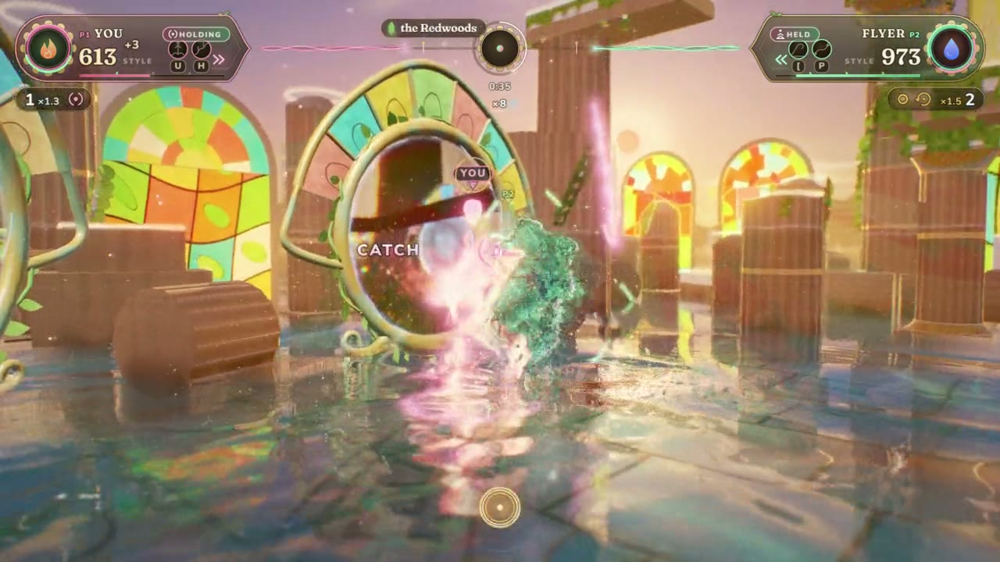
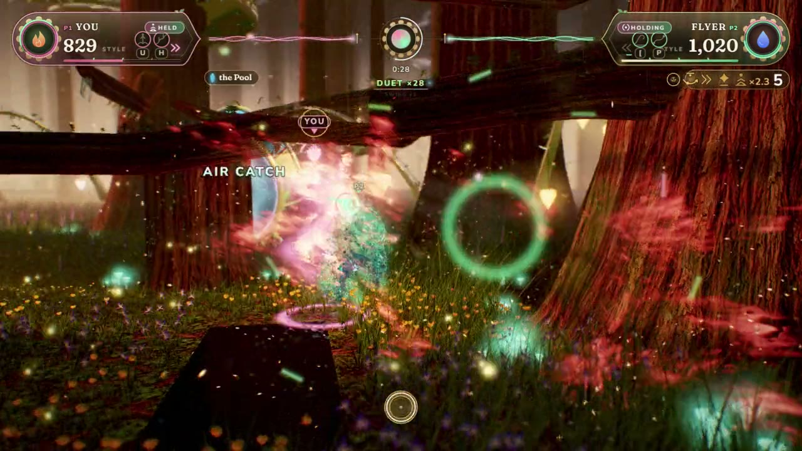

### 2. The big moment is big but washed and veiled (EPIC, light and colour)

The bloom now fills the stage (0:25 to 0:27), petals off the frame's edges, beams behind it. But the frame is mostly
cream and mint: the petals are rose and fern at the edges and near white where they overlap and where the beams
cross them; the world under them is lifted toward white; the lifted body stands behind one of the Pool's posts as the
finale begins (0:24.3 to 0:25.0). The aurora, the one sky moment, isn't in the frame (the camera looks down at the
water). Against the bible's "warm golden sunlight and its soft bounce", the finale reads as a glare more than a glow.
For phase 7: the bloom's added light capped so the petals keep their saturation where they overlap, the beams behind
the flower not over it; the finale's camera lifting its look to take in the sky (the aurora, the sun) and kept off the
posts (report 20-moments' `keep` didn't stop it here); one colour accent per moment rather than everything lifted.

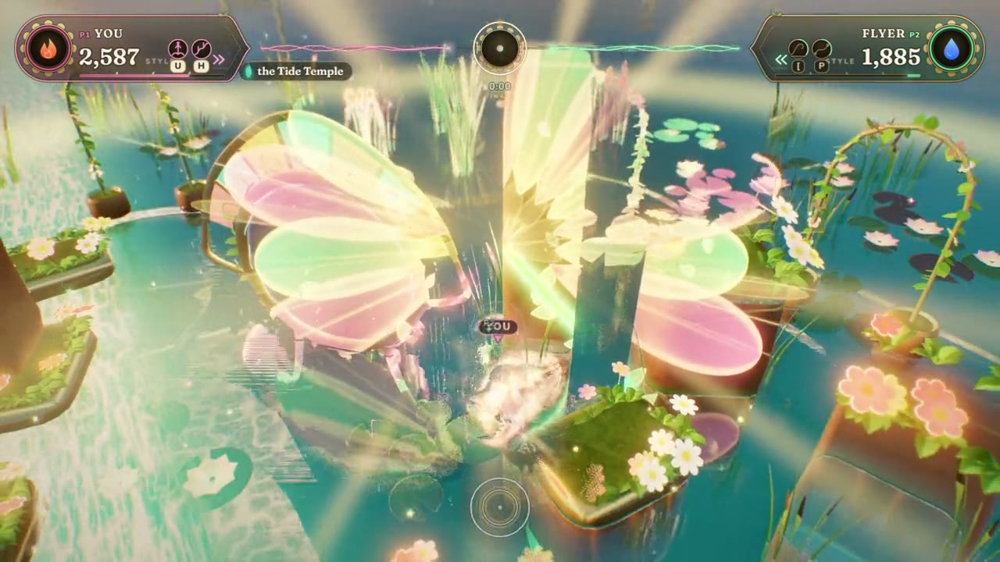

### 3. The way through the glass passes through the world's own pieces, and the turn is long (the flowing world)

Both crossings go through the disc, as the owner asked. But on the way round the rim the eye passes through what
stands beside the mirror: at 0:10.5 the frame is half a green blur, the eye inside the geode's planted ledge or a
hanging planter, and at 0:21.0 the temple's stained-glass screen fills half the frame at a hand's distance. The "round"
path takes 1.6 to 2.6 s (report 20-crossing), during which the pair is seen through the glass ring, small; And before this branch's fix, a way round a mirror's
rim went through a different gate (the temple's to the geode) and showed the wrong world for 2.7 s. For phase 7: the
way's path tested against the world's solids and decor (the camera's sight test, as the duel camera has), not only the
disc's frame; shorter rounds (the swing-in behind as the pair nears a disc, so the round case is rare); the camera
crossing any other gate on its way ruled out in the path itself, not only by the carry (the fix below).

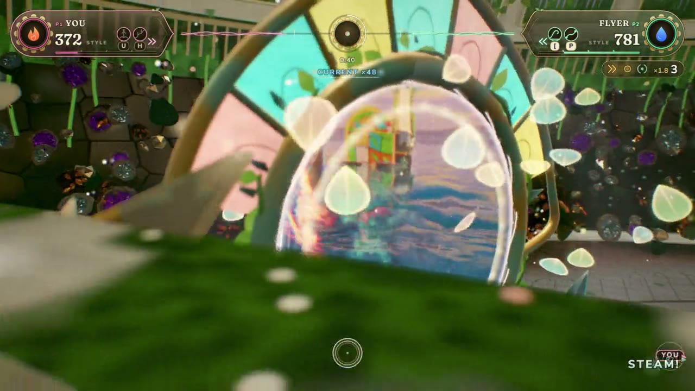

### 4. A newcomer from the front doesn't know which body is theirs, or what to press (first-time feel)

Judged as a first-time player from the front page with real keys: the front shows two dancers in the greenhouse and a
strip of icons (dance, together, the worlds, two rows of colour swatches marked 1 and 2, a sun to press). Nothing says
"press any key" or which of the two will be yours; the swatch rows are the only hint, and abstract. Pressing Enter and
holding W, the dance starts in 3D (it does reach the mirrors now: the temple's in 4.7 s) but the YOU tell the duel has
is not in the dance: no marker on either body, and a selenite slab and a planter block filled the left of the frame in the first
second. The crossing into the temple went over under the flash (the dance's own fallback, report 20-roam), and at 6 s
the camera was looking straight down at the fire body on the temple's tiles, the world not in view. For phase 7: the
YOU tell (the shaft, the ring, the tag) in the dance from the front, for the first seconds and after every crossing; a
word on the front ("press any key, or tap, to dance; you are the rose one"); the dance's follow camera given the duel's
through-the-disc way so its crossings stop cutting; the follow camera kept off the floor after a crossing.

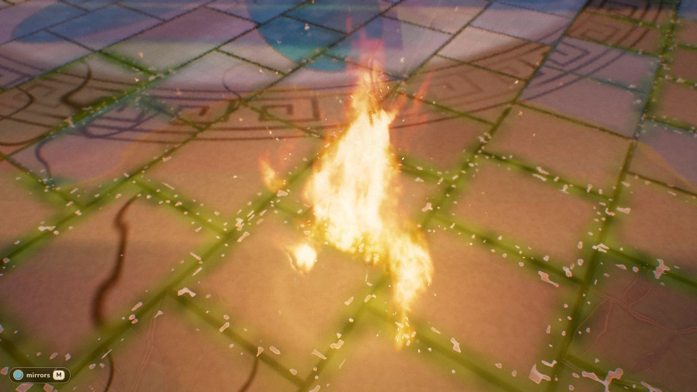

### 5. The flowing world is a corridor of discs: they cross too often, and the camera mostly looks at mirrors (the flowing world)

97 % of sets crossed, 1.75 times a set; 16 of 126 crossings came back before the view went over and 12 went straight
back within 3 s; 14 sets of 72 crossed three times or more, 4 of them four or five times. The voyages are frequent (one in 22 s), and the mirrors stand at
the arena's rim, so much of a set is danced at a disc: in the film's long shot a mirror's ring is in 10 of the 12 frames of its sheet. The worlds feel joined, but by doors, not as one land: nothing of the next world is seen until the
glass, and the music changes under each. For phase 7: fewer voyages (one a set, at the set's height, so a crossing is
an event) and a longer settle after one; the next world glimpsed in the landscape (the temple's sea visible from the
Pool's shore, the redwoods' canopy over the geode's glass) so a crossing reads as going somewhere you could see; the
mirrors set back from the stage's middle so the pair dances in the world, not at its doors.

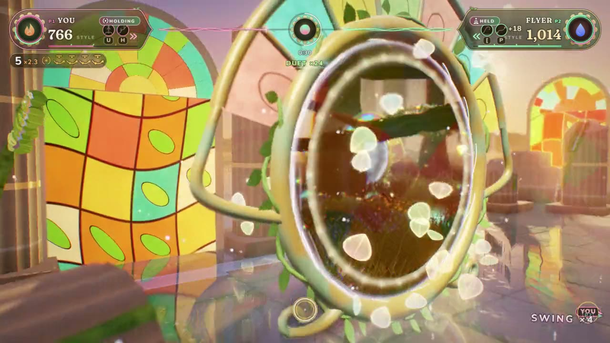

## Smaller things seen

- **The front's strip**, filmed with its DOM, is small at 720p and its icons unlabelled but for "dance" and
  "together".
- **The finale shot begins inside a post's blur** if cut half a second earlier (the preview's take): the Pool's posts
  stand at the camera's distance from the pair.
- **The count-in's selenite and planters** crowd the geode's frame; the vault reads only at the top.
- **Fewer of the duel's sounds a minute** (236 against 282): not looked into; the music under them is louder (−14.9
  LUFS against −17.1) because it enters mid-song now, not at an intro.
- **Redwoods' hour in a film**: a film holds the redwoods at 8.2 h unless a shot sets `hour`; the duel in play runs
  18.5 to 19.5 h. Scouts at 8.2 h, the film at 19.0 h: the hour is light only, the dance matched.

## Fixes committed

- **Film tool: a duel crossing's music as play has it** (`src/duel/sound.ts` `SetMusic.cross` on in a film whose track
  isn't fixed; `src/engine/film-shot.ts` records each switch's bridge, `tA`, `tB`, `tC`, `rA`, `rB`, `nb`, in
  `info.json`; `scripts/film.mjs` `layTracks`): the new track on the next beat at its matched phrase, the tempo bent and
  eased as the deck plays it (a bent rate reads the file faster, its pitch with it), round the track's loop as the
  deck goes round it (crossfaded 30 ms), the old one faded over 0.75 s; the chime in the shot's score. Before, a film
  took the new track's bar 1 on the bar line after the view went over, 2 to 3.5 s late, and had no chime. More than one
  crossing in a shot works; a shot whose page crossed before its in-point has the film's music cut to where its page's
  track is, on its cut. The `--flash` sync check reads the track laid at each time: in the test shot every flash fell
  within a frame of the laid track's beat across two crossings. `docs/extending/film.md` says how.
- **A camera on its way after its player goes only through the door into the player's world**
  (`src/portals/portals.ts`, a few lines): the duel's way round a mirror's rim passed through the temple's gate to the
  geode and carried the main view into the geode for 2.7 s while the pair danced in the redwoods, the geode's track
  coming in on the bar line. Rescouted after the fix: that set's crossing goes through; 0 of 126 crossings went wrong.

The flash as a plain cut in a film (report 20-crossing) wasn't needed: no crossing in 72 sets fell back to it.

## Stills

From the final film (`docs/reports/media/23-p6-*.jpg`): the sheet, `23-p6-front.jpg`, `23-p6-countdown.jpg`,
`23-p6-current.jpg`, `23-p6-through.jpg`, `23-p6-temple.jpg`, `23-p6-temple-duet.jpg`, `23-p6-through2.jpg`,
`23-p6-redwoods.jpg`, `23-p6-finale.jpg`, `23-p6-bloom.jpg`, `23-p6-banner.jpg`; the newcomer's
`23-p6-newcomer-front.jpg`, `23-p6-newcomer-1s.jpg`, `23-p6-newcomer-6s.jpg`. The master's sheets:
`23-film-duel-6-<shot>-master-sheet.jpg`.

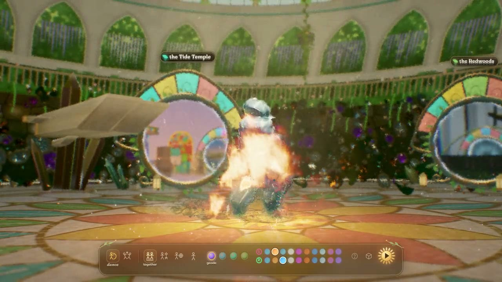
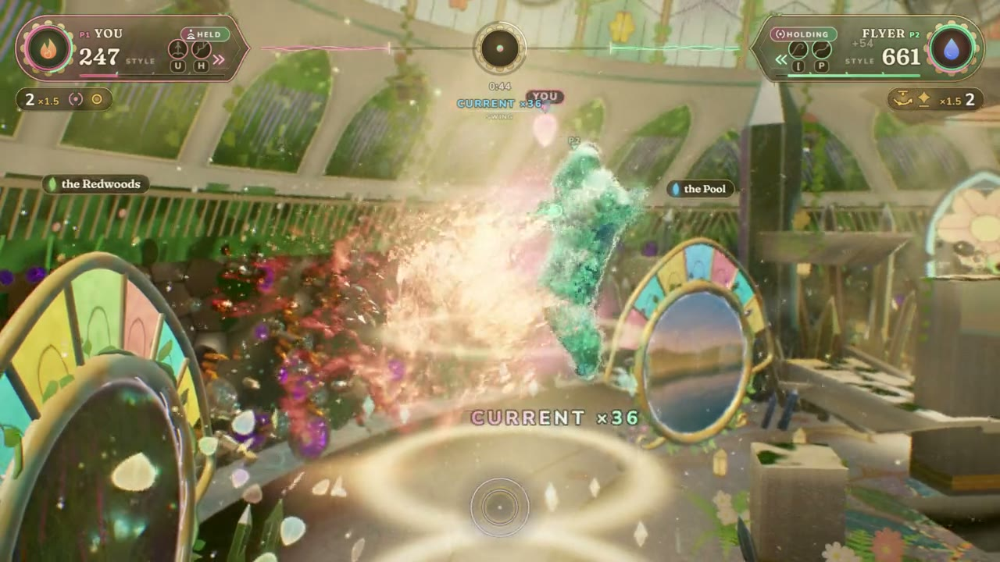
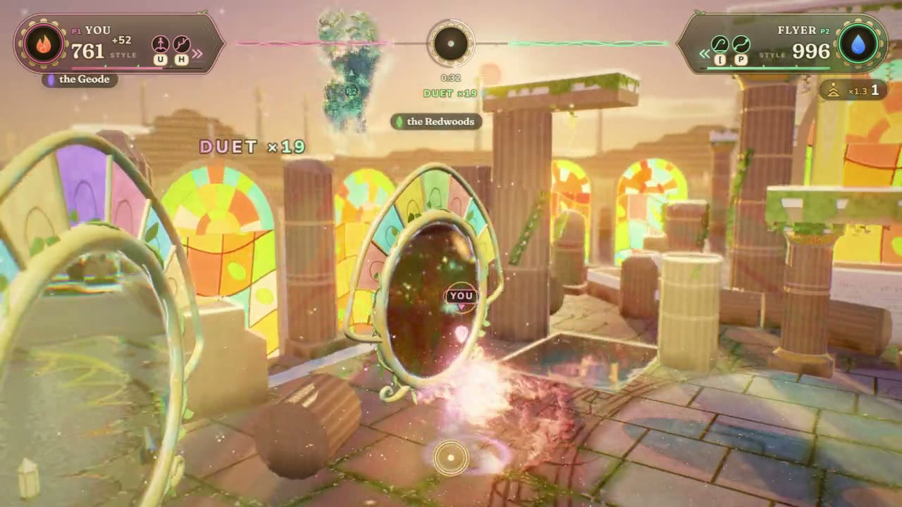
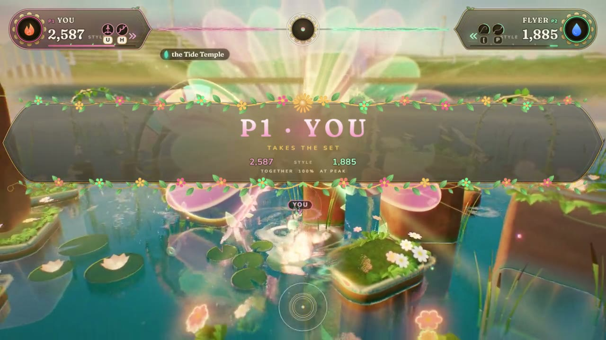

## Weak points of the film

- Two virtual players, seeded, the shots chosen from 72 sets. The long shot is the one set of 16 on the geode's track
  that crossed into the temple and on into the redwoods with time in the temple between.
- The last shot is another set in another world (the Pool), and its music cuts to the Pool's track on the cut.
- The flowing-world shot starts its music by a jump within the geode's track (the set had crossed and come back before
  its in-point; the film plays where its page's track was): a cut on the beat, same bar phase.
- The redwoods' hour is set by the film (19.0 h), not run as the duel runs it.
- The front is filmed by a different tool (screenshots of the page) and is pictures only.
- 31.05 s, a little over the asked 30.
- Sound: levels and the beat measured, not heard; the pitch bend at each crossing (up to 10 % on the old track, 6 % on
  the new) is the game's own and should be listened to.

## Not done

- The five issues above: phase 7's.
- Online, a phone, a person playing, the lock: not filmed or measured.
- The fused rate with the mirrors shut, in the same run: not measured.
- The duel's sounds a minute dropped (282 → 236): not looked into.
