# 24: the dusk worlds built (the geode's and the redwoods' pieces, a hero piece in each, the redwoods' look up)

Branch `p7-dusk-built`, from master `de3af62` (phase 6 and report 23). The brief: report 23's issue 1 for the geode and
the redwoods. "The worlds are lit but not yet built": in play the geode's eye sits among selenite slabs and planters with
the glass vault a pale band at the top, and the redwoods' canopy village is above the frame the duel keeps.

**Measured:** stills from the duel's own camera at 1280×720 (`bend.grab`; two virtual players at skill 0.85, `fire,water`,
the music's clock on the stepped frames, `&mirrors=0` so the pair stay in the world), in motion, at the same seeds and
seconds before (master) and after: the geode seed 2 at 4, 10, 24 and 32 s, the redwoods seed 3 at 8, 20, 40 and 70 s
(the redwoods' duel runs from 18.5 h at the start into the blue of dusk: 18.6, 18.8, 19.0 and 19.4 h). Each hero piece
from a pose held by hand, with the depth of field off (`post.dof`), before and after. The duel camera in Node
(`scripts/cam-sim.mjs`, 6 sets, 13,818 frames), with a new landmark, the canopy village. GPU time per pass at one
moment of each world (20 s), master and branch served in turn on port 5521, two rounds each; and the phone tier
(`?class=phone`) once each way. `npm run typecheck`, `node scripts/test-ts.mjs`, `check-limits`, `check-bindings`.

**Not measured:** a person playing; a real phone (the phone tier ran on the 5090); plasma, ice and gems bodies; an online
duel; the duel sims (no piece, ledge, drop, spawn or collision changed: below); the front page (the geode's screen is
behind the stage; the front looks the other way).

As before, the page's dance doesn't repeat frame for frame between loads: an "after" still is the same seed and second
as its "before", not the same moment.

## The geode

### The play pieces made of the bible's matter

The arena's pieces are the same shapes; what they are made of is new (`shelves.wgsl`, `crystals.wgsl`, `garden.ts`).

- **The standing beams** (the slabs that read as beige planter boxes) stand in a **socket of white glazed ceramic** with a
  frieze of gold leaves on teal tile and a ring of brass over it, and are **crowned under their tops by a band of
  copper gone green between two brass beads**.
- **Planted tops.** The moss covers each top now (in cushions of lighter and darker green, the stone only at a ragged
  edge; it was patches with the stone showing between, a camouflage print at the duel's distance), and every beam wide
  enough holds a clump of ferns and a few flowers (new plants in `garden.ts`, laid with their own dice after the rest).
- **The shelves** (the rafts of selenite) are bound across every 1.3 m by **straps of copper gone green edged in brass**.
- **The selenite itself** takes the light in: its thin parts and edges glow a little with the room's warm light, and its
  faces carry a faint pearly sheen.
- **The crystal points** (the druses, the great crystals at the arena's ends) were dark stone with a glow at the tip; now
  each is coloured glass in the sun, its colour a little deeper than the vein it grew from (honey calcite reads as
  citrine, the violet as amethyst), the sun through it where it is seen through its length.

| | before | after |
|---|---|---|
| seed 2, 4 s (the count-in's frame) | 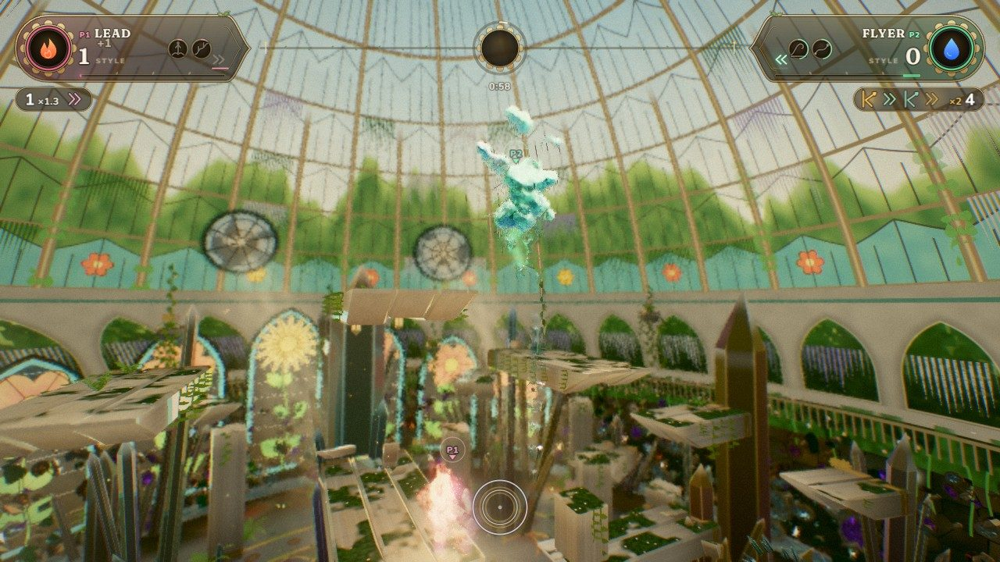 | 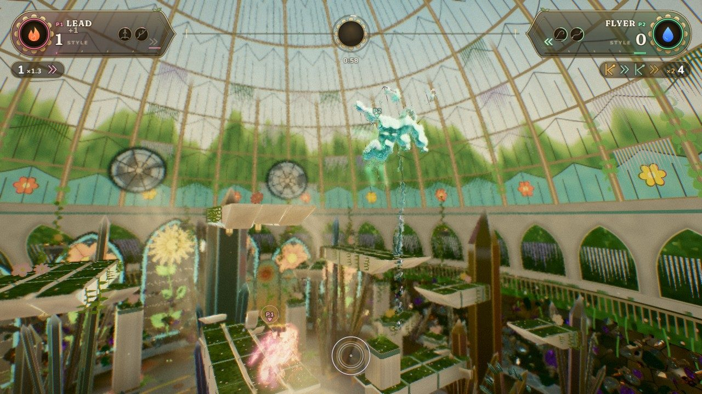 |
| seed 2, 10 s | 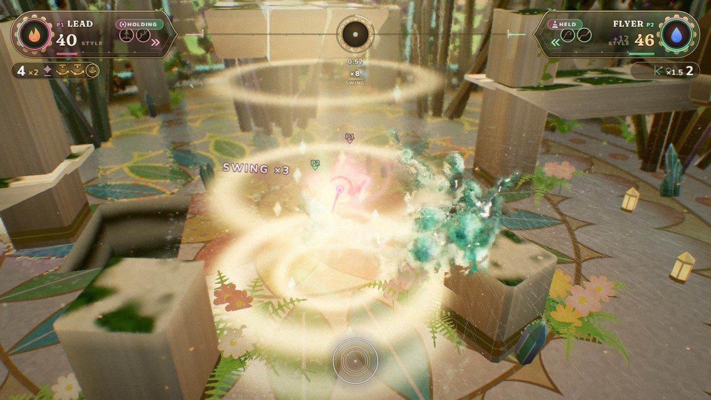 | 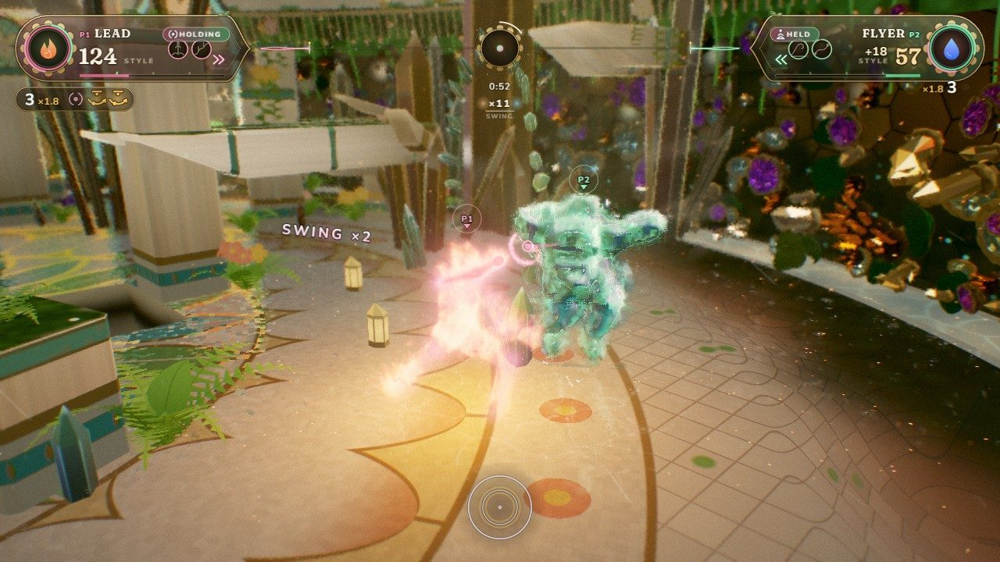 |
| seed 2, 24 s (the screen behind the pair) | 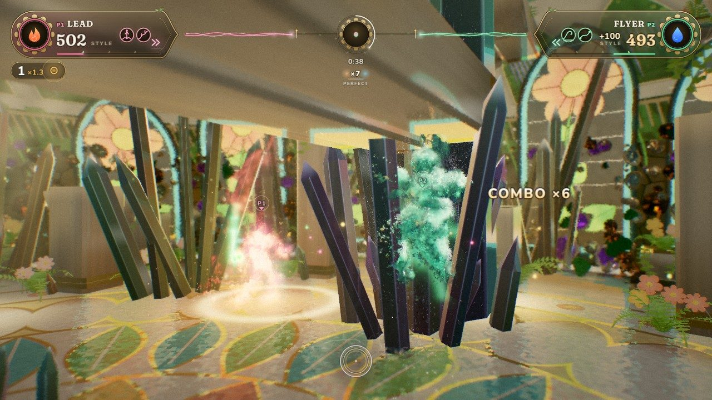 | 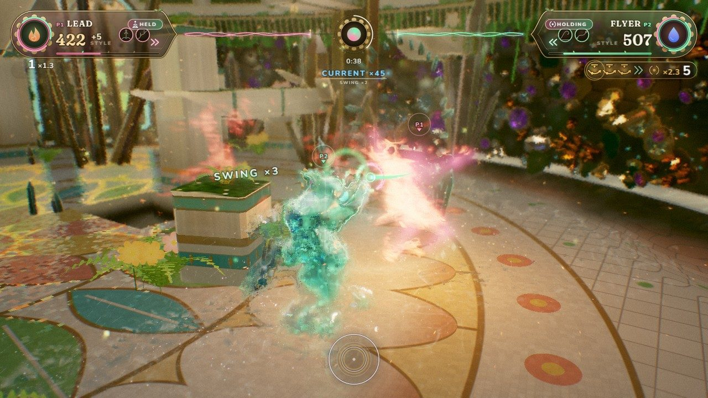 |
| seed 2, 32 s | 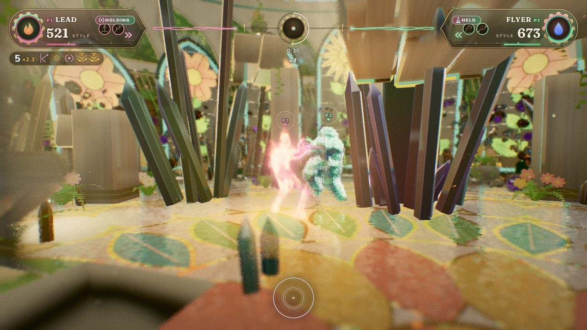 | 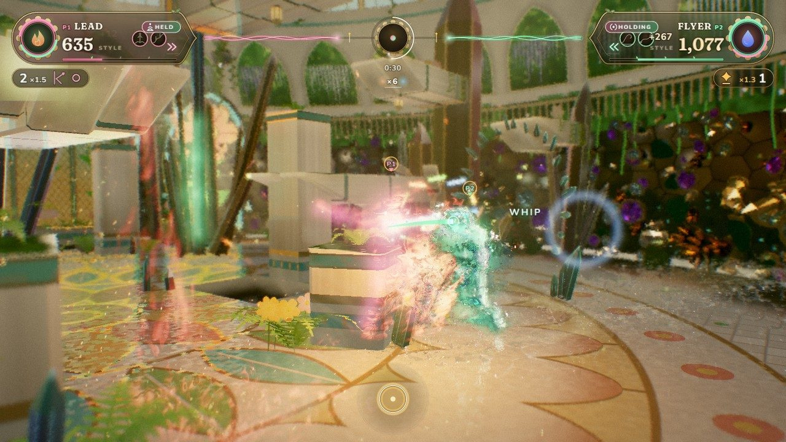 |

### The hero piece: a leaded-glass screen behind the stage

New `screen.ts` and `screen.wgsl` (one draw, three instances, 72 vertices each). Three tall arched panels (the middle
4.0 m, the sides 3.4 m, 3.7 m across) on a gentle arc at 10.55 m behind the stage (bearing −74°), where the duel camera
looks (`ARENA_CAM.face` is −z), between the druses at the foot of the two wall shelves.

- In the glass, art nouveau: in the middle a **sun flower** (an amber disc of seeds in twelve coral and gold petals) on a
  whiplash stem with leaves; either side a **lily** of three cream petals over a gold throat. Around them quarries of
  pale glass, sky teal high to amber low, each pane its own shade, **thin gold came over dark lead** between every pane.
- Each panel in a frame of brass with an outer line of copper gone green, a brass bar at the springing.
- The sun and the bright greenhouse behind light it from behind, carried through each pane's colour; the room and the
  vault mirror in its face.
- It stands in a **trough of white glazed ceramic** (the same gold-leaf frieze on teal tile, a brass rim) planted with
  ferns, flowers, a broad leaf and vines over the lip (`garden.ts`). The two planters that stood under the great window
  there are left out (their dice still thrown, so nothing else moves).

| before | after |
|---|---|
| 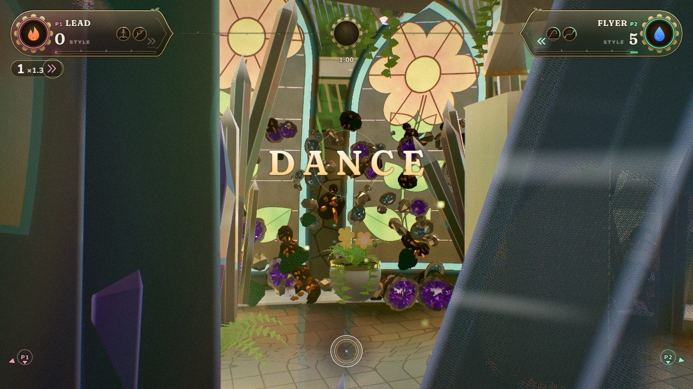 | 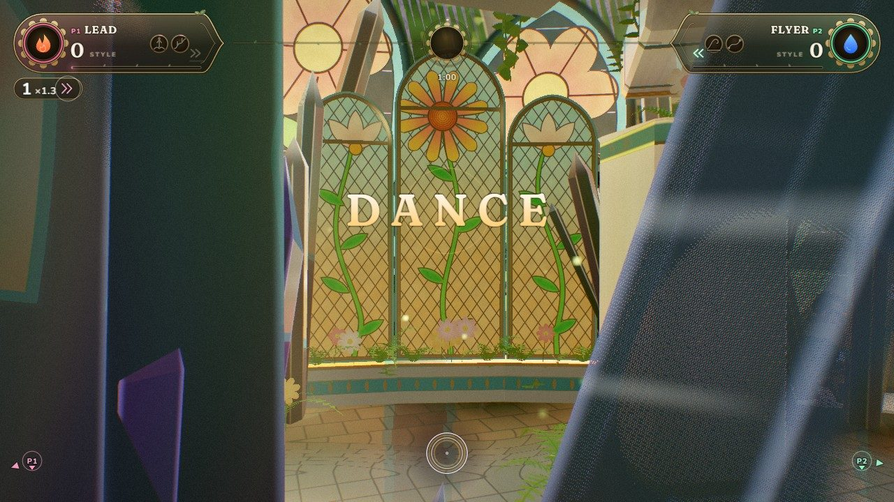 |

In the duel's own frame it is behind the pair at 24 s (above), at about a quarter of the frame's height (the bodies are
about a third), the great window's lancets above and behind it. It covers the busy crystal bank at the wall's foot there
(report 20's "not done").

**Where it stands, honestly.** It is decoration, not a solid: like the planters, the channel and the crystal bank it
stands at the room's edge, outside the floor's pieces and the gates' lanes, but 1.1 m inside the arena's space (radius
10.5 from its middle). A body flung there would pass through the glass. The pair seldom dance there (report 16's map),
and the near fade drops it (`decorDrop`) where it would stand in the lens.

## The redwoods

### The look up (camera.ts)

`ARENA_CAM.redwoods.lift = 0.08` rad (4.6°): every look the duel camera takes in the redwoods is raised by that much, the
plain view, the choices over the pieces and the floor under the fallback's dips (a few lines in `DuelCamera.update`;
the other worlds' `lift` is 0, unchanged). `camworlds.ts` gains the landmark `village`: each house of the canopy at its
windows, each ring deck's two ends and the hero tree-house's porch.

| redwoods, cam-sim, 6 sets, 13,818 frames | lift 0 (master) | **lift 0.08** |
|---|---|---|
| look down, mean (p90) | 14.5° (32°) | **10.9° (28°)** |
| the frame's top edge over the level | 13.1° | **16.7°** |
| the canopy village in frame (not hidden), without the hero tree-house | 38.3 % | **47.5 %** |
| … with the hero tree-house (below) | | **61.8 %** |
| the bunting in frame | 43.4 % | 53.1 % |
| any landmark | 43.5 % | 53.2 % (66.0 % with the tree-house) |
| sky share | 25.9 % | 31.6 % |
| the eye over its ground | 3.34 m | 3.02 m |
| a piece in the near frame (with the near fade) / over a tenth of it | 7.6 % / 1.2 % | 11.8 % / 2.9 % |
| the eye within 0.6 m of a solid | 0.5 % | 1.0 % |
| a body hidden (any line) | 2.3 % (5.4 %) | 2.7 % (5.7 %) |
| body height median (p10) | 32.2 % (19.6 %) | 33.1 % (19.6 %) |

The cost: a lower eye stands among the boughs more often, so the near frame has a piece in it more often (7.6 → 11.8 %,
the near fade dissolving most of it). The look down still comes mostly from the fallback's rises (11° of it, rising in
83 % of frames), not the plain view: the boughs at chest height make the eye rise and look down. A further lift would
cost more near frame for less gain; a smaller rise in the redwoods is the next lever (p7-feel's area).

### The hero piece: a tree-house at the clearing's edge

`canopy.ts` (laid last, its own pieces, so nothing laid before moves): on the ring tree nearest bearing −113° (behind the
stage on the left, where the camera looks), a **porch deck of honey wood at 2.8 m** round the trunk's far side with its
brass-railed balustrade and four lanterns, a **round tree-house** on its flank where it shows from the clearing (cream
lime walls, arched windows lit amber at dusk, a roof of moss over copper gone green, a brass finial), and **a stair
winding up from the meadow** round the back of the trunk to the porch, treads nosed in brass, three lanterns on its posts.
The stair's shader now takes its foot's height into the trunk's radius (`canopy.wgsl`, one line; every other stair's
foot is at 0, so they are as they were).

It stays outside the duel's space: the porch's ends 11.8 m from its middle, the stair's foot 12.4 m, the house's wall
11.7 m (the space's radius is 11).

| before | after |
|---|---|
| 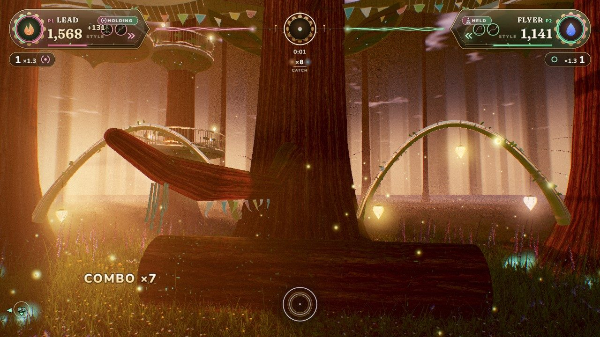 | 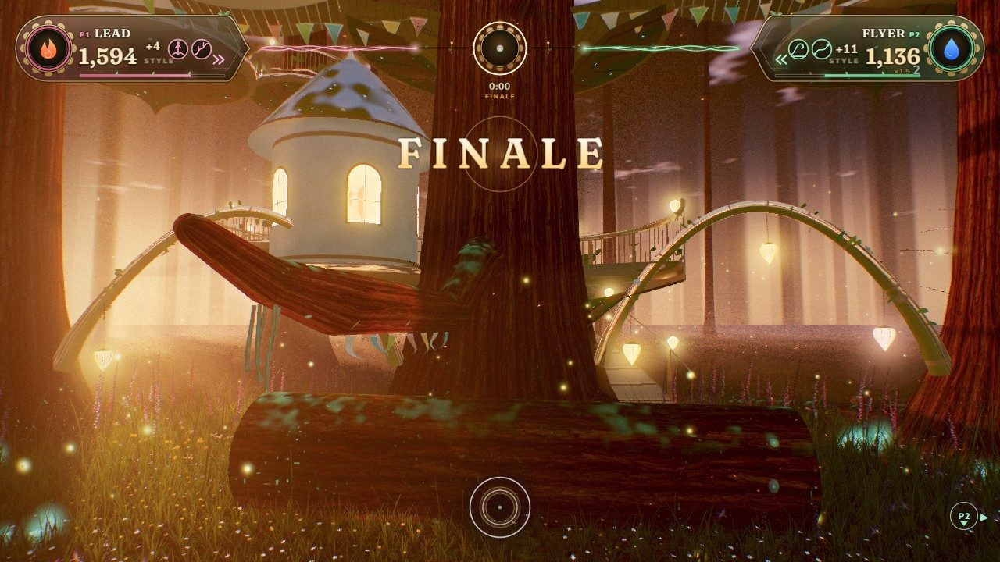 |
| 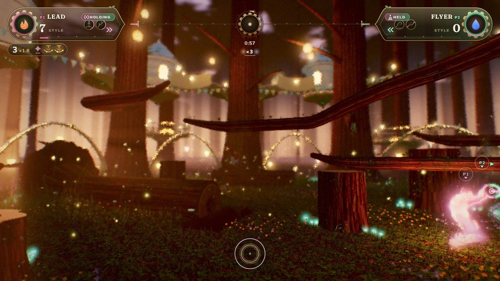 | 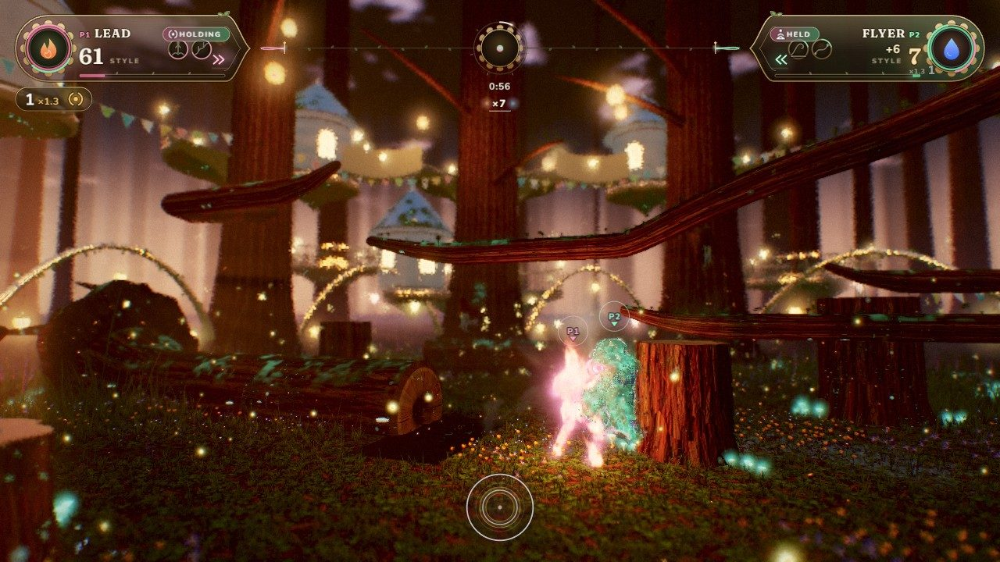 |

### Bioluminescence at dusk

All of it grows with the dusk (`forest.horizon.w`) and breathes, as the woods' fungi and moss already do:

- **The play pieces glow most** (`trunks.wgsl`, the stage's bark): the moss on a bough's, a log's or a stump's back lit
  softly through its cushions, and on their flanks **rosettes of glowing lichen** (a pale ring round a brighter heart,
  in clusters, teal to mint). At dusk what a body can stand on reads by its own light. (The roots at the meadow's edge
  are drawn with the same bark and glow too.)
- **The meadow's small flowers glow** (`flowers.wgsl`): the forget-me-nots sky blue, the sorrel and the starflowers a pale
  mint, from their petals and eyes, each in its own time: soft points of light in the grass under the pair.
- The hero tree-house's windows and lanterns light with the rest of the village.

| | before | after |
|---|---|---|
| seed 3, 8 s (18.6 h: the tree-house and the village in frame) | 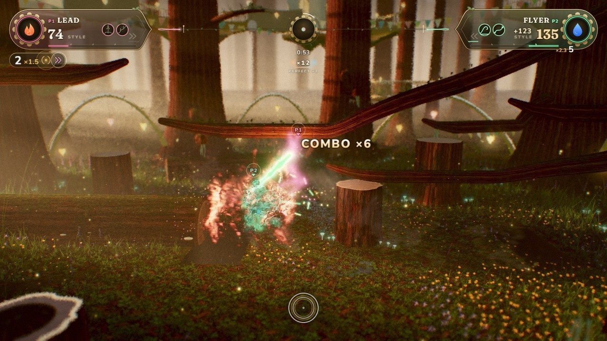 | 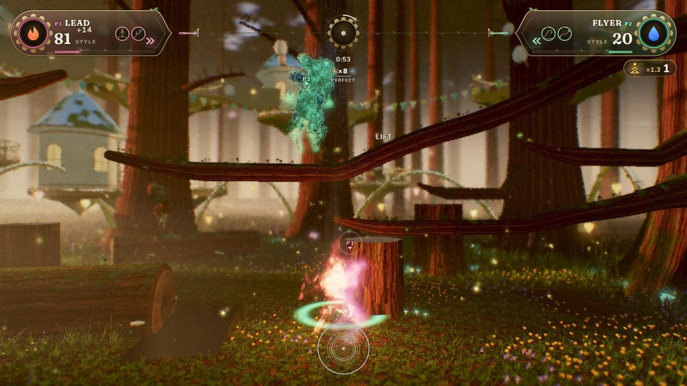 |
| seed 3, 20 s (18.8 h) | 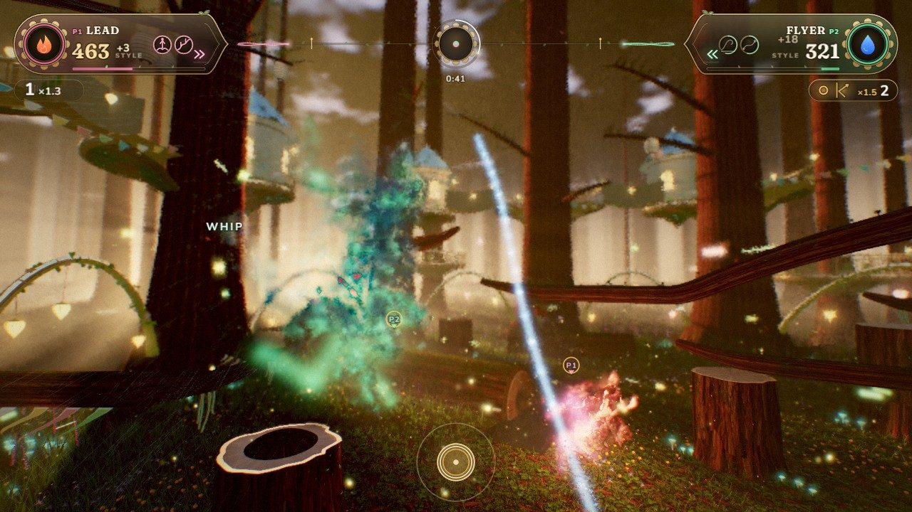 | 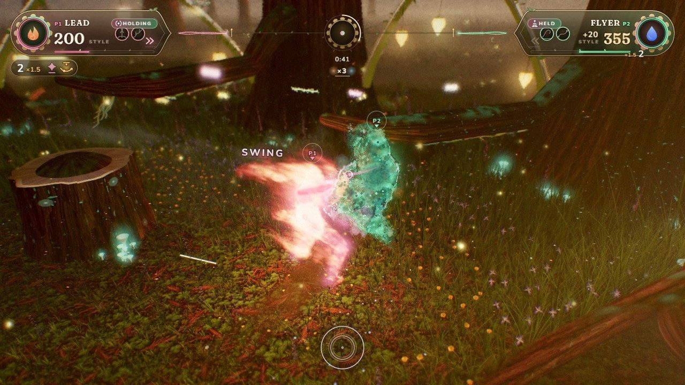 |
| seed 3, 40 s (19.0 h) | 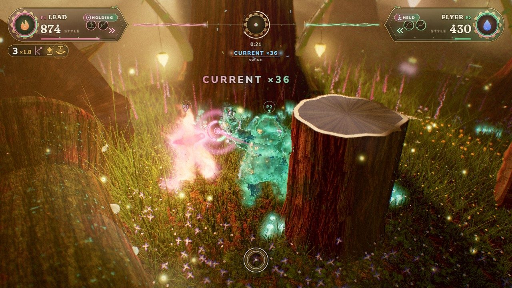 | 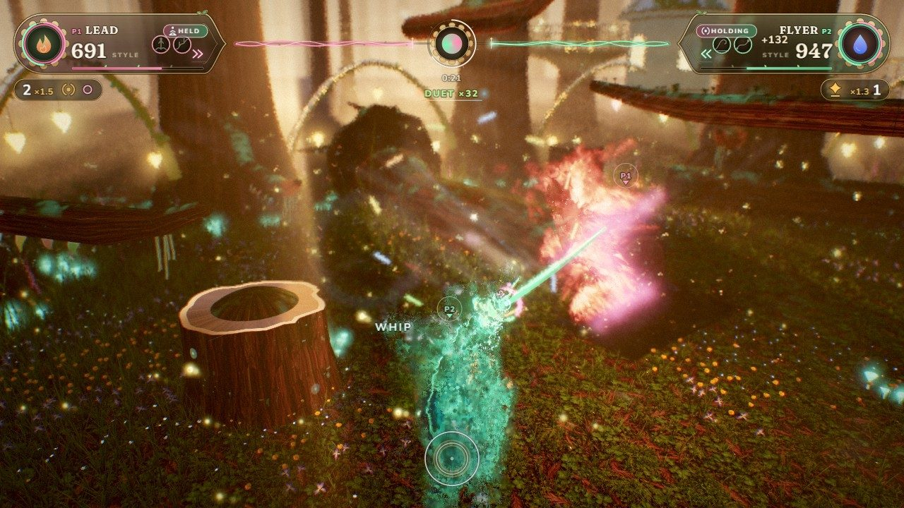 |
| seed 3, 70 s (19.4 h, the next set: dusk) | 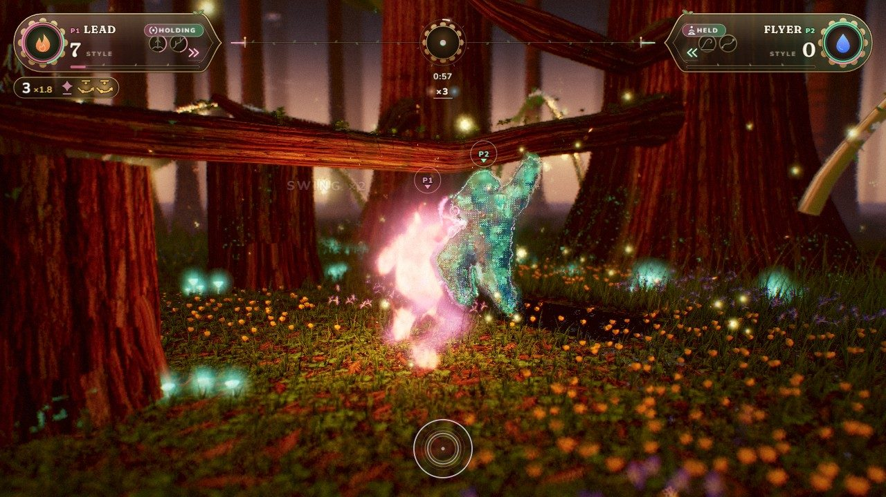 | 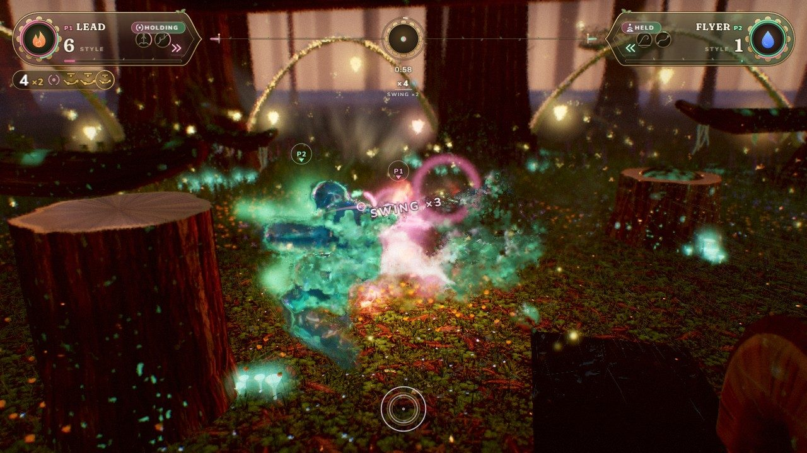 |

## Play, collision and the mirrors

- **No piece, ledge, wall, drop, spawn, hazard spot, exit or solid changed** in either arena, and nothing was added to
  `World.solids` or the arena's pieces. Everything new is shading on the existing pieces or decoration (the geode's
  screen and plants, the redwoods' tree-house, stair and lanterns).
- The camera changed in the redwoods only (the lift, above).
- The geode's screen is 2 m and more from every gate's lane (its bearing −74°; the gates are at the front); the
  tree-house is on a ring tree 5 m and more from both redwoods mirrors and the gate.

## The GPU

RTX 5090, 1280×720, at 20 s into each duel; the GPU shared with other agents. Means of 150 profiled frames.

| | scene pass, master → branch (ms, two rounds) | whole frame, master → branch |
|---|---|---|
| geode, seed 2 | 0.348, 0.392 → 0.382, 0.370 | 1.82, 1.59 → 1.72, 1.67 |
| redwoods, seed 3 | 0.909, 0.909 → 0.965, 1.048 | 3.07, 2.71 → 2.74, 2.90 |
| geode, phone tier (`?class=phone`) | 0.358 → 0.232 | 0.92 → 0.93 |
| redwoods, phone tier | 0.508 → 0.446 | 1.17 → 1.08 |

The geode's change is inside the noise (the screen is three instances of 72 vertices; the beams' extra shading is a few
branches on the pieces' pixels). The redwoods' scene pass rose by about 0.06 to 0.14 ms at full desktop quality (the
lichen's hashes on every stage piece's pixel at dusk, the tree-house's few hundred triangles); the whole frame stayed
inside its noise. The phone tier's numbers are on the 5090, so they say only that nothing new is unbounded there (the
tree-house is drawn on a phone too: four pieces and three lanterns).

## Files

- `src/worlds/geode/shelves.wgsl`: the selenite's light, the beams' ceramic socket and copper crown, the shelves' straps,
  the planted tops.
- `src/worlds/geode/crystals.wgsl`: the points as coloured glass in the sun.
- `src/worlds/geode/screen.ts`, `screen.wgsl` (and the generated `screen.d.wgsl.ts`): the hero screen. `geode.ts` draws
  it; `garden.ts` plants its troughs and the beams' tops, and keeps the great window's planters out of it.
- `src/worlds/redwoods/canopy.ts` (the hero tree-house, `HERO`), `canopy.wgsl` (a stair's foot height),
  `trunks.wgsl` (the pieces' glow and lichen), `flowers.wgsl` (the glowing flowers).
- `src/duel/camera.ts` (`ARENA_CAM.lift`, a few lines), `src/duel/camworlds.ts` (the `village` landmark).
- `scripts/dusk-cap.mjs`: the stills (a copy of `sun-cap.mjs` with the dusk worlds' poses, `--pose`, the hour printed).

## Not done

- **The geode's selenite still reads partly as blocks.** The beams now read as built, planted pillars, but their middles
  are still flat cream faces, and the shelves are flat slabs with straps; the room is still crowded with them in the
  near frame (the camera's and the arena's matter, not the matter's).
- **The geode's screen is not a solid** and stands 1.1 m inside the arena's space at its edge; a body flung there passes
  through it.
- **The redwoods' look down comes mostly from the fallback's rises**, which the lift doesn't touch; the near frame has a
  piece in it more often with the lower eye (above).
- A dark square seen once at the frame's bottom right in the redwoods after-still at 70 s (a stump close to the lens,
  the near fade's pale): not looked into.
- Not looked at: a real phone, plasma, ice and gems bodies against the new matter, an online duel, the front page, the
  answer's moments over the new pieces.
- No concept image was made.
