# 24 · Feel: virtual humans playing the real page

Branch `p7-feel`. The owner asked to "put yourself as virtual bodies dancing with each other and moving through the
world simulating how a human would control various input to make sure this is fun, smooth and feels amazing and
magical".

This pass builds virtual human players that drive the **real game page** with **real input events**. It measures what
a person would notice and turns that into a scorecard later phases can rerun. It then fixes the worst problems in my
area: movement, input, and the duel camera's damping.

Everything was measured on the RTX 5090 in headless Chrome. The page was 1280×720; the touch player's was 844×390.
"Before" is master (de3af62), served from a detached worktree on port 5513. "After" is this branch, on port 5511. Both
used the same seeds and the same scripts, and their recordings were scored by the same code. Other Phase 7 agents
used the GPU and 85 to 92 % of the CPU the whole time. That is why the scorecard runs on a stepped clock (below).

## The players: `scripts/human-play.mjs` and `scripts/human-lib.mjs`

Each player reads the screen's state a few times a second. It acts through puppeteer's keyboard, mouse and
touchscreen, so the page gets its own `keydown`, `keyup`, pointer and touch events. Nothing is placed or scripted in
the page: no `bend.place`, `bend.intent` or `bend.duel.cast`.

The players have a person's imperfections built in:

- A reaction of 150 to 350 ms between seeing and pressing, most often near 220 ms.
- Rolled-over keys: the next key goes down 20 to 80 ms before the last one comes up.
- Taps of 60 to 140 ms.
- Presses aimed at the beat land a few tens of ms off it.
- Hesitations and wrong keys.

| style | what it does |
|---|---|
| **newcomer** | Opens the **front page** and reads it for a second or two. Presses W, which starts the dance (any key does). Then wanders: holds a direction for half a second to a few seconds, mashes bursts of J K L Space, pauses, presses a wrong key (E Q F G), waves the mouse over the dancers and right-drags to turn the view. |
| **dancer** | Plays the duel as seat 1 on the solo layout. A virtual player thinks for the seat (`bend.duel.ghost`, a flyer at skill 0.85). The human presses what it wishes, a reaction late, with keys rolled over. When a beat is near, the grab and the jump are aimed at it, with a person's error. |
| **explorer** | Plays the duel. Walks to the nearest mirror in this world, through it, then picks another one that doesn't lead back. Sidesteps when stuck and hops now and then. |
| **pair** | `?jogo=same`: two humans on one keyboard (W A S D + Space + J K L, and the arrows + ' + , . /). The first leads round the room and takes the pair to a mirror every ~20 s. The second follows. Both reach for each other on the beat when close. |
| **touch** | Plays the duel on a phone-sized page with touch. A tap joins. The left thumb drags the stick toward the other body, and the right thumb taps the on-screen buttons. |
| online (two pages) | Not built. It needs the room server on its own port, and `test:net` is off limits. |

There are two clocks:

- **Stepped** (the scorecard's default): the page is stepped by hand at 60 fps, and the human's delays are counted in
  the page's frames. A `Clock` steps the next frame only once every one of the human's coroutines is waiting. A run
  therefore repeats on a busy machine, and before and after compare on the same seeds.
- **Real**: the wall's time. This is the only clock that measures frame pacing and the whole path from a key to the
  screen.

## What is measured, and the scorecard: `scripts/human-score.mjs`

A recorder in the page logs, every frame:

- the camera: eye, yaw, pitch, lens
- both bodies: the duel's simulated root and velocity, and the **drawn** hips
- where each body's chest lands on screen
- the duel camera's own pose and its "unclean eye" flag
- the link, the world and the crossings
- running counts of the moments
- every key and pointer event, with its time

From that recording it computes these measures:

- **Frame pacing** (real clock only): p50, p95 and p99 frame time, and hitches (frames over 33 ms) a minute.
- **Camera smoothness**:
  - Turn rate p95 (°/s), angular jerk p95, and swings (faster than 120°/s) a minute.
  - **Cuts** a minute: the eye moving a metre or more, or the view turning 40° or more, in one frame of one world. That
    is a jump, not a turn.
  - The share of time looking down more than 28°, and the share of time the duel camera judged its eye unclean.
- **Body smoothness**:
  - **Pops** a minute: the drawn hips moving 15 cm more in one frame than the body's own speed explains. Not counted
    while the body is carried, fallen or crossing.
  - Screen pops a minute: the chest's acceleration on screen above 40 px per frame².
- **Response**: from a move key pressed at rest to the body running faster than 0.5 m/s, and from a jump key pressed
  on the ground to the body 2 cm up.
- **Stuck and momentum**:
  - The share of time spent pushing a key while moving under 0.6 m/s.
  - Runs stopped a minute: from over 3 m/s to under 1 within a quarter second, with the key still held.
  - The share of pushing time spent over 3 m/s.
- **The dance**: catches, flings and links on the beat. Crossings, and how the view went over: through the glass, or a
  cut under the flash.
- **Magic** moments a minute:
  - The duel: juice, tiers, merges and the world's answers.
  - The jogo: exchanges, echoes, forms and builds.
- **Confusion**:
  - Going nowhere: a 10 s window with keys held most of the time, ending within 2 m of where it began.
  - Losing your body: its chest off screen.
  - The two bodies confusable: their chests within 45 px while not joined.

Each measure is scored 0 to 100 against what a person notices (`SCORE_RULES`). For example, no cuts a minute scores
100 and 10 cuts a minute scores 0. The measures are grouped into **smooth**, **responsive**, **clear** and **magic**, and
each run gets a total. The scorecard is written to `docs/reports/perf/24-feel-<label>.json`. Later phases rerun it:

```
node scripts/human-score.mjs --url http://localhost:<port>/energybending/ --label <name> --base docs/reports/perf/24-feel-after.json
node scripts/human-score.mjs --clock real --runs newcomer:geode,dancer:temple,explorer:temple --label <name>-real
node scripts/human-play.mjs --style explorer --world temple --seconds 60 --stills dir --clip out.mp4 --raw rec.json
```

Useful options:

- `--raw dir --again` scores old recordings again with new measures, without playing.
- `--merge` reruns only some runs.
- `human-play.mjs --clip` grabs about 8 frames a second for 8 s and joins them with ffmpeg at 640 wide.

## What playing as these bodies showed

1. **The duel camera cut 30 to 35 times a minute** for a flowing dancer, in every world. Frame by frame, there were
   three causes:
   - **Launches.** `pointsOf` added each airborne body's ballistic apex to the framed points all at once. The hard pass
     then threw the boom 2 to 4 m back, and the lens opened 10°, in one frame. This happened at every launch and air jump.
   - **Solids.** The boom snapped in out of a solid in one frame (`pull = pullWant`).
   - **The shell clamp and the hard pass.** Both set the boom outright, giving 1 to 5 m eye jumps with nothing else
     moving.
2. **The look down swung at up to 100°/s** (cam-sim's pitch rate p99). In the Pool and the redwoods, the camera spent a
   fifth to a half of its time looking down more than 28°. Example: the Pool, where a post fills the middle of the frame
   and YOU is small behind it.

   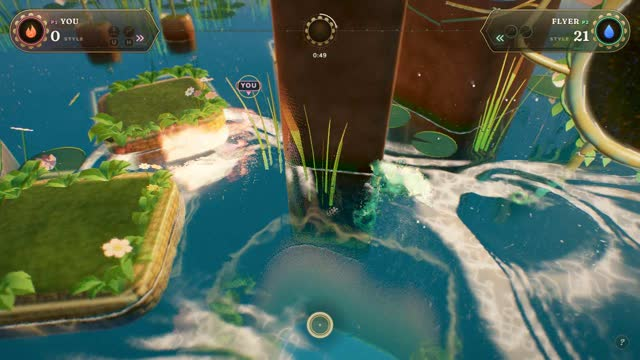

3. **Every fast landing popped the body.** The landing's give (`landK`) came in whole on the frame the feet touched,
   so the drawn hips dropped about 20 cm in one frame. This was most of the duel's 10 to 31 body pops a minute.
   Separately, a rise in the world's ground taller than a step was stood on in one substep: a 1.4 m pop up, seen at the
   geode's sunken floor.
4. **The newcomer from the front walked out of the world.** Holding W in the dance, the body passed through the
   geode's glass. At 28 s the frame was a cream blur 28 m from the middle. The duel has an edge; the dance had none.

   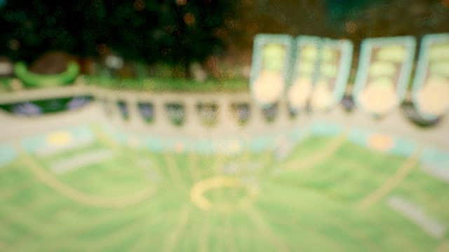

5. **On a phone held sideways, the duel had 13 buttons** in two columns down the right edge, over the second player's
   HUD. "merge" and "use" do nothing in the duel, and "strike" is the grab there.

   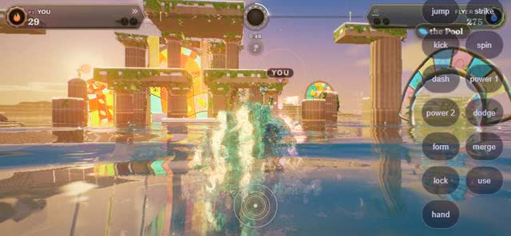
   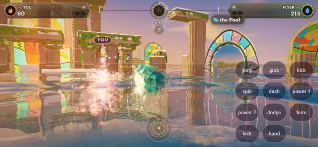

6. **The crossing camera makes almost all the remaining cuts and all the "where am I" time.** This is the way through
   the glass and the swing-in near a disc (`index.ts` with `ThroughCam`), outside this branch's area. After the fixes,
   the duel camera itself made **no cuts in any duel run**. Every remaining cut, and every frame with the player's body
   off screen, came while the way or the swing-in drove the camera:

   | after | way or swing-in drove the camera | cuts (duel camera / way) | frames with my body off screen (duel camera / way) |
   |---|---|---|---|
   | dancer, geode | 40 % of frames | 0 / 8 | 0 / 191 |
   | dancer, redwoods | 16 % | 0 / 1 | 1 / 141 |
   | dancer, Pool | 28 % | 0 / 2 | 0 / 0 |
   | dancer, temple | 10 % | 0 / 0 | 0 / 0 |
   | explorer | 50 % | 0 / 14 | 1 / 335 |
   | touch | 3 % | 0 / 0 | 0 / 0 |

   What this looks like, from the recordings:
   - After a crossing, the way holds the eye still, looking away for about a second, with the player's body behind the
     camera. It then ends in a 5 to 16 m, 40 to 180° cut onto the duel camera's view.
   - One way ran for 8 s and ended in a 180° flip.
   - The swing-in jumps when its disc or its side flips. The pair passing beside a mirror cut the view by 7 m and 140°.
7. **The dance's follow camera cuts about 17 to 20 times a minute** for the newcomer, and sits on the floor or inside
   the rim's decor. This is `engine/camera.ts`'s follow mode for the jogo, p7-newcomer's area. With the new edge the
   body stays in the world, but the camera now stands among the geode's crystal shelves or looks down at the tiles. It
   never clears solids the way the duel camera does.

   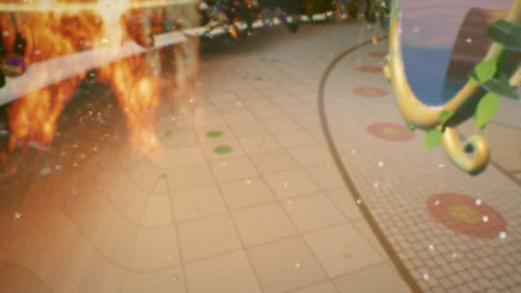

8. **The pair on one keyboard is gentle and lovely**, on the Pool's water at sunset. But nothing in the jogo says which
   body is whose.

   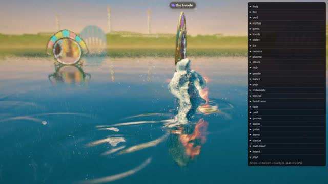

## What changed

- **`src/duel/camera.ts`** (small, local edits):
  - The apex is eased into the frame over `apexIn` (0.3 s) instead of appearing whole. The real head and hands still
    hold the hard margins every frame, and `camera.test`'s "the flyer stays in frame through a launch" still passes.
  - The boom moves at most `boomRate` (18 m/s) either way, and the lens widens to hold the frame meanwhile. `reset`
    and `from` restart it.
  - The snap in out of a solid is limited to `pullSnap` (14 m/s).
  - The fast rise's rate is now a parameter, `riseUp`, set to 1.1 rad/s (was 1.6). In cam-sim, the look down's p99
    rate is 7 to 12 % lower with the eye as clean. The flyer stays in frame 100 % and both bodies whole 100 %.
  - Cost: the redwoods' near-frame share rose from 7.3 to 9.5 %, and the temple's pitch-rate p99 rose from 29 to
    60°/s (from a flat 1°).
- **`src/dancer/character.ts`**:
  - A landing's give comes in over three frames (`LAND_IN`, 0.05 s) and goes as before.
  - A rise in the ground taller than a step is climbed at 7 m/s (`STEP_RISE`) instead of popped onto.
  - The landing change is pose only. The step change is the one position change: only a rise taller than a step now
    takes ~0.2 s to climb instead of one substep. Speeds and timings are unchanged.
- **`src/duel/edge.ts`** (new): the duel's soft edge, moved out of `match.ts` unchanged, so the dance can share it.
- **`src/dancer/play.ts`**: the free dance now curves round its world's arena edge, a metre inside the duel's
  (`DANCE_EDGE`), with the lanes to the mirrors left open as in the duel.
- **`src/input/touch.ts` and `touch-pad.ts`**:
  - In the duel, the pad drops the jogo-only "merge" and "use", and names the strike "grab".
  - On a short screen (under 520 px tall), the buttons sit in three columns under the HUD's corners: 11 buttons in 4
    rows, where there were 13 in 6.
- **Scripts**: `scripts/human-lib.mjs`, `human-play.mjs` and `human-score.mjs`. Results are in
  `docs/reports/perf/24-feel-before.json` and `24-feel-after.json`.

## The scorecard, before → after (stepped, same seeds)

Each column is one run of 35 to 80 s. The dance itself varies a lot between runs, because the stick is
camera-relative: a different camera means a different dance. On the same code, catches and magic moments vary by
about as much as they changed here. The camera and body measures are the systematic ones.

| measure | newcomer:geode | dancer:temple | dancer:redwoods | dancer:geode | dancer:pool | explorer:temple | pair:pool | touch:temple |
|---|---|---|---|---|---|---|---|---|
| camera turn p95 deg/s | 89.5 → **91.8** | 138 → **62.6** | 115 → **105** | 118 → **124** | 127 → **115** | 113 → **157** | 89.5 → **89.8** | 89.5 → **39.9** |
| camera jerk p95 | 19896 → **43434** | 232088 → **27246** | 175051 → **204405** | 222303 → **139572** | 249687 → **122253** | 169294 → **177869** | 131120 → **86876** | 24908 → **19679** |
| camera swings /min | 1.30 → **5.15** | 48.1 → **1.42** | 34.0 → **5.66** | 25.5 → **28.3** | 59.4 → **15.6** | 26.4 → **27.2** | 2.56 → **1.26** | 7.13 → **0.00** |
| camera cuts /min | 19.5 → **16.7** | 29.7 → **0.00** | 35.4 → **1.42** | 31.1 → **11.3** | 33.9 → **2.83** | 17.8 → **10.1** | 8.95 → **5.06** | 19.6 → **0.00** |
| camera looking down (>28°) | 0.15 → **0.39** | 0.17 → **0.04** | 0.22 → **0.36** | 0.48 → **0.24** | 0.21 → **0.32** | 0.28 → **0.20** | 0.00 → **0.00** | 0.05 → **0.00** |
| camera eye unclean | - | 0.41 → **0.04** | 0.45 → **0.64** | 0.61 → **0.36** | 0.61 → **0.43** | 0.51 → **0.52** | - | 0.22 → **0.00** |
| body pops /min | 0.00 → **1.29** | 9.91 → **2.83** | 15.6 → **4.25** | 31.1 → **5.66** | 14.1 → **14.2** | 1.55 → **0.78** | 7.67 → **3.79** | 7.13 → **0.00** |
| body screen pops /min | 45.5 → **109** | 69.3 → **18.4** | 73.6 → **93.5** | 80.6 → **35.3** | 90.5 → **32.6** | 47.3 → **60.5** | 39.6 → **7.59** | 51.7 → **1.78** |
| stuck pushing | 0.08 → **0.10** | 0.01 → **0.03** | 0.02 → **0.05** | 0.03 → **0.06** | 0.06 → **0.05** | 0.07 → **0.10** | 0.01 → **0.01** | 0.13 → **0.02** |
| run stops /min | 6.51 → **10.3** | 11.3 → **5.66** | 12.7 → **25.5** | 9.90 → **9.90** | 17.0 → **14.2** | 9.30 → **9.31** | 5.11 → **11.4** | 7.13 → **12.5** |
| momentum (fast share) | 0.81 → **0.73** | 0.92 → **0.84** | 0.89 → **0.83** | 0.89 → **0.87** | 0.84 → **0.82** | 0.63 → **0.74** | 0.91 → **0.82** | 0.73 → **0.89** |
| going nowhere | 0.00 → **0.00** | 0.13 → **0.13** | 0.00 → **0.00** | 0.00 → **0.00** | 0.13 → **0.13** | 0.00 → **0.00** | 0.00 → **0.00** | 0.00 → **0.17** |
| lost self (off screen) | 0.06 → **0.14** | 0.00 → **0.00** | 0.00 → **0.06** | 0.03 → **0.08** | 0.01 → **0.00** | 0.04 → **0.07** | 0.02 → **0.00** | 0.06 → **0.00** |
| bodies confusable | 0.01 → **0.01** | 0.02 → **0.03** | 0.03 → **0.00** | 0.02 → **0.01** | 0.01 → **0.01** | 0.01 → **0.01** | 0.01 → **0.05** | 0.09 → **0.09** |
| magic /min | 0.00 → **3.86** | 24.1 → **14.2** | 24.1 → **21.2** | 25.5 → **24.0** | 18.4 → **22.7** | 5.43 → **9.31** | 1.28 → **6.32** | 33.9 → **17.8** |
| **smooth** | 67 → **57** | 22 → **92** | 25 → **59** | 21 → **44** | 17 → **57** | 46 → **37** | 60 → **79** | 58 → **100** |
| **responsive** | 89 → **82** | 86 → **93** | 84 → **74** | 88 → **86** | 63 → **68** | 73 → **76** | 91 → **81** | 77 → **79** |
| **clear** | 79 → **51** | 76 → **94** | 76 → **53** | 54 → **68** | 65 → **67** | 64 → **63** | 95 → **97** | 80 → **87** |
| **magic** | 0 → **32** | 100 → **100** | 100 → **100** | 100 → **100** | 100 → **100** | 45 → **78** | 11 → **53** | 100 → **100** |
| **total** | 59 → **56** | 71 → **95** | 71 → **72** | 66 → **75** | 61 → **73** | 57 → **64** | 64 → **78** | 79 → **92** |
| catches / flings | 0/0 → 0/0 | 3/2 → 0/0 | 2/1 → 0/1 | 2/1 → 2/1 | 0/1 → 1/2 | 0/0 → 0/0 | 0/0 → 0/0 | 0/0 → 1/1 |
| links (on the beat) | 0 (0) → 0 (0) | 41 (17) → 29 (12) | 49 (19) → 37 (15) | 49 (25) → 36 (20) | 42 (16) → 42 (18) | 5 (2) → 11 (6) | 0 (0) → 0 (0) | 11 (5) → 9 (4) |
| crossings (through) | 0 (0) → 0 (0) | 0 (0) → 0 (0) | 0 (0) → 1 (1) | 1 (1) → 2 (2) | 1 (1) → 0 (0) | 2 (2) → 2 (2) | 1 (0) → 0 (0) | 1 (1) → 0 (0) |
| jump: key to 2 cm up, ms | 102 → 140 | 24 → 17 | 17 → 17 | 49 → 17 | 17 → 17 | 17 → 17 | 17 → 29 | - |

**All runs: 66 → 76.**

What moved, and what didn't:

- **Cuts.** The dancer's cuts fell from 30 to 35 a minute to 0 to 3 in three worlds. The geode's remaining 11 a minute
  all come from the crossing camera (6 above). The touch player's fell from 19.6 to 0.
- **Body pops.** They fell by 2 to 5 times in the duel, except in the Pool, where they stayed at 14 a minute. Those are
  pushes out of solids and moves starting, which I haven't fixed.
- **The newcomer's clear score fell (79 → 51) and their total slipped (59 → 56).** They now stay in the world, where
  the dance's follow camera stands in the decor and looks down (7 above). Their magic went from 0 to 3.9 a minute,
  because they now end up near their partner.
- **Not measured: key to motion in the duel.** The stepped duel answers within one 60 fps frame (17 ms) on both sides.
  The dancer almost never starts from rest, so there are few samples.
- **The dance's jump takes 100 to 140 ms.** This is because a jump waits for the move in progress to allow it (the jogo's
  committed moves). A mashing newcomer feels it.

## Frame pacing (real clock)

The two sides ran a few minutes apart under other agents' load, so hitches measure the machine as much as the game.

| real clock | newcomer:geode | dancer:temple | explorer:temple |
|---|---|---|---|
| frame p95, ms (before → after) | 18.4 → 18.4 | 18.3 → 18.6 | 18.3 → 18.6 |
| hitches over 33 ms a minute | 34 → 59 | 64 → 103 | 26 → 106 |
| body pops /min | 0 → 0 | 15.5 → 7.6 | 2.5 → 1.6 |
| jump, key to 2 cm up (ms) | 111 → 104 | - | - |
| move key from rest to a run (ms) | 23 → - (no sample) | - | - |

The frame p95 is the same on both sides. Nothing here adds GPU work; the GPU frame is about 2 to 4 ms. The hitches
moved with the load from other agents: the "after" pair ran while the CPU was at 90 %+. Cuts on the real clock aren't
comparable either: at 35 to 50 ms a frame, a smooth eye moves more than a metre in one frame. Use the stepped card for
cuts.

## Stills and clips of each style (after, low quality)

Each sheet is 8 frames, one per second, from the player's 8 s clip (stepped clock, 1280×720 grabbed, 320 wide here).
The clips themselves (640 wide, H.264) are not committed; `docs/reports/media` takes JPEGs only.

- The front page: 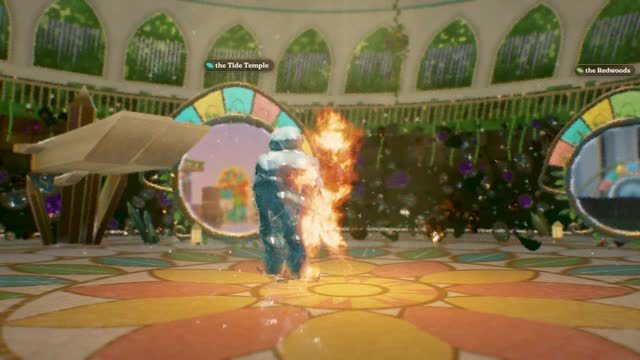
- Newcomer: 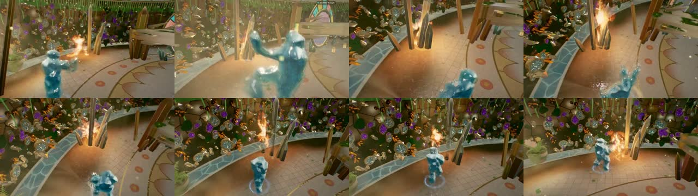
- Dancer, temple: 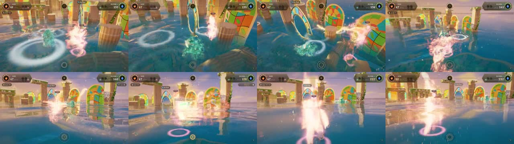
- Dancer, geode: 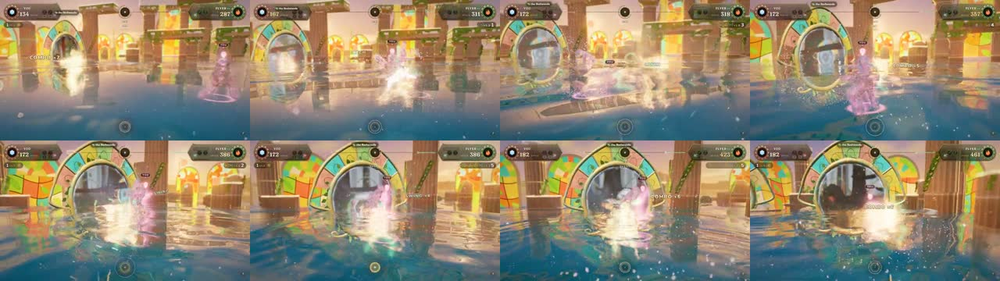
- Explorer, temple → redwoods → Pool: 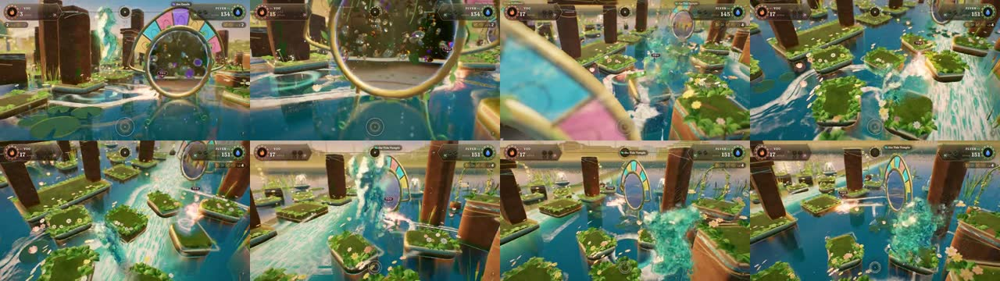
- Pair, one keyboard: 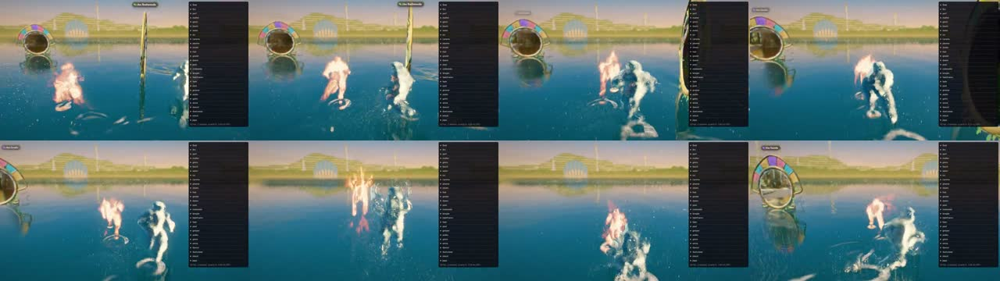
- Touch: 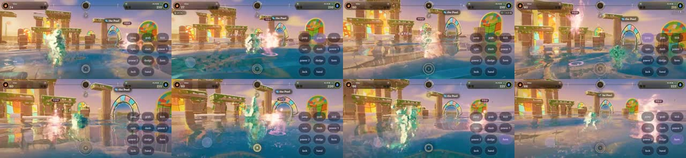

The dancer in the temple, before and after, 16 s into the same seed. The dance itself differs, because the camera changed:

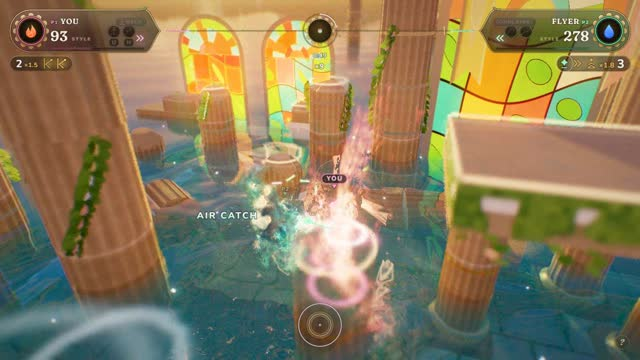 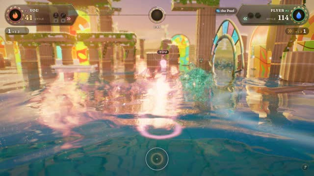

Through the temple's mirror into the redwoods, as the explorer saw it:

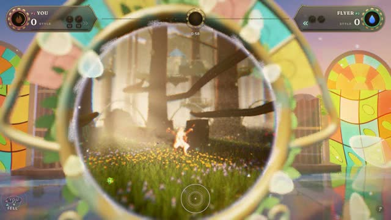

## Verdict: fun, smooth, amazing, magical?

- **Magical: often, in the duel.** The dancer gets 14 to 24 moments a minute: words, juice, the world answering. Going
  through the glass into the redwoods' meadow is a real "oh" moment. The pair drifting on the Pool's water at sunset
  is the most beautiful thing the players saw. In the dance from the front, magic is rare: 0 to 4 moments a minute for
  a newcomer, because nothing pulls them toward their partner.
- **Smooth: the duel camera is now smooth between crossings. Crossings are still not smooth.** Before, a flowing dancer
  saw a camera jump twice a second. Now the duel camera makes no cuts. But the moment the pair nears or passes a
  mirror, the swing-in and the way through take over for 10 to 50 % of the time. They cut, and they lose the player's
  body for a second at a time. The dance's follow camera cuts 17 to 20 times a minute. Bodies pop 3 to 6 times a
  minute in the duel; it was 10 to 31.
- **Fun: yes for someone who knows the duel.** There's momentum (80 to 90 % of pushing time over 3 m/s), few stops,
  1-frame response, and catches and flings land. **Not yet for a newcomer from the front.** They press W, run, mash, and
  mostly see the floor or the decor at the rim. They don't meet the partner, and don't learn what to do.
- **Amazing: in moments, not yet as a whole.** The worlds are gorgeous in the stills; the frame often isn't. The
  camera looks down at the water past posts (the Pool), or a crowd of pieces fills it.

## The five feel problems left

1. **The crossing camera** (way through and swing-in; p7-through, `src/duel/index.ts` + `crossing.ts ThroughCam`).
   After a crossing it cuts 5 to 16 m and 40 to 180° onto the duel camera's view. It looks away from the player's body
   for about a second; one way ran 8 s and ended in a 180° flip. It jumps whenever its disc or side flips. It is all
   the duel's remaining cuts and all its "where am I" time. Suggested fixes:
   - Blend the way's end onto the duel camera over 0.3 s instead of switching.
   - Keep the player's body in the way's frame.
   - Freeze the swing-in's side and disc once it is past a third.
2. **The dance's follow camera** (p7-newcomer, `engine/camera.ts` follow mode). It cuts 17 to 20 times a minute,
   stands low on the floor or inside the rim's decor, and never clears solids. The newcomer's view is mostly tiles,
   crystal shelves and blur. Suggestion: give it the duel camera's clean-eye test and rate-limited boom.
3. **The newcomer has nothing that brings them to the partner.** Pressing W from the front runs away from the other
   dancer. Mashing makes moves that commit, so the jump waits 100 to 140 ms. Nothing says "come here" or which body is
   theirs in the dance (no YOU in the jogo; p7-newcomer).
4. **The duel camera still looks down a lot in the Pool and the redwoods** (24 to 36 % of the time over 28°). Its eye
   is judged unclean 36 to 64 % of the time there. The rise over the posts and trunks is the camera's answer to the
   world's pieces standing at its distance. Pieces set back from the play space (p7-sun-built, p7-dusk-built) would
   help more than tuning.
5. **The body still pops in a few places.** These are pushes out of solids (0.3 to 0.6 m a frame for several frames
   after a reform or near a moving piece), the held body's snap onto the grip at a catch (the hips 0.65 m in one frame),
   and the Pool's posts and rims (14 a minute there). Contact (`contact.ts`) and `_solidsPush` should ease these
   corrections in rather than set them.

## Tests and checks

- `npm run typecheck`: clean.
- `node scripts/test-ts.mjs`: every test passed, including `camera.test`'s flyer-in-frame test.
- `scripts/cam-sim.mjs --sets 3`: the flyer in frame 100 %, both bodies whole 100 %, the eye in a solid 0.0 %.
- `npm run test:net` was not run, as the brief asks.

## Not done or not verified

- Two pages online was not built.
- Each scorecard cell is one run. With per-run variance this large in the dance, the dance numbers (catches, magic)
  need more seeds before reading anything into them. The camera and body numbers are consistent across the runs.
- The real clock was measured under other agents' load. Its frame pacing says nothing about the game alone.
- The landing ease and the step climb were looked at in recordings and stills, not in a live hand playtest on a
  screen.
- The touch pad's three columns were checked at 844×390 only.
