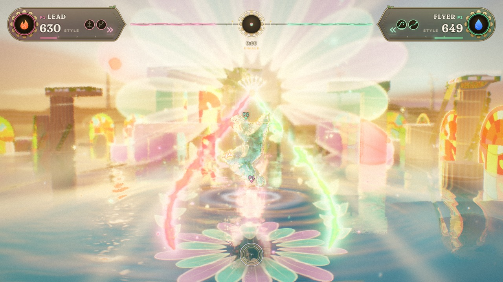
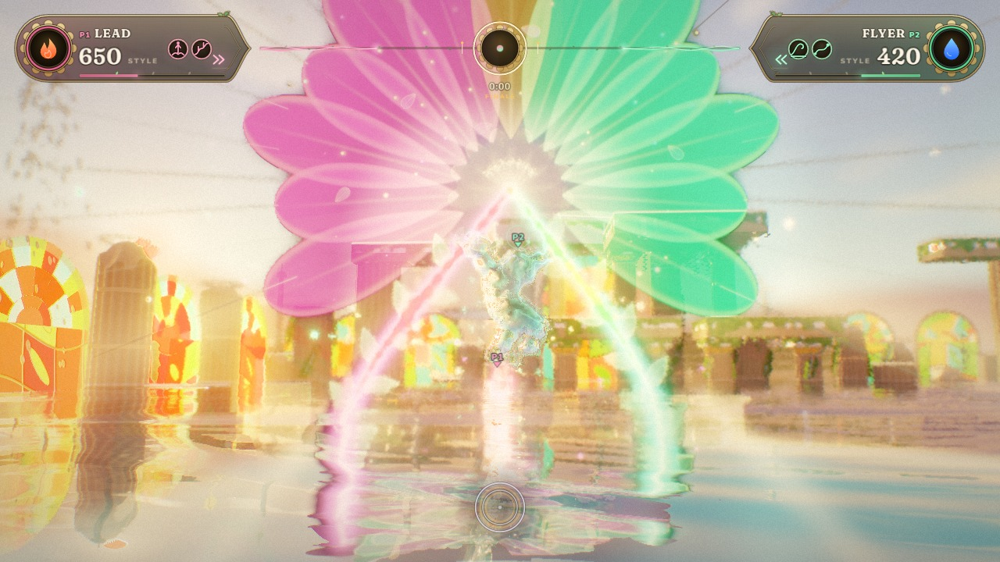
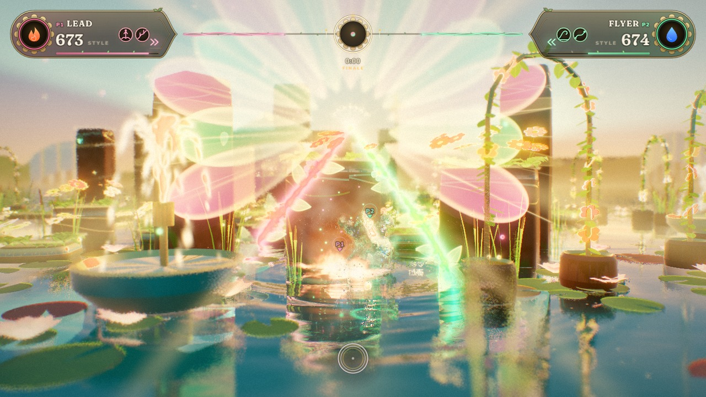
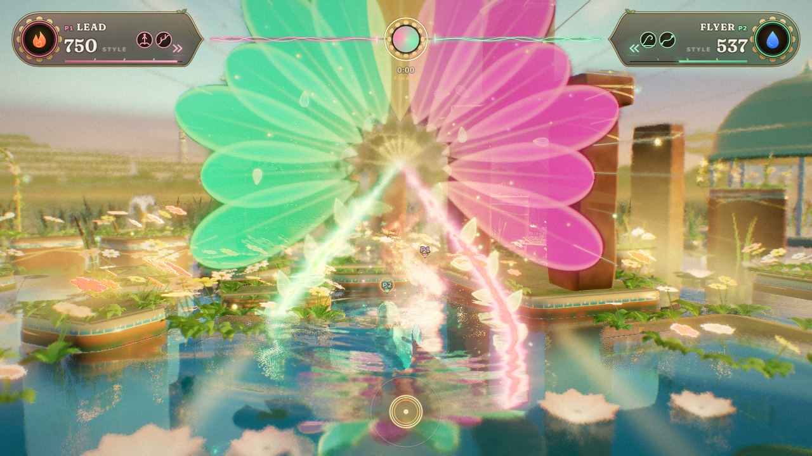
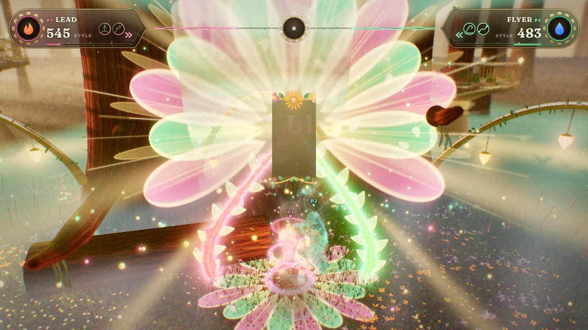
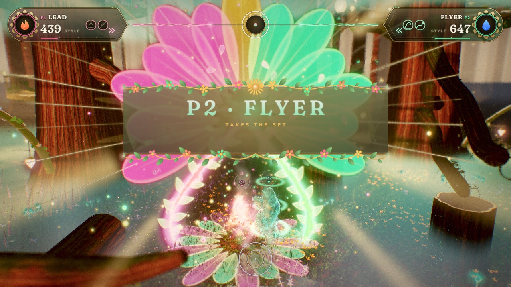
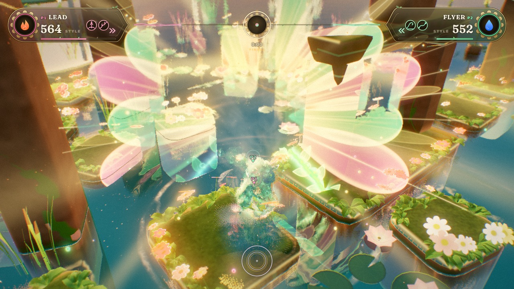
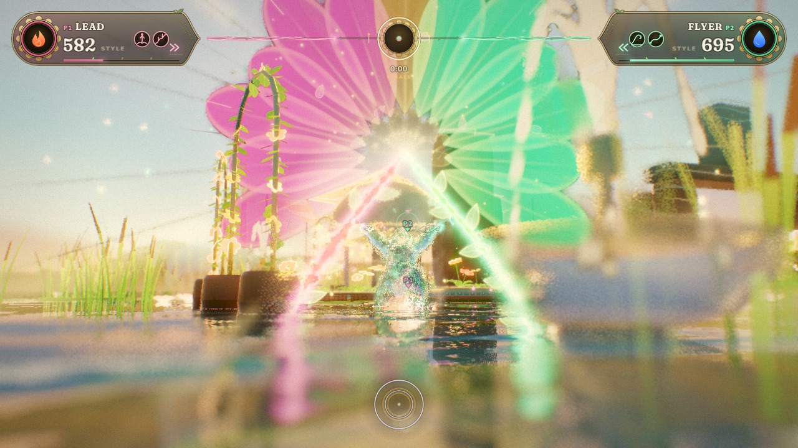
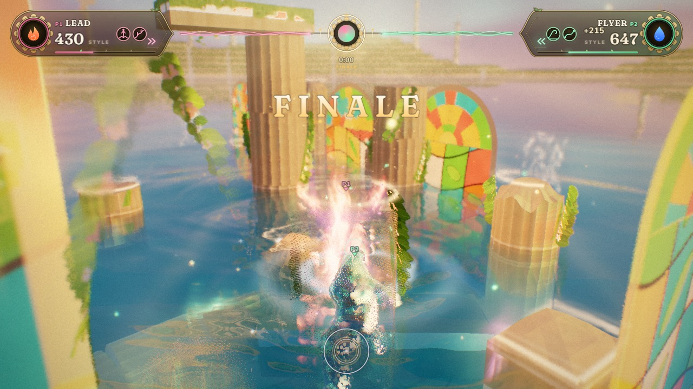

# 24: the big moment as a glow, not a glare

Branch `p7-glow`, from master `de3af62` (phase 6 and report 23). The brief is report 23's second issue: "the big moment
is big but washed and veiled". The flower was cream where its petals overlapped and where the beams crossed them, the
world under it was lifted toward white, the lifted body started behind a Pool post, and the aurora was out of frame
because the camera looked down at the water.

**What I measured.** I ran the finale in the page with `scripts/answer-cap.mjs`, which this branch extends. Each take
is two virtual players at skill 0.85, fire against water, stepped by hand at 60 fps and grabbed from the duel's own
camera at 1280×720 with the HUD. The mirrors were shut and the fusion was written into the rules' state. There are ten
takes per run: the Pool with seeds 1, 2, 3 and 6, the temple with 4 and 8, the geode with 3 and 7, and the redwoods
with 5 and 9.

The baseline ran on master's look with only the measures added. The final code ran twice: once
as it is, and once with the camera's new look up switched off (`--sky 0`) to separate the camera's share. For each
frame from the finale's start to the banner's end I recorded:

- **Near-white in the bloom.** The share of pixels in the bloom's box on screen (`moments.ts` `sizeOf`, below the HUD)
  with every channel over 215/255 and saturation under 0.18.
- **Petal saturation.** The mean HSV saturation of the rose and fern pixels in that box (hue 310°–10° and 120°–175°,
  value over 0.3). I measured it from the saved frames with `shots/petals.py`, which is not committed and is described
  under "Not done". The box's plain mean saturation, also in `answer.json`, mostly measures the sky behind the flower.
- **Body occluded.** Frames in which a solid crosses the sight line to a body's hips, chest or head (`moments.ts`
  `hidden`), counted over the finale.
- **Aurora in frame.** The same moment drawn with the aurora and without it, at four points through the lift (a
  ten-thousandth of a second apart, `DuelAnswer.noAurora`). I counted the share of the frame whose light changed by more
  than 3 % in the sky band (view rays 3° to 30° over level, where the aurora's curtains hang), and the share of the frame
  that is that band at all.
- **GPU time per pass**, from held frames with the flower open.

I also ran `npm run typecheck`, `node scripts/test-ts.mjs` (31 of 31 files), `check-limits` and `check-bindings`.

**What I didn't measure.** A person playing, a phone, an online duel, the film tool's camera, the lock, and the sound
(untouched). I made no 1080p or master render.

## The numbers

Ten takes before and ten after. The page's dance differs from run to run, so each take has the same seed but not the
same frames.

| | before | **after** | after, camera's look up off |
|---|---|---|---|
| **near-white pixels in the bloom's box** (mean of frames) | 4.5 % | **2.7 %** | 2.4 % |
| … over the whole frame | 2.6 % | 1.4 % | 1.1 % |
| **petal saturation** (rose and fern pixels in the box) | 0.25 | **0.35** | 0.36 |
| … rose / fern | 0.25 / 0.24 | 0.36 / 0.35 | 0.37 / 0.36 |
| … the box's share that reads rose or fern | 12 % | **26 %** | 27 % |
| **frames a body is occluded** (finale frames) | 163 of 1,418 (2 takes) | **56 of 1,412** (2 takes) | 50 of 1,413 (2 takes) |
| **the sky band in the frame** (share of the frame) | 23 % | **39 %** | 25 % |
| **the aurora in the frame's sky** (share of the frame its light changes) | 11 % | **17 %** | 10 % |
| … anywhere, its mirror in the water and floor included | 36 % | 36 % | 31 % |
| the bloom's lit share of the screen, mean | 23 % | 22 % | 20 % |
| a body's core under the bloom, mean | 0.06 % | 0.03 % | 0.03 % |
| GPU frame, held, the flower open (the air pass; the glow pass) | 2.13 ms (0.31; 0.13) | 2.29 ms (0.36; 0.15) | |

Per take, before → after:

| take | near-white in the box | petal saturation | occluded finale frames | sky band | aurora in the sky |
|---|---|---|---|---|---|
| geode 3 | 1.9 → 2.0 % | 0.26 → 0.39 | **34 → 0** | 34 → 56 % | 6.5 → 20.2 % |
| geode 7 | 1.2 → 1.8 % | 0.26 → 0.40 | 0 → 12 | 19 → 29 % | 7.9 → 10.3 % |
| Pool 1 | 0.7 → 2.8 % | 0.30 → 0.31 | **129 → 0** | **1 → 55 %** | **0.1 → 27.7 %** |
| Pool 2 | 1.6 → 2.0 % | 0.29 → 0.39 | 0 → 0 | 6 → 25 % | 1.9 → 9.4 % |
| Pool 3 | **7.8 → 1.8 %** | 0.28 → 0.36 | 0 → 0 | 43 → 38 % | 25.1 → 15.1 % |
| Pool 6 | **7.4 → 1.9 %** | 0.18 → 0.32 | 0 → 0 | 39 → 56 % | 28.3 → 27.5 % |
| redwoods 5 | 2.3 → 2.6 % | 0.28 → 0.38 | 0 → 0 | 12 → 16 % | 5.5 → 3.8 % |
| redwoods 9 | 3.2 → 2.9 % | 0.27 → 0.36 | 0 → 0 | 12 → 38 % | 5.1 → 18.0 % |
| temple 4 | **13.1 → 6.3 %** | 0.17 → 0.29 | 0 → 0 | 41 → 56 % | 23.6 → 29.7 % |
| temple 8 | 5.9 → 3.0 % | 0.19 → 0.31 | 0 → **44** | 26 → 16 % | 9.9 → 6.3 % |

**What the numbers say:**

- **Less glare.** The near-white share in the bloom fell by about two fifths, and by half or more in the takes that were
  washed (the temple at noon and the Pool's bright sky). Where the box held almost no white before, as in Pool 1 looking
  down at the water, it rose a little because the frame now holds the sky.
- **Saturated petals.** Saturation rose from 0.25 to 0.35 in every take, and the box reads rose or fern twice as much.
- **Sky and aurora.** The camera's look up gives the sky band 39 % of the frame instead of 25 %, and the aurora's
  light in the sky goes from 10 % of the frame to 17 %. The A/B run, with the same code and the look up switched off,
  credits the camera with that gain.
- **Occlusion is not settled.** Occluded frames fell from 163 to 56. But the run with the look up switched off also had
  only 50, so the drop is not the camera's change. The worst case before (Pool 1, the lifted body behind a post for 129
  frames, the camera looking straight down) didn't recur in the four takes of that seed after the change. Two takes in
  ten still begin behind a piece: temple 8 was behind a drum for the lift's first 0.7 s, then clear, and geode 7 for 12
  frames. I can't show that the camera's changes stop it, and as in report 20, ten takes are too few to tell.

## What changed

### 1. The bloom's light (`src/duel/bloom.ts`, `src/play/glow-draw.ts`, `glow.wgsl`, `glow.ts`, `src/post/air.wgsl`, `src/worlds/answer.wgsl`)

I found three causes of the cream:

- **Rose added over fern.** The thirteen petals alternated rose and fern and overlapped toward the heart. Added light
  of the two colours sums to cream.
- **Gold everywhere.** Thirteen gold midribs ran from the heart (white rays across every petal), along with gold sepals
  and 26 rays of sun drawn over the fan.
- **The petals were drawn into the scene.** That made them part of the surface behind them. The air fogged them as far
  as that surface (over a noon sky, as far as the sky), the moment's lamp lifted them with the world, and the sun's
  beams were added over them.

The fixes, in the same order:

- **Each half of the fan one seat's colour.** The base's colour is on the left and the flyer's on the right, as the
  vines already are, with a gold petal at the top between them. Rose over rose stays rose. The colours are deepened a
  little (each channel taken toward the peak by a power, so the hue and the peak are kept), and the petals' intensity
  went from 0.72 to 0.85.
- **The gold faint.** The petals use a new kind (`Glows.petal(…, soft)`, glow.wgsl kind 10) whose gold midrib, rim and
  heart are a quarter as strong. The sepals are fainter, the stamens are gold rather than cream, and the glint at the
  heart is dimmer. The rays of sun now start beyond the petals' tips, so they fan out behind the flower.
- **The flower is a layer of light in the air.** `GlowDraw.declareLayer` draws the bloom's range of the glow list into
  the main view's glow pass instead of the scene; the scene's draw skips that range (a skip range in `GlowLook`, which
  had two pads). Each petal writes its own view distance into the glow target's alpha, which is min-blended, so the air
  knows where it stands. Then `air.wgsl`:
  - **fogs it at its own distance**, not the sky's (that branch already existed);
  - **takes back the lamp's lift** (`answerGlowSeen` divides by the world's lift there);
  - **caps the peak where petals overlap**, rolling it off toward 0.95 with the hue kept, and letting go on the framed
    bodies so fire on a body stays hot;
  - **lays the petals over the world** (`answerGlowOver`): up to 92 % of what is behind a petal is hidden, never over a
    framed body. Light added over a bright sky can never be saturated, and this was the largest single change in the
    stills;
  - **takes the sun's beams off where the flower stands** (`answerShafts`), so they come out from behind it.

  The beams' hole round the heart is now the flower's own size as the eye sees it (3.3 m), not a fixed 13°. The veil
  behind the heart is a quarter, down from a half, because the petals do that work now.
- **Glow over water.** A glow with a distance is no longer taken for fire's mirror copy on the water (`glowSeen` takes
  the nearer of the light's focus and the glow's own distance).

**One colour accent per moment** (`answer.wgsl` `answerMul`, `src/duel/answer.ts`):

- **The lift as the wave passes.** It is a third of what it was, and in the moment's own colour (DUET's green,
  CURRENT's blue, MURMURATION's violet) rather than a generic gold lift on the whole stage.
- **A fusion's lamp.** It is about a third as strong (2.2 against 6), so the bodies and the stones under the flower are
  no longer pushed toward white.
- **A cap on the lift.** No surface is lifted past 1.8 times its light.
- **Motes.** A pair tier's motes are its own colour among sun gold, not the two seats' colours plus gold. A fusion's
  motes keep the seats' colours, because the flower is the two players.

### 2. The finale's camera looks up to the sky (`src/duel/camera.ts`, `src/duel/index.ts`)

The duel camera has a new input, `CamInput.sky` (0 to 1). In a fused finale, `index.ts` ramps it in over the lift's
first third and keeps it until the bloom fades under the banner. While it's on:

- **The plain view looks up** 0.14 rad (8°) instead of 3° down, and the higher views come down with it. The look up is
  allowed to reach 0.2 rad.
- **The fallback's tilt is capped.** When the eye is cluttered it tilts down over the pieces no further than 0.3 rad
  (it went to 0.75). The boom comes in among the pieces instead. Report 23's frame looked straight down at the water.
- **The rise comes back down** as quickly as it went up.
- **A blocked sky costs.** A choice whose view of the sky over the flower is blocked by a piece pays up to 1.2: three
  rays, 0.2 rad up, 14 m out.
- **The turns go all the way round**, up to 1.8 rad either side of side on.
- **The camera reacts at once.** The finale's start asks the choice again immediately, and the turn is twice as quick
  while the look up is on.

So a lift that begins behind a post is turned away from rather than climbed over. This is what moves the sky band from
25 % to 39 % and the aurora in the sky from 10 % to 17 %. `camera.test.ts` adds a test: at 16 places on the Pool's
stage, with the lift and its flower, the look is level or up at 13 against 11, with no more bodies behind a stone.

### 3. Measures (`scripts/answer-cap.mjs`, `src/duel/moments.ts`, `src/duel/answer.ts`)

- `answer-cap.mjs` records each frame's glare in the bloom's box and the aurora A/B at the lift's +10, +40, +90 and
  +150 frames, and summarises the occluded finale frames. `--sky 0` switches off the camera's look up.
- `moments.ts` `sizeOf` returns the box's left edge, and `lightFeet` reads the soft petal as a petal.
- `DuelAnswer.noAurora` is a measuring switch.

## GPU

At the flower's peak on the RTX 5090 (ten takes, held frames), the frame is 2.13 → 2.29 ms. The air pass is +0.05 ms
(the cap, the laying over and the beams' second evaluation, on glow pixels only) and the glow pass +0.02 ms (the bloom
moved into it). The scene pass is +0.14 ms, which I read as what the lower camera now sees: more of the far landscape
and sky. That is within the profiler's take-to-take swing. No binding was added (`check-bindings`: 192 entry points,
within the baseline).

## Files

- `src/duel/bloom.ts`: the fan's colours, deepened, soft petals, the rays outside the tips, fainter gold.
- `src/play/glow.wgsl` (+ `.d.wgsl.ts`), `glow.ts`, `glow-draw.ts`: kind 10 (the soft petal, its distance in the glow
  target), the skip range, `declareLayer`. The scene draw's alpha is kept rather than min-blended with 1e5, which is the
  same result.
- `src/post/air.wgsl` (a few lines): the glow's distance into `glowSeen`, the cap and the lift taken off, the petals
  laid over, the beams off the petals.
- `src/worlds/answer.wgsl`: `answerMul` (the accent, the lamp, the cap on the lift), `answerGlowSeen`, `answerGlowOver`,
  `answerShaftsAt`/`answerShafts`, the hole the flower's size, the veil a quarter. No `.d.wgsl.ts` changed, because the
  struct is the same.
- `src/duel/answer.ts`: the accent motes, `noAurora`.
- `src/duel/camera.ts`: `CamInput.sky` and its handling (`skyPitch`, `skyDown`, `skyMin`, `skyOffsets`, `skyCost`,
  `skyCap`), `skyScale`. `src/duel/camera.test.ts`: the new test.
- `src/duel/index.ts` (a few lines): `skyOf`, the bloom's layer.
- `src/duel/moments.ts`: `sizeOf`'s left edge, the soft petal in `lightFeet`.
- `scripts/answer-cap.mjs`: the glare and aurora measures, `--sky 0`.
- Stills: `docs/reports/media/24-glow-*.jpg`.

## Tests

- `npm run typecheck`: passes.
- `node scripts/test-ts.mjs`: 31 of 31 files (the camera's new test among them).
- `check-limits`: limits agree. `check-bindings`: within the baseline.
- I didn't run `test-audio` (no sound was touched) or `test:net` (per the brief).

## Not done, and weak points

- **Occlusion at the finale's start isn't fixed.** 2 of 10 takes still begin with a body behind a drum or slab for up
  to 0.7 s. The A/B shows the camera's changes didn't change the count; the drop from before is run-to-run noise. A
  real fix probably needs the finale to anticipate: turn the camera on the last bar before the finale, or lift on a
  clear spot.
- **The aurora is visible but faint against a day sky.** It changes the sky in a sixth of the frame now, against a
  tenth. In the stills it reads as a tint more than as curtains over the Pool's and the temple's bright skies. At a
  tier (AURORA in play) the camera doesn't lift. I tried 0.6 of the finale's look up there, and in one Pool take a body
  was occluded for 137 frames, so I took it out. Lowering the aurora's band, or giving the day sky a darker band for it
  to show against, are next steps.
- **The petals read as translucent.** With 92 % of what is behind hidden, the stones behind show faintly through. They
  read as light rather than as cut paper, but a little flat. A soft inner vein in the seat's own colour, rather than
  gold, could give them more form.
- **The flower is in the glow pass, so it now takes the glow's rules everywhere.** A water body in front of it tints it
  (correct). Its reflection in the Pool's and the temple's water is the glow's mirror copy (looks right in the stills,
  not checked closely).
- **The film tool's camera** (`filmcam`) doesn't know `sky`, so a film keeps the old finale framing unless it uses the
  duel camera.
- **The petal-saturation script isn't committed.** `shots/petals.py` is a scratch Python script, described above.
- I didn't make a concept image.
