# 24: a newcomer from the front page (phase 7, report 23's issue 4)

Branch `p7-newcomer`, from master `de3af62`. The brief: a newcomer from the front page doesn't know which body is
theirs or what to press. Make the front say what to press and which body will be yours; give the dance (the jogo) the
duel's YOU tell; no slab or planter filling the first second; the dance's crossing through the glass like the duel's;
the camera after a crossing keeping the world in view. Judged as a first-time player: real key presses from the front
page at 1280×720.

**Measured:** headless Chrome on the RTX 5090, the dev server on 5515, every run from the plain front page
(`scripts/steps/newcomer.js` through `roam-probe.mjs`), stepped at 60 fps, driven by the page's own keyboard, mouse and
touch input from Puppeteer, and a gamepad faked in the page (`navigator.getGamepads`). There were 17 runs before and
14 after, over the six ways in: Enter, an arrow, W, a click and a tap on the dancers, and a pad's A. Then the body was
moved three ways: W held, the touch stick held up, or a "first-timer" walker. The walker steers W A S D (or the arrows)
toward the mirror it sees and goes through. It is `roam-lib.js`'s walker, aimed at the nearest mirror or a named one.
**Not measured:** a person playing, a phone, a real gamepad, an online dance, sound.

## What was wrong (the before runs)

Four separate faults, found by driving the front with real keys:

1. **Enter gave you the wrong body.** The front's Enter joined the keyboard's *right* half, because Enter is that
   layout's form key. A newcomer's next key, W, then joined the *left* half as a second player, and that player took
   the partner's body (seat 2, the water one). In every Enter run the devices read `keyboard-right, keyboard-left`. The
   body the newcomer steered was the partner's. The fire body, the one the camera follows, stood still. This is why
   report 23's newcomer "didn't know which body was theirs": they really were steering the other one.
2. **The first key stuck down.** The key that began the game went up while the game was still loading, so its new
   keyboard source never heard the key-up. A tapped W walked the body forward by itself for 1.6 s. Then the room
   started, the count-in re-formed both bodies at their spawns, and the body jumped back. It was then held for 0.9 s
   while its matter rose into it.
3. **No edge in open 3D.** Holding W walked the body through the geode's balustrade and out past its glass, up to 20 m
   from the middle. The follow camera went after it into the wall of geodes (below).
4. **The camera.**
   - The first view kept the front's turn, so the boom's eye stood among the rim's floating selenite slabs and planters.
   - In 3 of 5 crossings the main view went over under the flash, or late.
   - The follow camera lifted over solids and over the disc's back, looking down at the floor. In the Enter runs it
     looked down in 59 % and 80 % of frames, because the body it follows (seat 1) never moved.

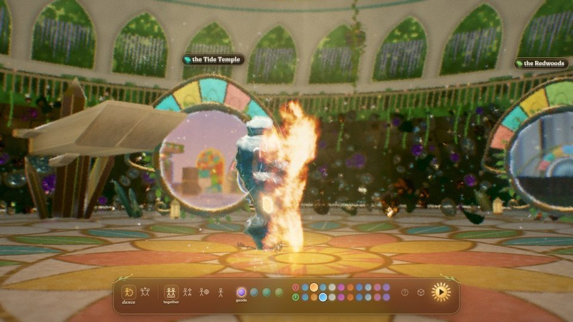
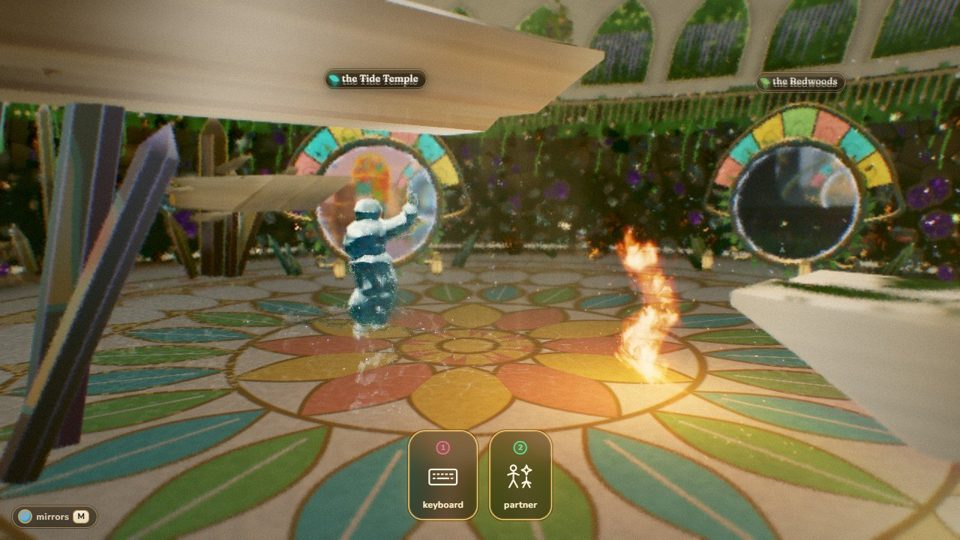
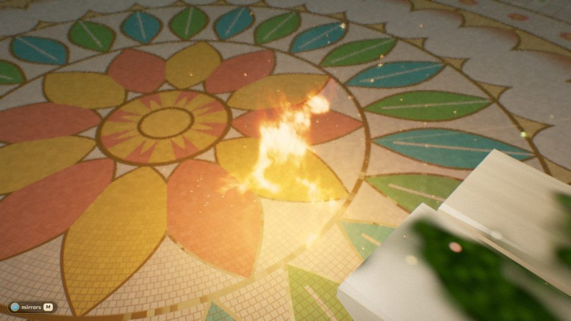
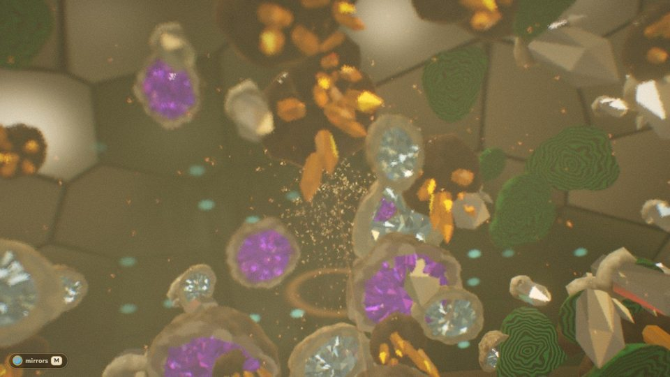

## What changed

### The front says what to press, and which body will be yours (`src/play/front-you.ts`, `src/play/you-tag.ts`)

- **On the body a press will join** (the show's first dancer, seat 1 in the dance and the duel alike), the duel's YOU
  tell as the front shows it, breathing slowly:
  - a rose petal standing on its point over the head;
  - a rose ring round the feet, with a sunlit disc inside it;
  - a soft shaft of sun on the body;
  - a ring of rose rising up the body every two seconds.
- **A small tag reading *you*** sits over the petal. It is the page's DOM, in the skin's honey glass and gold leading
  (index.html's `--eb-*` tokens).
- **A pill above the strip** gives the call to press, breathing gently: "press any key to dance". On a touch screen it
  reads "tap to dance". Once a gamepad is plugged in it adds the pad glyph and a green **A**. It goes as the game begins
  (`body.playing`).

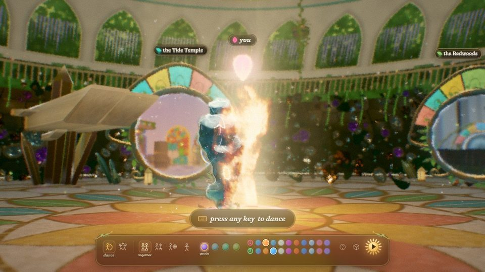
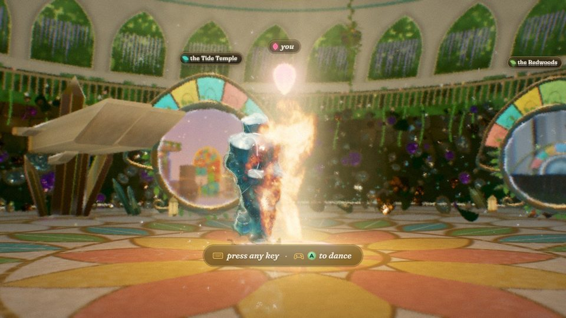

### The press joins the one-player keyboard, and the key is let go (`src/worlds/geode/front.ts`, `src/play/index.ts`, `src/play/menu.ts`)

- **Which layout a key joins.** A first press on W A S D (or any key of the solo layout) joins that layout. An arrow
  joins the right half. Any other key (Enter, Space, a letter no layout has) joins the solo layout with the mouse, as a
  click does. Enter and then W is now one player on one body.
- **The stuck key.** The front tracks which keys are down. A key that went up while the game was loading is let go as
  it joins (`Joined.held`). The same fix is in the dance and in the duel's lobby.
- **The room starts at once when the front begins it** (0.2 s rather than 1.6 s, counted on the frames' clock rather
  than a `setTimeout`, so a stepped capture starts it on the same frame every time).
- **The first count-in no longer re-forms the bodies.** They already stand at their spawns, so the player's first
  steps are kept, not undone a second and a half later.

### The YOU tell in the dance (`src/play/index.ts`, using `src/duel/you.ts` as it is)

- **Which seats.** The duel's `YouTell` runs on the jogo's own glows, on this page's own seats:
  - a local room: the seats a device plays;
  - online: this page's seat;
  - a film or a script: none.
- **The opening.** It runs the full opening (4.5 s) as the first device joins, so the front's petal carries straight
  on into the game. It runs the shorter opening (2.2 s) each time the view comes into a new world. Both openings give
  the shaft, the disc, a rising ring on each beat, and the large petal, with the *you* tag over it. With two players at
  one screen the tag reads P1 · W A S D and P2 · ARROWS.
- **All the time.** A small petal and a ring stay at the feet. The tell answers the first press, and fades in a fusion.
- **Views.** Its glows are drawn in the world, so the tell is the same in 3D and in the side view.

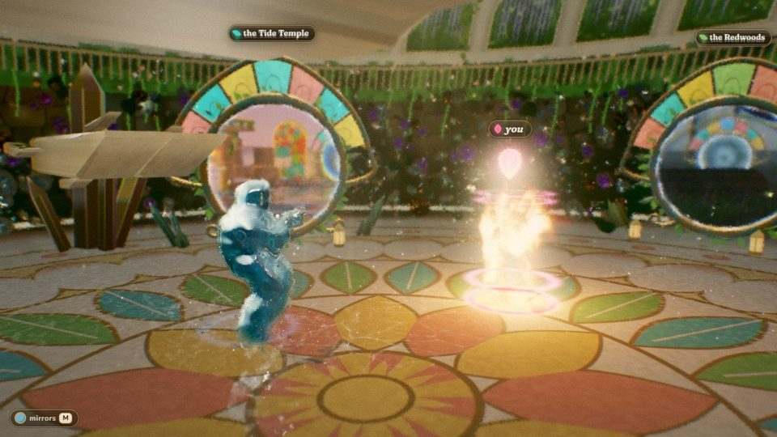
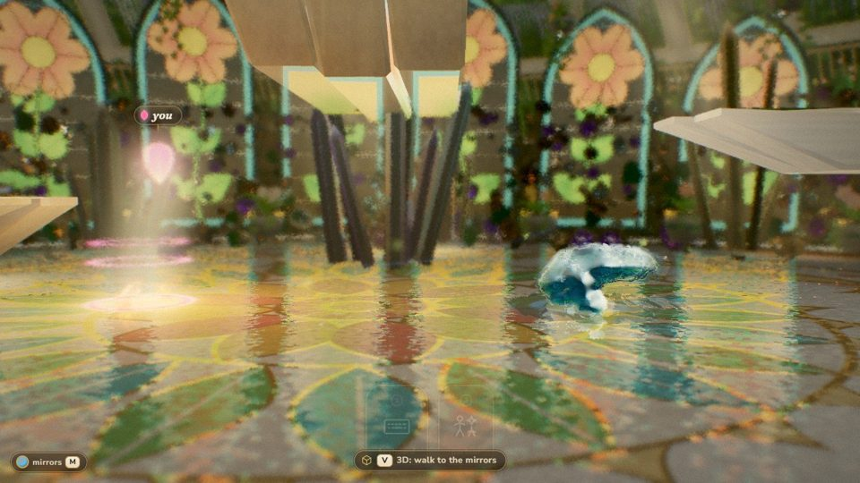

### The first view (`src/play/opening.ts`)

As the dance begins, and again at its count-in, the follow camera turns to the nearest clear turn and eases there over
about half a second. A turn is clear when:
- the boom from the pair to the eye misses the world's solids;
- nothing solid sits in the near part of the frame (a grid over the view out to 2.6 m).

The player's own look input takes over at once. The selenite slabs and planters are p7-dusk-built's, so they are left
where they are.

### The crossing goes through the glass (`src/play/roam.ts`, using `src/duel/voyage.ts` as it is)

- **The way through.** The dance's crossing now takes the duel's way through the glass (`ThroughCam`). From the frame
  the pair is through, the eye goes round the rim onto the disc's axis behind them (if it stood beside the disc), then
  through the disc on their line. It ends on the follow camera's own view of the pair in the new world, as the follow
  camera would frame it: the same look point, lead, boom and partner fit.
- **The settle.** After that, while the pair is still near the disc they came out of, the follow camera's view is held
  in front of that disc with its look level (at most 0.3 rad down). Where the boom straight back would put the eye
  behind the disc, it swings round beside it instead. The settle ends when the pair is clear of the disc, when the
  player turns the camera, or after 5 s. The follow camera then eases on from there, with no jump of its look point.
- **Why the settle.** Before, the follow camera swung behind the runners, met the disc's back and lifted over it. That
  is report 23's "looking straight down at the tiles".
- **The flash** is kept only for a locked view, or for a way that hasn't brought the eye through in 6 s.
- **Not changed:** voyage.ts and the portals (p7-through's).

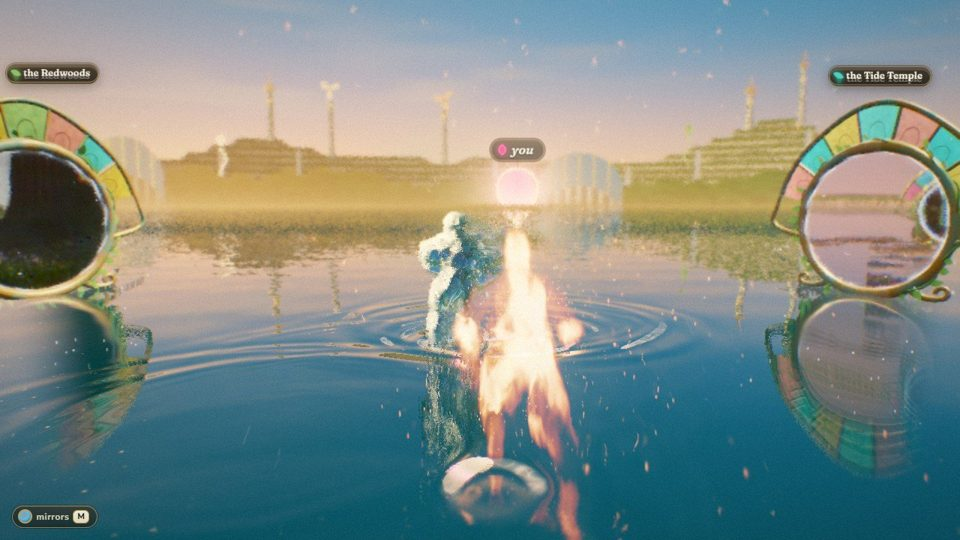
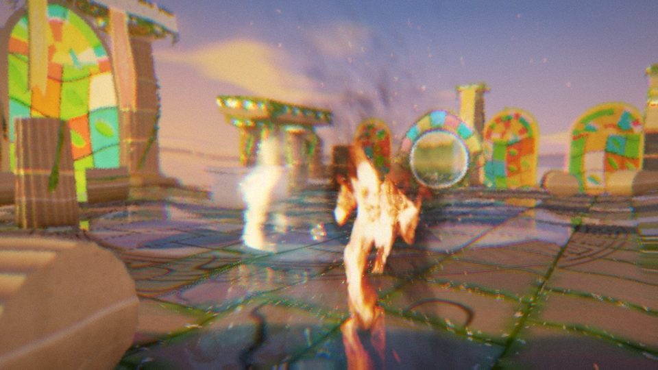
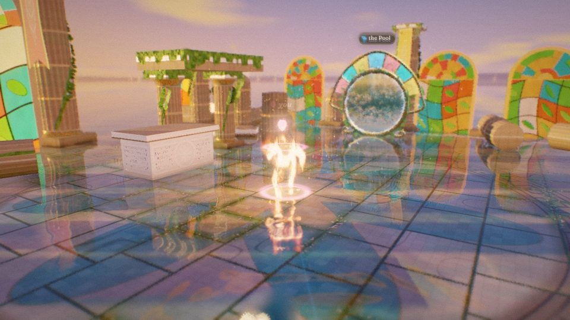
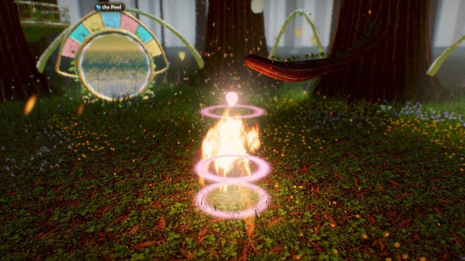

### The dance's soft edge (`src/play/edge.ts`)

This is the duel's soft edge (match.ts `softWall`, report 18-flow) on the dance's free bodies, about each world's duel
arena space:
- a run at the edge curves round it;
- a body past the edge is eased back in;
- the mirrors' lanes stay open.

W held from the front now runs along the geode's rim instead of out through its glass.

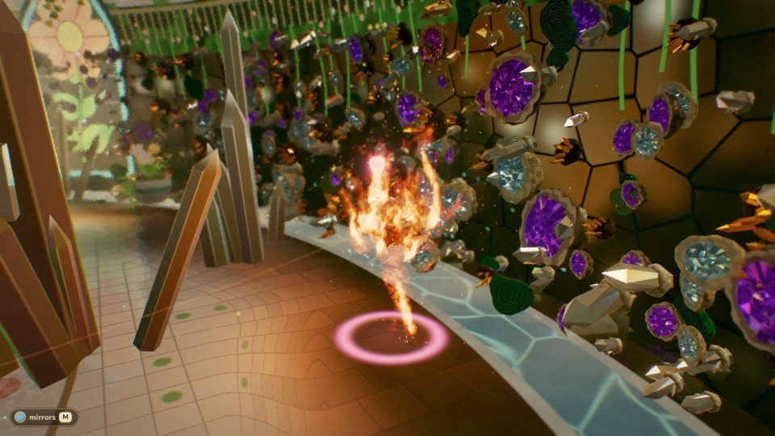

## Numbers

All times are seconds from the press on the front, on the stepped clock. "Moves" means the press's own body has
moved 0.25 m. "Floor frames" are frames whose camera looks more than 40° down (pitch below −0.7 rad). Before: master,
plus two instrumentation lines (the devices in `stats()`, and the room's start on the frames' clock rather than a
1.6 s `setTimeout`).

| the way in | before: body it drives | before: moves / crosses (how) / floor frames | **after: moves / crosses (how) / floor frames** |
|---|---|---|---|
| Enter, W held 10 s | **the partner's** (keyboard-left took seat 2) | never by its keys; — / 0 % (report 23's run: flash, then looking down) | **0.18** / no mirror on its line; runs along the rim / **0 %** |
| Enter, then walk to the nearest mirror | **the partner's** | never / never in 14 s / **59 %** | **0.38 / 1.58 through / 0 %** |
| Enter, then walk to the temple's mirror | **the partner's** | never / never in 20 s / **80 %** | **0.48 / 3.48 through** (a second run: 2.63, through) / 0.5 % (1 frame of 206) |
| W, then walk to the nearest | seat 1 (solo) | 0.23, put back at 1.6 / never in 14 s (walked out through the wall) / 0 % | **0.38 / 1.58 through / 0 %** |
| W, then walk to the temple's | seat 1 | 0.27 / 6.13 through / 0 % | (as Enter: 0.48 / 3.48 through) |
| ArrowUp, then the arrows to the nearest | seat 1 (right) | 0.23, put back / never in 14 s / 0 % | **0.40 / 1.60 through / 0 %** |
| ArrowUp, then the arrows to the redwoods' | seat 1 (right) | 0.23 / 5.23 through / 0 % | **0.45 / 2.97 through / 0 %** |
| a click on the dancers, then walk | seat 1 (solo) | 2.73 / 3.87 **late** (a cut under the light) / 0 % | **0.38 / 1.58 through / 0 %** |
| a tap, then the touch stick held | seat 1 (touch) | 0.35 / — / 0 % | 0.35 / — / 0 % |
| a pad's A, then its stick held | seat 1 (gamepad-0) | 0.20 / — / 0 % | 0.20 / — / 0 % |

How these numbers compare:
- **Time to the first move.** Before, the arrows and W moved at 0.23 s, but those steps were undone at 1.6 s by the
  re-form, and the body was then held 0.9 s. After, steps are kept from 0.18 to 0.48 s. Enter-first runs went from
  never to 0.18 to 0.48 s.
- **Time to the first crossing.** The nearest mirror: 1.6 s in all four ways in (before: one of four crossed, at 3.87
  s, under the light). The far mirrors: 3.48 s (temple) and 2.97 s (redwoods). Before, these were 6.13 and 5.23 s on
  W and the arrows, and never on Enter.
- **Share of crossings through the glass.** Before: 2 of 5 (the other three a flash or late; report 23's newcomer:
  under the flash). After: **7 of 7** (`stats().crossings[].how === 'through'`; the way's counts in `stats().ways`).
- **Frames looking at the floor.** Before: 59 % and 80 % on the Enter runs (the camera on an idle body among solids),
  0 % elsewhere. After: 0 % in all runs but one, which had 1 frame in 206. That was a single frame at −1.49 rad, 2 to
  3 s after the temple crossing, and a second run of the same walk had none. I didn't catch its cause. After a
  crossing, in the 3 s that follow: before, 10 of 71 frames (report 23's path); after, 0 of 60 in every run.
- **Does a still make it obvious which body is you?** Before, no. Nothing marks either body. The lobby's two cards
  (1 keyboard, 2 partner, or after Enter and W, two keyboards) are the only hint, and they named the wrong body. After,
  yes, in every still I took:
  - the front: the rose petal and *you* over the body that will be yours;
  - the first 4.5 s: the large petal, *you*, the sunlit shaft, and rings rising on the beat;
  - 2.2 s after each crossing: the same again;
  - all through: a small rose petal over the head and a ring at the feet.
- **GPU.** The front's tell is one more instanced draw of about 8 glows in the main scene pass; the dance's tell adds
  about 8 glows to the jogo's existing draw. The front at 720p: 5.8 ms a frame (`shot.mjs --timings`), with no pass
  standing out. Not measured against the same frame on master.

## Tests

- `npm run typecheck` (tsc): clean.
- `node scripts/test-ts.mjs`: **32 of 32 files pass**, including the new `src/play/test/newcomer.test.ts`:
  - the first view keeps a clear turn;
  - it turns off a slab in the near frame to the nearest clear turn;
  - a solid across the boom counts more than one at the frame's edge;
  - the soft edge turns a run along it, eases a body back in, leaves a mirror's lane open, and leaves the inside alone.
- `npm run test:net`: not run (port 5418, per the brief).
- check-limits, check-bindings, test-audio: not run (none of those areas touched).

## Files

- **New:**
  - `src/play/front-you.ts`
  - `src/play/you-tag.ts`
  - `src/play/opening.ts`
  - `src/play/edge.ts`
  - `src/play/test/newcomer.test.ts`
  - `scripts/steps/newcomer.js`: the measure. Run it with `roam-probe.mjs`, setting `window.NC = { start, go, keys,
    gate, after, secs }` in a `--lib` file.
- **Changed:**
  - `src/play/index.ts`: the front's tell, the dance's tell and tag, the first view, the edge, the start, the first
    count-in, `stats()`'s `devices`, `ways`, `you` and `opening`.
  - `src/play/roam.ts`: the way through the glass and the settle.
  - `src/play/menu.ts`: the duel's lobby lets go a key that went up.
  - `src/worlds/geode/front.ts`: which layout a press joins, and the keys down.
  - `scripts/steps/roam-probe.mjs`: `--touch`, and a held `touch()`.
- **Untouched:** the shared files `src/duel/voyage.ts`, `src/duel/you.ts`, `camera.ts` and `main.ts` (only imported).

## Not done, and seen along the way

- **Arrows, then W.** In "together" mode this is still two players: the arrows join the right half, and W then joins
  the left half as player 2, taking the partner's seat. That is the two-at-one-keyboard design. The tell then says so
  on both bodies (P1 · ARROWS, P2 · W A S D). A newcomer who uses only one set of keys, or starts with Enter, W, a
  click or a tap, gets one body.
- **Holding W from the front** doesn't reach a mirror: the camera's turn when the key went down sends the body past
  the mirrors, along the rim. A newcomer who steers reaches one in 1.6 to 3.5 s.
- **The selenite slabs and planters** still sit in the frame's top edge in some views, though no longer across it. The
  pieces themselves are p7-dusk-built's.
- **After a crossing, a walker that keeps its keys down** walks into the temple's drums and the redwoods' trunks, and
  the camera comes in close behind it. That is the world's pieces and the existing near fade.
- **The small petal outside the openings** is small at the follow camera's distance (a 0.2 m petal). In stills it is
  findable but not loud.
- **Not driven:** a real gamepad (the pad is faked in the page), a phone, online, a person.
- **The one floor frame** in one temple run, not reproduced.
