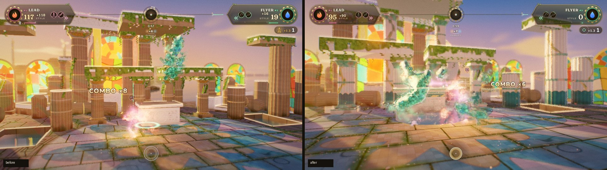
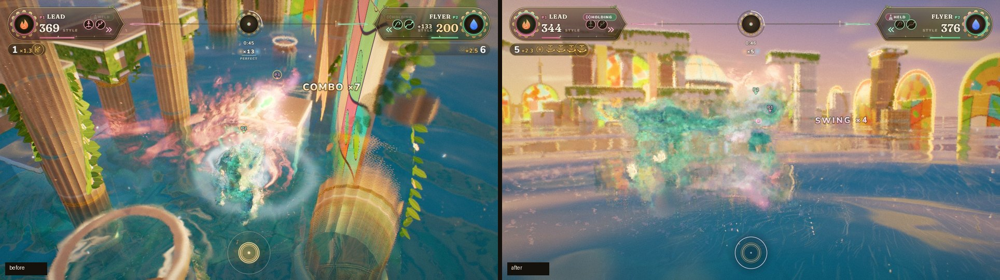
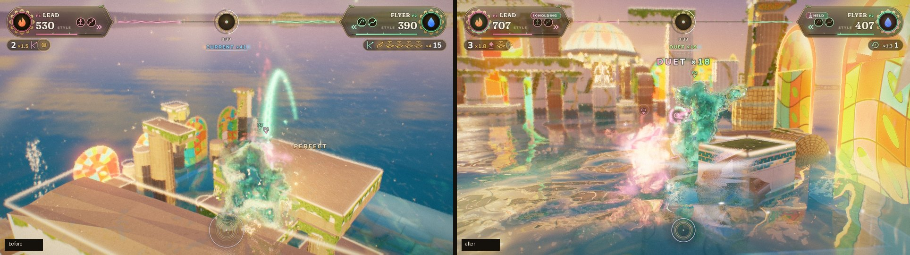
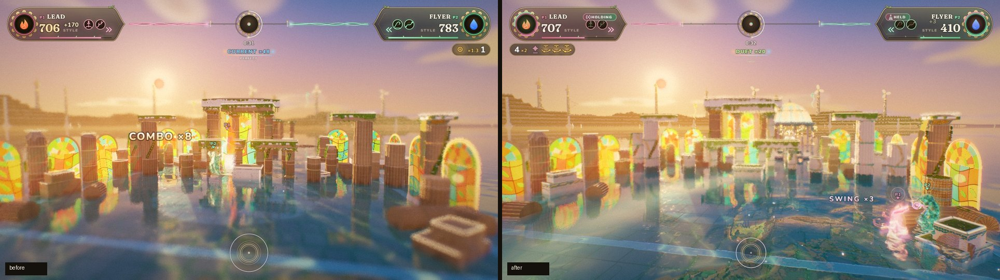
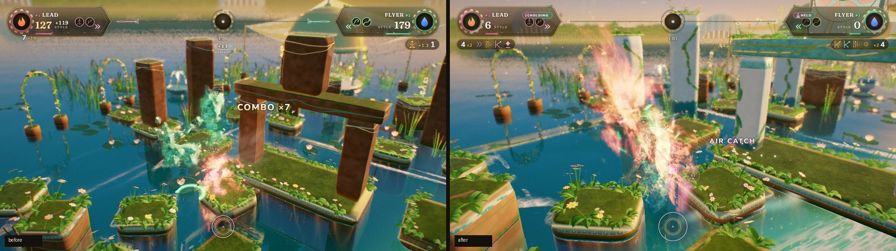
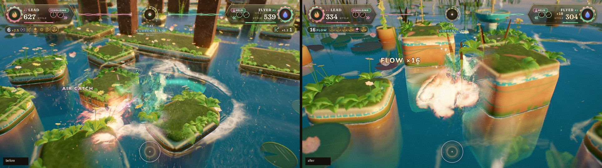
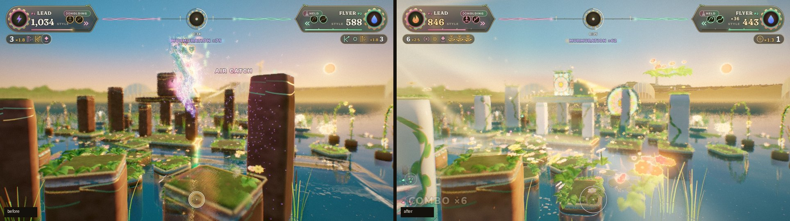

# 24: the sun worlds built (the temple's and the Pool's pieces in the bible's matter, a hero piece each, the far world through the lens)

Branch `p7-sun-built`, from master `de3af62`. One of the phase 7 agents. Mine is issue 1 of report 23 for the temple
and the Pool: "the worlds are lit but not yet built". Round the pair stood cream drums, blocks and plain brown posts,
and the vista was a soft band under the depth of field.

**Measured:**

- Stills from the duel's own camera at 1280×720, in motion: seeded duels of two virtual players at skill 0.85, grabbed at
  6, 12, 18, 24 and 30 s (`scripts/sun-cap.mjs`, my dev server on port 5519, headless Chrome on the RTX 5090). The
  temple is seed 3, the Pool seed 1, mirrors shut. The wide still is a held pose.
- How often each hero is inside the duel camera's frame: `sun-cap.mjs --hero`, a point every quarter second.
- GPU time per pass (`--timings`, 150 frames at 12 s), desktop and `?class=phone`, two runs each. On this branch each run
  was taken with the heroes on and with them off. Master was measured in the same worktree on the same port.
- Play: `scripts/duel-measure.mjs --world temple,pool --sets 6` on master and on this branch. **The JSON outputs are
  byte-identical.**
- `npm run typecheck`, `node scripts/test-ts.mjs` (31 of 31), `check-bindings` (199 entry points, within the baseline),
  `check-limits`.

**Not measured:**

- a person playing;
- a real phone (only the phone class's budget on the 5090);
- 1080p;
- a quiet GPU (other agents shared it, so the timings are noisy);
- an online duel;
- the lock.

## What changed

### The play pieces, made of the bible's matter

Only the drawing changed. Every solid, ledge, wall, spawn and mover is as it was, which is why the Node measure is
identical.

**The temple** (`src/worlds/temple/stones.wgsl`, `layout.ts`, `arena.ts`). A stone now carries a matter
(`MATTER`, packed into `look.z` as `+16 ×`). The court's ruins stay honey stone, so the pieces you play on read apart
from the scenery.

- **The play pieces in white glazed ceramic:** the stage's stumps, the altar, the lintels and their columns, the duel's
  stacks, tall columns and blocks.
  - **The shafts:** a dado of deep teal majolica up to a line of lotus scallops edged in gold. Above it, a green-glazed
    whiplash vine with broad leaves winds up each shaft, outlined in gold.
  - **Bands and capitals:** copper bands gone green at the joints, foot and top. The capitals and bases are verdigris
    copper in lotus petals, their edges rubbed bright.
  - **The blocks:** big white tiles in a running bond, and a band of teal-and-gold tile under the top. A copper coping
    runs along the top edge, with a gold whiplash along the faces. The egg-and-dart is glazed teal in its hollows and
    gold on its crowns.
  - **The tops:** every top is a bed of moss with small flowers, inside a copper rim.
  - **No broken edges:** a crafted piece has no ragged top. It now stands whole and flat to its rim, as its solid always
    was.
- **Woven fibre:**
  - The drums lying on their side are now woven bolsters, bound in copper, with moss in patches.
  - A stack two metres high or less is now a woven planter, bound at the foot, middle and top, its top planted.
  - The vines' leaf cards skip the woven pieces (`garden.ts`).

**The Pool** (`src/worlds/pool/stones.wgsl`, `arena.ts`, `garden.ts`).

- **The standing stones** were the "plain brown posts". They are now columns of white glaze on a teal majolica dado,
  with the same green whiplash. A copper band sits under the top, and the top is planted. `beds.wgsl`'s clumps now
  plant the standing stones' rims too.
- **The arch on the middle stone is now the sun gate:**
  - its pillars are such columns, with copper capitals in lotus petals;
  - its lintel is a beam of copper gone green with a gold whiplash;
  - its capstone is a lantern of stained glass in a copper frame, a lotus on each face, lit through by the low sun.
- **Round corners:** the columns are drawn with rounded corners seen from above, up to 0.4 m. The planters already were.
  The box's corner is left 0.17 m out along its diagonal.
- **The blocks:** a warmer, lighter fired clay, so a block reads as terracotta in the low sun and not as a dark post.

### One hero piece each, at the bodies' height (`src/worlds/sun-hero.ts`, `sun-hero.wgsl`)

The parts are shared by both worlds, modelled on the Pool's `edge.wgsl` and lit by each world (`WORLD` 2 or 3):

- lathes (a plinth, a dome, bowls, urns),
- tubes (columns, rings, tendrils),
- leaves and flowers,
- round stained-glass windows,
- fountain jets and rims that spill.

Both heroes are decoration only: not solid, outside the arena's space, and faded by the near fade's dither like the
Pool's edge.

- **The temple's sun fountain** (`temple/hero.ts`), at (2.8, 0, −15.1), just past the court's back edge, behind the
  stage a little to the right.
  - **What it is:** a round pavilion on a white ceramic plinth that steps down into the sea. Eight slender ceramic
    columns stand in copper collars, under a ring beam of verdigris copper. Copper brackets curve out in whiplash curves.
  - **The dome:** coral lotus petals on sky teal, in lead, on twelve copper ribs.
  - **The fountain:** a tiered fountain with a plume. Water falls off each bowl's rim.
  - **The planting:** vines up four columns and hanging from the beam, and planted urns at its front steps.
  - **Why there:** the place was chosen by measuring. A ring of 24 points round the court was sampled in two seeded duels.
    Points behind the stage were in the duel's frame 75 to 85 % of the time, and points to the sides 5 to 30 %.
  - **Measured in the final run:** its foot was in frame in 99 % of samples, its dome's top in 97 %.
  - **Caveat:** that measure ignores what stands in front of it. In the final run's five duel stills the dome shows only
    at 18 s; in the others the court's lintels and screens hide it (an earlier run showed it at 6 s).
- **The Pool's sun window** (`pool/hero.ts`), at (2.5, 0, −13.3), at the rim behind the stage, outside the stones' reach.
  - **What it is:** a moon gate. A ring of verdigris copper stands on a round ceramic foot in the water, holding a rose
    of stained glass: a gold sun, coral lotus petals, green leaves and sky teal, all in lead. The low sun stands behind
    it and lights it through.
  - **Around it:** copper tendrils curl up both sides, a flowering vine runs round its lower half, and planted urns stand
    either side.
  - **The edge:** `edge.ts`'s arches and fountains now leave its sector clear.
  - **With the sun gate:** together they make the Pool's composition, the lantern gate in the middle and the rose window
    behind it.
  - **Measured:** the window was in frame 24 % of the time in the final run. The ring scout gave 30 to 40 % behind the
    stage over two seeds.
  - **Caveat:** in the Pool the camera turns all the way round and often looks down at the water. The lantern's point
    (0, 4.5, 0) was in frame only 26 % of the time, though the gate's pillars and beam are in most frames.

### The far world through the lens (`src/worlds/vista-focus.ts`, `vista.wgsl` `vistaFocus`, two lines in shared files)

The vista is painted detail a few pixels wide at 110 to 600 m. The depth of field gave it the lens's whole blur at
infinity, about 5 px at 720p.

- **The fix:** each sun world now hands the main view's air a `lens`, the focus distance estimated as the post chain
  chooses it (the framed dancers' nearest and farthest, eased) and a share to keep. Past 60 m, whole at 110 m, a pixel
  is placed nearer the focus so that it keeps 22 % of its blur (`vistaFocusParams.keep`).
- **Only the lens reads it:** the haze, the reflections and everything else still read the true distance.
- **The shared lines:**
  - `worldFocus` in `src/worlds/light.wgsl`: a case for the Pool and the temple; every other world returns the focus
    unchanged;
  - one line in `src/post/air.wgsl` `fs_main`;
  - a `lens` member at the end of the `Pool` and `Temple` light structs.
- **Result:** the terraces, spires, turbines and kites now read in the duel's stills.
- **A follow-on fix:** sharp, the islands' tiers read as ruled steps. Their skyline and each wall's top now wander by a
  tree crown's height.

## Numbers

**Play.** Node, 6 sets each world, the same seeds: the measure's JSON for temple and Pool is byte-identical between master
and this branch. That covers catches, falls, hazards, merges, powers and energy.

**GPU, 1280×720.** Each value is the mean of two runs, with each run in brackets. The GPU was shared, and one run to the
next varied by up to 0.4 ms. "Off" means `--set '{"hero":{"show":false}}'` on this branch.

| ms | master | branch, heroes on | branch, heroes off |
|---|---|---|---|
| temple, desktop: frame | 1.88 (1.88 / 1.89) | 2.31 (2.21 / 2.41) | 2.22 (2.27 / 2.18) |
| temple, desktop: scene pass | 0.48 (0.43 / 0.54) | 0.55 (0.53 / 0.57) | 0.59 (0.60 / 0.57) |
| temple, phone class: frame | 1.10 (1.07 / 1.13) | 0.99 (0.96 / 1.03) | 1.15 (1.06 / 1.24) |
| temple, phone class: scene | 0.33 (0.23 / 0.43) | 0.27 (0.22 / 0.31) | 0.38 (0.32 / 0.44) |
| Pool, desktop: frame | 2.08 (2.37 / 1.79) | 1.71 (1.50 / 1.91) | 1.84 (1.86 / 1.81) |
| Pool, desktop: scene | 0.34 (0.32 / 0.35) | 0.25 (0.25 / 0.25) | 0.42 (0.52 / 0.31) |
| Pool, phone class: frame | 0.98 (0.99 / 0.98) | 1.17 (1.28 / 1.05) | 0.99 (1.03 / 0.95) |
| Pool, phone class: scene | 0.18 (0.18 / 0.18) | 0.33 (0.38 / 0.28) | 0.23 (0.21 / 0.24) |

**The cost.** The heroes are a handful of draws and about thirty thousand triangles. Their jets are 150 droplets a
fountain, 70 on a phone. Their cost is within this GPU's noise: on the temple, on is no dearer than off.

The crafted pieces' shading (more noise lookups and the whiplash) may add **about 0.05 to 0.1 ms** to the temple's scene
pass on desktop. That is the difference between master and the branch with the heroes off, and it is close to the noise.

**The Pool on the phone class is the one to watch.** The scene pass went from 0.18 ms on master to 0.33 ms with the
hero (0.23 off). That is +0.1 to 0.15 ms, two runs only.

The phone class keeps its full resolution here: `sun-cap` pins `renderScale` 1. `engine/quality.ts` lowers reflections
and particle density under load, but the heroes have no tier of their own. Their droplet counts are set by `coarse` at
declare.

**Bindings:** within the baseline, 199 entry points, and nothing new in a shared group. The world light uniform grew by
32 bytes (two `lens` vec4s).

**The new drawing:**

| world | draws | in each |
|---|---|---|
| temple | 4 opaque, 2 glow | the hero |
| Pool | 4 opaque, 2 glow | the hero |

The stones' draws are the same draws as before.

## Stills

From the duel's own camera at 1280×720, master on the left and this branch on the right, in motion. Each pair is the same
seeded duel at the same second but not the same frame, because a page does not replay a set exactly. The "before" stills
are from master `de3af62`.

**The temple at 6 s.** The stage's columns are white glaze on teal majolica with the green whiplash. The capitals are
copper gone green, the tops planted, and the altar has a band of teal and gold tile.
Here the sun fountain is hidden behind the lintels.

**The temple at 18 s, at high tide.** The pavilion's dome stands over the court behind the pair.

**The temple at 30 s.** The lintel's tiles, the woven planters, and the far world sharp through the lens.

**The temple, wide.** The sun fountain behind the stage. The terraces, spires and turbines now read and are not a soft
band.

**The Pool at 6 s.** Before, there were plain brown posts. Now the white columns carry the vine and the beam is copper
gone green.

**The Pool at 24 s.** The blocks are warm terracotta with their tile band and are no longer dark.

**The Pool, wide.** The sun gate with its stained-glass lantern on the middle stone. Behind it, the sun window with the
low sun beside it. The far world is sharp.

## Judged honestly

**What reads now:**

- **The pieces are made things, not ruins.** In every still the play pieces now read as white ceramic, green copper and
  woven fibre with planting on them, apart from the court's honey stone.
- **The temple's frames are more coloured.** Teal dados, green leaves, verdigris capitals, gold lines.
- **The Pool's frames have no dark posts left.**

**What is still weak:**

- **The whiplash vines are fine at the duel's distance.** They read as a green line with leaves, not as a drawn
  ornament. Bolder relief, or the leaves as cards (as the columns' real vines are), would carry further.
- **The white is close to cream at high tide.** In the temple's pale, low-contrast frames (the lens, the spray, the warm
  haze), the white columns still sit near the cream of report 23. The teal dado is what keeps them from washing out.
- **The temple's hero is often hidden.** It is in the frame almost always but often hidden behind the court's lintels and
  screens (seen in one of five final stills). It is decoration placed outside play. A pavilion inside the court would have to be a new
  solid, which would change play.
- **The Pool's heroes are seen less.** Its camera turns all the way round and looks down. The window and the lantern are
  in a quarter to a third of frames. The gate's pillars and beam are in most.
- **The woven bolsters read as brown barrels at a distance.** Their weave is fine.
- **A sharp vista is a choice.** A real lens would blur the horizon. With 22 % of the blur kept, the far world reads but
  stays a little soft. `vistaFocus.keep` is the knob.

## Not done

- **No concept image made.** I worked from the temple and Pool concepts.
- **Not looked at in a gate's live view:** the heroes in a gate's live view (they are drawn only while the duel's arena
  is shown) and outside the duel. The court in the plain dance keeps its old look except for the stage pieces, which
  are crafted in every mode.
- **No quality tier of the heroes' own.** They don't thin under `quality.ts`.
- **Merging with other branches:**
  - Master moved while I worked (p7-newcomer, p7-dusk-built). This branch is from `de3af62` and has not been merged with
    them.
  - The regenerated `*.d.wgsl.ts` for the world light will conflict with p7-dusk-built's at the merge. Regenerate them
    there by running the dev server.
- **Not measured:** a person playing, a real phone, 1080p, a quiet GPU.

## Files

- **New:**
  - `src/worlds/sun-hero.ts` and `src/worlds/sun-hero.wgsl`: the hero parts;
  - `src/worlds/temple/hero.ts`: the sun fountain;
  - `src/worlds/pool/hero.ts`: the sun window;
  - `src/worlds/vista-focus.ts`: the lens hand-off.
- **The temple:**
  - `stones.wgsl`: matter, the craft branch;
  - `layout.ts`: `MATTER`, `lookZ`, the stage pieces crafted;
  - `arena.ts`: the duel's pieces crafted and woven;
  - `garden.ts`: no vines on the woven pieces;
  - `temple.ts`: the hero, the lens;
  - `temple.wgsl`: `lens`.
- **The Pool:**
  - `stones.wgsl`: the columns, the beam, the lantern, the terracotta;
  - `arena.ts`: the looks, the round plans;
  - `garden.ts`: the standing stones planted;
  - `edge.ts`: the window's sector clear;
  - `pool.ts`: the hero, the lens;
  - `pool.wgsl`: `lens`.
- **Shared, a few lines each:**
  - `src/worlds/vista.wgsl`: `vistaFocus`, the tiers' crowns;
  - `src/worlds/light.wgsl`: `worldFocus`;
  - `src/post/air.wgsl`: one line.
- **Scripts:** `scripts/sun-cap.mjs` now takes `--hero`.
- **Generated:** the `*.d.wgsl.ts` of every shader that includes the world light.
