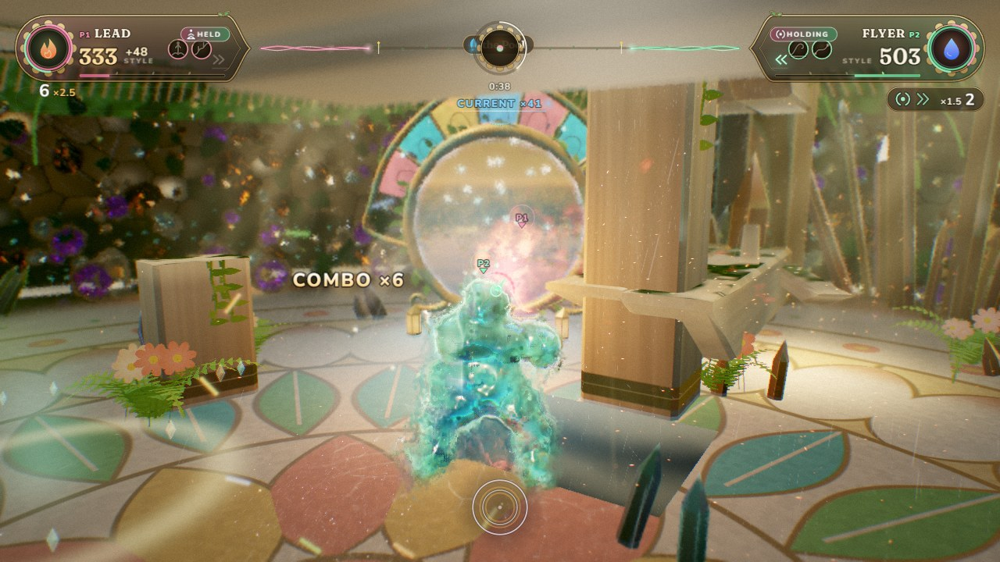
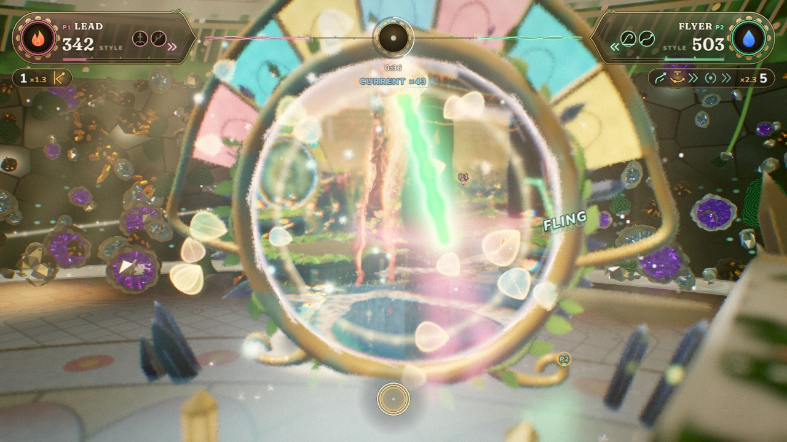
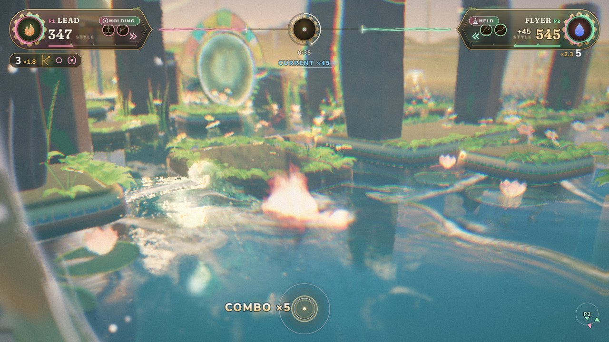
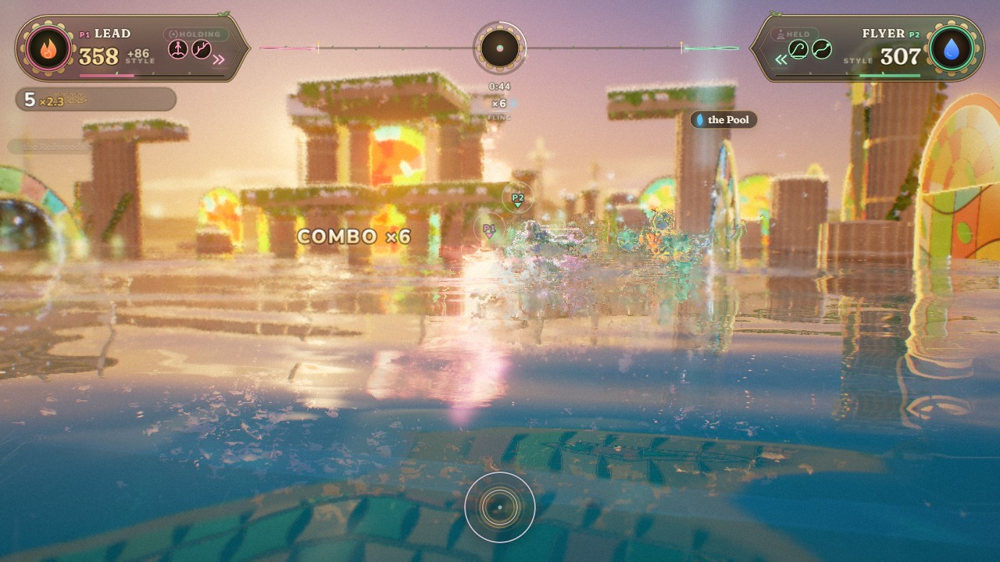
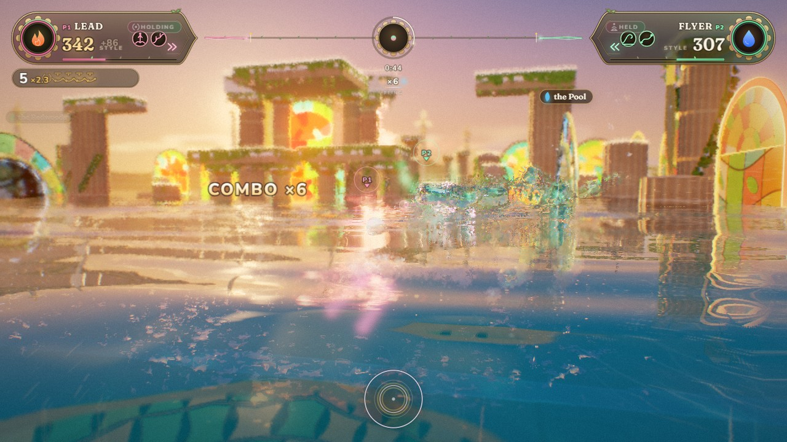

# 24: through the glass, and one flowing world (phase 7, issues 3 and 5 of report 23)

Branch `p7-through`, from master `de3af62` (phase 6). The brief: report 23's issue 3 (the way through a mirror passes
through the world's own pieces, and the turn round the rim is long) and issue 5 (the flowing world reads as a corridor
of doors: the pair crosses too often, a mirror's ring is in most frames, and nothing of the next world is seen until its
glass). The owner wants to walk or dance through the mirrors seamlessly.

**Measured:** whole sets in the page, two virtual players at skill 0.85, stepped at 60 fps in headless Chrome on the
5090 at 480×270, every frame sampled (`scripts/cross-measure.mjs`, extended here). 24 sets before (6 a world, seeds 1
to 6, the phase 6 code with only the measure added: commit `8c322f5`, served from a detached worktree) and 24 after
(the same seeds and dress). Two sets ran at once, so wall times are slow. In Node, 40 sets a side through
`scripts/duel-measure.mjs --mirrors 1` (the Node harness now runs the page's voyages: `sim.ts`). Stills and a clip from
the duel's own camera at 1280×720 with the HUD (`cross-clip.mjs`, `glimpse-cap.mjs` new). **Not measured:** a person
playing, a phone, online, the sound, the GPU cost of the glimpses with `shot.mjs --timings` (the render lock was not
taken; see below).

A page doesn't dance the same set twice (shaders compiling on the first frames shift it), so before and after are the
same seeds, not the same sets: the numbers are rates over 24 sets each, and small counts (a fused set, a flash) are
noise.

## Numbers

The page, 24 sets each (6 a world), the same seeds and dress; the after is the branch's last commit.

| | **before** (phase 6) | **after** |
|---|---|---|
| **frames with the eye inside a solid, decor piece or frame** (of all play frames) | 0.69 % | **0.40 %** |
| … within 0.3 m of one (a hand's distance) | 1.95 % | 1.28 % |
| **… on the way through** (from the crossing to 0.6 s after the view went over) | **78 of 7,595 (1.03 %)** | **13 of 4,119 (0.32 %)** |
| … within 0.3 m on the way | 3.08 % | 1.89 % |
| **the round: crossing to the view over, median (p90)** | **1.93 s (3.13)** | **1.32 s (1.98)** |
| … ways of 1.6 s or more | **37 of 47** | **5 of 35** |
| ways that began with the eye already in behind (aligned) / round | 13 / 34 | 11 / 24 |
| **crossings a set** | **2.21** (53) | **1.46** (35) |
| sets by crossings 0 / 1 / 2 / 3 / 4+ | 3 / 6 / 7 / 3 / 5 | 1 / 14 / 6 / 3 / 0 |
| **sets that crossed three times or more** | **8 of 24** | **3 of 24** |
| meant (a voyage) | 9 of 53 (17 %) | 19 of 35 (54 %) |
| how the view went over: through / flash / stayed | 41 / 6 / 6 | 35 / 0 / 0 |
| **a mirror's ring in the frame** (any open disc covering 2 % of a 16×9 ray grid within 40 m) | **62.5 %** of frames | **61.7 %** |
| … covering a tenth of the frame or more | 24.9 % | **20.3 %** |
| **how long the door was in sight before the crossing** (its disc, or its light, on screen without a gap of half a second), median (p25) | **2.6 s (0.9)** | **3.8 s (1.7)** |
| … the pair's distance from it then, median | 4.0 m | 5.1 m |
| catches a minute | 22.7 | 23.1 |
| fused finales | 2 | 6 |

In Node (`duel-measure.mjs --mirrors 1`, 40 sets a side, ten a world, the page's voyages run in the harness for both):

| | before | after |
|---|---|---|
| crossings a set | 2.03 (81) | **1.35** (54) |
| sets crossed three times or more | 11 of 40 | **4 of 40** |
| meant | 34 (42 %) | 27 (50 %) |
| catches a minute (the four worlds' mean) | 22.8 | 23.2 |
| fused | 5 | 7 |

- **The eye in the world's pieces on the way through fell by about two thirds** and the frames at a hand's distance by
  a third. A middle measure (after the way was made to try its paths, before the tail fix below) had 2.67 %: one set in
  the redwoods put most of it there. Looking into it (`bend.duel.keepOf`), the eye was inside a Pool post 1.8 to 2.2 s
  after a crossing, on the way's tail from the disc out to the duel camera's eye: the way now tries its whole length and
  bends its tail aside or over what stands there; and the duel camera itself had stood inside the temple's side screens
  after a way (it didn't know the decor): it does now. What is left on the way: three sets, 13 frames, two of them a
  way round that crossed into the redwoods (the trunks there are many and close).
- **The long round is now rare**: 5 ways of 35 took 1.6 s or more (37 of 47 before), the median 1.32 s.
- **Crossings are about one a set**, meant more often than not, and the flash fallback didn't happen. Catches and
  fusion held (fusion is noise at 24 sets).
- **The ring** is in about as many frames, but large in fewer: the mirrors stand at each arena's rim and the camera looks
  across the arena, so a door far off is usually somewhere in the frame. That is now meant to be so (the next world in
  sight, its light rising over it); a ring filling the frame is what fell.
- **The next world is in sight longer before its glass**: the median 3.8 s (2.6), from 5.1 m (4.0), and the quarter
  that saw it least 1.7 s (0.9).
- The music's delay is not compared: the before run's (median 6.7 s) is out of line with report 23's 0.53 s and was
  distorted by two headless pages at once; the after run's median is 0.45 s.

## What changed

### 1. The way through tried against the worlds (`src/duel/voyage.ts` ThroughCam, `src/portals/decor.ts`, new)

- **What the eye must keep out of** (`decor.ts`): the world's solids (World.solids: stones, trunks, blades, the arena's
  pieces), and the decor that isn't solid for the bodies but fills the lens at a hand's distance, from the same pure
  layouts the worlds draw from: the temple's 13 stained-glass screens and the gate's banners (`garden.ts` HANG), the
  geode's planters and hanging gardens (`garden.ts` pots) and its shell (the crystal bank and the planted tiers on the
  dome), and every gate's brass frame and crown. `keepOut(world, solids, gates).clear(p)` is one clearance (m, negative
  inside); `gateCrossed(a, b, gates)` says whether a step passes through a disc.
- **The way chooses its path** (`WaySpace`): on its first frame (the duel camera's pose known) the usual way is tried
  along its whole length, 25 points round and 24 through, each in the world the eye is really in (the old world's
  points mapped back through the door), against that world's keep-out and against crossing any gate but its own. If
  anything stands in it, up to seven others are tried (round the other way, wider of the rim, staged nearer, staged
  higher, straight in from the near side) and the clearest, then the shortest, wins. The crossing of any other gate
  costs 100, so it is ruled out in the path itself, not only by the portals' carry guard (report 23's fix stays).
- **The duel camera keeps out of the decor too** (`index.ts`, a few lines): the camera's space is the world's solids
  plus `decorOf(world)`. After a way, the duel camera had stood inside the temple's side screens at the court's edge.
- `bend.duel.eyeClear()` and `bend.duel.keepOf(world)` for the measure and for looking into a frame.

Report 23's frames for comparison: `media/23-p6-through.jpg` (the eye inside a planted piece on the way round the
geode's mirror) and `media/23-p6-through2.jpg` (the temple's screen at arm's length).

### 2. Shorter rounds (`voyage.ts` WAY, approachOf)

- **The swing in behind starts sooner**: `approachOf` looks 2 s ahead (was 1.4) and takes a voyage's mirror from 9 m
  (was 7), and the blend eases in at 3.2/s (was 2.6). More ways start with the eye already on the axis behind the pair.
- **An eye already in behind goes straight on** through, from where it is, under way (was: settle 0.25 s onto a
  staging point 2.6 to 3.2 m back, stop, then go). In the test, through at 0.83 s (was 1.20 s).
- **The swing round stops short of the axis** (`WAY.slant`, 0.55 rad) and stages 1.5 to 2 m back (was to 2.6): the way
  through then comes in at a slant and still crosses within a few centimetres of the disc's middle, a third of a turn
  sooner.
- **No stop between the two moves**: both are eased but never at rest between their ends (`going`), so the top speed
  is lower for the same time, and the speeds were raised to the same top (about 10.7 m/s, under the test's 11.4).
- In the test's six starting eyes: through at 0.83 to 1.62 s (was 1.20 to 2.47 s).

### 3. Crossings paced (`voyage.ts` CROSS and Voyage, `src/ai/duel-brain.ts`)

- **One voyage a set, at its height**: none before 35 % of the set has been played, at most one made a set
  (`CROSS.perSet`), a likelier start once allowed (1/8 s⁻¹, was 1/22) so it comes, the shared energy at 0.4 (was 0.3).
- **A longer grace and settle**: no voyage for 30 s after any crossing (was 18), the pair kept 4 m out in front of the
  disc they came out of for 6 s (was 3.2 m for 3.5 s).
- **The virtual players keep out of the other doors** (`DuelSight.mirrors`, new; `offDoors`, `flingOffDoors`): a goal
  in a mirror's lane (in front of its disc to 2.4 m, or just behind it) is moved out of it, a way to a goal through a
  disc goes round by its nearer side, and a fling that would send the other through a disc (not the voyage's) within
  6 m is turned off it by 0.6 to 1.6 rad. A human player still crosses whenever they walk or dance through.
- Node (`sim.ts` runs the voyages now, as the page does; `measure.ts` counts meant crossings and sets crossed three
  times or more).

### 4. The next world glimpsed before its glass (`src/duel/crossing-fx.ts` Glimpses)

Each open mirror of the main view's world breathes its world out into this one, all the time:

- its light spills on the floor (or the water) in front of it: a pool by the glass and a fainter one further out, in
  the far world's colour, breathing slowly;
- a soft shaft of that light rises over the door, so where the next world is reads from across the arena;
- the far world's air drifts out of the glass and wanders up to 5 m into this one: fireflies out of the redwoods, petals
  and spray glints out of the temple, rising droplets out of the Pool, crystal sparks out of the geode; each mote a few
  pixels across however far off;
- all of it stronger as the pair comes within 9 m, and most at a voyage's mirror.

And the live view through a mirror reaches further: a mirror within 14 m of the eye is drawn live (was 10; the duel's
`liveNear`), the rest show their still as before.

Glows only (the duel's glow list: about 30 a mirror, at most 3 mirrors in a world, of 8192), never the seats' rose or
fern.

### 5. The ring in frame (`src/duel/camera.ts` discCost, a few lines)

The duel camera now pays a little (`DISC_IN_FRAME`, 0.9 at its biggest) for a mirror's ring standing in its frame, by
how big it stands there. The frames with a large ring fell (24.9 % to 20.3 %); a small one far off is in about as many frames as before, which
now carries the glimpse of the next world (above).

## Tests

- `npm run typecheck`: clean.
- `node scripts/test-ts.mjs`: 31 of 31 files pass, with `voyage.test.ts`'s new case (a screen and another gate on the
  usual way round: the usual way meets them, -0.09 m and one gate crossed; the way chosen, "the other way, staged near"
  of six tried, stands 0.56 m clear at least and crosses no other gate, and still goes through the disc).
- `node scripts/check-portals.mjs`: 10,037 checks pass.
- check-limits, check-bindings, test-audio: not run (no shader, binding or audio change).
- `npm run test:net` not run (the brief).

## Files

- `src/portals/decor.ts` (new): the decor, the keep-out, a step through a gate.
- `src/duel/voyage.ts`: ThroughCam's plans, WaySpace, WAY; approachOf's reach; CROSS's pacing; Voyage's one a set.
- `src/duel/crossing-fx.ts`: Glimpses.
- `src/duel/index.ts` (localized): the way's space, the glimpses, the camera's decor, `mirrors` in the brains' sight,
  `liveNear` 14, the measure's hooks.
- `src/duel/camera.ts` (localized): discCost's ring in frame.
- `src/ai/duel-brain.ts`: `DuelSight.mirrors`, off the other doors, flings off them.
- `src/duel/sim.ts`, `src/duel/measure.ts`: the voyages in Node, meant and three-times counts.
- `scripts/cross-measure.mjs`: the eye in the world's pieces, the ring in frame, the round's length, how long the door
  was in sight before; `scripts/glimpse-cap.mjs` (new).
- `src/duel/test/voyage.test.ts`: the new case.

## Not done, and weak points

- **Sound bleeding** from the next world (its track or its air heard faintly near a door): not done. The glimpse is
  light and motes only. The music still changes on the crossing's beat.
- **The landscape glimpse** report 23 asked for (the temple's sea seen from the Pool's shore, the redwoods' canopy over
  the geode's glass) is the world agents' (their files); the mirrors were not moved back from the stage either (their
  sites are the network's, `portals/mirrors.ts`, but moving them touches the lanes `edge.test.ts` checks and each
  world's decor round them; left for a pass with the world agents).
- **The decor list is hand-kept** (`decor.ts`): the temple's screens and banners, the geode's planters and shell, every
  gate's frame. The redwoods' lanterns and bunting and anything p7-sun-built or p7-dusk-built add are not in it; a
  world agent adding decor near the mirrors should add it there.
- **13 frames of 4,119 on the way** still stand in something (a way round into the redwoods among its trunks). The
  way's plan is chosen once, on its first frame, against the duel camera's pose then; the duel camera moves on.
- **Node's camera measure** (`cam-sim.mjs`) was not extended to the way through or the decor: the page measure is the
  number here.
- **The GPU cost** of the glimpses was not timed with `shot.mjs --timings` (it takes the shared render lock). They are
  about 30 glows a mirror in the duel's existing glow pass; the gates' `liveNear` went from 10 to 14 m, which can keep
  a far mirror's live view (0.25 to 0.5 ms) where it showed its still.
- **Accidental crossings** by the virtual players are fewer but not gone (16 of 35); a human player crosses wherever they
  walk or dance through, as the owner wants.
- **The glimpse is subtle at 720p** from across the arena (the shaft of light over the door reads; the motes only near).
  Not looked at by a person, nor on a phone.
- Two sets ran at once on a GPU shared with other agents; the numbers are stepped frame by frame, so they don't depend
  on speed, but a page doesn't dance the same set twice, so before and after compare rates, not sets.

