# 25: the duel's phase 7 film (the worlds built, a newcomer's first seconds), the feel scorecard again, and what holds it back now

Branch `p7-film`, from master `06d4305` (all of phase 7 merged: the front says what to press and gives one body, the
dance's YOU tell and its way through the glass, 24-newcomer; the temple's and the Pool's pieces in ceramic, copper and
planted tops with a pavilion and a moon gate, 24-sun-built; the geode's and the redwoods' built pieces, the leaded-glass
screen, the tree-house and the dusk glow, 24-dusk-built; the bloom as a glow and the finale's look up, 24-glow; the way
through kept out of the world's pieces, crossings paced, glimpses of the next world, 24-through; the virtual human
players and the duel camera without jumps, 24-feel; and master's own fix since: the dance keeps one soft edge, the
dancers', a metre inside the arena, not the page's as well).

The brief: about 30 s at 1280×720, 60 fps, through the master render; a newcomer's first seconds from the front page;
the built worlds (the temple's pavilion and ceramic columns at golden hour, the Pool's ceramic posts and moon gate, the
geode's stained-glass screen, the redwoods' tree-house and dusk glow with the canopy village in frame); a smooth way
through the glass with the next world glimpsed before it; the rose-and-fern bloom with the finale's camera looking up.
And the feel scorecard (report 24-feel) rerun on master as a playtest of all the merged work, with the dance's
crossings checked for a newcomer holding W and for an explorer after the soft-edge change.

**Measured:** 44 whole sets scouted through the film tool itself (so each dances as it will in the film), the mirrors
open, two virtual players at skill 0.85 (rose fire, a lead, the player, against fern water, a flyer), 76 s each,
480×270, every rule and power event, the camera's pose every 10 frames, each crossing and how the view went over, each
change of track: 11 on the geode's track (all begun in the geode, seeds 2 to 12) and 33 on the temple's (seeds 1 to 12:
12 begun in the Pool, 12 in the redwoods, 9 in the temple). (Two more didn't load: the page went quiet; not counted.)
Each of the film's six shots against its scout, event for event. A newcomer's first seconds from the front page with
real keys, filmed with the page's DOM (`scripts/newcomer-cap.mjs`, new), twice. Eight more newcomer runs through
p7-newcomer's `scripts/steps/newcomer.js` (Enter, W, an arrow and a click, then W held or a walk to a mirror). The feel
scorecard (`scripts/human-score.mjs`, stepped, the eight runs of report 24-feel, seed 1). The film's loudness
(ffmpeg's ebur128). **Not measured:** a person playing; a phone; the sound by ear; an online duel; the lock; the frame
pacing (the scorecard's stepped clock doesn't measure it, and the machine was loaded by this branch's own scouts).

## The film

`docs/reports/media/film/duel-p7.mp4` (git-ignored; a copy in the main checkout's `docs/reports/media/film/`):
**30.32 s, 1280×720, 60 fps, H.264 High at 6.1 Mbit/s (two passes), AAC 314 kbit/s stereo at 48 kHz, 24.4 MB**;
loudness **−14.9 LUFS integrated**, true peak −2.9 dBFS, loudness range 2.2 LU (phase 6: 31.05 s, 25.0 MB, −14.9
LUFS, −1.8 dBFS, 1.4 LU). It is the newcomer's clip (4.92 s, `scripts/newcomer-cap.mjs`: the page's DOM over its
canvas, a frame at a time) laid before the film tool's master picture and score
(`docs/reports/media/film/duel-7-master.mp4`, 109.7 MB, rendered at 1.5× and brought down on the GPU; the render took
13 minutes, the lock held 34 to 72 s at a time), joined by a scratch `final.mjs` with one AAC generation.

The timeline is `films/duel-7.json`; every duel shot matched its scout event for event (80, 196, 97, 304, 86 and 396
events, 0.000 s apart). Seat 1 (rose fire) is the player in every shot (`bend.duel.you.seats = [0]`). **The music:** the
geode's track under the front with the press on bar 49's downbeat, the temple's on the next beat after the dance's
crossing (laid by hand, as the page's deck would: below); then the film tool's own: the geode's track from bar 57, the
temple's on the beat 0.28 s after the duel's crossing (bent across, as play does), and a cut to the last shot's page's
place in the temple's track on its cut.

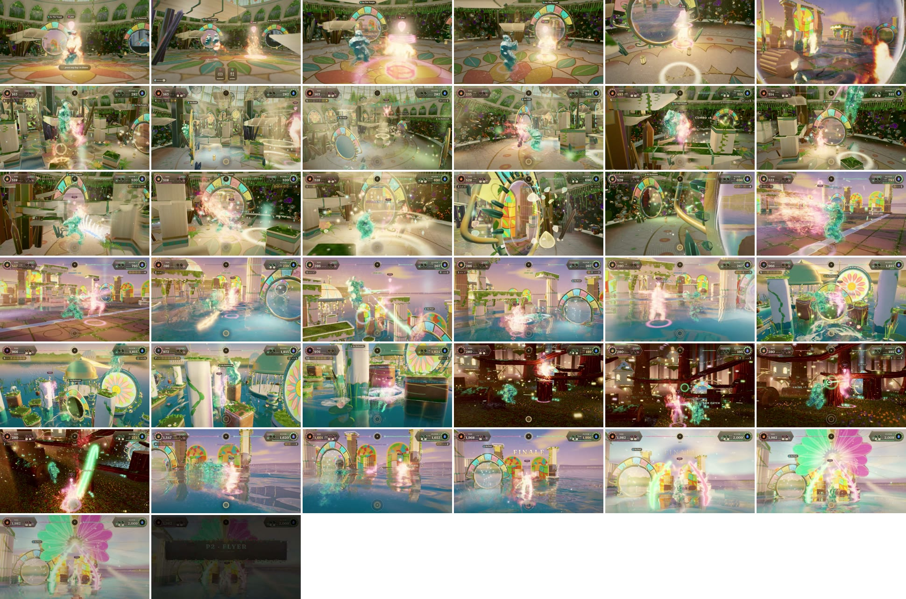

| time | shot | what happens |
|---|---|---|
| 0:00.0 | **the front page** (the geode's greenhouse; the page's DOM over its canvas) | the two dancers on the lotus floor, the mirrors to the Tide Temple and the Redwoods named over their crowns, the rose petal and **you** over the fire body, the pill **press any key to dance**; at 0:01.0 one key (Enter), the pill goes and the lobby's two cards (keyboard, partner) show for a moment |
| 0:01.0 | **the newcomer's first steps** (one body: `keyboard-solo`, the partner a brain) | the dance's YOU tell: the sunlit shaft, the rose rings rising, the petal and **you**; a first-timer's walk with W A S D to the mirror to the Tide Temple, the temple seen in the glass |
| 0:03.8 | **through the glass in the dance** | the camera round onto the disc and through behind the body; the temple at golden hour, its stained glass, the fire body out on the tiles; the temple's track on the next beat |
| 0:04.9 | **the geode's leaded-glass screen** (the duel; seed 2, the geode's track from bar 57) | the three arched panels (the sun flower, the two lilies) at the back of the greenhouse behind the pair; FLARE, swings |
| 0:07.6 | **one shot, no cut: the geode through the glass into the temple** (the same set) | the pair at the mirror to the Tide Temple, its light breathing out over the floor; **CURRENT ×36** (0:10.9) and through it at 0:11.6, a voyage: the camera round onto the disc's axis and **through behind them** (0:12.0), the temple's track on the beat; out on the temple's tiles at golden hour, its stained-glass screens, COMBO |
| 0:15.0 | **the Tide Temple** (seed 1, high tide) | white ceramic columns on teal majolica with the green whiplash, planted tops, woven planters, and **the sun-fountain pavilion's dome** at the court's back (0:16.0); WHIP, **CURRENT ×36** (0:17.4) |
| 0:18.2 | **the Still Pool** (seed 3) | the ceramic columns with their vines, planted blocks in the water, **the moon gate's stained-glass rose** (a gold sun in coral petals) beside the pair, a green copper dome behind; AIR CATCH, SWING |
| 0:21.4 | **the redwoods at dusk** (seed 10, 19.2 h) | **the canopy village's houses lit amber** among the trunks (0:22.4), lanterns on the boughs, fireflies, the glowing meadow flowers and lichen; AIR CATCH, SWING, PERFECT |
| 0:24.6 | **the fused finale in the temple** (seed 10) | MERGE, **FINALE** (0:26.5), the lift, **the camera looking up 8° into the evening sky**, **the bloom**: rose petals on the left, fern on the right, the beams behind it (0:27.5 to 0:29.5); the garland comes in under the fade at 0:29.7 (P2 · FLYER TAKES THE SET); out at 0:30.32 |

Shot sheets from the master: `media/25-film-duel-7-<shot>-master-sheet.jpg`.

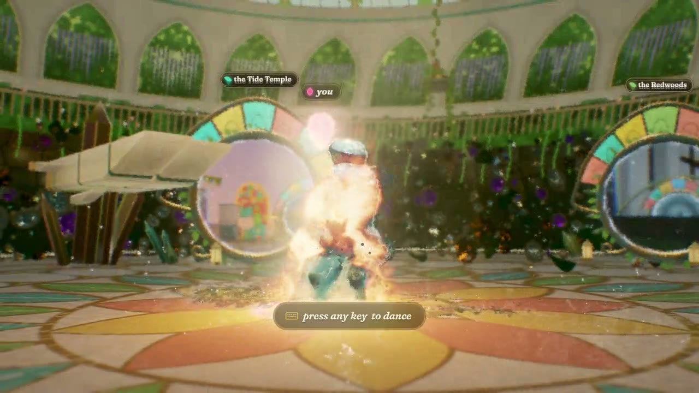
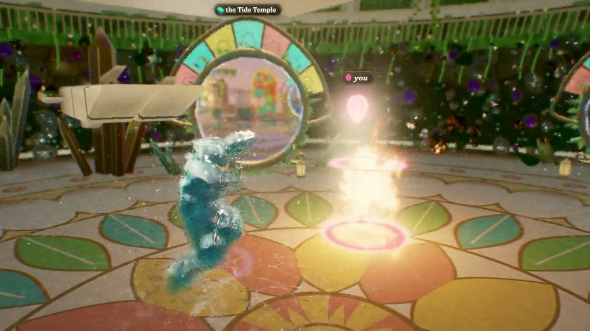
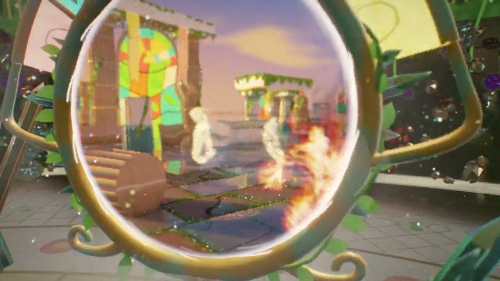
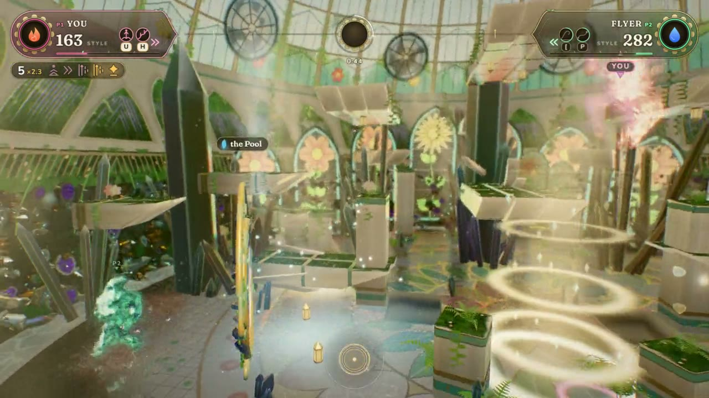
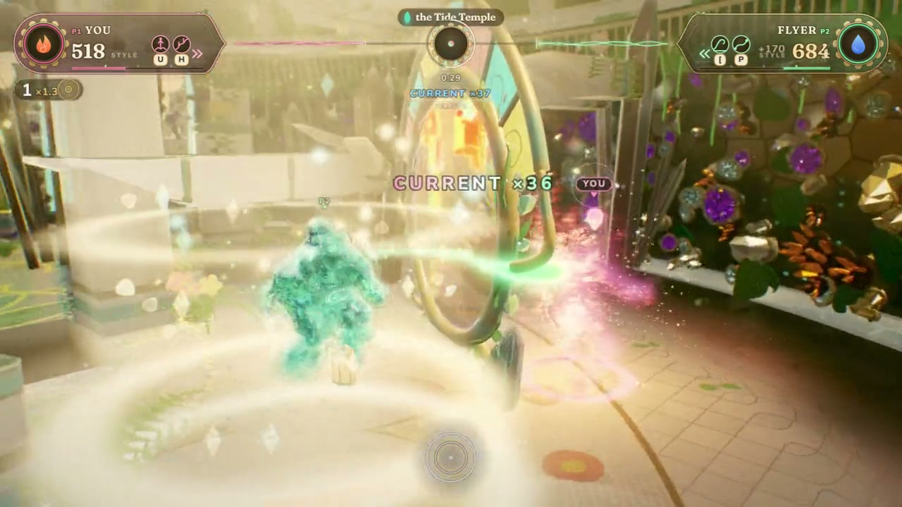
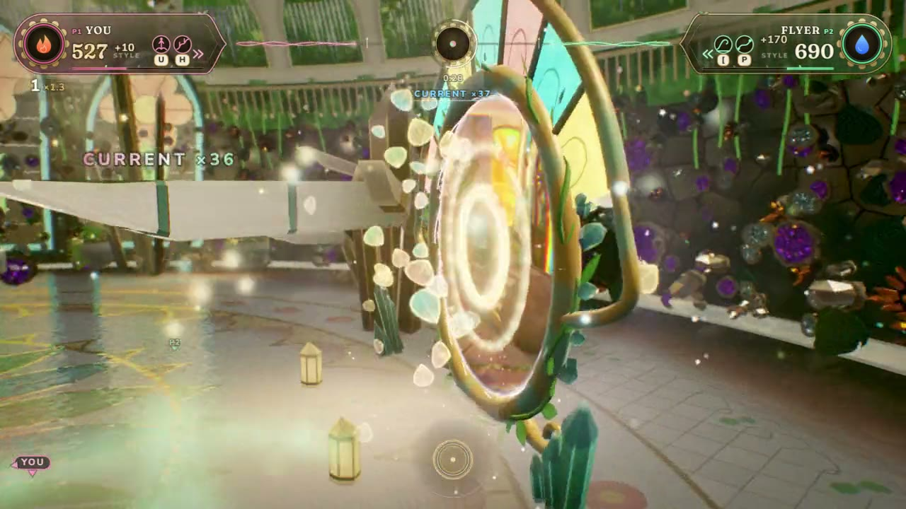
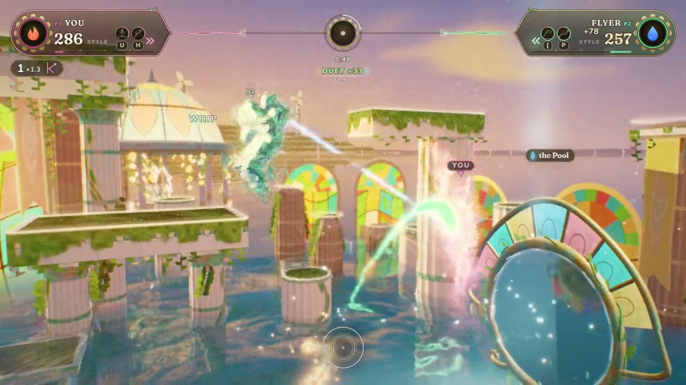
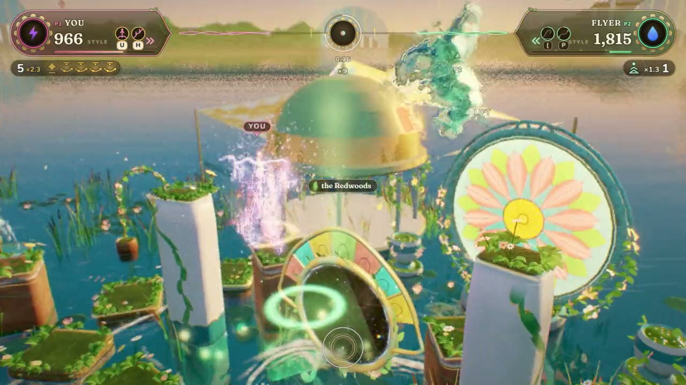
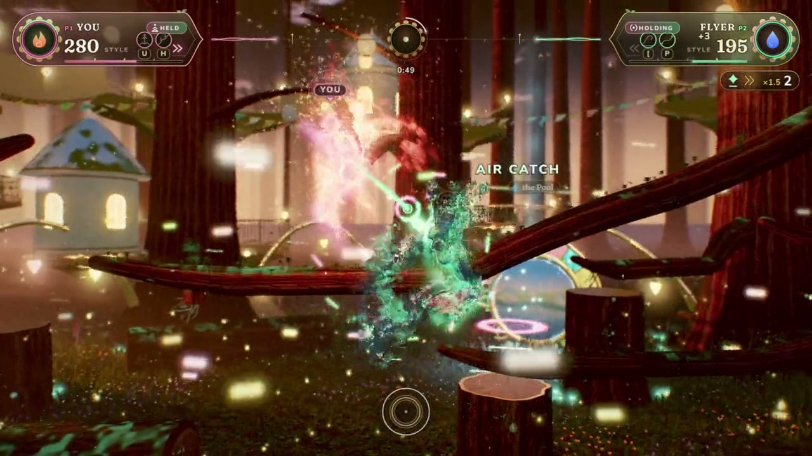
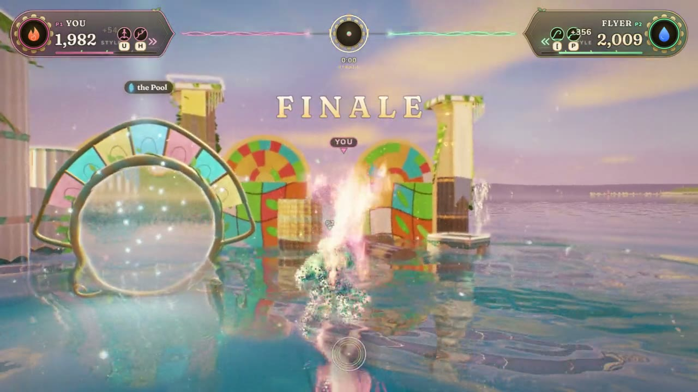
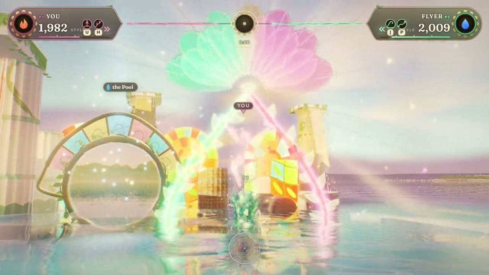

### How it was made

1. **Scouted** (in a scratch folder, deleted once done: `scout.mjs`, `numbers.mjs`,
   `aggregate.mjs`, `match.mjs`, `sheet.mjs`, `final.mjs`): 46 sets through the film tool, 76 s each at 480×270, two to
   four at a time, with a cue that logs the camera's pose every 10 frames, so each hero piece's time in the lens could be
   found (the geode's screen, the temple's pavilion, the Pool's moon gate, the redwoods' tree-house and village points
   from `camworlds.ts`), then timed contact sheets of the likely seconds to see which were really in sight.
2. **The order follows the tracks.** A duel's dance depends on its track's tempo, so each shot's scout is on the track
   the film is on there: the geode's for the first two shots, the temple's after the second shot's crossing. The temple,
   Pool and redwoods shots are sets that hadn't crossed before their in-points and don't cross in them; the finale's set
   had (to the Pool and back), so it goes last.
3. **The newcomer**: `scripts/newcomer-cap.mjs` (new, committed), front-cap's way with a press and newcomer.js's walker.
   Two takes, to the nearest mirror (the Pool's, 2.32 s after the press) and to the temple's (2.75 s); the temple's is
   in the film, cut 1.2 s after the crossing.
4. **A preview at 640×360, the master, then `final.mjs`**: the newcomer's frames 30 to 325, the master's lossless
   picture and score (`--keep-work`), the newcomer's music laid from the track files, fades at the ends, two passes.

## The numbers (44 scouted sets, phase 7 against phase 6)

Phase 6 is report 23's 40 sets on the redwoods' track. Phase 7's 44 are on the geode's track (11) and the temple's
(33), so the worlds' tracks and tempos differ from phase 6's and a world's sets are on different tracks: compare rates,
not sets. Both rotate no dress here: phase 7's are all fire against water (phase 6 rotated four pairs), so the
reactions don't compare. Measured from each set's `go` to its finale; catches are catches and air catches
(`measure.ts`'s count), the air share the air catches' share of them.

| | phase 6 (40 sets) | **phase 7 (44 sets)** | geode (11) | temple (9) | Pool (12) | redwoods (12) |
|---|---|---|---|---|---|---|
| catches a minute | 21.7 | **23.2** | 21.4 | 24.3 | 24.1 | 23.2 |
| … out of the air | 53 % | 51 % | 50 % | 39 % | 62 % | 48 % |
| juice events a minute | 39.7 | **44.7** | 41.1 | 47.1 | 47.1 | 43.5 |
| casts a minute (both players) | 10.6 | 12.0 | 11.1 | 11.7 | 13.1 | 11.9 |
| power forms (a set) | 48 (1.2) | 56 (1.3) | 9 | 13 | 23 | 11 |
| pair tiers (DUET, CURRENT, MURMURATION, AURORA) | 110, 50, 11, 0 | **127, 59, 17, 1** | 35, 9, 2, 0 | 24, 15, 4, 0 | 30, 22, 8, 1 | 38, 13, 3, 0 |
| sets whose top pair tier is CURRENT / MURMURATION / AURORA (DUET) | 21 / 11 / 0 (8) | 24 / 15 / 1 (4) | 7 / 2 / 0 (2) | 4 / 4 / 0 (1) | 5 / 6 / 1 (0) | 8 / 3 / 0 (1) |
| merges (sets with one) | 27 (22) | **46 (36)** | 12 (10) | 12 (8) | 12 (8) | 10 (10) |
| **fused finales** | 6 (15 %) | **6 (14 %)** | 1 | 3 | 1 | 1 |
| falls | 0 | 3 | 0 | 1 | 0 | 2 |
| eye to the pair, median (p90) | 5.6 m (8.3) | 5.5 m (7.4) | 5.6 (7.4) | 5.4 (7.2) | 5.6 (7.3) | 5.6 (7.7) |
| the taller body on screen, median (p10); under a sixth of the frame | 0.31 (0.22); 2.4 % | 0.32 (0.23); 1.8 % | 0.32; 1.6 % | 0.33; 1.7 % | 0.33; 1.8 % | 0.32; 1.9 % |
| **mirror crossings a set** (sets that crossed) | 1.6 (37 of 40) | **1.55 (41 of 44)** | 1.55 | 1.33 | 1.58 | 1.67 |
| … through the disc / under the flash / stayed | 54 / 0 / 10 | **59 / 3 / 6** | 15 / 2 / 0 | 12 / 0 / 0 | 15 / 0 / 4 | 17 / 1 / 2 |
| … meant (a voyage) | 28 | 36 | 9 | 7 | 10 | 10 |

(The worlds' columns are by the world a set began in; crossings counted before each set's finale, as report 23 did.)

**All 44 sets, every crossing and the music:**

| | phase 6 (72 sets) | **phase 7 (44 sets)** |
|---|---|---|
| sets that crossed | 70 (97 %) | 41 (93 %) |
| crossings | 126 (1.75 a set) | 73 (1.66 a set) |
| through the disc | 110 (87 %) | **64 (88 %)** |
| cut under the flash | 0 | **3** (all three a way that began aligned behind the pair: "eye through, view not") |
| stayed (back before the view went over) | 16 | 6 |
| sets that crossed three times or more | 14 of 72 | 6 of 44 |
| ways round / aligned | (not counted) | 49 / 21 |
| **the music's delay**: the crossing to the new track's first beat, median (p90, most) | 0.53 s (0.76, 0.85) | **0.41 s (0.69, 0.80)**, 61 crossings |

- **The dance is a little richer.** Catches 23.2 a minute (21.7), juice 44.7 (39.7), more pair tiers and twice the
  merges, and the first AURORA in either phase's scouts (Pool seed 12, ×137, then a fused finale). The fused share
  is the same (14 % against 15 %). The framing is phase 6's: the bodies a third of the frame, the eye 5.5 m off.
- **Crossings are fewer and more often meant**, but not one a set: 1.66 a set over all crossings (1.75), 6 sets of 44
  crossed three times or more (14 of 72), and 36 of 68 crossings before a finale were meant (28 of 64). Half are still
  the virtual players dancing through a door by accident.
- **The way through the glass is the rule, and has a new failure.** 64 of 73 went over through the disc; **three fell
  back to a cut under the flash, all three the same way: the eye already in behind the pair ("aligned"), which since
  24-through goes straight on through, came through the glass but the main view wasn't carried with it** (`why: "eye
  through, view not"`: geode → Pool, geode → Temple, temple → geode). Phase 6 had none in 126. Three in 21 aligned
  ways is one in seven.
- **The music comes in sooner**: 0.41 s after the crossing (0.53).

## The feel scorecard on master (virtual humans, all of phase 7)

`node scripts/human-score.mjs --url <master on 5525> --label p7-master --base docs/reports/perf/24-feel-after.json
--runs newcomer:geode,dancer:temple,dancer:redwoods,dancer:geode,dancer:pool,explorer:temple,pair:pool,touch:temple`,
the stepped clock, seed 1, the same scripts and seeds as report 24-feel's "after" (p7-feel's branch alone). Written to
`docs/reports/perf/24-feel-p7-master.json`. One run a cell: the dance itself varies a lot run to run (the stick is
camera-relative, so a different camera is a different dance), so read the camera and crossing rows, not the catches.

| run | total | smooth | responsive | clear | magic | cuts /min | looking down | eye unclean | body pops /min | magic /min | crossings (through) |
|---|---|---|---|---|---|---|---|---|---|---|---|
| newcomer, geode (the dance) | 56 → **54** | 57 → 56 | 82 → 83 | 51 → 55 | 32 → 20 | 16.7 → 17.0 | 0.39 → 0.34 | – | 1.3 → 2.4 | 3.9 → 2.4 | 0 → 0 |
| dancer, temple | 95 → **82** | 92 → 72 | 93 → 84 | 94 → 73 | 100 → 100 | 0 → 0 | **0.04 → 0.26** | **0.04 → 0.47** | 2.8 → 8.5 | 14.2 → 15.6 | 0 → 0 |
| dancer, redwoods | 72 → **61** | 59 → 58 | 74 → 77 | 53 → 73 | 100 → 35 | 1.4 → 1.4 | 0.36 → 0.20 | 0.64 → 0.55 | 4.2 → 5.7 | 21.2 → 4.2 | 1 (1) → 0 |
| dancer, geode | 75 → **72** | 44 → 37 | 86 → 82 | 68 → 68 | 100 → 100 | 11.3 → 7.1 | 0.24 → 0.25 | 0.36 → 0.47 | 5.7 → 7.1 | 24.0 → 12.7 | 2 (2) → 1 (1) |
| dancer, Pool | 73 → **77** | 57 → 56 | 68 → 88 | 67 → 64 | 100 → 100 | 2.8 → 0 | 0.32 → 0.34 | 0.43 → 0.55 | 14.2 → 9.9 | 22.7 → 22.6 | 0 → 0 |
| explorer, temple (the duel) | 64 → **55** | 37 → 40 | 76 → 90 | 63 → 64 | 78 → 26 | 10.1 → 13.2 | 0.20 → 0.20 | 0.52 → 0.49 | 0.8 → 1.6 | 9.3 → 3.1 | 2 (2) → 2 (2) |
| pair, Pool (the dance, one keyboard) | 78 → **69** | 79 → 63 | 81 → 74 | 97 → 96 | 53 → 44 | 5.1 → 6.5 | 0.00 → 0.04 | – | 3.8 → 0.0 | 6.3 → 5.2 | 0 → 1 (1) |
| touch, temple | 92 → **78** | **100 → 48** | 79 → 82 | 87 → 83 | 100 → 100 | **0 → 16.0** | 0.00 → 0.00 | 0.00 → 0.12 | 0 → 0 | 17.8 → 21.4 | 0 → 1 (1) |
| **all runs** | **76 → 69** | | | | | | | | | | |

What it says, as a playtest of the merged game:

- **Every crossing went through the glass: 7 of 7** (the explorer's two in the duel, temple → redwoods → Pool; the
  touch player's, the dancer's in the geode, and the pair's in the dance). None under the flash.
- **In the duel the camera cuts only in the runs that crossed.** The duel runs that never crossed have 0 to 1.4 cuts a
  minute (the duel camera of 24-feel holds); every duel run that crossed has 7 to 16: the touch player's one crossing
  took its smooth score from 100 to 48. The explorer cut half a second after each crossing (12.5 s after the one at
  12.0 s, 26.2 s after 24.3 s), and then ten times in two seconds at 32.6 to 34.5 s, which I didn't trace (no crossing
  there). That is 24-feel's first problem, still open: the way's end switches onto the duel camera instead of blending.
  (The dance's cuts, the newcomer's and the pair's, are its follow camera's.)
- **The temple dancer's camera now rises and looks down**: looking down more than 28° went from 4 % to 26 % of the time
  and the eye judged unclean from 4 % to 47 %. 24-through gave the duel camera the world's decor to keep out of
  (`decorOf`: the temple's screens and banners), and 24-sun-built's crafted pieces stand where they stood; the camera
  meets them more often and climbs. The geode and the Pool are about where they were.
- **The newcomer who wanders from the front still finds little**: 0 crossings in 50 s, 2.4 magic moments a minute, the
  dance's follow camera cutting 17 times a minute and looking down a third of the time. That is the dance's follow
  camera (24-feel's problem 2), which phase 7 didn't change.
- **The total fell 76 → 69.** Most of it is two things: the crossing cuts (touch 92 → 78, pair 78 → 69, which crossed
  where they hadn't) and the temple camera (95 → 82); the rest is the dance's run-to-run swing (the redwoods dancer's
  magic 21 → 4 a minute with the same camera).

### The dance's crossings after the soft-edge change

Master's change since the feel pass: the dance's bodies keep the dancers' own soft edge, a metre inside the arena's
radius (`src/dancer/play.ts`), and the page's second edge at the radius is gone (`src/play/index.ts`). Driven from the
front page with real keys (`scripts/steps/newcomer.js` through `roam-probe.mjs`, stepped, on master):

| the way in | moves | first crossing (how) | all crossings | frames looking > 40° down |
|---|---|---|---|---|
| **Enter, then W held 12 s** | 0.18 s | **5.25 s, geode → temple, through** | 2, both through (then temple → Pool at 9.4 s) | 0 of 240 |
| **W, then W held 12 s** | 0.18 s | **5.25 s, geode → temple, through** | 2, both through | 0 of 240 |
| Enter, walk to the nearest mirror | 0.40 s | 1.57 s, geode → Pool, through | 1 | 0 of 100 |
| Enter, walk to the temple's | 0.40 s | 2.58 s, geode → temple, through | 1 | 0 of 119 |
| W, walk to the nearest | 0.40 s | 1.57 s, through | 1 | 0 |
| W, walk to the Pool's | 0.40 s | 1.57 s, through | 1 | 0 |
| ArrowUp, the arrows to the redwoods' | 0.45 s | 2.93 s, geode → redwoods, through | 1 | 0 of 126 |
| a click, walk to the nearest | 0.40 s | 1.57 s, through | 1 | 0 |
| (the film's two captures) Enter, walk to the Pool's / the temple's | | 2.32 s / 2.75 s, through | 1 / 1 | |

**The dance crossed through the glass every time: 12 of 12**, and every newcomer drove one body (`keyboard-solo` or
`keyboard-right`, the partner a brain). **The soft edge didn't block the mirrors; it opened one: W held from the front
now reaches the temple's mirror in 5.3 s and the Pool's after it** (report 24-newcomer, before the change: W held "runs
along the rim" and never reached a mirror). The edge turns the run along the rim and the lanes stay open, so a run
along the rim falls into a lane. The explorer (the duel, which this change doesn't touch) crossed 2 of 2 in the
scorecard.

## A first-time player's verdict: fun, smooth, magical?

Judged as the owner asks, as a first-time player from the front page with real input, against their play-feel notes
(open, flowing movement; one flowing world, through the mirrors with no cut or menu; obvious how to reach the other
worlds and which body is yours), from the newcomer's captures and runs, the scorecard's virtual players and the 44 sets.

- **Which body is mine, and what do I press: yes, now.** The front says *press any key to dance* and puts a rose petal
  and *you* over the body that will be yours; one key gives that body (12 of 12 newcomer runs drove one body, by
  Enter, W, an arrow or a click); the shaft, the rings and *you* carry straight on into the dance and again in each new
  world. This was report 23's fourth problem and it is solved for a first-timer at a keyboard. The lobby's two cards
  flash up for a moment after the key, which reads as a menu for a breath.
- **How to reach another world: mostly yes.** The mirrors stand named across the greenhouse, their worlds' light and
  motes breathing out of them; a walker who steers at one is through in 1.6 to 3 s, and **a newcomer who only holds W
  now reaches the temple's mirror in 5.3 s** (before: never). A first-timer who wanders and mashes (the scorecard's
  newcomer) still crossed nothing in 50 s.
- **Through the mirrors with no cut: in the dance and the duel, almost always.** 12 of 12 dance crossings and 64 of 73
  duel crossings went through the disc, the music on the next beat 0.4 s later; it reads as going somewhere. But the
  camera still jumps as the way hands back to the play camera (7 to 16 cuts a minute in the duel runs that crossed,
  none in those that didn't), three duel crossings in 73 fell back to a cut under the flash, and on arriving in the
  dance the settle holds the camera in front of the disc, where a body that stops is cut in half by the mirror's frame.
- **Open and flowing: the duel yes, the dance's camera no.** The bodies keep their momentum (80 to 90 % of pushing time
  running); the duel camera is smooth between mirrors. The dance's follow camera still cuts 17 times a minute and looks
  down a third of the time for a newcomer.
- **Magical: yes in moments, more than in phase 6.** Through the glass into the golden temple, the redwoods' village
  lit at dusk with fireflies, the moon gate's rose over the Pool, the rose-and-fern bloom under an open sky: each is a
  real "oh". The dancer meets 13 to 23 magic moments a minute. A newcomer from the front, 2 to 4.
- **Fun: for someone who knows the duel, yes; a newcomer now gets in, gets their body and gets through a mirror, but
  then has nothing to do with the partner**: nothing in the dance pulls them together, so the wandering newcomer's
  magic is 2.4 a minute.
- **Amazing, as a still: the places now are.** Every world reads as built (white ceramic, copper gone green, planted
  tops, stained glass) and each hero piece is in its world's frame. What still lets the frame down is the light at the
  duel's distance (a cream-lilac haze in the temple and the greenhouse) and the pieces standing in the lens.

## Five things that hold it back (for phase 8)

From the 44 sets, the film's frames, the newcomer's runs and the scorecard, against the art bible and the owner's
notes. Report 23's five were phase 7's and they show: the worlds are built and their heroes are in frame (1); the
bloom keeps its rose and fern and the finale can look up (2); the way through stays out of the pieces and is shorter
(3); the newcomer knows which body is theirs and what to press (4); crossings are fewer and the next world is glimpsed
(5).

### 1. The camera still jumps at every mirror, and one way in seven from behind fails (the flowing world)

The duel camera itself no longer cuts (0 to 1.4 a minute in the runs that never crossed), but every duel run that
crossed cuts 7 to 16 times a minute: the touch player's one crossing took its smooth score from 100 to 48 and the
scorecard's total from 92 to 78. The way through ends by switching onto the duel camera rather than blending, as 24-feel
found. And a new failure: **3 of 73 crossings fell back to a cut under the flash, all three a way that began "aligned"
(the eye already behind the pair), which since 24-through goes straight on through: the eye came through the glass and
the main view wasn't carried** (`why: "eye through, view not"`; 3 of 21 aligned ways; phase 6 had none in 126). For
phase 8: blend the way's end onto the duel camera over a third of a second; find why the aligned way's eye passes the
disc without `Portals.carryCamera` carrying the view (the eye's step through the disc's plane, or its side, on the
straight-on path).

### 2. The light is a haze at the duel's distance: the built worlds read pale, the bloom pastel (EPIC, light and colour)

The pieces are now made things, but at the player's camera the temple at high tide is lilac and cream, the greenhouse
gold-cream, the white columns near the cream of report 23, and the geode's screen a soft shape at the back of a pale
room (0:05 to 0:08). The bloom keeps its two colours now, but over the temple's bright evening sky it is pastel mint
and pink with the bodies small and pale under it (0:27 to 0:29), and the air at the mirror before the crossing is a
gold glare (0:10.9). The redwoods at dusk are the exception: dark, warm, the lit houses and fireflies reading as light.
For phase 8: less lift and haze between the eye and the pair in the sun worlds (the depth of field and the warm air
together, not the matter), deeper shadow under the pieces, and the bloom's sky darkened behind it (24-glow's own next
step) so the petals read as saturated against it.

### 3. The finale's look up works in some worlds and not others, and the camera climbs over the new decor (EPIC, the frame)

In the temple (the film's finale) the view went from 4° down to 8° up and held the sky through the bloom. In the Pool
(seed 12, the one AURORA set) the look up was fully on (`sky` 1.0, logged in the film page) and the view stayed 14°
down: the camera had risen over the Pool's planted blocks and the look up didn't bring it down. In play, the temple
dancer's camera now looks down more than 28° a quarter of the time (4 % in 24-feel) and judges its eye unclean half
the time (4 %): the temple's screens and banners joined the camera's space (24-through), the crafted pieces stand where
they stood, and the camera climbs over them. The Pool's ceramic posts stand at the camera's distance and fill a third of
the frame as white blurs (0:18 to 0:21). For phase 8: a finale that lifts where the sky is open (or turns the camera on
the last bar before it); the rise's answer to the decor a lens move (closer, wider) more than a climb; the Pool's posts
set back from the camera's ring.

### 4. The dance after the front: nothing brings the newcomer to the partner, and its camera is the old one (first-time feel)

The newcomer now knows which body is theirs and gets through a mirror. But in the dance itself nothing pulls the pair
together: the wandering newcomer meets 2.4 magic moments a minute (a dancer in the duel: 13 to 23); the partner, a brain, doesn't
come to them. The dance's follow camera (24-feel's second problem, not phase 7's work) still cuts
17 times a minute and looks down a third of the time. On arriving through a mirror the settle holds the camera in front
of the disc, so a body that stops just through it is cut in half by the mirror's frame (the newcomer's capture, 1.5 s
after the crossing). For phase 8: give the dance's follow camera the duel camera's clean eye and rate-limited boom; a
partner who comes to the newcomer and offers a catch in the first seconds; the settle's camera beside the disc, not in
front of its frame.

### 5. The flowing world is still crossed by accident half the time, and the hero pieces are behind the play, not in it (the flowing world, EPIC)

Crossings are fewer (1.66 a set, 6 sets in 44 three times or more) but not one a set, and 32 of the 68 before a finale
were the virtual players dancing through a door by accident; a mirror's ring is in most frames of the temple and the
Pool shots (0:15 to 0:21), at the frame's edge and often a third of it. The hero pieces were placed outside play to keep
the dance unchanged, so they are seen behind the pair, never danced on or through: the pavilion at the court's back,
the moon gate at the rim, the screen at the room's back, the tree-house at the clearing's edge. For phase 8: the mirrors
set back from the stages' middles so a crossing is a choice (24-through left this to a pass with the world agents); one
hero piece in each world brought into play, a ledge, a perch or an arch the pair can use, so the place and the dance
meet.

## Smaller things seen

- **The lobby's two cards** (keyboard, partner) flash up for a moment after the front's key, a menu where the owner
  wants none.
- **The player's body is often small or at the edge** in the duel frames: the rose body is at the frame's corner in the
  geode screen shot and behind a mirror's ring in the temple's.
- **Both fused sets the film could use were won by the other seat**: the garland reads P2 · FLYER.
- **The explorer's ten cuts in two seconds** at 32.6 s, eight seconds after its last crossing: not traced.
- **Two scout pages never started** (the page went quiet for three minutes while four pages loaded at once).

## The film tool, the finale's look up and `film.mjs`

The brief asked whether the film tool's camera knows the finale's new look up (report 24-glow said `filmcam` doesn't).
It doesn't need to for this film: a duel shot with no `camera` keys is filmed by the duel's own camera, and its
`CamInput.sky` is live in a film. I logged `bend.duel.camera.skyWas` in a film page through Pool seed 12's finale: it
went 0 → 0.89 → 1.00 over the lift's first half second and back to 0.68 under the banner, as in play. So the film
matches the game, and **no fix to `film.mjs` or `filmcam.ts` was needed**. A shot that lays its own `camera` keys over
a finale would still frame it its own way (filmcam has no look-up input); none of this film's shots do.

What the look up does differs by world, and that is the game, not the tool: in the temple (seed 10, the film's
finale) the view went from 4° down to **8° up** and held it through the bloom; in the Pool (seed 12) it stayed **14°
down** with the look up fully on, the camera risen over the Pool's planted blocks (below, issue 3).

## Not done, and what's unverified

- The film's sound: levels and the beat grid only, not listened to. The newcomer's music is laid by hand
  (`final.mjs`: the geode's track with the press on a bar line, the temple's on the next beat after the crossing at a
  body phrase), not recorded from the page; the dance's own rings rise on the page's beat, which this laid track
  doesn't share. The crossing's chime is in the duel shots only.
- The film's duel shots are two virtual players, seeded, chosen from 44 sets; the newcomer is a scripted walker.
- The last shot is another set (temple seed 10, which had been to the Pool and back before its in-point): the film's
  music cuts to that page's place in the temple's track on its cut.
- In both fused sets the film could use, the other seat takes the set: the garland says P2 · FLYER.
- The redwoods' hour is set by the film (19.2 h), not run as the duel runs it (18.5 to 19.5 h).
- The scorecard is one run a cell (seed 1) and moves a lot from run to run in the dance (24-feel says so); the frame
  pacing wasn't measured.
- Online, a phone, a person playing, the lock: not filmed or measured.
