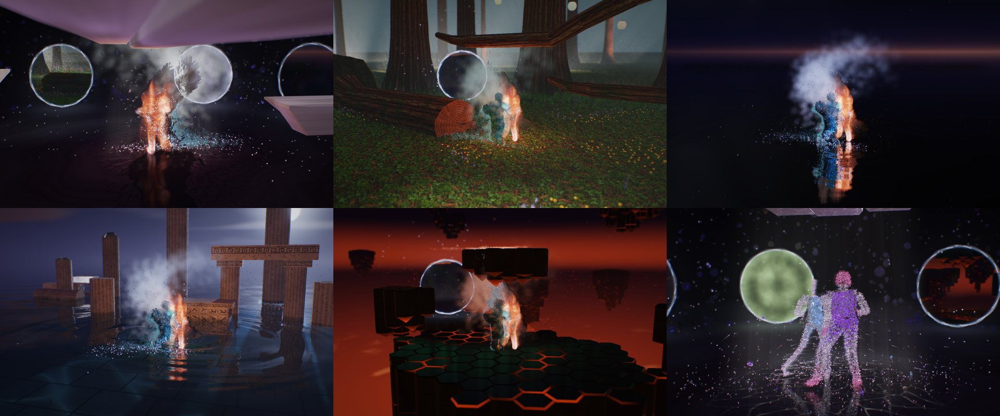

# The light budget: one uniform for the worlds' light

Branch `worktree-agent-af8534c3ec2356fca` (commits on top of `8086e12`; not pushed or merged).

The worlds' shared light group (bind group 2) took one uniform buffer per world plus one for the fire's light: six
uniforms in every stage of every lit shader. It now takes **one**, however many worlds there are. Every shader stage
is counted against WebGPU's baseline by `npm test`. `?baseline` runs the game with only the default limits, and every
world draws under it. The picture is unchanged within the run-to-run noise, and the GPU time is unchanged.

Measured: `npm run typecheck`, `npm test` (all of it), `vite build`, the binding check, and headless stills on the
RTX 5090, captured from production builds served by `vite preview` on port 5394: before ×2 and after ×1 (same steps)
plus a full `?baseline` run. Each capture also recorded GPU timings for the fire and water pair in the geode and the
redwoods. Not measured: a real phone or laptop with baseline limits, missing optional features (see weak points),
anything by ear.

## The layout, and how a view gets its world's light

`src/worlds/light.wgsl`:

```wgsl
struct WorldLight {
  fire: FireLights,   // the dancers' fire (and plasma, its violet form)
  geode: Geode,
  forest: Forest,
  pool: Pool,
  temple: Temple,
  forge: Forge,
}
@group(2) @binding(0) var<uniform> worldLight: WorldLight;
@group(2) @binding(1) var poolWaves: texture_2d<f32>;
@group(2) @binding(2) var templeWaves: texture_2d<f32>;
```

- Each world's struct is unchanged. It is now a member of WorldLight, called its **slot**. The world's shaders read
  it as `worldLight.geode.key` and so on: 349 references were renamed mechanically in the code, not in comments.
- On the TypeScript side, `worlds/shared.ts` makes one `UniformBuffer<WorldLight>` per kit. `lightSlot(kit, 'geode')`
  returns a `LightSlot` whose `set({...})` writes only that member, in place, in the buffer's CPU copy. weft uploads
  the whole buffer (3,488 bytes) once per `kit.run`. The fire kind takes `lightSlot(kit, 'fire')`
  (`matter/fire/lights.ts`); plasma rides in that same slot, as before. `World.shared` now holds only textures.
  `shareWorldLight` names no world.
- **Per view.** A uniform holds one value per run. That value now holds every world's slot, each written once a frame
  by its own world (`main.ts` updates every world some live view shows). A view drawing world W runs pipelines
  compiled with `WORLD = W.light`, which read only slot W. So the main view of the geode and a gate's view of the
  redwoods, drawn in the same run, read two slots of one buffer. They need no per-view copy and no change to
  `engine/views.ts` or `scene.ts`.
  - I chose this over "the current view's world in a common layout plus an extension area". That layout would have
    each world unpack its own fields from raw vec4s by offset, which breaks the project's rule 3 (no byte offsets).
    It would also need a copy of the buffer per view, and a group-2 bind group per view, which a shared group can't
    give.
  - The cost: the one buffer's size grows with the worlds (about 0.2 to 1.5 KiB each), up to the baseline's 64 KiB
    per uniform binding. The check enforces that cap.
- World light selection per pipeline is unchanged (`override WORLD`, `constants: { WORLD: world.light }`).
- `?baseline` is new: `src/engine/baseline.ts` holds WebGPU's default values for every limit weft would raise, and
  `main.ts` passes them to `createKit({ limits })`.

## The budget per stage (`node scripts/check-bindings.mjs --table`)

The check compiles every `.wgsl` under `src/` with weft's own build step (`@ericrius1/weft/wgsl`, the same includes
and reflection the Vite plugin uses). It then counts each entry's pipeline layout the way weft's binder builds it:

- group 0 is in every stage: 2 uniforms and 4 samplers;
- a shared group (`kit.shareGroup`) counts whole, in every stage, once any entry uses any of it;
- a shader's own bindings count only in the stages that use them.

It fails on any stage over 12 uniform buffers, 8 storage buffers, 16 sampled textures, 4 storage textures or 16
samplers, on 4 bind groups, or on a uniform struct over 64 KiB. It also fails if a `kit.shareGroup` appears that it
doesn't know about. It runs in `npm test`, after the limits check. Lowering the uniform limit to 6 in a copy of the
check made it fail on the two stages at 7, as expected.

Uniform buffers per stage, before and after (vertex / fragment, or compute):

| shader | before | after |
|---|---|---|
| matter/reactions/steam_draw | **12** / 11 | 7 / 6 |
| matter/gems/draw | 10 / **11** | 5 / 6 |
| matter/ice/shards | 11 / 9 | 6 / 4 |
| matter/water/drops | 11 / 8 | 6 / 3 |
| worlds/redwoods/grass | 11 / 11 | 6 / 6 |
| matter/water/surface | 8 / 9 | 3 / 4 |
| post/air, every world draw | 8 / 8 | 3 / 3 |
| matter/gems/sim (not lit) | 7 | 7 |

The brief counted the gems' draw at 12 of 12 from its declarations. Counted the way weft lays the pipeline out, the
gems' fragment stage was at 11 and the steam's vertex stage at 12. The full table, with storage buffers, textures and
what is left, is in AGENTS.md under "The binding budget".

What is tight now is **storage buffers**: the gems' sim and cull use 7 of 8. Uniforms peak at 7 of 12. Every lit
stage pays 2 sampled textures for the two water worlds' ripples, and each new water world adds one; the most any
stage uses is 5 of 16.

## The baseline run (`?baseline`, 900 frames per world, then a still)



`docs/reports/media/3-baseline-all.jpg` shows the geode, redwoods and pool on the top row, and the temple, forge and
geode hub on the bottom. The first five are the fire and water pair after 900 frames; the hub is the default couple,
700 frames.

Each page logged its device limits, `bend.stats().failed` and `.errors`:

- Every page logged `maxUniformBuffersPerShaderStage 12`, storage 8, sampled textures 16, storage textures 4,
  uniform binding 65,536, storage binding 134,217,728, workgroup storage 16,384, invocations 256.
- `failed: 0` and `errors: []` on all six pages.
- No page errors and no WebGPU validation warnings. The only console lines were Chrome's `powerPreference` notice
  and my own CHECK lines.
- Live gate views: the geode had the pool and redwoods gates live, the redwoods had three, and the forge had three.
  The hub had the temple and forge gates live.

So every world, with a fire dancer and a water dancer, and the hub with live gates, compiles and draws on default
limits.

One finding: the first build of the packed version passed reflection, the build and typecheck, but **Chrome refused
three shaders**. There were two causes:

- I had named the uniform `light`, and two redwoods shaders already have a function called `light`.
- The rename missed one bare reference, `let L = geode;` in the geode's studio.

Both are fixed (the uniform is `worldLight`), and the second commit records them. The binding check reflects the
WGSL but does not validate it, so only a browser run catches errors like these. That is what `?baseline` stills are
for.

## Pixel parity

The game is not deterministic run to run. Each capture opens a page that runs real-time frames before stepping, and
the dances and the music clock follow that real time. Two captures of the *before* build, with the same steps and
the film grain turned off (`post.grain = 0`), already differ in dancer poses, particles and the forge's bobbing
slabs. So the comparison is before against itself (the noise) next to before against after. Pixels count as
differing when any channel differs by more than 2, 8 or 32 out of 255, at 1280×800:

| still | before a vs before b: mean, >8 | before a vs after: mean, >8 | before b vs after: mean, >8 |
|---|---|---|---|
| wide-geode | 4.25, 10.1 % | 1.54, 3.8 % | 4.12, 9.9 % |
| wide-redwoods | 5.03, 15.2 % | 4.87, 14.5 % | 1.99, 4.1 % |
| wide-pool | 1.39, 2.8 % | 1.84, 3.9 % | 1.76, 3.7 % |
| wide-temple | 3.95, 9.9 % | 4.34, 11.2 % | 3.07, 7.5 % |
| wide-forge | 7.13, 11.6 % | 3.44, 9.6 % | 8.53, 15.3 % |
| hub | 12.00, 21.2 % | 13.92, 23.6 % | 15.79, 26.2 % |

Every after difference is within the range of the before-against-before noise; in the geode and the redwoods the
after still is closer to one of the before stills than the two before stills are to each other.

Looked at as difference images (`media/3-parity-geode.jpg`, `3-parity-forge.jpg`: before, after, the noise, the
after difference), the differences lie on things that move:

- the dancers' particles, the steam and the gems' spare stones;
- the edges of the forge's slabs, which bob with the music's real-time clock (thin outlines, not filled areas);
- the ripples in the temple's water;
- the far world seen through a gate.

None lies as a flat change over static lit surfaces such as floors, walls, the sky or the shelves, which is where a
change in the light would show.

The change cannot alter the arithmetic: every shader reads the same values from the same struct layouts (each
member keeps its own size, and every struct is a multiple of 16 bytes, so no offset inside a struct moves), and only
the global's name changed. I have not proven exact equality pixel for pixel; that would need a deterministic
capture, which the project does not have.

## GPU timings (RTX 5090, 1280×800, render scale 1, 150 stepped frames after 900 of dancing)

| run | geode: frame / scene / scene.gate1 | redwoods: frame / scene / gates (0+1+2) / air |
|---|---|---|
| before (grain on) | 4.102 / 1.974 / 0.987 | 3.746 / 1.868 / 0.871 / 0.348 |
| before 2 (grain on) | 4.281 / 2.074 / 1.050 | 3.796 / 1.884 / 0.871 / 0.347 |
| before a | 4.511 / 2.406 / 0.973 | 3.876 / 1.910 / 0.882 / 0.348 |
| before b | 4.205 / 2.122 / 0.978 | 3.881 / 1.927 / 0.880 / 0.348 |
| **after** | 4.398 / 2.269 / 0.941 | 3.866 / 1.928 / 0.871 / 0.348 |
| after, `?baseline` | 4.237 / 2.171 / 0.957 | 3.932 / 2.005 / 0.861 / 0.349 |

The timings are unchanged: after sits inside the spread of the four before runs (geode frame 4.10 to 4.51 ms,
redwoods 3.75 to 3.88 ms). The spread comes from the dancers' fill, which varies with their poses.

## What a new world must now do

The `src/worlds/<name>/` folder:

1. `index.ts` registers it.
2. Its World takes its light with `this.u = lightSlot(ctx.kit, '<name>')` and writes it with `this.u.set({...})`.
3. `shared` is `{}`, or holds its textures (a water world's ripples).
4. Its `.wgsl` declares `struct <Name>` and its functions, which read `worldLight.<name>.<field>`.

In `src/worlds/light.wgsl`, the one file outside the folder (WGSL has no registry):

1. Add its `#include`.
2. Add `<name>: <Name>,` as the next member of `WorldLight`.
3. If it has a texture, add it at the next binding.
4. Add its `WORLD` case in each function.

Nothing in `worlds/shared.ts`, `world.ts`, `engine/` or `main.ts` changes. `npm test` fails if the new world pushes
any stage, or the uniform's size, past the baseline. `docs/extending/world.md` says exactly this.

## Weak points

- **The uniform's byte size grows with the worlds.** The buffer count stays at one, but each world adds its struct:
  3.5 KiB now, against a 64 KiB cap (about 40 worlds the size of the redwoods). The whole buffer is uploaded every
  frame because some world writes its slot every frame. That is 3.5 KiB, which is negligible.
- **Water worlds still add a texture each to every lit stage** (5 of 16 at most now). The fix, if it ever matters, is
  one `texture_2d_array` of ripple fields; I didn't do it because it changes the ripples' simulation targets.
- **`?baseline` lowers limits, not features.** weft still asks for `float32-filterable`, `rg11b10ufloat-renderable`,
  `timestamp-query` and the rest where the adapter has them. A phone without one of these could still fail where the
  5090 doesn't. Testing that needs an adapter wrapper that hides the features.
- **The check is an upper bound for render shaders.** It counts a file's shared groups in all of its render entries,
  because which vertex and fragment entries pair is decided in TypeScript. It reflects but does not validate WGSL, as
  the name clash above showed; only a browser run catches those errors.
- **Firelight is still the main view's** (open item 11 of the integration report). A gate's view of another world
  reads the same `fire` slot, which holds the dancers' lights from the main world. That behaviour is unchanged.
- `npm test`'s real-time net test (`test/smoothness.test.ts`, "B: tracks the source in real time") failed once with
  rms 0.060 while the GPU was busy with captures. It passed when rerun alone: it skips its tracking check when the
  machine is too loaded. My change doesn't touch it.
- The integration report's own wide-still step files weren't committed. I rebuilt them from that session's
  scratchpad: the director's free camera at the same yaw, pitch, distance and height (6.8 m in the geode, 8.5 m
  elsewhere). The steps are not committed here either; they are plain `scripts/shot.mjs` steps.

## Files

- **Light:** `src/worlds/light.wgsl`, `shared.ts`, `world.ts`; each world's `*.ts` (the slot) and `*.wgsl` (the
  renamed reads).
- **Fire:** `src/matter/fire/lights.ts`, `light.wgsl` (comment) and `fire.ts` (the slot's type).
- **Baseline:** `src/engine/baseline.ts` (new), and `src/main.ts` (the `?baseline` flag).
- **Test:** `scripts/check-bindings.mjs` (new) and `package.json`.
- **Docs:** `AGENTS.md`, `docs/extending/world.md`, and this report with `docs/reports/media/3-*.jpg`.
- The generated `*.d.wgsl.ts` files were rewritten by the build.
